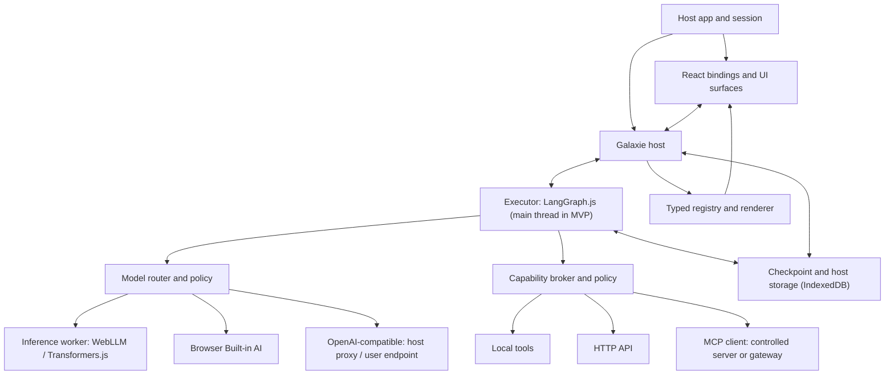
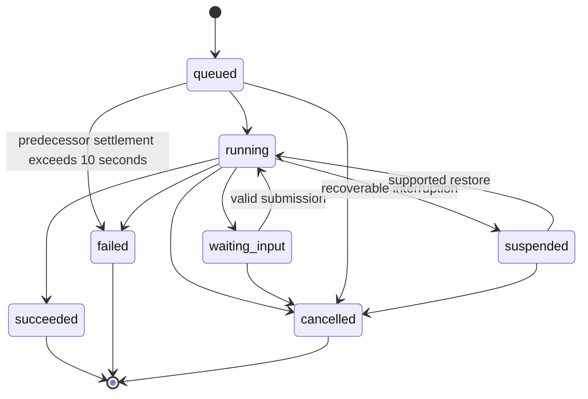
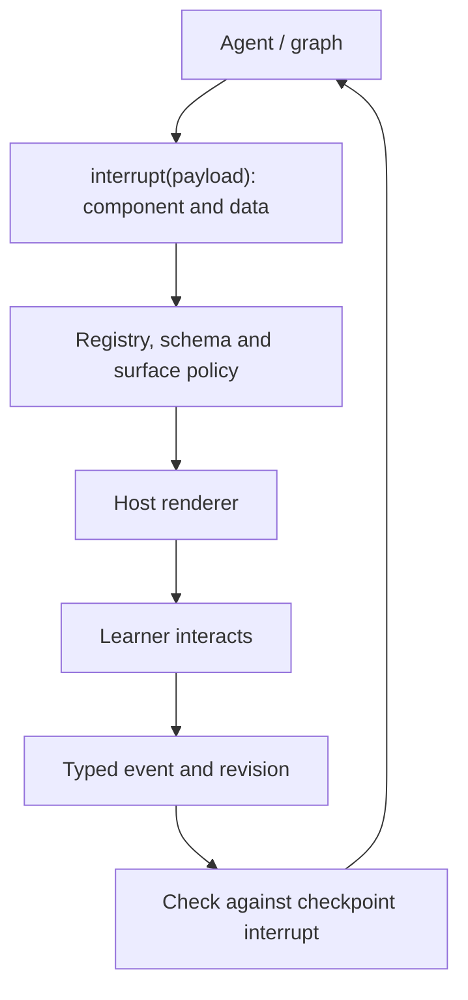

# galaxie — Browser-first Agent Runtime

> Project brief, proposed architecture and implementation contract.

- **Project name:** `galaxie`.
- **Document version:** 0.3. A starting point for implementation and critique, not a specification validated by code.
- **Date:** 2026-10-28, timezone Asia/Ho_Chi_Minh.
- **Language:** English.
- **Status:** four M1 slices implement the core lifecycle, LangGraph.js adapter, capability broker, model router with mock providers, sticky data labels and argument shapes, in-memory interrupt dispatch and resume, and finite step/tool-call/wall-clock/payload/token/cost budgets. The M1 exit controls add interaction URL policy and opt-in trace text filtered by live labels and destination, with twelve parity cases and additional Node/Chromium guarantee tests. Durable persistence and UI remain unimplemented. Three throwaway spikes have run (§16.2).
- **Scope:** an SDK/runtime for developers, and the framework-neutral contracts it defines for browser agents (§7.6). The English Tutor is the reference application, not the whole product.
- **Companion documents:** [framework overview](framework-overview.md) (role, direction, audiences, production readiness, public vs private) and [ADRs](adr/README.md).

## 0. Read this before writing code

**Galaxie is an environment for installing, running and managing AI agents as first-class entities inside a web application: they have identity, state, lifecycle, capabilities and an interactive UI.**

It packages agent pipelines (a single agent, a multi-agent system, or the harness around them) so that they run on the user's own device, in the browser. The developer deploys no agent backend and no container for the orchestration. The app's backend keeps its APIs, MCP servers, databases and tools.

Agent logic and the LLM can run entirely in the browser, using WebGPU on the user's device. When policy allows, an agent can also call HTTP APIs, MCP servers or other models: a model built into the browser, a model server on the user's machine, or a remote API. Developers write agents with LangGraph.js or another compatible engine and integrate them through an adapter. They do not have to learn a new graph DSL.

The verdict on galaxie is parity: LangChain and LangGraph code behaves in galaxie as it does natively on a server, and every difference is listed with its reason (§0.2, item 12).

An agent can present UI by choosing from a component catalog the application has registered: Quiz, Flashcard, Feedback, AudioRecorder and so on. The LLM supplies data and display intent. The application's trusted renderer owns the DOM and the event handlers. An agent can also provide data to the app and ask it to act, for example to navigate, through capabilities the host binds (§11.2).

### 0.1. Decision labels

- **[VISION]:** product direction stated by the founder.
- **[PROPOSED]:** the working default for architecture or scope. An ADR with reasons and evidence can replace it.
- **[OPEN]:** needs a spike, benchmark or product decision before committing.
- **[INVARIANT]:** a correctness, security or honesty constraint. It must not be silently dropped to make a demo work.

API and package names in examples are **sketches**, not real APIs or registered npm names. Implementers must check the APIs of dependencies at the pinned versions.

### 0.2. Key architectural conclusions

1. Do not build a second LangGraph in the MVP. Run LangGraph.js itself in the browser through an adapter. [ADR-0001]
2. TypeScript-first for the SDK and host integration. WASM is an optional execution or isolation target, not a requirement for every agent. [ADR-0013]
3. The MVP runs only JS/TS agents that the developer trusts and bundles into the application. It does not run arbitrary marketplace code behind a sandbox promise. [ADR-0002]
4. Agent execution, model inference and tool/data access are three separate axes. Being local on one axis says nothing about the others.
5. Agent-driven UI goes through a component catalog, schemas and named actions, never through arbitrary HTML or JS.
6. Resuming from a checkpoint does not mean running 24/7, permanent storage or exactly-once HTTP side effects.
7. The core proof: **the same tutor package runs in two host apps with different data bindings; a reload in the middle of a quiz restores the same quiz and the pending interaction; and at least one step uses per-user data, where local inference earns its place.**
8. Where a model runs is decided per model role, not by one global switch. Every option passes through policy, and the UI shows where the data goes. [ADR-0006]
9. In the MVP the executor runs on the main thread. WebLLM or Transformers.js inference runs in a worker. Built-in AI is called from the page, because the Prompt API is not available in workers. [ADR-0003]
10. For pending interactions, the interrupt payload in the LangGraph checkpoint is the source of truth. A durable submission inbox closes the crash window between accepting an answer and resuming. [ADR-0004]
11. A model that prompt injection has fully taken over can act only within what the host granted to that run:
    - approved capabilities;
    - approved destinations;
    - approved argument shapes;
    - the run's data labels.

    Significant writes need a confirmation bound to their exact parameters. These limits are bounded and testable; they are not a promise of "no harm". The security baseline in §9.7 is a release condition. [ADR-0012][ADR-0014]
12. **The verdict is parity.** Code written with LangChain and LangGraph runs in galaxie the way it runs natively, for example in Node inside a Docker container. A conformance suite runs the same graphs with a deterministic fake chat model on Node and in Chrome, and compares stream events, state, checkpoints, interrupts and resume. A difference is fixed, or listed in the compatibility matrix with its reason. Accuracy and system metrics are demonstrations, never pass/fail gates: they depend on the model, the tools and the pipeline the agent builder chooses. [ADR-0016]
13. **Traces are OpenTelemetry spans.** galaxie filters every value it records in them, and data labels apply to span content as they do to any outbound call. galaxie never exports spans itself: the host registers the exporter, for example to Langfuse during development. [ADR-0016]
14. **The contracts are a framework-neutral standard.** LangGraph.js is the first framework behind them, not the only one. They reuse open protocols (MCP, OpenTelemetry, JSON Schema, the OpenAI-compatible wire format) and specify only what no protocol covers. [ADR-0017]

## 1. Vision and product hypotheses

### 1.1. Founder vision [VISION]

- Agents become a natural part of web apps, the way routers, state management and data-fetching layers are today.
- **No agent backend.** galaxie packages an agent pipeline (a single agent, a multi-agent system, or the harness around them) into the web app, and the pipeline runs on the user's machine. The developer deploys no orchestration server and no container for it, so orchestration costs the developer no servers. The developer's work stays on the backend: APIs, MCP servers, databases and tools.
- **The user's device does the work it can.** Many devices are powerful. Some have a model built into the browser or the operating system, some users run their own model server, and some users want their data to stay on the device. Each model role uses what the device offers, under the host's policy (§3, §10).
- **Feature parity with a server stack.** Building an agent on galaxie should feel no different from building it on a server with an inference engine or a retrieval pipeline, within what the device and the browser support.
- **Lower running costs for small organizations.** A small company's customer-care assistant or a school's question-and-answer bot can run on its visitors' devices instead of on rented servers. When the documents may be public, the retrieval index can ship with the app (§1.4).
- **Parity with native LangChain and LangGraph.** Developers keep their LangChain/LangGraph code, and it behaves as it does natively on a server, for example in Node inside a Docker container (§18).
- One or more agents can cooperate, with many nodes, branching, loops, subgraphs and complex state machines.
- **One environment for models and tools.** Agents use a local LLM through WebGPU, a model built into the browser, a model server on the user's machine or a remote API, and they reach MCP servers and HTTP APIs, all under one policy. Calling agents that run elsewhere may come later (§16.8).
- Agents use data within the permissions the host app and backend grant. This is like a frontend calling an API, plus agent-specific policy.
- **Agents work with the app's UI.** An agent drives an assigned UI region with the app's own components and LLM-generated data, provides data to the app, and gives directives such as navigating to a page, through capabilities the host defines (§11.2).
- **Configuration and context through the web.** Agent settings, model choices, prompts and context are managed in the web app, not in a daemon or a file on the user's machine. In the MVP the host sets them in code; a web console is not scheduled until its scope is settled (§20, question 5).
- **Development tracing.** During development, galaxie exposes run data as traces, so a tool such as Langfuse shows the order of steps and where the time went (§14.4).
- **A standard for browser agents.** galaxie defines how browser agents communicate, the protocols they use, the security rules and the layers. The standard is framework-neutral, so LangChain, LangGraph and other frameworks can implement it (§7.6).
- Agents, skills, plugins and integrations can be shared, reinstalled, configured and reused.
- Runtime assets such as WASM modules and model weights load from a CDN or object storage the host chooses, such as an S3 bucket, with pinned hashes (§3.2, §5.4).
- Adding an agent should feel as simple as adding a library. End users should not need to install a daemon or a desktop app.
- Users who already have an LLM API or endpoint should be able to plug it in; a local model on WebGPU stays available as an option.
- Possibly later: a web app hands tasks to an agent the user already runs on their machine, such as Codex CLI or Claude Code, to coordinate work and cut the host's API costs. This is an idea on the watch list, not a commitment (§16.8).

### 1.2. Concrete product [PROPOSED]

A **Browser-first Agent Runtime SDK**. Inside it: an agent host/harness, executor adapters, model services, a capability broker, persistence, declarative UI integration and development tracing. Its contracts are published as a framework-neutral standard (§7.6).

Product message:

> Build, share, and run stateful AI agents inside your web application — with local inference, application tools, and interactive UI.

"React for agents" is a metaphor for developer experience. "Docker for agents" is a metaphor for packaging and reuse. Neither promises an API or an isolation level equal to the original product.

### 1.3. Hypotheses to test [OPEN]

- Do developers actually want a client-side runtime, or just a chatbot wired to a backend?
- Do the privacy, latency or cost benefits of local inference outweigh model download, latency, battery and device support costs?
- Can an agent package be reused across apps without changing its logic?
- Do developers value lifecycle, recovery and tool binding more than a thin `graph.invoke() + useAgent()` wrapper?
- Is a small model good enough for a given task, such as explaining mistakes in Vietnamese? galaxie records demonstrations; the agent builder decides (§18).
- Will users accept downloading a model per website, or only a model the browser manages?
- If the platform moves towards "the agent belongs to the browser and websites only expose tools" (WebMCP, Prompt API), does an agent embedded in the app still have a reason to exist? [S18][S19]

The existence of WebGPU or the hype around AI agents is not evidence of product-market fit.

### 1.4. Example deployments [VISION]

These show where the hypotheses in §1.3 would pay off. None has been built.

**Customer care for a small company, or questions and answers for a school.** The assistant answers from documents that may be public, such as product guides, policies, or admissions and course information.

- The host builds the retrieval index (a vector index) when it builds the app, and serves it with the app's other assets from a CDN or object storage. An embedding model and the search run on the visitor's device.
- Documents that change often, or that must stay private, stay on the backend. The host binds a search capability to them instead (§9.2).
- Each model role runs where the host's policy allows: in the browser, in a model built into the browser, or on a cloud model (§10.3).
- The organization pays for no orchestration or inference servers. It still serves the static assets, pays for any cloud model and runs the backend parts it keeps.
- Every visitor downloads the index, and the documents' content travels with it; that is why the index is only for public data.
- A local model is a large first download: B0 downloaded about 1.4 GB for a 1.7B model. A model built into the browser, or a cloud model, may suit visitors who come once (§3.2).

**A voicebot for the same uses**, once voice ships (§4.4, Phase 5 in §16.7).

## 2. Boundaries: what galaxie does and does not do

| Layer | Responsibility |
| --- | --- |
| Agent authoring framework | LangGraph/LangChain or hand-written code describing the workflow, reasoning, nodes and tools |
| Agent execution engine | Executes that engine's graph semantics, reducers, branching and interrupts |
| **Galaxie host/harness** | Identity, lifecycle, resources, model/tool bindings, permissions, persistence integration, UI surfaces, packaging and trace spans; the framework-neutral contracts between these layers (§7.6) |
| Inference engine | Runs a model on WebGPU/WASM or through a selected provider |
| Host application | Main UI, design system, login session, data and business rules |
| Backend/API/MCP | Provides services; authenticates and authorizes on the server |

### Non-goals of the MVP [INVARIANT]

- Not a new LLM or inference engine.
- Not a compiler that turns any Python/Node application into WASM.
- Not a Linux container in the browser.
- Not a LangGraph clone with its own graph semantics.
- Not a new agent-authoring framework. The standard in §7.6 is the contract between frameworks and the host; agents are still written with LangGraph or another framework.
- Not a public agent marketplace before the runtime is trustworthy.
- No guarantee of continuous background execution when the tab closes, the browser suspends or the device sleeps.
- Removes the agent backend, not the business backend: the host still runs its APIs, pays for external APIs and remote models, and authenticates users.
- Does not judge the quality of an agent's answers. Accuracy depends on the model, the tools and the pipeline the agent builder chooses; galaxie records it only as demonstrations (§18).
- Does not turn an agent into a good tutor through a system prompt alone.
- Never lets an LLM inject executable DOM or JavaScript into the application.
- Frontend state is never authoritative evidence for exam scores or transactions.
- Never executes code generated by an LLM.
- Not designed or certified for high-risk, regulated uses: moving money; decisions about people's credit, insurance, employment, admission or official grades; core systems of financial institutions; medical or safety-critical decisions. A host that uses galaxie there owns the risk and the compliance. The [README](../README.md#intended-use-and-disclaimer) states this publicly.

## 3. Three execution axes and the data policy

These three axes must be described separately in the API, the UI and the docs:

| Axis | Local example | Remote example |
| --- | --- | --- |
| Agent execution | LangGraph.js in the page | A Python agent on a server |
| Model inference | LLM on the client's WebGPU | Cloud model API, or the user's own endpoint |
| Tool/data access | A user-picked local file, a local lesson, local search | HTTP API, vector service, MCP server |

**A browser-local agent with WebGPU inference can still send data out through tool calls.** Never label something "your data never leaves your device" while tools send queries, learning content or audio to remote services.

### 3.1. Destination classes

Inference policy is an allowlist of **destination classes**, set **per model role** (for example `quiz.generate` and `tutor.feedback`), not one value for the whole app. [ADR-0006]

| Destination class | Examples | Label shown to the user |
| --- | --- | --- |
| `in-browser` | WebLLM, Transformers.js, Chrome Built-in AI | "Runs in your browser" |
| `user-device` | Ollama or LM Studio on `localhost` | "Runs on your computer" |
| `user-endpoint` | An endpoint the user configured (self-hosted vLLM, OpenRouter, a company gateway) | "Sent to the service you configured" |
| `host-server` | The application's own proxy or backend | "Sent to this app's server" |
| `third-party` | An external provider reached through the host proxy | "Sent to <provider> through this app" |

- The `local-only` preset means `in-browser` only. No silent fallback to another class.
- The `remote-allowed` preset means the classes the host configures and policy approves.
- The UI always shows the destination class in use, in words the user understands.
- A destination class describes the **final recipient**, not the first hop. A host proxy that forwards to an external provider is `third-party`, not `host-server`. The host declares this when it configures the provider, and the label shown to the user follows it.
- Egress policy is separate for each capability. The inference choice never implies network permissions for tools.
- Destination classes alone do not protect data across roles: learner text in graph state could reach another role or a capability. Run-level data labels (§3.3) close that gap on SDK-controlled paths.

### 3.2. Data policy

- Downloading weights or runtime assets is different from sending user data. Show the estimated size and ask for consent before a large download.
- Downloading weights from a third party is still egress: WebLLM's prebuilt model list points to Hugging Face and GitHub, so the user's IP and timing reach those parties. Production hosts should serve weights and runtime assets, WASM included, from their own origin, a CDN or object storage such as an S3 bucket, with hash checks.
- Claim offline mode only when the app shell, the model and the required assets are present and the workflow needs no remote tool.
- When hardware or a capability is missing, say so clearly. Never pretend to run locally.
- Browser storage is partitioned by origin, so every website that uses WebLLM or Transformers.js makes the user download weights again. This is a core risk to the vision, not an optimization detail. Sharing within one host runtime comes first. A browser-managed model (Built-in AI) is the only existing path to cross-site sharing. [ADR-0006]
- Built-in AI runs on the device, so it belongs to `in-browser`. The host does not control its model or version, and the API does not expose a version. Its descriptor says `browser-builtin`, CI re-runs its smoke tests on the current Chrome stable and beta channels, and the host can disable the provider (§10.5).

### 3.3. Data labels and argument shapes [PROPOSED] [ADR-0014]

**Data labels.**

- Schemas mark fields with a data label:
  - `public`: lesson content, catalog text;
  - `app`: application data read under the user's permissions;
  - `private-user`: the learner's own text or audio.
- The runtime attaches labels when data enters a run, from UI event schemas, capability output schemas and input schemas.
- A run carries every label it has read. Labels are sticky: they are never removed during the run.
- Host policy gives each label the destination classes it may reach. For example, `private-user` may reach only `in-browser`.

**Enforcement on every outbound call from a labelled run.**

- **Model calls.** The provider's destination class must be allowed for every label the run carries. Otherwise the call is blocked, or it needs consent if host policy allows that.
- **Capability calls with free-text arguments.** Arguments declared `freeText` follow the same rule as model calls.
- **Span content.** Text the host opts in to record in trace spans (§14.4) follows the same rule, against the destination class the host declares for its traces. Text whose labels allow only `in-browser` never enters a span.
- **Capability calls with structured arguments.** IDs, enums, numbers, booleans and short bounded patterns pass. They cannot carry a sentence verbatim. They remain a low-bandwidth channel, which is documented.
- **Verbatim-match guard.** As an extra check, outbound request bodies are scanned for registered `private-user` values.
- **Per-role policy** (§3.1) only narrows what labels allow. It never widens it.

**Limits.**

- Labels cover SDK-controlled paths only: the model router, the broker and galaxie's own spans. Host code that calls `fetch` itself is outside them.
- A paraphrase of private data sent to an allowed destination is not detectable. This is the residual risk of "exfiltration through an allowed endpoint" (§9.6, scenario 14).

**Effect on the tutor.**

- After step 9 the run carries `private-user`, so no later model call in that run can go remote.
- `progress.save@1` still works, because its arguments are structured (`lessonId`, `score`, `completed`).
- A host that wants remote quiz generation after the writing step starts a new run.

## 4. Reference application: English Tutor

### 4.1. Context

An English-learning website already has users, a curriculum and an API that stores progress. The developer wants an interactive tutor without building a separate agent backend.

Galaxie does not own the curriculum. The tutor package receives lessons and context through capabilities the host binds. Retrieval, if needed, can use a search API, a local index or a remote vector service. Do not build RAG or a vector database by default when reading one lesson by ID is enough.

### 4.2. MVP vertical slice [PROPOSED]

1. The learner opens a lesson and starts practicing.
2. The tutor calls `lessons.get` through a capability the host bound.
3. The graph uses the model role `quiz.generate` to produce a short quiz that matches a schema and the lesson content.
4. The runtime validates the structure. The tutor commits the final quiz and answer key into execution state.
5. The graph pauses with an interrupt that carries the quiz display payload. The checkpoint is written, and the host renders `Quiz` in the `lesson-main` surface.
6. The learner picks answers. Selecting and deselecting is normal UI work and never calls the LLM per click.
7. On submit, the host sends a typed event with identity and revision to the right agent, run and interaction.
8. Deterministic code grades the multiple-choice answers using the committed answer key. The LLM may explain mistakes and pick the next activity.
9. The learner writes one free-text sentence applying the grammar point. The model role `tutor.feedback` reviews it against the lesson rubric. The sentence is labelled `private-user` (§3.3) and the role defaults to `local-only`. Together they mean no SDK-controlled path sends the sentence outside the browser, and AT-04 checks this with a network capture.
10. `Feedback` and `Progress` are shown; progress is stored through the matching capability.
11. A reload at step 5, step 6 or while waiting for the sentence must restore the pending interaction. Calling the LLM again to make a different quiz is not recovery.

**Why step 9 exists.** A quiz generated from a shared lesson is the weakest case for local inference: a server can generate it once and cache it for every learner at almost no cost. Step 9 uses data that belongs to one learner and cannot be pre-generated, so it is the step that actually tests the privacy, latency and cost hypothesis in §1.3. It is also where the reference app shows how a small model handles explanations in Vietnamese, recorded as a demonstration (§18).

Local grading is acceptable for practice. For real exams or certification, the client can be modified or inspected, so the backend must verify the score and store the authoritative result.

### 4.3. Reuse across two applications

Same tutor package, same graph logic:

- Host A binds `lessons.get` to a lesson fixture or local store.
- Host B binds the same capability to an HTTP API using the current session.
- `progress.save` can bind to a local practice store or a business API.
- Each host can provide a different renderer for the same catalog contract.

The agent package never hardcodes URLs, bearer tokens, tenant IDs or database connections.

Two hosts in the same monorepo, written by the same team, only prove that dependency injection works. The real cost of reuse is that every host must write a renderer for every catalog component in its own design system. Therefore:

- Each catalog ships headless, unstyled reference components that a host can use immediately and theme later. [ADR-0007]
- The capability contract (logical name, schema, version) is the reuse "port". The agent declares it in code; host bindings are type-checked at build time and validated at runtime. [ADR-0008]
- The reuse claim counts as validated only after a developer outside the team integrates the package into an existing app (metric in §18).

### 4.4. Voice is the next milestone

- ASR, TTS and pronunciation assessment are capabilities or model services, not three LLM agents by default.
- Start with push-to-talk. Full duplex, barge-in and continuous listening need their own latency, resource and lifecycle work.
- A transcript is not enough to grade pronunciation, stress or prosody. Pronunciation assessment needs audio evidence and a system evaluated for that purpose.
- The browser microphone permission, the agent's permission to read audio and the permission to upload audio are three separate decisions.
- Do not assume the Web Speech API runs locally; check the specific implementation and mode.
- Teaching quality needs lessons, rubrics and evals, not just valid JSON. That is the tutor author's work; galaxie does not score it (§18).

## 5. MVP scope and what comes later

### 5.1. In MVP v0.1 [PROPOSED]

- A headless TypeScript runtime, browser-first, with no React dependency in core and no LangGraph type in its contracts. [ADR-0017]
- One LangGraph.js adapter with a pinned, tested version set. [ADR-0001]
- A parity conformance suite: the same graphs on Node and in Chrome, with every difference in the compatibility matrix (§16.3, AT-15). [ADR-0016]
- Development tracing: OpenTelemetry spans that hold only what galaxie's filter and the data labels allow; the host registers the exporter (§14.4). [ADR-0016]
- Executor on the main thread; local inference in a worker. [ADR-0003]
- Model providers [ADR-0006]:
  - one in-browser engine, the one Spike B picks before M2 (§16.2);
  - Chrome Built-in AI (Prompt API) where available;
  - an OpenAI-compatible remote provider in two modes, host proxy and user endpoint;
  - a deterministic mock provider for CI.
- Per-role model routing, destination labels in the UI, and first-run provider order with consent.
- A capability broker with logical names, schemas, cancellation and host bindings; deny by default.
- A real HTTP API capability.
- An MCP client over Streamable HTTP, connecting only to a server or gateway the project controls. Each tool is allowlisted and its definition is pinned. [ADR-0011]
- Run-level data labels and argument shapes for capabilities. [ADR-0014]
- IndexedDB persistence: a LangGraph checkpoint saver, a submission inbox and host records. [ADR-0005]
- A React adapter and one typed component registry for `Quiz`, `Feedback`, `Progress` and `WritingPrompt`, with headless reference components. [ADR-0007]
- Recovery of interrupt-based human interaction, rejection of stale events, and reload recovery. [ADR-0004]
- Code-first agent definition with versioned capabilities; the build generates the manifest JSON. [ADR-0008]
- Multi-tab ownership through Web Locks. [ADR-0009]
- The security baseline in §9.7, including a prompt injection test corpus in CI. [ADR-0012]
- The reference tutor working with two host bindings without changing the graph.
- One test graph with branching and a subgraph, so the runtime does not shrink into a single-turn chat wrapper.

### 5.2. Outside the MVP

See ADR-0010 for the cuts and the reasons, and §16 for when each item comes back.

- Installing and running arbitrary agents from any URL with sandbox guarantees.
- Universal Python compatibility or a LangGraph-to-WASM compiler.
- Marketplace, billing, a proprietary registry or community ratings.
- OCI distribution or the WASM Component Model as requirements.
- A visual graph editor or a dedicated IDE.
- Several UI renderers or framework adapters at once.
- Executor adapters for frameworks other than LangGraph.js. The contracts stay framework-neutral so that they can come later (§7.6).
- Building A2UI, AG-UI and a third UI DSL at the same time.
- Distributed multi-agent coordination, calls to agents that run elsewhere (§16.8), cross-device resume and always-on scheduling.
- Local model training or LoRA fine-tuning. The MVP configures prompts, skills, bindings and model selection only.
- A web console for agent settings, model choices, prompts and context. The host sets them in code; the console's scope is open (§20).
- Full-duplex voice, authoritative pronunciation scoring and every kind of multimodal input.
- Support for every browser, mobile device or GPU. Choose reference configurations and measure first.
- Third-party MCP servers with OAuth 2.1, and importing OpenAPI operations as capabilities.
- A "BYOK direct" mode where the browser calls OpenAI or Anthropic with the user's key.
- A published CLI, json-render and a multi-model pool. A dedicated executor worker too, unless its measured trigger fires during the MVP (§6.2). (Trace export is the host's OpenTelemetry exporter from M1, §14.4.)
- LLM-composed UI (§11.2) and LLM-chosen tool calls with small local models (§10.6).

A2UI surfaces are proposed in [ADR-0027](adr/0027-a2ui-surfaces.md); the existing deferral remains until that proposal is accepted.

### 5.3. Initial target platform [PROPOSED]

Desktop browsers with WebGPU, on a set of reference devices that has been tested. Never hardcode the promise that "every laptop can run it". Probe the GPU adapter and the needed features, load the model and run real inference. Seeing `navigator.gpu` does not prove a model runs.

### 5.4. Host integration requirements [PROPOSED]

Integrating galaxie asks things of the host application. They must be documented and checked by AT-21:

- **CSP:**
  - no `unsafe-inline` and no `unsafe-eval` in `script-src`;
  - `'wasm-unsafe-eval'` when an in-browser engine uses WASM;
  - `worker-src` for the inference worker;
  - `connect-src` limited to the model asset host, the host API, the MCP endpoint and configured providers;
  - `img-src` and `media-src` limited to an allowlist;
  - `form-action` and `frame-src` limited to an allowlist;
  - `base-uri 'none'` and `object-src 'none'`;
  - `frame-ancestors` set by the host;
  - `require-trusted-types-for 'script'` with a named `trusted-types` policy list. [S42]

  CSP narrows script injection and limits where SDK-rendered content can connect. It does **not** contain arbitrary same-origin code: such code can still use allowed endpoints, top-level navigation and any Trusted Types policy the host registers. Tests check the real exfiltration paths (AT-27, AT-32).
- **Cross-origin isolation:** COOP/COEP is needed only when a WASM multi-threaded path needs `SharedArrayBuffer`. COEP can break third-party embeds, so it is a documented, opt-in choice. [S33]
- **Model hosting:** serve weights, WASM modules and runtime libraries from the host origin, a CDN or object storage (for example an S3 bucket URL), with pinned hashes and correct CORS headers.
- **Storage:** call `navigator.storage.persist()` after the user consents to a model download, and handle a denial. [S34]
- **User-device endpoints:**
  - From Chrome 142, a public site that fetches `localhost` or LAN addresses triggers a Local Network Access permission prompt. [S38]
  - The local server must allow the app origin; for Ollama that is `OLLAMA_ORIGINS`, set to the exact origin, never `*`.
- **Bundle size:** core and the React adapter have a size budget that is measured in CI. Inference engines load lazily.

## 6. Overall architecture



The diagram shows responsibilities; not every box is a separate process or package. Remote services are optional per workflow. Do not add an HTTP loopback just so local parts can talk to each other.

### 6.1. TypeScript and Rust/WASM

| Component | Default | Reason |
| --- | --- | --- |
| Public SDK/contracts | TypeScript | Fits web developers, typed events and framework adapters |
| Host lifecycle/policy/bindings | TypeScript | Integrates browser APIs and the application |
| LangGraph execution | LangGraph.js on the main thread | Keeps engine semantics; no RPC layer between host and executor in the MVP |
| Local inference | WebLLM or Transformers.js in a worker; Built-in AI from the page | Do not compete at the tensor runtime level; keep the UI thread free (the browser runs Built-in AI out of process) |
| Remote inference | LangChain chat models (`ChatOpenAI` with `baseURL`) wrapped by policy | Reuse the standard wire format; no in-house model SDK |
| UI rendering | Trusted React components, typed registry with schemas | Keeps the design system and DOM control |
| Storage | IndexedDB; OPFS for large artifacts when needed | Recovery and quota management |
| Tracing | Spans through the OpenTelemetry API; the host registers the SDK and the exporter | The format tracing tools already read; no exporter or tracing key inside galaxie (§14.4) |
| WASM plugin target | After MVP | Useful for portable or isolated modules; needs explicit host imports |
| Own Rust graph kernel | Not planned | Only after a measured need that an engine adapter cannot meet |

Do not move every graph to Rust/WASM just to honor an early technology choice. [ADR-0013]

### 6.2. Execution contexts and worker boundaries

Why the executor stays on the main thread in the MVP [ADR-0003]:

- LangGraph.js mostly waits on I/O and inference, which already run elsewhere. Moving it into a worker adds an RPC layer for capabilities, UI intent and storage, and buys little.
- Host capabilities hold the app session and live on the main thread. In a worker, every one of them becomes an RPC proxy.
- A move to a dedicated worker or `SharedWorker` happens only when a measured trigger fires (long tasks on the main thread, §18). If the trigger fires during the MVP, the move becomes MVP work under a superseding ADR; it does not wait for Phase 6. A service worker is not suitable for the executor because the browser can stop it at any time.
- Execution is cooperative. Budgets, cancellation, timers and epoch checks cannot preempt a synchronous loop on the main thread. Graph code must stay non-blocking, synchronous inputs (schema validation, reducers, serialization) are size-bounded, and §18 measures the whole interaction path, not only inference.

Rules that hold whatever the context is:

- Graph factories and the engine are created inside the chosen execution context.
- Never send JavaScript functions or closures through `postMessage`. Send only data that can be cloned or transferred; call capabilities through an RPC proxy that carries identity.
- UI components and the DOM stay in the UI context.
- One inference worker can serve many logical agents in the same runtime. Do not load one copy of the weights per agent.
- One GPU does not become several because there are several agents. Start with an inference queue and concurrency 1; change it only when a benchmark shows a benefit.
- Never put audio buffers, weights or large tensors into a graph checkpoint. Use scoped asset handles with a clear lifetime.
- A worker is a thread, **not a capability sandbox** for untrusted code. A worker can still call `fetch` and use some storage APIs.

## 7. Integrating LangChain/LangGraph and other engines

### 7.1. Choose adapters, not a universal compiler

LangGraph.js has a browser export and browser tests in its repository. That does not guarantee every integration of every agent runs in a browser. Check the whole dependency graph at the specific versions. [S1][S2]

`graph.compile()` produces an executable graph for the LangGraph runtime; it does not compile to WASM. Nodes, edges and reducers are still executable code. Exporting the node/edge list as JSON cannot preserve closures, side effects or runtime behavior. [S3]

The browser has no `AsyncLocalStorage`. LangGraph APIs that rely on implicit async context may need the `config` passed explicitly. The M1 conformance suite lists which APIs are affected at the pinned version with the compatibility matrix, in [`tests/conformance/README.md`](../tests/conformance/README.md) (§16.3). [S2]

### 7.2. Required ownership

- **LangGraph:** graph state, reducers, next-node scheduling, supersteps, subgraph behavior and checkpoint semantics.
- **Galaxie:** instance and run identity, host lifecycle, model and tool services, storage integration, budgets, public state projection and UI surface ownership.
- Galaxie never reinterprets a checkpoint to decide the next node.
- An executor adapter may wrap checkpoints in an opaque envelope tagged with executor ID, version and schema version. Do not force every engine into one internal state format.
- Keep the local LangGraph engine apart from `langgraph-sdk` and other remote clients: a React hook that calls a server does not prove local execution.

### 7.3. Dependency injection contract

The agent author provides a factory that receives models, tools and a checkpointer from the host. The graph never creates cloud clients or credentials itself.

```typescript
// Illustrative API; not implemented.
export default defineAgent({
  id: "galaxie.examples/english-tutor", // full definition in §13.2
  executor: "langgraph-js",

  create(host) {
    const builder = buildEnglishTutorGraph({
      quizModel: host.langchain.chatModel("quiz.generate"),
      feedbackModel: host.langchain.chatModel("tutor.feedback"),
      tools: host.langchain.tools(["lessons.get@1", "progress.save@1"]),
      ui: host.ui,
    });

    return builder.compile({
      checkpointer: host.langchain.checkpointer(),
    });
  },
});
```

`host.langchain.chatModel(role)` returns a LangChain `BaseChatModel` that already carries the policy, budget, queue and egress rules for that role. The underlying provider may be `ChatWebLLM` from `@langchain/community`, `ChatOpenAI` with a `baseURL`, or a thin adapter for Transformers.js or the Prompt API. The graph does not know which one. [S26]

### 7.4. Compatibility tiers

| Tier | Example | Commitment |
| --- | --- | --- |
| Browser-native | LangGraph.js, pure JS/TS, injected host effects | Main support target |
| Adapter-required | Node filesystem, native DB, hardcoded cloud clients | Keep graph logic, replace environment-specific parts |
| Remote | Python or server-only agents | Reachable through a network adapter; never called local |
| Experimental | Pyodide, or a JS runtime embedded in WASM | Separate spike; no universal compatibility |

What makes a package browser-native, checked by the build:

- no `node:` imports, `process`, `fs` or `AsyncLocalStorage`;
- no direct `fetch`, storage, DOM or `eval` calls in agent code (the ESLint rule in §9.7);
- every model and tool comes from `host`;
- every dependency resolves under the pinned browser profile.

Python/WASM supports only dependencies that work in that environment. Pyodide has its own limits and package build requirements. [S4]

### 7.5. Executor extension point

The minimal contract must describe:

- Creating or preparing an instance and checking compatibility.
- Starting a run, streaming typed events, reporting results and errors.
- Dispatching a human interaction.
- Cooperative cancellation.
- Checkpoint and restore, when supported.
- Dispose, releasing the resources the executor owns.
- Capability discovery: whether interruption, resume, checkpoints, streaming and subgraphs are supported.

Do not make every executor pretend it can `pause/resume` at any moment. The community can write more executor adapters, but an adapter is infrastructure code that the host must trust.

### 7.6. The standard: framework-neutral contracts [VISION + PROPOSED] [ADR-0017]

galaxie's contracts are a standard for browser agents, not the private API of its LangGraph adapter. They cover the layers in §2 and what passes between them:

| Layer | What galaxie specifies | Open protocol reused |
| --- | --- | --- |
| Agent definition and packaging | Agent ID and version, executor, model roles and the features they need, capabilities, UI requirements, the generated manifest (§13) | JSON Schema for the schemas in the manifest |
| Executor | The adapter contract in §7.5: lifecycle, typed events, interrupts, cancellation, checkpoints, feature flags | None; each framework's events map onto it |
| Models | Roles, features, destination classes, the provider descriptor (§10.5) | The OpenAI-compatible wire format for remote providers |
| Tools and data | Capabilities: logical names, versions, schemas, grants, data labels and argument shapes (§3.3, §9.2) | MCP for remote tools (§9.5), HTTP for APIs |
| UI | Catalogs, components, surfaces, user events and revisions (§11) | A2UI, AG-UI and MCP Apps through adapters (§11.5) |
| Security | The baseline in §9.7, which every implementation keeps | None |
| Observability | Span names, attributes, and the rules for what galaxie records in a span (§14.4) | OpenTelemetry, with its GenAI semantic conventions where they apply |

Rules:

- galaxie specifies only what no open protocol covers: the host-side lifecycle, capability grants, data labels and argument shapes, UI surfaces, pending-interaction recovery, and how policy applies across them.
- Each framework gets its own executor adapter; LangGraph.js is the first. An adapter shows that it implements the standard and keeps its framework's native behavior by passing the conformance suite for that framework (§16.3).
- An implementation that drops a guarantee of the security baseline does not implement the standard.
- Contracts carry versions, as capabilities (`lessons.get@1`) and catalogs (`education/v1`) already do. How the set as a whole is versioned is open (§20).
- Agents inside one graph communicate through their framework's own mechanisms: state, subgraphs and handoffs. Separate agent instances in one runtime reach each other only through capabilities the host binds. Agents that run elsewhere are on the watch list (§16.8).

## 8. State, identity and lifecycle

### 8.1. Do not collapse everything into one mutable state object

| State type | Owner | Example | Persistence |
| --- | --- | --- | --- |
| UI state | Component/renderer and host | Unsubmitted choices, focus, open panel | Persist drafts when useful; never every hover or focus |
| Agent execution state | Executor | Messages, graph checkpoint, pending interrupts | Through the engine's checkpointer |
| Host runtime state | Galaxie | Run identity, interaction receipts, effect receipts, grant metadata | Host storage/journal |
| Domain state | Application/backend with authority | Learning progress, subscription, exam scores | Through capabilities with business checks |

The UI reads a public snapshot or projection; it cannot freely modify graph state. Changes go through typed events or commands with schema and ownership checks.

### 8.2. Minimal identity

- `appId`: the host app namespace.
- `principalScope`: a user or anonymous session; not a credential.
- `agentId` plus package version and content hash: the agent definition.
- `instanceId`: one instance the app manages.
- `sessionId` / executor thread mapping: one study session or conversation.
- `runId`: one run from start until it succeeds, fails or is cancelled. It keeps the same ID across waits for input and resumes.
- `interactionId`, `surfaceId`, `viewRevision`: one specific UI interaction.
- `effectId`, `eventId`: dedupe and correlation.
- `epoch`/generation: discard late results after cancel, logout or a session change.

The host creates and checks every identity that has a control meaning. Control metadata generated by an LLM is never trusted.

### 8.3. Instance lifecycle and run status are different things

Proposed instance lifecycle:

`created → preparing → ready → disposing → disposed`

A prepare failure is reported clearly, with a retry or dispose path. A failed run does not necessarily make the instance unusable.



- MVP: at most one active run per instance/session. A double click never starts two runs.
- `cancel` is a cooperative stop request plus invalidation of late results. It does not undo a remote write that already happened.
- `suspended` is used only where a concrete recovery contract exists. A Promise still in RAM is not a checkpoint.
- A React rerender never creates a new instance. Hooks subscribe to a stable instance, and Strict Mode remounts in development must not duplicate execution.
- A component unmount only drops its subscription by default. The instance's explicit owner decides when to dispose, so a session another component still uses is never killed.
- Dispose releases the instance's resources. A shared model is unloaded only when no lease or consumer needs it.
- On logout or permission revocation, disable the old principal's bindings and in-flight results, and wipe that principal's local storage (§9.7).

Multi-tab ownership [ADR-0009]:

- One owner runtime per `appId` per browser profile, held through the Web Locks API with the lock name `galaxie:<appId>:runtime`. The lock is released automatically when the tab closes. [S35]
- A tab that does not hold the lock does not load the model and does not resume runs. It shows "active in another tab" and offers to take over.
- **Cooperative handover first.** The new tab asks over a `BroadcastChannel`. The owner finishes or cancels its in-flight work, records unresolved effects, unloads its engine and releases the lock.
- **Forced takeover** with `steal` is used only when the owner does not answer in time.
  - Stealing releases the old lock but does not stop the old tab's code. The old tab learns of the loss when its lock request rejects, and then it stops, unloads the engine and goes read-only.
  - Until then it may still be running.
- **Atomic fencing.** Every local write checks the fencing `epoch` stored in IndexedDB inside the same transaction as the write. A write with a stale epoch never commits.
- **Remote effects.**
  - Effect IDs are persisted before dispatch, so a new owner reuses the same idempotency key.
  - Where a backend needs it, requests carry the epoch and the backend rejects stale epochs.
  - A remote request already sent by the old owner can still complete. The effect journal marks it `outcome_unknown` until it is reconciled.
- **Back/forward cache.** On `pageshow` with `persisted`, the runtime re-checks the lock, the epoch and the invalidation generation before doing anything.
- What this guarantees: at most one owner can commit local state. A forced takeover can leave in-flight remote requests unresolved, and they are handled by the journal (§12.3). Tests cover takeover in the middle of a run (AT-18).

## 9. Capability broker, tools and security

### 9.1. Trusted-first is the security boundary of v0.1 [INVARIANT]

Agent JS/TS in the MVP is reviewed and trusted by the developer and bundled with the application. Galaxie controls only the calls that go through the broker. Arbitrary same-origin JS can bypass a wrapper API if it can call browser APIs directly. [ADR-0002]

Therefore:

- Never advertise the manifest as a security sandbox for arbitrary JS.
- Never cite a Web Worker or Shadow DOM as evidence of security isolation.
- No "paste a URL and run it safely" feature in v0.1.
- Static dependency scanning helps but does not prove code is harmless.
- Agent packages and executable custom UI components are both code that must be trusted.
- A signed package or hash identifies provenance and integrity; it does not prove safe behavior.

Running untrusted code needs its own ADR and threat model: WASM with limited imports or an isolated-origin sandbox, a checked message bridge, resource limits, and escape and egress tests. A wasm module is not safe by default when its host imports are broad.

### 9.2. Capability contract

A capability has:

- A logical name and version, for example `lessons.get@1`, `progress.save@1`.
- Input and output schemas; both the request and the response are validated.
- A classification of `read`, `write`, `device` or `ui`, decided by the host. A tool's own claim is never accepted.
- Timeout, cancellation and concurrency policies.
- An egress destination and data policy when it uses the network. URLs are host-defined templates; the model fills schema-typed parameters only.
- A grant scope tied to the right app, principal, instance or run.
- An approval requirement for significant effects.
- Retry and idempotency semantics, never inferred from the tool name or the HTTP method.

The manifest only **requests** permissions. The host decides what to grant, and the backend still authorizes every request.

### 9.3. Network and credentials

- An agent receives logical capabilities, not a global `fetch` with all of the app's credentials.
- The host holds credentials and applies them to requests for the right origin and path. Tokens never go into prompts, graph state, checkpoints, package exports or traces.
- Same-origin sessions can be reused according to the app's auth architecture. Cross-origin calls need CORS and suitable auth; `credentials: include` does not get around those limits.
- MCP over `stdio` or a subprocess cannot run from a normal tab. It needs a separately installed bridge or a remote host such as the gateway in §9.5. [S7]
- The capability broker does not replace CSRF protection, RBAC/ABAC, tenant isolation or server-side business validation.
- `read` does not mean nothing leaks: a search query can carry information from the conversation.
- Model output, lesson text, tool results, skills and MCP tool descriptions are data that may contain prompt injection. None of it can grant new execution rights.

### 9.4. Budgets

The host configures limits for steps, tokens, money spent on remote providers, repair attempts, tool calls, wall-clock time, payload size and the number of UI elements. Every limit has a finite default. Exceeding a limit produces a typed error and a trace entry, never an infinite loop.

- Budget is reserved before a call is dispatched, not counted after it returns.
- When a provider does not report usage or price, the call is charged at the role's configured maximum.
- Cancelling a request does not guarantee the provider stops billing. Hard spending limits belong on the host proxy (§9.7 B11).
- Time limits are cooperative on the main thread (§6.2).

### 9.5. MCP and tools on other servers [ADR-0011]

Ways to reach tools that live on other servers:

| Path | How | When |
| --- | --- | --- |
| Host API capability | The host binds a capability to its own API | Default for the app's own data |
| MCP server the project controls | Browser → MCP over Streamable HTTP, with CORS, using the app session or a short-lived token | MVP |
| MCP gateway | Browser → the app's gateway → many MCP servers, including `stdio` ones | Production pattern; the galaxie client is the same as above, only the URL differs |
| Third-party MCP server directly | Browser → third-party server with OAuth 2.1 + PKCE [S39] | After MVP (§16, Phase 5) |

Rules for every MCP connection:

- **Allowlist per tool.** The host maps each allowed MCP tool to a logical capability with its own schema and classification. An unlisted tool cannot be called.
- **Namespace per server.** A tool from server `lessons` is `mcp.lessons.search`, so it cannot shadow a host capability or a tool from another server.
- **Definition pinning (metadata-change detection).**
  - The host stores a hash of each tool's canonicalized definition: name, title, description, input schema, output schema and annotations.
  - The client re-checks the tool list on connect and on `notifications/tools/list_changed`, and checks the pin again before each call.
  - A changed definition disables the tool until the host approves it.
  - Pinning detects changed metadata only. A server can keep the same definition and change what the tool does, so server-side authorization and result validation remain separate controls.
- **Annotations are hints.** `readOnlyHint`, `destructiveHint` and similar annotations come from the server and are untrusted. The host's classification wins.
- **Results are data.** Tool results go to the model as data. They are size-limited and cannot change policy, grants or which tools are available.
- **Secrets stay on the server side.** The gateway holds third-party credentials, the allowlist, audit logs and rate limits. The browser never holds a shared server secret.
- **No dynamic servers.** An agent cannot add an MCP server at runtime. The host configures servers in code.

Supported MCP profile for the MVP. It is pinned to protocol revision 2025-11-25 [S45]; a new revision needs an update to ADR-0011.

- **Client features:**
  - Tools only. The client does not advertise sampling, elicitation or roots.
  - Server-to-client requests (`sampling/createMessage`, `elicitation/create`, roots) are rejected with an error and logged.
  - Resources and prompts are out of scope.
- **Server requirements**, for `examples/mcp-server/` and any production gateway:
  - Validate `Origin` on every request against an allowlist and answer 403 otherwise. This blocks DNS rebinding.
  - Bind to localhost when running locally.
  - Authenticate every request with the app session or a short-lived host-issued token.
  - Bind `MCP-Session-Id` to the authenticated principal, and reject a session ID presented by another principal.
  - CORS allows only the app origin. It allows the `MCP-Session-Id` and `MCP-Protocol-Version` request headers and exposes `MCP-Session-Id`, so the browser can read it.
- **Client behavior:**
  - Send `MCP-Protocol-Version` on every request after initialization.
  - On HTTP 404 for a session, start a new session. Never reuse a session across principals or after logout.
  - Cancel with `CancelledNotification`; a dropped stream is not a cancel.
  - Limit message and result size, and time out idle streams.

Who decides which tool to call:

- **Graph-driven calls:** deterministic code in a node decides to call a tool and builds the arguments. This works with small local models and is the MVP default.
- **Model-chosen calls:** the model chooses tools from an allowlisted set. This needs a model whose tool calling has been tested (§10.5) and carries higher injection risk, so write tools always need confirmation.

### 9.6. Attack scenarios the design must block

Principle: **prompt injection cannot be reliably blocked by prompts or filters.** Design so that a model fully controlled by an attacker can act only within what the host granted to that run, and so that every significant effect needs a confirmation bound to its exact parameters. Treat the model as an untrusted user typing into the app.

The "lethal trifecta" is a useful frame: a run that combines private data, exposure to untrusted content and a channel to send data out must be assumed able to leak. [S41]

- Host-defined destinations and URL templates narrow the third leg but do not cut it: an injected model can still put private text into an allowed query or write parameter.
- Galaxie therefore also tracks what data a run has read and restricts the arguments that can carry it (§3.3).
- What remains is a documented, bounded residual risk (scenario 14).

| # | Scenario | Defense |
| --- | --- | --- |
| 1 | A lesson or MCP result hides instructions; the model calls `progress.save` or another write capability **with the user's session** (confused deputy) | Narrowest possible capabilities; host-rendered confirmation for writes; backend authorization; requests tagged as agent-originated |
| 2 | The model emits an image or link like `https://evil.example/?d=<data>`, and the browser loads it automatically | The renderer never loads model-produced URLs automatically; URL allowlist; CSP `img-src` and `connect-src` |
| 3 | Model output reaches `innerHTML`, a script runs and steals the session or an API key | Render only through the registry; no `innerHTML` or `eval`; Trusted Types; block `javascript:` URLs |
| 4 | The agent shows a "session expired, re-enter your password" form in the app's own design system, or a button labelled "Show answers" that actually runs `progress.reset` | No password or payment input in any catalog; action labels and confirmation text come from the host registry and the real parameters; agent content is visibly marked |
| 5 | A malicious MCP server hides instructions in a tool description, changes a tool after approval, or registers a tool with the same name as a host tool | Allowlist per tool; definition pinning; per-server namespace; host-side classification |
| 6 | A malicious agent package, dependency or plugin gets full access to the origin | With trusted-first, only supply chain hygiene stops it: lockfile, integrity hashes, review, provenance; no code loaded at runtime |
| 7 | WebLLM's model library is **WASM code** running in the origin, not just data; weights can carry a behavioral backdoor | Pin hashes; self-host artifacts; production refuses artifacts without hashes |
| 8 | The model picks a URL to reach the router, the internal network or a same-origin API with cookies | Never give the model a generic `fetch` tool; URLs are host-defined, the model fills schema parameters only |
| 9 | On a shared computer, the next user sees the previous user's checkpoints, traces or context | Storage partitioned per principal; logout wipes it; context resets per session |
| 10 | Another script or iframe sends a fake `quiz.submitted` event through `postMessage` | In-process or `MessagePort` channels only; no global `window` `message` listener; IDs generated by the host |
| 11 | Injection causes a loop that burns money on a remote provider or locks the GPU | Token, cost, step and time budgets per run |
| 12 | The system prompt, skills and answer keys in the bundle are readable by the device owner | No secrets in prompts; authoritative logic lives on the backend |
| 13 | A user-device endpoint (Ollama) configured with `OLLAMA_ORIGINS=*` is reachable by any site the user visits | Docs require the exact origin; galaxie shows the LNA state and never asks users to open a wildcard |
| 14 | Injected content makes the model put private text into an allowed destination: a search query, a free-text field of a write, or a remote model prompt | Data labels and argument shapes (§3.3); free-text arguments follow label policy; verbatim-match guard; the residual paraphrase risk is documented |
| 15 | An approval is replayed, or the parameters change after the user approved | Approval bound to principal, capability, canonical arguments, effect ID, policy revision and expiry; single use (§9.7 A5) |
| 16 | A website uses DNS rebinding to reach an MCP server or model endpoint on `localhost` | Server validates `Origin` and binds to localhost (§9.5); Chrome Local Network Access prompt |
| 17 | A malicious MCP server sends sampling or elicitation requests to reach the model or the user | The MVP client advertises tools only and rejects server-to-client requests (§9.5) |

### 9.7. Mandatory security baseline [INVARIANT] [ADR-0012]

**A. Runtime guarantees. No flag turns these off.**

These hold on SDK-controlled paths: the model router, the capability broker, the MCP client, the registry renderer and galaxie's own storage. Code that goes around the SDK, such as host code or a dependency calling `fetch` directly, is outside them (§9.9).

1. Never render HTML or JS produced by a model. URLs pass an allowlist. Never auto-load external resources from model output.
2. Deny by default: a capability runs only if the host bound and granted it. Validate both the request and the response schema. The model cannot widen its own permissions.
3. No generic `fetch`, SQL or shell capability is ever offered to a model.
4. Credentials:
   - Galaxie never writes the credentials it handles (provider keys, tokens from the host callback) into prompts, state, checkpoints, traces or exports.
   - Traces record only allowlisted fields. Free text is omitted or hashed unless the host opts in during development, and opted-in text still follows the data labels (§3.3, §14.4).
   - Automatic redaction cannot recognize a secret hidden in arbitrary text, so the design does not rely on it.
5. Confirmations:
   - Significant actions need a confirmation that the host renders from the real parameters. An agent surface can never draw its own confirmation.
   - The approval is bound to the principal, capability, canonical arguments, effect ID, policy revision and an expiry.
   - It is single use. It becomes invalid when any bound value changes, on logout and on takeover.
6. Inference destinations:
   - Never silently change where inference runs. The current destination class is always visible.
   - Moving to a less private class needs consent.
   - Data labels (§3.3) are enforced on every model call and on free-text capability arguments.
7. Every budget has a finite default.
8. Every outbound request made by the broker carries an agent/run attribution header (for example `X-Galaxie-Agent`).
   - It is for attribution and backend policy, not for authorization: same-origin code can forge or drop it.
   - Authority comes from server-issued scoped credentials (B10).
9. MCP tool definitions are pinned. A changed definition disables the tool until the host re-approves it.
10. Logout:
    - bumps an invalidation generation that every tab sees;
    - wipes the principal's local storage;
    - invalidates every in-flight result and approval.

    Every write checks the generation in the same transaction, so a stale tab cannot recreate deleted records.

**B. Host developers must:**

1. Authorize **every** request on the backend. Client-side policy is defense in depth only.
2. Ship a strict CSP:
   - no `unsafe-inline`, no `unsafe-eval`;
   - `require-trusted-types-for 'script'`;
   - allowlists for `connect-src`, `img-src` and `media-src`.

   CSP is the browser-level exfiltration stop that still holds when code goes around the broker. (§5.4)
3. Never ship provider API keys or tracing credentials in the bundle. Remote LLM calls go through the host proxy, and spans from the browser go through a collector the host runs (§14.4).
4. Bind the narrowest capabilities possible; write capabilities carry an idempotency key. In v0.1, agents never touch payments, email or password changes, or account deletion.
5. Register no catalog component that collects passwords or payment details.
6. Route MCP through a gateway or server the host controls. Agents cannot add servers.
7. Bundle only reviewed agents. Never load agents or plugins from a URL at runtime.
8. Keep exam scores and transactions authoritative on the server.
9. Run the prompt injection corpus (attacks in lessons, tool output and MCP descriptions) in CI.

10. For write capabilities, issue the agent a short-lived token scoped to those capabilities instead of letting it ride on the user's full session. This is also recommended for read capabilities.
11. Enforce spending limits for remote models on the host proxy. Client-side budgets stop loops early, but only the server can stop spending.

**C. Agent package authors must:**

- Never call `fetch`, storage, the DOM or `eval` directly. Galaxie ships an ESLint rule to catch this. It is a linting aid, not a sandbox.
- Make permission decisions and grading in deterministic code, never in the LLM.
- Put side effects after an interrupt or a confirmation step. Never put them before an `interrupt()` in the same node, or in a parent node that calls a subgraph that interrupts (§12.2).
- Treat every tool output and retrieval result as data, not instructions.

**D. End users are not a security layer.** The design must not depend on their care. Docs and UX only advise users to:

- use API keys with a spending limit;
- treat an agent asking for a password as a scam, because agents never ask for passwords;
- set `OLLAMA_ORIGINS` to a specific origin, never `*`;
- grant Local Network Access only to sites they trust.

### 9.8. Content safety and learner data

- The tutor audience may include minors. The host provides an output safety hook that runs on generated text before display. In the MVP this can be a host-supplied function. After the MVP it can be a small classifier running on Transformers.js.
- Learner sentences in step 9 stay `in-browser` by default. Any role that sends learner content to a remote class must say so in the UI and get consent.
- A legal review of applicable data protection rules (minors, consent, retention) is a human task. It has not been done for this project, which has no legal counsel and was made public without it ([ADR-0024](adr/0024-apache-2-0-license-and-dco.md)). It is the responsibility of any host that deploys the tutor to learners, and it is not something the runtime can guarantee.

### 9.9. Limits to state plainly

- With trusted-first, an XSS bug or a malicious dependency bypasses every client-side control. Then only server-side authorization and CSP limit the damage, and CSP does not stop code that uses allowed endpoints or top-level navigation.
- The guarantees in §9.7 A cover SDK-controlled paths only.
- Data labels cannot detect paraphrased private data sent to an allowed destination.
- Dev-mode diagnostics are best effort: page code cannot read every effective CSP or find every stored key.
- Acceptance tests should map to the OWASP Top 10 for LLM Applications: prompt injection, sensitive information disclosure, improper output handling, excessive agency and unbounded consumption. [S40]
- A green test suite never proves the system is secure. Review results are reported as "no findings in scope X", not as "secure".

## 10. Model service and client resources

### 10.1. Provider types [ADR-0006]

| Provider | Destination class | Strengths | Limits |
| --- | --- | --- | --- |
| WebLLM | `in-browser` | Strongest LLM path on WebGPU; worker support; LangChain `ChatWebLLM` exists [S5][S26] | Weights per origin; WebGPU required |
| Transformers.js v4 | `in-browser` | Many model architectures; new C++ WebGPU runtime; also embeddings, ASR and classifiers; experimental structured output in 4.3 [S36][S37] | WASM fallback too slow for LLMs, fine for small models |
| Chrome Built-in AI (Prompt API) | `in-browser` (`browser-builtin`) | Browser-managed model shared across sites; `responseConstraint` for structured output [S18] | Desktop Chrome only; not available in workers; documented languages are English, Japanese, Spanish, German and French (no Vietnamese yet); no model version exposed, so the host cannot pin it |
| OpenAI-compatible, host proxy | `host-server` / `third-party` | Strong models; keys stay on the server | Data leaves the device; cost |
| OpenAI-compatible, user endpoint | `user-device` / `user-endpoint` | User brings Ollama, LM Studio, vLLM, OpenRouter… | CORS, Local Network Access prompt, quality unknown to the host |
| Mock | none | Deterministic CI | Not evidence of real inference |

Pin Transformers.js v4. v3 is superseded; do not start new work on it.

### 10.2. Adapters on LangChain chat models, not a model SDK

- The integration point is the LangChain `BaseChatModel`, because the executor is LangGraph:
  - `ChatWebLLM` exists, but Spike B (before M2) must check that it can use a worker engine and reset context per session at the pinned version; otherwise galaxie writes a thin adapter;
  - `ChatOpenAI` with `baseURL` covers every OpenAI-compatible endpoint;
  - Transformers.js and the Prompt API need thin adapters.
- Galaxie wraps every provider with the same policy layer: destination class, egress allowlist, consent, budgets, the inference queue for local engines, trace redaction and capability flags.
- Galaxie does not write its own model client library.

### 10.3. Per-role routing and first-run order

- The agent declares model roles and the features each role needs (structured output, tool calling, languages).
- The host maps each role to an ordered list of providers and an allowlist of destination classes.
- First-run order for a role:
  1. Built-in AI, if `availability()` reports it usable for the role's input and output languages (`expectedInputs` / `expectedOutputs`). Today that excludes roles that need Vietnamese. Whether its quality suits the role is the host's call: the host lists it for the role or leaves it out. Starting its model download requires user activation;
  2. the in-browser engine, if its model is already cached;
  3. the in-browser engine with a download, after showing the size and getting consent;
  4. a remote provider, only if the role allows remote classes and the user consents.
- No silent switch. Changing the destination class mid-session shows a notice. Moving to a less private class needs consent.
- When nothing in the list is available, return a typed `unavailable` error with the reason. Do not fall back further than the list.

### 10.4. Remote providers and credentials

- **Host proxy (production default):** the browser calls the app's endpoint with the app session. The server holds provider keys, enforces quotas and may log. Galaxie sees an OpenAI-compatible URL.
- **User endpoint:** the user configures a base URL (and a key, if needed) for Ollama, LM Studio, vLLM, OpenRouter or a company gateway.
  - A `localhost` or LAN URL triggers Chrome's Local Network Access prompt. [S38] To page code, a denial, a CORS failure and a stopped server all look like the same network error. Galaxie reports a typed `unreachable` error that lists the likely causes, and it never falls back.
  - The endpoint must allow the app origin through CORS.
- **Credentials:** galaxie never stores keys. The host supplies them through a `getCredential()` callback when a request is made. Keys never enter prompts, checkpoints, traces or exports. Docs state plainly that an XSS on the origin means a lost key.
- **BYOK direct to OpenAI or Anthropic from the browser is not in the MVP.** Both SDKs require `dangerouslyAllowBrowser`, which means any script on the origin can read the key. It comes back only through the Phase 5 gate in §16.

### 10.5. Model descriptors and capability flags

Every provider/model pair declares, and tests:

- artifact, version and hash, tokenizer/template and license metadata. Built-in AI exposes no version, so its descriptor records `browser-builtin`, the Chrome version and the `availability()` result instead. CI re-runs its smoke tests on Chrome stable and beta, and the host can turn the provider off;
- memory and context requirements measured on a test profile, not only the download size;
- generation, streaming, structured output, tool calling and cancellation support;
- modality and languages. Quality for a use case is not a descriptor field: the host judges it, and galaxie's measurements of it are demonstrations (§18);
- the device actually used (`webgpu` or `wasm`). Transformers.js `device` is set explicitly and reported; a silent downgrade to WASM is a bug.

An OpenAI-compatible API does not prove that tool calling or structured output works with the chosen model. Small local models are often weak at tool calling, so the graph decides which tool to call (§9.5).

"OpenAI-compatible" endpoints also differ in:

- schema support;
- streaming;
- cancellation;
- usage reporting;
- authentication.

Each tested endpoint type gets its own descriptor. An unknown user endpoint runs with tool calling off and structured output validated on the client.

### 10.6. MVP inference path

- Use a structured workflow to create the quiz; no autonomous tool loop per node.
- The model returns data matching a schema. Validate it, allow a bounded number of repairs, then return an understandable error.
- Where a provider can enforce a JSON Schema while it decodes (a strict `response_format`, the Prompt API's `responseConstraint`, or guided decoding in the in-browser engine), the adapter uses it, and `withStructuredOutput` takes the same path. In the local tutor spike at 1.7B parameters, free-form JSON with one repair left 13 of 49 sections failed; enforcing each section's schema while decoding left none (`spikes/local-english-tutor/`).
- Tool-calling support is announced only when a test exists for the specific model/provider.
- The mock provider is for unit tests and CI. A smoke test with real WebGPU is required before calling anything a local-inference MVP.
- Do not freeze a model name in this document. Before M2, Spike B picks the in-browser engine from functional checks on the reference devices (it loads, streams, cancels and enforces a schema) and records its numbers as demonstrations; then pin the artifact and version.

### 10.7. Model pool

- MVP: one in-browser engine, one loaded model and concurrency 1. Spike `ServiceWorkerMLCEngine` (sharing one engine across tabs) only after the MVP. [S5]
- Dedupe by model, runtime and config compatibility, with reference counting or leases.
- Keep shared weights apart from each session's context and KV state. One user's conversation must never leak into another session.
- Explicit queueing and backpressure.
- Handle interrupted downloads, storage quota, load failures, GPU device loss and cancellation.
- Cached weights are not a live GPU session; a reload may still need warm-up and a new runtime.
- When voice arrives, prioritize turn-taking and audio over background tasks; never let several agents saturate the GPU.

## 11. Generative UI: the agent drives the experience, the host owns the DOM

### 11.1. Core model [VISION + INVARIANT]

An agent can choose the interaction that fits the domain: quiz, flashcard, listening exercise, feedback or roleplay. It does not write React code. It emits UI intent and structured data; the host validates it and renders a trusted component.



### 11.2. Catalog, registry and surfaces

A2UI surfaces are proposed in [ADR-0027](adr/0027-a2ui-surfaces.md), retaining host-owned catalogs and regions.

- The catalog defines component types, props schemas and allowed events/actions.
- The registry maps the catalog to the host's actual React, Vue or Web Components. Each catalog ships headless reference components. [ADR-0007]
- An agent package can require catalog `education/v1`; the host reports supported components before the run.
- A custom component that is not registered is rejected or shown as an explicit fallback. Never download or execute new code because the LLM named a component.
- The host assigns surfaces such as `lesson-main` or `tutor-sidebar`. An agent cannot overwrite navigation, payment UI or another agent's region.
- The host decides branding, accessibility, layout constraints, allowed URLs and action implementations.
- Beyond its surfaces, an agent works with the app in two more ways:
  - **As a data provider.** Run results reach the app through typed events and snapshots (§14.1). The app decides where to show them.
  - **Through directives.** The agent asks the app to act, for example to navigate to a route. The host binds a capability for it, such as `app.navigate@1` with an allowlist of routes, and the broker checks each call (§9.2). The agent never touches the router or the DOM.

Two modes, with different policies:

- **Graph-selected UI (MVP):** the graph code decides which component to show; the LLM only fills its data, which is then validated. This works with small models.
- **LLM-composed UI (after MVP):** the LLM picks or assembles components. It needs a strong model, a tighter allowlist and its own tests. Start with domain components (`Quiz`), never with an LLM assembling hundreds of `div/input/button`.

### 11.3. Example UI intent

This is a sample semantic payload, **not a new UI standard**. It is the value passed to `interrupt(...)`, so the checkpoint holds it (§12.2). The host adds control metadata such as instance, run, interaction and revision; none of it comes from the LLM.

```json
{
  "surface": "lesson-main",
  "component": "education.Quiz/v1",
  "props": {
    "title": "Practice: past simple",
    "questions": [
      {
        "id": "q1",
        "prompt": "Yesterday, I ___ to school.",
        "options": [
          { "id": "a", "label": "go" },
          { "id": "b", "label": "went" },
          { "id": "c", "label": "gone" }
        ]
      }
    ]
  },
  "action": "quiz.submit"
}
```

The answer key belongs to execution or domain data, not to the display props. That separation does not hide the answer key from the device owner when grading runs locally.

Proposed user event envelope:

```json
{
  "type": "quiz.submitted",
  "eventId": "evt-42",
  "instanceId": "tutor-instance-1",
  "runId": "run-7",
  "surfaceId": "lesson-main",
  "interactionId": "interaction-3",
  "viewRevision": 2,
  "payload": {
    "answers": { "q1": "b" }
  }
}
```

The IDs are examples. The renderer and host create the event and check it against the current binding. An event from an old quiz never applies to a new run.

### 11.4. Interaction rules

- Input, select and toggle run locally in the component. Only meaningful events are sent; the LLM is never called per keystroke.
- An `interactionId` is consumed according to its contract; double submits are deduped.
- `viewRevision` changes when the structure or content of the questions changes. Never swap questions silently while the learner is answering.
- The graph waits for the user through an interrupt in a checkpoint. Holding an endless Promise in RAM is not a durable interaction.
- Multiple-choice answers are graded by deterministic code against the committed answer key. The model explains; it never changes the answer after submission.
- No `eval`, no handlers as JavaScript strings, no `innerHTML` with LLM output. Rich text and URLs need a proper renderer and validation.
- A valid catalog entry and schema prove neither correct content nor a safe action. Actions still go through capability policy.
- A partially streamed UI renders only as the renderer allows. Side effects never run from partial, unvalidated JSON.

### 11.5. Using the existing ecosystem

| Project/standard | Role | Use in galaxie |
| --- | --- | --- |
| Typed registry (in-house, small) | Component ID → React component + schema | MVP default [ADR-0007] |
| json-render (Vercel Labs) | Catalog, schema, registry and renderer [S9][S32] | Candidate after MVP when LLM-composed UI is needed |
| A2UI v0.9 | Declarative UI protocol with data binding, actions and an official React renderer [S8][S21] | Adapter target when portability across renderers/hosts matters |
| MCP Apps | MCP extension for `ui://` resources rendered in a sandboxed iframe over JSON-RPC [S20] | Bridge to evaluate when MCP servers ship their own UI |
| AG-UI | Bidirectional events between agent runtime and UI [S10] | Map run/tool/state/UI events when useful |
| CopilotKit | Frontend–agent integration primitives; runtime mounted on a server [S11][S24] | Build-vs-integrate reference |
| Hashbrown | Browser-side generative UI and tools; inference through a backend proxy [S22] | Closest DX reference |
| Tambo | Component registration for generative UI [S23] | DX reference |

These pieces play different roles; they are not three names for the same thing. json-render documents A2UI/AG-UI integration as conceptual examples. Do not assume a production bridge exists at every version. [S9][S10][S11]

**Recommendation:** in the MVP, one small typed registry that we own, pinned and tested. Keep an adapter boundary for A2UI, json-render and MCP Apps instead of building every standard at once. Local agents can talk over in-process calls or a `MessagePort`; no backend is needed just because protocol examples use HTTP.

[ADR-0027](adr/0027-a2ui-surfaces.md) proposes A2UI v1.0 surfaces in place of the registry format; this proposal has not yet replaced the MVP recommendation above.

## 12. Persistence, recovery and side effects

### 12.1. Goal

Restore committed state and pending user interactions consistently. Never promise to save every in-flight instruction or to reproduce LLM output bit for bit by calling the model again.

Minimal records:

- Instance/session metadata and package, executor and schema versions.
- Executor checkpoints and pending writes, per the engine's contract. **Pending interrupts live here** and are the source of truth for pending interactions. [ADR-0004]
- A run/event journal with a sequence or revision.
- Submission inbox entries keyed by `interactionId`, with status `accepted` or `consumed`. A consumed entry is the receipt.
- Effect intents and receipts for retries and recovery.
- Artifact references instead of large binaries in graph state.

The host UI projection is a cache rebuilt from the checkpoint, not a second source of truth. The only host record tied to a pending interaction is the submission inbox, and recovery reconciles it with the checkpoint (§12.2).

A full general event-sourcing system is not required in v0.1, but the recovery contract must be explicit and tested with fault injection.

### 12.2. Quiz recovery

1. Generate and validate the quiz in its own node.
2. That node returns the quiz and the answer key as a state update, so the checkpoint after the node contains both.
3. The next node builds the display payload deterministically from state and calls `interrupt(payload)`. The checkpoint now holds the pending interrupt and its payload.
4. The host reads pending interrupts with `graph.getState(config)` (`tasks[].interrupts`) and renders from that payload. After a reload it does the same thing; there is no separate restore path. [S31]
5. On submit, the host validates the event (identity, `interactionId`, `viewRevision`, payload schema) against the interrupt payload in the checkpoint. Then:
   - In one IndexedDB transaction it checks the owner epoch and writes the event to the **submission inbox**, keyed by `interactionId`, with status `accepted`.
   - A second event for the same `interactionId` is rejected at the inbox.
   - Only then does a single inbox processor call `graph.invoke(new Command({ resume: answers }), config)`.
6. On resume, LangGraph re-executes the node containing `interrupt()` from its start. Code before `interrupt()` must be deterministic and side-effect free. The `interactionId` comes from the engine's interrupt ID or a deterministic host ID derived from the checkpoint, never from the LLM and never regenerated in that node. The M1 conformance suite confirms the interrupt ID behavior at the pinned version.
7. When the checkpoint after the resume is durably committed, the inbox entry becomes `consumed`; that is the receipt. Side effects after resume go through the effect journal (§12.3). Their effect IDs are derived from `interactionId`, so a repeated resume reuses them.
8. Recovery after a crash reconciles the inbox with the checkpoint:
   - entry `accepted` and the same interrupt still pending → resume again with the stored payload;
   - entry `accepted` and the interrupt no longer pending → mark the entry `consumed`;
   - no entry → the submission never happened, and the interrupt is shown again.

   The M1 conformance suite checks how the pinned version persists a resume value (pending writes) and whether a second resume after a crash is safe. M3 runs those cases again with the IndexedDB saver.

LangGraph may re-run part of a node after interrupt/resume. Never place an irreversible side effect before an interrupt without an idempotency or replay contract.

Limits in the MVP:

- **One pending interrupt per run.** A graph that produces several simultaneous interrupts (parallel branches) gets a typed `unsupported` error. Supporting it needs interrupt-ID routing and surface arbitration, which are not designed yet.
- **Subgraphs.** When a subgraph interrupts, resuming re-executes the parent node that called the subgraph as well as the interrupting node. The "deterministic, no side effects before `interrupt()`" rule applies to that parent node too. The M1 conformance suite confirms this on the pinned version.

### 12.3. Journal for external effects

Minimal states:

`planned → dispatched → succeeded | failed | outcome_unknown`

- If a remote mutation succeeds but the tab crashes before the receipt is saved, the outcome may be unknown.
- Retry automatically only when the effect is truly idempotent or the server supports an idempotency key with verified semantics.
- There is no general exactly-once for HTTP APIs.
- For `outcome_unknown` on a non-idempotent effect: reconcile or ask for an explicit decision; never fire it again silently.
- UI replay never repeats a remote write that already has a successful receipt.
- Aborting a request does not prove the server did not process it.

### 12.4. Storage limits

- Browser storage has quotas and can be cleared or evicted. Persistence is not permanence. [S12]
- Call `navigator.storage.persist()` after the user consents to a model download, and report the result. [S34]
- Handle quota errors and missing model or artifact data.
- A model cache is not a backup of learning progress.
- For durable or multi-device data, use the host backend or a consented export.
- A package or schema upgrade needs a migration or a safe refusal to restore. Never run an old checkpoint with incompatible new code.
- The LangGraph checkpointer for IndexedDB is ours to build: LangGraph ships `InMemorySaver` and Node-oriented savers, not a browser one. It implements `BaseCheckpointSaver` (`getTuple`, `list`, `put`, `putWrites`, `deleteThread`) and must pass the official checkpointer conformance tests if they can run in a browser. [ADR-0005]
- **Durability barrier.**
  - `put` and `putWrites` resolve only after their IndexedDB transaction completes.
  - Use LangGraph's synchronous durability mode where the pinned version offers it (the M1 conformance suite records which modes it offers), so a checkpoint is committed before the next step's effects run.
  - The UI never shows a state as committed before its checkpoint is.
- **Retention.** Completed sessions keep their final checkpoint, and older checkpoints are dropped after a host-configured period. Abandoned sessions expire. Defaults are finite.
- **Schema upgrades.**
  - If another tab blocks a database upgrade (`onblocked`), the runtime asks that tab to close its connection. Until then the new version refuses to start rather than run on the old schema.
  - An older package version refuses to open a newer schema.
- **Corruption.** If a record fails to deserialize, the session is marked unrecoverable, the user sees a recovery message, and the host can start over. The runtime never guesses.
- **Deletion scope.** Principal data (checkpoints, inbox, journal, traces) is stored apart from shared model assets. Logout deletes the first and keeps the second.

## 13. Agent packages, skills and sharing

### 13.1. An agent definition is not an agent instance

- **Definition/package:** logic, schemas, prompts, required capabilities, UI requirements and the assets needed to create the agent.
- **Instance:** one creation with an owner, session, grants, state and resources.
- **Checkpoint export:** data from one session, possibly personal. It never travels with a shared package by default.

Sharing an agent never shares chat history, tokens, learner answers or application data by default.

### 13.2. Code-first definition, generated manifest [ADR-0008]

The source of truth is code with types. The build generates the manifest JSON from it, so the two cannot drift.

```typescript
// Illustrative API; not implemented.
import { z } from "zod";

export const tutorDefinition = defineAgentDefinition({
  id: "galaxie.examples/english-tutor",
  version: "0.1.0",
  executor: "langgraph-js",
  input: z.object({ lessonId: z.string() }),
  capabilities: {
    required: {
      "lessons.get@1": { input: LessonRequest, output: Lesson, kind: "read" },
    },
    optional: {
      "progress.save@1": { input: ProgressUpdate, output: SaveReceipt, kind: "write" },
    },
  },
  models: {
    "quiz.generate": { modality: "text", requires: ["structured-output"] },
    "tutor.feedback": {
      modality: "text",
      requires: ["structured-output"],
      languages: ["en", "vi"],
      defaultPolicy: "local-only",
    },
  },
  ui: {
    catalog: "education/v1",
    components: ["Quiz", "WritingPrompt", "Feedback", "Progress"],
    surfaces: ["lesson-main"],
  },
  skills: ["./skills/english-practice/SKILL.md"],
});
```

Generated manifest (excerpt):

```json
{
  "schemaVersion": "0.2",
  "id": "galaxie.examples/english-tutor",
  "version": "0.1.0",
  "executor": "langgraph-js",
  "entry": "./agent.mjs",
  "compatibilityProfile": "browser-profile-pinned-by-build",
  "inputSchema": "./schemas/input.json",
  "requiredCapabilities": { "lessons.get@1": "./schemas/lessons.get@1.json" },
  "optionalCapabilities": { "progress.save@1": "./schemas/progress.save@1.json" },
  "models": {
    "quiz.generate": { "modality": "text", "requires": ["structured-output"] },
    "tutor.feedback": { "modality": "text", "requires": ["structured-output"], "languages": ["en", "vi"], "defaultPolicy": "local-only" }
  },
  "ui": {
    "catalog": "education/v1",
    "components": ["Quiz", "WritingPrompt", "Feedback", "Progress"],
    "surfaces": ["lesson-main"]
  },
  "skills": ["./skills/english-practice/SKILL.md"],
  "integrity": { "entry": "sha256-…", "lockfile": "sha256-…" }
}
```

Field names are proposals. JSON Schemas are generated from Zod (Zod v4 `z.toJSONSchema`, to verify at the pinned version). Schemas also carry data labels and argument shapes (§3.3): the `sentence` field of the `WritingPrompt` submission is `private-user`, and `progress.save@1` accepts structured fields only. The manifest never contains credentials or a user's policy grants. `defaultPolicy` is a request; the host decides.

### 13.3. Output format

The MVP package can be an npm/browser package containing:

- The validated, generated manifest.
- A browser JS bundle/entry, with dependencies bundled or resolved under the tested profile.
- Schemas, prompts, skills and reference assets.
- Catalog requirements and compatibility metadata.
- Model references. Packages never bundle multi-GB weights per agent by default.

A WASM module is a future payload type. A JS agent never has to go through JS-in-WASM just to get a `.wasm` extension.

### 13.4. Skills and plugins

- A skill is usually instructions and resources loaded on demand, not an executable with unlimited rights.
- The `SKILL.md` structure and reference assets of Agent Skills can be adopted where they fit. [S13]
- A script in a skill never gets the right to run a shell, install native packages or read files outside granted capabilities.
- Plugin types are distinct: executor, model provider, tool, storage, UI catalog/renderer.
- Each plugin has version compatibility and a trust policy. Installing a plugin never grants it rights over every user or session.
- Installing a package and enabling a capability are two separate steps.

## 14. Public API direction

This is an API direction for review, not a binding specification of every function name. Clear semantics beat a pretty API that pretends to support what the engine cannot do.

### 14.1. Agent instance contract

```typescript
type RunStatus =
  | "queued"
  | "running"
  | "waiting_input"
  | "suspended"
  | "succeeded"
  | "failed"
  | "cancelled";

interface AgentInstance<Input, ViewState> {
  readonly instanceId: string;

  // Downloads and device access go through host policy and consent UX.
  prepare(): Promise<void>;

  // Returns a run reference once accepted; never holds a Promise until the learner submits.
  start(input: Input): Promise<{ runId: string }>;

  // Events are checked for schema, ownership and revision against the pending interrupt.
  dispatch(event: UserInteractionEvent): Promise<DispatchReceipt>;

  cancel(runId: string): Promise<CancelReceipt>;
  getSnapshot(): Readonly<AgentSnapshot<ViewState>>;
  subscribe(listener: () => void): () => void;
  dispose(): Promise<void>;
}
```

`UserInteractionEvent`, receipts and snapshots need schemas and types in the implementation. This sketch is not a TypeScript file that compiles on its own.

Restore is an explicit runtime/executor operation. If the engine does not support it, the API returns an unsupported-capability result instead of silently starting over.

### 14.2. Host integration sketch

```typescript
// Proposed API; no package exists yet.
const runtime = createRuntime({
  appId: "english-site",
  executors: [langGraphBrowserAdapter()],
  models: {
    "quiz.generate": [
      browserBuiltinProvider(),
      inBrowserProvider(modelProfile),
      // The proxy forwards to an external provider, so the final recipient is third-party.
      openAICompatibleProvider({ baseURL: "/api/llm", mode: "host-proxy", finalRecipient: "third-party" }),
    ],
    "tutor.feedback": [browserBuiltinProvider(), inBrowserProvider(modelProfile)],
  },
  modelPolicy: {
    "quiz.generate": { allow: ["in-browser", "third-party"] },
    "tutor.feedback": { allow: ["in-browser"] },
  },
  dataPolicy: {
    "private-user": { allow: ["in-browser"] },
  },
  mcpServers: [
    mcpServer({
      name: "lessons",
      url: "https://mcp.example.com/lessons",
      tools: { search: { capability: "lessons.search@1", kind: "read", pin: "sha256-…" } },
    }),
  ],
  storage: indexedDbStorage(storageNamespace),
});

const tutor = await runtime.create(tutorDefinition, {
  instanceKey: stableTutorInstanceKey,
  principalScope: currentPrincipalScope,
  bindings: {
    "lessons.get@1": hostLessonCapability,
    "progress.save@1": hostProgressCapability,
  },
  ui: { catalog: educationCatalog, surfaces: ["lesson-main"] },
  policy: hostDefinedAgentPolicy,
});
```

Host bindings hold the app's session/auth and call existing APIs. Bindings are type-checked against the definition's capability schemas at build time and validated at runtime. A user-endpoint provider receives its URL and key through the host's `getCredential()` callback; galaxie stores neither.

### 14.3. React integration sketch

```tsx
function LessonWorkspace({ tutor }: { tutor: TutorInstance }) {
  const snapshot = useAgentSnapshot(tutor);

  return (
    <AgentSurface
      agent={tutor}
      surfaceId="lesson-main"
      registry={educationRegistry}
      status={snapshot.run?.status}
    />
  );
}
```

- The hook never calls the model on render.
- Core imports neither React nor Vue.
- A surface cannot run an action the host has not registered.
- Scope and identity never come from arbitrary form props as proof of authorization.
- A Vue adapter comes after the headless contract and renderer mapping are stable.

### 14.4. Development tracing [PROPOSED] [ADR-0016]

During development, galaxie exposes what a run did as OpenTelemetry spans, so that a tracing tool such as Langfuse shows the order of the steps and where the time went.

- galaxie calls only the OpenTelemetry API (`@opentelemetry/api`). Until the host registers an OpenTelemetry SDK, those calls do nothing. galaxie ships no exporter, holds no tracing credentials and sends no telemetry of its own.
- Each run produces one span tree: a span for the run, and under it a span for each graph node, model call and capability call. A model span records the role, the provider, the destination class, token counts and timing.
- Attributes follow the OpenTelemetry GenAI semantic conventions where one fits, such as `gen_ai.request.model` and `gen_ai.usage.input_tokens` [S47]. Their status is Development, not stable, so galaxie records which revision it follows. galaxie's own attributes start with `galaxie.`.
- galaxie filters what it records, not what the exporter sends. The same rules hold for every attribute, event, exception and status message that galaxie records:
  - By default, only allowlisted values go in: IDs, names, statuses, timings, sizes and counts.
  - An error is recorded as its type and galaxie's error code, not its message, because a provider or capability error can repeat the request.
  - Prompts, model output and capability arguments stay out unless the host opts in for development (§9.7 A4).
  - Opted-in text follows the data labels (§3.3). The host declares the destination class of the system that finally receives the spans (§3.1); Langfuse Cloud behind a host collector is `third-party`. Text goes in only when every label the run carries allows that class. Without a declaration, no text goes in.
  - Text whose labels allow only `in-browser` never goes in, whatever the declaration, so the most private text does not depend on the declaration being right.
  - Credentials never appear in a span.
- Spans that other instrumentation creates, such as a `fetch` instrumentation the host registers, are outside galaxie's filter.
- The host registers the exporter. For Langfuse, an OTLP/HTTP exporter sends spans to the Langfuse endpoint `/api/public/otel` [S46]. The Langfuse secret key must not ship in the browser bundle, so spans from the browser go through a collector or proxy that the host runs and that adds the credentials.

## 15. Proposed repository structure

TypeScript strict; pnpm workspaces. Pin the toolchain and versions after checking the environment. Vitest and Playwright are the proposed test tools, not fixed dependencies.

| Path | Responsibility |
| --- | --- |
| `packages/core/` | Framework-neutral contracts, instance/run lifecycle, events, policy, capability broker, model router, multi-tab ownership, trace spans through the OpenTelemetry API |
| `packages/adapter-langgraph/` | Engine adapter, host-model bridge, mapping of checkpoints, interrupts and events |
| `packages/models/` | Providers behind subpath exports: in-browser engine (chosen by Spike B), Built-in AI, OpenAI-compatible, mock; inference worker |
| `packages/tools-mcp/` | MCP client over Streamable HTTP, allowlist, namespacing, definition pinning |
| `packages/storage-indexeddb/` | LangGraph checkpoint saver, submission inbox, host records, journal and migrations |
| `packages/react/` | Hooks, surfaces, typed registry and headless reference components |
| `packages/eslint-plugin/` | Rules for agent packages (no direct `fetch`, storage, DOM, `eval`); created in M4 |
| `examples/english-tutor/` | Agent definition with no hardcoded host backend |
| `examples/host-local/` | Local lesson/progress bindings, in-browser models only |
| `examples/host-http/` | Existing-API bindings, host-proxy LLM, MCP connection |
| `examples/mcp-server/` | Minimal Streamable HTTP MCP server with CORS, standing in for a gateway |
| `tests/conformance/` | The parity suite: the same graphs with a deterministic fake chat model on Node and in Chrome; its results feed the compatibility matrix (M1) |
| `tests/fixtures/` | Mock model, deterministic tools, malformed UI, crash scenarios |
| `tests/injection-corpus/` | Prompt injection cases for lessons, tool output and MCP descriptions |
| `docs/adr/` | Architecture decisions, alternatives and evidence |

These are module boundaries, not a demand to publish many npm packages at once. Starting with fewer packages is fine as long as dependency boundaries hold. Do not create empty folders for roadmap items that are not being built. A published CLI is deferred; the MVP generates manifests with a build script.

## 16. Roadmap

### 16.1. Rules

- No week estimates until the team and constraints are known.
- Every milestone lists deliverables, exit criteria and the ADRs it touches.
- A spike may change a dependency choice. It never changes the vision silently: the ADR is updated with the evidence.
- Post-MVP phases start only when their entry gate is met. Items on the watch list carry a trigger, not a date.
- After each milestone, record what ran, what is mocked and what is blocked by the environment.

### 16.2. Spikes, run when a milestone needs them

Version 0.2 of this brief ran every spike in an M0 phase before M1. Three spikes have run: B0 loaded a 1.7B model on WebGPU, the local English tutor ran a LangGraph.js agent on it in Chrome, and [Spike C](../spikes/c-ui-path/README.md) rendered a typed interrupt UI and restored it through a session saver and spike-only adapter shim (2026-10-29). In 0.3, M1 starts without the others, and each remaining spike runs when a milestone needs its answer. Spikes are throwaway code, not the first version of the packages. Each ends with a short report and an ADR update.

| Spike | Goal | When | Evidence required | ADRs |
| --- | --- | --- | --- | --- |
| A — Engine and persistence | Pinned LangGraph.js in the browser: branch, subgraph, `interrupt()` and `Command({ resume })`; resume after reload | No longer a spike. The engine part becomes the M1 conformance suite (§16.3); the IndexedDB saver is built in M3 | Observed node re-execution on resume, including the parent node of an interrupting subgraph; interrupt ID behavior; how resume values are persisted and whether a repeated resume after a crash is safe; available durability modes; list of APIs that need an explicit `config` without `AsyncLocalStorage` | 0001, 0003, 0004, 0005 |
| B — In-browser engine | WebLLM vs Transformers.js v4 vs onnxruntime-web with galaxie's own decoding loop (as in the tutor spike) vs Prompt API, on the reference devices | Before M2 | Functional checks: the engine loads, streams, cancels, runs in a worker and resets context per session; whether it enforces a JSON Schema while decoding; whether `ChatWebLLM` works with a worker engine; Prompt API `availability()` for English and Vietnamese. Recorded as demonstrations, with no threshold: download size, warm-up, TTFT, p50/p95, schema-valid rate, device actually used | 0006 |
| C — UI path | Typed registry renders `Quiz` from an interrupt payload; submit event; stale-event rejection; reload | Before M2; ran 2026-10-29 ([report](../spikes/c-ui-path/README.md)) | Recorded run with reload in the middle of the quiz | 0004, 0007 |
| D — Remote paths | `ChatOpenAI` with `baseURL` against (1) a host proxy and (2) Ollama on `localhost` under Chrome LNA; MCP client over Streamable HTTP to a test server with CORS | Before M4 | Observed CORS, LNA prompt and denial behavior; credential callback design; MCP tool listing and pinning prototype; the §9.5 MCP profile (`Origin` rejection, session headers through CORS, 404 re-initialization, rejected server-to-client requests) | 0006, 0011 |

The compatibility matrix holds **observed** results, not results inferred from READMEs. Every Proposed ADR names the milestone and the test that will confirm or revise it:

- ADR-0003 and ADR-0004 in M1, through the conformance suite; ADR-0003 again from M2, when the long-task trigger is watched during real inference (§18);
- ADR-0005 (IndexedDB saver) in M3;
- ADR-0007 (UI registry) through Spike C, before M2;
- ADR-0009 (multi-tab) in M3 with AT-18;
- ADR-0008 (manifest generation) and ADR-0010 (scope) in M4;
- ADR-0014 (data labels) in M1 with unit tests and AT-36, in M2 with AT-04, and in M4 with AT-32.

ADR-0006 is Accepted, but it names the in-browser engine only after Spike B.

### 16.3. M1 — Headless host, adapter, broker and security skeleton

Deliverables:

- Core instance/run lifecycle, stable identity, typed events and cancellation.
- Framework-neutral contracts in `core`: the executor adapter contract (§7.5), events, capabilities and model roles, with no LangGraph type in them. [ADR-0017]
- The LangGraph adapter uses the original engine; no second scheduler.
- **Parity conformance suite** (`tests/conformance/`). [ADR-0016]
  - The same graphs, with a deterministic fake chat model, run on Node and in Chrome.
  - It compares stream events, final state, checkpoints, interrupts and resume, after normalizing generated IDs and timestamps.
  - The graphs cover branching, subgraphs, `interrupt()` and `Command({ resume })`, node re-execution on resume (including the parent node of an interrupting subgraph), interrupt IDs, resume values, and the durability modes the pinned version offers. Checkpoints use LangGraph's in-memory saver; the IndexedDB saver joins in M3.
  - It lists the APIs that need an explicit `config` because browsers have no `AsyncLocalStorage`.
  - Every difference is fixed, or recorded in the compatibility matrix with its reason.
- Capability broker with deny-by-default, schema validation, host-side classification and agent request tagging.
- Run-level data labels and argument shapes in the model router and the broker. [ADR-0014]
- Model router with per-role policy and destination classes (mock providers only).
- Budgets with finite defaults, including cost.
- OpenTelemetry spans for runs, nodes, model calls and capability calls, filtered as galaxie records them (§14.4). [ADR-0016]
- No duplicate runs on rerender or double start; late results invalidated.

Exit:

- A headless agent with a clear lifecycle, traced and tested, with the runtime guarantees of §9.7 A1–A4, A7 and A8 covered by tests.
- The conformance suite passes on Node and in Chrome, or each difference is in the compatibility matrix with its reason (AT-15).
- A run produces the span tree of AT-36.

### 16.4. M2 — Local models and the domain UI vertical slice

Deliverables:

- Spike B and Spike C run first (§16.2).
- The chosen in-browser engine in a worker, plus the Built-in AI provider. Each provider enforces a JSON Schema while decoding where it can (§10.6).
- First-run order with download consent, destination labels and `persist()`.
- Tutor steps 1–10: lesson, quiz, grading, the free-text sentence with `tutor.feedback`, Feedback and Progress.
- Typed registry with headless reference components, URL allowlist, surface ownership and stale-event rejection.
- Output safety hook.
- Example hosts with the CSP of §5.4.

Exit: the learning loop runs in the browser with no server orchestration and no model API on the local path. A network capture shows that the learner's sentence never leaves the browser. The demonstrations in §18 are recorded on the reference devices.

### 16.5. M3 — Durable interaction and recovery

Deliverables:

- IndexedDB checkpoint saver with the durability barrier, journal and versioned envelope. The conformance suite's persistence cases run again with it.
- Pending interaction restored from the checkpoint interrupt after reload, with the same content and revision.
- Submission inbox with recovery reconciliation; interrupt replay tests, including subgraphs; effect outcome handling.
- Storage lifecycle (§12.4): retention, blocked upgrades, corruption, quota, missing artifacts and unsupported migrations.
- Multi-tab ownership: cooperative handover, forced takeover with atomic fencing, back/forward cache checks.
- Logout with an invalidation generation across tabs.
- **External developer trial:** a developer outside the team integrates the tutor slice, with recovery, into an existing app.

Exit:

- A crash or reload never produces a different quiz, a lost accepted answer, a duplicate submit or a remote mutation outside the contract (AT-08, AT-09, AT-31).
- The external developer trial is done and its findings are recorded.

### 16.6. M4 — Remote integration, reuse and the MVP release gate

Deliverables:

- Spike D runs first (§16.2).
- OpenAI-compatible provider in host-proxy mode and user-endpoint mode; credentials only through the host callback.
- MCP client against `examples/mcp-server/`: allowlist, namespacing, pinning, result size limits; write tools only behind host confirmation.
- The same tutor package in two host apps without graph changes. A second external developer trial with the full MVP.
- Build script generating the manifest and integrity metadata.
- ESLint plugin for agent packages.
- Prompt injection corpus in CI; security review against ADR-0012 and the OWASP LLM Top 10 mapping.
- Dev-mode diagnostics: warnings for missing CSP directives or Trusted Types, unbound capabilities, roles without an available provider, provider keys found in storage, and blocked model-produced URLs.
- AI-facing docs: `AGENTS.md` per package and `llms.txt` for the docs, with "do this, never that" examples for coding assistants.
- A development tracing guide: register an OpenTelemetry exporter and send spans to Langfuse through a collector the host runs (§14.4).
- Tested device matrix and integration docs, including §5.4.

Exit: every required acceptance test has evidence. Unsupported features are listed publicly, not hidden behind mocks. The Go/Revise decision in §18 rests on parity, the acceptance tests and the engineering checks; the demonstrations are published with it.

### 16.7. After the MVP: phases with entry gates

Nothing below starts unless the M4 decision is **Go** and the phase's own entry gate is met.

**Phase 5 — Integration breadth**

| Item | Entry gate | Notes |
| --- | --- | --- |
| Third-party MCP servers with OAuth 2.1 + PKCE | A real host needs it; a token storage, refresh and revocation design is reviewed; ADR-0011 updated | Tokens never in checkpoints or traces; per-server consent UI |
| OpenAPI operations as capabilities | A host has an OpenAPI spec and asks for it | Host allowlists operations; same schema and classification rules |
| Transformers.js for non-LLM tasks | A use case: safety classifier, embeddings for retrieval, or ASR | Explicit `device`; measured on reference devices |
| Retrieval over public documents (§1.4) | A host with public documents asks for it; the index format, its update path and its download size are designed | The prebuilt index is a pinned asset; embeddings and search run on the device; private or fast-changing documents stay behind a backend capability. [ADR-0019](adr/0019-in-browser-retrieval.md) opens the browser-built example gate; the prebuilt pinned-index format and update path remain undesigned. |
| Voice push-to-talk | Text loop is stable; audio permissions designed (§4.4) | ASR/TTS are capabilities, not agents |
| BYOK direct to a provider | An ADR accepts the risk; host opt-in flag; keys in memory only | May never become a default |

**Phase 6 — Portability and scale**

| Item | Entry gate | Notes |
| --- | --- | --- |
| Executor in a dedicated worker or `SharedWorker` | §18 main-thread trigger fired | ADR-0003 superseded with the measurement. If the trigger fires during the MVP, the move is MVP work (§6.2) |
| Multi-model pool, shared engine across tabs (`ServiceWorkerMLCEngine`) | Two or more models or tabs in a real host | Session context isolation tests first |
| Second renderer (Vue or Web Components) | Headless contract stable through M4 | Proves the catalog contract is portable |
| A2UI / MCP Apps / json-render bridge | A host or MCP server needs it | Conformance tests per pinned version |
| LLM-composed UI | Strong model available for the role; tighter allowlist designed | §11.2 |
| Published CLI | Developers ask for it in M4 feedback | Trace spans and the host's exporter are M1 work (§14.4) |

[ADR-0027](adr/0027-a2ui-surfaces.md) proposes lifting the A2UI deferral through a pinned surface format; the other bridges remain deferred.

**Phase 7 — Isolation and distribution**

| Item | Entry gate | Notes |
| --- | --- | --- |
| Untrusted agent packages (isolated-origin sandbox or WASM guest) | Threat model ADR; escape and egress test suite | Prerequisite for any registry |
| Registry or marketplace | Several useful packages exist; provenance and trust model defined | Not before isolation |
| WebMCP bridge (expose host capabilities to browser agents, or consume them) | WebMCP stable in at least one engine | See watch list |
| Python/Pyodide, cross-device continuity | A use case strong enough to pay the compatibility cost | |

### 16.8. Watch list (no commitment)

| Item | Why it matters | Trigger to revisit |
| --- | --- | --- |
| WebMCP and agents built into the browser [S19] | Could make "agent embedded in the app" less relevant; could also be a distribution channel | Leaves origin trial, or a major browser agent uses it by default |
| Prompt API on more platforms and browsers [S18] | Changes first-run order and the per-origin download problem | Available on mobile or in another engine |
| Cross-origin model sharing | Would remove the core per-origin risk in §3.2 | Any browser proposal for a shared model cache |
| Transformers.js structured output [S37] | Experimental in 4.3; if stable, may change the Spike B decision | Marked stable |
| An official browser checkpointer for LangGraph.js | Would replace our IndexedDB saver | Released upstream |
| MCP spec revisions (auth, Apps) [S20][S39] | Affects ADR-0011 | New spec revision |
| tsrs / `@tsrs/wasm` [S43] | A Rust port of the TypeScript 7 compiler running as WASM in browsers and Node. It could power an in-browser playground that type-checks agent definitions and host bindings without a server | We decide to build a browser playground. Check license, bundle size, memory (4 GiB cap) and Safari worker stack limits first. It is a compiler, not a runtime or sandbox: type-checking LLM-generated code does not make that code safe to run |
| TypeScript 7.1 compiler API [S44] | Type-aware tooling (lint rules, declaration bundling) needs it before we can drop TypeScript 6.x | 7.1 released and our tooling supports it [ADR-0013] |
| Agents that run elsewhere, for example over A2A [S48] | A galaxie agent could hand work to an agent on another stack or server, or receive work from one. The founder expects this but has not committed to it | A host needs it, and a design keeps the broker, data labels and confirmations in force for calls between agents |
| OpenTelemetry GenAI semantic conventions [S47] | galaxie's span attributes follow them where one fits (§14.4) | A release declares them stable, or renames an attribute galaxie uses |
| Coding agents on the user's machine (Codex CLI, Claude Code, their desktop apps) | A web app could hand tasks to an agent the user already runs and pays for, to coordinate work and cut the host's API costs. It would be optional, for users who already run such an agent; galaxie itself still needs no daemon | A design in which (1) the user starts a local bridge that the page reaches under Local Network Access; (2) the page can request only named tasks, never the agent's shell or file tools (§9.7 A3); and (3) each provider's terms allow a subscription to serve a web app this way |

### 16.9. Path to 1.0: production readiness for many users

Galaxie targets end users of host apps, developers and enterprises. "Many users" means many devices, many host apps, and the server parts that hosts run (host proxy, MCP gateway, model asset CDN). The full checklist, the needs of each audience and the public/private recommendation are in the [framework overview](framework-overview.md#7-path-to-production-readiness-10). 1.0 requires at least:

- **Stability:** frozen public API under semver, a deprecation policy, an LTS line with security backports, and tested checkpoint and manifest migrations.
- **Security:**
  - every item of ADR-0012 covered by tests;
  - an external security review with a public summary;
  - `SECURITY.md` with coordinated disclosure;
  - signed releases with npm provenance and an SBOM.
- **Reliability:**
  - conformance suites for adapters (including parity with Node), the saver and renderers;
  - fault injection and a real-GPU browser matrix in CI;
  - host-controlled kill switches per agent, role, provider and MCP server;
  - staged rollout of model updates.
- **Enterprise controls:**
  - org-level policy presets that agent packages cannot widen;
  - content-free audit events exportable to the host's logging;
  - self-hosted model assets for offline or air-gapped use.
- **Server side at scale:** reference gateway and host proxy with rate limits, per-user quotas and cost budgets.
- **End-user experience:**
  - WCAG 2.2 AA reference components;
  - tested i18n;
  - performance demonstrations on low-end reference devices, published with their setup (§18);
  - destination labels and consent everywhere.
- **Governance:**
  - the DCO sign-off for contributions (ADR-0024);
  - a trademark policy;
  - a code of conduct, a release process and named maintainers.
- **Measurable commitments.** Every production claim (LTS, kill switch, air-gapped use, audit events) has:
  - an owner;
  - an acceptance test;
  - a supported deployment profile;
  - a documented limitation, for example the support window of an LTS line, or that a kill switch cannot reach a device that is offline.

## 17. Acceptance tests — the definition of done

These are the acceptance requirements across all milestones. The implemented M1 coverage is mapped to code and Node/Chromium tests in [system design §9](system-design.md#9-security-baseline-map); requirements for later milestones remain planned.

| ID | Test | Pass condition |
| --- | --- | --- |
| AT-01 | Browser execution | The graph runs in the browser; no agent backend decides the workflow |
| AT-02 | Dependency compatibility | Browser build and tests pass with the pinned versions; no unhandled Node-only APIs |
| AT-03 | Real local inference | Generation on real WebGPU (or Built-in AI); mock CI does not count |
| AT-04 | Local-only policy | On SDK-controlled paths, roles marked `local-only` never reach another destination class; after caching, a network capture shows no prompt, learner text or audio upload |
| AT-05 | Tool portability | The same package hash and logic run with two host bindings without graph changes |
| AT-06 | UI schema/catalog | Unknown components, invalid props or disallowed actions are rejected with a typed error |
| AT-07 | UI event routing | A wrong instance, run, surface, interaction or revision never advances the current graph |
| AT-08 | Durable quiz | A reload while waiting rebuilds the same quiz from the checkpoint interrupt, without regenerating |
| AT-09 | Duplicate submit | Double clicks or replayed events never grade or save progress twice outside the contract |
| AT-10 | Effect crash window | Fault injection before and after a remote write handles idempotency or `outcome_unknown` correctly |
| AT-11 | Broker denial | An ungranted capability never runs through the broker; docs never call this a sandbox for arbitrary JS |
| AT-12 | Cancellation/dispose | Cancellable work stops, late results are ignored, a model with other consumers stays loaded |
| AT-13 | User/session isolation | Logout or a user switch wipes the old principal's storage and never surfaces its state or results |
| AT-14 | Storage failures | Quota, missing data and version mismatch have clear recovery or error paths |
| AT-15 | Framework parity | The conformance suite runs the same graphs with a deterministic fake chat model on Node and in Chrome. Stream events, state, checkpoints, interrupts and resume match after generated IDs and timestamps are normalized, including branching, subgraphs and node re-execution on resume. Every difference is in the compatibility matrix with its reason |
| AT-16 | HTTP integration | An existing API binding works; CORS and auth failures are reported, not hidden |
| AT-17 | React lifecycle | Rerender, Strict Mode and subscription changes never duplicate instances or runs outside the owner policy |
| AT-18 | Multi-tab | Never two owners commit local state. Cooperative handover and forced takeover in the middle of a run both fence the old owner's late writes. In-flight remote requests end `succeeded` or `outcome_unknown`, never duplicated |
| AT-19 | Export hygiene | Package and session exports contain no secrets; personal content only on explicit action. Spans follow AT-36 |
| AT-20 | Model output handling | Invalid quiz JSON never renders arbitrarily; repairs are bounded; errors are reported |
| AT-21 | Host integration | Example hosts run under the CSP of §5.4 with Trusted Types; required headers are documented |
| AT-22 | Provider selection | First-run order is followed; no silent class switch; the UI shows the destination; per-role policy holds even when another role allows remote; Built-in AI is not selected for a role whose languages `availability()` does not support |
| AT-23 | Credential hygiene | A scan finds no provider key in IndexedDB, traces, exports or prompts; keys come only from the host callback |
| AT-24 | User endpoint | A `localhost` endpoint works when LNA is granted; a denial or CORS failure gives a typed `unreachable` error with likely causes, and no fallback |
| AT-25 | MCP allowlist and pinning | Unlisted tools cannot be called; a change to any pinned field (name, title, description, input or output schema, annotations) disables the tool until re-approved; tools are namespaced; result size is limited |
| AT-26 | Prompt injection corpus | Attacks in lessons, tool output and MCP descriptions cause no unapproved write, no egress to a non-allowlisted destination and no rendering of a non-allowlisted URL |
| AT-27 | Renderer exfiltration | Model-produced image or link URLs outside the allowlist cause no network request |
| AT-28 | Confirmation integrity | Confirmation text comes from the registry and the real parameters; agent content cannot render a look-alike that triggers the effect; an approval cannot be replayed, and it is invalid after its arguments change, after expiry, logout or takeover |
| AT-29 | Agent request tagging | Every broker request carries the agent header; a backend fixture rejects tagged requests to a sensitive endpoint |
| AT-30 | Budgets | A runaway loop stops at the configured step, token or cost limit with a typed error |
| AT-31 | Submission crash windows | Fault injection at each boundary between inbox accept, resume, checkpoint commit and receipt: the interaction advances exactly once and no accepted answer is lost |
| AT-32 | Leakage through allowed endpoints | A run carrying `private-user` data cannot send it through SDK paths to a disallowed class: not in free-text capability arguments, remote model calls, form actions or model-produced links |
| AT-33 | MCP server profile | The reference server rejects a bad `Origin` with 403; the client re-initializes on 404, never shares a session across principals, sends `MCP-Protocol-Version`, and rejects sampling and elicitation requests |
| AT-34 | Storage lifecycle | Retention limits apply; a blocked upgrade, a corrupted record and a rollback each give their defined outcome; a logout in one tab stops another tab from recreating deleted records |
| AT-35 | Interrupt limits | A graph with simultaneous interrupts gets a typed `unsupported` error; a subgraph interrupt re-executes the parent node without repeating its effects |
| AT-36 | Trace spans | With an in-memory exporter, a run produces one span tree (run, nodes, model calls and capability calls) with correct parent links. Without the development opt-in, the complete exported spans, including runs where a model call and a capability call fail, hold only allowlisted values in their attributes, events, exceptions and status messages: no prompt, output or capability argument. With the opt-in, text from a run whose labels do not allow `third-party` is absent when the declared trace destination is `third-party`, and text whose labels allow only `in-browser` is absent whatever the declaration. No span holds a credential or an error message. With no OpenTelemetry SDK registered, tracing makes no network request |

### Testing and evidence

- Unit tests: deterministic state transitions, schemas, policy decisions and event correlation.
- Browser integration: inference worker, IndexedDB, renderer, cancellation, reload and multi-tab.
- Fault injection: crash after checkpoint, after effect dispatch, before receipt and after UI submit.
- Conformance: the parity suite on Node and in Chrome (AT-15).
- Model smoke tests on real machines with controlled test data. Accuracy and speed are recorded as demonstrations (§18). Report failures instead of only demoing the happy path.
- Accessibility: the quiz and writing prompt work by keyboard, with sensible focus, labels and clear error states.
- Security negatives: malformed props, URLs and action names; the injection corpus; cross-instance events; MCP definition changes.

If CI has no real WebGPU, mark AT-03 as not verified in CI and provide a manual procedure and artifact. Never report a pass for a code path that did not run.

## 18. Verdict, demonstrations and engineering checks [ADR-0016]

**The verdict is parity.** Code written with LangChain and LangGraph runs in galaxie the way it runs natively on a server, for example in Node inside a Docker container. The evidence is the conformance suite (AT-15): the same graphs, with a deterministic fake chat model, on Node and in Chrome. A difference is fixed, or listed in the compatibility matrix with its reason. One difference is known already: browsers have no `AsyncLocalStorage`, so some LangGraph.js APIs need `config` passed explicitly (§7.1).

**Accuracy and system metrics are demonstrations.** They depend on choices the agent builder makes: the model, the tools, and for retrieval the pipeline design and the documents. galaxie records them on named devices and publishes them with the setup that produced them, never as pass/fail thresholds. Scoring the quality of an agent's answers, such as a tutor's lessons, is the agent author's work.

Record as demonstrations:

- First download size, download and warm-up time, and time on later visits.
- Time to first token and time to a valid quiz, p50/p95 per reference device.
- Schema-valid output rate and repair rate, and whether the provider enforced the schema while decoding.
- Pending interaction restore time.
- Number of model instances/weights held and queue wait; memory estimates must state how they were measured.
- Time for a developer outside the team to integrate the agent into an existing app; lines and places changed in the graph.
- In moderated tests: the share of users who accept the first model download, and completion of the practice loop.

Engineering checks keep a fixed bar, because they test galaxie's own code, not the model:

| Check | Bar | Notes |
| --- | --- | --- |
| Framework parity | Same results on Node and in Chrome, or a listed difference with its reason | AT-15 |
| Recovery in the fault-injection suite | 100% of scripted cases | AT-08, AT-09, AT-31 |
| Main-thread long tasks attributable to galaxie while inference runs | None over 50 ms | Watched from M2, when real inference runs. A breach triggers the ADR-0003 revisit |

No number in this document proves speed or quality. Marketing claims never rest on model size or node counts.

**Go:** parity holds, the required acceptance tests pass, and the engineering checks meet their bar.

**Revise:** parity breaks in a way the compatibility matrix cannot explain, a required acceptance test fails, or an engineering check misses its bar. galaxie is fixed before release, or the limit is documented and the claim narrowed.

The demonstrations are published with the decision but do not decide it. A download that is too large or a reply that is too slow is a choice to revisit in the reference app: a smaller model, a narrower task, other devices, or a remote role with clear consent.

## 19. Gap, competitors and differentiation

The individual pieces already exist: in-browser inference, graph execution, shared-state agent UI, catalog-driven rendering and actor-based agents. Galaxie must not claim to have invented them.

| Project | What it covers | What it lacks relative to galaxie |
| --- | --- | --- |
| LangGraph.js | Graph engine, state, interrupts, checkpoint interfaces | No browser host, no browser checkpointer, no UI catalog |
| CopilotKit / AG-UI [S11][S24] | Frontend–agent integration and events | Runtime mounted on a server; no local inference focus |
| A2UI v0.9 / json-render / MCP Apps [S21][S32][S20] | Declarative or sandboxed UI | UI layer only |
| Hashbrown / Tambo [S22][S23] | Generative UI DX in the browser | Inference through a backend; no lifecycle or recovery |
| Cloudflare Agents [S25] | Stateful agents with `useAgent` | State lives in Durable Objects on the server |
| page-agent (Alibaba) [S28] | Agent inside the web page | Drives the DOM directly instead of a catalog; different trust model |
| WebMCP + Prompt API [S19][S18] | Browser-owned agents; sites expose tools | The browser, not the app, owns the agent; origin trial |
| Docker Agent / Letta Agent File [S29][S30] | Packaging and sharing agents | Not browser runtimes |
| WebLLM / Transformers.js [S5][S36] | Local inference | Engines, not hosts |
| Stately Agent [S14] | State-machine agent logic | Different execution model; no inference or UI host |
| GitHub prototypes (webgpu-agent, LocalAgent-UI, pi-agent) | Local LLM plus UI demos | Proofs of concept without lifecycle, policy or recovery |

No project found combines all of it. The gap is an **integration gap**.

Differentiation to prove:

> One consistent contract so that reusable agent packages run on the client and behave as they do on a server, use local or user-chosen models under clear policy, bind to the app's permissions and data, drive interactive UI and recover sessions — without the developer wiring all of those pieces together.

This is a product hypothesis. The milestones in §16 exist to prove it.

## 20. Risks, ADRs and open questions

| Issue | Risk | Mitigation |
| --- | --- | --- |
| Local model quality | Complex workflows are unstable even when the engine is correct | Narrow tasks, schema enforcement while decoding where the provider supports it, bounded repair, per-role remote option with consent; quality recorded as demonstrations (§18) |
| Per-origin model download | Every site re-downloads weights; users refuse | Built-in AI first; host-served weights; measure acceptance (§18) |
| GPU/device variance | OOM, device loss, slowness or no support | Capability probes, device tests, consented fallback |
| Platform shift (WebMCP, browser agents) | Embedded agents lose relevance | Watch list; keep capabilities exposable through a WebMCP bridge later |
| Untrusted packages | Data exfiltration, arbitrary actions | Trusted-first; isolation phase before any marketplace |
| Prompt injection | Wrong tool or action, data leaks | §9.6–§9.7: least privilege, egress allowlist, confirmations, injection corpus |
| Malicious or changed MCP tools | Tool poisoning, post-approval changes | Allowlist, pinning, namespaces, host classification |
| Remote credentials | Key theft through XSS or logs | Host proxy default; host callback; no storage; CSP |
| Recovery gaps | Duplicate writes or a different quiz after reload | Interrupt as source of truth, receipts, journal, fault tests |
| Framework version drift | Browser build or interrupt semantics change | Pinned versions, the conformance suite on Node and in Chrome (AT-15), compatibility matrix |
| Trace content | A span carries a prompt, learner text, an error message or a key through the host's collector to a tracing service | Allowlisted values for everything galaxie records, data labels checked against the declared trace destination, no exporter in galaxie, AT-36 |
| A standard with one implementation | The contracts fit only LangGraph.js | A second framework adapter must pass its conformance suite without changes to the core contracts (ADR-0017) |
| UI protocol drift | A2UI/json-render/AG-UI versions diverge | One MVP path, adapters and conformance tests when integrating |
| Large API surface | Too many promises, hard to support | Vertical slice first; explicit unsupported capabilities |
| Client storage | Quota, eviction, data loss | `persist()`, recovery UX, optional host sync/export |
| Distributed ownership | Two tabs or two agents write the same state | Cooperative handover, atomic epoch fencing, IDs/revisions, effect idempotency |
| Leakage through allowed endpoints | Private text leaves in an allowed query, write field or remote prompt | Data labels and argument shapes (§3.3); residual paraphrase risk documented |
| Submission crash windows | An accepted answer is lost or applied twice | Durable submission inbox, recovery reconciliation, AT-31 |

### ADR index

| ADR | Decision | Status |
| --- | --- | --- |
| [ADR-0001] | Run LangGraph.js through an adapter; no new engine | Accepted |
| [ADR-0002] | Trusted-first execution in v0.1 | Accepted |
| [ADR-0003] | Executor on the main thread in the MVP | Proposed |
| [ADR-0004] | Checkpoint interrupt is the source of truth for pending interactions | Proposed |
| [ADR-0005] | IndexedDB checkpoint saver for LangGraph.js | Proposed |
| [ADR-0006] | Model providers, destination classes and per-role routing | Accepted (in-browser engine chosen by Spike B, before M2) |
| [ADR-0007] | Typed UI registry with headless reference components for the MVP | Proposed |
| [ADR-0008] | Code-first agent definition, generated manifest | Proposed |
| [ADR-0009] | Multi-tab ownership with Web Locks and a fencing epoch | Proposed |
| [ADR-0010] | MVP scope cuts | Proposed |
| [ADR-0011] | MCP and remote tools through servers or gateways the project controls | Accepted |
| [ADR-0012] | Mandatory security baseline | Accepted |
| [ADR-0013] | TypeScript-first implementation language | Accepted |
| [ADR-0014] | Run-level data labels and argument shapes | Proposed |
| [ADR-0024] | License: Apache-2.0, with the Developer Certificate of Origin | Accepted |
| [ADR-0016] | Parity is the verdict, metrics are demonstrations, traces are OpenTelemetry spans | Accepted |
| [ADR-0017] | Framework-neutral contracts, with an adapter per framework | Accepted |

### Open questions

1. Which reference devices and browsers make up the test matrix?
2. Is galaxie JavaScript-only, or do agents written in Python run too, through Pyodide? When is there a real need to invest in Rust/WASM isolation?
3. With no agent backend, where do the keys for remote APIs live? galaxie never stores keys (§10.4). The options so far are the host proxy, the host callback for a user endpoint, and BYOK direct (Phase 5).
4. Which frameworks come after LangGraph.js, and what does a second adapter need from the contracts?
5. What does the web console for configuration and context manage (agents, model choices, prompts, context), and for whom: the developer, the host's administrators or end users?
6. How is the standard versioned as a whole, and what must another implementation show to claim it?
7. Can a web app hand tasks to a coding agent the user already runs, such as Codex CLI or Claude Code, without giving web content a path to that agent's shell and files, and within each provider's terms (§16.8)?

Default implementation: TypeScript-first, LangGraph.js, React, trusted packages, per-role model routing with local inference first, IndexedDB, the OpenTelemetry API for traces, and named domain UI components. Reopen a decision only with a blocker or clear evidence.

## 21. Technical sources and verification level

Public sources consulted on 2026-10-28. `main`/`latest` pages can change; re-read them and pin a release or commit before implementing. Reading sources does not replace compile tests, browser tests or benchmarks on real machines.

- [S1] LangGraph.js package exports and browser test configuration.
- [S2] LangGraph context: browser-compatible tool state and the limits of ambient async context.
- [S3] LangGraph Graph API: nodes, edges and what `compile()` means.
- [S4] Pyodide Python compatibility and package-loading constraints.
- [S5] WebLLM: local browser inference, WebGPU, workers and service worker engines.
- [S6] Transformers.js: WebGPU and an ASR example.
- [S7] MCP client transports; browser networking still needs CORS and suitable auth.
- [S8] A2UI: declarative UI protocol, catalogs and actions.
- [S9] json-render: catalog and component/action registry.
- [S10] AG-UI: agent/UI event protocol.
- [S11] CopilotKit Generative UI; json-render integration guides are marked conceptual.
- [S12] Browser storage quotas and eviction.
- [S13] Agent Skills: metadata, instructions and optional resources/scripts.
- [S14] Stately Agent: state-machine logic and host/executor boundaries.
- [S15] Web Workers: threads, message passing and network access.
- [S16] DOM injection risks.
- [S17] Browser microphone permission and local speech recognition mode.
- [S18] Chrome Built-in AI Prompt API.
- [S19] WebMCP specification draft.
- [S20] MCP Apps announcement.
- [S21] A2UI v0.9.
- [S22] Hashbrown.
- [S23] Tambo component registration.
- [S24] CopilotKit architecture.
- [S25] Cloudflare Agents.
- [S26] LangChain.js `ChatWebLLM` integration.
- [S27] `@browser-ai/web-llm` (WebLLM for the AI SDK).
- [S28] Alibaba page-agent.
- [S29] Docker Agent: sharing agents.
- [S30] Letta Agent File.
- [S31] LangGraph.js checkpoint package reference.
- [S32] InfoQ on json-render.
- [S33] MDN: `SharedArrayBuffer` security requirements (cross-origin isolation).
- [S34] MDN: `StorageManager.persist()`.
- [S35] MDN: Web Locks API.
- [S36] Transformers.js releases (v4).
- [S37] Transformers.js 4.3.0 release notes.
- [S38] Chrome Local Network Access.
- [S39] MCP authorization, revision 2025-11-25 (optional; OAuth 2.1 with PKCE when used).
- [S40] OWASP Top 10 for LLM Applications.
- [S41] Simon Willison, "The lethal trifecta for AI agents".
- [S42] MDN: Trusted Types API.
- [S43] tsrs (oxc-project): Rust port of the TypeScript 7 compiler, with a WASM build.
- [S44] Announcing TypeScript 7.0 (2026-07-08): native compiler; no compiler API in 7.0, a new API expected in 7.1; `@typescript/typescript6` for side-by-side use.
- [S45] MCP transports, revision 2025-11-25: Streamable HTTP, `Origin` validation, sessions, protocol version header.
- [S46] Langfuse OpenTelemetry integration: OTLP over HTTP at `/api/public/otel`, and how `gen_ai.*` attributes map to Langfuse fields.
- [S47] OpenTelemetry semantic conventions for generative AI, now in their own repository; status Development, not stable.
- [S48] A2A (Agent2Agent) protocol.

[S1]: https://github.com/langchain-ai/langgraphjs/blob/main/libs/langgraph-core/package.json
[S2]: https://github.com/langchain-ai/langgraphjs/blob/main/docs/docs/agents/context.md
[S3]: https://docs.langchain.com/oss/javascript/langgraph/graph-api
[S4]: https://pyodide.org/en/stable/usage/wasm-constraints.html
[S5]: https://webllm.mlc.ai/docs/
[S6]: https://huggingface.co/docs/transformers.js/guides/webgpu
[S7]: https://ts.sdk.modelcontextprotocol.io/v2/clients/connect
[S8]: https://a2ui.org/introduction/what-is-a2ui/
[S9]: https://json-render.dev/docs/catalog
[S10]: https://docs.ag-ui.com/introduction
[S11]: https://docs.copilotkit.ai/concepts/generative-ui-overview
[S12]: https://developer.mozilla.org/en-US/docs/Web/API/Storage_API/Storage_quotas_and_eviction_criteria
[S13]: https://github.com/agentskills/agentskills
[S14]: https://stately.ai/docs/packages/agent
[S15]: https://developer.mozilla.org/en-US/docs/Web/API/Web_Workers_API/Using_web_workers
[S16]: https://developer.mozilla.org/en-US/docs/Web/API/Element/innerHTML
[S17]: https://developer.mozilla.org/en-US/docs/Web/API/MediaDevices/getUserMedia
[S18]: https://developer.chrome.com/docs/ai/prompt-api
[S19]: https://webmachinelearning.github.io/webmcp/
[S20]: https://blog.modelcontextprotocol.io/posts/2026-01-26-mcp-apps/
[S21]: https://developers.googleblog.com/a2ui-v0-9-generative-ui/
[S22]: https://hashbrown.dev/
[S23]: https://docs.tambo.co/guides/enable-generative-ui/register-components
[S24]: https://docs.showcase.copilotkit.ai/concepts/architecture
[S25]: https://github.com/cloudflare/agents
[S26]: https://docs.langchain.com/oss/javascript/integrations/chat/web_llm
[S27]: https://cdn.jsdelivr.net/npm/@browser-ai/web-llm@2.1.7/README.md
[S28]: https://github.com/alibaba/page-agent
[S29]: https://docs.docker.com/ai/docker-agent/sharing-agents/
[S30]: https://docs.letta.com/guides/agents/agent-file
[S31]: https://reference.langchain.com/javascript/modules/_langchain_langgraph-checkpoint.html
[S32]: https://infoq.com/news/2026/03/vercel-json-render
[S33]: https://developer.mozilla.org/en-US/docs/Web/JavaScript/Reference/Global_Objects/SharedArrayBuffer#security_requirements
[S34]: https://developer.mozilla.org/en-US/docs/Web/API/StorageManager/persist
[S35]: https://developer.mozilla.org/en-US/docs/Web/API/Web_Locks_API
[S36]: https://github.com/huggingface/transformers.js/releases
[S37]: https://newreleases.io/project/github/huggingface/transformers.js/release/4.3.0
[S38]: https://developer.chrome.com/blog/local-network-access
[S39]: https://modelcontextprotocol.io/specification/2025-11-25/basic/authorization
[S40]: https://genai.owasp.org/llm-top-10/
[S41]: https://simonwillison.net/2025/Jun/16/the-lethal-trifecta/
[S42]: https://developer.mozilla.org/en-US/docs/Web/API/Trusted_Types_API
[S43]: https://github.com/oxc-project/tsrs/blob/main/npm/tsrs-wasm/README.md
[S44]: https://devblogs.microsoft.com/typescript/announcing-typescript-7-0/
[S45]: https://modelcontextprotocol.io/specification/2025-11-25/basic/transports
[S46]: https://langfuse.com/integrations/native/opentelemetry
[S47]: https://github.com/open-telemetry/semantic-conventions-genai
[S48]: https://a2a-protocol.org/latest/

[ADR-0001]: adr/0001-langgraph-adapter-not-engine.md
[ADR-0002]: adr/0002-trusted-first-execution.md
[ADR-0003]: adr/0003-executor-execution-context.md
[ADR-0004]: adr/0004-interrupt-as-pending-interaction-source.md
[ADR-0005]: adr/0005-indexeddb-checkpoint-saver.md
[ADR-0006]: adr/0006-model-providers-and-routing.md
[ADR-0007]: adr/0007-typed-ui-registry-for-mvp.md
[ADR-0008]: adr/0008-code-first-agent-definition.md
[ADR-0009]: adr/0009-multi-tab-ownership.md
[ADR-0010]: adr/0010-mvp-scope-cuts.md
[ADR-0011]: adr/0011-mcp-via-controlled-servers.md
[ADR-0012]: adr/0012-security-baseline.md
[ADR-0013]: adr/0013-typescript-first-implementation.md
[ADR-0014]: adr/0014-data-labels-and-argument-shapes.md
[ADR-0024]: adr/0024-apache-2-0-license-and-dco.md
[ADR-0016]: adr/0016-parity-demonstrations-and-otel-traces.md
[ADR-0017]: adr/0017-framework-neutral-contracts.md

Further reading for implementation and review:

- [LangGraph persistence](https://docs.langchain.com/oss/javascript/langgraph/persistence)
- [LangGraph interrupts](https://docs.langchain.com/oss/javascript/langgraph/interrupts)
- [Pyodide loading packages](https://pyodide.org/en/stable/usage/loading-packages.html)
- [A2UI catalogs](https://a2ui.org/concepts/catalogs/)
- [A2UI actions](https://a2ui.org/concepts/actions/)
- [json-render registry](https://json-render.dev/docs/registry)
- [json-render A2UI integration — conceptual guide](https://json-render.dev/docs/a2ui)
- [json-render AG-UI integration — conceptual guide](https://json-render.dev/docs/ag-ui)
- [MDN CORS](https://developer.mozilla.org/en-US/docs/Web/HTTP/Guides/CORS)
- [MDN local speech recognition mode](https://developer.mozilla.org/en-US/docs/Web/API/SpeechRecognition/processLocally)
- [Javy — JavaScript runtime embedded in WASM](https://github.com/bytecodealliance/javy)

## 22. Conclusion: keeping the project on course

Galaxie does not need to become a tool for rewriting every agent. Its expected value is to make agents written with existing tools a managed, reusable and interactive part of web applications: they run on the user's device with no agent backend, and they behave as they do on a server.

**First prove parity with native LangGraph.js (M1). Then prove the closed loop: package → host bindings → local execution → interactive UI → user event → checkpoint/recovery → reuse in another app — under a security baseline that holds even when the model is compromised.**

Expand into untrusted plugins, WASM-first execution, adapters for more frameworks, complex voice or a marketplace only after this loop has working evidence and the phase gates in §16.7 are met.
