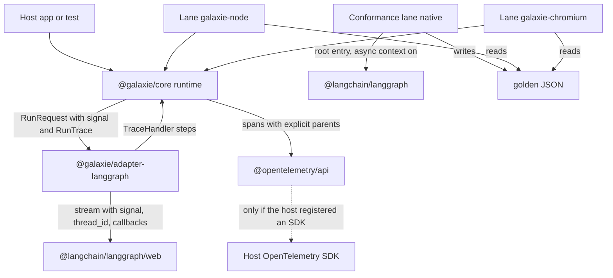
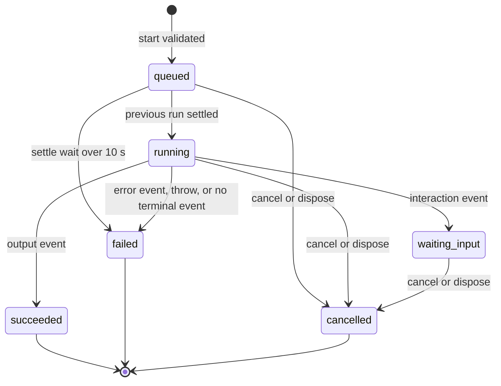
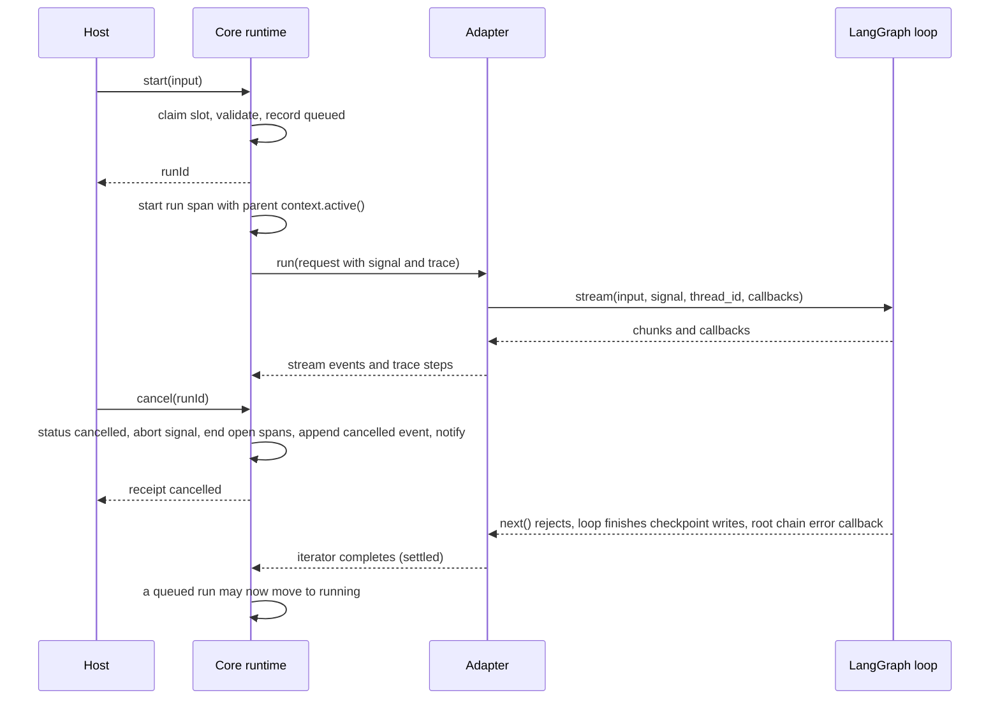

# M1 Core Runtime, LangGraph Adapter, Parity Skeleton and Spans - Plan

## Goal Capsule

- **Objective:** A host developer runs an unmodified LangGraph.js graph through galaxie on Node and in headless Chromium and gets the same stream events and final state as native LangGraph, or a recorded reason for each difference, and every run shows up as an allowlisted OpenTelemetry span tree.
- **Means:** a runtime in `packages/core` (KTD3, KTD5), a new `@galaxie/adapter-langgraph` package that drives LangGraph's own stream (KTD9, KTD10), a conformance package with three lanes and goldens (KTD11, KTD12), and spans recorded by core through `@opentelemetry/api` only (KTD6 to KTD8).
- **Authority, highest first:** `AGENTS.md` repository rules; Accepted ADRs in `docs/adr/` (ADR-0001, ADR-0012, ADR-0016, ADR-0017 bind this slice); this plan; `docs/galaxie-project-brief.md`; `docs/system-design.md`. When this plan and an Accepted ADR disagree, follow the ADR and record the conflict in the PR body.
- **Execution profile:** autonomous, one branch, one pull request against `main`. Units run in order U1 to U7. Run `pnpm check` after each unit.
- **Stop conditions:** stop and open a draft pull request that names the blocker when any of these happens:
  - a pinned version fails the 7-day release-age gate or `pnpm install --frozen-lockfile` cannot resolve without changing `minimumReleaseAge`;
  - `@langchain/langgraph/web` or `@opentelemetry/sdk-trace` cannot load in the Vitest Chromium project without a Node polyfill in a published package;
  - a requirement can only pass by weakening an ADR-0012 guarantee or by recording an error message, prompt or model output in a span;
  - `pnpm check` still fails after three focused fix attempts on the same cause.
- **Who finishes:** the implementing agent opens the pull request and stops. It never merges, never pushes to `main`, and never marks the pull request ready to merge.

---

## Product Contract

### Summary

galaxie gets its first runtime. `createRuntime` creates agent instances with stable identity; each instance prepares an executor, starts runs, streams typed events, cancels and disposes. A LangGraph.js adapter runs compiled graphs through LangGraph's own engine. A conformance suite runs the same graphs natively on Node and through galaxie on Node and in headless Chromium, and a compatibility matrix lists every difference with its reason. Core records one span tree per run through the OpenTelemetry API, holding only allowlisted values.

### Problem Frame

`packages/core` holds draft contract types and no runtime (brief §16.3, `AGENTS.md` "Project status"). ADR-0016 makes parity with native LangGraph the verdict on galaxie and requires OpenTelemetry spans from M1. Nothing can show parity, or show a run, until a runtime and an adapter exist. This slice builds the smallest runtime that the conformance suite (AT-15 subset) and the span tests (AT-36 subset) can exercise.

### Requirements

**Runtime and identity**

- R1. `createRuntime({ appId, executors, tracerProvider?, diagnostics? })` returns a runtime synchronously; it throws `GalaxieError` `invalid` for an empty `appId` or two adapters with the same `id`, and `unsupported` when `globalThis.crypto.randomUUID` is missing.
- R2. `runtime.create(definition, { principalScope, agent, services? })` resolves an instance in state `created` with a fresh `InstanceId` and `SessionId`; it rejects with `unsupported` when no registered adapter has `id === definition.executor`.
- R3. `runtime.dispose()` disposes every instance the runtime created and is idempotent.

**Instance lifecycle**

- R4. Instance state follows `INSTANCE_TRANSITIONS` in `packages/core/src/lifecycle.ts`. `prepare()` returns the in-flight promise while `preparing` and resolves at once when `ready`.
- R5. A failed prepare returns the instance to `created` and sets `snapshot.prepareError`; the next `prepare()` clears it.
- R6. `dispose()` during `preparing` aborts the adapter's prepare signal, makes `prepare()` reject with `cancelled`, and disposes an `ExecutorAgent` that arrives late.
- R7. `dispose()` from any state cancels an active run, waits for it to settle up to the settle bound (KTD3), calls `ExecutorAgent.dispose()`, and always ends `disposed`; an error from the executor's `dispose` goes to `diagnostics` only.
- R8. Every operation other than `getSnapshot`, `subscribe` and `dispose` rejects with `invalid` after `dispose()` was called.

**Runs**

- R9. `start(input)` rejects with `invalid` unless the instance is `ready` and has no run that is `queued`, `running` or `waiting_input`; the check and the slot claim happen synchronously, so two calls in one tick start one run.
- R10. `start` validates `input` against `definition.input` and rejects with `invalid` before any `RunId` exists; after a `RunId` exists every failure is a run outcome, never a `start` rejection.
- R11. `start` resolves with the `RunId` once the run is recorded as `queued`, without waiting for an executor event.
- R12. A run moves to `running` only after the previous run of the instance has settled (KTD3); a run that waits longer than the settle bound fails with `timeout`.
- R13. Run status follows the executor: `output` gives `succeeded`, `error` gives `failed`, `interaction` gives `waiting_input` with `snapshot.run.pending` (the iterator may complete after it; the run stays `waiting_input`), and an iterator that throws, or ends with no terminal event and no `interaction` event, gives `failed` with `executor_error`.
- R14. `cancel(runId)` rejects with `stale` for a run that is not the instance's current run; for a terminal run it returns a receipt with that status; otherwise the run becomes `cancelled` at once, its signal aborts, and later executor events are dropped.
- R15. Only the run's own `AbortSignal` decides `cancelled`; error names and messages never do.
- R16. `events(runId)` returns an async iterable that replays the run's events from sequence 0 and then follows it live; every run ends with exactly one terminal event (`output`, `error` or `cancelled`) and the iterable completes after it.
- R17. `events(runId)` for a run that is not the current run rejects the first `next()` with `stale`; `break` detaches only that consumer.
- R18. `dispatch()` rejects with `unsupported` in this slice.
- R19. `getSnapshot()` returns the same frozen object until something changes; listeners run synchronously after each change, a throwing listener does not stop the others, and no listener runs after `disposed`.

**Errors**

- R20. Every `ErrorInfo` stored in a snapshot or event carries a code, a fixed message for that code, and an optional sanitized `type`; text from an error that galaxie did not write never reaches a snapshot, an event or a span.
- R21. The raw error, protocol violations and dropped late events reach the host only through the optional `diagnostics` callback.

**LangGraph adapter**

- R22. `@galaxie/adapter-langgraph` runs a compiled graph through LangGraph's own `stream()` with no scheduler of its own (ADR-0001), imports LangGraph only from `@langchain/langgraph/web`, and uses the instance's `SessionId` as `thread_id`.
- R23. The adapter turns every stream chunk into a `stream` event and the root graph's last `values` chunk into the `output` event.
- R24. The agent factory receives `host.langchain.chatModel(role)` and `host.langchain.checkpointer()`; an unknown role throws `unavailable`, and consecutive runs of one instance share one checkpointer thread.
- R25. An interrupt in the graph, or a `resume` command, ends the run with an `unsupported` error event.
- R26. After an abort or a failure, the adapter's iterator completes only after LangGraph's loop has settled; the adapter has no timeout of its own, so core's settle bound (KTD3) is the only bound.

**Parity**

- R27. The same graph code runs in three lanes: native LangGraph on Node with the root entry, galaxie on Node, and galaxie in headless Chromium.
- R28. Goldens are written only by the native lane; the two galaxie lanes compare against them after normalization.
- R29. `tests/conformance/compatibility-matrix.json` lists, for each case and lane, the exact set of differing paths and a non-empty reason; the suite fails when actual differences and listed differences are not identical.

**Tracing**

- R30. Each executor call of a run produces one span tree: a run span, node spans and model spans, linked by explicit parent contexts, under the instrumentation scope `@galaxie/core`.
- R31. Every attribute key is on the allowlist in KTD8 and every value is a string, a finite number, a boolean or an array of one of those.
- R32. No span carries an event, a link, an `exception.*` attribute or a status description; a failed span has status `ERROR`, and a cancelled span keeps status `UNSET`.
- R33. With no OpenTelemetry SDK registered, a full run lifecycle makes no network request.

**Boundaries**

- R34. `packages/core` imports no agent framework and has no runtime dependency outside its peers `zod` and `@opentelemetry/api`; a CI check enforces it (ADR-0017).
- R35. The status lines in `README.md`, `AGENTS.md`, `docs/system-design.md` and `docs/galaxie-project-brief.md` describe the new runtime without calling galaxie secure, compliant, certified or production-ready.

### Acceptance Examples

- AE1. Covers R9, R11. **Given** a ready instance, **when** the host calls `start(a)` and `start(b)` in the same tick, **then** the first resolves with a `RunId` and the second rejects with `invalid`.
- AE2. Covers R12, R14. **Given** run A is `running` with an executor that takes 50 ms to settle after an abort, **when** the host calls `cancel(A)` then `start(b)`, **then** A is `cancelled` at once, run B stays `queued` until A's iterator completes, then moves to `running`.
- AE3. Covers R15. **Given** a run nobody cancelled, **when** a model call inside it throws an `AbortError`, **then** the run fails with `executor_error`, not `cancelled`.
- AE4. Covers R16, R17. **Given** a run that already emitted five events, **when** a consumer calls `events(runId)`, **then** it receives sequences 0 to 4 first, then live events, then exactly one terminal event, then completion.
- AE5. Covers R20. **Given** a graph node that throws `new Error('secret-canary')`, **when** the run fails, **then** the snapshot, every event and every span contain no `secret-canary`, and `diagnostics` receives the raw error.
- AE6. Covers R31, R32. **Given** a model call that fails, **when** the run ends, **then** the model span, its node span and the run span all exist, are ended and have status `ERROR`, and none has a status description.

### Scope Boundaries

- Out of this slice: capability broker, model router, data labels, budgets, IndexedDB persistence, UI surfaces, interrupts and resume, `instanceKey` deduplication (AT-17), journaled events (M3), capability spans, and the role, provider and destination attributes that need the router (brief §14.4).
- Deferred to follow-up work: conformance cases for `interrupt()`, `Command({ resume })`, node re-execution on resume and durability modes (brief §16.3; this slice's matrix covers stream events, final state and checkpoint history only), native-Chromium as a fourth lane, a graceful drain mode for `dispose` through LangGraph's `RunControl`, the bundle smoke test for the adapter, and a CI job proving the `^1.9.0` OpenTelemetry API peer range against an SDK 2.x host.

### Key Decisions

- **The create options stay `{ principalScope, agent, services? }` in this slice.** `instanceKey`, `bindings`, `ui` and `policy` from brief §14.2 need the broker, the UI work or persistence. Governs R2.
- **`agent` is the adapter-specific factory; `services` injects LangChain models until the router exists.** Brief §7.3 `host.langchain.*` is honored through `services`. Governs R2, R24.
- **One instance is one session.** Consecutive runs continue the same LangGraph thread; a new conversation is a new instance. Governs R24.
- **Cancel is immediate for the host and settled for the engine.** The host sees `cancelled` at once; the next run waits for the engine to finish. Governs R12, R14.

---

## Planning Contract

### Key Technical Decisions

- KTD1. **Errors carry a code, a fixed message and a sanitized type.** Add `executor_error` to `ErrorCode` ("the executor or the agent code failed"), widen the doc comment of `invalid` to cover calls made in the wrong state, and add `type?: string` to `ErrorInfo`. Core owns one message table keyed by code and writes every stored `ErrorInfo` through it. `type` is kept when it matches `^[A-Za-z_$][A-Za-z0-9_$]{0,63}$`, otherwise it becomes `Error`. Rejections that core itself throws to the host (wrong state, stale run id) may carry specific messages that core writes. Rationale: ADR-0012 A4 and the `ErrorInfo` comment forbid user content in messages, and an exported `GalaxieError` lets agent code put anything in a message.
- KTD2. **The runtime creates a `cancelled` terminal event.** `RunEvent` becomes `(ExecutorEvent | { type: 'cancelled' }) & { eventId, runId, sequence }`. Sequence numbers count per run from 0 with no gaps; dropped events take no number. When the executor iterator throws, the runtime creates the `error` event itself. Rationale: without it a consumer cannot tell a cancel from a stopped iterator.
- KTD3. **A run settles when the executor's `run()` iterator completes.** Core never calls `return()` on that iterator; after a cancel it keeps draining and drops what arrives. A run in `waiting_input` whose iterator has completed counts as settled. One module constant, `SETTLE_TIMEOUT_MS = 10_000`, bounds both the wait of a queued run and the wait inside `dispose`; it is the only settle bound in the system (executors add none). When a predecessor never settles, each queued run behind it fails with `timeout`, so a stuck instance stays unusable until `dispose`, rather than starting a second loop on the same thread. Write this rule into the doc comments of `ExecutorAgent.run` and of `queued` in `lifecycle.ts`, and add `'failed'` to `RUN_TRANSITIONS.queued` (a transition brief §8.3 does not yet draw; U7 adds it to the brief's diagram). Rationale: LangGraph keeps writing checkpoints after an abort, and two loops on one `thread_id` fork the thread.
- KTD4. **Input validation uses the Standard Schema interface.** Core calls `definition.input['~standard'].validate(input)` and awaits the result; it does not import `zod` at runtime. Rationale: `zod/v4/core` schemas implement `~standard`, and system design §4 allows no runtime dependency beyond the OpenTelemetry API.
- KTD5. **The `stream` event is an executor-native passthrough.** Add `{ type: 'stream'; executor: string; path: readonly string[]; mode: string; data: unknown }` to `ExecutorEvent`. Its doc comment says the payload is framework-specific, passed by reference, delivered live and never journaled. Core types it with plain strings, so no framework type enters core (ADR-0017).
- KTD6. **Core owns every span; executors report steps through a data-only recorder.** New file `packages/core/src/trace.ts` defines `RunTrace { start(step: TraceStep, parent?: TraceHandle): TraceHandle }`, `TraceHandle { end(result: TraceResult): void }`, `TraceStep = { kind: 'node'; name: string; step?: number } | { kind: 'model'; provider?: string; model?: string }` and `TraceResult = { status: 'ok'; usage?: { inputTokens?: number; outputTokens?: number }; responseModel?: string } | { status: 'error'; errorType?: string }`. `RunRequest` gains `trace: RunTrace`. `end()` is idempotent, and calls after the run span ended are no-ops. At settlement or cancel, core ends every open handle, children first, then the run span. Every span gets an explicit parent context built with `trace.setSpan(parentContext, parentSpan)`; the run span's parent is `context.active()` captured in `start()`. Never use `startActiveSpan` or `context.with` across awaits.
- KTD7. **`@opentelemetry/api` is a peer dependency of core with range `^1.9.0` and devDependency `1.10.0`.** Core imports nothing else from OpenTelemetry. The tracer comes from `options.tracerProvider ?? trace.getTracerProvider()` at `createRuntime` time, named `@galaxie/core` with the package version from a constant that a unit test compares with `packages/core/package.json`. Rationale: a second, newer API copy silently turns every span into a no-op, and the SDK 2.x and 3.x generations need API 1.9.x and 1.10.x.
- KTD8. **Span names and the attribute allowlist.** Attribute names are hardcoded string constants in core; core does not import `@opentelemetry/semantic-conventions`. The followed GenAI revision is `open-telemetry/semantic-conventions-genai@51a0f580f8a6ad804ca4de5e033683c6fbbe5906` (manifest `schema_url https://opentelemetry.io/schemas/gen-ai-dev/1.42.0-dev`, core semantic conventions v1.44.0); record it in a code comment next to the constants and in system design. Attributes that samplers need are passed in the `startSpan` options.

  | Span | Name | Kind | Attributes at start | Attributes at end |
  | --- | --- | --- | --- | --- |
  | Run | `invoke_agent {agentId}` | INTERNAL | `gen_ai.operation.name=invoke_agent`, `gen_ai.agent.name`, `galaxie.app.id`, `galaxie.agent.version`, `galaxie.instance.id`, `galaxie.session.id`, `galaxie.run.id`, `galaxie.executor.id`, `galaxie.executor.version` | `galaxie.run.status`; on failure `error.type` and `galaxie.error.code` |
  | Node | `galaxie.node {name}` | INTERNAL | `galaxie.node.name`, `galaxie.node.step` when known | `galaxie.step.status` (`ok`, `error`, `cancelled`); on failure `error.type` |
  | Model | `chat {model}`, or `chat` when unknown | CLIENT | `gen_ai.operation.name=chat`, `gen_ai.provider.name` (`_OTHER` when unknown), `gen_ai.request.model` when known | `galaxie.step.status`, `gen_ai.response.model`, `gen_ai.usage.input_tokens`, `gen_ai.usage.output_tokens` when reported; on failure `error.type` |

  Every name or string value that comes from an executor is kept only when it is 1 to 128 characters with no control characters, otherwise it becomes `_OTHER`. `error.type` is the sanitized type from KTD1 or `_OTHER`. Core sets status `ERROR` with no description on failure and never calls `recordException` or `addEvent`. A cancelled run keeps status `UNSET` with `galaxie.run.status=cancelled`. `principalScope` and `gen_ai.conversation.id` are never recorded. One helper builds every attribute map and drops any key or value outside these rules.
- KTD9. **The adapter's trace handler observes LangChain callbacks and never changes execution.** It extends `BaseCallbackHandler` from `@langchain/core/callbacks/base`, sets `name = 'galaxie-trace'` and `awaitHandlers = true`, and never sets `lc_prefer_streaming` or `raiseError`. `handleChainStart` receives `(chain, inputs, runId, parentRunId, tags, metadata, runType, runName)` at runtime, which differs from the order in the `.d.ts`; implement the runtime order and say so in a comment. A chain run is a node when `runName === metadata.langgraph_node` and its tags lack `langsmith:hidden`; every other chain run maps to the nearest recorded ancestor's handle. A model run starts in `handleChatModelStart`, reads only `metadata.ls_provider` and `metadata.ls_model_name`, and ends in `handleLLMEnd` (usage from `output.generations[0][0].message.usage_metadata`) or `handleLLMError`. The handler never copies inputs, outputs, messages, invocation parameters or other metadata.
- KTD10. **The adapter detects LangGraph's settlement through the root chain callbacks.** The root run is the chain run whose `parentRunId` is undefined; its `handleChainEnd` or `handleChainError` resolves a per-run settled promise. On abort or failure the adapter's `run()` generator awaits that promise before it completes, with no timeout of its own (KTD3 makes core's constant the only bound); when the stream rejects before the handler saw a root chain start (for example an abort before the first chunk), it completes at once. Rationale: after an abort LangGraph's `next()` rejects at once while its loop still writes checkpoints, and breaking out of the stream does not stop the loop; an adapter timeout shorter than core's would hand core a thread that is still being written.
- KTD11. **Three lanes, goldens from the native lane only.** Lane `native` imports the root entry `@langchain/langgraph` (async context on); lane `galaxie-node` and lane `galaxie-chromium` run through the adapter, which imports `/web`. Graph factories take the LangGraph module namespace as a parameter, typed `typeof import('@langchain/langgraph/web')`, so every lane runs identical graph code. The native lane writes `tests/conformance/golden/<case>.json` with `toMatchFileSnapshot`; the galaxie lanes import the goldens as JSON modules and never write. Native-versus-galaxie-node isolates async context; galaxie-node versus galaxie-chromium isolates the browser.
- KTD12. **Normalization, diff and matrix live in one shared module.** Normalize by JSON round trip, then replace every UUID-shaped substring (including inside strings such as `checkpoint_ns` and `run-<uuid>`) with `<uuid:N>` numbered by first appearance in the transcript, and every ISO 8601 timestamp with `<timestamp>`. The diff walks two JSON values and returns `$`-rooted paths such as `$.events.updates[3]`; arrays of different length give one path for the array. Because a length difference collapses to one path, transcripts keep events per stream mode (see the transcript shape in U5), so a missing `messages` chunk cannot hide a change in `values`, `updates` or `custom`. Matrix entries are `{ case, lane, differences: string[], reason }`; a case and lane with no differences has no entry.
- KTD13. **The fixture model is written from scratch.** `tests/conformance/support/scripted-chat-model.ts` subclasses `BaseChatModel`, answers from a per-case script keyed by the last human message, sets explicit message ids and `usage_metadata`, reports `ls_provider: 'galaxie-fixture'` and `ls_model_name: 'fixture-1'` through `getLsParams`, streams word chunks from `_streamResponseChunks` and calls `runManager.handleLLMNewToken`, and can throw a `FixtureModelError` or wait on a test-controlled latch that rejects when the call's signal aborts. Never copy or adapt LangChain's fake models (AGENTS.md "Do not merge, copy or adapt code from outside contributors").
- KTD14. **Workspace layout.** Add `tests/*` to `pnpm-workspace.yaml`; `tests/conformance` is the private package `@galaxie/conformance`. One root `vitest.config.ts` defines two projects: `node` and `browser` (the browser instance is named `browser (chromium)`). Source aliases map `@galaxie/core` and `@galaxie/adapter-langgraph` to their `src/index.ts` in Vitest and through `paths` in the typecheck tsconfigs; build tsconfigs have no `paths`, so the adapter builds against core's `dist`. The root `test` script drops `--dir packages`, because `--dir` would hide `tests/conformance` from every project.
- KTD15. **The adapter's prepare gets a signal and core gets a diagnostics hook.** `ExecutorAdapter.prepare(agent, services, options: { signal: AbortSignal })`, and its doc comment says a malformed `agent` or `services` rejects with `invalid` while an incompatible version or feature rejects with `unsupported`. `AgentSnapshot` gains `prepareError?: ErrorInfo`. `createRuntime` takes `diagnostics?: (event: DiagnosticEvent) => void`, where `DiagnosticEvent` is `{ kind: 'prepare_failed' | 'run_failed' | 'executor_dispose_failed' | 'late_event' | 'protocol_violation' | 'listener_threw'; instanceId; runId?; error?: unknown }`. Nothing passed to `diagnostics` is stored, traced or put in a snapshot or event.

### High-Level Technical Design

These sketches show the intended shape; they are not code to copy.

Package and lane topology:



Run state machine as this slice implements it:



A run from start to cancel:



### Implementation Constraints

- Every new `.ts` file starts with the SPDX header from ADR-0015:

  ```ts
  // SPDX-FileCopyrightText: 2026 Nguyễn Xuân Vĩnh
  // SPDX-License-Identifier: AGPL-3.0-only
  ```

- Every new `package.json` has `"license": "AGPL-3.0-only"` and `"private": true`; `scripts/check-license.ts` checks both headers and license fields.
- TypeScript rules from system design §10 and `tsconfig.base.json`: relative imports end in `.js`, type-only imports use `import type`, exported functions declare return types (`isolatedDeclarations`), no `enum`, no namespaces, no parameter properties (`erasableSyntaxOnly`), `exactOptionalPropertyTypes` and `noUncheckedIndexedAccess` stay on. Code must compile with TypeScript 7.0.2 (`tsc`) and 6.0.2 (`tsc6`).
- Everything committed is English: code, comments, docs, commit messages and the pull request.
- Never add secrets, `.env` files, tokens or API keys; the fixture model needs none.
- Never edit `.gitignore` to expose `/internal/`, and never copy anything from `internal/`.
- Never describe galaxie as secure, compliant, certified, production-ready or suitable for regulated uses (AGENTS.md).
- Never weaken a check (Biome rules, tsconfig flags, the release-age gate, the license check) to make a step pass.
- Stage files by name; never `git add -A` or `git add .`. Never commit `spikes/.DS_Store` or anything under `spikes/` that this plan does not name.
- Test code may import test support from another test directory by relative path (for example `tests/conformance` importing `packages/core/test/span-tree.ts`); production code under `src/` never imports test code.

### Dependencies and Versions

All versions below pass the 7-day `minimumReleaseAge` gate on 2026-10-28. Use exact versions in `devDependencies`. Do not use `@langchain/langgraph` 1.5.2 or later, or `@langchain/core` 1.3.x, in this slice. Do not install the deprecated `@opentelemetry/sdk-trace-base`, `-web` or `-node`.

| Package | Version | Where |
| --- | --- | --- |
| `@opentelemetry/api` | peer `^1.9.0`, dev `1.10.0` | `packages/core` |
| `@opentelemetry/api` | `1.10.0` | `tests/conformance` dependencies |
| `@opentelemetry/sdk-trace` | `3.0.0` | devDependency of `packages/core`; dependency of `tests/conformance` |
| `zod` | peer `^4.6.0`, dev `4.6.7` (existing) | `packages/core`; also dev `4.6.7` in the adapter and conformance package (LangGraph peer) |
| `@langchain/langgraph` | peer `~1.5.1`, dev `1.5.1` | `packages/adapter-langgraph`; dependency `1.5.1` of `tests/conformance` |
| `@langchain/core` | peer `~1.2.20`, dev `1.2.20` | `packages/adapter-langgraph`; dependency `1.2.20` of `tests/conformance` |
| `@galaxie/core` | `workspace:*` | dependency of the adapter and of `tests/conformance` |
| `@galaxie/adapter-langgraph` | `workspace:*` | dependency of `tests/conformance` |
| `@vitest/browser-playwright` | `5.0.5` | root devDependencies |
| `playwright` | `1.64.1` | root devDependencies |

Chromium for tests: `pnpm exec playwright install --only-shell chromium` locally and `pnpm exec playwright install --with-deps --only-shell chromium` in CI. Always name `chromium`; without it the command also installs Firefox and WebKit.

### Known Library Behavior to Respect

Read from LangGraph 1.5.1, LangChain core 1.2.20 and OpenTelemetry JS 3.0.0 sources, not yet executed in this repository. The first tests of U4 and U6 confirm them; when one turns out false, adapt the implementation and record the finding in the pull request body.

- `@langchain/langgraph/web` is the root entry minus the `node:async_hooks` initialization. Without async context, a model called in a node without the node's `config` gets no callbacks (no model span, no `messages` chunk, no abort); conformance graphs forward `config` except in the `model-without-config` case.
- With `streamMode` as an array and `subgraphs: true`, each chunk is `[namespace, mode, payload]`, the root namespace is `[]`, and segments look like `nodeName:<taskId>`.
- Breaking out of `for await` over `graph.stream()` does not stop the loop; only the `signal` option does. An abort before the first chunk makes `await graph.stream(...)` reject.
- Adding `messages` to `streamMode` makes chat models that implement `_streamResponseChunks` take the streaming path, so the native lane must request the same modes as the adapter.
- On Node only, `LANGSMITH_TRACING`, `LANGCHAIN_TRACING_V2` and `LANGCHAIN_VERBOSE` add LangChain handlers that can send runs to LangSmith; a `setupFiles` entry of the `node` Vitest project deletes every `LANGCHAIN_*` and `LANGSMITH_*` variable from `process.env` before any Node test file runs.
- On `@langchain/langgraph/web` with no async context, `interrupt()` and `getWriter()` called without a config throw a plain `Error('Called interrupt() outside the context of a graph.')`; the adapter reports that as `executor_error`. R25 covers interrupts that reach LangGraph as a `GraphInterrupt`, such as a node that throws `NodeInterrupt` (exported from `/web`).
- `@opentelemetry/sdk-trace` 3.0.0 exports `TracerProvider`, `SimpleSpanProcessor` (constructed with `{ exporter }`) and `InMemorySpanExporter`; `ReadableSpan.parentSpanContext` replaces `parentSpanId`; there is no `register()`. It selects its browser code through the package `imports` field `#platform`.
- The OpenTelemetry API keeps one global per major version; `trace.setGlobalTracerProvider` returns `false` on a second call until `trace.disable()`.

---

## Implementation Units

### U1. Core contract changes

- **Goal:** the contract types carry everything the runtime, the adapter and the spans need, before any behavior exists.
- **Requirements:** R13, R16, R20, R22, R30; KTD1, KTD2, KTD3, KTD5, KTD6, KTD15.
- **Files:**
  - `packages/core/src/errors.ts`: `executor_error`, the widened `invalid` comment, `ErrorInfo.type?`, the message table, `toErrorInfo(code, error?)` that applies KTD1, and `isGalaxieError(value)` (duck-typed on `name === 'GalaxieError'` and a known `code`).
  - `packages/core/src/events.ts`: the `stream` variant and the runtime-created `cancelled` event.
  - `packages/core/src/executor.ts`: `RunRequest.trace`, the `prepare` options with `signal`, and the settlement rule in the `run` doc comment.
  - `packages/core/src/instance.ts`: `events(runId)` on `AgentInstance`, `prepareError?` on `AgentSnapshot`, and doc comments for the `start` and `stale` rules.
  - `packages/core/src/lifecycle.ts`: the doc comment of `queued`, and `'failed'` added to `RUN_TRANSITIONS.queued` (KTD3); extend `packages/core/test/lifecycle.test.ts` for the new edge.
  - `packages/core/src/trace.ts` (new): the recorder types from KTD6.
  - `packages/core/src/index.ts`: export the new names.
  - `packages/core/test/errors.test.ts` (existing: extend it and keep its current `GalaxieError` test).
- **Approach:** change types and doc comments only, plus the two pure helpers in `errors.ts`. Keep existing exports stable.
- **Test scenarios:**
  - `toErrorInfo('executor_error', new TypeError('secret'))` returns the table message and `type: 'TypeError'`, and its JSON holds no `secret`.
  - A type name with a space, one longer than 64 characters, or a non-string `name` becomes `Error`.
  - `isGalaxieError` is true for a `GalaxieError` and for a plain object with `name: 'GalaxieError'` and a known code, and false for an unknown code.
  - The existing `lifecycle.test.ts` still passes.
- **Verification:** `pnpm check` passes.

### U2. Core runtime

- **Goal:** `createRuntime`, instances and runs behave as R1 to R21 require, tested with a scripted fake executor.
- **Requirements:** R1 to R21; KTD1 to KTD4, KTD15.
- **Dependencies:** U1.
- **Files:**
  - `packages/core/src/runtime.ts` (new): `createRuntime`, `Runtime`, `RuntimeOptions`, `CreateOptions`, `DiagnosticEvent`.
  - `packages/core/src/agent-instance.ts` (new): the instance state machine and the run records.
  - `packages/core/src/run-events.ts` (new): the per-run event buffer with replay and live iteration.
  - `packages/core/src/index.ts`.
  - `packages/core/test/fake-executor.ts` (new, test support): an `ExecutorAdapter` whose runs follow a script of events, throws, latches and settle delays.
  - `packages/core/test/runtime.test.ts`, `packages/core/test/instance.test.ts`, `packages/core/test/runs.test.ts`, `packages/core/test/events.test.ts` (new).
- **Approach:**
  - IDs come from `crypto.randomUUID()` cast to the branded types in `ids.ts`.
  - Each run owns one `AbortController`; link nothing else into it in this slice, and remove listeners in `finally`.
  - Every change runs as one synchronous step: update state, append the event, replace the frozen snapshot, notify listeners. A listener error is rethrown with `queueMicrotask` and also reported to `diagnostics`.
  - The event iterator is a hand-written async iterator, not an `async function*`, so `return()` detaches at once.
  - Drive the executor with a loop that core owns and keeps reading after a cancel (KTD3).
  - The settle timeout uses `setTimeout` so tests can use Vitest fake timers.
- **Test scenarios:**
  - `createRuntime` throws `invalid` for `appId: ''` and for two adapters with one id; throws `unsupported` when `crypto.randomUUID` is stubbed to `undefined`.
  - `create` with an unknown executor rejects `unsupported`; two instances get distinct instance and session ids.
  - Concurrent `prepare()` calls call the adapter once; a failing prepare leaves `created` with `prepareError.code === 'executor_error'`, and a second prepare that succeeds clears it.
  - `dispose()` while prepare is pending: `prepare()` rejects `cancelled`, the adapter's signal is aborted, and the agent that resolves later has `dispose` called once.
  - AE1, AE2 and AE4 as written.
  - `start` with input that fails the schema rejects `invalid`, and `snapshot.run` stays unchanged.
  - Executor yields `output`: status `succeeded`, events end with `output`, the iterator completes.
  - Executor throws `new Error('secret')`: status `failed`, `executor_error`, a runtime-created `error` event, no `secret` in the snapshot or events, `diagnostics` gets the raw error.
  - Executor ends with no terminal event: `failed` with `executor_error` and `type: 'ProtocolViolation'`, plus a `protocol_violation` diagnostic.
  - Executor yields after `output`: the extra event is dropped and reported as `late_event`.
  - Executor yields `interaction` and then its iterator completes: status stays `waiting_input` with `pending`, no `protocol_violation` is reported, `events()` stays open; `cancel` ends it with a `cancelled` event.
  - Three listeners where the second throws: the first and third still run, a `listener_threw` diagnostic is reported, and the rethrown error is captured by stubbing `queueMicrotask` with `vi.stubGlobal` (an unhandled rethrow would fail the Vitest run).
  - AE3: executor throws an error named `AbortError` while the signal is not aborted: `failed`, not `cancelled`.
  - `cancel` with another run id rejects `stale`; `cancel` on a succeeded run returns `{ status: 'succeeded' }`; a second `cancel` returns `cancelled`.
  - A queued run whose predecessor never settles fails with `timeout` after 10 000 ms (fake timers).
  - `dispose()` during a run: the run is `cancelled`, `ExecutorAgent.dispose` runs after the iterator completes, the state is `disposed`; a throwing executor `dispose` still ends `disposed` and reports `executor_dispose_failed`.
  - After `dispose()`, `start`, `prepare`, `cancel` and `events` reject `invalid`, and listeners receive nothing.
  - `getSnapshot()` returns the same object between changes and a frozen new one after each change.
  - `dispatch()` rejects `unsupported`.
  - `runtime.dispose()` disposes two instances and is idempotent.
- **Verification:** `pnpm check` passes; the runtime tests run in the `node` project.

### U3. Spans in core

- **Goal:** each run produces the span tree, attributes and statuses of KTD6 to KTD8, and nothing reaches the network without an SDK.
- **Requirements:** R30 to R33; KTD6 to KTD8.
- **Dependencies:** U2.
- **Files:**
  - `packages/core/package.json`: peer and dev dependencies from the version table; update `description` to say the package holds the runtime and contracts.
  - `packages/core/src/tracing.ts` (new): tracer setup, the attribute allowlist helper, name sanitizing and the `RunTrace` implementation.
  - `packages/core/src/version.ts` (new): the package version constant.
  - `packages/core/src/runtime.ts`, `packages/core/src/agent-instance.ts`: start and end the run span and pass `trace` in `RunRequest`.
  - `packages/core/test/tracing.test.ts`, `packages/core/test/version.test.ts`, `packages/core/test/no-network.test.ts` (new).
  - `packages/core/test/span-tree.ts` (new, test support): builds a tree from finished spans by span id and checks the allowlist; U5 and U6 reuse it.
  - `packages/core/tsconfig.json`: restrict `include` to `src`, so source keeps `types: []` and cannot use Node globals (ADR-0017). `packages/core/test/tsconfig.json` (new): extends the base config with `types: ["node"]`, `resolveJsonModule: true`, `noEmit: true` and `include: ["."]`, because the no-network and version tests use `node:diagnostics_channel` and read `package.json`. Root `typecheck` and `typecheck:ts6` add `-p packages/core/test`. Use the same split for `packages/adapter-langgraph` in U4.
- **Approach:** tests create `new TracerProvider({ spanProcessors: [new SimpleSpanProcessor({ exporter })] })` and pass it as `tracerProvider`, so no global registration is needed; only the default-provider and no-network tests touch the global, with `trace.disable()` before and after. Await `provider.forceFlush()` before reading spans. Do not register a context manager.
- **Test scenarios:**
  - A run whose fake executor reports node A with a model child, then node B, then `output`: one root run span, two node spans under it, one model span under A, one trace id, scope `@galaxie/core` with the package version.
  - The tree check first asserts that spans exist and, when none do, fails with a message naming a duplicate `@opentelemetry/api` copy as the likely cause.
  - Every key on every span is in the allowlist and every value is a primitive or an array of one primitive type; `events` and `links` are empty; `status.message` is undefined.
  - AE6 with a fake executor: a failing model step yields `ERROR` on the model, node and run spans, `error.type` set, `galaxie.error.code` on the run span only.
  - Cancel during an open node and model step: all three spans end, the run span has `galaxie.run.status=cancelled` and status `UNSET`, the children have `galaxie.step.status=cancelled`; a `TraceHandle.end()` call after that changes nothing.
  - A node name of 200 characters, or one with a newline, is recorded as `_OTHER`; a provider value that is an object is dropped.
  - Canary test: an executor error message, a model name containing `canary-model-x` with a control character, and an input value `canary-input` never appear in `JSON.stringify` of any finished span.
  - Host parent: in this one test, register `new StackContextManager().enable()` from `@opentelemetry/sdk-trace` with `context.setGlobalContextManager`, call `start()` synchronously inside `context.with(trace.setSpan(context.active(), hostSpan), ...)`, and assert the run span's parent is `hostSpan`; disable the manager afterwards.
  - Without any context manager, the run span is a root span.
  - The version constant equals `packages/core/package.json` `version`.
  - No network (R33): with `trace.disable()` and no provider, a lifecycle with one succeeded, one failed and one cancelled run records zero calls to stubbed `fetch`, `XMLHttpRequest.prototype.open`, `navigator.sendBeacon`, `WebSocket` and `EventSource` where they exist, and zero messages on the `diagnostics_channel` channels `http.client.request.start`, `net.client.socket` and `undici:request:create`; a self-test proves each recorder fires once when triggered directly.
- **Verification:** `pnpm check` passes.

### U4. LangGraph adapter package

- **Goal:** a compiled LangGraph.js graph runs through galaxie on Node with stream events, output, cancellation and spans.
- **Requirements:** R22 to R26, R30; KTD5, KTD9, KTD10, KTD14.
- **Dependencies:** U3.
- **Files:**
  - `packages/adapter-langgraph/package.json` (new): name `@galaxie/adapter-langgraph`, version `0.0.0`, `private`, `type: module`, `sideEffects: false`, `exports` like `packages/core`, dependencies and peers from the version table.
  - `packages/adapter-langgraph/tsconfig.json` and `packages/adapter-langgraph/tsconfig.build.json` (new), modeled on `packages/core`; the typecheck config maps `@galaxie/core` to `../core/src/index.ts` through `paths`.
  - `packages/adapter-langgraph/src/index.ts`, `src/adapter.ts`, `src/host.ts`, `src/trace-handler.ts`, `src/errors.ts` (new).
  - `packages/adapter-langgraph/test/trace-handler.test.ts` (new): unit tests that call the handler's methods directly with synthetic run ids and metadata, with no graph and no model.
  - `pnpm-workspace.yaml`: add `tests/*`.
  - `tests/conformance/package.json` and `tests/conformance/tsconfig.json` (new; `types: ["node"]`, `lib` with `dom`, `resolveJsonModule`, `paths` to both package sources; this package is test code, so Node types are allowed here).
  - `tests/conformance/support/scripted-chat-model.ts` (new): the fixture model from KTD13, shared by the adapter integration tests here and the lanes in U5.
  - `tests/conformance/adapter.node.test.ts` (new): the adapter integration tests below.
  - Root `vitest.config.ts` (new) with a `node` project that includes `packages/*/test/**/*.test.ts` and `tests/conformance/**/*.test.ts`, has `setupFiles: ['tests/conformance/support/clean-env.node.ts']` (new; deletes every `LANGCHAIN_*` and `LANGSMITH_*` variable from `process.env`), plus the source aliases from KTD14; root `package.json` `test` becomes `vitest run`.
  - Root `package.json`: `build` builds core then the adapter; `typecheck` and `typecheck:ts6` add `packages/adapter-langgraph` and `tests/conformance`.
- **Approach:**
  - Export `createLangGraphAdapter(): ExecutorAdapter<LangGraphAgent, LangGraphServices>` with `id: 'langgraph-js'`, `version` from the package, and `features` all `false` except `streaming` and `subgraphs`.
  - `LangGraphAgent` is `(host: LangGraphHost) => graph`, where the graph exposes LangGraph's `stream`; `LangGraphServices` is `{ chatModels: Readonly<Record<string, BaseChatModel>>; checkpointer?: BaseCheckpointSaver }`. `prepare` checks shapes (else `invalid`), builds the host with the given checkpointer or one `MemorySaver` per instance from `@langchain/langgraph/web`, calls the factory once, and checks that the result has a `stream` function.
  - Export `STREAM_MODES = ['values', 'updates', 'messages', 'custom'] as const`; the native lane imports it.
  - `run` for a `start` command calls `graph.stream(input, { streamMode: [...STREAM_MODES], subgraphs: true, signal, callbacks: [handler], configurable: { thread_id: sessionId } })`, maps chunks per R23, and treats a root `updates` payload containing `__interrupt__` per R25.
  - Errors: when `signal.aborted`, end silently after the settle wait (core decides `cancelled`); otherwise yield an `error` event with code `executor_error` and the error's `name` as `type` (`GraphRecursionError` and `AggregateError` keep their names).
  - `dispose` drops the graph and host references.
- **Test scenarios:**
  - A two-node graph with a scripted model forwarding `config`: events include root `values`, `updates`, `messages` chunks and a `custom` chunk from `config.writer`; status `succeeded`; output equals the graph's final state.
  - Two consecutive runs on one instance: the second sees state committed by the first (shared thread).
  - `chatModel('missing')` inside the factory makes `prepare` reject `unavailable`; a non-function `agent` rejects `invalid`.
  - A graph whose node throws `new NodeInterrupt(value)` (from the LangGraph namespace passed to the factory), with a checkpointer, ends `failed` with `unsupported`.
  - A node that throws `new Error('secret-node')`: `failed`, `executor_error`, `type: 'Error'`, no `secret-node` in snapshot, events or spans.
  - Recursion limit: a graph that loops ends `failed` with `type: 'GraphRecursionError'`.
  - Cancel while the scripted model waits on its latch, with a test-only `MemorySaver` subclass whose `put` waits on a second test-controlled latch: the run is `cancelled` at once; a following `start` stays `queued` until the test releases the `put` latch and the root chain callback fires, then runs. The thread is consistent: `getStateHistory` forms one parent chain, no two checkpoints share a parent, and the second run's first checkpoint descends from the cancelled run's last checkpoint.
  - A predecessor that never settles (the `put` latch is never released): the following run fails with `timeout` after `SETTLE_TIMEOUT_MS` (fake timers), and `dispose()` still ends `disposed`.
  - Span tree for the two-node graph: run span, one span per node named `galaxie.node a` and `galaxie.node b`, one `chat fixture-1` model span under the node that called it, with `gen_ai.provider.name=galaxie-fixture` and usage tokens.
  - The handler never sees `lc_prefer_streaming`: assert the property is absent on the handler.
- **Verification:** `pnpm check` passes; `pnpm build` emits `packages/adapter-langgraph/dist/index.js` that imports `@langchain/langgraph/web` and never `@langchain/langgraph` alone.

### U5. Conformance package, fixtures and Node lanes

- **Goal:** the native and galaxie-node lanes run every case, the native lane owns the goldens, and the matrix records every difference.
- **Requirements:** R27 to R29; KTD11 to KTD14.
- **Dependencies:** U4.
- **Files:**
  - `tests/conformance/support/normalize.ts`, `support/diff.ts`, `support/transcript.ts` (new): the common transcript `{ events: { values: E[], updates: E[], messages: E[], custom: E[] }, modes: string[], final: unknown, state: { values, next }, checkpoints: C[], outcome: { status, errorType? } }`, where `E` is `{ path, data }`, `modes` keeps the interleaving order of all chunks, and `checkpoints` is the thread's `getStateHistory` oldest first with each entry's `metadata.step`, `metadata.source`, `next`, `values` and parent checkpoint id; plus the runners for native and galaxie.
  - `tests/conformance/cases/` (new): one module per case exporting a graph factory that takes the LangGraph namespace and the model, plus its input and script.
  - `tests/conformance/native.node.test.ts`, `tests/conformance/galaxie.test.ts`, `tests/conformance/support.test.ts` (new).
  - `tests/conformance/golden/*.json` (generated by the native lane, committed).
  - `tests/conformance/compatibility-matrix.json` (new).
  - Root `package.json`: add `conformance:update` = `vitest run --project node tests/conformance/native.node.test.ts --update`.
  - `biome.json`: exclude `tests/conformance/golden` from formatting and linting.
- **Approach:**
  - Cases: `linear` (two nodes, one model call forwarding `config`, one `custom` write), `branching` (a conditional edge and two parallel nodes with no model), `subgraph` (a compiled subgraph added as a node), `model-without-config` (a node calls `model.invoke(messages)` without `config`), `model-failure` (the model throws `FixtureModelError` and nothing catches it).
  - The native runner uses the same stream options as the adapter with a fresh `thread_id` and a `MemorySaver`, and reads `getState` and `getStateHistory` after the stream ends; the galaxie runner captures the compiled graph and checkpointer from inside the agent factory to read `getState` the same way.
  - Native outcome on failure records `errorType: error.name`; the galaxie outcome records `error.type` from the `error` event.
  - The galaxie lanes import each golden with `import golden from './golden/<case>.json' with { type: 'json' }`.
  - Lane identity comes from the runner: `galaxie-node` in the node project, `galaxie-chromium` in the browser project (detected by `typeof window !== 'undefined'`).
- **Execution note:** run `pnpm conformance:update` once to create the goldens, inspect them for leftover random values, then run `CI=true pnpm test` so a missing golden fails instead of being written.
- **Test scenarios:**
  - `normalize` maps two occurrences of one UUID to the same `<uuid:1>`, a second UUID to `<uuid:2>`, a UUID inside `node:<uuid>` and `run-<uuid>` likewise, and an ISO timestamp to `<timestamp>`.
  - `diff` returns `[]` for equal values, `$.a[1].b` for one changed leaf, and `$.events.messages` once when that array's length differs while `$.events.updates` is still compared element by element.
  - The matrix loader rejects an entry with an empty `reason` or an unknown case or lane.
  - Every case's native transcript matches its golden.
  - For every case, the galaxie-node lane's difference set equals the matrix entry exactly; the expected entry is `model-without-config` (no `messages` chunks and no model span without async context), with any further differences the first run reveals recorded with a reason or fixed.
  - `model-failure` ends `failed` in all lanes with `errorType: 'FixtureModelError'`.
- **Verification:** `CI=true pnpm test` passes; `git status` shows the goldens as new tracked files with no change after a second run.

### U6. Chromium lane

- **Goal:** the galaxie lane, the span tree and the no-network test run in headless Chromium.
- **Requirements:** R27, R29, R30, R33; KTD11, KTD14.
- **Dependencies:** U5.
- **Files:**
  - `vitest.config.ts`: add the `browser` project with `provider: playwright()`, `headless: true`, `instances: [{ browser: 'chromium' }]`, include `tests/conformance/**/*.test.ts`, exclude `tests/conformance/**/*.node.test.ts`.
  - `tests/conformance/tracing.test.ts` (new): the U3 tree, allowlist and canary checks through the real adapter, in both projects.
  - `tests/conformance/no-network.test.ts` (new): the R33 check through the real adapter, in both projects, filtering the Vitest server origin out of `WebSocket` recordings.
  - `tests/conformance/browser-smoke.test.ts` (new): imports `@langchain/langgraph/web`, compiles and runs a two-node graph; creates a `TracerProvider`, ends a span and asserts a 32-hex trace id.
- **Approach:** when the smoke test shows that Vite does not resolve `#platform` or the langsmith `browser` map, fix it in `vitest.config.ts` (`optimizeDeps.include` or `exclude`, `resolve.conditions` for the browser project) and never by adding a polyfill to a published package. Matrix entries for the `galaxie-chromium` lane follow the same rule as U5.
- **Test scenarios:**
  - The smoke test passes in `browser (chromium)`.
  - Every case's galaxie-chromium difference set equals its matrix entry.
  - The tracing test produces the same normalized tree shape in both projects for `linear` and `model-failure`.
  - The no-network test records zero requests outside the Vitest origin in Chromium.
- **Verification:** `CI=true pnpm test` runs both projects and passes; `pnpm exec vitest run --project 'browser (chromium)'` passes alone.

### U7. Dependency guard, CI and docs

- **Goal:** CI enforces the boundaries and runs both lanes, and the docs describe the runtime that now exists.
- **Requirements:** R34, R35.
- **Dependencies:** U6.
- **Files:**
  - `scripts/check-dependencies.ts` (new), run as `check:deps` with `node scripts/check-dependencies.ts`, last in `check`, after `build`, because it reads `dist`.
  - `scripts/tsconfig.json`: include the root `vitest.config.ts` if no other typecheck covers it.
  - `.github/workflows/ci.yml`: add `pnpm run check:deps` after the build step and, before the test step, `pnpm exec playwright install --with-deps --only-shell chromium`; keep every action pinned by SHA and the job timeout at 15 minutes unless the browser step needs more, in which case raise it to 20.
  - `README.md` status blockquote, `AGENTS.md` "Project status", `packages/core/package.json` `description`, `docs/system-design.md` (§1 status, §4 rule 1 on the OpenTelemetry API peer, §5 layout with the adapter and `tests/conformance`, §6 modules and the "Not in core yet" list, §10 commands including `conformance:update` and the Playwright install, the GenAI revision from KTD8), and the status line near the top of `docs/galaxie-project-brief.md` plus the `queued --> failed` edge in its §8.3 run diagram (no version bump).
- **Approach:** `check-dependencies.ts` asserts that `packages/core/package.json` has no `dependencies` and exactly the peers `zod` and `@opentelemetry/api`; that every import in `packages/core/src/**/*.ts` is relative, `zod/v4/core` (type-only) or `@opentelemetry/api`; that `packages/adapter-langgraph/src/**/*.ts` imports LangGraph only as `@langchain/langgraph/web`; and that the built `packages/core/dist/**/*.js` and `packages/adapter-langgraph/dist/**/*.js` contain no `node:` import and no `async_hooks`.- **Test scenarios:**
  - `check:deps` passes on the finished tree.
  - Temporarily adding `import '@langchain/langgraph'` to an adapter source file makes it fail with a message naming the file; revert the probe before committing.
- **Verification:** `pnpm check` passes locally; the CI workflow file is valid YAML and lists the new steps.

---

## Verification Contract

| Gate | Command | When |
| --- | --- | --- |
| Install | `pnpm install` (CI: `pnpm install --frozen-lockfile`) | After each dependency change; commit `pnpm-lock.yaml` |
| Browser binary | `pnpm exec playwright install --only-shell chromium` | Once before U6 locally |
| Full check | `pnpm check` | After every unit and before the pull request |
| Both test projects without writing goldens | `CI=true pnpm test` | U5, U6 and before the pull request |
| Goldens | `pnpm conformance:update` | Only when a case or the normalizer changes; review the diff |
| One project | `pnpm exec vitest run --project node` or `--project 'browser (chromium)'` | While debugging |
| Format | `pnpm format` | Before committing |

The pull request body lists: what each unit delivered, the final compatibility matrix with reasons, every "Known Library Behavior" item that the tests contradicted, the OpenTelemetry peer decision, and the commands run with their results.

---

## Definition of Done

- R1 to R34 hold, each covered by at least one test named in U1 to U6; R35 is met by the U7 documentation edits.
- `pnpm check` and `CI=true pnpm test` pass locally, including both Vitest projects, and `.github/workflows/ci.yml` runs the same commands. If CI finishes on the pull request before the agent stops, it is green; otherwise the pull request body says CI was still running.
- `tests/conformance/compatibility-matrix.json` has a reason for every entry and matches the actual differences exactly.
- No span contains an error message, prompt, model output or credential, and no snapshot or `error` event contains error text that galaxie did not write; the canary tests prove it. (`stream` and `output` events carry graph data by design, R23.)
- Every new file has the SPDX header and every new package has its license field.
- The diff contains no abandoned experiment, no skipped or `.only` test, no commented-out code, no `console.log` outside test support, and no file under `internal/` or `spikes/`.
- The pull request against `main` is open, its title follows Conventional Commits (`feat(core): ...`), its body follows the Verification Contract, and it is not merged.
