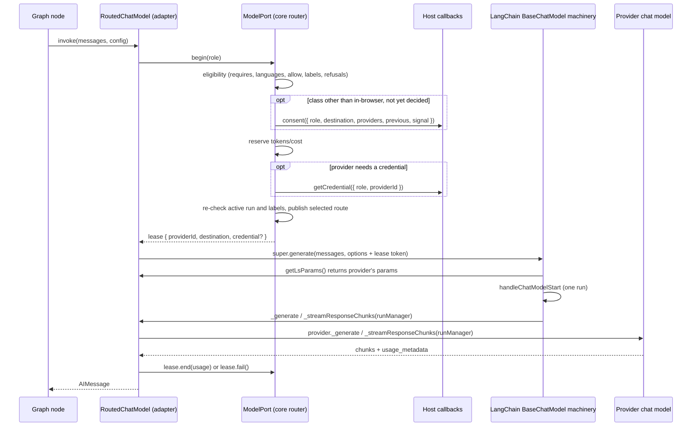

# M1 Model Router, Destination Classes, Model Budgets and Mock Provider - Plan

## Goal Capsule

- **Objective:** A host developer can tell a galaxie agent which models each of its roles may use, and where each model sends the data. A LangGraph graph keeps calling ordinary LangChain chat models. Every call goes to the first model in the host's list that the role, the run's data labels and the user's consent allow. Nothing switches destination silently. Provider keys come from a host callback and appear nowhere else. Token and cost budgets stop a run before a call whose reservation would exceed them is sent. The existing conformance cases still match native LangGraph on Node and in headless Chromium.
- **Means:**
  - A per-instance model router in `packages/core` sits behind a framework-neutral port on `RunRequest` (KTD1 to KTD7).
  - The LangGraph adapter wraps the host's chat models in one routing `BaseChatModel` (KTD8, KTD9).
  - A deterministic mock provider ships in a new `packages/models` package (KTD10).
- **Authority, highest first:**
  1. `AGENTS.md` repository rules.
  2. Accepted ADRs in `docs/adr/`. ADR-0001, ADR-0006, ADR-0012, ADR-0016 and ADR-0017 bind this slice.
  3. This plan. ADR-0014 is Proposed; this plan applies it to model calls as slice 2 applied it to capabilities.
  4. `docs/galaxie-project-brief.md`.
  5. `docs/system-design.md`.

  When this plan and an Accepted ADR disagree, follow the ADR and record the conflict in the PR body.
- **Execution profile:** autonomous. Work on one branch named `feat/m1-model-router` and open one pull request against `main`. Run units U1 to U7 in order, and `pnpm check` after each one.
- **Stop conditions:** stop and open a draft pull request that names the blocker when any of these happens:
  - a requirement can pass only by weakening an ADR-0012 guarantee, recording a prompt, completion or credential in a span, event, snapshot or error, or letting a graph reach a chat model without the router;
  - a galaxie lane of an existing conformance case produces a difference that `tests/conformance/compatibility-matrix.json` does not already list, and three focused attempts do not remove it;
  - `pnpm check` still fails after three focused fix attempts on the same cause.
- **Who finishes:** the implementing agent opens the pull request and stops. It never merges, never pushes to `main`, and never enables auto-merge.

---

## Product Contract

### Summary

The runtime gains a model router. At `create`, the host declares two things:

- its model providers, each with a descriptor: destination class, features, languages, pricing, and whether it needs a credential;
- for each model role the agent declares, an ordered provider list, a destination allowlist and per-call budget reservations.

A graph node calls `host.langchain.chatModel(role)` as before. Each call goes through the router:

1. it selects the first eligible provider;
2. it asks the host for consent before data first leaves the browser for a class;
3. it reserves the token and cost budget;
4. it fetches a credential when the provider needs one;
5. it settles usage afterwards.

The snapshot shows which provider and destination class each role last used. Chat spans gain the destination class and the provider ID. A new `@galaxie/models/mock` export gives CI a scripted chat model. A new conformance test shows routing, label narrowing, consent, budgets and credential hygiene on Node and Chromium.

### Problem Frame

Today `host.langchain.chatModel(role)` returns whatever chat model the host put under that key. No policy sits between a graph and a model. A run that read a learner's private sentence could send it to a third-party API, and nothing would notice. ADR-0006 and brief §10.3 require per-role destination allowlists, no silent switch, consent before data moves to a less private class, and credentials only from a host callback. Brief §9.4 requires token and cost budgets. Brief §16.3 lists the model router with mock providers as M1 work. Brief §9.7 A1, A4 and A6 cover model calls, and AT-04 and AT-22 depend on the router.

### Requirements

**Configuration (create)**

- R1. `CreateOptions.models` declares:
  - `providers`: a record from provider ID to descriptor;
  - `roles`: a record from role name to route;
  - an optional `consent` callback;
  - an optional `getCredential` callback.

  A provider descriptor has these fields:
  - `destination`: one `DestinationClass`, the final recipient (ADR-0006);
  - `modality`: `'text'`;
  - `features`: a list of `ModelFeature`;
  - `languages`: optional BCP 47 tags;
  - `pricing`: per-token input and output prices, in the host's cost unit, or `'unknown'`;
  - `credential`: optional boolean.

  A route has these fields:
  - `providers`: an ordered, non-empty list of provider IDs;
  - `allow`: a list of `DestinationClass`, the role's allowlist;
  - `maxTokens`: the tokens reserved for each call (R11). It is a reservation, not a cap: the router never sees messages, so it cannot count input tokens or limit output, and a call may use more (R12);
  - `maxCost`: the cost reserved for each call to a provider with `'unknown'` pricing. It is required when the route lists such a provider and not allowed otherwise.
- R2. `create` rejects with `invalid` and a fixed message, never echoing the configuration, when any of these holds:
  - a role in the definition's `models` has no route, or a route names a role the definition does not declare;
  - a provider ID does not match `^[A-Za-z0-9._-]{1,64}$`;
  - a route names an undeclared provider, an empty provider list, or a provider whose destination is outside the route's `allow`;
  - a descriptor field is malformed: an unknown destination, modality or feature, a non-string language, or a price that is negative or not finite;
  - `maxTokens` is not an integer of at least 1;
  - `maxCost` is negative or not finite, missing while the route lists a provider with `'unknown'` pricing, or present while it lists none;
  - `consent` or `getCredential` is present but not a function, or a provider needs a credential and `getCredential` is absent.

  A definition without `models`, created without `CreateOptions.models`, is valid and has no roles.

**Routing (every call)**

- R3. Every model call a LangGraph graph makes through `host.langchain.chatModel(role)` goes through the router, whichever LangChain entry point the graph uses: `invoke`, `batch`, `stream`, or `streamEvents`. `chatModel(role)` for a role with no route throws `unavailable` when the factory runs, as today.
- R4. A provider is eligible for a call when all of these hold:
  - its features include every feature the role `requires`;
  - every language the role declares matches a provider language by primary subtag, case-insensitively, so `en` matches `en-US`. A provider without `languages` is ineligible for a role that declares languages;
  - its destination is in the route's `allow`;
  - its destination is allowed for every data label the run currently holds, under the runtime data policy (ADR-0014);
  - the user has not refused consent for that role and destination (R6).
- R5. The first eligible provider in route order serves the call. The router never uses a provider outside the route's list. When no provider is eligible, the call rejects:
  - `denied`, when at least one provider met the role's requirements and the route's `allow`, and every such provider was excluded by a data label or a consent refusal;
  - `unavailable`, otherwise.
- R6. Consent:
  - `in-browser` needs no consent. Every other class needs the host's `consent` callback to approve it, once per role and class for the lifetime of the instance. An answer covers every provider of that class in the role's route.
  - The callback receives `{ role, destination, providers, previous, signal }`:
    - `providers`: the IDs of the route's providers in that class, in route order;
    - `previous`: the role's current selected route from `AgentSnapshot.routes` (R9), absent on its first call;
    - `signal`: aborts when every call waiting on this answer has ended (R7).
  - The router remembers each `true` or `false` answer for the instance.
  - Concurrent calls that need the same role and class share one callback invocation.
  - Without a `consent` callback, every class other than `in-browser` counts as refused.
  - A callback that throws, rejects or returns a non-boolean counts as a refusal for the calls waiting on it, and is reported to diagnostics as `model_failed`. It is not remembered, so a later call asks again.
  - A refused provider is skipped, so the next eligible provider in the list may serve the call (R5).
- R7. A consent wait ends when the run ends. The call then rejects `cancelled`, reserves no budget and never reaches a provider. When every call waiting on an unanswered consent request has ended, the router aborts that request's `signal` and forgets it, so a later call asks again.
- R8. After the last wait inside a call (consent and credential, R10), the router checks again that the run is active and that its current labels allow the selected destination:
  - if the run has ended, the call releases its reservation, drops the credential and rejects `cancelled`;
  - if a label added during the waits forbids the destination, the call releases its reservation, drops the credential and selects again, as after a refusal. It rejects `denied` only when no eligible provider remains (R5).
- R9. No silent switch: `AgentSnapshot.routes` maps each role that has made a call to its selected route, `{ providerId, destination }`, for its latest call. The router publishes it only when a call is about to be sent, after R8's check. The instance publishes a new snapshot whenever a role's provider or destination changes, including its first call. A role that has made no call has no entry. The field is absent until the first call.

**Credentials**

- R10. For a provider with `credential: true`, the router calls `getCredential({ role, providerId })` once per call, after the budget reservation. The wait races the run signal. The router passes the result to the executor only inside that call's lease. If the callback throws or returns anything other than a non-empty string, the call releases its reservation and rejects `unavailable` with a fixed message. The router reports `model_failed` to diagnostics without the raw error, because the error may contain the credential. A credential never appears in a snapshot, run event, span, `ErrorInfo`, error message or diagnostic.

**Budgets**

- R11. Before a provider is invoked, the router reserves two amounts against the run budget:
  - `tokens`: the route's `maxTokens`;
  - `cost`: `maxTokens × max(inputPerToken, outputPerToken)` for known pricing, or the route's `maxCost` for `'unknown'` pricing.

  If committed plus reserved usage plus the new reservation would exceed a limit, the run fails with `budget_exceeded`, the call rejects, and the provider is never invoked. Tokens are checked first.
- R12. Each call settles once, replacing its reservation with a charge:
  - When the provider reports input and output tokens as finite, non-negative integers, the call is charged `input + output` tokens. Its cost is `input × inputPerToken + output × outputPerToken`, or the reserved cost when pricing is `'unknown'`. The charge may exceed the reservation.
  - When usage is not reported, is reported in any other form, or the call failed, was cancelled or was abandoned after dispatch, the call is charged the full reservation.
  - A charge that takes committed usage over a limit fails the run with that budget.
  - A settlement after the run has ended changes nothing.
- R13. A model budget failure runs through the same path as a capability budget failure. The run fails with `budget_exceeded`, its root span records `galaxie.budget.name` = `tokens` or `cost`, and the executor's later error event is a `late_event`.

**Observability**

- R14. A chat span for a routed call adds `galaxie.destination.class` and a new allowlisted attribute `galaxie.model.provider`, set to the provider ID and filtered like every other string attribute. Chat spans still record no prompt, completion, credential or route configuration. A call made without forwarded config still has no chat span, as today.

**LangGraph adapter**

- R15. The model that `chatModel(role)` returns is a LangChain `BaseChatModel`. Each call produces exactly one LangChain chat-model run, with the selected provider's `getLsParams()` metadata. The provider's streamed tokens reach callbacks once. A provider error reaches the graph as the same error object. A `generate()` call with more than one message list rejects `unsupported` and reaches no provider, because each provider call needs its own reservation; `batch()` still works, one `invoke` per input.
- R16. `LangGraphServices.chatModels` is keyed by provider ID. Each value is either a `BaseChatModel` or a factory that receives `{ credential }` and returns one. `prepare` rejects with `invalid` when any of these holds:
  - a routed provider has no entry;
  - a provider with `credential: true` maps to a model instead of a factory;
  - a provider without a credential maps to a factory.

**Mock provider**

- R17. `@galaxie/models/mock` exports a deterministic scripted `BaseChatModel` for tests and CI:
  - replies are selected by the last human message;
  - output streams word by word, and usage metadata can be omitted to simulate unknown usage;
  - the `ls_provider` and model names are configurable;
  - it stops on `AbortSignal`, can throw scripted errors, and counts its calls;
  - it makes no network request and needs no credential.

**Parity and proof**

- R18. Through the router, the galaxie lanes of the seven existing conformance cases produce exactly the differences that the unchanged `compatibility-matrix.json` lists.
- R19. A new conformance test proves R3 to R6, R9 to R11, R13 and R14 on Node and in Chromium through `createRuntime`, the LangGraph adapter and the mock provider. The core router tests (U2) prove R7, R8 and R12.
- R20. `docs/system-design.md`, `README.md` and `AGENTS.md` describe the router as implemented with mock providers only. They list what remains: real providers, availability probing, first-run download order, structured output through the router, per-call token caps on providers. They also state the limits:
  - routing, labels, consent and model budgets apply only to calls through `host.langchain.chatModel(role)`. Agent code that calls a model instance it holds bypasses them, under the trusted-code model (ADR-0002);
  - `maxTokens` is a reservation, so a call can use more, and the run fails only after that call returns;
  - `getCredential` hands credentials to page code per call. An XSS or a malicious dependency on the origin can read them, so hosts should return short-lived, host-proxy-scoped tokens rather than long-lived provider keys (ADR-0012).

### Acceptance Examples

- AE1. Covers R4, R5, R6, R9:
  - the role `tutor.feedback` routes to `[remote, local]`;
  - `remote` is a `third-party` mock and `local` is an `in-browser` mock;
  - the host's consent callback approves `third-party`;
  - the first call reaches `remote`, and `snapshot.routes['tutor.feedback']` is `{ providerId: 'remote', destination: 'third-party' }`.
- AE2. Covers R4, R8, R9 (label narrowing). The run from AE1 continues:
  - a capability returns an output field labelled `private-user`;
  - the next call reaches `local`;
  - `routes` changes to `local` and `in-browser`;
  - `remote`'s call count stays 1, and consent was asked once.
- AE3. Covers R5, R6:
  - the role routes only to a `third-party` mock;
  - the run input carries a `private-user` field;
  - the call rejects `denied`, and the mock is never called;
  - with no labels and no consent callback, the call also rejects `denied`;
  - with a route whose only provider lacks a required feature, the call rejects `unavailable`.
- AE4. Covers R11, R13:
  - `budgets: { tokens: 1500 }`, and the route's `maxTokens` is 1000;
  - the first call's mock omits usage, so the call is charged the full 1000;
  - the second call's reservation (1000 committed + 1000 > 1500) fails the run with `budget_exceeded`, and the mock's call count stays 1;
  - the root span has `galaxie.budget.name` = `tokens`.
- AE5. Covers R10, R14:
  - a `host-server` mock needs a credential, and `getCredential` returns `canary-credential-5e1d`;
  - the provider factory receives the canary;
  - the serialized spans, run events and snapshots never contain it;
  - the chat span carries `galaxie.destination.class` = `host-server` and `galaxie.model.provider` = the provider ID;
  - in two more runs, `getCredential` rejects with an `Error` whose message contains the canary, and the factory-built mock throws such an `Error`. Spans, run events, snapshots, every `ErrorInfo` and the `getCredential` diagnostic still omit the canary.

### Scope Boundaries

- Deferred to M2: the in-browser engine and Built-in AI providers, availability probing (`availability()`), the first-run download order with size and consent UI, structured output and `bindTools`/`withStructuredOutput` through the routing model, repair attempts.
- Deferred to M4: OpenAI-compatible providers in host-proxy and user-endpoint modes, `unreachable` reporting for user endpoints, host-side spending limits.
- Interrupts, resume, durable runs and UI stay with their own milestones.
- Considered and not built:
  - A compile-time check that routes cover the declared roles. Runtime validation at `create` catches it before any run; a type-level check can come with the M4 build tooling if hosts ask for it.
  - A run event for route changes. The snapshot already gives the UI the class in use; a new event type would change journaled event shapes for no extra protection.
  - Applying the definition's `defaultPolicy` automatically. It is a request to the host (brief §13.2); the host's route is the policy.
  - Replacing the conformance `ScriptedChatModel` with the mock. The goldens depend on its exact metadata; consolidation can follow once the mock is proven.

### Key Decisions

- **The host's route is the policy; data labels only narrow it.** The definition's `defaultPolicy` stays advisory, as brief §13.2 says. Governs R1, R4.
- **Every class other than `in-browser` needs consent, once per role and class per instance.** Brief §10.3 requires consent before any remote provider. The host's callback can approve without asking when its own terms already cover it. Governs R6.
- **A refusal or a label exclusion is `denied`; nothing usable is `unavailable`.** `errors.ts` defines `denied` as policy refusing a destination class, and ADR-0006 keeps `unavailable` for an empty list. Governs R5, R6.
- **The snapshot is the notice channel.** The UI already renders snapshots, and brief §10.3 asks that the UI show the class in use. Governs R9.
- **Unknown usage, a failure or a cancellation is charged at the reservation.** ADR-0006 item 10, and a cancelled request may still be billed. Governs R12.
- **`maxTokens` is a reservation, not a cap.** The router never sees messages (ADR-0017), and LangChain has no provider-neutral output limit. Hard spending limits stay with the host proxy (ADR-0006 item 10). Governs R1, R11, R12.

---

## Planning Contract

### Key Technical Decisions

- **KTD1. A per-instance `ModelRouter` in `packages/core/src/model-router.ts`, exposed to executors as `RunRequest.models: ModelPort`.**
  - It mirrors `CapabilityBroker` and its per-run `port()`.
  - The port has one method, `begin(role, { signal? })`. It resolves to a `ModelCall` lease: `providerId`, `destination`, an optional `credential`, `end(usage?)` and `fail()`.
  - The router never touches messages, so core stays framework-neutral (ADR-0017). Provider implementations stay in the executor's services, so LangChain chat models remain the integration point (ADR-0006 item 3).
- **KTD2. Configuration lives in `CreateOptions.models` (R1) and is validated once in the router constructor (R2).**
  - Consent memory is per instance, and so are routes.
  - `ExecutorAdapter.prepare` options gain an optional `models` summary: the routed role names, plus each routed provider's ID and credential flag. The adapter can then reject a missing implementation at `prepare` (R16) and keep the unknown-role error at factory time (R3).
  - Core passes the summary. Direct `prepare` calls in tests may omit it, which means no roles.
- **KTD3. Selection order inside `begin`:**
  1. compute eligibility (R4);
  2. pick the first eligible provider;
  3. await consent when needed, racing the run signal (R6, R7);
  4. reserve the budget (R11);
  5. fetch the credential when needed, racing the run signal (R10);
  6. check the run is active and its labels allow the destination (R8);
  7. publish the selected route when it changed (R9);
  8. return the lease.

  A refusal at step 3, or a label exclusion at step 6, restarts selection from step 1. Step 6 first releases the reservation and drops the credential. The restart terminates: each pass either serves the call or excludes another provider, because refusals are remembered and labels only grow.
- **KTD4. Consent state per instance has two maps keyed by `role` + destination:**
  - answered: the remembered `true` or `false` (R6);
  - pending: one in-flight callback promise, its `AbortController` and a count of waiting calls. A waiter that ends lowers the count. At zero, the router aborts the controller and deletes the entry (R7). A settled callback moves a boolean answer to `answered` and deletes the pending entry; any other outcome only deletes it.

  Dispose aborts every pending entry and clears both maps.
- **KTD5. Budget accounting extends `RunBudget`.**
  - New methods reserve and settle `tokens` and `cost`, tracking committed and reserved amounts.
  - A reservation failure calls `run.failBudget(name)` before throwing `BudgetExceeded`, so the run fails with the right budget name before the executor's error arrives. This is the slice-2 broker pattern (R13).
  - `cost` is a float. Compare with `>` against the limit and never round.
- **KTD6. Credentials never leave the lease.**
  - The router does not store the credential or put it in a diagnostic or an error. A `getCredential` failure is reported as `model_failed` with no `error` field (R10). A consent-callback failure keeps the raw error, as other host-only diagnostics do.
  - The adapter calls the provider factory with `{ credential }` for that call only and keeps no reference afterwards (R10, R16).
  - The canary test serializes spans, run events and snapshots, and also checks `ErrorInfo` messages.
- **KTD7. The run supplies labels, budget and failure hooks to the router through the same per-run record the broker uses.** `agent-instance.ts` builds both ports from one run record, so labels the broker adds are visible to the next model call with no extra plumbing.
- **KTD8. The adapter's `RoutedChatModel extends BaseChatModel` (new file `packages/adapter-langgraph/src/routed-chat-model.ts`):**
  - It overrides `generate()` (the funnel for `invoke` and `batch`) and `_streamIterator()` (the path for `stream`). These run before LangChain reads `getLsParams()` and fires `handleChatModelStart`.
  - `generate()` rejects `unsupported` before `begin()` when it receives more than one message list (R15). LangChain's `_generateUncached()` would otherwise run one `_generate()` per list under one lease.
  - Each override calls `begin()`, then passes the lease to the inner call. The carrier is an opaque frozen token under a module-private symbol call-option key, and a module `WeakMap` maps the token to the lease. The credential never sits in call options, which LangChain hands to callbacks as `extra.options`.
  - A lease is single-use. The first `_generate()` or `_streamResponseChunks()` that takes it removes it from the `WeakMap`. A token that is missing from the map rejects `invalid` and reaches no provider.
  - `getLsParams(options)` returns the selected provider's `getLsParams(options)`. The `messages` stream metadata and the conformance goldens therefore stay identical (R15, R18). Without a lease token it returns the base class result.
  - `_generate()` and `_streamResponseChunks()` call the provider's own `_generate()` and `_streamResponseChunks()` directly, with the wrapper's `runManager`. LangChain then sees one chat-model run, and tokens are reported once.
  - A provider that does not override `_streamResponseChunks` is served through its `_generate()`, yielding one chunk.
  - When either method runs with no lease token at all, it calls `begin()` itself. Policy then never depends on the entry point (R3). In 1.2.20 this happens only on the legacy `streamEvents()` path without a `version`, which calls `_streamChatModelEvents()` directly and starts no LangChain run, so no run metadata is involved.
  - Every method that calls `begin()` wraps the rest of the call in `try`/`finally`. If the lease has seen neither `end()` nor `fail()` when control leaves, including an early `return()` of a stream generator, the `finally` calls `fail()` (R12).
  - Usage on the `_generate()` path comes from the final message's `usage_metadata`. On the stream path, the wrapper adds up `usage_metadata` across all chunks, as LangChain's chunk `concat` does. It then calls `end(usage)`, or `fail()` before rethrowing the original error.
- **KTD9. Selected-route attributes reach the chat span through the trace handler.** In this plan, "route" means the host's `ModelRoute` configuration, and "selected route" means the `{ providerId, destination }` pair one call used (type `SelectedModelRoute`).
  - Inside `_generate()` or `_streamResponseChunks()`, the wrapper reports the selected route for `runManager.runId` to the active run's `LangGraphTraceHandler`.
  - The handler adds it to the `TraceResult` it passes to `end()`. `TraceResult` gains an optional `route: SelectedModelRoute` on both its variants.
  - `tracing.ts` maps it to `galaxie.destination.class` and `galaxie.model.provider`, the latter added to `ALLOWED`.
  - No span is created where none was before (R14).
- **KTD10. The mock ships in a new private workspace package, `packages/models`, with one subpath export, `./mock`.**
  - This follows system design §5: models live there from M1 for the mock, and from M2 for real engines.
  - Its only peer dependency is `@langchain/core ~1.2.20`, which the workspace already uses at 1.2.20. It needs no import from `@galaxie/core`.
  - It adds no new external dependency. `pnpm install` only links the workspace package.
- **KTD11. Existing tests keep their services shape.** Their fixtures use provider ID `assistant` and role `assistant`, so `chatModels: { assistant: model }` keeps working. Each test that creates an instance adds `models: { assistant: { modality: 'text' } }` to its definition. It also adds a matching `CreateOptions.models` with one `in-browser` provider, pricing 0, and `maxTokens: 1000`. A shared helper in `tests/conformance/support/` builds that configuration. These are setup edits, not assertion edits.

### High-Level Technical Design

One routed call through LangGraph:



Provider eligibility for one call, in order:

| Check | Source | Failure counts toward |
| --- | --- | --- |
| Features include `requires` | role requirements, descriptor | `unavailable` |
| Languages match by primary subtag | role requirements, descriptor | `unavailable` |
| Destination in route `allow` | host route | `unavailable` (also `invalid` at create, R2) |
| Destination allowed by every run label | runtime data policy, run labels | `denied` |
| Consent not refused for role and class | instance consent memory | `denied` |

A label exclusion found after the waits (KTD3 step 6) removes the provider for that pass and restarts selection, so it counts toward `denied` like the label row above.

### Assumptions

These are inferred bets from a headless planning run. Each is recorded so a reviewer can overturn it.

- Provider pricing is per token in one host-chosen unit. Hosts with per-request pricing set `'unknown'` and a `maxCost`.
- The default `cost` budget stays 0 (`DEFAULT_BUDGETS`). A call reserving a cost above 0 therefore fails unless the host raises the budget, which fails closed. Zero-priced providers pass because the check is `>`.
- A provider's `usage_metadata` is trusted as reported. A provider that under-reports is a host configuration problem, not a router bug.
- Under the default data policy, `private-user` data can only reach `in-browser`, which needs no consent. A host that widens the policy so `private-user` may reach a remote class must word its consent to cover private data, because one answer covers the role and class whatever labels later calls hold.
- One consent decision per role and class per instance matches "moving to a less private class needs consent" (ADR-0006 item 6). A consent that expires belongs to M2's UI work.
- `galaxie.model.provider` is a new attribute, not `gen_ai.provider.name`, because the GenAI convention reserves that name for the vendor. LangChain's `ls_provider` still fills it, as today.

### Implementation Constraints

- Every new `.ts` file starts with the SPDX header from ADR-0015:

  ```ts
  // SPDX-FileCopyrightText: 2026 Nguyễn Xuân Vĩnh
  // SPDX-License-Identifier: AGPL-3.0-only
  ```

- TypeScript rules from system design §10 and `tsconfig.base.json` stay on:
  - relative imports end in `.js`, and type-only imports use `import type`;
  - exported functions declare return types;
  - no `enum`, namespaces or parameter properties;
  - `exactOptionalPropertyTypes` and `noUncheckedIndexedAccess` stay on.

  Code must compile with `tsc` (7.0.2) and `tsc6` (6.0.2).
- `packages/core/src` still imports only `@opentelemetry/api` at runtime and `zod/v4/core` as types. `packages/adapter-langgraph/src` still imports LangGraph only through `@langchain/langgraph/web`.
- `packages/models/src` imports only `@langchain/core/*` subpaths and relative files.
- Extend `scripts/check-dependencies.ts` with that rule and with `packages/models/dist` in its built-package scan. Never loosen an existing rule.
- No new external dependency and no version change. The lockfile changes only to link `@galaxie/models` into the workspace and the conformance package.
- Everything committed is English. Never add secrets, `.env` files or real keys. Canaries are obviously fake strings such as `canary-credential-5e1d`.
- Never weaken a check: Biome rules, tsconfig flags, the release-age gate, the license check or an existing test assertion. Never skip a test or leave `.only`.
- Stage files by name. Never `git add -A` or `git add .`. Never commit anything under `internal/`, `spikes/`, `.beads/` or `.codegraph/`.
- Never describe galaxie as secure, compliant, certified or production-ready.

### Known Library Behavior to Respect

`@langchain/core` 1.2.20 (`dist/language_models/chat_models.js`):

- `invoke()` → `generatePrompt()` → `generate()` → `_generateUncached()`. `_generateUncached()` merges `getLsParamsWithDefaults(parsedOptions)` into the run metadata, then calls `handleChatModelStart` with `extra.options` set to the parsed call options.
- `_streamIterator()` builds its own metadata from `getLsParamsWithDefaults(callOptions)` and calls `handleChatModelStart`, but only when `_streamResponseChunks` is overridden and `disableStreaming` is false. Otherwise it calls `invoke()`.
- `_generateUncached()` streams through `_streamResponseChunks()` when a callback handler prefers streaming. When a handler prefers chat-model stream events, it uses `_streamChatModelEvents()`, whose default bridges to `_streamResponseChunks()`. Otherwise it calls `_generate()`. Implementations report tokens themselves via `runManager.handleLLMNewToken()`; see `tests/conformance/support/scripted-chat-model.ts`.
- `getLsParamsWithDefaults()` adds `ls_integration: 'langchain_chat_model'` to whatever `getLsParams()` returns.
- `generate()` passes every message list to `_generateUncached()`, which calls `_generate()` once per list with the same parsed options. Hence KTD8's multi-list rejection.
- `streamEvents()` without `version: 'v1' | 'v2'` calls `_streamChatModelEvents(messages, callOptions)` with no run manager and no `handleChatModelStart`. With a version, it goes through `Runnable.streamEvents`, which calls `stream()`.
- Because the routing model always overrides `_streamResponseChunks`, `_generateUncached()` streams whenever a streaming handler is attached, as LangGraph's `messages` handler is. A provider that implements only `_generate()` then reaches the graph as one `AIMessageChunk` rather than the `AIMessage` it would produce natively. The goldens are unaffected because both test models stream. Record this in the PR's residual risks.
- Calling a provider's `_generate()` or `_streamResponseChunks()` directly skips that provider's own callbacks, tags, metadata and cache. This is intended: the wrapper's single run carries the callbacks.
- Whether `_separateRunnableConfigFromCallOptionsCompat()` keeps a symbol-keyed option is not verified. U5 tests it first. If the symbol is dropped, use a string key that maps to the same opaque token.

`@langchain/langgraph` 1.5.1 `/web` has no implicit async context. A model invoked without a forwarded config gets no stream callbacks, which is why `model-without-config` has listed differences and no chat span. The router must still apply there (R3).

### Sequencing

U1 (core contracts) → U2 (router and budgets) → U3 (instance wiring, snapshot, spans) → U4 (`packages/models` mock) → U5 (adapter routing model and existing-test setup) → U6 (new conformance test) → U7 (docs).

U5 must land the adapter change and the existing-test setup edits together, because the adapter rejects unrouted roles from then on.

---

## Implementation Units

### U1. Core contracts

- **Goal:** add the public types for providers, routes, the port and the lease, with no behavior.
- **Requirements:** R1, R9 (types), R14 (types).
- **Dependencies:** none.
- **Files:**
  - `packages/core/src/models.ts`:
    - add `ModelProviderId`, `ModelPricing`, `ModelDescriptor`, `ModelRoute` (it extends `DestinationAllowlist`), `ModelRouting`, `ModelConsentRequest` (R6's shape), `ModelCredentialRequest`, `ModelUsage` and `SelectedModelRoute` (KTD9);
    - add `ModelPort` and `ModelCall`, with KTD1's shape.
  - `packages/core/src/executor.ts`: an optional `models` summary on the `prepare` options (KTD2). `RunRequest.models` is added in U3, where `agent-instance.ts` starts supplying it, so U1 still type-checks.
  - `packages/core/src/runtime.ts`:
    - `CreateOptions.models?: ModelRouting`;
    - add `DiagnosticEvent` kind `model_failed`.
  - `packages/core/src/instance.ts`: optional `AgentSnapshot.routes`.
  - `packages/core/src/trace.ts`: optional `route: SelectedModelRoute` on both `TraceResult` variants.
  - `packages/core/src/index.ts`: exports.
- **Approach:** keep `ModelPolicy` exported and unchanged. Document each new field with a one-line comment that cites ADR-0006 or the brief section.
- **Test expectation:** none beyond compiling. Types only; U2 and U3 test behavior.
- **Verification:** `pnpm check` passes with no behavior change.

### U2. Router and model budgets

- **Goal:** validate the routing configuration and route one call end to end inside core, with no executor.
- **Requirements:** R2, R4 to R8, R10 to R12.
- **Dependencies:** U1.
- **Files:**
  - `packages/core/src/model-router.ts` (new);
  - `packages/core/src/budgets.ts`: token and cost reserve and settle;
  - `packages/core/test/model-router.test.ts` (new);
  - `packages/core/test/budgets.test.ts`: extend it.
- **Approach:**
  - The constructor takes the definition, `CreateOptions.models`, the data policy and the diagnostic reporter. It validates per R2 and freezes copies of the descriptors and routes.
  - `port(run)` returns a `ModelPort` bound to one run's labels, signal, budget, `active()`, `failBudget(name)` and a `selectedRouteChanged(role, selected)` hook (KTD7).
  - `begin()` follows KTD3. Consent state follows KTD4.
  - Language matching compares the lower-cased primary subtag, the text before the first `-`.
  - `end()` and `fail()` are idempotent: only the first call settles. After the run is inactive they do nothing (R12).
  - `end(usage)` accepts usage only when input and output are finite, non-negative integers; anything else settles as unreported (R12).
- **Execution note:** write the selection and budget tests before the router. Most of the behavior is a table of inputs and outcomes.
- **Patterns to follow:** `CapabilityBroker` (validation in the constructor, `port()`, `failure(code)` with fixed messages, `#report`); `RunBudget` for accounting.
- **Test scenarios:**
  - Validation: each R2 case rejects `invalid` with the fixed message, and the message contains no provider ID or role name. A definition without `models`, created without routing, is valid.
  - Selection:
    - the first eligible provider wins over later ones;
    - a provider missing a required feature is skipped;
    - `en-US` satisfies a role that declares `en`;
    - a provider without `languages` is skipped for a role with languages.
  - Covers AE3:
    - with `private-user` held and only a `third-party` provider, the call rejects `denied`;
    - with only a provider lacking a feature, the call rejects `unavailable`.
  - Consent:
    - `in-browser` never calls the callback;
    - two concurrent calls for the same role and class invoke the callback once;
    - the request carries the route's providers of that class in order, and `previous` once the role has a selected route;
    - an approval is remembered;
    - a refusal is remembered and the next eligible provider serves the call;
    - a throwing callback counts as a refusal for that call and reports `model_failed`; a later call asks again, and an approval then lets it through;
    - with no callback, a `host-server` provider is refused.
  - Cancellation (R7):
    - the run signal aborts during a pending consent, so `begin` rejects `cancelled` and nothing is reserved;
    - the request's `signal` aborts once no call waits on it, and the next run's call invokes the callback again.
  - Label race (R8):
    - with providers `[remote (third-party), local (in-browser)]`, a `private-user` label added while consent for `remote` is pending makes the call select `local`;
    - with only `remote`, the same race rejects `denied`;
    - a label added while `getCredential` is pending for a `host-server` provider releases the reservation and rejects `denied` when no other provider is eligible;
    - the run ending while `getCredential` is pending rejects `cancelled` and releases the reservation;
    - in every case `routes` is not published for a destination that received nothing.
  - Budget reservation:
    - with `tokens: 1500` and `maxTokens: 1000`, two concurrent reservations fail the second with `failBudget('tokens')`;
    - `'unknown'` pricing reserves `maxCost`;
    - known pricing reserves `maxTokens × max(price)`;
    - a cost limit of 0 with known zero prices allows the call.
  - Settlement:
    - reported usage charges actual tokens and cost, even above the reservation;
    - missing usage charges the reservation;
    - negative, `NaN`, fractional or string token counts charge the reservation;
    - `fail()` charges the reservation, and a second `end()` or `fail()` changes nothing;
    - a charge over the limit calls `failBudget`;
    - `end()` after the run ended changes nothing.
  - Validation of `maxCost`: present on a route with only known-pricing providers rejects `invalid`.
  - Credential:
    - `getCredential` runs once per call, after reservation, and its value is on the lease;
    - a throw, or a return of `''` or `42`, releases the reservation and rejects `unavailable` with a fixed message;
    - the `model_failed` diagnostic for a throw whose message holds a canary has no `error` field, and no diagnostic field holds the canary.
- **Verification:** the core router tests pass on the Node project, and `pnpm check` passes.

### U3. Instance wiring, snapshot routes and route spans

- **Goal:** give every run a `ModelPort`, publish `routes`, and carry route attributes into chat spans.
- **Requirements:** R9, R13, R14; R2 at `create`.
- **Dependencies:** U2.
- **Files:**
  - `packages/core/src/agent-instance.ts`;
  - `packages/core/src/runtime.ts`;
  - `packages/core/src/tracing.ts`;
  - `packages/core/test/runs.test.ts` or a new `packages/core/test/model-runs.test.ts`;
  - `packages/core/test/tracing.test.ts`.
- **Approach:**
  - Build the `ModelRouter` beside the broker in `createAgentInstance`. Configuration errors then reject at `create`, as bindings do.
  - Add the required `RunRequest.models: ModelPort` to `executor.ts`. Pass `models: router.port(...)` in the `RunRequest`, using the same run record as the broker (KTD7). Pass the `prepare` summary (KTD2).
  - `selectedRouteChanged` updates the instance's route map and calls `publish()` only when the provider or destination differs.
  - `tracing.ts`:
    - add `galaxie.model.provider` to `ALLOWED`;
    - when a model step ends with a `route`, set `galaxie.destination.class` and `galaxie.model.provider` on both ok and error results.
  - Dispose aborts pending consent requests and clears consent state (KTD4).
- **Test scenarios:** use a fake executor that calls `request.models.begin()` directly.
  - A definition that declares a role but is created without routing rejects `invalid` at `create`.
  - The first call publishes `routes`. A second call to the same provider does not publish again. A call that moves to another class publishes the new route.
  - Covers AE4 at core level: a reservation failure fails the run with `budget_exceeded`, the root span has `galaxie.budget.name` = `tokens`, and the executor's later error event is reported as `late_event`.
  - A model step ended with a `route` has both new attributes. An unsafe provider ID becomes `_OTHER`. A step ended without a `route` has neither attribute.
- **Verification:** the core tests pass, and `pnpm check` passes.

### U4. `packages/models` with the mock provider

- **Goal:** add the workspace package and its deterministic mock chat model.
- **Requirements:** R17.
- **Dependencies:** none (can run in parallel with U1 to U3, but land it in order).
- **Files:**
  - `packages/models/package.json`:
    - name `@galaxie/models`, `private: true`, `license: AGPL-3.0-only`, `type: module`, `sideEffects: false`;
    - `exports["./mock"]` points to `dist/mock.js` and its types;
    - peer dependency `@langchain/core ~1.2.20`, dev dependency `@langchain/core 1.2.20`.
  - `packages/models/tsconfig.json`, `packages/models/tsconfig.build.json`, `packages/models/test/tsconfig.json`: mirror `packages/adapter-langgraph`.
  - `packages/models/src/mock.ts` (new).
  - `packages/models/test/mock.test.ts` (new).
  - Root `package.json`: add the package to `build`, `typecheck` and `typecheck:ts6`.
  - `vitest.config.ts`: alias `@galaxie/models/mock`.
  - `tests/conformance/package.json`: add `@galaxie/models: workspace:*`.
  - `tests/conformance/tsconfig.json`: add its path.
  - `scripts/check-dependencies.ts`: add the rules from Implementation Constraints.
  - `pnpm-lock.yaml`: regenerated by `pnpm install`.
- **Approach:**
  - `MockChatModel` takes a script keyed by the last human message's string content. Each entry is one of:
    - `{ id, text, usage? }`;
    - `{ error }`;
    - an optional latch, like `createModelLatch` in the conformance support, for abort tests.
  - It takes optional `provider` and `model` names, with defaults `galaxie-mock` and `mock-1`, returned from `getLsParams()`.
  - It implements `_generate()` and `_streamResponseChunks()` like `ScriptedChatModel`, and exposes a read-only `calls` count.
  - Run `pnpm install` once to link the package, and commit the lockfile change.
- **Patterns to follow:** `tests/conformance/support/scripted-chat-model.ts` for chunking and abort, and `packages/adapter-langgraph` for package files.
- **Test scenarios:**
  - `invoke` returns the scripted text and usage.
  - `stream` yields the words in order, with usage only on the last chunk.
  - An entry without `usage` returns no `usage_metadata`.
  - An unknown message throws a typed mock error whose message contains none of the input.
  - Aborting the signal during a latch rejects with the abort reason.
  - `calls` counts invocations.
  - `getLsParams()` returns the configured names.
- **Verification:** `pnpm check` passes, including build and `check:deps`.

### U5. Adapter routing model and existing-test setup

- **Goal:** route every chat model call from a LangGraph graph through the port, and move existing tests onto routed configuration with unchanged assertions.
- **Requirements:** R3, R15, R16, R18; KTD8, KTD9, KTD11.
- **Dependencies:** U3, U4.
- **Files:**
  - `packages/adapter-langgraph/src/routed-chat-model.ts` (new);
  - `packages/adapter-langgraph/src/host.ts`: services type and validation, and `chatModel(role)` returning a `RoutedChatModel` per role, created once at factory time;
  - `packages/adapter-langgraph/src/adapter.ts`: `active` gains `models`; read the `prepare` models summary;
  - `packages/adapter-langgraph/src/trace-handler.ts`: record a route per model run ID and include it on end;
  - `packages/adapter-langgraph/src/index.ts`;
  - `packages/adapter-langgraph/test/routed-chat-model.test.ts` (new);
  - `packages/adapter-langgraph/test/trace-handler.test.ts`;
  - setup edits only (KTD11): `tests/conformance/support/transcript.ts`, `tests/conformance/tracing.test.ts`, `tests/conformance/adapter.node.test.ts`, `tests/conformance/no-network.test.ts`, and any other test that calls `chatModel` through a runtime;
  - `tests/conformance/support/routing.ts` (new helper).
- **Approach:**
  - Follow KTD8 for the class and KTD9 for spans.
  - `chatModel(role)` throws `unavailable` when the role is not in the `prepare` summary.
  - When no run is active, the routing model rejects `invalid`, as `host.capabilities.call` does today.
  - For a credential provider, call the factory per call with `{ credential }` and drop the reference after the call.
  - Rethrow provider errors unchanged. That keeps `FixtureModelError` as the transcript's `errorType`.
  - The direct `prepare` tests that pass `{ chatModels: {} }` and no summary keep their assertions. With no summary there are no roles, so `chatModel('missing')` still rejects `unavailable`.
- **Execution note:** start with the symbol-key survival test and a one-call `linear` golden comparison. If either fails, resolve that before writing the rest.
- **Test scenarios:**
  - One `invoke` produces exactly one `handleChatModelStart`, with the provider's `ls_provider` and `ls_model_name`.
  - Streaming through a LangGraph `messages` stream yields each token once.
  - `stream()` on the routing model routes, and so does `streamEvents()` without a lease.
  - `generate([[a], [b]])` rejects `unsupported`, and the provider's call count stays 0. `batch([a, b])` routes two calls with two reservations.
  - A lease token reused after its first call rejects `invalid` and reaches no provider.
  - A consumer that breaks out of `model.stream()` after the first chunk leaves the lease failed, so the reservation is charged once.
  - A provider that reports input tokens on the first chunk and output tokens on the last is charged their sum.
  - A provider without `_streamResponseChunks` is served through `_generate()`.
  - A provider error is the same object the graph catches, and the lease is failed.
  - The credential factory receives the credential. Call options passed to callbacks (`extra.options`) contain no credential.
  - `prepare` rejects `invalid` for each case in R16.
  - The trace handler ends a model span with the route it was given.
  - Covers R18: all seven cases still match the compatibility matrix in `galaxie.test.ts`, with the matrix file unchanged.
- **Verification:** `pnpm check` and `CI=true pnpm test` pass. `git diff --stat tests/conformance/golden tests/conformance/compatibility-matrix.json` is empty.

### U6. Routing conformance on Node and Chromium

- **Goal:** prove routing, narrowing, consent, budgets and credential hygiene through the full runtime in both environments.
- **Requirements:** R19, AE1 to AE5.
- **Dependencies:** U5.
- **Files:** `tests/conformance/models.test.ts` (new; it runs in the Node project and in the `browser (chromium)` project because its name has no `.node.` part).
- **Approach:**
  - Use `createRuntime` with the LangGraph adapter, an in-memory span exporter as in `tracing.test.ts`, and `MockChatModel` instances.
  - Define small graphs inline, in the style of `adapter.node.test.ts`.
  - A capability binding, from slice 2, returns a `private-user`-labelled output field to narrow labels mid-run.
  - Serialize spans, events and snapshots with the existing `serializeSpans` helper and `JSON.stringify` for the canary checks.
- **Test scenarios:**
  - Covers AE1: the first call reaches the remote mock after one approval, and `routes` shows it.
  - Covers AE2: after the labelled capability, the next call reaches the local mock, `routes` changes, the remote count stays 1, and consent was called once.
  - Covers AE3: the run with a `private-user` input fails with `denied`, and the mock count stays 0. Without a consent callback, a remote-only route fails `denied`. A feature mismatch fails `unavailable`.
  - Covers AE4:
    - the token budget fails the run before the mock runs, with the budget name on the root span;
    - an `'unknown'`-pricing provider with `maxCost: 5` under `budgets: { cost: 7 }` succeeds once and fails the second call on `cost`.
  - Covers AE5:
    - the credential canary reaches only the factory;
    - the chat span has `galaxie.destination.class` and `galaxie.model.provider`;
    - the serialized spans, events and snapshots never contain the canary;
    - the two error-path runs (a rejecting `getCredential` and a throwing provider, both with the canary in the message) leave no canary in spans, events, snapshots, `ErrorInfo` or the `getCredential` diagnostic.
  - Covers R3: a graph that calls `model.invoke(messages)` without config is still routed and still denied under a `private-user` label.
  - A `stream()` call inside a node is routed.
- **Verification:** `CI=true pnpm test` passes on both projects, and `pnpm check` passes.

### U7. Docs and status

- **Goal:** describe what this slice implemented and what remains.
- **Requirements:** R20.
- **Dependencies:** U6.
- **Files:** `docs/system-design.md` (module table and "Not in `core` yet"), `README.md` (status paragraph), `AGENTS.md` (project status), `packages/adapter-langgraph` docs comments if any.
- **Approach:**
  - Add `model-router.ts` to the system design §6 table.
  - Note `packages/models` in the "Today" tree.
  - Replace "the model router ... remain unimplemented" with the remaining items listed in R20.
  - State R20's three limits where the docs describe the router and `getCredential`. `AGENTS.md` is hand-written, not generated; edit it directly.
  - Keep the wording factual: controls and their limits, never "secure".
- **Test expectation:** none, docs only.
- **Verification:** `pnpm check` passes. `rg -n "model router" README.md AGENTS.md docs/system-design.md` shows no claim that the router is missing.

---

## Verification Contract

| Gate | Command | When |
| --- | --- | --- |
| Install | `pnpm install --frozen-lockfile` | At start |
| Link the new package | `pnpm install` | Once in U4; commit only the workspace-link lockfile change |
| Full check | `pnpm check` | After every unit and before the pull request |
| Both test projects without writing goldens | `CI=true pnpm test` | After U5, U6 and before the pull request |
| One project | `pnpm exec vitest run --project node` or `--project 'browser (chromium)'` | While debugging |
| Browser binary | `pnpm exec playwright install --only-shell chromium` | If Chromium is missing locally |
| Format | `pnpm format` | Before each commit |

Never run `pnpm conformance:update`. This slice adds no golden, and a changed golden is a stop condition.

The pull request body lists:

- what each unit delivered;
- confirmation that the goldens and the compatibility matrix are unchanged;
- every Known Library Behavior item the tests contradicted, especially the symbol-key result;
- every departure from this plan and why;
- residual risks:
  - providers are trusted for well-formed usage;
  - `maxTokens` is a reservation, so a call can exceed it and the run fails only after that call;
  - the wrapper bypasses provider-level callbacks and cache;
  - a `_generate()`-only provider reaches a streaming graph as a chunk;
  - structured output is deferred;
- the commands run and their results.

---

## Definition of Done

- R1 to R19 hold, each covered by at least one test named in U2 to U6. R20 is met by U7.
- AE1 to AE5 each have a test whose name cites the AE ID.
- `pnpm check` and `CI=true pnpm test` pass locally. If CI finishes before the agent stops, it is green; otherwise the PR body says CI was still running.
- `tests/conformance/golden/` and `tests/conformance/compatibility-matrix.json` are unchanged. Every existing test passes with its assertions unchanged. Only the setup edits KTD11 describes are allowed, and the PR body lists them.
- No credential canary appears in spans, run events, snapshots or `ErrorInfo`. The canary tests prove it.
- Every new file has the SPDX header. No new external dependency or version change.
- The diff contains none of these: an abandoned experiment, a skipped or `.only` test, commented-out code, a `console.log` outside test support, a file under `internal/` or `spikes/`.
- The pull request against `main` is open and not merged. Its title follows Conventional Commits as `feat(core): ...`, and its body follows the Verification Contract.
