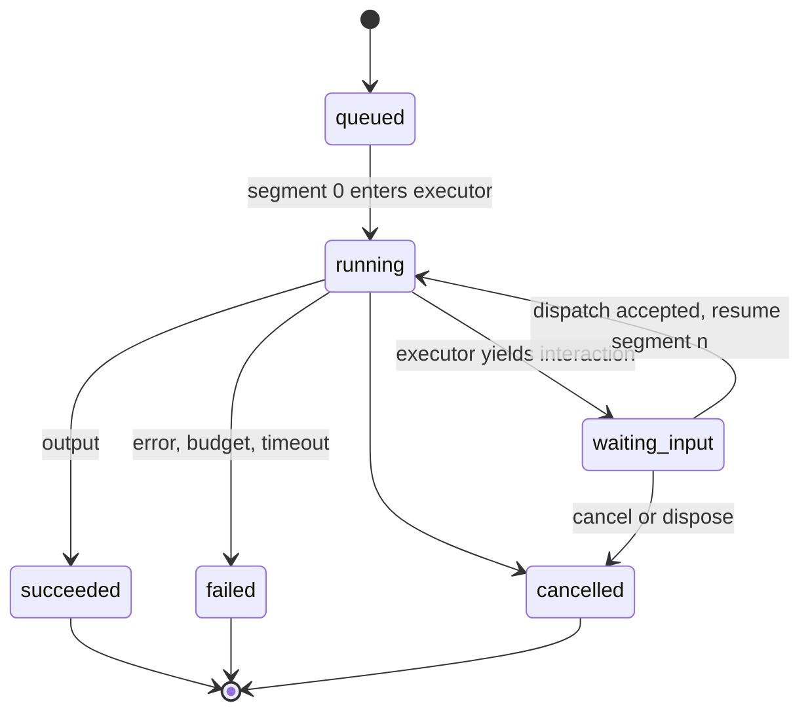
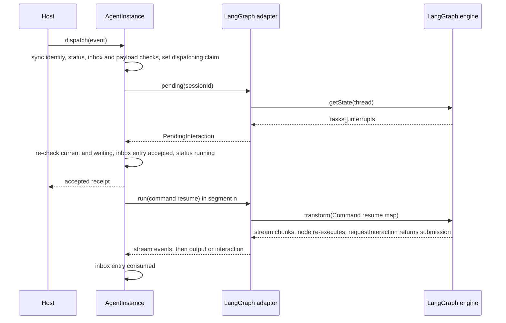
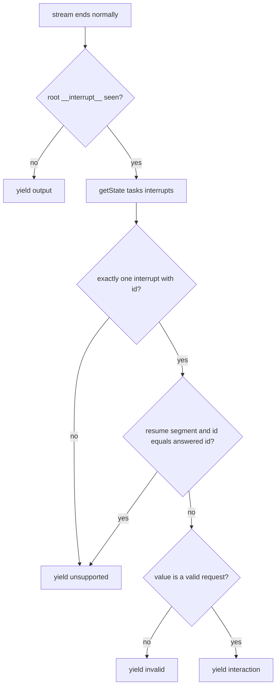

# M1 Interrupts, Resume, Interaction Dispatch and Run Segments - Plan

## Goal Capsule

- **Objective:**
  - A LangGraph graph run through galaxie can pause to ask the user something, on Node and in Chromium. The host sees one pending interaction, read from the checkpoint. The user's answer resumes the same run exactly once.
  - Double clicks, stale screens and late executor events never start a second resume or a second run.
  - The conformance suite proves on native Node, galaxie Node and galaxie Chromium that interrupt, resume, node re-execution, interrupt IDs, resume values and durability modes behave as native LangGraph 1.5.1 does.
- **Means:**
  - Core runs each run as one or more segments and gains an in-memory submission inbox behind `AgentInstance.dispatch` (KTD3 to KTD7).
  - The LangGraph adapter ships a `requestInteraction(request, config)` helper that works anywhere in a node (KTD1). It installs async context when none exists: a real `AsyncLocalStorage` on Node, and a synchronous shim elsewhere, under which stock `interrupt()` works only in a node's synchronous prefix (KTD2). It reads the pending interaction with `getState` and resumes with `Command({ resume })` (KTD8 to KTD10).
- **Authority, highest first:**
  1. `AGENTS.md` repository rules.
  2. Accepted ADRs in `docs/adr/`. ADR-0001, ADR-0012, ADR-0015, ADR-0016 and ADR-0017 bind this slice.
  3. This plan. ADR-0004 is Proposed; this plan implements its M1 part (in-memory inbox) and records what conformance confirms.
  4. `docs/galaxie-project-brief.md`, especially §7.5, §8.2, §8.3, §11.4, §12.1, §12.2 and §16.3.
  5. `docs/system-design.md`.

  When this plan and an Accepted ADR disagree, follow the ADR and record the conflict in the PR body.
- **Execution profile:** autonomous. Work on one branch named `feat/m1-interrupts-resume` and open one pull request against `main`. Run units U1 to U8 in order, and `pnpm check` after each one.
- **Stop conditions:** stop and open a draft pull request that names the blocker when any of these happens:
  - a requirement can pass only by weakening an ADR-0012 guarantee, or by putting a submission payload, interrupt value or prompt into a span, diagnostic message or error message;
  - an existing golden file under `tests/conformance/golden/` would have to change;
  - a galaxie lane produces a difference that neither a fix nor a matrix entry with a concrete reason can account for, after three focused attempts;
  - `pnpm check` still fails after three focused fix attempts on the same cause.
- **Who finishes:** the implementing agent opens the pull request and stops. It never merges, never pushes to `main`, and never enables auto-merge.

---

## Product Contract

### Summary

A graph node asks the user for input by calling `requestInteraction(request, config)` from `@galaxie/adapter-langgraph`. The request names a surface, a view revision, a component and its props.

The run pauses in `waiting_input`, and its snapshot carries a `PendingInteraction` whose `interactionId` is LangGraph's interrupt ID. The host calls `dispatch(event)`. Core checks every identity field against the pending interaction, reads the pending interaction again from committed checkpoint state, and records the submission in an in-memory inbox. It then resumes the same run in a new segment, and the interrupting node receives `{ action, payload }`.

The conformance suite gains interrupt cases that run on all three lanes.

### Problem Frame

Today `dispatch()` throws `unsupported`, the adapter turns every `__interrupt__` into an `unsupported` error, and `pending()` returns `undefined`. No human-in-the-loop graph can run.

Research against the installed packages found a harder problem. LangGraph's `interrupt()` reads its config only from AsyncLocalStorage. The `/web` entry installs none, so in a browser `interrupt()` throws "Called interrupt() outside the context of a graph." and the node fails instead of pausing. Brief §16.3 makes interrupt and resume parity on Node and Chrome an M1 exit criterion, so this slice must close that gap with the pinned versions.

### Requirements

**Asking and pausing**

- R1. A node calls `requestInteraction(request, config)` with the node's own `config`. On the first execution the run pauses. After a resume, the call returns the submission `{ action, payload }`. This works on the `/web` entry in Node and in Chromium, including after an `await` in the node.
- R2. An interaction request is a plain JSON object with exactly four fields. `surfaceId` and `viewRevision` are non-empty strings. `component` matches the `ComponentId` shape `<namespace>.<Name>/v<integer>`. `props` is a JSON object. A malformed request fails the run with `invalid`; an interrupt value that is not a valid request, such as a bare `interrupt()` with another shape, fails the run the same way.
- R3. When a segment ends at exactly one interrupt with an ID, the run status becomes `waiting_input`. The snapshot's `run.pending` is `{ interactionId, surfaceId, viewRevision, component, props }`. Its `interactionId` is the interrupt ID, and its fields come from committed checkpoint state, read through the executor's `pending(sessionId)` (ADR-0004).
- R4. These cases fail the run with `unsupported`, a fixed message, and no pending interaction (AT-35):
  - two or more interrupts pending at once;
  - a static `interruptBefore`/`interruptAfter` breakpoint;
  - an interrupt without an ID, such as `NodeInterrupt`;
  - a resumed segment that pauses again on the interrupt ID it just answered, which happens when one node calls `requestInteraction` more than once.

**Dispatch and the submission inbox**

- R5. `dispatch(event)` resolves `{ status: 'accepted', interactionId }` only when all of these hold:
  - `instanceId` and `runId` name this instance and its current run, the run is `waiting_input`, and `interactionId`, `surfaceId` and `viewRevision` equal the pending interaction's;
  - the executor's `pending(sessionId)` still reports that `interactionId`;
  - `action` is a non-empty string;
  - `payload` is JSON-serializable within the run's `payloadBytes` limit.
- R6. A rejected dispatch resolves `{ status: 'rejected', error }` with one of these codes and never resumes anything. Checks run in this order, and the first failing check decides the code:
  1. `stale` when `instanceId` or `runId` does not name this instance and its current run;
  2. `duplicate` when the run's inbox already holds an entry for the event's `interactionId`, or a dispatch for it is still being checked, whatever the run's status;
  3. `stale` when the run is not `waiting_input`, or `interactionId`, `surfaceId` or `viewRevision` differs from the pending interaction;
  4. `unsupported` when the adapter declares `features.resume: false`;
  5. `invalid` for a malformed `action` or a payload that is not JSON-serializable, and `budget_exceeded` for a payload over `payloadBytes`;
  6. after awaiting `pending(sessionId)`: `stale` when committed state no longer reports the interaction, or when the run stopped being current and waiting (cancelled or disposed) during the await; `executor_error` when `pending()` rejects, with the fixed message in the receipt and the raw error in diagnostics only.

  A dispatch called on an already disposed instance still rejects the promise, as every other method does.
- R7. An accepted dispatch writes one inbox entry `accepted` for that `interactionId`. The run moves to `running` and loses its pending interaction, and core starts exactly one resume segment with `{ type: 'resume', interactionId, action, payload }`. The entry becomes `consumed` when that segment reports an executor outcome: output, a next interaction, or an executor error. The snapshot shows the latest entry as `run.submission: { interactionId, status }`.

**Run segments**

- R8. A run keeps its `runId`, its event stream and its data labels across segments. `events(runId)` delivers every event once, in sequence order, across segments.
- R9. Token, cost and tool-call budgets accumulate across segments. The payload limit applies to each value on its own, including each submission payload. The step limit and the wall-clock limit apply to each segment separately and never run while the run waits for input.
- R10. Each segment has its own root span with the same `galaxie.run.id` and a new integer attribute `galaxie.run.segment`, starting at `0`. A segment that pauses ends its span with `galaxie.run.status = waiting_input` and without an error status (unset, as today).
- R11. Once a segment has reported its outcome, any later event from that segment's iterator is dropped and reported as `late_event`. Ports handed to a segment refuse new capability and model calls after that segment's outcome.
- R12. Cancelling or disposing a waiting run ends it `cancelled` without calling the executor. A later `start` on the same instance runs from `START` on the same thread, abandoning the old interrupt as native LangGraph does.

**Duplicate runs and late results (brief §16.3)**

- R13. Repeated `prepare()`, `subscribe()`, `getSnapshot()` and `events()` calls never start or resume a run. Two `start` calls in one tick, or a `start` while a run is waiting or resuming, start one run only. Existing tests cover the `start` cases and stay green.

**Conformance**

- R14. New conformance cases run on all three lanes and are each compared with a golden from the native Node lane:
  - `interrupt-resume`;
  - `interrupt-sequence`, two interrupts in two nodes with a `false` payload;
  - `interrupt-subgraph`, a subgraph invoked inside a parent node;
  - `interrupt-durability-sync` and `interrupt-durability-exit`.

  Together they cover `interrupt()`, `Command({ resume })`, interrupt IDs, resume values, node and parent-node re-execution, and the durability modes `async` (the default), `sync` and `exit`.
- R15. Each difference a galaxie lane shows against a golden is either fixed or listed in `tests/conformance/compatibility-matrix.json` with a concrete reason. Existing golden files do not change.

### Acceptance Examples

- AE1. **Covers R1, R3, R7.**
  - **Given** a graph `prepare → ask → finish` where `ask` awaits a timer and then calls `requestInteraction`.
  - **When** the run pauses, the host dispatches `{ action: 'submit', payload: { answer: 'yes' } }` with the pending identity.
  - **Then:**
    - the receipt is `accepted`;
    - `ask` runs twice and `prepare` once;
    - the run succeeds;
    - `run.submission.status` is `consumed`;
    - this holds in Node and in Chromium.
- AE2. **Covers R5, R6, R7.**
  - **Given** a waiting run.
  - **When** the host calls `dispatch` twice with the same valid event in one tick.
  - **Then** the first resolves `accepted`, the second resolves `rejected` with `duplicate`, and the executor receives exactly one resume request.
- AE3. **Covers R6.**
  - **Given** a waiting run whose pending `viewRevision` is `r2`.
  - **When** the host dispatches an event carrying `r1`.
  - **Then** the receipt is `rejected` with `stale`, the run stays `waiting_input`, and nothing reaches the executor.
- AE4. **Covers R4.** A graph with two parallel nodes that each call `requestInteraction` fails with `unsupported`, and the snapshot has no `pending`.
- AE5. **Covers R12.**
  - **Given** a waiting run.
  - **When** the host cancels it and then starts again on the same instance.
  - **Then** the new run executes from `START` and succeeds, and `pending(sessionId)` afterwards returns `undefined`.
- AE6. **Covers R11.** An executor that yields a `stream` event after its `interaction` event produces one `late_event` diagnostic. The last journaled event is the interaction, and an open `events()` iterator stays open, waiting for a resume.

### Scope Boundaries

- Considered and not built:
  - **An adapter-side re-check of the pending ID before `Command({ resume })`.** Core reads `pending()` during dispatch and holds the only run slot, so nothing can change the thread in between. Revisit when M3 adds recovery resumes that skip dispatch.
  - **Payload schema validation per component.** The component registry and its payload schemas are M2 (ADR-0007). M1 accepts any JSON payload within `payloadBytes`.
  - **Data labels from submission payloads.** Labels come from schema annotations, and payloads have no schema until M2.
  - **A `resumed` run event.** The snapshot's `submission` field and the following stream events already show progress.
- Outside this slice:
  - the IndexedDB saver, the durable inbox, recovery reconciliation and reload restore (M3, brief §16.5);
  - React hooks, `instanceKey` deduplication and Strict Mode remounts (AT-17), which arrive with the React package in M2;
  - UI rendering and the component registry (M2);
  - several pending interrupts per run, and multiple interrupts in one node.

### Key Decisions

- **M1 "rerender" means repeated subscription, snapshot reads and `prepare` calls on one instance.** galaxie has no React package yet, so instance deduplication across remounts stays with the React hooks in M2. Governs R13.
- **One interrupt request per node execution.** Every `interrupt()` call in one node shares one engine ID, so a second call cannot be told apart from a replay. Splitting asks across nodes keeps `interactionId` equal to the engine ID, as ADR-0004 prefers. Governs R4.
- **Dispatch rejections resolve a receipt.** `DispatchReceipt` already has a `rejected` variant, and a double click is an expected outcome, not a programming error. Governs R6.

---

## Planning Contract

### Key Technical Decisions

- KTD1. **`requestInteraction(request, config)` wraps stock `interrupt()`.** It validates the request (R2), then calls `interrupt(request)` from `@langchain/langgraph/web` inside `AsyncLocalStorageProviderSingleton.runWithConfig(config, ...)` from `@langchain/core/singletons`. `interrupt()` is synchronous and reads exactly that store. The helper never catches the `GraphInterrupt` it throws. Reimplementing `interrupt()` from `config.configurable` internals was rejected: it copies upstream logic, which `AGENTS.md` forbids, and depends on more internals.
- KTD2. **The adapter installs async context at `prepare` when none exists.** `installContext()` passes an instance to `AsyncLocalStorageProviderSingleton.initializeGlobalInstance`, which writes only when no global instance exists, so an instance installed earlier is always kept.
  - **On Node** (`globalThis.process?.getBuiltinModule` is a function), the instance is `new AsyncLocalStorage()` from `process.getBuiltinModule('node:async_hooks')`. This is what importing the root `@langchain/langgraph` entry installs, so the galaxie Node lane gets native behavior: stock `interrupt()`, `getConfig()` and implicit model config work anywhere in a node, and the host's own LangChain code is not locked out of real async context. The adapter still imports only `/web`; this is a runtime feature check, not an import.
  - **Elsewhere** (browsers), the instance is a synchronous shim with `getStore`, `run` and `enterWith`. Stock `interrupt()`, `getConfig()` and implicit model config then work only in a node's synchronous prefix, before its first `await`. First-writer-wins means the shim stays for the page's lifetime; browsers have no real `AsyncLocalStorage` for it to block.

  Either way the existing `model-without-config` matrix entries can shrink or disappear, so U5 re-measures them. Portable graph code uses `requestInteraction`, which works on every lane.
- KTD3. **A run is a sequence of segments.** Each segment is one executor `run()` call: the start, then one per accepted submission. A segment owns its settlement promise, root span, wall-clock timer, step limit and an outcome flag. A resume segment calls `executor.run()` only after the previous segment has settled, within the existing `waitForSettlement` bound, because the previous iterator can still be finishing (the adapter awaits its trace handler in `finally`) after core already published `waiting_input`. The `RunRecord` owns `runId`, events, labels, private values, grants, `RunBudget`, the inbox and the status. The instance-level `settlement` chain appends every segment, so `start` and `dispose` wait for the latest segment. Private values are cleared only when the run becomes terminal.
- KTD4. **Dispatch claims synchronously, then confirms against committed state.**
  1. Run checks 1 to 5 of R6 synchronously, in R6's order.
  2. Set a per-run `dispatching` claim for the `interactionId`. While it is held, a dispatch for the same `interactionId` gets `duplicate` (R6 check 2), and one for another ID gets `stale` (R6 check 3).
  3. Await `executor.pending(sessionId)`, then apply R6 check 6.
  4. Write the inbox entry, set `running`, publish, then start the resume segment.

  Any rejection releases the claim.
- KTD5. **Inbox entries live in a per-run `Map<InteractionId, InboxEntry>`.** An entry stores status, action and payload; there is no deletion and no persistence in M1. The entry becomes `consumed` on the resume segment's first executor outcome (R7). It stays `accepted` if the segment is cancelled or fails in core before an executor outcome, which is the state M3 recovery will resume from.
- KTD6. **Spend limits per run, autonomy limits per segment.** `RunBudget` is created once per run (R9). `limits.steps` and a fresh `deadlineTimer(wallClockMs)` are per segment, because LangGraph's `recursionLimit` counts steps per invocation and a human wait must not consume wall-clock budget.
- KTD7. **Every segment-owned path keys on the segment, not on run status.** `acceptEvent` takes the segment. It drops and reports `late_event` for any event after that segment's outcome or after the run is terminal, and ports' `active()` checks the same pair. The same segment check guards everything `execute` does after the loop or on error: the post-loop protocol check (no outcome), the `catch` guard, the wall-clock deadline callback, budget failure, label and route publishing, and the span's final `galaxie.run.status`. A segment that reported an interaction ends its span as `waiting_input` even if the run is already `running` again, and its late deadline or protocol check never touches the run.
- KTD8. **The adapter detects a pause from the stream, then reads the checkpoint.**
  1. During the stream, collect root-path (`path.length === 0`) `updates` payloads that carry `__interrupt__`.
  2. After a normal end, if any were seen, call the same function that implements `pending(sessionId)`: `graph.getState({ configurable: { thread_id } })`, then the interrupts on `tasks[].interrupts`.
  3. Map an empty interrupt list, a missing ID, or more than one distinct ID to `unsupported` (R4).
  4. Validate the single interrupt's value with core's request validator, and yield `{ type: 'interaction', interaction }`.

  `getState().next` is not used because it is unreliable at interrupts.
- KTD9. **Resume uses an ID map, on every lane.** The adapter streams `new Command({ resume: { [interactionId]: { action, payload } } })` on the same thread with the same options as a start. Wrapping the payload means `false`, `0`, `''` and `null` resume correctly; LangGraph rejects falsy single resume values with `EmptyInputError`. If the `interrupt-subgraph` case shows that the map does not reach a subgraph's inner task on 1.5.1, use the single-value form `{ action, payload }` instead. That is safe because R4 guarantees one pending interrupt. The native conformance driver uses the same form (KTD11). Record the outcome in the PR body.
- KTD10. **`LangGraphGraph` requires `getState`.** `prepare` rejects a graph without `getState` with `unsupported`, as it does for `transform`. Adapter features become `interrupts: true`, `resume: true`, `checkpoints: true`.
- KTD11. **Conformance cases receive the interrupt function.** `ConformanceCase.factory` gains a fifth parameter `{ request(value, config) }`.
  - The native lane passes `(value) => langgraph.interrupt(value)` from the root `@langchain/langgraph` module, which has async context.
  - Galaxie lanes pass `requestInteraction`.

  Graph code is otherwise identical. Native resumes send the same `{ action, payload }` value in the same resume form the adapter uses (KTD9), keyed by the root interrupt ID read from `getState().tasks`, so both lanes feed the engine the same command.
- KTD12. **Transcripts stay backward compatible.** A case may export `resumes: readonly { action: string; payload: unknown }[]`. A transcript gets a `pauses` field only when the run paused. Each pause records the root interrupts read from `getState().tasks` as `{ id, value }` and the checkpoint history length at that moment. `normalize` also replaces interrupt IDs with first-appearance `<interrupt:n>` tokens. It collects the IDs from the transcript's `pauses` and from `__interrupt__` entries in stream events, then replaces exactly those strings wherever they appear, including as object keys. It never rewrites other 32-hex strings, so a lane that returns a different hex value in state still shows a difference. Existing cases never pause and contain no 32-hex strings, so their goldens stay byte-identical.

### High-Level Technical Design

Run status and segments:

Dispatch and resume:

Adapter pause detection, per segment:

### Assumptions

- Headless execution: the scoping confirmation was skipped. These inferred defaults stand:
  - the helper is named `requestInteraction` so it does not shadow LangGraph's `interrupt`;
  - the snapshot field is `run.submission`;
  - a pause ends its span without an error status, as it does today;
  - the galaxie Node lane gets a real `AsyncLocalStorage` (native parity), and only browsers get the synchronous shim (KTD2).
- `@langchain/core` 1.2.20 keeps `runWithConfig` storing the config under its child key and `initializeGlobalInstance` as first-writer-wins. U4 adds a test that fails if either changes.
- A subgraph interrupt bubbles to the root, so root `getState().tasks` lists it on the calling parent task with the same ID the stream reported. U5 and U7 verify this; if it is false, the adapter reads the ID from the stream instead and the PR body records why.
- The probes behind this plan ran on Node 24 against the installed packages. Chromium behavior is assumed to match `/web` on a clean Node process. The galaxie Chromium lane confirms it.

### Implementation Constraints

- No new runtime or dev dependency. `@langchain/core/singletons` is already reachable through the adapter's `@langchain/core` peer dependency.
- New source files start with the SPDX header from `AGENTS.md`. Relative imports end in `.js`, type-only imports use `import type`, exported functions declare return types, and no `enum`.
- Fixed error messages only. Payloads, props and interrupt values never appear in error messages, spans or diagnostics `error` fields.
- Never run `pnpm conformance:update` blindly. Generate new goldens only from the native Node lane, then confirm with `git status` that the only golden changes are new files for the new cases.
- Biome formatting via `pnpm format` before each commit.
- No Beads IDs in tracked files, commits or the PR.

### Known Library Behavior to Respect

- `interrupt()` and `config.interrupt` read config only from async context. In a browser, without KTD2, they throw a plain `Error`, so the node fails instead of pausing.
- All `interrupt()` calls in one node share one ID. The interrupting node re-runs from its top on every resume. For a subgraph invoked inside a node, the calling parent node re-runs too.
- Interrupt IDs hash a time-based checkpoint namespace, so they differ between runs and lanes.
- `Command({ resume })` on a thread with nothing pending ends silently with zero chunks. Plain input on an interrupted thread silently starts a new run from `START`.
- In `values` mode the last root chunk at an interrupt is `{ __interrupt__ }`, not state.
- A subgraph invoked inside a node must receive the node's `config` (`child.invoke(state, config)`) on `/web`.
- Durability binds per graph with `graph.withConfig({ durability })`. Probes on 1.5.1 with the `prepare → ask → finish` graph found history lengths of 3, 3 and 1 at the pause for `async`, `sync` and `exit`, and 5, 5 and 2 after the resume. Each node that finishes after the resume adds one checkpoint under `async` and `sync`. The native golden is authoritative if a case graph changes shape.
- Aborting the signal makes the stream throw `AbortError`; that is cancellation, never a pause.

### Sequencing

U1 → U2 → U3 → U4 → U5 → U6 → U7 → U8. U2 and U3 change core only and use the fake executor. U4 and U5 need U1's validator. U6 and U7 need U3 and U5.

---

## Implementation Units

### U1. Core interaction contracts and request validation

- **Goal:** Add the types and validator the rest of the slice uses.
- **Requirements:** R2, R5, R7.
- **Dependencies:** none.
- **Files:**
  - `packages/core/src/interactions.ts`
  - `packages/core/src/executor.ts`
  - `packages/core/src/instance.ts`
  - `packages/core/src/index.ts`
  - `packages/core/test/interactions.test.ts` (new)
- **Approach:**
  1. Add `InteractionRequest` (the four request fields) and `Submission { action, payload }` types.
  2. Add an exported `parseInteractionRequest(value)` that returns the request or `undefined`. It accepts only plain JSON: a plain prototype object, finite numbers, no `undefined`, functions, BigInt or cycles.
  3. Add `action: string` to the resume `RunCommand`.
  4. Add optional `submission: { interactionId, status: InboxStatus }` to `RunSnapshot`.
  5. Export the new names from `index.ts`.
- **Test scenarios:**
  - A valid request with nested JSON props parses to an equal object.
  - Each malformed field fails: an empty `surfaceId`, an empty `viewRevision`, the component `Quiz/v1`, the component `edu.Quiz/vx`, props given as an array, props containing a `Date`, a BigInt, a function or an `undefined` value, and an extra fifth key.
  - A class instance as props fails.
- **Verification:** core typecheck passes under `tsc` and `tsc6`, and the new tests pass.

### U2. Run segments in core

- **Goal:** Restructure `execute` so one run can span several executor calls without breaking existing guarantees.
- **Requirements:** R8, R9, R10, R11, R12.
- **Dependencies:** U1.
- **Files:**
  - `packages/core/src/agent-instance.ts`
  - `packages/core/src/tracing.ts`
  - `packages/core/test/runs.test.ts`
  - `packages/core/test/tracing.test.ts`
  - `packages/core/test/budgets.test.ts`
  - `packages/core/test/fake-executor.ts`
- **Approach:**
  1. Introduce a segment record owned by the run (KTD3) and make `execute` take a segment and a `RunCommand`.
  2. Create `RunBudget` only for segment 0. Start a wall-clock timer and pass `limits.steps` per segment (KTD6).
  3. Make `acceptEvent`, the ports' `active()` and every other segment-owned path segment-aware (KTD7).
  4. In `finally`, clear private values only when the run is terminal, finish only the segment span, and settle only the segment.
  5. Start a resume segment's `executor.run()` only after the previous segment settles (KTD3).
  6. Add `galaxie.run.segment` to `ALLOWED` in `tracing.ts` and set it in `startRunTrace`.
  7. Extend `FakeExecutor` so a test can script one event list per command, and record every `RunRequest`.
- **Patterns to follow:** the existing settlement chain and the `waitForSettlement` bound in `agent-instance.ts`; scripted executors in `fake-executor.ts`.
- **Test scenarios:**
  - Covers AE6. An executor yields `interaction`, then a `stream`. One `late_event` diagnostic is reported, the journal's last event is the interaction, and no `stream` event follows it.
  - A paused segment's span has `galaxie.run.status = waiting_input`, `galaxie.run.segment = 0` and a status that is not error.
  - Cancelling a waiting run publishes `cancelled`, closes `events()` with a `cancelled` event, and never calls `run()` again.
  - Disposing a waiting run disposes the executor once and settles within the existing bound.
  - The wall-clock budget does not fail a run that waits longer than `wallClockMs`, with fake timers.
- **Verification:** every existing core test passes unchanged except tests whose subject is the old single-segment behavior. A changed test is listed with the reason in the PR body.

### U3. Dispatch and the in-memory submission inbox

- **Goal:** Implement `dispatch` and the resume segment.
- **Requirements:** R5, R6, R7, R9, R10, R13.
- **Dependencies:** U2.
- **Files:**
  - `packages/core/src/agent-instance.ts`
  - `packages/core/test/dispatch.test.ts` (new)
  - `packages/core/test/instance.test.ts`
  - `packages/core/test/runs.test.ts`
- **Approach:** follow KTD4 and KTD5.
  - Use `budget.payload(payload)` for the size and serializability check, mapping its error to the rejected receipt.
  - Read `adapter.features.resume` for the `unsupported` rejection.
  - Rewrite the `instance.test.ts` test "dispatch rejects unsupported in this slice" to cover the new behavior. Keep the disposed-instance rejection as a rejected promise.
- **Patterns to follow:** `start`'s synchronous slot claim (`claimingSlot`), and the fixed messages from `toErrorInfo`.
- **Test scenarios:**
  - Covers AE2. Two dispatches in one tick give `accepted` and `duplicate`, with exactly one resume `RunRequest` recorded.
  - Covers AE3. Each of the five identity fields mismatched in turn gives `stale`, with zero resume requests and status still `waiting_input`.
  - A dispatch while `running` or after `succeeded`, for an interaction ID without an inbox entry, gives `stale`. A dispatch carrying a previous run's ID gives `stale`.
  - Repeating an accepted event in a later tick, after the first receipt resolved, gives `duplicate`, including after the run succeeded.
  - A fake `pending()` that returns another `interactionId` gives `stale` and releases the claim; a correct retry then succeeds.
  - A cancel issued while `pending()` is awaited makes that dispatch resolve `stale`, with no resume request. A `dispose()` issued during the await does the same, and the executor is disposed only after that dispatch settles.
  - A fake `pending()` that throws gives `executor_error` with the fixed message, no raw error text in the receipt, and a released claim.
  - Covers KTD3 and KTD7. A fake executor delays its generator's return after yielding `interaction`, and a dispatch is accepted during that delay. The run resumes and succeeds, segment 1's `run()` starts only after segment 0 settled, no protocol-violation failure occurs, and segment 0's span ends `waiting_input`.
  - `action: ''` gives `invalid`. A BigInt payload gives `invalid`. A payload larger than `payloadBytes` gives `budget_exceeded`.
  - An adapter with `features.resume: false` gives `unsupported`.
  - After an accepted dispatch the snapshot is `running` without `pending`, with `submission.status = accepted`. After the resume segment's output the run is `succeeded` and the submission `consumed`.
  - A resume segment cancelled before it enters the executor leaves the submission `accepted`.
  - Tokens reserved in segment 0 count against segment 1's reservations.
  - Segment 1's span carries `galaxie.run.segment = 1` and the same `galaxie.run.id`.
  - One `events()` iterator observes stream, interaction, stream, output across two segments with contiguous sequences and no repeats.
  - Rerender proxy for R13: calling `prepare()` three times, subscribing and unsubscribing listeners, and reading `getSnapshot()` repeatedly records no extra `RunRequest`.
- **Verification:** the new and updated core tests pass, and existing duplicate-start tests in `runs.test.ts` remain green.

### U4. Context shim and `requestInteraction`

- **Goal:** Make stock `interrupt()` usable from galaxie graphs on `/web`.
- **Requirements:** R1, R2.
- **Dependencies:** U1.
- **Files:**
  - `packages/adapter-langgraph/src/interaction.ts` (new)
  - `packages/adapter-langgraph/src/index.ts`
  - `packages/adapter-langgraph/test/interaction.test.ts` (new)
- **Approach:** implement KTD1 and KTD2.
  - Export `requestInteraction`, plus an internal `installContext()` that `prepare` calls in U5.
  - The shim's `run(store, callback)` sets the current store, calls the callback, and restores the previous store in `finally`.
  - A malformed request throws `GalaxieError('invalid', ...)` with the fixed message, so the adapter's existing cause mapping fails the run with `invalid`.
- **Test scenarios:**
  - On Node, `installContext()` with no global instance installs an instance that keeps the store across an `await` inside `run()`.
  - `installContext()` keeps a pre-existing global instance. Save the existing value at `Symbol.for('ls:tracing_async_local_storage')`, set a sentinel, call the function, assert the sentinel remains, then restore.
  - Inside `runWithConfig(config, ...)` under the shim (constructed directly, not through `installContext()`), `AsyncLocalStorageProviderSingleton.getRunnableConfig()` returns that config. This guards the core 1.2.20 internals the helper relies on.
  - The shim restores the previous store after a callback throws.
  - `requestInteraction` with a malformed request throws `invalid` before any interrupt.
- **Verification:** the adapter tests pass under the node project.

### U5. Adapter interrupt detection, `pending()` and resume

- **Goal:** Wire LangGraph interrupts and `Command({ resume })` into the executor contract.
- **Requirements:** R1, R3, R4, R12.
- **Dependencies:** U3, U4.
- **Files:**
  - `packages/adapter-langgraph/src/adapter.ts`
  - `packages/adapter-langgraph/src/host.ts`
  - `tests/conformance/adapter.node.test.ts`
  - `tests/conformance/compatibility-matrix.json`
- **Approach:** implement KTD8, KTD9 and KTD10.
  - Call `installContext()` in `prepare` before calling the factory.
  - Re-measure `model-without-config` on both galaxie lanes in this unit, because `installContext()` changes it and `galaxie.test.ts` requires the observed differences to equal the matrix exactly. Shrink each lane's matrix entry to the differences that remain, or delete an entry whose differences are now empty, and rewrite each remaining reason to match. Expect the galaxie Node entry to disappear (real `AsyncLocalStorage`) and the Chromium entry to shrink only if the model call sits in the synchronous prefix.
  - Build the resume input as a one-item async generator, as starts do today, through `graph.transform`.
  - Keep `request.signal.aborted` suppression and the credential-failure mapping unchanged.
  - Rewrite the test "reports NodeInterrupt and resume as unsupported", and update the feature-flag assertion.
- **Patterns to follow:** the existing `transform` call, recursion-limit computation and error mapping in `adapter.ts`.
- **Test scenarios:**
  - Covers AE1 on Node. The full start, pause, dispatch, resume and succeed flow runs on a real graph with `MemorySaver`. `pending(sessionId)` equals the snapshot's pending interaction while waiting and is `undefined` after success.
  - Covers AE4. Two parallel interrupting nodes give `unsupported`.
  - Each of these gives `unsupported`: `NodeInterrupt`, an `interruptBefore` breakpoint, and one node calling `requestInteraction` twice, failing on the second pause after the first resume.
  - A stock `interrupt({ question: 'x' })` value gives `invalid`.
  - Covers AE5. Cancel while waiting, then start again: the second run executes from `START` and succeeds on the same thread.
  - A resume with payload `false` reaches the node as `{ action, payload: false }`.
  - A graph object without `getState` makes `prepare` reject `unsupported`.
  - The features are `{ interrupts: true, resume: true, checkpoints: true, streaming: true, subgraphs: true }`.
- **Verification:** `tests/conformance/adapter.node.test.ts` passes, including the existing settlement and thread-continuity tests.

### U6. Conformance harness for multi-step runs

- **Goal:** Let cases pause and resume on all lanes and record pauses comparably.
- **Requirements:** R14, R15.
- **Dependencies:** U5.
- **Files:**
  - `tests/conformance/support/transcript.ts`
  - `tests/conformance/support/normalize.ts`
  - `tests/conformance/support.test.ts`
- **Approach:** implement KTD11 and KTD12.
  - **Native driver:** repeat `graph.stream` on one thread, starting with the input and then `new langgraph.Command({ resume: { [id]: next } })`, where `id` is the single root interrupt ID read from `getState().tasks`, while a root `__interrupt__` was seen and resumes remain. If U5 settled on the single-value form (KTD9), use that form here too.
  - **Galaxie driver:** track the last event `sequence`. On an `interaction` event, record the pause, dispatch the next resume with identity taken from `instance.getSnapshot().run.pending`, assert `accepted`, then iterate a fresh `events(runId)` and skip sequences already seen.
  - If either driver pauses with no resume left, it throws, failing the case.
- **Test scenarios:**
  - `normalize` maps two distinct interrupt IDs taken from `pauses`, including one used as an object key, to `<interrupt:1>` and `<interrupt:2>` by first appearance, leaves an unrelated 32-hex string in state unchanged, and leaves dashed UUID handling unchanged.
  - A transcript of an existing non-pausing case has no `pauses` key.
- **Verification:** `support.test.ts` passes, and the native lane still matches all seven existing goldens without `--update`.

### U7. Interrupt conformance cases, goldens and matrix

- **Goal:** Prove parity for the R14 cases on three lanes.
- **Requirements:** R1, R14, R15.
- **Dependencies:** U6.
- **Files:**
  - `tests/conformance/cases/interrupt-resume.ts` (new)
  - `tests/conformance/cases/interrupt-sequence.ts` (new)
  - `tests/conformance/cases/interrupt-subgraph.ts` (new)
  - `tests/conformance/cases/interrupt-durability-sync.ts` (new)
  - `tests/conformance/cases/interrupt-durability-exit.ts` (new)
  - `tests/conformance/cases/index.ts`
  - `tests/conformance/golden/` (new files only, one per new case)
  - `tests/conformance/galaxie.test.ts`
  - `tests/conformance/native.node.test.ts`
  - `tests/conformance/compatibility-matrix.json`
  - `tests/conformance/interaction-context.test.ts` (new; runs in both projects)
- **Approach:**
  - Count node executions with a closure counter in each factory. A final node writes the counts into state, so re-execution shows in the golden values.
  - Requests use the surface `main`, the revision `r1` and the component `conformance.Question/v1`.
  - The two durability cases reuse `interrupt-resume`'s graph with `.withConfig({ durability })`; `interrupt-resume` itself covers the default `async`.
  - `interrupt-subgraph` calls `child.invoke(state, config)` from the parent node.
  - After the new goldens exist, run both galaxie lanes. Fix or record every difference.
- **Test scenarios:**
  - Covers AE1 on all lanes. `interrupt-resume` succeeds with counts `{ prepare: 1, ask: 2 }`, one pause, and an answer equal to the payload.
  - `interrupt-sequence` pauses twice with two distinct normalized IDs, `<interrupt:1>` then `<interrupt:2>`, and its final state holds `false` from the second payload.
  - `interrupt-subgraph` shows counts `{ callSub: 2, s1: 1, sask: 2 }`.
  - The pause history lengths are 3, 3 and 1 for `async`, `sync` and `exit`, and the final histories are 5, 5 and 2, matching Known Library Behavior. The native golden is authoritative.
  - `interaction-context.test.ts`, on the galaxie lanes:
    - `requestInteraction` after an `await` pauses the run on both lanes;
    - stock `interrupt()` after an `await` pauses the run on galaxie Node and fails it with `executor_error` on galaxie Chromium;
    - a model called without config inside a node's synchronous prefix emits `messages` events on both lanes.
- **Verification:**
  - `native.node.test.ts` passes, and `git status` shows only new golden files.
  - `galaxie.test.ts` passes on the node project and on browser (chromium).
  - Every matrix entry has a concrete reason.

### U8. Docs and status

- **Goal:** Keep the docs true to the code.
- **Requirements:** R1 to R15.
- **Dependencies:** U7.
- **Files:**
  - `docs/system-design.md`
  - `AGENTS.md`
  - `docs/adr/0004-interrupt-as-pending-interaction-source.md`
- **Approach:**
  - Replace "Dispatch and resume remain unsupported" and the deferred interrupt/durability parity sentence in `docs/system-design.md` §6. State the segment model, the in-memory inbox, the `requestInteraction` requirement, the context installation from KTD2 (real `AsyncLocalStorage` on Node, the synchronous shim and its synchronous-prefix limit in browsers, first-writer-wins in both directions), and the M1 limits from R4.
  - Update the project-status paragraph in `AGENTS.md`.
  - In ADR-0004, add the M1 conformance results under its verification text without changing its status. Record only what the transcripts observe: interrupt IDs, node and parent re-execution, resume values reaching the node, and the single-interrupt-per-node rule. List how resume values are persisted, and whether a repeated resume after a crash is safe, as still unverified for M3.
  - Never describe galaxie as secure or compliant.
- **Test expectation:** none, because this unit changes documentation only.
- **Verification:** `pnpm check` passes, including Biome, and the docs name no Beads IDs or `internal/` content.

---

## Verification Contract

| Gate | Command | When |
| --- | --- | --- |
| Formatting and safe fixes | `pnpm format` | before each commit |
| Full CI equivalent | `pnpm check` | after each unit and before the PR |
| CI-mode tests | `CI=true pnpm test` | before the PR |
| Native goldens for new cases only | `pnpm vitest run --project node tests/conformance/native.node.test.ts --update`, then `git status tests/conformance/golden` | once in U7, after the cases exist; any modified existing golden is a stop condition |
| Conformance on both lanes | `pnpm vitest run tests/conformance/galaxie.test.ts tests/conformance/interaction-context.test.ts` | U7 |

The PR body lists:

- each changed existing test and why it changed;
- the final `compatibility-matrix.json` entries;
- which resume form KTD9 settled on;
- any assumption that turned out false.

---

## Definition of Done

- R1 to R15 hold, and each AE has a passing test.
- `pnpm check` and `CI=true pnpm test` pass on the final commit.
- The only golden changes are new files for the five new cases.
- New files carry the SPDX header, and no new dependency was added.
- No error message, span attribute or diagnostic message contains a payload, props or interrupt value.
- Abandoned experiments, probe scripts and dead code are removed from the diff.
- One PR from `feat/m1-interrupts-resume` against `main` is open, with a body that covers the Verification Contract items, ends with the attribution line, and contains no Beads IDs.
