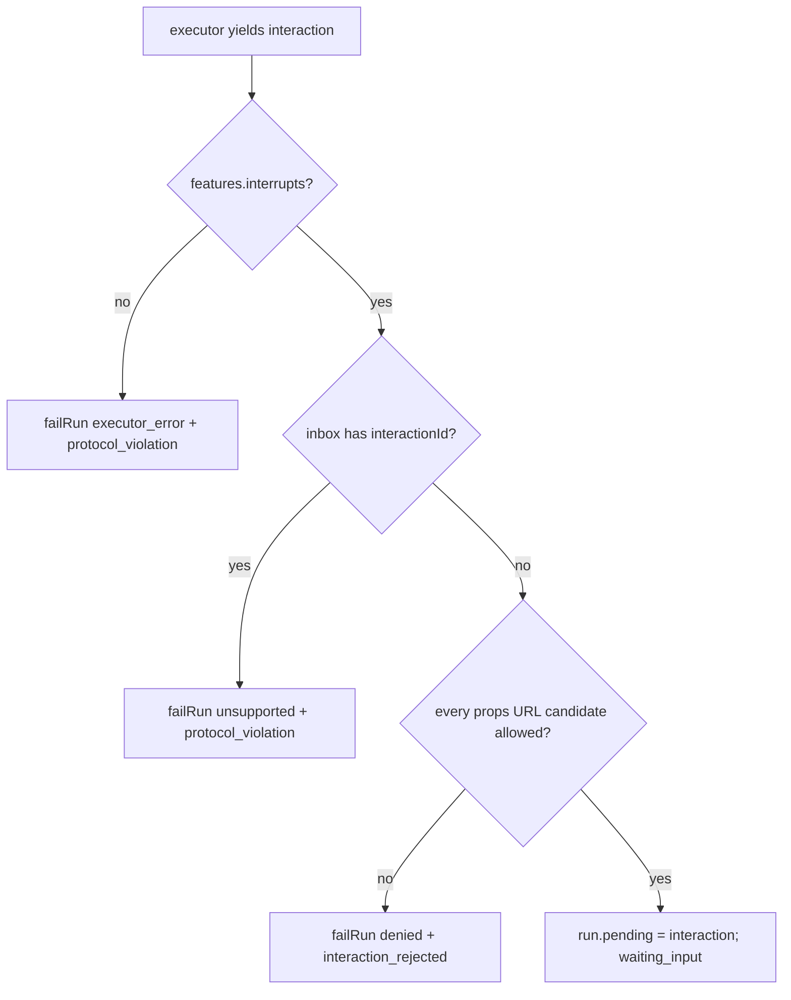

# M1 Exit - Trace Text Opt-in, Headless URL Policy, Chromium Coverage and Docs - Plan

## Goal Capsule

- **Objective:** M1 can be closed once three things hold: the development trace-text opt-in and the URL policy for interaction props are enforced, the runtime guarantees are tested on Node and in Chromium, and the docs match the code. In detail, close every remaining gap between the merged M1 code and the M1 deliverables and exit criteria in brief §16.3:
  - AT-36 passes in full, including its development opt-in for text in spans.
  - The headless M1 share of ADR-0012 A1 is enforced and tested.
  - The runtime guarantees the exit names (A1–A4, A7, A8, no duplicate runs, late results invalidated) are tested on Node **and** Chromium.
  - The APIs that need an explicit `config` are listed next to the compatibility matrix.
  - The docs no longer contradict the code.
- **Means:**
  - A shared label/destination helper in `packages/core/src/policy.ts` (KTD1).
  - A runtime option for development trace text, filtered in core at record time (KTD2 to KTD5).
  - A runtime URL allowlist applied to interaction props at the core boundary, plus executor feature honesty (KTD6 to KTD8, KTD11).
  - New dual-lane tests in `tests/conformance/` (KTD9, KTD12).
  - A conformance README and documentation updates (KTD10).
- **Authority, highest first:**
  1. `AGENTS.md` repository rules.
  2. Accepted ADRs: ADR-0001, ADR-0012, ADR-0015, ADR-0016, ADR-0017.
  3. This plan. ADR-0003, ADR-0004, ADR-0007 and ADR-0014 are Proposed; this plan implements their M1 parts.
  4. `docs/galaxie-project-brief.md`, especially §3.3, §7.1, §9.7, §11, §14.4, §16.3 and the AT-15 and AT-36 rows.
- **Stop conditions:**
  - Stop and report if a requirement can only be met by weakening an ADR-0012 guarantee, by changing an existing conformance golden, or by adding a dependency.
  - KTD4's attribute names were checked against the pinned semantic-conventions revision during planning, so there is no semconv stop condition.

---

## Product Contract

### Summary

M1 has four merged slices. An audit of brief §16.3 against the code and tests found four kinds of gap:

- **AT-36's opt-in text rule does not exist.** There is no host opt-in for text in spans and no declared trace destination, and core cannot receive prompt or argument text.
- **A1 has no headless enforcement.** `parseInteractionRequest` checks shape only. No URL policy applies to anything that reaches the host's UI.
- **Several exit guarantees are proven on Node only.** Everything under `packages/*/test` runs only in the `node` Vitest project. Chromium lacks tests for:
  - double start and repeated preparation;
  - a dropped late result;
  - the `toolCalls`, `wallClockMs` and `payloadBytes` budgets;
  - capability spans, failed capability spans, and one span tree containing run, node, model and capability spans.
- **Docs are stale or incomplete.**
  - Brief §7.1 and ADR-0001 promise a list of explicit-`config` APIs in the compatibility matrix; it does not exist.
  - `README.md`, `docs/system-design.md` and `docs/framework-overview.md` still describe slices 1–3 and seven cases.
  - `docs/system-design.md` says the M1 suite records resume persistence and repeat-resume safety, which contradicts ADR-0004 (M3).

### Problem Frame

M1's exit is a set of testable claims. A claim that holds only on Node, or only in prose, does not meet "the conformance suite passes on Node and in Chrome" or "the runtime guarantees ... covered by tests". This slice adds no new product capability beyond the two controls that §9.7 A1/A4 and AT-36 already require. Everything else is evidence and documentation.

### Requirements

**Development trace text (AT-36, §14.4, ADR-0014 traces rule)**

- R1. The host can opt in to text in spans for development with one runtime option that also declares the destination class of the system that finally receives the spans. Without the option, spans contain no prompt, model output or capability argument, exactly as today.
- R2. With the option, a text attribute is recorded only when every label the run carries at record time allows the declared class under the runtime's data policy.
- R3. Text is never recorded while the run carries a label whose allowlist is exactly `in-browser`, whatever the declaration. Under the default policy this means `private-user` text never enters a span. M1 has no payload schemas for UI events, so ADR-0014's rule that free text in a UI event is `private-user` is applied to the trace-text decision only: once a run has accepted a submission whose payload contains a non-empty string, the trace-text decision treats the run as carrying `private-user` (KTD3). Model routing labels for UI events arrive with the M2 registry's schemas.
- R4. The recorded text is: model input messages, model output messages, and capability arguments of calls that passed validation, the payload budget and policy. Galaxie itself adds no capability output, error message, credential, URL or header to any span. Message and argument text is recorded verbatim, so it can contain whatever agent code put there: tool results fed back into a prompt, error text, URLs. Only R2 and R3 gate it. The docs must state this limit (U6).
- R5. Text recording never changes the existing allowlisted attributes, statuses or the span tree. A rejected or absent text attribute is silent: no error, no diagnostic, no placeholder value.
- R6. Core makes the record/omit decision. Adapters only offer text when core says the run may record text, and always as plain JSON data.

**Headless A1 (ADR-0012 A1, ADR-0007)**

- R7. The host can give the runtime a URL allowlist of exact origins. The default is empty.
- R8. When an executor reports an interaction, core checks every string leaf of the interaction's `props` with the URL candidate rule (KTD7). A candidate passes only if it is an `https:` URL, or an `http:` URL on a loopback host, with no user info, and its origin is in the allowlist.
- R9. If a candidate fails, the run fails with code `denied` and a fixed message. The interaction never becomes `pending`, and its props never appear in a snapshot, an `interaction` event, the `error` event or a diagnostic. `stream` events are excluded from this promise: they carry raw engine output, and a LangGraph root `updates` chunk carries the interrupt value before core sees the interaction (KTD8). A diagnostic records the rejection without the URL or props.
- R10. An executor that reports `features.interrupts: false` but emits an `interaction` event fails the run as a protocol violation, as `executor.ts` already promises.
- R11. Core exports the URL check so the M2 registry renderer and hosts can apply the same rule to URL props the registry's schemas declare.

**Evidence on both lanes**

- R12. One dual-lane test runs a real LangGraph graph whose run produces a run span, node spans, a model span and a capability span in one tree with correct parent links. A second run in the same test has a failed model call and a failed capability call. Both assert the AT-36 allowlist and contain no credential canary or error message.
- R13. Dual-lane tests prove:
  - two starts in one tick claim one slot;
  - repeated `prepare`, `subscribe`, `getSnapshot` and `events` calls never execute another command (the headless stand-in for a rerender);
  - a model result that settles after cancellation is dropped and reported as late;
  - the `toolCalls`, `wallClockMs` and `payloadBytes` budgets fail the run with `budget_exceeded`.
- R14. The R1–R11 controls have dual-lane tests.

**Documentation**

- R15. `tests/conformance/README.md` lists the APIs that need an explicit `config` in the browser, with the test that proves each entry, and explains the compatibility matrix.
- R16. `docs/system-design.md` §9 gains an M1 coverage map: for A1–A4, A7, A8 and the two lifecycle guarantees, the code and the Node and Chromium tests that prove them.
- R17. Stale status text is corrected in `README.md`, `docs/system-design.md`, `docs/framework-overview.md` and `AGENTS.md`, and the brief's "none has run yet" sentence is corrected. The only ADR change is a note appended to ADR-0001's Verification section that records where the explicit-config list lives (KTD10); Accepted ADR decision text is never edited, per `docs/adr/README.md`. The guarantee-to-test evidence lives in one place, the §9 coverage map (R16). No text claims galaxie is secure or compliant.

### Acceptance Examples

- AE1. No opt-in. A run calls the model and a capability. Spans contain no `gen_ai.input.messages`, `gen_ai.output.messages` or `gen_ai.tool.call.arguments`. (R1)
- AE2. Opt-in, destination `third-party`, run labels `{public}`. The model span carries input and output messages; the capability span carries arguments. (R2, R4)
- AE3. Opt-in, destination `third-party`, run labels `{app}` (default policy excludes `third-party` for `app`). No text attribute anywhere; all other attributes equal AE2's. (R2, R5)
- AE4. Opt-in, destination `host-server`, run labels `{app}`. Text is present. (R2)
- AE5. Opt-in, any destination including `in-browser`, run labels include `private-user`. No text attribute. This holds whichever way the label arrived: through the run input schema before any capability call, through a capability output in an earlier segment followed by a model call after resume, or through an accepted submission with a string payload. (R3)
- AE6. Opt-in, destination `third-party`. The run starts with `{public}`, makes a model call, then a capability output adds `app`, then a second model call. The first model span has text; the second has none. (R2, KTD3)
- AE7. Allowlist `['https://cdn.example.com']`. An interaction with props `{ image: 'https://cdn.example.com/a.png', note: 'Note: see page 3' }` becomes pending. (R7, R8)
- AE8. Same allowlist. Props `{ image: 'https://evil.example/?d=x' }`, `{ link: 'javascript:alert(1)' }`, `{ link: ' java\tscript:alert(1)' }`, `{ src: '//evil.example/x' }`, `{ src: '\\\\evil.example/x' }`, `{ src: '/\\evil.example/x' }`, `{ src: 'https:evil.example' }`, `{ src: 'http:evil.example/x' }`, `{ src: 'wss:evil.example' }` or `{ a: { b: ['data:text/html,x'] } }` each fail the run with `denied`. The snapshot has no `pending`. `JSON.stringify` of the snapshot, the diagnostics and every non-`stream` event contains no part of the URL. (R8, R9)
- AE9. An executor with `interrupts: false` yields an `interaction`. The run fails with `executor_error` and a `protocol_violation` diagnostic. (R10)
- AE10. Opt-in, destination `third-party`, run labels `{public}`. The run pauses, the host dispatches a submission whose payload holds a free-text string, and the resumed segment calls the model. That model span has no text attribute. (R3)

### Scope Boundaries

- No React package, registry, props schemas, component or surface checks against `definition.ui`. These are M2 (brief §16.4, ADR-0007).
- No change to how `stream` events carry engine output. `stream` events are untrusted raw engine output: hosts must not render them as UI, and the M2 renderer renders interactions only from a validated `pending` (KTD8).
- No real providers, IndexedDB saver, durable inbox, MCP client or spikes.
- No change to existing conformance goldens or the compatibility-matrix entries.

#### Considered and not built

- **A size cap on text attributes.** The host opted in for development, and the OpenTelemetry SDK's span limits (`attributeValueLengthLimit`) already bound attribute size in the host's exporter. Revisit if a host reports oversized spans.
- **Retracting text already recorded when a label arrives later.** Labels are sticky and only cover data that entered the run after them. Text recorded earlier was produced before that data entered, so it cannot contain it. This matches the model router, which checks labels at call time.
- **Recording capability outputs on capability spans.** §14.4 names prompts, model output and capability arguments only. Capability spans never carry outputs. Output that agent code places in a later prompt is recorded as model input, subject to R2 and R3 (R4).
- **Withholding the `stream` update that carries a rejected interrupt.** Core would have to inspect LangGraph's `__interrupt__` chunks, which breaks its engine neutrality, and reordering events in the adapter risks parity with the native goldens. M1 narrows R9 instead and documents `stream` events as untrusted engine output.
- **Labelling UI-event payloads for model routing.** That needs per-field payload schemas, which arrive with the M2 registry. M1 applies the `private-user` rule to trace text only (R3).
- **Checking `component` and `surfaceId` against `definition.ui`.** This is surface ownership, an M2 registry deliverable. Adding it now would force a `ui` declaration on every existing test definition.

### Key Decisions

- The development trace text option is in M1, because ADR-0014's Verification section and the AT-36 row both assign the opt-in check to M1.
- The headless A1 share is a URL allowlist at the interaction boundary plus an exported check. Rendering rules (text only, no auto-loaded resources, no model HTML) stay with the M2 renderer and are documented as such.

---

## Planning Contract

### Key Technical Decisions

- **KTD1. One label helper.** Add an exported `labelsAllow(policy, labels, destination)` to `packages/core/src/policy.ts`. It returns true when every label's allowlist includes the destination; an empty label set allows every destination. Replace the private `ModelRouter.#allows` in `model-router.ts` and the inline check in `capability-broker.ts` with it. Behaviour must not change; the existing label tests (`labels.test.ts`, `model-router.test.ts`) prove it.
- **KTD2. The opt-in option.** Add `developmentTraceText?: { readonly destination: DestinationClass }` to `RuntimeOptions` in `packages/core/src/runtime.ts`. Its presence is the opt-in; the destination is required, so the host cannot opt in without declaring where spans go. `createRuntime` validates it once, rejecting with `invalid` if the destination is not in `DESTINATIONS`, and freezes it. Today neither the data policy nor any option reaches `startRunTrace`, whose signature is `(tracer, parent, metadata)`, so this wiring is new. `createRuntime` adds the frozen option to the instrumentation bag it gives `createAgentInstance`, and the bag's type gains the field. `startRunTrace` gains an options parameter carrying the option, the resolved data policy and a label reader (KTD3). `execute` in `agent-instance.ts` passes them on every segment, resumes included.
- **KTD3. Record-time decision in core.** `packages/core/src/tracing.ts` decides per attribute: record only when the option is set, `labelsAllow(policy, currentLabels, destination)` holds, and no current label has an allowlist that is exactly `['in-browser']`. "Current labels" come from the label reader that `agent-instance.ts` passes to `startRunTrace`. It returns the run's live `run.labels` set (the same mutable `Set` the model router and capability broker read through their run port's `labels` field), plus `private-user` once the run has accepted a submission whose payload contains a non-empty string leaf (R3). `agent-instance.ts` sets that flag in `dispatch` when the submission is accepted. Do not use the tracer's `setLabels` copy for this decision: `startRunTrace` starts it as `[]` on every segment and only `labelsChanged` updates it, so it misses input-schema labels and labels from earlier segments. The check runs when the text arrives, not when the span ends.
- **KTD4. Attribute names and encoding.** Use the opt-in GenAI attributes of the pinned semantic-conventions revision already cited in `tracing.ts`: `gen_ai.input.messages`, `gen_ai.output.messages` and `gen_ai.tool.call.arguments`. All three are `Opt-In` attributes at that revision; this was checked during planning (`docs/gen-ai/gen-ai-spans.md` and the `non-normative/tests/cases` input and output message cases). Values are JSON strings. Input messages are an array of `{ "role": ..., "parts": [{ "type": "text", "content": ... }] }`. Output messages have the same shape plus `"finish_reason"`: use the generation's finish reason when LangChain reports one, otherwise `"stop"`. Map LangChain message types `human`→`user`, `ai`→`assistant`, `system`→`system`, `tool`→`tool`. Non-string content is serialized as JSON inside one text part. Tool arguments are the JSON object itself.
- **KTD5. Text channel in the trace contract.** In `packages/core/src/trace.ts`:
  - `RunTrace` gains a readonly `recordsText: boolean`, true only when the option is set. Adapters build message text only when it is true, so runs without the opt-in pay nothing.
  - The model `TraceStep` gains an optional `input` (plain JSON messages).
  - The ok `TraceResult` gains an optional `output` (plain JSON messages).

  In `packages/core/src/tracing.ts`, where it is declared, `CapabilitySpan` gains a method the broker calls with the arguments.

  Core treats all of these as untrusted data: it serializes with `JSON.stringify` inside a `try`, drops values that do not serialize, and never puts them anywhere but the three text attributes. The adapter's trace handler (`packages/adapter-langgraph/src/trace-handler.ts`) supplies model text from `handleChatModelStart` and `handleLLMEnd`. The broker (`packages/core/src/capability-broker.ts`) supplies arguments after the second `checkPolicy(value)` succeeds, immediately before the binding is invoked. Input validation runs before the payload budget and both policy checks, so recording right after validation would leak the arguments of calls that are denied afterwards.
- **KTD6. URL allowlist option.** Add `urlAllowlist?: readonly string[]` to `RuntimeOptions`. `createRuntime` validates each entry as an exact origin: `https://host[:port]`, or `http://` on `localhost`, `127.0.0.1` or `[::1]`; no path other than `/`, no query, fragment or user info. Invalid entries reject `createRuntime` with `invalid`. The list is normalized to `URL.origin` strings and frozen. Reuse the origin checks in `http-capability.ts` if they factor out cleanly; do not duplicate them.
- **KTD7. URL candidate rule.** For each string leaf of `props` (at any depth, in objects and arrays):
  1. Remove ASCII tab, LF and CR anywhere, and leading or trailing C0 controls and spaces, as the WHATWG URL parser does.
  2. The string is a candidate when any of these holds:
     - it starts with two characters drawn from `/` and `\` (`//`, `\\`, `/\`, `\/`);
     - it matches `^[A-Za-z][A-Za-z0-9+.-]*://`;
     - its scheme (the text before the first `:`, matching `^[A-Za-z][A-Za-z0-9+.-]*$`, compared case-insensitively) is a WHATWG special scheme (`http`, `https`, `ws`, `wss`, `ftp`, `file`), with or without slashes, or one of `javascript`, `vbscript`, `data`, `blob` or `filesystem`.

     The WHATWG parser resolves `\\evil.example/x`, `/\evil.example/x`, `https:evil.example` and `http:evil.example/x` to the attacker origin, so they are candidates too.
  3. A candidate passes only if `new URL(candidate)` parses it (a scheme-relative candidate fails to parse without a base and is rejected), its scheme is `https:`, or `http:` on a loopback host, it has no user info, and its origin is in the allowlist.

  Other strings, such as `Note: see page 3`, `mailto:` or `10:30`, are plain text, which the M2 renderer renders as text. The rule is exported from `packages/core/src/interactions.ts` (for example as `checkInteractionUrls(props, allowlist)` plus a single-URL `isAllowedUrl(url, allowlist)`), so the M2 registry can reuse it. The all-leaves heuristic can fail a run whose text prop merely starts with a URL-like token. That is accepted for M1. The M2 registry replaces it with schema-declared URL props, checked with `isAllowedUrl`.
- **KTD8. Where A1 is enforced.** Core applies KTD7 in `acceptEvent` (`packages/core/src/agent-instance.ts`), case `interaction`, before setting `run.pending`. A rejection calls the existing `failRun(run, toErrorInfo('denied'))` path, which publishes one `error` event, and reports a new diagnostic kind `interaction_rejected` with no `error` field. The dispatch path does not need a second check: dispatch compares the committed interrupt ID with the `pending` that already passed. Any later path that turns a checkpoint's pending interaction into host-visible state, such as the M3 reload from checkpoint (ADR-0004), must call the same check; say so in the code comment and in `docs/system-design.md`. The LangGraph adapter streams a root `updates` chunk containing `__interrupt__` before it yields the `interaction` event, and core publishes `stream` events unchecked. A rejected interrupt's props therefore still appear in that `stream` event. This is accepted and documented: `stream` events are untrusted raw engine output that hosts must not render as UI (R9). Brief §9.7 A1's rendering rules (no model HTML or JS, no auto-loaded resources, stream text rendered as text, interactions rendered only from a validated `pending`) are documented as owned by the M2 renderer.
- **KTD9. Dual-lane evidence lives in `tests/conformance/`.** The Chromium project runs only `tests/conformance/**/*.test.ts` files not ending in `.node.test.ts` (`vitest.config.ts`). New evidence goes there. It reuses the Node-free helpers `packages/core/test/fake-executor.ts`, `packages/core/test/span-tree.ts` and `packages/core/test/network-recorder.ts`, as `tracing.test.ts` and `capabilities.test.ts` already do. Node-only helpers are loaded with a `typeof window === 'undefined'` guard and dynamic import, as `no-network.test.ts` does.
- **KTD10. Explicit-config list location.** Create `tests/conformance/README.md` next to `compatibility-matrix.json`. The matrix schema (`support/matrix.ts`) stays unchanged: it records case/lane differences, not API lists. Brief §7.1 is reworded from "in the compatibility matrix" to "with the compatibility matrix, in `tests/conformance/README.md`". ADR-0001 is Accepted, so its decision text stays as written. A dated note is appended to its Verification section instead: the M1 explicit-config list lives in `tests/conformance/README.md` next to `compatibility-matrix.json`, because the matrix records case and lane differences.
- **KTD11. Executor feature honesty.** In `acceptEvent`, an `interaction` from an adapter whose `features.interrupts` is false takes the existing protocol-violation path: `failRun` with `executor_error` named `ProtocolViolation`, plus a `protocol_violation` diagnostic. This check runs before KTD8's URL check.
- **KTD12. Test helper allowlist.** `packages/core/test/span-tree.ts` keeps its independent copy of allowed keys. By default `assertSpanTree` fails if any of the three text keys is present. A new option (for example `{ text: 'allowed' }`) permits those keys and exempts only them from the 128-character, no-control-character string rule. Only the opt-in tests pass that option, so every existing caller keeps rejecting text keys.

### High-Level Technical Design

Text decision at record time (directional):

```text
text arrives (model start/end, capability args after policy)
  -> option unset?                                   omit
  labels = run.labels (+ private-user after a string submission)
  -> any label allowlist == ['in-browser']?          omit
  -> not labelsAllow(policy, labels, destination)?   omit
  -> JSON.stringify fails?                           omit
  -> set gen_ai.* text attribute on that span
```

A1 at the interaction boundary (directional):



The repeated-pause check (`inbox has interactionId`) already exists from slice 4; keep its position.

### Assumptions

- Input-schema leaves with no label default to `app` (`packages/core/src/annotations.ts`), so a typical unlabelled run carries `{app}`. A test that needs `{public}` labels its input schema fields `public` explicitly.
- Vitest fake timers or a short real `wallClockMs` work in the Chromium project; the existing step-limit case proves budgets run there.

### Implementation Constraints

- New source files start with the SPDX header from ADR-0015. Strict TypeScript per system design §10: `.js` relative imports, `import type`, explicit return types on exported functions, no `enum`.
- No new dependency. `scripts/check-dependencies.ts` stays unchanged; built packages must not import `node:` modules.
- Error messages are fixed (`toErrorInfo`); no URL, prop, label value, prompt or argument may appear in an error, snapshot, event, diagnostic `error` field or non-text span attribute.
- Existing goldens in `tests/conformance/golden/` must stay byte-identical. Never run `pnpm conformance:update`.
- Never describe galaxie as secure, compliant or certified, in docs or comments.

### Sequencing

U1 → U2 → U3 → U4 → U5 → U6. U3 and U4 do not depend on U2 and may land in either order. U5 depends only on U2. U6 is last.

---

## Implementation Units

### U1. Shared label helper

**Goal:** one exported label/destination check used by the router and broker (KTD1).

**Requirements:** R2 (foundation).

**Dependencies:** none.

**Files:**
- `packages/core/src/policy.ts`
- `packages/core/src/model-router.ts`
- `packages/core/src/capability-broker.ts`
- `packages/core/src/index.ts` (export)
- `packages/core/test/labels.test.ts`

**Approach:**
1. Add `labelsAllow` to `policy.ts`, plus an `inBrowserOnly(policy, labels)` helper for KTD3.
2. Replace both existing copies with calls to it.

**Patterns to follow:** the existing checks in `model-router.ts` and `capability-broker.ts`.

**Test scenarios:**
- Every label × destination combination under the default policy, including the empty label set allowing all.
- `inBrowserOnly` is true for `private-user` under the default policy, and for `app` under a host policy restricting `app` to `['in-browser']`.
- Existing router and broker label tests pass unchanged.

**Verification:** no remaining private copy of the check; label tests pass.

### U2. Development trace text

**Goal:** the AT-36 opt-in (R1–R6, KTD2–KTD5, KTD12).

**Requirements:** R1, R2, R3, R4, R5, R6, R14.

**Dependencies:** U1.

**Files:**
- `packages/core/src/runtime.ts`
- `packages/core/src/trace.ts`
- `packages/core/src/tracing.ts`
- `packages/core/src/capability-broker.ts`
- `packages/core/src/agent-instance.ts` (required: bag type, `startRunTrace` options, label reader, string-submission flag)
- `packages/core/src/index.ts`
- `packages/adapter-langgraph/src/trace-handler.ts`
- `packages/core/test/span-tree.ts`
- `packages/core/test/tracing.test.ts`
- `tests/conformance/tracing.test.ts`

**Approach:**
1. Add and validate the runtime option (KTD2). Wire it, the resolved data policy and the label reader (KTD3) through the instrumentation bag and `execute` into `startRunTrace` on every segment. In `dispatch`, set the run's string-submission flag when an accepted submission's payload has a non-empty string leaf.
2. Expose `recordsText` on the `RunTrace` given to executors. Add the optional `input` and `output` fields and the capability-arguments method (KTD5).
3. In `tracing.ts`, add one private function that applies the KTD3 decision against the label reader, never the `setLabels` copy. It sets a text attribute directly with `span.setAttribute`, bypassing the 128-character `attributes()` filter only for the three text keys.
4. In the trace handler, when `recordsText` is true, map `BaseMessage[][]` to the KTD4 message shape for `input`, and the first generation's message plus its finish reason for `output`.
5. In the broker, pass the arguments to the capability span after the second `checkPolicy(value)` succeeds, immediately before the binding is invoked. Never pass them on invalid input, a payload-budget failure or a policy denial.
6. Update `span-tree.ts` per KTD12.

**Patterns to follow:** the `dataPolicy` validation in `createRuntime`; how the model router reads the live run labels; the existing `assertSpanTree` and `serializeSpans` usage in `tests/conformance/tracing.test.ts`.

**Test scenarios** (dual-lane in `tests/conformance/tracing.test.ts`, using a real LangGraph graph with a routed mock model and one bound capability):
- Covers AE1. No option: no text key in any span; existing assertions unchanged.
- Covers AE2. `third-party` with `{public}` input labels: model span has input and output messages in the KTD4 shape; capability span has the arguments JSON.
- Covers AE3. `third-party` with `{app}`: no text key; all other attributes equal AE2's run after normalizing IDs and timings.
- Covers AE4. `host-server` with `{app}`: text present.
- Covers AE5. `private-user` with each destination, including `in-browser`: no text key. Three variants: the label comes from an input-schema field and the model is called before any capability; a capability output adds it in segment 0 and the model is called after resume; and AE10.
- Covers AE6. A label added mid-run by a capability output: the earlier model span has text and the later one has none.
- Covers AE10. After a submission with a free-text payload, the resumed segment's model span has no text key.
- A capability call rejected by input validation records no arguments. So does a call whose free-text argument is denied by labels while the trace destination is allowed (`{app}` labels, a `host-server` trace, a `third-party` binding).

Failure and canary assertions with the option on belong to U5's failing run, not here.

Node-only unit tests in `packages/core/test/tracing.test.ts`:
- `createRuntime` rejects an unknown destination with `invalid`.
- A non-serializable `input` (a cycle) is omitted without throwing.
- `recordsText` is false without the option.

**Verification:** AE1–AE6 and AE10 pass on Node and Chromium; every existing span test passes unchanged.

### U3. Headless URL policy at the interaction boundary

**Goal:** the M1 share of A1 and executor feature honesty (R7–R11, KTD6–KTD8, KTD11).

**Requirements:** R7, R8, R9, R10, R11, R14.

**Dependencies:** none.

**Files:**
- `packages/core/src/runtime.ts`
- `packages/core/src/interactions.ts`
- `packages/core/src/agent-instance.ts`
- `packages/core/src/index.ts`
- `packages/core/src/http-capability.ts` (only to factor out shared origin checks)
- `packages/core/test/interactions.test.ts`
- `packages/core/test/dispatch.test.ts`
- `tests/conformance/interaction-policy.test.ts` (new)

**Approach:**
1. Add the option and its validation (KTD6).
2. Add the candidate walker and the URL check in `interactions.ts` (KTD7), and export both.
3. In `acceptEvent`, apply KTD11, then the existing repeated-pause check, then KTD8, in the order of the flowchart above.
4. Add `interaction_rejected` to `DiagnosticEvent.kind` in `runtime.ts`.

**Patterns to follow:** `failRun` plus `report` in `acceptEvent`; `dataPolicy` validation; fixed errors via `toErrorInfo`.

**Test scenarios** (unit, `packages/core/test/interactions.test.ts`):
- Allowed origins: an exact `https` origin, a non-default port, and loopback `http` all pass.
- Rejected values: any other origin, a different port, the wrong scheme for a listed host, user info, a protocol-relative URL, the backslash forms `\\evil.example/x`, `/\evil.example/x` and `\/evil.example/x`, the slashless special-scheme forms `https:evil.example`, `http:evil.example/x`, `wss:evil.example` and `ftp:evil.example`, and `javascript:`/`data:`/`blob:`/`file:` with mixed case and embedded tab or newline.
- Plain text is not a candidate: `Note: see page 3`, `10:30`, `mailto:a@b.c`, `ratio:3`, an empty string.
- Nested candidates in arrays and objects are found.
- `createRuntime` rejects allowlist entries with a path, query, user info or a non-loopback `http` origin.

Dual-lane (`tests/conformance/interaction-policy.test.ts`, with `FakeExecutor` scripts as in `dispatch.test.ts`):
- Covers AE7. An allowed URL plus a plain `Note:` string pauses, and `pending` equals the request.
- Covers AE8. Each rejected form fails the run with `denied`. There is no `pending`; there is one `error` event and an `interaction_rejected` diagnostic. No part of the URL appears in the serialized snapshot, the diagnostics or any non-`stream` event.
- Covers AE9. `interrupts: false` plus an interaction gives `executor_error` and a `protocol_violation` diagnostic.
- With the default empty allowlist, an interaction with no URL candidates pauses normally.

One real-graph scenario in the new dual-lane file, using a real LangGraph graph and `requestInteraction` as `interaction-context.test.ts` does:
- A real graph whose interaction props contain a disallowed URL fails with `denied`. No `interaction` event is published, and the URL appears in no snapshot, diagnostic or non-`stream` event. The root `updates` `stream` event does carry it (KTD8); assert that too, so a future change to that behaviour is noticed. After disposal, the checkpoint still holds the interrupt, which is expected because the adapter does not own the policy.

**Verification:** all scenarios pass on both lanes; existing dispatch and conformance tests pass unchanged.

### U4. Runtime guarantees on Chromium

**Goal:** dual-lane evidence for R13.

**Requirements:** R13.

**Dependencies:** none.

**Files:**
- `tests/conformance/runtime-guarantees.test.ts` (new)
- `packages/core/test/fake-executor.ts` (only if a helper must become Node-free; keep existing behaviour)

**Approach:** port the essence of the Node-only tests to a dual-lane file. Do not delete or weaken the Node tests:
- `runs.test.ts`: "two starts in one tick claim one slot".
- `dispatch.test.ts`: "repeated preparation, subscriptions, snapshots and event reads never execute another command".
- `budgets.test.ts`: the toolCalls, wallClockMs and payloadBytes cases.
- A late-result case using the `late_event` pattern from `dispatch.test.ts`. Do not model it on `no-network.test.ts`: its model latch rejects on abort, the router drops settlements on inactive runs silently, and that test asserts no diagnostic.

**Test scenarios:**
- Two `start` calls in the same tick: one run starts and the other rejects with the existing code. The executor sees one start request.
- Repeated `prepare`, `subscribe`, `getSnapshot` and `events` reads: the executor request count stays one.
- A `FakeExecutor` script function calls `request.models.begin('assistant')` and then waits on a deferred. The test cancels the run, then resolves the deferred, and the script yields an `output` event carrying a canary. The run stays `cancelled`, a `late_event` diagnostic is reported, and the canary appears in no event or snapshot.
- `toolCalls: 1` with two capability calls fails `budget_exceeded`, and the root span records `galaxie.budget.name`.
- A small `wallClockMs` with a latched executor fails the run with `budget_exceeded`.
- With a small `payloadBytes`, a capability input over budget rejects the call with `budget_exceeded` and the run fails with `budget_exceeded`, as in `budgets.test.ts`.

**Verification:** the file passes on Node and Chromium.

### U5. One AT-36 span tree on both lanes

**Goal:** R12, the AT-36 tree with all four span kinds and failures, on both lanes.

**Requirements:** R12.

**Dependencies:** U2 (the KTD12 span-tree option and the opt-in).

**Files:**
- `tests/conformance/tracing.test.ts`
- `tests/conformance/support/` (only if a small shared graph fixture helps; no golden changes)

**Approach:**
1. Build one real graph: node `a` calls the routed mock model, and node `b` calls a bound capability through `host.capabilities`.
2. Run it with an in-memory exporter, then assert the full tree with `assertSpanTree`.
3. Run it a second time with a model script that throws and a capability binding that rejects with an error message containing a canary. Node `a` catches the model error and returns normally; its `chat` span still ends `ERROR` through `handleLLMError`. Node `b` then calls the capability, and its uncaught failure fails the run, so one run has both failed spans. A credential canary is returned by `getCredential` for the binding.
4. Run the failing graph twice: once without the opt-in, and once with `developmentTraceText` set to `third-party` and `{public}` input labels.

**Test scenarios:**
- The successful run gives `galaxie.run` → `galaxie.node a` → `chat …` and `galaxie.node b` → capability span, with correct parents, `OK`/`UNSET` statuses as today, and only allowlisted keys.
- The failing run, with and without the opt-in: the model span and the capability span are `ERROR` with `error.type` and the galaxie code only. No status message, no events, no error message and no credential canary appear in any serialized span, and the run span status matches the existing failed-run convention. With the opt-in, the model span carries input text and no output text.
- With no SDK registered, the same graph makes no network request. Reuse the `no-network.test.ts` recorder, or reference that file's existing case if it already covers a capability call on Chromium.

**Verification:** passes on both lanes; `CI=true pnpm test` passes.

### U6. Conformance README, coverage map and docs

**Goal:** R15, R16, R17.

**Requirements:** R15, R16, R17.

**Dependencies:** U1–U5 (the coverage map cites their tests).

**Files:**
- `tests/conformance/README.md` (new; Markdown, no SPDX requirement unless `scripts/check-license.ts` demands one for `.md`; follow what it checks)
- `docs/system-design.md`
- `README.md`
- `docs/framework-overview.md`
- `AGENTS.md`
- `docs/galaxie-project-brief.md` (§7.1 wording per KTD10; the "none has run yet" sentence)
- `docs/adr/0001-langgraph-adapter-not-engine.md` (one dated note appended to its Verification section, per KTD10; no other ADR changes)

**Approach:**
1. In `tests/conformance/README.md`, describe:
   - the three lanes and how goldens are produced (native Node only);
   - how the matrix is compared;
   - the explicit-`config` table: `requestInteraction(request, config)` after an `await`; stock `interrupt()` and implicit model config working only in a node's synchronous prefix under the shim; routed models always needing explicit config; first-writer-wins context installation on Node. Each entry cites the test that proves it: `interaction-context.test.ts`, `tracing.test.ts`, the `model-without-config` matrix entry, or `packages/adapter-langgraph/test/interaction.test.ts` for first-writer-wins. List only entries a test proves; `getConfig()` has no test and is left out.
2. In `docs/system-design.md`:
   - update the status lines (§0 or wherever "slices 1–3" and "seven" appear);
   - fix the resume-persistence sentence to match ADR-0004 (M3);
   - document the two runtime options in the tracing and security paragraphs, including R4's limit (recorded text is verbatim and can hold tool results, error text or URLs that agent code put into prompts), R9's `stream`-event exclusion, and the rule that any later path exposing a checkpoint's pending interaction must apply the URL check;
   - replace "A1 remains pending" with the M1/M2 split;
   - add the §9 coverage map as a table (guarantee → code → Node tests → Chromium tests).
3. Update the other status lines, correct the brief's §7.1 wording and its "none has run yet" sentence, and append the ADR-0001 note. `tests/conformance/README.md` links to the §9 coverage map instead of repeating it.

**Test scenarios:** Test expectation: none -- documentation only; `pnpm check` (license and Biome) must pass.

**Verification:** `grep -rniE 'slices 1–3|seven .*graph cases|none has run yet|A1 remains pending'` over `README.md`, `AGENTS.md` and `docs/` finds nothing stale, apart from historical plans under `docs/plans/`. Every coverage-map test name exists.

---

## Verification Contract

- `pnpm format` before each commit, then `pnpm check`. It runs the license check, Biome, `tsc`, `tsc6`, Vitest node and Chromium, the build and `check:deps`, and must pass.
- `CI=true pnpm test` must pass. It runs both projects and writes no goldens.
- `git diff main -- tests/conformance/golden tests/conformance/compatibility-matrix.json` must be empty.
- `scripts/check-dependencies.ts` unchanged, and no new entries in any `package.json` dependency field.
- For each new control, prove that its test fails when the control is removed: temporarily revert the core check and run the focused test. Report it in the PR body; do not commit the reverted state.

## Definition of Done

- U1–U6 are implemented on branch `feat/m1-exit`, with one or more commits per unit and messages in English.
- AE1–AE10 pass on Node and Chromium.
- The Verification Contract passes.
- A ready-for-review PR against `main` lists:
  - each M1 exit line (brief §16.3) with the evidence that meets it;
  - departures from this plan;
  - for each new control, the focused test that failed when the core check was reverted.
- No Beads IDs, `internal/` content or secrets appear in tracked files, commits or the PR.
