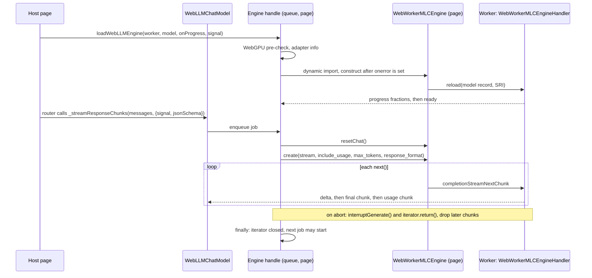

# M2 WebLLM Provider in an Inference Worker - Plan

## Goal Capsule

- **Objective:** A host developer can give a galaxie agent a local chat model that runs on the user's GPU in a Web Worker. Routing, data labels and budgets apply to it as they do to the mock provider. Calls stream tokens, stop promptly when cancelled, return JSON that matches a schema when asked for one, and report usage the router can settle. When the device cannot run the model, the host gets a typed `unavailable` error with a content-free reason instead of a silent fallback.
- **Means:** a new `@galaxie/models/webllm` subpath. It holds a thin LangChain `BaseChatModel` over the WebLLM 0.2.86 worker engine (KTD1), a FIFO engine queue that owns cancellation and worker failure (KTD3, KTD4), a pinned model record with integrity hashes (KTD5) and a worker entry the host bundles (KTD2).
- **Authority, highest first:**
  1. `AGENTS.md` repository rules.
  2. Accepted ADRs in `docs/adr/`. ADR-0002, ADR-0006, ADR-0012, ADR-0015, ADR-0016 and ADR-0017 bind this slice.
  3. This plan.
  4. `docs/galaxie-project-brief.md`.
  5. `docs/system-design.md`.

  ADR-0006 decision 3 already allows a thin adapter when `ChatWebLLM` does not work with a worker engine. Spike B found that it does not. Recording the Spike B result in ADR-0006 waits for the maintainer and is not part of this plan. When this plan and an Accepted ADR disagree, follow the ADR and record the conflict in the PR body.
- **Execution profile:** autonomous, without a WebGPU adapter. Work on the existing branch `m2/webllm-provider` and open one pull request against `main`. Run units in order (U1 to U7) and `pnpm check` after each one. Everything is proven with a fake engine and fake workers; the real-device run happens in a later M2 slice.
- **Stop conditions:** stop and open a draft pull request that names the blocker when any of these happens:
  - a requirement can pass only by weakening an ADR-0012 guarantee, or by letting prompt, completion or engine text reach an error message, span, event, snapshot or diagnostic;
  - `@mlc-ai/web-llm@0.2.86` cannot be installed under the root `minimumReleaseAge` or with an exact pin;
  - the browser Vitest project cannot run the new conformance test after three focused attempts, for example because Vite cannot resolve or prebundle the lazily imported engine;
  - `pnpm check` still fails after three focused fix attempts on the same cause.
- **Who finishes:** the implementing agent opens the pull request and stops. It never merges, never pushes to `main` and never enables auto-merge.

---

## Product Contract

### Summary

`packages/models` gains a WebLLM provider. The host creates one `Worker` per runtime from a tiny file that calls `startWebLLMWorker()`. It passes that worker to `loadWebLLMEngine()`, which checks WebGPU on the page, loads the pinned model in the worker, reports progress and returns an engine handle. The handle carries the device that was used.

The host then creates a `WebLLMChatModel` over the handle and registers it as an ordinary provider under `LangGraphServices.chatModels`. The router selects it, and `host.langchain.chatModel(role)` calls it.

Every call is queued on the handle and runs alone. It resets the engine, sends the full message list and streams tokens. A schema call option constrains decoding, and the engine's usage is reported once. An abort interrupts the engine, closes the stream and drops any chunk that arrives afterwards.

### Problem Frame

M1 shipped routing, labels, consent and budgets, but the only provider is a scripted mock, so no galaxie agent can run a real model on the user's machine. Brief §16.4 makes the in-browser engine in a worker the first M2 deliverable. Brief §10.6 requires providers to enforce a JSON Schema while decoding wherever they can. Spike B (`spikes/b-local-inference/README.md`) found that WebLLM is the only engine on the reference Mac that loads, streams, cancels, runs in a worker and enforces a schema while decoding. It also found that `ChatWebLLM` drops temperature, the schema and the abort signal when it is given a worker engine.

### Requirements

**Loading and device**

- R1. `loadWebLLMEngine({ worker, model?, onProgress?, signal? })` loads one model into the host's worker and resolves to an engine handle. Without `model` it loads the pinned default record (KTD5). A host-supplied record replaces it and is validated first (R4).
- R2. Before anything is fetched, loading checks WebGPU on the page. It rejects with an `unavailable` error and a reason when `navigator.gpu` is missing (`no_webgpu`), when no adapter is returned (`no_adapter`), or when the record requires `shader-f16` and the adapter lacks it (`no_shader_f16`). Failures inside the engine's own load map to `adapter_limits`, `device_lost`, `integrity`, `worker_failed` or `load_failed` (KTD6). WebLLM has no non-GPU path, so there is no fallback to report.
- R3. The handle reports the device: the WebGPU backend, the worker thread, and the adapter vendor and architecture as the page sees them for the same `high-performance` preference WebLLM uses (KTD7).
- R4. A host-supplied model record must name the model ID, an absolute or origin-relative model URL and model-library URL, a context window, and SRI hashes for the chat config, the model library and `tokenizer.json`. A record without them rejects with `invalid` before any fetch.
- R5. `onProgress` receives `{ phase, fraction, elapsedSeconds }` with `phase` one of `download`, `load` or `unknown`. It never receives the engine's progress text. The record exposes the weight size in bytes so a later slice can show it before download.
- R6. An abort of the load `signal` unloads the engine, terminates the worker and rejects with the signal's reason. `handle.dispose()` does the same at any time and is idempotent.

**Calls**

- R7. `WebLLMChatModel` implements `_generate` and `_streamResponseChunks`. Both run on the handle's queue: one request at a time, in arrival order, whatever the number of chat-model instances sharing the handle.
- R8. Each request resets the engine's conversation before it is sent, then sends the complete message list it was given. No conversation state crosses requests (KTD8).
- R9. Messages map to the engine's roles. A request rejects with `invalid` before dispatch when it is empty, when a system message is not first or appears twice, when the last message is not from the user, or when any message carries tool calls, a tool role or non-text content.
- R10. Streaming yields each non-empty text delta as one chunk and calls `handleLLMNewToken` once per such chunk. Usage appears on exactly one chunk, the last, as `usage_metadata` mapped from the engine's `prompt_tokens` and `completion_tokens`. `response_metadata` carries the finish reason.
- R11. Every request sends `max_tokens`: the call option `maxTokens` if given, otherwise the model's configured `maxTokens`. Temperature defaults to 0 and can be overridden per model or per call.
- R12. The call option `jsonSchema` carries a JSON Schema object. The provider sends it as WebLLM's `{ type: 'json_object', schema }` with the schema serialized as a string (KTD9).
- R13. `withStructuredOutput(schema)` on `WebLLMChatModel` accepts a Zod, Standard Schema or JSON Schema value. It binds the converted schema as `jsonSchema`, parses the reply and supports `includeRaw`. `method` values other than `jsonSchema` (or none) reject with `unsupported`.

**Cancellation and failure**

- R14. An aborted request that has not started never reaches the engine and rejects with the signal's reason. An abort during generation calls `interruptGenerate()`, closes the engine stream and rejects with the signal's reason. Chunks and usage that arrive after the abort are not yielded. The next request starts only after the stream is closed (KTD3).
- R15. A worker `error` or `messageerror` event terminates the worker. It also rejects the running and queued requests with `unavailable` (`worker_failed`), and every later call rejects the same way.
- R16. An engine error during a call maps to `unavailable` when it shows the device or model is gone (lost device, model not loaded), and to `invalid` when the prompt exceeds the context window. Everything else becomes a fixed-message provider error. No error, diagnostic or span carries engine text, prompt text or completion text (ADR-0012).
- R17. The `unavailable`, `invalid` and `unsupported` errors are recognized by core as galaxie errors (KTD6), so the adapter reports them under those codes rather than `executor_error`.

**Packaging and boundaries**

- R18. `@galaxie/models/webllm` and `@galaxie/models/webllm/worker` are new subpath exports. `@mlc-ai/web-llm` is an optional peer pinned to `0.2.86`, so `@galaxie/models/mock` users do not need it. Importing either subpath has no side effects, and importing `@galaxie/models/webllm` does not load the engine bundle until `loadWebLLMEngine` runs (KTD2).
- R19. `packages/models` still has no `@galaxie/core` dependency. `check:deps` allows `@mlc-ai/web-llm` only in the WebLLM files that need it and checks the models package's peers.
- R20. `docs/system-design.md`, `AGENTS.md` and `README.md` describe what ships and its limits, without calling galaxie secure, compliant or production-ready.

### Scope Boundaries

- Structured output through the router (`host.langchain.chatModel(role).withStructuredOutput(...)`), availability probing for routing, the first-run order, download consent and `persist()` belong to the M2 first-run slice. This slice gives that slice the call option, the weight size and the typed errors to build on.
- The Built-in AI provider is a separate M2 slice. It is expected to reuse the `jsonSchema` call option, the progress shape and the error codes.
- The real-device run on the reference Mac belongs to the M2 exit slice.
- No change to ADR-0006 text. No change to the conformance goldens or the compatibility matrix.
- Not built: KV-cache reuse across requests (KTD8); hashing weight shards ourselves, since WebLLM's SRI covers only the config, the library and the tokenizer while the weights are pinned by commit URL (would change if ADR-0012 required byte-level weight integrity); a page-side tokenizer to count prompts; tool calling (Qwen2.5 is not on WebLLM's function-calling list); deterministic schema key ordering for the engine's grammar cache (a cache miss only costs time).

### Assumptions

- Hosts bundle their own worker file, for example `new Worker(new URL('./inference.worker.ts', import.meta.url), { type: 'module' })` whose body calls `startWebLLMWorker()`. Bundlers cannot resolve a package specifier inside `new URL`, so the package does not ship a ready worker URL.
- Hosts register the provider with an `in-browser` descriptor, zero pricing and features `['streaming', 'cancellation']`. They should not declare `structured-output` until routed structured output ships, because a role that requires it would select this provider and then fail at `withStructuredOutput`.
- Hosts allow the download hosts in their CSP: `connect-src` for `https://huggingface.co`, `https://*.hf.co` and `https://raw.githubusercontent.com`, and `script-src 'wasm-unsafe-eval'` (Spike B README). The example-host slice sets this up.

---

## Planning Contract

### Key Technical Decisions

- KTD1. **A thin `BaseChatModel` over WebLLM's worker client, not `ChatWebLLM` and not a galaxie RPC.** WebLLM already ships a data-only worker protocol (`WebWorkerMLCEngineHandler` in the worker, `WebWorkerMLCEngine` on the page, structured-clone messages only). galaxie adds what that protocol lacks: a queue, cancellation that works before the first token, crash handling, error mapping and usage mapping. Writing our own RPC would duplicate WebLLM's streaming protocol for no gain. `ChatWebLLM` was rejected by Spike B (ADR-0006 decision 3).
- KTD2. **Lazy engine import, local engine types and a function-style worker entry.** `src/webllm/engine.ts` imports `@mlc-ai/web-llm` with a dynamic `import()` inside `loadWebLLMEngine`. The worker subpath exports `startWebLLMWorker(scope = self)`, which statically imports the handler; nothing runs at import. These two files are the only ones that import the module. `sideEffects: false` therefore stays true, and tests and the conformance suite never load the 6.5 MB engine bundle. WebLLM 0.2.86's `.d.ts` files re-export through extensionless relative paths that do not resolve under the repo's `nodenext` settings: imported types become missing or `any`. `engine.ts` therefore declares narrow local structural types for the surface it uses (the `WebWorkerMLCEngine` methods, the streaming request, the chunk and usage shape, and the `AppConfig` and model-record fields), and no file imports types from `@mlc-ai/web-llm`. The same types are the seam for the fake engine: `engine.ts` exports an internal factory that takes the WebLLM module, the `navigator.gpu` object and the worker. `loadWebLLMEngine` calls it after the dynamic import. The factory stays out of `index.ts`, and tests import it by relative source path. Only the Node worker test (U6) mocks `@mlc-ai/web-llm` with `vi.mock`, to stand in for the handler that `worker.ts` imports statically; the browser project never mocks or loads it.
- KTD3. **The engine handle owns a FIFO queue with concurrency 1 and owns cancellation.** WebLLM's `interruptGenerate()` is one engine-wide flag that each request clears when it takes the model lock at its first `next()`, so an early interrupt is lost. `resetChat`, `reload` and `unload` do not take the lock. The handle therefore runs one job at a time, as follows:
  1. A job aborted while queued is removed and never dispatched.
  2. A running job runs `resetChat()`, then `create()` with `stream: true` and `stream_options.include_usage`, then pulls chunks.
  3. On abort it calls `interruptGenerate()` and `iterator.return()`, stops yielding, and settles once `return()` has resolved.
  4. In every outcome a `finally` closes the iterator, so the model lock is released before the next job starts.
- KTD4. **The handle installs `onerror` and `onmessageerror` on the worker before constructing the engine.** `WebWorkerMLCEngine` overwrites `onmessage` but never listens for worker failure, so pending promises would otherwise hang. The handle races every engine call against a failure promise, as Spike B's guard did.
- KTD5. **The pinned default model record:**
  - Model ID: `Qwen2.5-1.5B-Instruct-q4f16_1-MLC`, the model Spike B ran.
  - Weights: `https://huggingface.co/mlc-ai/Qwen2.5-1.5B-Instruct-q4f16_1-MLC/resolve/9bd564b064631febf14deadcac492efb761d60c3/`, so every config, tokenizer and shard URL inherits the commit.
  - Library: `https://raw.githubusercontent.com/mlc-ai/binary-mlc-llm-libs/00fe7a40e57e5e8eb9fef87526a4bf28ad5846c0/web-llm-models/v0_2_86/base/Qwen2-1.5B-Instruct-q4f16_1_cs1k-webgpu.wasm`. This commit is the only one that has touched the `v0_2_86` libraries; it rebuilt them in place on 2026-10-11, which is why `main` URLs are not acceptable.
  - Integrity (SRI, checked by WebLLM on every load, cached or not), all computed on 2026-10-29 from the pinned URLs:
    - `mlc-chat-config.json`: `sha256-faSVQhLT8hqRzD5pPRefYyE/1XNWeWhH9l1/lUeKH54=`;
    - library: `sha256-Q2Rira1AfgkU0jUP1FKlo9mD4AMdd8lAxD6jUcjNMAA=`;
    - `tokenizer.json`: `sha256-wDghF+oynN8JcEETL21zWSS2l5JNb2/DlFcT6WzodTk=`;
    - failure mode `error`.
  - `required_features: ['shader-f16']`, which WebLLM's prebuilt record omits.
  - Context window 4096 and `vram_required_MB` 1629.75, both from the prebuilt record.
  - Weight size 868,547,584 bytes: the sum of `nbytes` over the 30 records in the pinned `tensor-cache.json`.
  - Cache backend `cache`.
- KTD6. **The typed errors are models-local and carry core's cross-realm shape.** `packages/models` cannot depend on core (system design §4 rule 2). Core's `isGalaxieError` deliberately recognizes any object whose `name` is `GalaxieError` and whose `code` is a known code, and the adapter maps such errors to their code. A models-local error class sets that name, a `code` (`unavailable`, `invalid` or `unsupported`), a fixed message per code and, for `unavailable`, a content-free `reason`. The fixed provider error for unclassified failures is the same kind of object without a galaxie name. Neither ever sets `cause` or carries a field derived from its input, because core's `run_failed` diagnostic forwards the adapter error's `cause` chain. WebLLM errors cross the worker as `err.toString()` strings such as `"WebGPUNotAvailableError: …"`; its two untyped adapter failures therefore arrive as `"Error: Unable to find a compatible GPU…"` and `"Error: Cannot initialize runtime because of requested…"`. A classifier maps the named errors by name prefix, and the two untyped messages after an optional `Error: ` prefix, into these codes. It returns only the code and reason, never the input string.
- KTD7. **The device is read on the page, not with `getGPUVendor()`.** `getGPUVendor()` creates a new `GPUDevice` on every call. The pre-check already calls `navigator.gpu.requestAdapter({ powerPreference: 'high-performance' })`, the preference WebLLM uses inside the worker, and reads `adapter.info`. The handle reports that. If the worker ever picked a different adapter, the report would be wrong; the real-device slice checks this against WebLLM's final progress report.
- KTD8. **Stateless requests: reset before every request and send the full history.** LangChain callers pass the whole conversation on every call, so the engine needs no memory. Resetting first means one agent's conversation can never leak into another's KV cache, and `prompt_tokens` then counts the full prompt, which the budget needs. The cost is no KV-prefix reuse across turns. The real-device slice measures that cost.
- KTD9. **One engine-neutral schema call option, `jsonSchema`.** WebLLM 0.2.86 silently ignores `response_format.type: 'json_schema'` and decodes unconstrained, so the provider must translate to `json_object` with a string schema. The call option stays a plain JSON Schema object so the Built-in AI provider and routed structured output can reuse it unchanged. `withStructuredOutput` uses LangChain's `toJsonSchema` and `assembleStructuredOutputPipeline`, both under the allowed `@langchain/core/*` imports.

### High-Level Technical Design



### Output Structure

```text
packages/models/src/
  mock.ts                  unchanged
  errors.ts                galaxie-shaped error class and codes (KTD6)
  webllm/
    index.ts               public exports of @galaxie/models/webllm
    model-record.ts        pinned record, validation, AppConfig (KTD5)
    classify.ts            engine error string to code and reason (KTD6)
    engine.ts              loadWebLLMEngine, pre-check, handle, queue (KTD2-KTD4, KTD7)
    chat-model.ts          WebLLMChatModel (KTD8, KTD9)
    worker.ts              startWebLLMWorker, @galaxie/models/webllm/worker
packages/models/test/
  webllm-model-record.test.ts
  webllm-engine.test.ts
  webllm-chat-model.test.ts
  webllm-worker.test.ts
  support/fake-webllm.ts   fake engine, fake worker, fake navigator.gpu
tests/conformance/webllm-provider.test.ts
```

The tree is a scope declaration; the per-unit file lists are authoritative.

### Implementation Constraints

- New source files start with the SPDX header from ADR-0015. Relative imports end in `.js`, type-only imports use `import type`, exported functions declare return types, and there is no `enum`.
- Never copy or import spike code (`spikes/b-local-inference/`). Read it as evidence and reimplement.
- Package source uses no Node globals. The provider must ignore unknown call-option keys and must never forward the whole options object to the engine, because the routed model passes a private lease symbol in it.
- WebLLM's `RangeError` export shadows the global one; do not import it.

---

## Implementation Units

### U1. Package wiring and dependency boundary

- **Goal:** make `@mlc-ai/web-llm` available to the WebLLM files and nowhere else, and expose the two subpaths.
- **Requirements:** R18, R19.
- **Dependencies:** none.
- **Files:** `packages/models/package.json`, `pnpm-lock.yaml`, `scripts/check-dependencies.ts`, `vitest.config.ts`, `tests/conformance/tsconfig.json`.
- **Approach:**
  1. In `packages/models/package.json`, add the exports `./webllm` and `./webllm/worker` (types plus default, following the `./mock` shape). Add an exact optional peer `@mlc-ai/web-llm: 0.2.86` and a dev dependency at the same version, plus a dev dependency `zod: 4.6.7` (the version the adapter pins) for the `withStructuredOutput` tests. Update the description to cover the mock and WebLLM providers.
  2. Install under the existing `minimumReleaseAge` (0.2.86 was published on 2026-10-11).
  3. In `check-dependencies.ts`, allow `@mlc-ai/web-llm` only in `packages/models/src/webllm/engine.ts` (dynamic import) and `worker.ts`, and reject type-only imports of it everywhere (KTD2). Keep `mock.ts` and `errors.ts` limited to `@langchain/core/*` and relative imports. Add a peer check: exactly `@langchain/core` and optional `@mlc-ai/web-llm`, and no `@galaxie/core` anywhere in the package's dependency fields.
  4. Add `@galaxie/models/webllm/worker` (to `src/webllm/worker.ts`) and then `@galaxie/models/webllm` (to `src/webllm/index.ts`) to the Vitest alias, in that order, because a string alias also captures `<key>/…`. Add both to the conformance `tsconfig.json` paths.
  5. In the Chromium project of `vitest.config.ts`, add `@mlc-ai/web-llm` to `optimizeDeps.exclude` (it is only resolved there, never run), and add every new `@langchain/core/*` subpath the WebLLM source imports to `optimizeDeps.include`, so the dev server does not discover dependencies late and reload the page mid-run.
- **Patterns to follow:** the core peer check and the models import loop in `scripts/check-dependencies.ts`; the `./mock` export entry.
- **Test expectation:** none, since this is packaging. `pnpm check:deps` must still pass, and a temporary import (value or type-only) of `@mlc-ai/web-llm` in `chat-model.ts` must make it fail; check that once, then remove the import.
- **Verification:** a frozen install succeeds, `pnpm check` passes, and `check:deps` reports the forbidden-import case above.

### U2. Typed errors, the pinned model record and the error classifier

- **Goal:** the content-free error shape, the default record and record validation, and the mapping from engine error strings.
- **Requirements:** R2, R4, R5, R16, R17.
- **Dependencies:** U1.
- **Files:** `packages/models/src/errors.ts`, `packages/models/src/webllm/model-record.ts`, `packages/models/src/webllm/classify.ts`, `packages/models/test/webllm-model-record.test.ts`.
- **Approach:**
  1. `errors.ts` defines the error class and the fixed provider error (KTD6). Their messages are fixed per code, they never take input text, never set `cause` and carry no field derived from the input.
  2. `model-record.ts` exports the pinned default (KTD5) as a frozen galaxie-shaped record, a validator for host records (R4), and a function that builds WebLLM's `AppConfig` with integrity, `required_features`, context-window override and cache backend.
     - The builder always emits `integrity.onFailure: 'error'`. The galaxie record type has no failure-mode field, and the validator rejects with `invalid` a host record that supplies one, so SRI cannot be downgraded to WebLLM's warn-only mode.
     - WebLLM passes the model URL through `new URL(model)` without a base and appends `resolve/main/` to any URL whose path lacks a `/resolve/<revision>/` segment. The builder therefore resolves an origin-relative model URL against the page's `location.href`. The validator rejects with `invalid` a model URL whose resolved path has no `/resolve/<revision>/` segment with a 40-character hexadecimal commit, so a host record can never load weights from a mutable revision such as `main`. Library URLs may stay relative, because WebLLM resolves them correctly.
  3. `classify.ts` maps an unknown rejection (an `Error` or a string) to `{ code, reason }`:
     - `WebGPUNotAvailableError` → `no_webgpu`;
     - `ShaderF16SupportError` or `FeatureSupportError` → `no_shader_f16`;
     - "Unable to find a compatible GPU", after an optional `Error: ` prefix → `no_adapter`;
     - "Cannot initialize runtime because of requested", after an optional `Error: ` prefix → `adapter_limits`;
     - `DeviceLostError` → `device_lost`;
     - `IntegrityError` → `integrity`;
     - `ModelNotLoadedError` or `WorkerEngineModelNotLoadedError` → `unavailable` with `device_lost`;
     - `ContextWindowSizeExceededError` → `invalid`;
     - anything else → an unknown failure, which the caller turns into `load_failed` or a fixed provider error.
- **Patterns to follow:** `MockModelError` in `packages/models/src/mock.ts` for a fixed message; `isGalaxieError` in `packages/core/src/errors.ts` for the shape to satisfy (do not import it).
- **Test scenarios:**
  - The default record's `AppConfig` has the commit-pinned weight URL, the commit-pinned library URL, the three SRI hashes, `required_features: ['shader-f16']`, a context window of 4096 and cache backend `cache`.
  - The default record exposes 868,547,584 weight bytes.
  - A host record without `integrity` for the library rejects with code `invalid` and a fixed message that does not contain the record's URL.
  - A host record with a non-URL model path rejects with `invalid`.
  - A host record carrying `onFailure: 'warn'` rejects with `invalid`, and every valid record's `AppConfig` has `integrity.onFailure: 'error'`.
  - A host record whose model URL ends in `/resolve/main/`, or has no `/resolve/<revision>/` segment, rejects with `invalid`.
  - A valid host record with an origin-relative model URL `/models/qwen/resolve/<40-hex>/` gets an absolute model URL in the `AppConfig`, and its relative library URL is kept relative.
  - Each listed WebLLM error-name prefix, given as a string the way the worker sends it (`err.toString()`, so the two untyped messages start with `Error: `), maps to its code and reason.
  - A string containing a sentence of prompt text after the error name maps to its code, and the sentence is absent from the returned value and from any thrown error's message, `cause` chain and own enumerable properties.
  - An unknown string maps to the unknown class.
  - The error class has `name === 'GalaxieError'` and the code it was built with. A test in `packages/adapter-langgraph` or the conformance suite proves core recognizes it; that check is covered in U6.
- **Verification:** every scenario passes on Node, and no import of `@mlc-ai/web-llm` appears in these files.

### U3. Engine handle: loading, pre-check, progress, device, failure and disposal

- **Goal:** `loadWebLLMEngine` and the handle up to, but not including, the request queue.
- **Requirements:** R1, R2, R3, R5, R6, R15.
- **Dependencies:** U2.
- **Files:** `packages/models/src/webllm/engine.ts`, `packages/models/test/webllm-engine.test.ts`, `packages/models/test/support/fake-webllm.ts`.
- **Approach:**
  1. Validate the record (U2), then run the page pre-check (R2, KTD7). The pre-check does not import WebLLM.
  2. Install the worker failure listeners (KTD4).
  3. Dynamically import WebLLM, construct `WebWorkerMLCEngine` with the record's `AppConfig` and a progress adapter, then `reload`, racing the worker failure and the load `signal`.
  4. The progress adapter derives the phase from whether the report belongs to the download or the GPU-load pass, without forwarding the text (R5). The fraction resets from 0 to 1 for each pass. A report that matches neither pass is forwarded with phase `unknown` and its fraction.
  5. After `reload` resolves, confirm the load was not aborted, because WebLLM resolves a `reload` that `unload()` interrupted.
  6. Map load failures through the classifier to `unavailable` with a reason, `load_failed` when the classifier has no match.
  7. `dispose()` runs in this order: settle the KTD4 failure promise with `unavailable`/`disposed`, which rejects the running and queued jobs and every pending engine call racing it; then call `unload()`, bounded by the same race; then terminate the worker and mark the handle disposed. A second call does nothing. `unload` does not take WebLLM's model lock, and once the worker is gone a pending `next()` never settles, so the failure promise must settle first or a running job could hang in its `finally`.
- **Execution note:** inject the WebLLM module and `navigator.gpu` through the internal factory of KTD2 so the tests never load the real bundle.
- **Patterns to follow:** the latch helper in `packages/models/src/mock.ts` for controllable timing.
- **Test scenarios:**
  - Without `navigator.gpu`, loading rejects with `unavailable`/`no_webgpu`, never imports the engine module and never posts to the worker.
  - With `requestAdapter()` returning `null`, it rejects with `unavailable`/`no_adapter`.
  - With an adapter that lacks `shader-f16`, the default record rejects with `no_shader_f16`.
  - With a fake engine whose `reload` resolves, the handle reports `webgpu`, `worker` and the fake adapter's vendor and architecture.
  - Fake progress reports with download text, then load text, reach `onProgress` as `download` then `load` phases with their fractions, and no text field. A report matching neither reaches it as `unknown`.
  - A `reload` rejected with the string `"IntegrityError: …"` rejects the load with `unavailable`/`integrity`, and the rejected string is absent from the error's message, `cause` chain and own enumerable properties.
  - Aborting the load signal during `reload` calls `unload`, terminates the worker and rejects with the signal's reason, even when the fake `reload` then resolves.
  - A worker `error` event during `reload` rejects with `unavailable`/`worker_failed` and terminates the worker.
  - `dispose()` twice unloads and terminates once.
- **Verification:** all scenarios pass on Node with the fake module.

### U4. Request queue and cancellation on the handle

- **Goal:** the job runner of KTD3, which `WebLLMChatModel` will call.
- **Requirements:** R7, R8, R14, R15, R16.
- **Dependencies:** U3.
- **Files:** `packages/models/src/webllm/engine.ts`, `packages/models/test/webllm-engine.test.ts`, `packages/models/test/support/fake-webllm.ts`.
- **Approach:** add a handle method that takes an engine request and a signal and returns an async iterator of engine chunks. Its contract is KTD3. A job rejected because the worker failed or the handle was disposed raises `unavailable` with the matching reason. Engine rejections during a job go through the classifier: known codes become typed errors, and everything else becomes the fixed provider error.
- **Technical design:** directional only. The job is `wait for turn → if aborted, reject → resetChat → create → pull until done or aborted → finally return() → release turn`.
- **Test scenarios:**
  - Two requests started together reach the fake engine one after the other. The second request's `resetChat` happens only after the first stream's `return()` resolved.
  - Each request calls `resetChat` once, before `create`.
  - A request aborted while queued never calls `resetChat` or `create`, rejects with the signal's reason, and the next queued request still runs.
  - A request aborted after its second chunk calls `interruptGenerate` once and `return()` once, rejects with the reason, and yields nothing that the fake engine emits after the abort, including its final and usage chunks.
  - An abort signalled before the first `next()` still stops the request: the fake engine's interrupt flag would be cleared at the first `next()`, so the test proves `return()` alone closes it.
  - A request whose consumer stops iterating early closes the engine stream.
  - A worker `error` event while one request runs and another waits rejects both with `unavailable`/`worker_failed`, and a later request rejects the same way without touching the engine.
  - An engine rejection `"ContextWindowSizeExceededError: …"` on the first `next()` (where WebLLM 0.2.86 raises it, during prefill) rejects with `invalid`, closes the stream and lets the next queued request run. An unknown engine string rejected by `create` produces the fixed provider error, and the string is absent from its message, `cause` chain and own enumerable properties.
  - `dispose()` while one request streams and another waits rejects both with `unavailable`, settles without the fake answering the pending `next()`, and leaves no open fake stream.
  - After `dispose()`, a new request rejects with `unavailable`.
- **Verification:** all scenarios pass on Node, and no test leaves a fake stream open (assert in the fake).

### U5. `WebLLMChatModel`

- **Goal:** the LangChain model over the handle, including message mapping, usage, the schema option and `withStructuredOutput`.
- **Requirements:** R7 to R14, R16.
- **Dependencies:** U4.
- **Files:** `packages/models/src/webllm/chat-model.ts`, `packages/models/src/webllm/index.ts`, `packages/models/test/webllm-chat-model.test.ts`, `packages/adapter-langgraph/test/routed-chat-model.test.ts` (the two routed scenarios, importing `WebLLMChatModel` and the fake handle by relative source path as that file already does for `mock.ts`; `packages/models/test` stays free of `@galaxie/core` and adapter imports).
- **Approach:**
  1. The constructor takes the handle plus optional `temperature` (default 0) and `maxTokens` (default 1024). The model's `maxTokens` is the engine's per-request output limit (`max_tokens`). It is separate from the router's `maxTokens` reservation, which this slice does not pass to the provider. Call options add `maxTokens`, `temperature` and `jsonSchema`.
  2. `_streamResponseChunks` validates and maps messages (R9), builds the engine request (R11, R12, KTD9), runs it on the handle and yields chunks (R10).
  3. `_generate` consumes the same stream and returns one message with the joined text, usage and finish reason, so the abort path is shared.
  4. `_llmType` and `getLsParams` follow the mock and report provider `webllm` and the model ID.
  5. `withStructuredOutput` follows R13. LangChain's structured-output parsers throw an `OutputParserException` whose message and `llmOutput` carry the reply text, and core's `run_failed` diagnostic would receive it through the adapter's `cause` chain. The parse stage is therefore wrapped: a parse failure is rethrown as the fixed provider error, with no `cause` and no reply text (R16). With `includeRaw: true`, LangChain's own fallback still returns `{ raw, parsed: null }`.
  6. `index.ts` exports `loadWebLLMEngine`, the handle and progress types, `WebLLMChatModel`, the default record, the record type and the error class.
- **Patterns to follow:** `MockChatModel` in `packages/models/src/mock.ts` for chunk construction, `handleLLMNewToken` and abort; `packages/adapter-langgraph/test/routed-chat-model.test.ts` `routed()` for testing through a routed model.
- **Test scenarios:**
  - A system message and two user/assistant turns stream as several chunks whose text joins to the fake reply. `handleLLMNewToken` is called once per non-empty delta. `usage_metadata` appears only on the last chunk with input 12 and output 5 when the fake reports `prompt_tokens: 12` and `completion_tokens: 5`.
  - `invoke` returns the joined text with the same usage and `finish_reason: 'stop'` in `response_metadata`.
  - The engine request has `stream: true`, `stream_options.include_usage: true`, `temperature: 0`, the default `max_tokens`, and no `response_format` when no schema is bound.
  - A per-call `maxTokens: 64` and `temperature: 0.7` reach the engine request.
  - A bound `jsonSchema` reaches the engine as `{ type: 'json_object', schema: <string> }`, whose parsed value deep-equals the bound object.
  - The options object carries an extra symbol key and an unknown string key; neither reaches the engine request.
  - `withStructuredOutput` with a Zod object returns the parsed object when the fake replies with matching JSON. With `includeRaw: true` it returns `{ raw, parsed }`. With `method: 'functionCalling'` it rejects with `unsupported`.
  - A reply that is not valid JSON makes `withStructuredOutput` reject with the fixed provider error, and the reply text is absent from its message, `cause` chain and own enumerable properties. With `includeRaw: true` the same reply returns `parsed: null`.
  - Rejections before dispatch, each with `invalid`: an empty message list, a system message second, two system messages, a last message from the assistant, an assistant message with tool calls, a tool message, and image content.
  - An abort through `invoke({ signal })` mid-stream rejects with the signal's reason.
  - In `packages/adapter-langgraph/test/routed-chat-model.test.ts`, through its `routed()` helper: a stream settles the lease with `{ inputTokens: 12, outputTokens: 5 }` exactly once, and an abort mid-stream makes the lease record `fail` rather than `end` with usage.
- **Verification:** all scenarios pass on Node, and `pnpm check:deps` shows `chat-model.ts` does not import `@mlc-ai/web-llm`.

### U6. Worker entry and conformance coverage through the runtime

- **Goal:** the worker subpath, and proof on Node and headless Chromium that the provider works behind `createRuntime` and the router.
- **Requirements:** R7, R10, R14, R17, R18.
- **Dependencies:** U5.
- **Files:** `packages/models/src/webllm/worker.ts`, `packages/models/test/webllm-worker.test.ts`, `tests/conformance/webllm-provider.test.ts`.
- **Approach:**
  1. `startWebLLMWorker(scope = self)` throws a fixed error when `scope` is a window (`'document' in scope`), because a window would accept messages from any frame. Otherwise it creates one `WebWorkerMLCEngineHandler`, routes the handler's replies through `scope.postMessage` (WebLLM's handler otherwise calls the global `postMessage`), and forwards the scope's `message` events to it. Calling it twice throws a fixed error rather than creating a second handler.
  2. The conformance test builds a handle over the fake engine through the internal factory of KTD2, importing it and `packages/models/test/support/fake-webllm.ts` by relative source path (or a small conformance support copy if that path is awkward). It registers a `WebLLMChatModel` as provider `local` with the in-browser descriptor from the Assumptions and runs a one-node LangGraph graph through the runtime.
- **Execution note:** the conformance test must not import `@mlc-ai/web-llm` or any file that statically imports it, and it must not touch the goldens or the compatibility matrix.
- **Patterns to follow:** `tests/conformance/models.test.ts` and `tests/conformance/support/routing.ts` for runtime and routing setup; `tests/conformance/no-network.test.ts` for the no-network guard.
- **Test scenarios:**
  - `startWebLLMWorker` on a fake scope installs one message listener that forwards events to the mocked handler, and a reply from the handler reaches the fake scope's `postMessage`. A second call throws.
  - A fake scope with a `document` property throws and installs no listener.
  - Importing `@galaxie/models/webllm/worker` alone does not construct a handler.
  - On both Node and Chromium, a run that calls `chatModel('assistant')` streams the fake tokens to the graph and finishes. `snapshot.routes.assistant` names provider `local` with destination `in-browser`. The model budget is charged the fake's reported usage, not the reservation.
  - On both, cancelling the run during the fake stream ends it `cancelled`. The fake engine records `interruptGenerate` and a closed stream, and the budget is charged the reservation.
  - On both, a handle whose fake worker emits `error` makes the next call end the run with error code `unavailable`, which proves core recognizes the models-local error (R17).
  - The suite's no-network guard sees no request during these tests.
- **Verification:** `CI=true pnpm test` runs the new test in both the `node` and `browser (chromium)` projects. `git diff --stat main -- tests/conformance/golden tests/conformance/compatibility-matrix.json` is empty.

### U7. Documentation

- **Goal:** the docs describe what ships, how a host wires it and what is still missing.
- **Requirements:** R20.
- **Dependencies:** U6.
- **Files:** `docs/system-design.md`, `AGENTS.md`, `README.md`.
- **Approach:**
  1. In `docs/system-design.md`, update §1 (`packages/models` line), §4 rule 2 (the models package now also imports `@mlc-ai/web-llm` in its WebLLM files, as an optional peer), and the "Not in `core` yet" paragraph that lists real providers as missing. Reword the §8.4 sentence "`maxTokens` is a per-call reservation, not a provider token cap" so it stays true: the router's `maxTokens` is a reservation, while the WebLLM provider sends its own per-request `max_tokens`.
  2. Update the §5 tree and the §10 `pnpm build` and `check:deps` rows.
  3. Rewrite the last paragraph of §8.4 to say what `@galaxie/models/webllm` ships:
     - one worker per runtime, a FIFO queue at concurrency 1 and reset per request;
     - cancellation, the `jsonSchema` option and provider-level `withStructuredOutput`;
     - the pinned record with SRI, the typed `unavailable` reasons, the page-side device report and the CSP hosts.
  4. In the same §8.4 paragraph, list what stays deferred: routed structured output, availability probing and first-run order, consent UI, `persist()`, per-call provider caps from the router, the Built-in AI provider and the real-device run.
  5. State the limits:
     - loading, streaming, cancellation (interrupt plus stream return), schema decoding and the device report are verified against a fake engine only; the first real-device run is the M2 exit slice, and abort latency during a long prefill is not measured yet;
     - SRI does not cover weight shards, so a host record must pin an immutable revision, which validation enforces;
     - the device report is the page's view of the adapter;
     - a KV-cache reuse cost is not measured yet;
     - after a worker failure or device loss the provider stays selected for its role and every call fails `unavailable`; galaxie does not fall back to the next listed provider in this slice, and the host recovers by disposing the handle and creating a new handle, model and runtime;
     - hosts should not declare `structured-output` for this provider yet.
  6. For the CSP hosts, say that only the inference worker needs the download hosts in `connect-src` and `'wasm-unsafe-eval'`. Hosts that can set per-path headers should send them on the worker script's response and leave the page CSP unchanged.
  7. Update the `AGENTS.md` project-status paragraph and the `README.md` status block to the same facts, including the fake-engine-only and no-fallback limits and the `maxTokens` wording, in the existing style.
- **Test expectation:** none, since this is documentation. Check the wording against the AGENTS.md rule on not calling galaxie secure or compliant.
- **Verification:** `pnpm check` passes (Biome checks the markdown tables where it lints them), and the three files agree on what ships.

---

## Verification Contract

| Gate | Command or check | Applies to |
| --- | --- | --- |
| Install | `pnpm install --frozen-lockfile` after the lockfile change | U1 |
| Full local CI | `pnpm check` (license, Biome, `tsc`, `tsc6`, Vitest, build, `check:deps`) | every unit |
| CI-mode tests | `CI=true pnpm test`, which runs the browser project in headless Chromium | U6 and before the PR |
| Dependency boundary | `pnpm check:deps`, plus the one-time negative check in U1 | U1, U5 |
| Goldens unchanged | `git diff --stat main -- tests/conformance/golden tests/conformance/compatibility-matrix.json` is empty | before the PR |
| No engine bundle in tests | no test file imports `@mlc-ai/web-llm`; only `packages/models/test/webllm-worker.test.ts` mocks it with `vi.mock` | U3 to U6 |

No command in this plan needs a GPU. The real-device check of loading, streaming, cancelling, schema enforcement and the device report is the M2 exit slice's work.

---

## Definition of Done

- U1 to U7 are complete, and each unit's test scenarios exist and pass.
- `pnpm check` and `CI=true pnpm test` pass on the final commit.
- Every new source file has the SPDX header.
- No error, span, diagnostic or snapshot introduced here contains prompt, completion or engine text.
- `packages/models` has no `@galaxie/core` dependency.
- The goldens and the compatibility matrix are unchanged. ADR-0006 is unchanged.
- No spike code was copied or imported into `packages/` or `tests/`.
- Abandoned experiments are removed from the diff.
- The pull request body lists the pinned URLs and hashes, the deferred items from Scope Boundaries, and the fact that no real GPU ran in CI.

---

## Appendix

### Sources

- `spikes/b-local-inference/README.md`: results, the "Proposed ADR-0006 update" and the CSP needs.
- `spikes/b-local-inference/src/arms/webllm.ts` and `webllm.worker.ts`: the WebLLM calls that worked on the reference Mac (evidence only).
- WebLLM 0.2.86 package sources, read in `spikes/b-local-inference/node_modules/@mlc-ai/web-llm/lib/`:
  - `web_worker.d.ts` for the handler and client;
  - `config.d.ts` and `integrity.d.ts` for the record and SRI;
  - `openai_api_protocols/chat_completion.d.ts` for the request;
  - `error.d.ts` for the error names;
  - `index.js` for the interrupt, lock, `resetChat`, progress and string-error behavior cited in KTD3, KTD4 and KTD6.
- `@langchain/core` 1.2.20, `language_models/chat_models.js`: the default `withStructuredOutput` supports only function calling and needs `bindTools`.
- `packages/adapter-langgraph/src/routed-chat-model.ts`: providers' protected methods are called directly, usage is summed across chunks, and the options object carries a lease symbol.
- `packages/core/src/errors.ts` (`isGalaxieError`) and `packages/adapter-langgraph/src/adapter.ts` for the error mapping.
- `https://github.com/mlc-ai/binary-mlc-llm-libs/commit/00fe7a40e57e5e8eb9fef87526a4bf28ad5846c0` and `https://huggingface.co/mlc-ai/Qwen2.5-1.5B-Instruct-q4f16_1-MLC` at revision `9bd564b064631febf14deadcac492efb761d60c3`.
