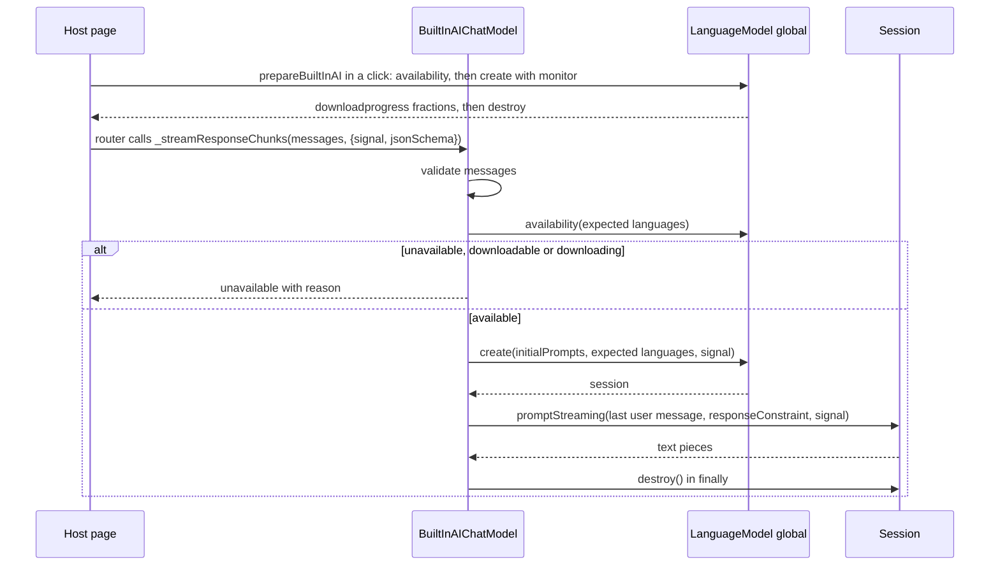

# M2 Chrome Built-in AI Provider (Prompt API) - Plan

## Goal Capsule

- **Objective:** A host developer can give a galaxie agent Chrome's browser-managed model through the Prompt API. Routing, labels and budgets apply to it as they do to the WebLLM provider. Calls stream text, stop when cancelled, and return schema-constrained JSON when asked. The provider refuses a call with a typed `unavailable` error, never a silent fallback, in three cases: the browser lacks the API, the role's languages are unsupported, or the model still has to be downloaded. A model call never starts a download. The host can check availability for a set of languages and start the download on purpose from a click.
- **Means:** a new `@galaxie/models/builtin-ai` subpath with a thin LangChain `BaseChatModel` over the `LanguageModel` global (KTD1), one session per request (KTD2), an availability check and a prepare call for the host (KTD4), and shared message mapping, errors and structured output extracted from the WebLLM provider (KTD6).
- **Authority, highest first:**
  1. `AGENTS.md` repository rules.
  2. Accepted ADRs in `docs/adr/`. ADR-0002, ADR-0006 (decision 2 defines this provider), ADR-0012, ADR-0015, ADR-0016 and ADR-0017 bind this slice.
  3. This plan.
  4. `docs/galaxie-project-brief.md`.
  5. `docs/system-design.md`.

  When this plan and an Accepted ADR disagree, follow the ADR and record the conflict in the PR body.
- **Execution profile:** autonomous, without Built-in AI. Work on the existing branch `m2/builtin-ai-provider` and open one pull request against `main`. Run units in order (U1 to U6) and `pnpm check` after each one. Everything is proven with a fake `LanguageModel` global; the real-device run happens in the M2 exit slice.
- **Stop conditions:** stop and open a draft pull request that names the blocker when any of these happens:
  - a requirement can pass only by weakening an ADR-0012 guarantee, or by letting prompt, completion or engine text reach an error, span, event, snapshot or diagnostic;
  - the U1 refactor cannot keep every existing WebLLM test passing without changing what a test asserts, apart from the renamed error class and message text that U1 names;
  - the browser Vitest project cannot run the new conformance test after three focused attempts;
  - `pnpm check` still fails after three focused fix attempts on the same cause.
- **Who finishes:** the implementing agent opens the pull request and stops. It never merges, never pushes to `main` and never enables auto-merge.

---

## Product Contract

### Summary

`packages/models` gains a Built-in AI provider. The host constructs `BuiltInAIChatModel` with the languages its role reads and writes. Before each call the model checks `LanguageModel.availability()` for those languages, opens a fresh session from the system message and the prior turns, and streams the reply to the last user message with `promptStreaming`. When a schema is bound, `responseConstraint` constrains decoding. The model destroys the session when the call ends, however it ends.

For the M2 first-run slice and for hosts, the subpath also exports two functions. `checkBuiltInAI({ inputLanguages, outputLanguages })` reports `available`, `downloadable`, `downloading` or `unavailable`. `prepareBuiltInAI({ inputLanguages, outputLanguages, onProgress, signal })` runs inside a click handler: it starts or joins the model download, reports progress and resolves when the model is ready.

### Problem Frame

ADR-0006 decision 2 makes Chrome Built-in AI the first local provider in the default order whenever `availability()` supports the role's languages. Spike B (`spikes/b-local-inference/README.md`) found that it passed its functional checks for English on Chrome 155. It enforces a JSON Schema while decoding through `responseConstraint`. Vietnamese was unavailable. Its download needed a fresh user activation, and its model identity cannot be pinned. M2 needs this provider beside WebLLM so the first-run slice can choose between them.

### Requirements

**Availability and download**

- R1. `checkBuiltInAI({ inputLanguages, outputLanguages })` resolves to `available`, `downloadable`, `downloading` or `unavailable`. It returns `unavailable` when the `LanguageModel` global is missing or `availability()` rejects. It never creates a session, so it never starts a download.
- R2. A call through `BuiltInAIChatModel` rejects with `unavailable` before creating a session in each of these cases:
  - availability is `unavailable` (reason `no_api` when the global is missing, `unsupported_languages` otherwise);
  - availability is `downloadable` or `downloading` (reason `download_required`), whatever the activation state.
- R3. `prepareBuiltInAI({ inputLanguages, outputLanguages, onProgress?, signal? })` rejects with `unavailable` and reason `no_api` or `unsupported_languages` as in R2. When availability is `downloadable` or `downloading` and `navigator.userActivation.isActive` is false, it rejects with reason `activation_required` and creates no session. Otherwise it creates and destroys one session with a download monitor. `onProgress` receives `{ phase: 'download', fraction, elapsedSeconds }` from each `downloadprogress` event. A rejected download maps to `unavailable` with reason `download_failed`; an abort rejects with the signal's reason.

**Calls**

- R4. Each call opens its own session, with the system message (if any) and every message before the last as `initialPrompts`, and the configured `expectedInputs` and `expectedOutputs` languages. It prompts the last message, which must be from the user. It destroys the session in every outcome. No conversation state crosses calls (KTD2).
- R5. Message validation matches the WebLLM provider. A request rejects with `invalid` before any session is created when it is empty, when a system message is not first or appears twice, when the last message is not from the user, or when any message carries tool calls, a tool role or non-text content.
- R6. Streaming yields each non-empty text piece as one chunk and calls `handleLLMNewToken` once per chunk. The last chunk carries no `usage_metadata` (KTD3) and `response_metadata.finish_reason: 'stop'`.
- R7. The `jsonSchema` call option and `withStructuredOutput` behave as in the WebLLM provider. The schema is sent as `responseConstraint` with `omitResponseConstraintInput: true`, and parse failures become the fixed provider error.
- R8. An abort before the session exists rejects with the signal's reason and creates no session. An abort during streaming rejects with the signal's reason and yields nothing after it. The session is destroyed in both cases.
- R9. Prompt API failures map without engine text:
  - `NotSupportedError` from `create` → `unavailable`/`unsupported_languages`;
  - `NotSupportedError` from a prompt (unsupported schema feature) → `invalid`;
  - `QuotaExceededError` → `invalid`;
  - `NetworkError` → `unavailable`/`download_failed`;
  - `NotAllowedError` → `unavailable`/`not_allowed`;
  - `TypeError` from `create` or a prompt → `invalid`;
  - everything else, including `SyntaxError` for output that misses the schema, → the fixed provider error.

  Any rejection from `create`, a prompt or the stream while the call's signal is aborted rejects with the signal's reason, before classification, as the WebLLM engine does. No error carries `cause` or input text.

**Packaging, shared code and docs**

- R10. `@galaxie/models/builtin-ai` is a new subpath export with no new dependency. Importing it has no side effects and touches no global.
- R11. The models-local errors, text-message mapping and provider-level structured output are shared by both providers (KTD6). WebLLM behavior does not change.
- R12. `docs/system-design.md`, `AGENTS.md` and `README.md` describe what ships and its limits, without calling galaxie secure, compliant or production-ready.

### Scope Boundaries

- Belongs to the M2 first-run slice: routed structured output, availability probing inside the router, the first-run provider order, the consent UI and `persist()`. This slice gives it `checkBuiltInAI`, `prepareBuiltInAI` and the typed reasons.
- Belongs to the M2 exit slice: the real-device run, CI smoke tests on Chrome stable and beta (ADR-0006 consequences), and measuring session-creation cost per call.
- Not built:
  - sampling control: `temperature` and `topK` are ignored on web pages, and `samplingMode` is left at the browser default until the real-device slice confirms Chrome ships it;
  - a per-request output limit: the Prompt API has none, so `maxTokens` has no effect on this provider;
  - tools, multimodal input, `prefix` assistant prefill and `thinkingEffort`;
  - reusing or cloning sessions across calls;
  - reading the context usage before a call. A `QuotaExceededError` from the browser covers prompts that do not fit.
- No change to ADR text, the conformance goldens or the compatibility matrix.

### Assumptions

- Hosts register the provider with destination `in-browser`, zero pricing, features `['streaming', 'cancellation']` and the role's `languages`. They should not declare `structured-output` until routed structured output ships, as for WebLLM.
- Chrome requires transient user activation for a `create()` that downloads; the explainer does not state it, but Chrome's documentation and Spike B's Mac run do. Applying the activation check to `downloading` too is conservative: joining a running download through `create()` may also need activation. Transient activation lasts several seconds after any gesture, including pressing Enter in a chat box, so activation alone does not show download intent; that is why model calls never download (KTD4).
- Spike B saw Chrome's model produce varied output for the same prompt, so hosts must not expect repeatable replies. The model's identity and revision are not exposed and cannot be pinned (ADR-0006).

---

## Planning Contract

### Key Technical Decisions

- KTD1. **A thin `BaseChatModel` over the `LanguageModel` global, read at call time.** The provider reads `globalThis.LanguageModel` when a call or check runs, never at import, so importing is side-effect free (R10). Tests install a fake global. Local structural types describe the parts of the API in use, because no type package is pinned and DOM typings in TypeScript 7 may not include it.
- KTD2. **One session per call, destroyed in `finally`.** The LangChain caller passes the full history every time, so the provider stays stateless like WebLLM (KTD8 of the WebLLM plan). History goes into `initialPrompts` and the last user message into `promptStreaming`. A fresh session per call means one agent's context can never reach another's. Overflow eviction also never silently drops earlier turns, because `initialPrompts` are never evicted and a prompt that does not fit raises `QuotaExceededError`. Cloning a base session was rejected: it saves nothing when every call has a different history, and it keeps a session alive between calls. The cost is session creation per call, which the real-device slice measures.
- KTD3. **Report no usage; let the router charge the reservation.** The Prompt API reports no output token count, and its context-usage numbers count the session's whole context, not one call's input. The router charges the reservation when usage is missing (system design §8.4). That is the honest outcome: the provider is zero-priced, and the token budget sees the reserved `maxTokens` rather than an invented number. Estimating output tokens from characters was rejected because a provider that reports usage is trusted to report it accurately.
- KTD4. **Only `prepareBuiltInAI` downloads; model calls require `available`.** Every model call checks availability first and creates a session only when the result is `available`. For `downloadable` or `downloading` it rejects with `download_required`, even with transient activation. Activation lasts for seconds after any gesture, such as sending a chat message, so a call made in that window would otherwise start a large download without the host's consent step (ADR-0006). The host starts the download on purpose with `prepareBuiltInAI` from a click, which checks activation itself.
- KTD5. **Errors classify by `DOMException` name and the step that failed.** The same name means different things in `create` and in a prompt (`NotSupportedError` is an unsupported language in one and an unsupported schema feature in the other), so the classifier takes the step as an input. Only the name and step are read; the message is never read or kept.
- KTD6. **Extract the shared pieces from the WebLLM provider, nothing more.**
  - `src/errors.ts` becomes provider-neutral. The error class `ModelError` keeps the GalaxieError name and codes, `ModelProviderError` replaces `WebLLMProviderError`, and the reason union gains `no_api`, `unsupported_languages`, `download_required`, `activation_required`, `download_failed` and `not_allowed`. The fixed messages lose the word "WebLLM".
  - `src/messages.ts` holds the text-only message mapping and validation, which both providers need unchanged.
  - `src/structured-output.ts` holds the `withStructuredOutput` assembly with the sanitized parser.

  `WebLLMErrorCode` and `WebLLMUnavailableReason` become `ModelErrorCode` and `ModelUnavailableReason`; `classifyWebLLMError` keeps its name. The WebLLM subpath exports `ModelError` and the two renamed types in place of the old names. The package is private and unpublished, so the rename needs no alias. No shared base model class is introduced: the two `_streamResponseChunks` bodies differ in every step except validation.
- KTD7. **The page-only rule is enforced by the platform, documented by galaxie.** The provider does not check for a worker scope. In a worker the `LanguageModel` global is absent, so the provider reports `unavailable`/`no_api`, which is accurate.

### High-Level Technical Design



### Output Structure

```text
packages/models/src/
  errors.ts                provider-neutral errors (KTD6)
  messages.ts              shared text-message mapping (KTD6)
  structured-output.ts     shared withStructuredOutput assembly (KTD6)
  builtin-ai/
    index.ts               public exports of @galaxie/models/builtin-ai
    api.ts                 structural types, global lookup, availability, prepare
    classify.ts            DOMException name + step to code and reason (KTD5)
    chat-model.ts          BuiltInAIChatModel
packages/models/test/
  builtin-ai-api.test.ts
  builtin-ai-chat-model.test.ts
  support/fake-language-model.ts
tests/conformance/builtin-ai-provider.test.ts
```

The tree is a scope declaration; the per-unit file lists are authoritative.

### Implementation Constraints

- New source files start with the SPDX header from ADR-0015. Relative imports end in `.js`, type-only imports use `import type`, exported functions declare return types, and there is no `enum`.
- Never copy or import spike code (`spikes/b-local-inference/`). Read it as evidence and reimplement.
- No Node globals in package source. Ignore unknown call-option keys and never forward the options object to the API; the routed model passes a private lease symbol in it.
- Never read `error.message` from a Prompt API rejection.

---

## Implementation Units

### U1. Extract shared errors, message mapping and structured output

- **Goal:** move the provider-neutral pieces out of the WebLLM files without changing WebLLM behavior.
- **Requirements:** R11.
- **Dependencies:** none.
- **Files:**
  - `packages/models/src/errors.ts`, `packages/models/src/messages.ts`, `packages/models/src/structured-output.ts`;
  - `packages/models/src/webllm/chat-model.ts`, `engine.ts`, `classify.ts`, `index.ts`;
  - the WebLLM tests under `packages/models/test/`, `tests/conformance/webllm-provider.test.ts` and `packages/adapter-langgraph/test/routed-chat-model.test.ts`, where they name the error classes or messages;
  - `docs/system-design.md`, only where it names `WebLLMError`.
- **Approach:**
  1. Rename the error classes and messages per KTD6. Extend the reason union.
  2. Move `textContent` and `mapMessages` to `messages.ts`, and the body of `withStructuredOutput` to a function in `structured-output.ts` that takes the model (as a `Runnable` with `withConfig`) and the schema options.
  3. Point the WebLLM files at them, and export `ModelError` from `@galaxie/models/webllm` in place of `WebLLMError`.
- **Patterns to follow:** the current `packages/models/src/webllm/chat-model.ts`.
- **Test expectation:** no new behavior. Existing tests keep their assertions, except that names and message strings change to the new ones.
- **Verification:** `pnpm check` passes with the same test count as before U1. `rg -nw "WebLLMError|WebLLMProviderError|WebLLMErrorCode|WebLLMUnavailableReason" packages tests docs` shows no remaining use outside plan files.

### U2. Package wiring

- **Goal:** expose the subpath and keep the dependency boundary.
- **Requirements:** R10.
- **Dependencies:** U1.
- **Files:** `packages/models/package.json`, `scripts/check-dependencies.ts` (only if its models rules need the new directory named), `vitest.config.ts`, `tests/conformance/tsconfig.json`.
- **Approach:**
  1. Add the export `./builtin-ai` (types plus default). Update the package description.
  2. Confirm `check:deps` keeps `builtin-ai/**` to `@langchain/core/*` and relative imports, and add a rule only if the current one does not already cover it.
  3. Alias `@galaxie/models/builtin-ai` to `packages/models/src/builtin-ai/index.ts` in Vitest and the conformance `tsconfig.json`.
  4. Add any new `@langchain/core/*` subpath to the Chromium project's `optimizeDeps.include`.
- **Test expectation:** none, since this is packaging. The negative `check:deps` check runs in U4, once `builtin-ai/chat-model.ts` exists.
- **Verification:** `pnpm check` passes.

### U3. API types, availability check, prepare and error classifier

- **Goal:** the parts of the provider that do not generate text.
- **Requirements:** R1, R2, R3, R9.
- **Dependencies:** U2.
- **Files:** `packages/models/src/builtin-ai/api.ts`, `packages/models/src/builtin-ai/classify.ts`, `packages/models/test/builtin-ai-api.test.ts`, `packages/models/test/support/fake-language-model.ts`.
- **Approach:**
  1. `api.ts` declares structural types for `LanguageModel` (`availability`, `create`) and the session (`promptStreaming`, `destroy`). Its `languageModel()` reads the global at call time (KTD1).
  2. A helper builds `expectedInputs` and `expectedOutputs` as `[{ type: 'text', languages }]` from the configured language lists.
  3. `checkBuiltInAI` follows R1. `assertCallable(languages)` follows R2 and KTD4 for model calls and never reads activation. `prepareBuiltInAI` reads `navigator.userActivation?.isActive` and treats a missing value as not active.
  4. `prepareBuiltInAI` follows R3. It measures `elapsedSeconds` from the start of the call and always destroys its session.
  5. `classify.ts` maps `(error, step)` per R9 and KTD5, and returns only a code and reason.
- **Patterns to follow:** `packages/models/src/webllm/classify.ts`. The fake rejects pending `create` and streams with `signal.reason` on abort, as Chrome does.
- **Test scenarios:**
  - With no global, `checkBuiltInAI` returns `unavailable` and a call to `assertCallable` rejects with `unavailable`/`no_api`.
  - For `en`, the fake receives `expectedInputs` and `expectedOutputs` of `[{ type: 'text', languages: ['en'] }]`.
  - A fake that answers `unavailable` for `vi` makes `assertCallable` reject with `unsupported_languages`.
  - `availability()` rejecting makes `checkBuiltInAI` return `unavailable`.
  - `checkBuiltInAI` never calls `create`, for each availability value.
  - For `downloadable`, `assertCallable` rejects with `download_required` both with and without activation, and `create` is never called. The same holds for `downloading`.
  - For `downloadable` without activation, `prepareBuiltInAI` rejects with `activation_required` and `create` is never called. The same holds for `downloading`.
  - `prepareBuiltInAI` with activation forwards two fake progress events (0 and 1) as `download` phase fractions 0 and 1 with non-negative `elapsedSeconds`, then destroys its session.
  - A `create` rejected with a `DOMException` named `NetworkError` makes `prepareBuiltInAI` reject with `unavailable`/`download_failed`. Aborting its signal rejects with the signal's reason.
  - The classifier maps each R9 name and step pair to its outcome. A `DOMException` whose message holds a prompt sentence produces an error whose message, `cause` chain and own enumerable properties lack that sentence.
- **Verification:** all scenarios pass on Node.

### U4. `BuiltInAIChatModel`

- **Goal:** the LangChain model over one session per call.
- **Requirements:** R4 to R9.
- **Dependencies:** U3.
- **Files:** `packages/models/src/builtin-ai/chat-model.ts`, `packages/models/src/builtin-ai/index.ts`, `packages/models/test/builtin-ai-chat-model.test.ts`, `packages/adapter-langgraph/test/routed-chat-model.test.ts`.
- **Approach:**
  1. The constructor takes `{ inputLanguages, outputLanguages }`, both non-empty arrays of BCP 47 tags, and rejects an empty array with `invalid`.
  2. `_streamResponseChunks` runs these steps (KTD2, KTD4):
     1. validate messages through `messages.ts`;
     2. check the signal;
     3. `assertCallable`;
     4. `create` with `initialPrompts`, the expected languages and the call's signal;
     5. `promptStreaming(lastUser, { signal, responseConstraint?, omitResponseConstraintInput? })`;
     6. yield pieces;
     7. `destroy()` in `finally`.
  3. Map rejections through the classifier with their step.
  4. `_generate` consumes the stream.
  5. `_llmType` and `getLsParams` report provider `builtin-ai` and model name `browser-managed`.
  6. `withStructuredOutput` uses `structured-output.ts`.
  7. `index.ts` exports `BuiltInAIChatModel`, its option and call-option types, `checkBuiltInAI`, `prepareBuiltInAI`, the availability and progress types, and `ModelError`.
- **Patterns to follow:** `packages/models/src/webllm/chat-model.ts`; the adapter's `routed()` test helper for lease settlement.
- **Test scenarios:**
  - A system message, a user turn, an assistant turn and a final user message call `create` with three `initialPrompts` in order. They call `promptStreaming` with the final user text, stream pieces that join to the fake reply, call `handleLLMNewToken` once per non-empty piece, and destroy the session once.
  - `invoke` returns the joined text with `finish_reason: 'stop'` and no `usage_metadata`.
  - A bound `jsonSchema` reaches `promptStreaming` as `responseConstraint` (deep-equal) with `omitResponseConstraintInput: true`. Without one, neither key is present.
  - The options object carries an extra symbol key and an unknown string key; neither reaches `create` or `promptStreaming`.
  - `withStructuredOutput` with a Zod object returns the parsed object. `includeRaw` returns `{ raw, parsed }`. `method: 'functionCalling'` rejects with `unsupported`. A non-JSON reply rejects with the fixed provider error without the reply text.
  - Each R5 case rejects with `invalid` and calls neither `availability` nor `create`.
  - With the fake reporting `downloadable` and `navigator.userActivation.isActive` stubbed to true, a call rejects with `unavailable`/`download_required` and records no `create`.
  - A signal aborted before the call rejects with its reason and calls no `create`.
  - An abort after the first piece rejects with the reason. Pieces the fake emits after it are not yielded, and the session is destroyed.
  - A prompt that rejects with `QuotaExceededError` rejects with `invalid`. A `SyntaxError` rejects with the fixed provider error. In both cases the session is destroyed and the fake's message text is absent from the error.
  - Two concurrent calls create two sessions and destroy both.
  - In `packages/adapter-langgraph/test/routed-chat-model.test.ts`, through `routed()`, a successful stream settles the lease by charging the reservation, because no usage is reported.
- **Verification:** all scenarios pass on Node. A temporary import of `@mlc-ai/web-llm` in `builtin-ai/chat-model.ts` makes `pnpm build && pnpm check:deps` fail; check that once, then remove it.

### U5. Conformance through the runtime

- **Goal:** prove the provider behind `createRuntime` and the router on Node and headless Chromium.
- **Requirements:** R2, R6, R8, R9.
- **Dependencies:** U4.
- **Files:** `tests/conformance/builtin-ai-provider.test.ts`, plus a small support module under `tests/conformance/support/` if the fake from U3 cannot be imported by relative path.
- **Approach:** install the fake global for each test and remove it afterwards. Register `BuiltInAIChatModel` as provider `builtin` with the in-browser descriptor from the Assumptions and `languages: ['en']`, and run a one-node LangGraph graph.
- **Execution note:** in Chromium, a real `LanguageModel` global may exist in some Chrome builds. Save and restore any existing global around each test, and never call the real one.
- **Patterns to follow:** `tests/conformance/webllm-provider.test.ts` and `tests/conformance/support/routing.ts`.
- **Test scenarios:**
  - On both platforms, a run streams the fake reply and finishes. `snapshot.routes.assistant` names provider `builtin` with destination `in-browser`. The token budget is charged the reservation.
  - On both, cancelling the run during the fake stream ends it `cancelled`, and the fake records that the session was destroyed.
  - On both, with the fake reporting `downloadable`, the run ends with error code `unavailable` and the fake records no `create`.
  - The no-network guard sees no request.
- **Verification:** `CI=true pnpm test` runs the test in both the `node` and `browser (chromium)` projects. `git diff --stat main -- tests/conformance/golden tests/conformance/compatibility-matrix.json` is empty.

### U6. Documentation

- **Goal:** the docs describe what ships, how a host wires it and what is missing.
- **Requirements:** R12.
- **Dependencies:** U5.
- **Files:** `docs/system-design.md`, `AGENTS.md`, `README.md`.
- **Approach:**
  1. In `docs/system-design.md` §8.4, add a paragraph for `@galaxie/models/builtin-ai`:
     - page-only use, with the descriptor guidance above;
     - one session per call, the rule that model calls need `available` and only `prepareBuiltInAI` downloads, after a click, and `checkBuiltInAI` and `prepareBuiltInAI` for a click handler;
     - `responseConstraint` with the schema omitted from input;
     - typed reasons.
  2. In the same paragraph, state the limits:
     - no reported usage, so the router charges the reservation;
     - `maxTokens` and temperature have no effect;
     - model identity cannot be pinned and output varies;
     - fake-only verification in this slice;
     - no fallback after `unavailable` until the first-run slice.
  3. Remove "the Built-in AI provider" from the deferred list in §8.4 and from the "Not in `core` yet" paragraph's provider list. Update §1's `packages/models` line and the §10 build row if they list the subpaths.
  4. Update the `AGENTS.md` status paragraph and the `README.md` status block to the same facts, in the existing style.
- **Test expectation:** none, since this is documentation. Check the wording against the AGENTS.md rule on not calling galaxie secure or compliant.
- **Verification:** `pnpm check` passes, and the three files agree on what ships.

---

## Verification Contract

| Gate | Command or check | Applies to |
| --- | --- | --- |
| Full local CI | `pnpm check` (license, Biome, `tsc`, `tsc6`, Vitest, build, `check:deps`) | every unit |
| CI-mode tests | `CI=true pnpm test`, which runs the browser project in headless Chromium | U5 and before the PR |
| Refactor safety | the same test count after U1 as before it, with only renamed names and messages changed | U1 |
| Dependency boundary | `pnpm check:deps`, plus the one-time negative check in U4 | U2, U4 |
| Goldens unchanged | `git diff --stat main -- tests/conformance/golden tests/conformance/compatibility-matrix.json docs/adr` is empty | before the PR |

No command in this plan needs Built-in AI. The real-device check is the M2 exit slice's work.

---

## Definition of Done

- U1 to U6 are complete, and each unit's test scenarios exist and pass.
- `pnpm check` and `CI=true pnpm test` pass on the final commit.
- Every new source file has the SPDX header.
- No error, span, diagnostic or snapshot introduced here contains prompt, completion or browser error text, and no typed error sets `cause`.
- `packages/models` has no `@galaxie/core` dependency and no new dependency.
- The goldens, the compatibility matrix and `docs/adr/` are unchanged.
- No spike code was copied or imported into `packages/` or `tests/`.
- The pull request body lists the deferred items from Scope Boundaries and states that no real Built-in AI ran in CI.

---

## Appendix

### Sources

- `https://github.com/webmachinelearning/prompt-api` README, read on 2026-10-29. It covers:
  - availability values and options;
  - `initialPrompts` rules (system only first);
  - `promptStreaming` options and `omitResponseConstraintInput`;
  - `downloadprogress` (`loaded` in 0 to 1, `total` 1);
  - `destroy` rejecting pending work with `AbortError`;
  - the `contextUsage` and `contextWindow` renames;
  - deprecated `temperature` and `topK` on the web;
  - the error names;
  - worker unavailability.
- `spikes/b-local-inference/README.md`: English available and Vietnamese unavailable on Chrome 155, the second click needed for the download, varied output, and no pinnable identity. `src/arms/prompt-api.ts` and `src/device.ts` are evidence only.
- `packages/models/src/webllm/chat-model.ts`, `packages/models/src/errors.ts` and `packages/adapter-langgraph/src/routed-chat-model.ts`, for the shared pieces and usage settlement.
- `docs/system-design.md` §8.4, for missing usage charging the reservation.
