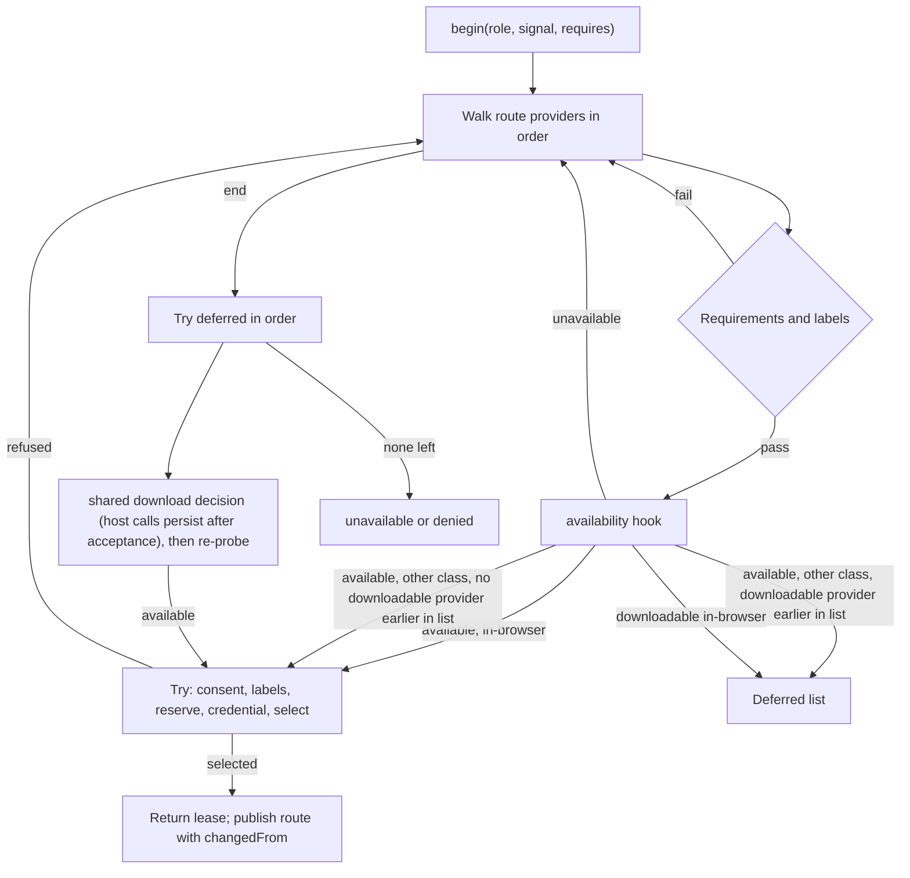

# M2 Router Availability, First-Run Order, Download Consent and Routed Structured Output - Plan

## Goal Capsule

- **Objective:** On first run, an agent role gets the most private model it can, in the order ADR-0006 decision 5 sets:
  1. a browser model that is ready now;
  2. a cached in-browser model;
  3. an in-browser download, after the user consents with the size shown;
  4. a remote provider with consent.

  The router asks the host whether each provider is available. It never starts a download without the host's download decision. When a role's destination class changes, the snapshot says so. When nothing qualifies, the call fails with a typed `unavailable`. `withStructuredOutput` on a routed model selects only providers that declare `structured-output`, sends them the JSON Schema to enforce while decoding, and validates the reply.
- **Means:**
  - Two optional host hooks on `ModelRouting`, `availability` and `download`, with an order-preserving deferral rule in the router (KTD1, KTD2).
  - A per-call feature requirement on `ModelPort.begin` (KTD5).
  - A routed `withStructuredOutput` in the LangGraph adapter (KTD5).
  - A `changedFrom` field on published routes (KTD4).
  - `checkWebLLMModel` in `@galaxie/models/webllm`, so hosts can answer the availability hook for the cached model (KTD6).
- **Authority, highest first:**
  1. `AGENTS.md` repository rules.
  2. Accepted ADRs in `docs/adr/`. ADR-0002, ADR-0006 (decisions 4, 5, 6 and 10 define this slice), ADR-0012, ADR-0014, ADR-0015, ADR-0016 and ADR-0017 bind it.
  3. This plan.
  4. `docs/galaxie-project-brief.md` (§10.6, §10.7).
  5. `docs/system-design.md` (§8.4).

  When this plan and an Accepted ADR disagree, follow the ADR and record the conflict in the PR body.
- **Execution profile:** autonomous, with mock providers and fake hooks only. Work on the existing branch `m2/router-first-run` and open one pull request against `main`. Run units in order (U1 to U6) and `pnpm check` after each one.
- **Stop conditions:** stop and open a draft pull request that names the blocker when any of these happens:
  - a requirement can pass only by weakening an ADR-0012 guarantee, or by letting prompt, completion, schema-validation or host error text reach an error, span, event, snapshot or diagnostic. The only exception is the host-only `DiagnosticEvent.error` field for a failing host hook, exactly as class consent already uses it;
  - an existing test assertion must change for reasons other than those U3 names;
  - a conformance golden or the compatibility matrix would change;
  - `pnpm check` still fails after three focused fix attempts on the same cause.
- **Who finishes:** the implementing agent opens the pull request and stops. It never merges, never pushes to `main` and never enables auto-merge.

---

## Product Contract

### Summary

The host optionally gives `CreateOptions.models` two new hooks:

- `availability({ role, providerId, signal })` returns `available`, `unavailable`, or `downloadable` with an optional byte size and whether the download lands in site storage. Hosts wire it to `checkBuiltInAI` and to the new `checkWebLLMModel`.
- `download({ role, providerId, bytes?, persist?, signal })` shows the size, gets the user's decision and performs the download. It resolves `true` when the provider is ready, typically from a click that calls `prepareBuiltInAI` or loads the WebLLM engine.

The router probes providers in route order. It uses an available provider at once, and defers a downloadable one together with every non-browser provider listed after it. So a cached model is used before any download, and a download is offered before a later remote provider. Published routes gain `changedFrom` when the role's class differs from the one it last used. `RoutedChatModel.withStructuredOutput(schema)` routes only to `structured-output` providers, passes the `jsonSchema` call option and validates the reply against the schema.

### Problem Frame

M1's router walks the host's provider list and treats every provider as ready. M2 adds providers that may be missing, downloadable, or cached: Chrome Built-in AI and WebLLM. ADR-0006 decision 5 fixes the first-run order. Decision 6 requires no silent switch, a notice on class change and a typed `unavailable`. Brief §10.6 requires `withStructuredOutput` to take the provider's schema-enforcing path, which the routed model does not offer yet. Both providers already accept `jsonSchema`, but hosts were told not to declare `structured-output` until this slice.

### Requirements

**Availability and order**

- R1. `ModelRouting.availability`, when supplied, is called with `{ role, providerId, signal }` for each provider the router considers in a call, at most once per provider during the walk, plus one re-probe after that provider's download decision returns `true` (R4). Its result must be one of:
  - `{ status: 'available' }`;
  - `{ status: 'unavailable' }`;
  - `{ status: 'downloadable', bytes?: number, siteStorage: boolean }`, where `bytes` is a non-negative safe integer.

  Any other value, a rejection or a throw counts as `unavailable` and reports a `model_failed` diagnostic. A rejection or throw puts the raw error only in the host-only `DiagnosticEvent.error` field, as for class consent; an invalid return value reports no `error`. Without the hook every provider is `available`, as in M1.
- R2. A `downloadable` answer for a provider whose destination is not `in-browser` counts as `unavailable`.
- R3. The router walks the route's providers in order and skips any that fail the role's requirements, the call's required features (R12) or the current labels. For each remaining provider:
  - `available` and `in-browser`: tried at once.
  - `available` and another class: tried at once, unless a downloadable provider appeared earlier in the list. In that case it is deferred.
  - `downloadable`: deferred.
  - `unavailable`: skipped.

  After the walk, the router tries the deferred providers in their original order.
- R4. Trying a provider keeps the M1 steps:
  1. class consent for non-browser destinations;
  2. labels rechecked;
  3. reservation, then credential;
  4. selection.

  Trying a deferred downloadable provider first runs the download decision (R5 to R7), then probes it again. It continues only when the new answer is `available`.

**Download**

- R5. The router calls `ModelRouting.download` with `{ role, providerId, bytes?, persist?, signal }`. Without the hook, downloadable providers are skipped as unavailable. `true` means ready. `false`, a non-boolean, a rejection or a throw count as refusal and report `model_failed` for anything other than a boolean, with the raw error placed as R1 describes. A refusal is remembered for that provider for the instance's lifetime, as consent refusals are.
- R6. Concurrent calls that need the same provider's download share one pending `download` call. Its `signal` aborts when no call still waits, following the pending-consent rules. The signal means only that no call is still waiting. The wait counts toward the run's wall-clock budget, so hosts should let a started download continue after the signal aborts, and resolve `false`; a later call's re-probe then finds the provider available. Hosts expecting long downloads should raise `wallClockMs`.
- R7. For an answer with `siteStorage: true`, the download request carries `persist(): Promise<boolean>`. The host calls it after the user accepts and before the download starts, because the router cannot see the decision inside the hook. It calls `navigator.storage.persist()` at most once per instance and shares the result. It resolves `false` when the API is missing, rejects or the call's signal aborts. Requests for `siteStorage: false` answers carry no `persist`.

**Outcome and notices**

- R8. When no provider is selected, the call fails with `unavailable`, unless a provider that met the requirements was skipped for labels, class consent or download refusal. In that case it fails with `denied`, as in M1.
- R9. `snapshot.routes[role]` stays `{ providerId, destination }`. It gains `changedFrom: <class>` when the instance's previously selected route for that role had a different destination class. A first selection, or a change of provider within the same class, carries no `changedFrom`.

**Routed structured output**

- R10. `RoutedChatModel.withStructuredOutput(schema, config)` accepts a Zod, Standard Schema or JSON Schema object, and `config.method` must be absent or `jsonSchema`; otherwise it rejects with `unsupported`. It binds the `jsonSchema` call option and parses the text reply. It returns the parsed value, or `{ raw, parsed }` with `includeRaw`.
- R11. Without `includeRaw`, a reply that is not text, not JSON, or fails the schema rejects with `invalid`. With `includeRaw`, it resolves to `{ raw, parsed: null }`, as LangChain's pipeline does. The error has the fixed core message, and no error, diagnostic or span carries the reply text. The call's lease settles normally.
- R12. A call carrying the `jsonSchema` option begins with `requires: ['structured-output']`. `ModelPort.begin(role, { signal, requires })` filters out providers whose descriptor lacks a required feature, alongside the role's own requirements. Unknown feature names reject with `invalid`.

**Providers and docs**

- R13. `@galaxie/models/webllm` exports `checkWebLLMModel({ model? })`. It returns `{ status: 'unavailable' }` without `navigator.gpu`. Otherwise it returns `{ status: 'available' }` when WebLLM reports the model cached, else `{ status: 'downloadable', bytes: record.weightBytes, siteStorage: true }`. It loads the WebLLM bundle lazily and never downloads.
- R14. Docs describe the hooks, the order, `changedFrom`, routed structured output and that WebLLM and Built-in AI hosts may now declare `structured-output`. The docs never call galaxie secure or compliant.

### Scope Boundaries

- Not in this slice:
  - repair attempts after a failed validation (the `repairs` budget stays reserved);
  - a consent UI component (the M2 React slice);
  - lazy model construction for WebLLM hosts (the host example slice);
  - remote providers (M4);
  - the real-device run (M2 exit).
- No change to ADR text, the conformance goldens or the compatibility matrix.
- No new dependency.

### Assumptions

- Route order stays the host's policy (ADR-0006 decision 4). The deferral rule in R3 yields decision 5's order for a host that lists Built-in AI, then the in-browser model, then remote providers. It keeps M1's acceptance tests, which list a remote provider first with no downloadable provider, unchanged.
- The `download` hook combines the decision and the download, because Built-in AI needs the user's click as activation for its download, and only host UI can obtain it.
- Probing on every call is acceptable. Built-in AI `availability()` and a Cache Storage lookup are cheap, and state changes after a download.

---

## Planning Contract

### Key Technical Decisions

- KTD1. **Host hooks, not provider objects, answer availability and download.** Core has no dependency on `packages/models`, and descriptors are plain data. Two functions on `ModelRouting` keep the router framework-neutral (ADR-0017). Hosts wire `checkBuiltInAI`, `prepareBuiltInAI`, `checkWebLLMModel` and `loadWebLLMEngine` to them. Hook results are validated like any other host input.
- KTD2. **An order-preserving deferral rule instead of fixed tiers.** Re-sorting providers into fixed tiers (in-browser, download, remote) would override host order and break M1's AE1 and AE3, which deliberately list a remote provider first. Deferring a downloadable provider, and every later non-browser one, gives ADR-0006 decision 5 for ADR-ordered lists:
  - an available in-browser provider wins without a prompt;
  - a cached model listed after a downloadable one is still used before any download;
  - a remote provider listed after the download waits for the download decision.
- KTD3. **The download decision mirrors class consent.** It uses shared pending decisions with waiter counting and abort when unused, refusals remembered for the instance lifetime, and successes not remembered, because the next call re-probes anyway. The implementation should extract the pending-decision mechanics from `#approval` into one helper used by both, rather than copy them.
- KTD4. **`changedFrom` on the published route, not a new event.** A new event type would change the run-event stream that the parity goldens record. A field on the snapshot route, set only when the class changes, gives the host what it needs for a notice, and leaves first selections, and therefore the goldens, unchanged. "Previous" is the instance-wide last selection for the role. Class consent already uses that value.
- KTD5. **Routed structured output as a per-call feature requirement.** The routed model knows a call is structured from its `jsonSchema` option, and asks the port for `structured-output`. The provider receives the option unchanged, because the routed model already forwards call options, and decodes under the schema. The adapter validates with `@langchain/core`'s `createContentParser` and maps every parse or validation failure to `invalid`. Its pipeline matches the models package's `structured-output.ts`. That code is re-implemented in the adapter, because packages do not import each other (system design §4).
- KTD6. **`checkWebLLMModel` uses WebLLM's own cache check.** `hasModelInCache(modelId, appConfig)` from `@mlc-ai/web-llm` 0.2.86 reads the configured cache. The helper builds the app config from the validated record, and lazily imports the bundle through the same module-supplier seam the engine uses, so tests stay fake.

### High-Level Technical Design



### Output Structure

```text
packages/core/src/models.ts            new hook, availability and download types; begin requires; PublishedModelRoute
packages/core/src/model-router.ts      probing, deferral, download decision, persist, requires
packages/core/src/agent-instance.ts    changedFrom on published routes
packages/core/src/instance.ts          snapshot route type
packages/core/src/index.ts             new exports
packages/adapter-langgraph/src/routed-chat-model.ts   withStructuredOutput, requires on begin
packages/models/src/webllm/cache.ts    checkWebLLMModel
packages/models/src/webllm/index.ts
```

The tree is a scope declaration; the per-unit file lists are authoritative.

### Implementation Constraints

- New source files start with the SPDX header from ADR-0015. Relative imports end in `.js`, type-only imports use `import type`, exported functions declare return types, and there is no `enum`.
- Core uses no Node globals. It reaches `navigator.storage` only through `globalThis.navigator?.storage?.persist`.
- Hook errors and replies never reach diagnostics as text. Follow the existing consent diagnostics, which pass the raw error to the host's diagnostic sink only. Keep that behavior identical for the new hooks: the same `model_failed` kind, with the raw error passed exactly as consent passes it.
- Never forward a hook's return value into a snapshot, span or error beyond the validated fields.

---

## Implementation Units

### U1. Core types

- **Goal:** declare the public surface.
- **Requirements:** R1, R5, R9, R12.
- **Dependencies:** none.
- **Files:** `packages/core/src/models.ts`, `packages/core/src/instance.ts`, `packages/core/src/index.ts`.
- **Approach:**
  1. Add `ModelAvailability` (the R1 union) and `ModelAvailabilityRequest` `{ role, providerId, signal }`.
  2. Add `ModelDownloadRequest` `{ role, providerId, bytes?, persist?, signal }`.
  3. Add the optional `availability` and `download` hooks to `ModelRouting`, with doc comments that cite ADR-0006.
  4. Add `requires?: readonly ModelFeature[]` to `ModelPort.begin`'s options.
  5. Add `PublishedModelRoute extends SelectedModelRoute { readonly changedFrom?: DestinationClass }`, and use it for `snapshot.routes`.
  6. Export the new types.
- **Patterns to follow:** existing `ModelConsentRequest` and its comments.
- **Test expectation:** none, since this unit only declares types. U2 tests the behavior.
- **Verification:** `pnpm check` passes.

### U2. Router: probing, deferral, download, persist and requires

- **Goal:** the R1 to R8 and R12 behavior in `ModelRouter`.
- **Requirements:** R1 to R8, R12.
- **Dependencies:** U1.
- **Files:**
  - `packages/core/src/model-router.ts`;
  - `packages/core/test/model-router.test.ts`, plus a new `packages/core/test/model-first-run.test.ts` if the existing file grows unwieldy.
- **Approach:**
  1. Validate the two hooks as functions at construction, as for `consent`.
  2. Validate `requires` in `begin`.
  3. Extract the pending-decision mechanics of `#approval` into a helper that keys a shared promise, counts waiters, aborts when unused and remembers refusals (KTD3). Use it for class consent and for downloads, keyed by provider ID.
  4. Implement the walk and the deferred pass (KTD2), with the probe wrapped in `waitForHostOrAbort`.
  5. Implement the memoized `persist` function, once per instance (R7).
  6. Keep the M1 try steps unchanged, factored into one function both passes call.
- **Execution note:** write the walk tests first, against fake hooks, before refactoring `begin`. The refactor touches the most security-relevant code in core. Every existing router, model-run and conformance model test must pass unchanged.
- **Patterns to follow:** the consent tests in `packages/core/test/model-router.test.ts`.
- **Test scenarios:**
  - Without hooks, every existing test passes unchanged, including AE1 and AE3 in `tests/conformance/models.test.ts`.
  - Route `[builtin, webllm, remote]`, where `builtin` answers `downloadable`, `webllm` answers `available` and `remote` is third-party: `webllm` is selected with no download and no consent call.
  - Same route with `webllm` `downloadable` too: no consent before the download decision. `download` is called for `builtin` first, and on `false` for `webllm`. On `false` again, `remote` is tried with consent.
  - Route `[remote, local]` where `local` is `available`: `remote` is tried first, as in M1, because no download precedes it.
  - `download` resolving `true` re-probes. A second answer of `available` selects the provider. A second answer of `downloadable` skips it and the call continues.
  - A refused download is remembered: the next call does not call `download` again for that provider.
  - Two concurrent calls share one `download` call. Cancelling both aborts its signal.
  - A fake `download` hook that calls `request.persist()` gets `true` when a fake `navigator.storage.persist` resolves `true`, and `false` when it is missing or rejects. The browser API is called once across two downloads with `siteStorage: true`, never before the hook calls `persist`, and a `siteStorage: false` request has no `persist`.
  - An availability hook that throws, rejects or returns `{ status: 'downloadable', bytes: -1 }` makes the provider `unavailable` and reports `model_failed`.
  - A `downloadable` answer for a `third-party` provider counts as unavailable.
  - All providers `unavailable` gives `unavailable`. One downloadable provider whose download is refused gives `denied`.
  - `begin(role, { requires: ['structured-output'] })` skips providers without the feature, and gives `unavailable` when none has it. `requires: ['teleport']` rejects with `invalid`.
  - A run cancelled while `availability` or `download` is pending rejects `cancelled` and releases no reservation it never took.
- **Verification:** all scenarios pass. `git diff --stat main -- tests/conformance/golden tests/conformance/compatibility-matrix.json` is empty.

### U3. Published route notices

- **Goal:** `changedFrom` on class change (R9).
- **Requirements:** R9.
- **Dependencies:** U2.
- **Files:** `packages/core/src/agent-instance.ts`, `packages/core/test/model-runs.test.ts`, `tests/conformance/models.test.ts`.
- **Approach:** keep the `selectedRouteChanged(role, selected)` signature unchanged; an extra argument would make the negated two-argument assertion in the label-narrowing test of `packages/core/test/model-router.test.ts` pass vacuously. Compute `changedFrom` in `agent-instance.ts` from the previous selection for the role. If the existing `routes` map is per run, keep an instance-level map of the last selected destination per role beside it. Publish `changedFrom` only when the previous destination differs from the new one.
- **Test scenarios:**
  - A first selection has no `changedFrom`.
  - A switch from `third-party` to `in-browser`, through a label as in AE2, publishes `changedFrom: 'third-party'`.
  - A provider switch within one class has no `changedFrom`.
  - A later run of the same instance that selects a different class than the previous run publishes `changedFrom`.
- **Verification:** the scenarios pass. These existing assertions compare whole route objects across a class change and must gain `changedFrom: 'third-party'` on the local route; these are the only permitted assertion changes, and the PR body lists them:
  - the AE1/AE2 test in `tests/conformance/models.test.ts`, both the `routes` array and any final `snapshot.routes` assertion;
  - the second entry of the `notices` assertion in `packages/core/test/model-runs.test.ts`.

### U4. Routed structured output

- **Goal:** R10 to R12 in the adapter.
- **Requirements:** R10, R11, R12.
- **Dependencies:** U2.
- **Files:**
  - `packages/adapter-langgraph/src/routed-chat-model.ts`;
  - `packages/adapter-langgraph/test/routed-chat-model.test.ts`;
  - `tests/conformance/models.test.ts`, or a new `tests/conformance/structured-output.test.ts`.
- **Approach:**
  1. In `#begin`, pass `requires: ['structured-output']` when the options carry a `jsonSchema` that is a plain object.
  2. Override `withStructuredOutput` as KTD5 describes. Convert with `toJsonSchema`, and reject a schema that cannot be converted with `invalid`. Wrap the parser so that any failure throws `GalaxieError('invalid')`. Assemble with `assembleStructuredOutputPipeline(this.withConfig({ jsonSchema }), parser, includeRaw)`.
- **Patterns to follow:** `packages/models/src/structured-output.ts`.
- **Test scenarios:**
  - With a mock provider declaring `structured-output` that replies `{"answer":"yes"}`, a Zod schema returns `{ answer: 'yes' }`. The provider received `jsonSchema` equal to the converted schema.
  - `includeRaw` returns `{ raw, parsed }`. With `includeRaw`, a non-JSON reply resolves to `{ raw, parsed: null }`, as `assembleStructuredOutputPipeline` and `@galaxie/models` structured output do.
  - Route `[plain, structured]`, where `plain` lacks the feature: `structured` serves the call, and `snapshot.routes` names it.
  - No provider with the feature gives `unavailable` before any provider is called.
  - A reply `not json`, and a reply failing the schema, both reject with `invalid`. The message is the fixed core text, and the reply text is absent from the error, its cause chain and the diagnostics. The lease settled once.
  - `method: 'functionCalling'` rejects with `unsupported`.
  - On Node and Chromium through `createRuntime`, a one-node graph returns the parsed object.
- **Verification:** the scenarios pass on both platforms. `CI=true pnpm test` passes.

### U5. `checkWebLLMModel`

- **Goal:** R13.
- **Requirements:** R13.
- **Dependencies:** none (it may run in parallel with U2 to U4, but commit it after U4).
- **Files:** `packages/models/src/webllm/cache.ts`, `packages/models/src/webllm/index.ts`, `packages/models/test/webllm-cache.test.ts`, `packages/models/test/support/fake-webllm.ts`, `scripts/check-dependencies.ts` (only if it pins the files allowed to import `@mlc-ai/web-llm`).
- **Approach:**
  1. Validate the record with `buildAppConfig`.
  2. Read `navigator.gpu`.
  3. Lazily import the module, call `hasModelInCache(modelId, appConfig)`, and map the result.
  4. Use an internal supplier seam for tests, as `createWebLLMEngine` does.
  5. `buildAppConfig` validation runs first and rejects an invalid record with `invalid`. Only failures of the lazy import and of `hasModelInCache` map to `{ status: 'unavailable' }`, without their text.
- **Test scenarios:**
  - No `navigator.gpu` gives `unavailable`, and the module is never loaded.
  - A cached fake gives `available`; an uncached fake gives `downloadable` with the record's `weightBytes` and `siteStorage: true`.
  - A rejecting fake gives `unavailable`.
  - An invalid host record rejects with `invalid`.
- **Verification:** the scenarios pass, and `check:deps` passes.

### U6. Documentation

- **Goal:** R14.
- **Requirements:** R14.
- **Dependencies:** U5.
- **Files:** `docs/system-design.md`, `AGENTS.md`, `README.md`.
- **Approach:**
  1. In system design §8.4, extend the mermaid flow and text with the probe, the deferral rule, the download decision with `persist()`, `changedFrom` and routed structured output.
  2. Add a host wiring sketch:
     - for Built-in AI only: `availability` mapping `checkBuiltInAI` (`downloading` and `downloadable` both become `downloadable` with `siteStorage: false` and no `bytes`), and `download` calling `prepareBuiltInAI` from the consent click;
     - for WebLLM: `checkWebLLMModel` reports cache state, but routing a not-yet-loaded WebLLM provider needs a lazily constructed chat model, deferred to the host example slice. Until then a WebLLM provider must be loaded before prepare. `available` means cached weights, not a loaded engine.
  3. State the Built-in AI size limit: the Prompt API exposes no download size, so its request carries no `bytes`. Hosts must say in the consent UI that the browser manages the download and its size is not reported. Record this as a known gap against ADR-0006 decision 5's "size shown" in the docs and the PR body.
  4. Update the WebLLM and Built-in AI paragraphs: hosts may declare `structured-output`.
  5. Remove the delivered items from the deferred lists.
  6. Update the `AGENTS.md` status paragraph and the README status block in the existing style.
- **Test expectation:** none, since this is documentation.
- **Verification:** `pnpm check` passes, and the three files agree.

---

## Verification Contract

| Gate | Command or check | Applies to |
| --- | --- | --- |
| Full local CI | `pnpm check` | every unit |
| CI-mode tests | `CI=true pnpm test` (Node and headless Chromium) | U4 and before the PR |
| M1 behavior kept | every pre-existing router, model-run and conformance model test passes, with only the U3 change allowed | U2, U3 |
| Goldens unchanged | `git diff --stat main -- tests/conformance/golden tests/conformance/compatibility-matrix.json docs/adr` is empty | before the PR |
| Dependencies unchanged | `git diff main -- pnpm-lock.yaml` is empty | before the PR |

---

## Definition of Done

- U1 to U6 are complete, and each unit's test scenarios exist and pass.
- `pnpm check` and `CI=true pnpm test` pass on the final commit.
- Every new source file has the SPDX header.
- No hook result, reply text or host error text reaches an error message, span, snapshot or event. A failing host hook's raw error appears only in the host-only `DiagnosticEvent.error` field, as for class consent. Routed structured-output failures report no error object, so no reply or validation text reaches a diagnostic.
- The goldens, the compatibility matrix, `docs/adr/` and the lockfile are unchanged.
- The pull request body lists the Scope Boundaries deferrals, and every place an existing test changed and why.

---

## Appendix

### Sources

- ADR-0006 decisions 4 to 6 and 10; brief §10.6.
- `packages/core/src/model-router.ts`, `packages/core/src/models.ts`, `packages/core/src/agent-instance.ts` (`selectedRouteChanged`), `packages/adapter-langgraph/src/routed-chat-model.ts`.
- `tests/conformance/models.test.ts` AE1 to AE3, which fix M1's route-order behavior that KTD2 preserves.
- `packages/models/src/builtin-ai/api.ts` (`checkBuiltInAI`, `prepareBuiltInAI`) and `packages/models/src/webllm/engine.ts` (module supplier seam).
- WebLLM 0.2.86 `hasModelInCache(modelId, appConfig?)` in `lib/cache_util.d.ts`.
