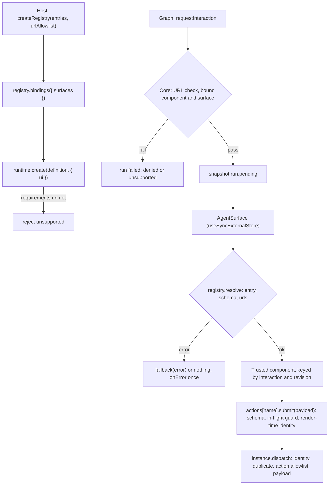

# M2 React Package with a Typed UI Registry and Headless Reference Components - Plan

## Goal Capsule

- **Objective:** A host renders the agent's pending interaction through trusted React components it registered, and the user's answer reaches the graph only as a valid, allowlisted action for the exact interaction on screen.
  - Unknown components, invalid props and URL props outside the allowlist are rejected with typed errors before anything renders. Disallowed actions and invalid payloads are rejected at submit and again at dispatch (AT-06, AT-27 for registry URLs).
  - A stale screen never advances the graph (AT-07).
  - Rerenders, Strict Mode and switching instances never create or start anything, and never leak subscriptions (AT-17).
- **Means:**
  - A new `packages/react` (ADR-0007) holding:
    - a typed registry whose entries own the component ID, the props schema, the action allowlist with labels and payload schemas, an optional URL extractor and the trusted component;
    - a snapshot hook and a surface component;
    - headless reference components `education.Quiz/v1`, `education.Feedback/v1` and `education.Progress/v1`.
  - A small core addition: optional host UI bindings in `CreateOptions`. They let core check the definition's UI requirements, pending components and surfaces, and dispatched actions, so a non-React dispatch path gets the same action allowlist (Spike C finding).
- **Authority, highest first:**
  1. `AGENTS.md` repository rules.
  2. Accepted ADRs in `docs/adr/`, plus ADR-0007 as the Proposed working default for this slice. ADR-0002, ADR-0004, ADR-0012, ADR-0015 and ADR-0017 also bind it. Do not edit any ADR.
  3. This plan.
  4. `docs/galaxie-project-brief.md` §11 and §14.3.
  5. `docs/system-design.md` §4.
  6. `spikes/c-ui-path/README.md`, as evidence only. Never import or copy spike code.

  When this plan and an Accepted ADR disagree, follow the ADR and record the conflict in the PR body.
- **Execution profile:** autonomous, in Node and headless Chromium only. Work on the existing branch `m2/react-ui-registry` and open one pull request against `main`. Run units in order (U1 to U7) and `pnpm check` after each one.
- **Stop conditions:** stop and open a draft pull request that names the blocker when any of these happens:
  - a requirement can pass only by weakening an ADR-0012 guarantee, or by rendering model text as HTML or putting props, payloads or reply text in an error, diagnostic, span or snapshot;
  - an existing test assertion must change;
  - a conformance golden or the compatibility matrix would change;
  - a dependency other than those U2 names would be added, or one of those fails pnpm's `minimumReleaseAge`;
  - `pnpm check` still fails after three focused fix attempts on the same cause.
- **Who finishes:** the implementing agent opens the pull request and stops. It never merges, never pushes to `main` and never enables auto-merge.

---

## Product Contract

### Summary

The host builds a registry from component entries and passes `registry.bindings({ surfaces })` to `runtime.create(definition, { ..., ui })`. In React it mounts one `<AgentSurface instance registry surfaceId="lesson-main" />` per surface. The surface reads `instance.getSnapshot()` through `useSyncExternalStore`. It renders the pending interaction only when that interaction targets its surface, its component is registered, its props pass the entry's schema and its URL props are allowlisted. Otherwise it renders the host's fallback, or nothing, and reports a typed error.

The trusted component receives the validated props and one bound action per allowlisted action name. Each action has its registry label and a `submit(payload)` that:
- validates the payload against the action's schema;
- refuses a second submit while one is in flight;
- dispatches with the identity of the interaction that was rendered, never the one current at click time.

Core checks the same allowlist on dispatch.

### Problem Frame

M1 ships pending interactions, identity-checked dispatch and an origin check on every URL-like props string. It has no UI package. Spike C showed that a registry entry can own the component, the schema and the actions. It also found four gaps:
- core accepts any non-empty action;
- the runtime never reads the definition's `UiRequirements`;
- the registry did not apply the URL allowlist to schema-declared URLs;
- local input is lost on reload, with no decision recorded about it.

Brief §11.2 also requires the host to report supported components before a run, and the agent must not draw outside its surfaces.

### Requirements

**Core UI bindings**

- R1. `CreateOptions.ui?: UiBindings` is `{ components: Record<ComponentId, { actions: Readonly<Record<string, { payload: Schema }>> }>, surfaces: readonly SurfaceId[] }`, where `Schema` is core's Standard Schema type.
  - `runtime.create` validates it and rejects with `invalid` when:
    - a component ID does not match the `ComponentId` pattern that `parseInteractionRequest` uses;
    - an action name is empty, or an action's `payload` is not a Standard Schema;
    - the surface list has an empty, non-string or duplicate entry.
  - The actions record may be empty in bindings, but R3 fails a run whose pending component has no actions, since nothing could answer it.
- R2. When `ui` is given and the definition declares `ui: UiRequirements`, `create` rejects with `unsupported` unless both hold:
  - every required component `<catalog name>.<component>/v<catalog version>` is bound, where `education/v1` with `Quiz` becomes `education.Quiz/v1`;
  - every required surface is listed.

  Without `ui`, M1 behavior is unchanged.
- R3. When `ui` is given and an interaction is about to become pending, an unbound component, a component with no actions, or an unlisted surface fails the run with `unsupported`, in the same place and the same way as the existing URL check fails it with `denied`. Nothing becomes pending.
- R4. When `ui` is given, `dispatch` rejects with `invalid` an action that is not in the pending component's actions, or a payload that fails that action's schema (synchronously; a Promise result or a throw is `invalid`, with no issue text or cause kept). The action check runs after the existing identity and duplicate checks; the schema check runs on the payload after the existing budget parse; nothing is recorded on failure. Without `ui`, the M1 rule (any non-empty string) is unchanged.

**Registry**

- R5. `defineComponent({ id, props, actions, urls?, component })` declares an entry.
  - `props` is a Standard Schema, which includes Zod 4.
  - `actions` maps each action name to `{ label: string, payload: StandardSchema }`.
  - `urls(props)` returns every URL the component may load or link, from validated props, each as its own absolute string that the component uses verbatim as a single attribute value, never as a `srcset` list or CSS `url()`.
  - `component` is the trusted React component.

  `createRegistry({ components, urlAllowlist })` rejects with `invalid` on duplicate IDs, an ID failing the `ComponentId` pattern, an empty label, or a non-function component. `urlAllowlist` holds exact origins, as for `createRuntime`.
- R6. `registry.resolve(pending)` returns either `{ ok: true, entry, props }` or `{ ok: false, error: ErrorInfo }`, synchronously:
  - an unknown component gives `unsupported`;
  - props that fail the schema, or a schema that validates asynchronously, give `invalid`;
  - a URL from `urls(props)` that contains ASCII whitespace or fails core's `isAllowedUrl(url, urlAllowlist)` gives `denied`;
  - a props schema or `urls` extractor that throws gives `invalid`, never rethrown and with no cause kept.

  Errors use core's `toErrorInfo`, so no props, schema issues or URL text appear in them.
- R7. `registry.bindings()` returns the `UiBindings` for R1, built from the same entries, so the action allowlist and payload schemas are declared once. The host passes its own surface list as an argument: `bindings({ surfaces })`.

**React surface and hooks**

- R8. `useAgentSnapshot(instance)` returns `instance.getSnapshot()` through `useSyncExternalStore`, subscribing with `instance.subscribe`. Changing `instance` unsubscribes from the old one. The hook never calls `prepare`, `start`, `dispatch`, `cancel` or `dispose`.
- R9. `<AgentSurface instance registry surfaceId fallback? onError?>` renders:
  - nothing when there is no pending interaction for `surfaceId`;
  - the entry's component when `resolve` succeeds;
  - otherwise `fallback(error)` if given, else nothing.

  `onError(error)` is called once per rejected interaction, from an effect, even under Strict Mode's double invocation. The rendered component is keyed by interaction ID and view revision, so local state resets whenever the interaction changes.
- R10. The component receives `{ props, actions, status }`.
  - `actions[name]` is `{ label, submit(payload): Promise<DispatchReceipt> }` for each allowlisted action. `label` comes from the registry entry, never from props (ADR-0012).
  - `submit` validates the payload synchronously. On failure, including a throwing schema, it resolves to `{ status: 'rejected', error: toErrorInfo('invalid') }` without dispatching.
  - It builds the `UserInteractionEvent` from the identity of the rendered pending interaction (instance, run, interaction, surface, revision).
  - While a submit for that interaction is in flight, or after one was accepted, it resolves to `rejected` with `duplicate` without dispatching.
  - A dispatch rejection clears the in-flight state so the user can try again.
- R11. `status` is `'idle' | 'submitting' | 'accepted' | { rejected: ErrorCode }`, for the rendered interaction only. It stays `'accepted'` after an accepted dispatch until the interaction leaves the snapshot.

**Reference components**

- R12. Headless, unstyled entries with Zod schemas, exported singly and as `educationComponents`:
  - `education.Quiz/v1`:
    - props `{ title?, questions: [{ id, prompt, options: [{ id, label }] }] }`, with 1 to 20 questions and 2 to 6 options each;
    - action `submit` with payload `{ answers: Record<questionId, optionId> }`, where every question is answered with one of its options (checked in the component before submit, and the schema bounds the shape);
    - renders a `form` with one `fieldset` per question, each with its own `legend`, native radio inputs with `label`s, and a submit button disabled while submitting.
  - `education.Feedback/v1`:
    - props `{ title?, items: [{ id, kind: 'correct' | 'incorrect' | 'info', text }] }`, with 1 to 20 items;
    - action `continue` with payload `{}`;
    - renders a list and a continue button.
  - `education.Progress/v1`:
    - props `{ label?, current, total }`, integers with `0 <= current <= total <= 1000` and `total >= 1`;
    - action `continue` with payload `{}`, because a pending interaction must be answerable (R3);
    - renders a native `progress` element with a text equivalent.

  Every string is bounded: titles and labels at most 200 characters, prompts and texts at most 2000. Every `id` matches `^[A-Za-z0-9_-]{1,64}$`. Question IDs are unique within a Quiz, option IDs within a question, and item IDs within Feedback, through schema refinements. Quiz builds `answers` with `Object.fromEntries`, never by property assignment. Text renders only as React text children: no `dangerouslySetInnerHTML`, no URLs and no event handlers from props.
- R13. Input drafts are component-local and are not persisted. Any remount starts with empty inputs: a new interaction ID or revision in this slice, and a reload once M3 ships the restore API (core has no restore path yet; Spike C AE4 showed the same loss through a spike shim). Persisting typed text is a storage and labels decision for M3 (ADR-0014), recorded in system design. U4's remount scenario covers the reset.

**Boundaries and docs**

- R14. React appears only in `packages/react`. `check:deps` enforces both rules: no other package source or build imports `react` or `react-dom`, and `packages/react` source and build import only `@galaxie/core`, `react` (including `react/jsx-runtime`), `zod` and relative files. Test files under `packages/react/test` may also import `react-dom` and `vitest`.
- R15. The docs record the Spike C decisions:
  - core checks actions and UI requirements when the host passes bindings;
  - URL props are declared by each entry's `urls` and checked against the registry allowlist;
  - drafts are not persisted in M2.

  They also describe the package API. No doc calls galaxie secure or compliant.

### Scope Boundaries

- Not in this slice:
  - `education.WritingPrompt/v1` (the example slice adds it if it needs one);
  - confirmation dialogs for capability approvals (AT-28 belongs with capability UI);
  - LLM-composed UI and adapters for json-render, A2UI or MCP Apps;
  - styling and theming;
  - a restore API (M3);
  - draft persistence;
  - enforcing the `uiElements` budget;
  - the example app and CSP host (later M2 slices).
- No ADR edits, no change to conformance goldens or the compatibility matrix, and no change to existing test assertions.
- The only new dependencies are those U2 names.

### Assumptions

- The registry's URL extractor is trusted host code and is the primary URL control. Core's M1 string-leaf check stays as a backup, but it only catches strings that begin with a scheme or `//`: URLs embedded in CSS, `srcset` lists or text pass it. The origin allowlist does not stop a model-chosen path or query from carrying data to an allowed host (ADR-0012 residual); the docs say so.
- Hosts create, prepare and start instances outside React, or in their own effects with their own ownership policy. The package never owns an instance's lifecycle, which is how AT-17 holds by construction. Tests prove the package keeps to that.
- Zod 4's Standard Schema `validate` is synchronous for the reference schemas.

---

## Planning Contract

### Key Technical Decisions

- KTD1. **Core enforces the action allowlist only when the host passes bindings.** It cannot do so from the interrupt: `parseInteractionRequest` accepts exactly four keys, so actions cannot travel with the request. Making bindings optional keeps every M1 test and golden unchanged. A host that uses the registry gets them from `registry.bindings()` for free.
- KTD2. **Fail the run on an unbound component or surface, like the URL check.** A pending interaction that no surface can render would wait forever. Failing it at the same point as the URL denial reuses an existing, tested path and gives the host a typed reason.
- KTD3. **Render-time identity in `submit`.** The bound action closes over the pending interaction it was rendered for. A click on an old screen therefore dispatches the old identity, and core rejects it `stale`, instead of silently applying the answer to a newer interaction.
- KTD4. **URL props declared by an extractor function, not by schema metadata.** Walking Zod schemas for URL markers is complex and fragile across schema libraries. A typed `urls(props)` on the entry is explicit, works with any Standard Schema, and runs on validated props.
- KTD5. **Standard Schema for props and payloads.** Core already validates input through Standard Schema. Reuse its validation helper if core exports one, else call `~standard.validate` and treat a Promise result as `invalid`. The reference entries use Zod 4, which is core's peer.
- KTD6. **No draft persistence.** Typed text is user content subject to labels and storage policy (ADR-0012, ADR-0014). Storing it in `sessionStorage` would create a second, unlabeled copy outside the checkpoint. M3 owns durable state.
- KTD7. **React tests run in Chromium with `react-dom/client` and React's `act`.** This needs no testing-library dependency. Package tests and one end-to-end conformance test use the real runtime and LangGraph adapter.

### High-Level Technical Design



### Output Structure

```text
packages/core/src/interactions.ts     UiBindings type, binding checks
packages/core/src/runtime.ts          CreateOptions.ui
packages/core/src/agent-instance.ts   requirement, pending and action checks
packages/react/
  package.json  tsconfig.json  tsconfig.build.json
  src/index.ts  src/registry.ts  src/surface.tsx  src/hooks.ts
  src/components/quiz.tsx  src/components/feedback.tsx  src/components/progress.tsx  src/components/index.ts
  test/*.test.tsx
tests/conformance/react-surface.test.tsx
scripts/check-dependencies.ts  scripts/check-license.ts (only if it skips .tsx)
vitest.config.ts  package.json  pnpm-lock.yaml
```

The tree is a scope declaration; the per-unit file lists are authoritative.

### Implementation Constraints

- New source files start with the SPDX header from ADR-0015, `.tsx` files included. Relative imports end in `.js`, type-only imports use `import type`, exported functions and components declare return types (`ReactElement | null`), and there is no `enum`.
- `packages/react` uses `"jsx": "react-jsx"` in its own tsconfig and the strict base settings. It has `sideEffects: false`, depends on `@galaxie/core`, and has `react` and `zod` as peers.
- Errors are core `GalaxieError` or `ErrorInfo` values with fixed messages and no cause. No props, payload, schema issue or URL text appears in an error, diagnostic, span or snapshot.
- The package never calls `prepare`, `start`, `cancel` or `dispose` on an instance.

---

## Implementation Units

### U1. Core UI bindings

- **Goal:** R1 to R4.
- **Requirements:** R1, R2, R3, R4.
- **Dependencies:** none.
- **Files:**
  - `packages/core/src/interactions.ts`, `packages/core/src/runtime.ts`, `packages/core/src/agent-instance.ts`, `packages/core/src/index.ts`;
  - `packages/core/test/ui-bindings.test.ts`;
  - `tests/conformance/interaction-policy.test.ts`, adding cases only.
- **Approach:**
  1. Add `UiBindings` and export it.
  2. Validate `options.ui` in `create`, and check the definition's `ui` against it (R2), using a shared component-ID helper with `parseInteractionRequest`'s pattern.
  3. At the point where pending interactions pass `checkInteractionUrls`, also check the bound component and surface (R3).
  4. In `dispatch`, after the stale and duplicate checks and before payload parsing, check the action (R4).
- **Patterns to follow:** the URL-denial path and its tests in `tests/conformance/interaction-policy.test.ts`.
- **Test scenarios:**
  - Valid bindings are accepted. Each R1 violation rejects `invalid`.
  - A definition requiring `education/v1` `Quiz` on `lesson-main` is rejected `unsupported` when either is unbound, and accepted when both are bound.
  - A graph interrupting with an unbound component, or an unlisted surface, ends the run `failed` with `unsupported`, with no pending interaction, on Node and Chromium.
  - With bindings, `dispatch` with action `skip` for a component allowing only `submit`, or with `submit` and a payload failing its schema, rejects `invalid`. The run stays `waiting_input` with the same pending interaction, and the checkpoint count is unchanged. `submit` is accepted.
  - Without bindings, all existing interaction and dispatch tests pass unchanged.
- **Verification:** the scenarios pass, and existing assertions are untouched.

### U2. Package scaffold and dependencies

- **Goal:** a buildable, type-checked, linted, tested `packages/react`.
- **Requirements:** R14.
- **Dependencies:** U1.
- **Files:** `packages/react/package.json`, `packages/react/tsconfig.json`, `packages/react/tsconfig.build.json`, `packages/react/test/tsconfig.json` (if the other packages use one), `tests/conformance/package.json` (adds `@galaxie/react: workspace:*`, `react`, `react-dom`, `@types/react`, `@types/react-dom` at the versions below), `tests/conformance/tsconfig.json` (`"jsx": "react-jsx"` and an `@galaxie/react` paths entry), root `package.json` scripts (typecheck, typecheck:ts6, build), `vitest.config.ts`, `pnpm-lock.yaml`, `scripts/check-license.ts` (only if it does not already cover `.tsx`).
- **Approach:**
  1. Add dev dependencies at the exact versions Spike C recorded: `react` 19.3.1, `react-dom` 19.3.1, `@types/react` 19.3.0, `@types/react-dom` 19.3.0.
  2. List `@galaxie/core: workspace:*` under `dependencies`, as `@galaxie/adapter-langgraph` does. Declare peers `react: ^19.2.0` and `zod: ^4.6.0`, and add `zod` 4.6.7 (already in the lockfile) as a dev dependency. These, and the conformance package entries in the file list, are the allowed dependency set.
  3. Add `react`, `react-dom/client` and `react/jsx-runtime` to the Chromium project's `optimizeDeps.include`, so Vite does not discover them mid-run.
  4. Add a Chromium Vitest project, or extend the existing browser project, so `packages/react/test/**/*.test.tsx` and `tests/conformance/**/*.test.tsx` run in Chromium. Keep `.tsx` out of the Node project.
  5. Add the alias `@galaxie/react` for conformance tests.
- **Test expectation:** a smoke test rendering an empty `<AgentSurface>` lands in U4. This unit is verified by the build and the checks.
- **Verification:**
  - `pnpm install --frozen-lockfile` passes after the lockfile update;
  - `pnpm check` passes;
  - the lockfile diff adds only these packages and their transitive dependencies.

### U3. Registry

- **Goal:** R5 to R7.
- **Requirements:** R5, R6, R7.
- **Dependencies:** U2.
- **Files:** `packages/react/src/registry.ts`, `packages/react/src/index.ts`, `packages/react/test/registry.test.tsx`.
- **Approach:** implement `defineComponent`, `createRegistry`, `resolve` and `bindings` as R5 to R7 state. Normalize the URL allowlist with the same rules `createRuntime` uses; use core's exported helper if one exists. Use `isAllowedUrl` from core.
- **Test scenarios:**
  - An unknown component gives `unsupported`. Missing or extra-typed props give `invalid`. An async schema gives `invalid`.
  - A test entry whose `urls` returns `https://images.example.test/a.png` resolves with that origin allowlisted. It gives `denied` without it, and for `javascript:` and `data:` URLs.
  - A `srcset`-style string whose first URL is allowlisted, and a CSS `url(...)` string, give `denied`. A throwing refinement and a throwing extractor give `invalid`.
  - No error contains props text, URL text or schema issue text (`JSON.stringify` check).
  - `bindings({ surfaces: ['lesson-main'] })` lists every entry's actions. `createRegistry` rejects duplicate IDs and empty labels with `invalid`.
- **Verification:** the scenarios pass in Chromium.

### U4. Hooks and surface

- **Goal:** R8 to R11.
- **Requirements:** R8, R9, R10, R11.
- **Dependencies:** U3.
- **Files:** `packages/react/src/hooks.ts`, `packages/react/src/surface.tsx`, `packages/react/test/surface.test.tsx`, `packages/react/test/support/fake-instance.ts`.
- **Approach:**
  1. Write a fake `AgentInstance` with a settable snapshot, counted `subscribe` and unsubscribe calls, and a `dispatch` spy.
  2. Implement the hook and the surface. Memoize resolution on the pending object, whose identity is stable in snapshots.
  3. Keep the in-flight guard in a ref keyed by interaction ID.
- **Test scenarios:**
  - A pending interaction for another surface renders nothing. A valid Quiz renders, and its labels come from the registry entry, not props.
  - Unknown, invalid and denied interactions render the fallback with the error code. `onError` is called once each, inside `<StrictMode>`.
  - `submit` dispatches the full render-time identity. Swap in a new pending interaction, then call the old bound action: it dispatches the old identity, and the fake (like core) returns `stale`.
  - Two synchronous `submit` calls produce one dispatch and one `duplicate`. After a rejected dispatch, a retry dispatches again. An invalid payload never dispatches.
  - A new interaction ID or view revision remounts the component, so local state resets.
  - Under `<StrictMode>`, with rerenders and an `instance` prop switch: the old instance ends with zero subscribers. No `prepare`, `start`, `cancel` or `dispose` is called (spies). Dispatch counts match user submits.
- **Verification:** the scenarios pass in Chromium.

### U5. Reference components

- **Goal:** R12, R13.
- **Requirements:** R12, R13.
- **Dependencies:** U4.
- **Files:** `packages/react/src/components/*.tsx`, `packages/react/test/components.test.tsx`.
- **Approach:** Zod schemas with the R12 bounds. Headless markup with native elements and accessible names. Quiz keeps answers in component state and enables submit only when every question is answered.
- **Test scenarios:**
  - Quiz renders one fieldset per question with labelled radios. Submitting sends `{ answers }` through `actions.submit`. Markup-looking text such as `` renders as text, with no `img` element in the DOM.
  - Out-of-bounds props are rejected `invalid`: 0 or 21 questions, 1 option, a 2001-character prompt, duplicate question IDs, duplicate option IDs, or a 65-character ID. A question with ID `__proto__` round-trips in the submitted payload.
  - Feedback renders its items and `continue`. Progress renders `progress` with `value` and `max`, and a `continue` button.
- **Verification:** the scenarios pass in Chromium.

### U6. End-to-end conformance and dependency guard

- **Goal:** the full path with the real runtime, and R14.
- **Requirements:** R3, R4, R9, R10, R14.
- **Dependencies:** U5.
- **Files:** `tests/conformance/react-surface.test.tsx`, `scripts/check-dependencies.ts`.
- **Approach:**
  - The test runs a one-node LangGraph graph through `createRuntime` and the LangGraph adapter, with bindings from `registry.bindings`. The graph calls `requestInteraction` with a Quiz and returns the submitted answers. The test renders `<AgentSurface>` under `<StrictMode>`, answers, submits and awaits a `succeeded` run.
  - Extend `check:deps` for R14, in source and build checks, with the test-file allowance R14 states.
- **Test scenarios:**
  - The run succeeds with the submitted answers. There is one accepted dispatch, and the surface renders nothing after the run leaves `waiting_input`.
  - Reusing the old bound action after the accepted submit resolves `rejected` with `duplicate` and does not dispatch. After a new run starts on the same instance, an old bound action from the previous run dispatches and core rejects it `stale`.
  - `check:deps` fails on a temporary `import 'react'` in core. Verify this locally and do not commit it.
- **Verification:** the scenarios pass, and `CI=true pnpm test` passes.

### U7. Documentation

- **Goal:** R15.
- **Requirements:** R13, R15.
- **Dependencies:** U6.
- **Files:** `docs/system-design.md`, `AGENTS.md`, `README.md`.
- **Approach:**
  1. In system design §4, §5 and §8.1, describe `packages/react`, `UiBindings`, the surface flow and the Spike C decisions (R15).
  2. Add a short host wiring sketch that passes `ui: registry.bindings({ surfaces })` to `runtime.create`. State that without `ui` core accepts any non-empty action and skips UI requirement checks, so hosts using the registry must pass bindings, and that the URL allowlist checks origins only.
  3. Update the `AGENTS.md` status paragraph and the README status block in their existing style. Do not edit ADR-0007.
- **Test expectation:** none, since this is documentation.
- **Verification:** `pnpm check` passes, and the three files agree.

---

## Verification Contract

| Gate | Command or check | Applies to |
| --- | --- | --- |
| Full local CI | `pnpm check` | every unit |
| CI-mode tests | `CI=true pnpm test` (Node and headless Chromium) | U4 and later, and before the PR |
| M1 behavior kept | every pre-existing test passes with unchanged assertions | U1 and later |
| Goldens unchanged | `git diff --stat main -- tests/conformance/golden tests/conformance/compatibility-matrix.json docs/adr` is empty | before the PR |
| Dependencies | the lockfile diff adds only the U2 packages and their transitive dependencies; `pnpm install --frozen-lockfile` passes | U2, before the PR |

---

## Definition of Done

- U1 to U7 are complete, and each unit's test scenarios exist and pass.
- `pnpm check` and `CI=true pnpm test` pass on the final commit.
- Every new source file has the SPDX header.
- React is imported only in `packages/react`, and `check:deps` enforces it.
- The goldens, the compatibility matrix and `docs/adr/` are unchanged.
- The pull request body lists the Scope Boundaries deferrals, the Spike C decisions, and every dependency added.

---

## Appendix

### Sources

- ADR-0007; brief §11.2 to §11.4 and §14.3; AT-06, AT-07, AT-17 and AT-27 in brief §19.
- `spikes/c-ui-path/README.md`, "Findings for M2".
- `packages/core/src/interactions.ts` (`parseInteractionRequest`, `isAllowedUrl`, `checkInteractionUrls`, `UiRequirements`), `packages/core/src/agent-instance.ts` (`dispatch`), `packages/core/src/instance.ts` (`AgentInstance`, `AgentSnapshot`), `packages/core/src/runtime.ts` (`CreateOptions`).
- `vitest.config.ts`, `scripts/check-dependencies.ts`, `scripts/check-license.ts`.
