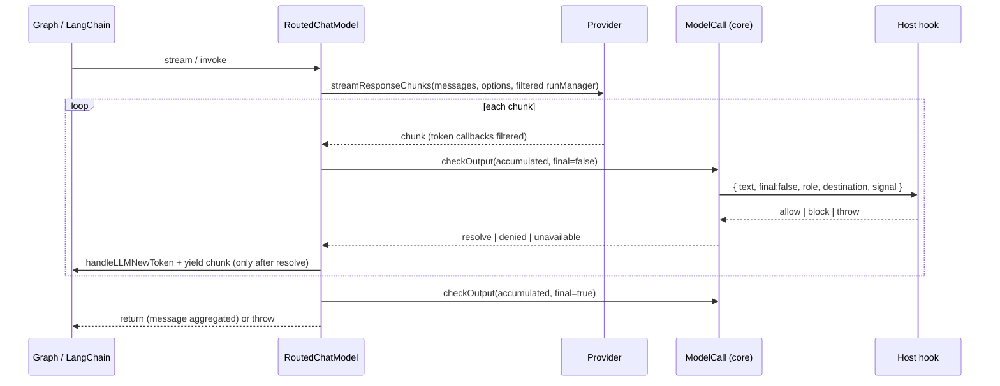

# M2 Output Safety Hook for Generated Text - Plan

## Goal Capsule

- **Objective:** A host registers one function that sees every piece of model-generated text before that text reaches the graph, a stream consumer or a token callback. The function can block the reply, and a blocked or failed check fails the model call with a typed error that carries no text (brief §9.8: the tutor audience may include minors).
- **Means:**
  - `RuntimeOptions.outputSafety`, a host hook validated at `createRuntime`.
  - `ModelCall.checkOutput(text, { final })` in core. It runs the hook, maps its outcome to typed errors and diagnostics, and records an allowlisted outcome attribute for the model span.
  - `RoutedChatModel` in `packages/adapter-langgraph` calls it on final text and on the accumulated streamed text before it releases each chunk. It also takes over token callbacks from the provider so that no streamed token escapes unchecked.
- **Authority, highest first:**
  1. `AGENTS.md` repository rules.
  2. Accepted ADRs in `docs/adr/`, in particular ADR-0002, ADR-0006, ADR-0012, ADR-0016 and ADR-0017. Do not edit any ADR.
  3. This plan.
  4. `docs/galaxie-project-brief.md` §9.8 and §16.4.
  5. `docs/system-design.md` §4 and §8.

  When this plan and an Accepted ADR disagree, follow the ADR and record the conflict in the PR body.
- **Execution profile:** autonomous, in Node and headless Chromium only. Work on the existing branch `m2/output-safety` and open one pull request against `main`. Run units in order (U1 to U4) and `pnpm check` after each one.
- **Stop conditions:** stop and open a draft pull request that names the blocker when any of these happens:
  - a requirement can pass only by weakening an ADR-0012 guarantee, or by putting checked text in an error, event, span, snapshot or diagnostic;
  - an existing test assertion must change, other than those U3 names. Fixture-only edits named in U1 and U2 are allowed;
  - a conformance golden or the compatibility matrix would change;
  - a dependency would be added, upgraded or removed;
  - `pnpm check` still fails after three focused fix attempts on the same cause.
- **Who finishes:** the implementing agent opens the pull request and stops. It never merges, never pushes to `main` and never enables auto-merge.

---

## Product Contract

### Summary

Routed model replies pass through a host-supplied output safety hook. The hook decides `allow` or `block` for the text produced so far, and for the final text. Core turns a block into a `denied` failure of the model call and a hook failure into an `unavailable` failure, fail closed. Without a hook, nothing is checked, M1 behavior is unchanged, and core reports one diagnostic per instance so the gap is visible during development.

### Problem Frame

The M2 tutor shows model text to learners who may be minors. Today, generated text reaches the graph state, LangGraph's `messages` stream and the providers' token callbacks without any host check. A check only at the end is not enough: streamed tokens reach a UI before the reply is complete, and the providers emit token callbacks themselves, before the routed model sees the chunk.

### Requirements

**Hook contract**

- R1. `RuntimeOptions.outputSafety?: OutputSafetyHook`, where:
  ```ts
  type OutputSafetyHook = (check: OutputSafetyCheck) => OutputSafetyVerdict | Promise<OutputSafetyVerdict>;
  interface OutputSafetyCheck {
    readonly text: string;          // all text produced so far by this call
    readonly final: boolean;        // true once, for the complete reply
    readonly role: ModelRoleName;
    readonly destination: DestinationClass;
    readonly signal: AbortSignal;   // aborts when the call or run is cancelled
  }
  type OutputSafetyVerdict = 'allow' | 'block';
  ```
  `createRuntime` rejects a non-function value with `invalid`. The types are exported from `@galaxie/core`.
- R2. `ModelCall` gains `checkOutput(text: string, options: { readonly final: boolean }): Promise<void>`:
  - Without a hook it resolves at once.
  - `'allow'` resolves.
  - `'block'` rejects with `GalaxieError('denied', 'The output safety hook blocked the reply.')`.
  - A hook that throws, rejects, or returns anything other than `'allow'` or `'block'` rejects with `GalaxieError('unavailable', 'The output safety hook failed.')`. This fails closed.
  - A cancelled signal before or during the check rejects with `cancelled`, as other model waits do.
  - Errors set no `cause` and contain no text.
  - After a `block` or failure, later `checkOutput` calls on the same `ModelCall` reject with the same code without calling the hook.
- R3. Diagnostics. `DiagnosticEvent.kind` gains:
  - `'output_blocked'`, with no `error`;
  - `'output_safety_failed'`, with no `error`. The hook's thrown value is discarded, because it may contain the checked text;
  - `'output_safety_unset'`, reported once per instance at create when the instance has `models` routing and the runtime has no hook.

  No diagnostic carries the checked text.
- R4. The model span carries the allowlisted attribute `galaxie.output_safety`, whose value is `'allowed'`, `'blocked'`, `'failed'` or `'unset'`. It is the outcome of the last check of that call; `'unset'` means no hook was configured. Never the text.

**Enforcement in the routed model**

- R5. Non-streaming calls: `RoutedChatModel._generate` awaits `call.checkOutput(text, { final: true })` before it returns the result. `text` is the reply's text content, followed by each tool call's arguments, serialized with `JSON.stringify` and joined with `\n`. On rejection, the call fails through the existing failure path, and the reservation settles as for any failed call.
- R6. Streaming calls: for every provider chunk, `_streamResponseChunks` appends the chunk's text and its tool-call-chunk argument strings to an accumulator. When the accumulator grew, it awaits `checkOutput(accumulated, { final: false })` before it yields the chunk or emits its token callback. After the provider's stream ends, it awaits `checkOutput(accumulated, { final: true })` before it returns, so LangChain never aggregates a blocked reply into a message. This covers the default `#generateChunk` bridge too.
- R7. No bypass through token callbacks. The routed model passes the provider's `_generate` and `_streamResponseChunks` a filtered run manager: an object whose prototype is the real run manager (`Object.create(runManager)`), with `handleLLMNewToken` and `handleChatModelStreamEvent` overridden as no-ops that resolve. Every other callback method, and properties such as `runId` and `handlers`, still reach the real manager. When no run manager was given, the provider gets none. Once a chunk's check passes, the routed model yields the chunk and then awaits `runManager?.handleLLMNewToken(chunk.text, …, { chunk })`, once per chunk. This matches the order the mock and scripted providers use today, so token payloads keep the ids LangChain adds after the yield. `setModelRoute` keeps using the routed model's own run manager. This applies with and without a hook, so behavior does not depend on configuration.

  This holds on every LangChain path that reaches the routed model: `invoke` with and without a streaming handler, `stream`, `streamEvents` and the chat-model stream-event bridge. Graph state, the LangGraph `messages` stream and `RunEvent` `stream` data therefore only ever contain checked text.
- R8. Routed `withStructuredOutput` (slice 3) is covered through R5 or R6, because it calls the routed model. Its validation runs after the safety check.

**Unchanged and documented limits**

- R9. Without `outputSafety`, every existing test passes with unchanged assertions, apart from U3's named token-callback ordering assertions if any exist. Fixture-only edits under U1 and U2 are allowed. Routing, consent, budgets and labels behave as in M1.
- R10. Documentation:
  - **System design §8:** the hook, its fail-closed rule, the streaming contract (accumulated text, checked before release, one final check), and the outcome attribute.
  - **What the hook checks:** text produced through `host.langchain.chatModel(role)` only. Trusted agent code that holds its own model, tool outputs and capability results are not checked (ADR-0002).
  - **Host responsibility:** the hook receives the reply text, and keeping that text on the device, or obtaining consent before sending it elsewhere, is the host's job.
  - **Untraced path:** when LangChain calls `_streamChatModelEvents` without a run manager, the text is still checked, but the model span gets no route or outcome attribute.
  - **What a block does:** it does not retract chunks that already passed a non-final check. Hosts that only check final text accept that streamed text was shown unchecked.
  - Also update the AGENTS.md project status paragraph and the README status.
  - Never describe the hook as making galaxie safe for minors; describe the control and its limits.

### Scope Boundaries

- No built-in classifier, word list or Transformers.js model (brief §9.8 places that after the MVP).
- No checks on interaction props, run output, tool outputs or capability results beyond the model text they were built from.
- No retraction or redaction of already released chunks; a block fails the call.
- No change to `packages/models` providers, `packages/react`, ADRs, goldens or the compatibility matrix.

### Assumptions

- Providers emit token output through `handleLLMNewToken` (the three galaxie providers do). A host-supplied model that emits display text through another callback is outside this check; document that.
- One hook call per streamed chunk is acceptable for M2. Hosts that want to check less often can return `'allow'` for non-final checks.

---

## Planning Contract

### Key Technical Decisions

- KTD1. **Core owns the policy, the adapter owns text extraction.** `checkOutput` lives on `ModelCall`, so the error codes, diagnostics and span outcome come from one place, and a future executor adapter enforces the same rule. The adapter only knows how to read text from LangChain messages and chunks.
- KTD2. **Fail closed.** A broken hook must not let unchecked text through. `unavailable` tells the host the check did not run. `denied` tells it the check refused.
- KTD3. **Accumulated text, not deltas.** A delta alone cannot be judged. The hook gets everything produced so far.
- KTD4. **Filter token callbacks from providers.** Providers call `handleLLMNewToken` around their yield, and that is how LangGraph's `messages` stream sees tokens. A filtered run manager closes this path without changing any provider, and keeps their other callbacks working.
- KTD5. **Tool-call arguments count as text.** Display text can arrive as a tool call, so leaving it out would be a bypass.

### High-Level Technical Design



### Output Structure

- `packages/core/src/models.ts`: `ModelCall.checkOutput`, the output safety types.
- `packages/core/src/model-router.ts`: the implementation on the call object.
- `packages/core/src/runtime.ts`: `RuntimeOptions.outputSafety`, validation, diagnostic kinds, the unset diagnostic.
- `packages/core/src/tracing.ts`, `packages/core/src/trace.ts`: the `galaxie.output_safety` attribute.
- `packages/core/src/index.ts`: exports.
- `packages/adapter-langgraph/src/routed-chat-model.ts`, `packages/adapter-langgraph/src/trace-handler.ts`: enforcement and the span outcome.
- Tests in `packages/core/test/`, `packages/adapter-langgraph/test/` and `tests/conformance/output-safety.test.ts`.
- Docs: `docs/system-design.md`, `AGENTS.md`, `README.md`.

The tree is a scope declaration; the per-unit file lists are authoritative.

### Implementation Constraints

- New source files start with the SPDX header from ADR-0015. Relative imports end in `.js`, type-only imports use `import type`, exported functions declare their return types, and there is no `enum`.
- Errors are `GalaxieError` values with the fixed messages above and no `cause`. Text never appears in an error, event, span, snapshot or diagnostic, including `DiagnosticEvent.error`.
- Tests use the mock provider and fake hooks only. Never download model weights, load the real WebLLM bundle or call a real `LanguageModel` global.

---

## Implementation Units

### U1. Core hook contract

- **Files:** `packages/core/src/models.ts`, `packages/core/src/model-router.ts`, `packages/core/src/runtime.ts`, `packages/core/src/agent-instance.ts` (only if the router needs the hook passed through), `packages/core/src/tracing.ts`, `packages/core/src/trace.ts`, `packages/core/src/index.ts`, `packages/core/test/output-safety.test.ts`, `packages/core/test/span-tree.ts` (add `galaxie.output_safety` to its independent `ALLOWED` set and assert its value is one of the four outcomes; this test-support change is allowed).
- **Approach:** add the R1 types and validation; implement R2 on the object `begin` returns, with the call's signal; add R3's kinds and report `output_safety_unset` at create; record the last outcome on the call so the adapter's span can read it (R4). Add `galaxie.output_safety` to the tracing allowlist.
- **Test scenarios:**
  - A non-function `outputSafety` rejects `createRuntime` with `invalid`.
  - Without a hook, `checkOutput` resolves without calling anything; `output_safety_unset` is reported once for an instance with `models`, and not at all for one without.
  - `'allow'` resolves; `'block'` rejects `denied`, reports `output_blocked`, and a later check rejects `denied` without calling the hook.
  - A throwing hook, a rejecting async hook, and a hook returning `'yes'` each reject `unavailable` and report `output_safety_failed` without `error`; a hook that throws an `Error` whose message is the sentinel leaves no sentinel in the diagnostic.
  - A run cancelled during a pending async hook rejects `cancelled`, and the hook's signal is aborted.
  - The hook receives `role`, `destination` and `final` as given.
  - No error message or code contains the checked text. Use a sentinel string and assert it is absent from the errors, the snapshot and the diagnostic kinds.

### U2. Routed model enforcement

- **Files:** `packages/adapter-langgraph/src/routed-chat-model.ts`, `packages/adapter-langgraph/src/trace-handler.ts`, `packages/adapter-langgraph/test/output-safety.test.ts`, and `packages/adapter-langgraph/test/routed-chat-model.test.ts` plus any other test that builds a `ModelCall` by hand. Those fixtures may gain a no-op `checkOutput: async () => {}`, and any outcome accessor U1 adds, with no assertion changes. List each fixture edit in the PR body.
- **Approach:** implement R5 to R8; set `galaxie.output_safety` on the model span from the call's outcome when the span ends; keep `recordFailure` and `finish` behavior.
- **Test scenarios:**
  - Use the mock provider, streaming three words, and a hook blocking once the text contains the second word. Then:
    - `stream()` yields only the first chunk, then throws `denied`;
    - a callback handler sees exactly one `handleLLMNewToken`;
    - the model span has `galaxie.output_safety = 'blocked'`, `error.type = 'GalaxieError'` and `galaxie.step.status = 'error'`, with no text attribute.
  - A hook that allows every non-final check and blocks the final one: every chunk is yielded, `invoke()` throws `denied`, and no message is returned.
  - `invoke()` without a streaming handler: the hook is called once with `final: true` and the full text, and a block throws `denied`.
  - `invoke()` with a streaming callback handler: each token callback follows its check.
  - Tool-call arguments are part of the checked text: a fake provider returns a tool call whose arguments contain the sentinel, and the call is blocked.
  - Routed `withStructuredOutput`: a block surfaces as `denied`, not as a validation error.
  - A provider whose `_streamResponseChunks` calls `runManager?.handleLLMNewToken` reaches no handler directly; the handler sees the token only from the routed model, after the check. A fake provider that calls a non-token method on its run manager (for example `handleText` or reads `runId`) still reaches the real manager.
  - Without a hook, existing adapter tests pass unchanged and the span shows `'unset'`.

### U3. End-to-end conformance

- **Files:** `tests/conformance/output-safety.test.ts`.
- **Approach:** run a small LangGraph graph through `createRuntime` with the mock provider routed on one role, on Node and Chromium. The run must use LangGraph's `messages` stream mode; if the adapter cannot select it, stop under the stop conditions instead of substituting another mode.
- **Test scenarios:**
  - A blocking hook fails the run with `denied`. The run's `messages` stream events contain the allowed chunk and never the chunk that triggered the block, the snapshot error has no text, and the final graph state does not contain the blocked reply.
  - An allowing hook gives the same events and output as a run without a hook.
  - A throwing hook fails the run with `unavailable`.
- **Existing assertions:** if an existing test asserts the exact ordering of provider token callbacks relative to chunks, R7 may change that ordering. That assertion may be updated to the new order, and only it; list each such change in the PR body. Every other assertion stays as it is.

### U4. Documentation

- **Files:** `docs/system-design.md`, `AGENTS.md`, `README.md`.
- **Approach:** write R10 in the style of the surrounding sections. Use plain control-and-limit wording.

---

## Verification Contract

| Gate | Command or check | Applies to |
| --- | --- | --- |
| Full local CI | `pnpm check` | every unit |
| CI-mode tests | `CI=true pnpm test` (Node and headless Chromium) | U2 and later, and before the PR |
| M1 behavior kept | every pre-existing test passes; changed assertions only as U3 allows | every unit |
| Goldens unchanged | `git diff --stat main -- tests/conformance/golden tests/conformance/compatibility-matrix.json docs/adr` is empty | before the PR |
| Dependencies | `pnpm-lock.yaml` unchanged; `pnpm install --frozen-lockfile` passes | before the PR |

---

## Definition of Done

- U1 to U4 are complete, and each unit's test scenarios exist and pass.
- `pnpm check` and `CI=true pnpm test` pass on the final commit.
- No checked text appears in any error, event, span, snapshot or diagnostic kind, and a sentinel test shows it.
- The goldens, the compatibility matrix and `docs/adr/` are unchanged.
- The PR body lists the documented limits (R10) and every changed assertion.

---

## Appendix

### Sources

- Brief §9.8 and §16.4; ADR-0002, ADR-0006, ADR-0012.
- `packages/core/src/models.ts` (`ModelCall`, `ModelPort`), `packages/core/src/model-router.ts`, `packages/core/src/runtime.ts` (`RuntimeOptions`, `DiagnosticEvent`), `packages/core/src/tracing.ts` (attribute allowlist).
- `packages/adapter-langgraph/src/routed-chat-model.ts` (`_generate`, `_streamResponseChunks`, `#generateChunk`), `packages/adapter-langgraph/src/trace-handler.ts`.
- `@langchain/core` 1.2.20 `dist/language_models/chat_models.js`: `_generateUncached` streaming-handler and chat-model stream-event paths, and the `_streamChatModelEvents` bridge.
- `packages/models/src/mock.ts`, `webllm/chat-model.ts` and `builtin-ai/chat-model.ts`: providers emit `handleLLMNewToken` around their yield.
