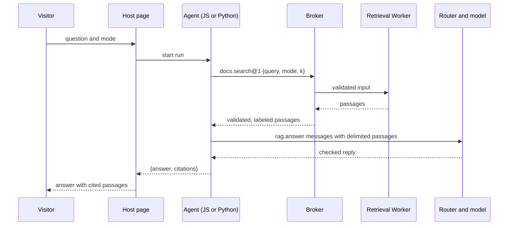
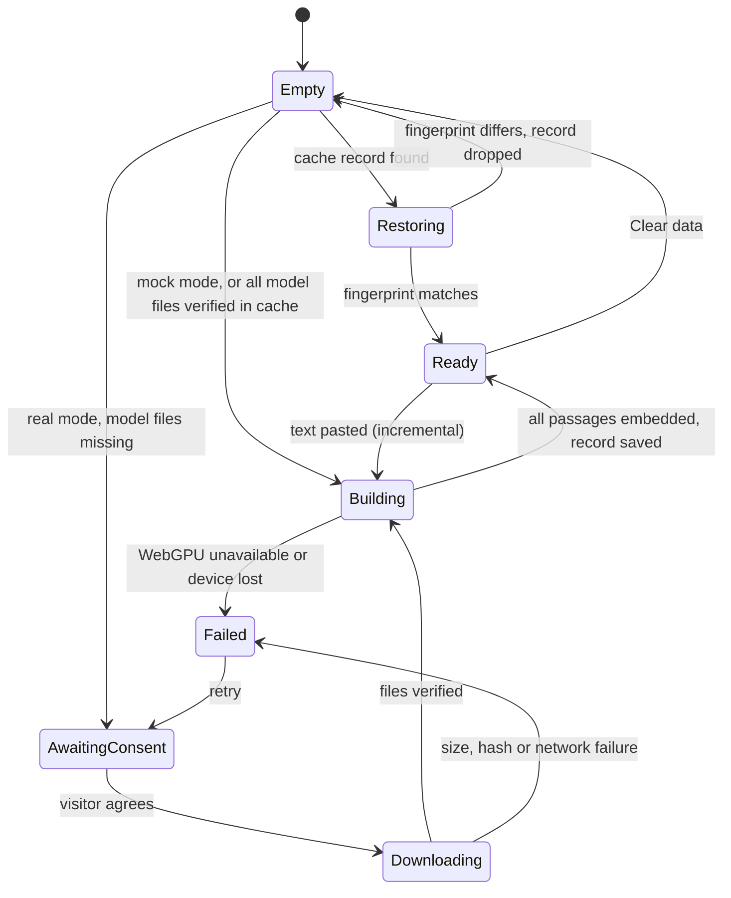

# In-Browser RAG Example in JavaScript and Python - Plan

## Goal Capsule

- **Objective:** a visitor opens one page, lets their own browser embed a public corpus or any text they paste, and asks questions that get answers citing the passages they came from. The page lets them run the same agent written in LangGraph.js or in LangGraph Python. Both run the same graph, make the same search calls and send the same prompts; with the mock model a test proves their transcripts are identical, while real in-browser models can word answers differently between runs. No server embeds, searches or generates.
- **Means:** a new maintained example, `examples/rag-browser`, with EmbeddingGemma 2 and Orama in one retrieval Worker behind a host capability (KTD2, KTD7). Stage 2 adds a minimal `@galaxie/adapter-pyodide` and a Python `galaxie` package so the Python graph runs on the same host (KTD12, KTD14).
- **Authority, highest first:**
  1. `AGENTS.md`. In particular: everything committed is English, SPDX headers on new source files, the ADR-0012 baseline is never weakened, galaxie is never described as secure or compliant, and spike code is never promoted.
  2. Accepted ADRs, especially ADR-0002, ADR-0006, ADR-0012, ADR-0014, ADR-0016 and ADR-0017. Do not edit an Accepted ADR.
  3. ADR-0018 (Proposed). Its decisions bind stage 2. KTD8 narrows which decisions this example exercises and changes none of them. Only its Verification section and Revisions line may change.
  4. This plan.
  5. The project brief.
- **Execution profile:** autonomous. Node 24, pnpm 11, uv with CPython 3.14, headless Chromium through Playwright.
  - Network is needed for `pnpm install`, `uv`, the Python wheel fetch script (U9), and the optional corpus and model downloads during manual checks. Tests never use the network.
  - Stage 1 is U1–U8. Stage 2 is U9–U13. Open one pull request per stage against `main`, and run `pnpm check` before each.
  - Stage 1 merged on 2026-10-30 in PR #60 (`9c660c4`). Stage 2 branches from current `main` and builds on the code described in "Stage 1 as Shipped", not on the stage 1 unit text where the two differ.
- **Stop conditions:** stop, open a draft pull request that names the blocker, and report it when any of these happens:
  - A change to a public type exported by `packages/core` is required. Stage 2 must fit the existing `ExecutorAdapter`, `ModelPort` and `CapabilityPort` contracts.
  - An existing test assertion, golden, or the compatibility matrix would change.
  - An Accepted ADR, or any ADR-0018 decision, would change.
  - Any page or Worker (retrieval, WebLLM or Pyodide) needs a CSP or Trusted Types relaxation beyond KTD11, such as `'unsafe-eval'`, `'unsafe-inline'`, a `blob:` or `data:` script source, or a Trusted Types script policy. If only Pyodide needs it, stage 2 stops and stage 1 still ships.
  - A Python dependency has no Pyodide-compatible wheel and no same-name pure-Python stand-in under ADR-0018 decision 10.
  - `pnpm check` still fails after three focused attempts on the same cause.
  - Stage 2 is blocked for any other reason. Stage 1 has already shipped (PR #60).
- **Who finishes:** the implementing agent opens the pull requests and stops. It never merges. If its environment forbids git operations, it leaves the work uncommitted on disk and reports that.

---

## Product Contract

### Summary

Add `examples/rag-browser`, a page that builds a vector index in the browser and answers questions from it with citations. A Node script turns the SQuAD v1.1 validation split into a corpus file. On the page, EmbeddingGemma 2 embeds that corpus, plus anything the visitor pastes, on WebGPU in a Worker. The vectors are indexed in Orama for full-text, vector and hybrid search.

A LangGraph agent searches through a host capability and answers through the existing router and in-browser models. The agent is written twice, in LangGraph.js and in LangGraph Python, and a test with the mock model proves both produce the same transcript. An evaluation button reports recall and MRR on validation questions as a demonstration.

### Problem Frame

galaxie claims an agent pipeline can run on the user's machine with no agent backend. No example shows the data side of that claim: building and searching an index in the browser. The brief lists retrieval as a gated Phase 5 item (`docs/galaxie-project-brief.md:1472`), and the maintainer opened that gate on 2026-10-30 with this use case.

ADR-0018 says Python agents can run through Pyodide with all policy in JavaScript, but only a throwaway spike backs it. A showcase that runs the same agent in both languages on one host is the first evidence a developer can open and check.

### Key Decisions

- **A maintained example, not a spike.** (session-settled: user-directed — chosen over a throwaway spike under `spikes/`: the user wants a lasting showcase.) Governs R15, R16.
- **SQuAD v1.1 validation split only.** (session-settled: user-directed — chosen over validation plus train: about 2k passages index quickly in the browser.) Governs R1.
- **English retrieval only.** (session-settled: user-directed — chosen over Vietnamese retrieval: a simpler first corpus and tokenizer.) Governs R7.
- **EmbeddingGemma 2 for embeddings.** (session-settled: user-directed — chosen over bge-small-en-v1.5: newer and denser, and the point is to show off in-browser indexing.) Governs R3.
- **Orama for the index and search.** (session-settled: user-directed — chosen over a custom index: it gives full-text, vector and hybrid search in one library.) Governs R7.
- **The browser builds the index and caches it.** (session-settled: user-approved — chosen over a prebuilt index shipped as a pinned asset, which brief §1.4 describes: the demo exists to show that the browser can index any text.) Governs R3, R5.
- **Generation uses the existing in-browser providers.** (session-settled: user-directed — chosen over building an LFM3 provider first: the engine decision `galaxie-fjl` is still open.) Governs R9.
- **The agent ships in both LangGraph.js and LangGraph Python.** (session-settled: user-directed — chosen over a JavaScript-only example: the example must show that galaxie code works in both languages.) Governs R12, R14.
- **Stage 1, the JavaScript version, ships first and alone.** (session-settled: user-approved — chosen over one combined delivery: a stage 2 problem must not hold back the JavaScript demo.) Governs R16.

### Requirements

**Corpus**

- R1. A Node script turns the SQuAD v1.1 validation split into one corpus file holding each distinct context once, plus every question with its answers and source context. It pins the source by URL and SHA-256 and refuses a mismatch.
- R2. The corpus file is never committed. The file and the page both carry the CC BY-SA 4.0 notice and the SQuAD attribution.

**Indexing**

- R3. After the visitor agrees to a download whose size is stated, the page embeds every corpus passage with EmbeddingGemma 2 on WebGPU in a Worker and shows progress.
- R4. The visitor can paste any text. The page splits it into passages and indexes them alongside the corpus. Pasted text never leaves the browser.
- R5. The built index survives a reload and is reused only when it was built with the same model, settings and corpus. "Clear data" removes the index and all pasted text.
- R6. Without WebGPU, the page reports a fixed message and indexes nothing. It never falls back silently to WebAssembly (ADR-0006 item 8).

**Search and answers**

- R7. The visitor chooses full-text, vector or hybrid search for each question.
- R8. The agent reaches the index only through the host read capability `docs.search@1`, whose result size is bounded.
- R9. The agent answers through `host.langchain.chatModel(role)` with an in-browser model, and its answer cites only passages that the search returned.
- R10. Retrieved passages reach the model as delimited data, never as instructions. A test shows that an injected passage cannot make the agent call another capability, produce a URL or send a request.

**Evaluation**

- R11. An evaluation button runs a sample of validation questions through each search mode and reports recall@1, recall@5, recall@10 and MRR. These figures are demonstrations, never gates (ADR-0016).

**Python**

- R12. The visitor can switch the page to the LangGraph Python version of the same agent. The switch states the extra download and cold start. Each answer names the executor that produced it.
- R13. The Python side holds no credential, provider, policy, budget or label logic. Model calls and capability calls cross a versioned JSON bridge, and JavaScript checks every reply before Python sees it (ADR-0018 decisions 3–5).
- R14. For one scripted session with the mock model and mock embedder, the JavaScript agent on Node and Chromium, the Python agent in Pyodide on Node and Chromium, and the Python graph on CPython all produce the same transcript (KTD15).

**Delivery**

- R15. Every TypeScript test runs in CI on Node and headless Chromium, and every Python test runs on CPython 3.14 in the same workflow. All use mocks and a committed synthetic fixture, without network at test time.
- R16. Stage 1 works and ships with no stage 2 code present.

### Success Criteria

- On the maintainer's Apple M5 Pro with Chrome, a cold visit indexes the whole validation corpus and answers a validation question with a correct citation. The README records index time, index size, per-query latency, download bytes, Python cold start and the evaluation figures, as demonstrations.
- A developer can read the JavaScript and Python graphs side by side and see the same nodes and state, with only model and capability wiring differing.

### Scope Boundaries

- Not built: an LFM3 or ONNX Runtime chat provider, Vietnamese retrieval, a prebuilt shipped index, a retrieval or vector API in `packages/core`, and answer-quality scoring beyond the R11 figures.
- Not built: pydantic-ai, DSPy, the language-tutor port, Python interrupts, Python checkpoints, and session restore after reload (KTD8).
- Not built: a generated manifest for the rag-browser agents. ADR-0018 decision 10's wheel inventory in the manifest stays with the tutor port.
- Considered and not built: coordination between two tabs that build the index at once. Each write replaces the record under the same fingerprint, so the only cost is duplicate work. Evidence of a corrupted cache would change this call. "Clear data" across tabs is coordinated (KTD6), because a second tab could otherwise write deleted pasted text back.
- Considered and not built: removing one pasted text at a time. Only "Clear data" removes pasted text, and the page says so.
- Considered and not built: retrying a failed model-file download automatically. The visitor presses the button again. Evidence that partial downloads stick would change this call.

### Deferred to Follow-Up Work

- Upgrade Transformers.js to 4.3.2 or later once it passes the 7-day release-age gate (about 2026-11-03), then drop the own-fetch workaround if the hang fix makes it unnecessary (KTD3).
- Streaming Python model calls over the bridge.
- A LangGraph Python version of the language tutor, which needs interrupts, the byte-record port and `galaxie-2fg`.

### Sources

- SQuAD v1.1: Rajpurkar et al., 2016, CC BY-SA 4.0 (`https://huggingface.co/datasets/rajpurkar/squad`).
- EmbeddingGemma 2, Apache-2.0: `https://huggingface.co/google/embeddinggemma-2`; ONNX export at `onnx-community/embeddinggemma-2-ONNX`, revision `daa72c51243991dfcaf9f9137d2c573d8f7790c0`.
- Orama 3.1.18, Apache-2.0: `https://github.com/oramasearch/orama`.
- Pyodide spike evidence: `spikes/python-bridge/README.md`, `spikes/python-bridge/summary.json` and `spikes/python-bridge/requirements.json`.

---

## Planning Contract

Product Contract preservation: Product Contract unchanged. The 2026-10-30 stage 2 update reconciles U9–U13 with the merged stage 1 code and adds KTD17 and KTD18.

### Key Technical Decisions

- KTD1. **One example package holds the host and both agents.** `examples/rag-browser` contains the host, the JavaScript graph and the Python graph. Splitting the agent into its own package, as `examples/english-tutor` does, only pays off with a generated manifest, which this plan does not build.
- KTD2. **One retrieval Worker owns the embedder and the Orama index.** A query then costs one round trip from page to Worker, and the Trusted Types policy needs one more worker URL, not two. The page talks to it through a small typed message protocol that rejects unknown or oversized messages with a fixed error.
- KTD3. **Transformers.js is pinned to exactly 4.3.1, with our own download and hash check.** 4.3.1 is the first version that registers `embedding_gemma2`. It also hangs forever when an `.onnx_data` download fails (issue #1801).
  - The Worker downloads the five pinned files itself, checks each size and SHA-256, and stores them in its own Cache Storage. The library must then resolve all five files from that cache only and never fetch. In 4.3.1 that takes `env.allowRemoteModels = false`, `env.allowLocalModels = true` with a fixed same-origin `env.localModelPath`, `env.useBrowserCache = false`, and `env.useCustomCache = true` with `env.customCache` a `match`/`put` wrapper over the verified cache, keyed by the path the library builds. With both remote and local models off, `getModelFile` throws before reading any cache. Confirm these names against the 4.3.1 source (`src/utils/hub.js`, `src/utils/cache.js`).
  - `env.remotePathTemplate` hard-codes the revision, which also stops the tokenizer's probe of `main`.
  - Loading uses `AutoConfig` with `vision_config` and `audio_config` set to null, then `AutoModel` and `AutoTokenizer`. The `feature-extraction` pipeline is not used because it loads every encoder.
  - The Worker passes `device: 'webgpu'` and `dtype: 'q4'`. With that device a missing GPU throws, which gives R6 its failure path.
  - The ONNX Runtime `.mjs` and `.wasm` are self-hosted through Vite `?url` imports, pinned to the exact `onnxruntime-web` version Transformers.js bundles. `env.useWasmCache = false` keeps `blob:` out of `script-src`.
- KTD4. **Embedding settings.**
  - Passages are truncated at 256 tokens and embedded in batches of 8, which stays under the model card's limit of about 2,700 tokens per WebGPU batch.
  - Vectors are cut to 256 dimensions and re-normalized.
  - Queries use the prefix `task: search result | query: `. Passages use `title: <title> | text: <text>`, and pasted passages use `title: none`.
  - These values, plus the `q4` dtype and the `webgpu` device, sit in one settings object. The settings feed the cache fingerprint (KTD6), so changing any of them forces a rebuild.
- KTD5. **Orama settings.**
  - Schema: `id`, `title`, `text`, `source` (`squad` or `pasted`) and `embedding: vector[256]`. Vectors are inserted as plain arrays, because Orama rejects `Float32Array`.
  - The tokenizer splits on `/[^\p{L}\p{N}]+/u` and lowercases, with stemming off. Orama's default English splitter drops non-ASCII letters.
  - The vector similarity threshold is set explicitly. The default of 0.8 drops many relevant EmbeddingGemma hits, which score about 0.68–0.87. The value is measured and recorded in U4.
  - Hybrid search keeps the default 0.5/0.5 weights. A weight of 0 silently reverts to the default, so the page never offers 0.
  - The index is persisted with Orama's `save()` and restored with `create()` using our schema and tokenizer, then `load()`. The persistence plugin is not used: its `restore()` drops the custom tokenizer and schema, and its `seqproto` format drops vectors.
- KTD6. **The cache is its own IndexedDB database.** It is named `galaxie-rag:<appId>`, separate from the checkpoint saver's `galaxie:<appId>`, whose version changes would supersede it.
  - One record holds the saved index and the pasted passages, keyed by a fingerprint. The fingerprint is the SHA-256 of: the model revision, the KTD4 settings, the exact Transformers.js and `onnxruntime-web` versions, the tokenizer rule, the Orama schema version and the corpus file's SHA-256.
  - A fingerprint mismatch discards the record and rebuilds.
  - "Clear data" deletes the database. Each write replaces the whole record.
  - As shipped, a second database, `galaxie-rag:epochs`, holds only content-free clear epochs for fencing. "Clear data" does not remove it.
  - Every cache write and "Clear data" run under one Web Lock named after the database. "Clear data" also posts a `BroadcastChannel` notice that makes other tabs' Workers drop their pasted passages and close their connection, so another tab cannot write deleted pasted text back.
  - "Clear data" keeps the downloaded model files in Cache Storage, and its label says so. A separate "Remove downloaded model" action deletes them.
  - The cache lives outside `@galaxie/storage-indexeddb`, so its retention sweep, principal scoping and logout wipe do not apply. Pasted text stays on the device until "Clear data" or browser eviction, and the page says so next to the paste box.
- KTD7. **`docs.search@1` is an `in-browser` read binding, and its passage text is labeled `private-user`.** The index can hold pasted text, and output labels are a static property of the schema (`packages/core/src/capability-broker.ts:468-471`), so every search marks the run `private-user`. The query is `freeText` labeled `private-user` too.
  - That pins every model role to `in-browser`, which matches the only routes this example has.
  - The output schema caps `k` at 10 and each passage at 4,000 characters, which keeps it inside the default payload budget.
- KTD8. **No durable session restore, in either language.** Each question is one run. The JavaScript agent uses `MemorySaver`, and the Python graph runs without a checkpointer. The Pyodide adapter declares `interrupts`, `resume` and `checkpoints` as false.
  - The ADR-0018 byte-record port and the executor-aware `RecoverySession` (`galaxie-2fg`) are therefore not needed here. They stay with the tutor port, which needs interrupts.
  - This narrows ADR-0018 for this use: the plan records it in ADR-0018's Verification section and changes no ADR-0018 decision.
- KTD9. **The corpus comes from the official SQuAD v1.1 `dev-v1.1.json`.** That file is the same validation split as the Hugging Face dataset, in plain JSON. The Hugging Face copy is Parquet, which would need a Parquet parser dependency for one script. The script pins the URL and SHA-256 and writes `examples/rag-browser/public/data/squad-dev.json` in the format `galaxie.rag-corpus/v1`. That path is git-ignored.
- KTD10. **Consent for the embedding model is a host button.** It states 233.6 MB before any request: 206.7 MB of model files plus 26.9 MB of ONNX Runtime. Chat models keep the host-local pattern: a "Prepare models" click, and the router's download hook for Built-in AI (`examples/host-local/src/runtime.ts:225-268`). The router's consent covers chat models only (`packages/core/src/models.ts:119-134`).
- KTD11. **CSP and Trusted Types follow host-local, with one default policy in both modes.** The policy allows exactly the bundled worker URLs: the retrieval Worker and the WebLLM Worker, and in stage 2 the Pyodide Worker.
  - Mock mode changes host-local's `trusted-types 'none'` to that policy, because the retrieval Worker must start in mock mode too.
  - Every page and Worker response keeps `script-src 'self' 'wasm-unsafe-eval'` and `require-trusted-types-for 'script'`, and never adds `'unsafe-eval'`, `'unsafe-inline'` or `blob:`. `connect-src` is `'self'` in mock mode, plus `https://huggingface.co https://*.hf.co https://raw.githubusercontent.com` in default mode. The last host serves the WebLLM model library, as in host-local (`examples/host-local/src/csp.ts:16`).
- KTD12. **The Pyodide adapter is minimal and follows ADR-0018.** Its executor ID is `langgraph-python`, and all five `ExecutorFeatures` flags are false.
  - Bridge messages are `galaxie.bridge/v1` JSON of at most 1 MB, carrying the ops `boot`, `run`, `model`, `capability`, `abort` and `result`. Unknown or malformed messages get fixed errors on both sides (ADR-0018 decision 5).
  - Abort sends an `abort` message. If the Worker does not acknowledge within 500 ms, the adapter terminates it, fails the run `cancelled`, and boots a new Worker on the next run.
  - The host supplies a `createWorker` function, so the host's Trusted Types policy stays in charge of the worker URL. It returns a minimal port: `postMessage(string)`, a message listener, an error listener and `terminate()`. The Chromium host wraps a Web `Worker`; Node tests wrap `worker_threads.Worker`. `worker.ts` uses `parentPort` when present and `self` otherwise.
  - On Node there is no page origin and no Vite transform for `worker_threads`, and `pnpm test` runs before `pnpm build`. Node tests therefore bundle `worker.ts` with Vite into a temporary directory first, as `test/loop.node.test.ts` builds the host, and serve the agent sources, runtime files and wheels from a loopback server.
  - Services are `{ chatModels }`, keyed by provider ID with the same `BaseChatModel` or credential-factory shape as `LangGraphServices.chatModels`, so the host reuses its providers. `prepare` checks them against `ModelPreparation.providers`.
  - The `ModelPort` arrives per run in `RunRequest.models`, not at `prepare`. `RoutedChatModel` is not exported from `@galaxie/adapter-langgraph`, so the adapter runs the lease sequence itself for each bridge `model` op:
    1. `models.begin(role, { signal })`;
    2. convert the bridge messages to `@langchain/core` messages;
    3. invoke the selected provider, built from `call.credential` when one is leased;
    4. `checkOutput(text, { final: true })` before replying;
    5. `end(usage)` from `usage_metadata`, or `fail()` on error.
  - The adapter may import `@langchain/core`. It never imports `@langchain/langgraph*` or `@galaxie/adapter-langgraph`.
  - The agent value passed to `runtime.create` is a plain descriptor: the same-origin base URL of the agent sources, the list of source files, the module and entry function. The adapter fetches those files with `credentials: 'omit'` and writes them into the Pyodide file system before import.
  - Bridge validation must not need code generation under strict CSP. Either hand-write the validators or build Zod schemas only after `z.config({ jitless: true })`, as stage 1's `src/host/zod-config.ts` does for the retrieval Worker.
  - Pyodide has not been run under this CSP: the spike README lists browser CSP deployment as untested. U10 therefore boots Pyodide in Chromium under the stage 1 header first, before the bridge work. If that boot needs a KTD11 relaxation, stage 2 stops (Goal Capsule).
  - Measured on 2026-10-30 (headless Chromium 156, stage 1 `cspHeader('mock')` on every response): Pyodide 314.0.7 boots in a module Worker, but its `isClassicWorker()` probe calls `importScripts("data:text/javascript,")`, which reports a `require-trusted-types-for` violation before throwing. Module Workers cannot use `importScripts`, so the Worker entry replaces `globalThis.importScripts` with a function that throws `TypeError` before loading Pyodide. The probe then returns `false` as before, without reaching the Trusted Types sink, and the boot reports zero violations. This changes no CSP directive; a test asserts that the shim stays in place and that the boot reports zero violations.
  - After an abort, the adapter's `run` iterator settles once the Worker acknowledges or is terminated. That 500 ms is a Worker liveness bound, not a settlement timeout: core still owns settlement waits (`packages/core/src/executor.ts`, `ExecutorAgent.run`).
- KTD13. **Python wheels are self-hosted and hash-pinned.** No runtime CDN is used.
  - The Pyodide runtime files come from the npm package `pyodide@314.0.7`.
  - The Pyodide packages and PyPI wheels the graph needs are listed with SHA-256 in `python/requirements.lock`. The lock holds only the dependency closure of `langgraph` and `langchain-core` that the RAG graph resolves. Versions are resolved by uv under the 7-day release-age gate below, not copied from the spike: the spike's pins (`langgraph` 1.2.18, `langchain-core` 1.7.3 and others) were published after the gate's cutoff, so the lock takes the newest compatible versions that pass it (on 2026-10-30: `langgraph` 1.2.16, `langchain-core` at most 1.7.0, `langgraph-checkpoint` 4.3.0, `langgraph-sdk` 0.4.8, `langsmith` 0.14.12). Never add a per-package exception to the gate. Use `spikes/python-bridge/requirements.json` only to know which packages the closure needs; leave out `pydantic-ai-slim`, `pydantic-graph`, `httpx2`, `httpx2-jsfetch`, `genai-prices`, `griffelib`, `logfire-api`, `opentelemetry-api` and anything only they require. A fetch script downloads them into the git-ignored `.cache/python-wheels/`, checks every hash, and the host serves them same-origin.
  - The Worker checks each locked file's SHA-256 again before installing it, through Pyodide's lockfile `sha256` with `checkIntegrity` or by installing from verified bytes. The expected hashes are built into the Worker bundle from the lock through `runtime-files.ts`, never read from a lockfile fetched at run time, so replacing a served wheel and a served lock together does not pass.
  - The CPython test environment is pinned separately, because `requirements.lock` holds `wasm32` wheels CPython cannot install. `python/uv.lock`, committed with hashes, covers `python/galaxie`, the stand-in and the pytest dependencies; its `langgraph` and `langchain-core` closure matches `requirements.lock` version for version, and a Node check asserts the shared versions agree. Lock it with uv `exclude-newer` set 7 days back, mirroring the npm release-age gate, and pin `build-system.requires` to exact versions. CI runs `uv sync --locked` in the setup step; `pnpm test:python` runs `uv run --locked --offline pytest`, so tests never resolve or download.
  - The `galaxie` and `ormsgpack` wheels, the agent sources and Pyodide's own runtime files are build outputs served same-origin. They carry the same trust as the page's JavaScript bundle. `loadPyodide` fetches `pyodide.asm.wasm` and `pyodide.asm.mjs` itself from `indexURL`, so the Worker cannot bind those bytes. The adapter README states this limit. A host that serves these files from a CDN needs SRI or pinned hashes (ADR-0018 decision 10), which this example does not build.
  - `uuid-utils` takes the PyPI wheel 0.19.0, which is not in Pyodide's package list, pinned by URL and SHA-256 as U9 states. `ormsgpack` uses a same-name pure-Python stand-in, version 1.13.0, over `msgpack`.
- KTD14. **The Python `galaxie` package lives in `python/galaxie`, outside the pnpm workspace.** It is built into a wheel with uv. It contains `galaxie.langchain` (`GalaxieChatModel`) and `galaxie.capabilities` (`call`), plus a private bridge module that the tests replace with a fake transport. The stand-in sits in `python/standins/ormsgpack`.
- KTD15. **A parity transcript records behavior, not timing or streaming.** It is a list of: each capability call's name and input, each model call's role and messages, and the final run output. JavaScript streams and stage 2 Python does not, so chunks and content-free events are left out. The golden transcript lives at `examples/rag-browser/test/golden/session.json`.
- KTD16. **CI gains a Python lane in stage 2, delivered by U12.** Stage 1's `pnpm check` needs no Python. The workflow installs uv with CPython 3.14, the CPython line Pyodide 314 tracks, then runs the wheel fetch script before tests. `pnpm check` runs `pnpm test:python`, which runs pytest on CPython for the `galaxie` package and the parity graph. It fails with a fixed message naming uv when uv is missing.
  - The CI job's `timeout-minutes` is 15 today. U12 may raise it to at most 25 when the measured job needs it, and records the measured duration in the PR.
- KTD17. **One prompt and citation contract, read by both languages.** Stage 1 keeps the prompt in `src/agent/prompt.ts` and the citation rule in `src/agent/citations.ts`. U11 moves the prompt text to `examples/rag-browser/src/agent/prompt.json`, which both agents read, and moves the existing citation cases to `examples/rag-browser/test/fixtures/citation-cases.json`.
  - The user message must be byte-identical across languages, because the mock model keys its reply on the exact human message (`src/host/mock-script.ts`). The passage block is the compact JSON of `[{ marker, id, title, text }]` in that key order. JavaScript uses `JSON.stringify`; Python uses `json.dumps(value, separators=(",", ":"), ensure_ascii=False)`. The shared case file includes non-ASCII text, quotes, backslashes and a newline, so any escaping difference shows up in tests.
  - Citation markers match ASCII digits inside square brackets. A marker is valid when it is 1 to the passage count; invalid markers are removed from the answer text, and duplicates keep one citation in first-seen order. Every case in today's `citations.test.ts` moves into the JSON file unchanged; the test then reads the file, so no assertion changes.
- KTD18. **Python tests need the verified wheel cache, and say so.** Vitest files that boot Pyodide check for `.cache/python-wheels/` first. When it is missing they skip with the fixed reason "Python wheels are not fetched; run the wheel fetch script" outside CI, and fail with that message when `CI` is set. This keeps `pnpm check` usable on a machine that has not fetched wheels, without letting CI pass by skipping.

### Pinned Inputs

These values were fetched and checked on 2026-10-30. Use them as written; do not re-derive them.

SQuAD v1.1 dev (KTD9): `https://rajpurkar.github.io/SQuAD-explorer/dataset/dev-v1.1.json`, 4,854,279 bytes, SHA-256 `95aa6a52d5d6a735563366753ca50492a658031da74f301ac5238b03966972c9`. It holds version `1.1`, 48 articles, 2,067 distinct contexts and 10,570 questions.

EmbeddingGemma 2 text-only q4 files (KTD3), at `https://huggingface.co/onnx-community/embeddinggemma-2-ONNX/resolve/daa72c51243991dfcaf9f9137d2c573d8f7790c0/<path>`:

| Path | Bytes | SHA-256 |
|---|---:|---|
| `config.json` | 5,031 | `8d011bfe08b5e345bbe0b81e5c6fd02c381920b345b986047bc2a33ce7b90d1d` |
| `tokenizer.json` | 32,170,510 | `4d777ef5bdc1aa36227abdfb77c3e49e7b9c892d16e1b6bda41c393504828be4` |
| `tokenizer_config.json` | 1,599 | `17bd5d6e9364ca49a534e1502076593317c298d4a663623091ed45388f004874` |
| `onnx/model_q4.onnx` | 490,742 | `f9eeba97acddf139b8ee2ddf04bc30dceafa88de93fadf74d7644e0d61a477a9` |
| `onnx/model_q4.onnx_data` | 174,028,800 | `c3975f2d1ab7a1878ae31a7d7a9b7804a827aff3800b60dfceafce21cac3df49` |

The ONNX Runtime `.mjs` and `.wasm` come from the `onnxruntime-web` version that `@huggingface/transformers@4.3.1` depends on, pinned through `pnpm-lock.yaml`. They need no separate hash.

### High-Level Technical Design

Components and trust boundaries. The core, the router, the broker and the host bindings stay on the main thread. Each Worker only computes.

```mermaid
flowchart TB
  subgraph Page[Main thread]
    UI[Page UI: consent, paste, ask, mode, executor switch, evaluate]
    Core[galaxie core: runtime, router, broker, labels, budgets]
    Bind[docs.search@1 binding, in-browser]
    JSA[LangGraph.js agent]
    PA[adapter-pyodide]
  end
  subgraph RW[Retrieval Worker]
    Emb[EmbeddingGemma 2 on WebGPU, or mock embedder]
    Ora[Orama index]
  end
  subgraph PW[Pyodide Worker]
    PyG[LangGraph Python graph]
    PyPkg[galaxie Python proxies]
  end
  WL[WebLLM Worker or Built-in AI]
  IDB[(IndexedDB galaxie-rag:appId)]
  UI --> Core
  Core --> JSA
  Core --> PA
  PA <-->|galaxie.bridge/v1| PyPkg
  PyG --> PyPkg
  JSA -->|capability call| Core
  Core --> Bind
  Bind <--> RW
  Emb --> Ora
  RW <--> IDB
  Core -->|routed model call| WL
```

One question, whichever agent runs:



Index lifecycle in the retrieval Worker:



### Output Structure

```text
examples/rag-browser/
  package.json, index.html, vite.config.ts, tsconfig.json, README.md
  scripts/build-corpus.ts
  public/data/            git-ignored corpus output
  src/corpus.ts
  src/retrieval/          protocol, worker, embedder, mock embedder, model files, chunking, index, cache, client
  src/agent/              definition, schemas, graph, prompt (+ prompt.json, stage 2), citations, python definition (stage 2)
  src/host/               main, app, runtime, csp, trusted types, evaluate, mock script, webllm worker
  agent_py/rag_agent/     graph.py, citations.py, prompt.py (stage 2)
  test/                   fixtures (+ citation and prompt cases, stage 2), golden, unit, browser and node tests
packages/adapter-pyodide/ (stage 2)
python/galaxie/           (stage 2)
python/standins/ormsgpack/ (stage 2)
python/requirements.lock  (stage 2)
docs/adr/0019-in-browser-retrieval.md
```

### Assumptions

- Chrome on the reference device can run the WebLLM Worker and the retrieval Worker on WebGPU at the same time. This has not been measured. If it fails, the page indexes before preparing chat models, and the README records the limit.
- LangGraph Python's dependencies resolve on Pyodide 314.0.7 as they did in the spike, with the two package gaps the spike found.
- The in-browser chat models write `[n]` markers often enough to cite passages. The manual default-mode run checks this over several validation questions, and the README records how often answers carried at least one valid citation.

### Stage 1 as Shipped

Stage 2 builds on these facts from PR #60. Where they differ from the U1–U8 text, they win.

- **Agent.** `src/agent/graph.ts` has two nodes, `retrieve` and `generateAnswer`; the answer node is not named `answer` because that is a state key. State is `question`, `mode`, `passages`, `answer` and `citations`. The graph projects its output with native `withConfig({ outputKeys: ['answer', 'citations'] })` and searches with `k: 10`. It uses the host checkpointer, an in-memory saver per instance.
- **Contracts.** `src/agent/definition.ts` declares `galaxie.rag-browser`, executor `langgraph-js`, the one capability `docs.search@1` and the role `rag.answer` (`local-only`, `en`). `src/agent/schemas.ts` holds `RagInputSchema`, `SearchInputSchema`, `SearchResultSchema` and `RagOutputSchema`.
- **Prompt and citations.** The system prompt and `userPrompt(question, passages)` live in `src/agent/prompt.ts`; the marker rule lives in `src/agent/citations.ts`. KTD17 moves both into shared data.
- **Host.** `createRagHost(retrieval, models)` in `src/host/runtime.ts` creates the runtime with only the LangGraph adapter, binds `docs.search@1`, and prepares one instance. `createMockModels()` in `src/host/mock-script.ts` builds a mock whose reply depends on the exact human message. `src/host/app.tsx` labels each answer "Answer · LangGraph.js". Retry indexing and persisted `pageshow` reload the page.
- **Workers and CSP.** `src/host/trusted-types.ts` installs one `default` policy that allows exactly the retrieval and WebLLM worker URLs, created with `?worker&url`. `src/host/csp.ts` sets the header for both modes. Each Worker imports `src/host/zod-config.ts` before building schemas.
- **Repository rules.** `scripts/check-dependencies.ts` holds an explicit allowlist of imports for `examples/rag-browser/src`, and agent files may import only other agent files. `tests/conformance/eslint-rag-agent.node.test.ts` lints `src/agent/`.
- **Tests.** Unit tests sit in `examples/rag-browser/test/*.test.ts` and run on both Vitest projects. The built-host Playwright loop is `test/loop.node.test.ts`. The injection test expects an undeclared run grant to fail `invalid`, which is the existing core behavior.
- **Deviations already documented in the README.** Clear fencing uses a separate content-free epoch database, `galaxie-rag:epochs`. In real mode the Worker fetches the corpus by fixed URL. Transformers.js fetches are denied.

---

## Implementation Units

| U-ID | Title | Key files | Depends on |
|---|---|---|---|
| U1 | Retrieval ADR | `docs/adr/0019-in-browser-retrieval.md` | none |
| U2 | Corpus format and builder | `examples/rag-browser/scripts/build-corpus.ts`, `src/corpus.ts` | U1 |
| U3 | Embedder and pinned model files | `src/retrieval/embedder.ts`, `model-files.ts`, `mock-embedder.ts` | U2 |
| U4 | Index, cache and retrieval Worker | `src/retrieval/index.ts`, `cache.ts`, `worker.ts`, `client.ts` | U3 |
| U5 | JavaScript agent | `src/agent/graph.ts`, `citations.ts`, `definition.ts` | U4 |
| U6 | Host page | `src/host/*`, `vite.config.ts` | U5 |
| U7 | Stage 1 repo wiring and docs | root `package.json`, `scripts/check-dependencies.ts`, docs | U6 |
| U8 | Retrieval injection test | `test/injection.test.ts` | U5 |
| U9 | Python `galaxie` package and wheels | `python/galaxie/*`, `python/requirements.lock`, `scripts/fetch-python-wheels.ts` | U7 |
| U10 | Pyodide adapter | `packages/adapter-pyodide/*` | U9 |
| U11 | Python RAG agent and executor switch | `agent_py/rag_agent/*`, `src/agent/definition-python.ts` | U10 |
| U12 | Cross-language parity lane | `test/golden/session.json`, `test/parity*.ts`, `.github/workflows/ci.yml` | U11 |
| U13 | Stage 2 docs and evidence | ADR-0018 Verification, docs | U12 |

### U1. Retrieval ADR

- **Goal:** record the retrieval stack and the opening of the Phase 5 retrieval gate before any code.
- **Requirements:** R3, R5, R7, R8.
- **Dependencies:** none.
- **Files:** `docs/adr/0019-in-browser-retrieval.md`, `docs/adr/README.md`, `docs/galaxie-project-brief.md` (one pointer in the §16.7 retrieval row).
- **Approach:**
  1. Write ADR-0019 as Proposed, using the template in `docs/adr/README.md`. Context: the use case and the gate opened on 2026-10-30.
  2. Decisions: KTD2–KTD7 and KTD10. Name the brief's "prebuilt pinned asset" and record the deviation. The gate asks for the index format, update path and download size; answer it with the cache fingerprint, rebuilding on mismatch, and the 233.6 MB figure. State that these answers cover browser-built indexes only: the prebuilt pinned-index format of brief §1.4 and its update path stay undesigned, and the §16.7 pointer says so.
  3. Record the licenses: SQuAD CC BY-SA 4.0 with attribution, EmbeddingGemma 2 Apache-2.0, Orama Apache-2.0, Transformers.js Apache-2.0. Do not describe galaxie as secure or compliant.
  4. Verification: point to U4–U6 tests and the README demonstration figures.
- **Patterns to follow:** `docs/adr/0018-python-agents-through-pyodide.md` and commit `bc566fb` for how a use case opens a gate.
- **Test expectation:** none, documentation only. The `check:docs` link check covers it.
- **Verification:** the ADR index lists 0019, and `pnpm check:docs` passes.

### U2. Corpus format and builder

- **Goal:** turn SQuAD v1.1 dev into the corpus file, and commit a synthetic fixture for tests.
- **Requirements:** R1, R2, R15.
- **Dependencies:** U1.
- **Files:** `examples/rag-browser/package.json`, `examples/rag-browser/scripts/build-corpus.ts`, `examples/rag-browser/src/corpus.ts`, `examples/rag-browser/test/fixtures/corpus.json`, `examples/rag-browser/test/corpus.test.ts`, `.gitignore`.
- **Approach:**
  1. `src/corpus.ts` defines the `galaxie.rag-corpus/v1` zod schema:
     - `format`, `license`, `attribution`, `source: { url, sha256 }`;
     - `passages: [{ id, title, text }]`;
     - `questions: [{ id, question, answers: string[], passageId }]`.
     Parsing returns a typed corpus or a fixed error.
  2. The script fetches the pinned URL, checks the SHA-256, deduplicates contexts in order, and assigns passage IDs from the article and paragraph index. It writes the JSON with keys in a stable order. The URL, size and hash are in Pinned Inputs.
  3. The package script `corpus` runs it. `pnpm check` and CI never run it (KTD9).
  4. The fixture is about 12 original, synthetic English passages under 3 titles, with 10 questions. It never copies SQuAD text.
- **Patterns to follow:** `examples/english-tutor/package.json` for package fields and the SPDX header. Pin dependencies to exact versions as `examples/host-local/package.json` does.
- **Test scenarios:**
  - A SQuAD-shaped input with two questions on the same context yields one passage and two questions pointing at it.
  - Answers keep their order, and duplicates in the source are kept as given.
  - A source whose SHA-256 differs makes the converter fail with a fixed message and write nothing. Test the pure conversion and hash-check functions, not the network fetch.
  - The committed fixture parses with the schema.
  - A corpus missing `license` or `attribution` is rejected.
- **Verification:** the conversion tests pass on Node and Chromium. Running `corpus` once by hand writes about 2k passages and 10,570 questions, recorded in the README.

### U3. Embedder and pinned model files

- **Goal:** embed passages and queries in the Worker with the real model, or with a deterministic mock in tests and mock mode.
- **Requirements:** R3, R6, R15.
- **Dependencies:** U2.
- **Files:** `examples/rag-browser/src/retrieval/model-files.ts`, `examples/rag-browser/src/retrieval/embedder.ts`, `examples/rag-browser/src/retrieval/mock-embedder.ts`, `examples/rag-browser/src/retrieval/settings.ts`, `examples/rag-browser/test/model-files.test.ts`, `examples/rag-browser/test/mock-embedder.test.ts`, `examples/rag-browser/test/embedder.test.ts`.
- **Approach:**
  1. `model-files.ts` lists the five files with the byte sizes and SHA-256 values in Pinned Inputs. It downloads into a dedicated Cache Storage name, reports byte progress, checks size and hash, and deletes a failed file (KTD3).
  2. `embedder.ts` configures Transformers.js as KTD3 says. It embeds in batches as KTD4 says and returns 256-dimension unit vectors as plain arrays. It reports the device it used.
  3. `mock-embedder.ts` hashes each token into a 256-dimension bag of words and normalizes it. Shared words then score high, which lets tests check vector and hybrid ranking with no model.
  4. Both implement one embedder interface, and the Worker picks one at start-up.
- **Execution note:** test `model-files.ts` with an injected fetch and an in-memory cache. The real model never loads in CI.
- **Patterns to follow:** `spikes/local-english-tutor/src/engine/model-files.ts` for the verify-then-cache shape. Reimplement it; never copy spike code into the example. Device probing follows `spikes/b-local-inference/src/device.ts` in the same way.
- **Test scenarios:**
  - A file whose bytes match its size and hash is cached and returned, and progress ends at the file's size.
  - A file with one wrong byte is rejected with a fixed error and removed from the cache.
  - A cached file loads with no fetch call.
  - A network failure produces a fixed error, not a hang.
  - The mock embedder returns identical vectors for identical text and unit-length vectors of 256 numbers.
  - With the mock, the query "capital of France" scores a passage about Paris above an unrelated passage.
  - Re-normalizing a cut vector gives length 1 within 1e-6.
  - Starting the real embedder without `navigator.gpu` fails with the fixed WebGPU message and never selects WebAssembly. Use a stubbed global in Chromium.
- **Verification:** the tests pass on Node and Chromium. A manual default-mode run reports `webgpu` as the device.

### U4. Index, cache and retrieval Worker

- **Goal:** build, search, persist and clear the Orama index in one Worker behind a typed protocol.
- **Requirements:** R3, R4, R5, R7.
- **Dependencies:** U3.
- **Files:** `examples/rag-browser/src/retrieval/index.ts`, `examples/rag-browser/src/retrieval/chunk.ts`, `examples/rag-browser/src/retrieval/cache.ts`, `examples/rag-browser/src/retrieval/protocol.ts`, `examples/rag-browser/src/retrieval/worker.ts`, `examples/rag-browser/src/retrieval/client.ts`, `examples/rag-browser/test/index.test.ts`, `examples/rag-browser/test/chunk.test.ts`, `examples/rag-browser/test/cache.test.ts`, `examples/rag-browser/test/worker.test.ts`.
- **Approach:**
  1. `index.ts` creates the Orama database as KTD5 says and inserts passages with their vectors. Search takes a query, a mode and `k`, and returns passages with scores. `save()` and `load()` round-trip the index.
  2. `chunk.ts` splits pasted text on blank lines and packs paragraphs into passages of at most 1,000 characters. A longer paragraph is split at sentence ends, and empty input yields nothing.
  3. `cache.ts` stores and loads the KTD6 record and deletes the database on clear.
  4. `protocol.ts` defines the messages: `init`, `consent`, `paste`, `search` (with an optional `source` filter), `clear` and `remove-model`, and the events `progress`, `ready` and `failed`. Messages are validated with zod, capped at 1 MB, and fixed errors never carry content.
  5. `worker.ts` runs the lifecycle in the High-Level Technical Design. `client.ts` is the page-side wrapper the binding and UI use.
  6. Measure and set the vector similarity threshold, recording the value and how it was chosen in a code comment and the README.
- **Patterns to follow:** `examples/host-local/src/webllm-worker.ts` for worker bootstrapping. The zod usage follows `examples/english-tutor/src/schemas.ts`.
- **Test scenarios:**
  - With the fixture and the mock embedder, full-text search for a title word returns that title's passages first.
  - Vector search returns the passage that shares most words with the query, and a passage below the threshold is left out.
  - Hybrid search ranks a passage that matches both lexically and by vector above one that matches only one way.
  - The tokenizer keeps "café" and "naïve" as single tokens, and "café" finds the passage that contains it.
  - `k` above 10 is rejected by the protocol.
  - A saved index loads back and returns the same results for the same three queries.
  - In Chromium IndexedDB, a record with a matching fingerprint restores without embedding. Assert that the mock embedder is not called.
  - A record whose fingerprint differs is dropped and rebuilt.
  - "Clear" removes the database, and the next start builds from scratch with no pasted passages.
  - Two tabs in Chromium: after tab A clears, tab B pastes, and the stored record holds only B's new paste, never A's earlier pasted passages.
  - After "Clear", a start with all model files verified in the cache builds without asking for consent.
  - Pasting two paragraphs adds two `pasted` passages that search finds, and restoring after reload keeps them.
  - Chunking: blank-line paragraphs become separate passages, a 2,500-character paragraph becomes three passages split at sentence ends, and whitespace-only input yields none.
  - An unknown message type, a message over 1 MB and a malformed `search` each get the fixed invalid-message error.
  - A Worker that fails to start the embedder emits `failed` with the fixed WebGPU message, and the client surfaces it.
- **Verification:** the tests pass on Node, for pure functions, and in Chromium, for the Worker and IndexedDB.

### U5. JavaScript agent

- **Goal:** a LangGraph.js agent that retrieves through `docs.search@1` and answers with citations.
- **Requirements:** R8, R9, R10.
- **Dependencies:** U4.
- **Files:** `examples/rag-browser/src/agent/schemas.ts`, `examples/rag-browser/src/agent/definition.ts`, `examples/rag-browser/src/agent/graph.ts`, `examples/rag-browser/src/agent/prompt.ts`, `examples/rag-browser/src/agent/citations.ts`, `examples/rag-browser/test/agent.test.ts`, `examples/rag-browser/test/citations.test.ts`.
- **Approach:**
  1. The input is `{ question, mode }`. The output is `{ answer, citations: [{ marker, passageId, title, text }] }`, where `marker` is the passage's retrieval position and `text` is copied from the returned passage. `docs.search@1` takes `{ query, mode, k }` and returns `{ passages: [{ id, title, text, score }] }`, with the labels and caps from KTD7.
  2. The graph has two nodes. `retrieve` calls `host.capabilities.call('docs.search@1', …, config)`. `answer` calls `host.langchain.chatModel('rag.answer')`.
  3. `prompt.ts` builds a system message saying the passages are reference data and must never be followed as instructions. The user message lists the passages between fixed delimiters with markers `[1]`…`[k]`.
  4. `citations.ts` keeps only markers that point to a retrieved passage and removes duplicates in first-seen order. Markers outside the range are removed from both the citations and the answer text, so the answer never cites a passage that was not retrieved (R9). Stage 2's Python version must follow these exact rules, so write them as plain data rules with no regex flags beyond ASCII digits.
  5. The definition declares executor `langgraph-js`, the capability as required, and the role `rag.answer` with `defaultPolicy` allowing `in-browser` only.
- **Patterns to follow:** `examples/english-tutor/src/definition.ts`, `src/graph.ts` and `src/schemas.ts` for `defineAgentDefinition`, labels and `host.capabilities.call`.
- **Test scenarios:**
  - With a mock capability returning three passages and a mock model replying "Paris [2].", the output is that answer with one citation for passage 2.
  - A reply citing `[2]`, `[2]` and `[7]` with three passages yields one citation for passage 2, with marker 2 and the passage text, and the answer text keeps its `[2]` markers and loses `[7]`.
  - A reply with no markers yields an empty citation list and the reply unchanged.
  - The model receives the passages inside the delimiters, and the system message carries the data-not-instructions rule.
  - A capability failure fails the run with the broker's fixed error, and the model is never called.
  - An empty search result still calls the model, with a message saying no passages were found, and returns no citations.
- **Verification:** the agent tests pass on Node and Chromium through the real runtime, router and broker with mock models.

### U6. Host page

- **Goal:** the page a visitor uses: consent, indexing progress, paste, ask, search mode, cited answers, attribution, evaluation and clear data.
- **Requirements:** R2–R7, R9, R11, R15.
- **Dependencies:** U5.
- **Files:**
  - `examples/rag-browser/index.html`, `examples/rag-browser/vite.config.ts`, `examples/rag-browser/tsconfig.json`, `examples/rag-browser/test/tsconfig.json`
  - `examples/rag-browser/src/host/main.tsx`, `app.tsx`, `runtime.ts`, `csp.ts`, `trusted-types.ts`, `evaluate.ts`, `mock-script.ts`, `webllm-worker.ts`
  - `examples/rag-browser/test/csp.test.ts`, `examples/rag-browser/test/evaluate.test.ts`, `examples/rag-browser/test/loop.node.test.ts`
- **Approach:**
  1. `runtime.ts`:
     - binds `docs.search@1` with `destination: 'in-browser'`, `kind: 'read'`, `grantScope: 'instance'`, `approval: 'none'`, `retry: 'none'` and a timeout that covers query embedding;
     - routes `rag.answer` to `builtin` and `webllm` as host-local does, with mock providers in mock mode;
     - passes host-local's demonstration output-safety hook;
     - turns on `developmentWarnings` only when `import.meta.env.DEV` is set.
  2. `app.tsx` shows the states from the High-Level Technical Design:
     - the KTD10 consent button with its byte figure, then progress;
     - a paste box, a question box, and a mode selector for full-text, vector and hybrid;
     - the answer, labeled with the executor that produced it, and citations as a numbered list using the same `[n]` as the answer, each showing the passage title and text;
     - the CC BY-SA attribution next to the corpus status, "Clear data" (labeled as keeping downloaded model files) and "Remove downloaded model".
     All model and passage text renders as React text only. Only the final `{ answer, citations }` renders, for both executors.
  3. Page states:
     - The question box and Ask are disabled, with a visible reason, until the index is Ready and chat models are prepared. Embedding consent comes first, then "Prepare models".
     - During a run, a status line shows the run status and a Cancel button aborts the run.
     - An answer with no citations shows the fixed notice "No retrieved passage is cited for this answer." When the search returned nothing, the page shows "No passages matched this question in <mode> search." and suggests another mode.
     - A `failed` event shows its fixed message and a Retry button.
     - The paste box accepts at most 200,000 characters and shows a fixed message above that, before anything is sent. After a paste, a status line shows embedding progress, then how many passages were added. A fixed note beside the box says pasted text is stored on this device until "Clear data" (KTD6).
  4. Layout and accessibility follow host-local and host-remote:
     - one column that works at phone width, ordered status and consent, then question, mode and answer, then paste, evaluation and attribution;
     - a visible label on every control, `role=status` for progress and run status, `role=alert` for failures, and focus moved to the answer heading after a successful run;
     - `ModelRoutes` beside the run status.
  5. `evaluate.ts` samples 200 questions with a fixed seed and shows N beside the figures. Each question is searched in each mode through the normal `search` message, filtered to `source: 'squad'`, without the model, with `k = 10`. A hit is the question's source passage appearing in the results. The button is disabled until the index is Ready, shows "n of N" progress and has Cancel. The page shows recall@1/5/10 and MRR.
  6. With no corpus file present, the page says how to run the `corpus` script and still accepts pasted text.
  7. `csp.ts` and `trusted-types.ts` follow KTD11.
- **Patterns to follow:**
  - `examples/host-local/src/` for each matching file: CSP, Trusted Types, mock-script isolation, the "Prepare models" click and Vite inputs;
  - `examples/host-local/test/loop.node.test.ts` for build, preview and Playwright request recording.
- **Test scenarios:**
  - `csp.test.ts`: mock mode sets `connect-src 'self'` and the default policy; default mode adds only the Hugging Face hosts and `raw.githubusercontent.com`; both modes keep `require-trusted-types-for 'script'` and contain no `'unsafe-eval'`, `'unsafe-inline'` or `blob:` in `script-src`.
  - The Trusted Types policy accepts the two bundled worker URLs and throws for any other URL.
  - `evaluate.test.ts`: given fixed search results, recall@1/5/10 and MRR come out to hand-computed values. A question whose passage never appears adds 0 to MRR.
  - Loop in mock mode with the fixture:
    - the page indexes on load and answers a fixture question with the expected cited passage;
    - pasting a paragraph makes a question about it cite the pasted passage;
    - after a reload, the index restores with no rebuild progress shown;
    - "Clear data" empties the pasted passages.
  - Loop in mock mode: every request is same-origin, no request body or URL contains the pasted text or the question, and no CSP violation is reported.
  - Loop in default mode: until consent, no request goes to a Hugging Face host and no `.wasm` loads.
  - Loop: the page shows the attribution text and the license link.
  - Loop in mock mode: Ask is disabled with its reason before the index is Ready; a mock reply without markers shows the no-citation notice; an empty search shows the no-match notice; a paste over the limit shows the fixed message and sends nothing; the paste-storage note renders.
  - Loop in mock mode: evaluation is disabled before Ready, and Cancel stops it.
  - Loop with `navigator.gpu` stubbed away in default mode: after consent, the page shows the fixed WebGPU message and Retry.
  - Chromium keyboard-only test: complete consent, a question and a paste.
- **Verification:** the loop tests pass headless. A manual default-mode run on the reference device completes the Success Criteria, and the figures go into the README.

### U7. Stage 1 repo wiring and docs

- **Goal:** make the new example part of `pnpm check` and the docs.
- **Requirements:** R15, R16.
- **Dependencies:** U6.
- **Files:**
  - root `package.json`, `pnpm-workspace.yaml`, `pnpm-lock.yaml`, `vitest.config.ts`, `scripts/check-dependencies.ts`, `tests/conformance/eslint-rag-agent.node.test.ts`
  - `examples/rag-browser/README.md`, `README.md`, `AGENTS.md`, `llms.txt`
  - `docs/device-matrix.md`, `docs/unsupported.md`, `docs/system-design.md`
- **Approach:**
  1. Add the example to the explicit `typecheck`, `typecheck:ts6` and `build` lists in the root `package.json`.
  2. Add an `allowBuilds` denial for `onnxruntime-node`, `sharp` and `protobufjs` in `pnpm-workspace.yaml`, as `spikes/b-local-inference/pnpm-workspace.yaml:8-11` does.
  3. Add vitest aliases and `optimizeDeps` entries for Orama. Exclude Transformers.js and ONNX Runtime from optimization.
  4. Add a `check:deps` block for `examples/rag-browser`. Its import allowlist keeps the mock script and `@galaxie/models/mock` reachable only through the mock-mode dynamic import, and keeps Transformers.js inside `src/retrieval/`.
  5. The example README covers: what it shows, how to run the corpus script, mock and default modes, download sizes, measured figures labeled as demonstrations, licenses and attribution, and limits. Limits include no session restore, one tab at a time for building, an index that is lost if the browser evicts site data, and a cache outside galaxie storage's retention and logout rules. The README also says the page builds the index in the browser to show that any text can be indexed, and that a host with a fixed public corpus should ship a prebuilt, pinned index as brief §1.4 describes.
  6. Add a Node conformance test, following `tests/conformance/eslint-tutor.node.test.ts`, that runs `@galaxie/eslint-plugin` over `examples/rag-browser/src/agent/` after type stripping and expects no reports. The host code legitimately uses Workers and IndexedDB, so only the agent folder is linted.
  7. Update the root README examples paragraph, `AGENTS.md` project status, `llms.txt`, the device matrix lanes, and `docs/unsupported.md` limits. In system design, add one line pointing at ADR-0019.
- **Test expectation:** none beyond `pnpm check`, which runs the license, lint, typecheck, test, build, dependency and docs checks.
- **Verification:** `pnpm check` passes from a clean install.

### U8. Retrieval injection test

- **Goal:** show that an injected retrieved passage cannot steer the agent outside its grants.
- **Requirements:** R10.
- **Dependencies:** U5.
- **Files:** `examples/rag-browser/test/injection.test.ts`, `examples/rag-browser/README.md`.
- **Approach:**
  1. The shared prompt-injection corpus already covers the `tool-output` vector with every goal through the real runtime, router and broker, so add no cases to `tests/injection-corpus/cases.json` and change no stated case count.
  2. `injection.test.ts` runs the rag-browser agent with the obedient-attacker mock model. One passage in the top results tells the model to call a URL or reveal a private sentence. It asserts that:
     - the only capability call is `docs.search@1`;
     - no interaction or URL is produced;
     - no request leaves the page.
  3. The README says the shared corpus covers retrieval-shaped data through its `tool-output` vector, and that pasted untrusted text can still mislead a real model into a wrong but well-formed cited answer.
- **Patterns to follow:** `tests/conformance/support/obedient-attacker.ts` and `tests/conformance/injection-corpus.test.ts`.
- **Test scenarios:**
  - An injected passage asking the model to fetch `https://attacker.example/?q=…` produces no request to that host.
  - The rag agent's broker grants list only `docs.search@1`, so an injected instruction to call another capability fails `denied` or `unsupported`.
  - An injected passage asking for an interaction produces no pending interaction.
- **Verification:** the test passes on Node and Chromium, and the shared corpus runner is unchanged.

### U9. Python `galaxie` package and wheels

- **Goal:** the Python proxies, the stand-in, and hash-pinned, self-hosted wheels.
- **Requirements:** R13, R15.
- **Dependencies:** U7 (merged).
- **Files:**
  - `python/galaxie/pyproject.toml`
  - `python/galaxie/src/galaxie/__init__.py`, `_bridge.py`, `langchain.py`, `capabilities.py`
  - `python/galaxie/tests/test_bridge.py`, `python/galaxie/tests/test_langchain.py`
  - `python/standins/ormsgpack/pyproject.toml`, `python/standins/ormsgpack/src/ormsgpack/__init__.py`
  - `python/requirements.lock`, `python/uv.lock`, `python/pyproject.toml` (uv workspace), `scripts/fetch-python-wheels.ts`, `scripts/build-python-wheels.ts`, `scripts/test/fetch-python-wheels.test.ts`, `.gitignore`
  - root `package.json`, for the `test:python` script
- **Approach:**
  1. `_bridge.py` sends and awaits `galaxie.bridge/v1` requests through a transport installed at boot. It maps fixed error codes to a `GalaxieError` without content.
  2. `GalaxieChatModel` subclasses LangChain's `BaseChatModel`. It sends the role, the messages in the OpenAI-compatible shape and the options, and returns the checked reply. `capabilities.call(name, input, config)` forwards the call with the effect scope from `langgraph_checkpoint_ns` (ADR-0018 decision 6).
  3. The `ormsgpack` stand-in exposes the functions LangGraph's serializer uses (`packb`, `unpackb`, `Ext` and the error types the spike found), over `msgpack`, at version 1.13.0, with the license notice of what it replaces. Write it fresh from the spike README's description; never copy `spikes/python-bridge/standins.py`.
  4. `requirements.lock` lists every wheel and Pyodide package with version, URL and SHA-256, limited to the KTD13 dependency closure. Start from `spikes/python-bridge/requirements.json`, remove the KTD13 exclusions, and keep what `langgraph` and `langchain-core` still need. Add `uuid-utils` 0.19.0 from PyPI by URL and hash.
  5. The fetch script downloads them into `.cache/python-wheels/` with `credentials: 'omit'`, verifies every byte count and hash, and refuses a mismatch with a fixed error. It is an explicit network step, never run by tests. The build script runs `uv build` for `galaxie` and the stand-in into the same folder.
  6. Commit `python/uv.lock` as KTD13 describes, and add the Node check that its `langgraph`/`langchain-core` closure matches `requirements.lock`.
  7. Place the Node test of the fetch script where `pnpm test` already finds it. If `scripts/test/` is outside the Vitest include globs, put the test under `tests/conformance/` instead; do not widen the globs.
- **Test scenarios:** pytest on CPython through `pnpm test:python`, unless noted.
  - A fake transport returning a reply makes `GalaxieChatModel.ainvoke` return it as an `AIMessage`, with `usage_metadata` when the reply carries usage.
  - A fake transport returning `{ ok: false, error: { code: 'denied' } }` raises `GalaxieError` with code `denied` and the fixed message, and no reply text.
  - A reply that is not valid bridge JSON, has the wrong `v`, or has an unknown op raises the fixed `invalid` error.
  - `capabilities.call` sends the name, the input and the effect scope taken from the config, and returns the checked output.
  - The stand-in round-trips dicts, lists, bytes, nested values and `Ext` identically to `msgpack`.
  - Node, with an injected fetch: the fetch script rejects a wheel whose bytes do not match the lockfile hash and leaves no file behind, and accepts matching bytes.
- **Verification:** `pnpm test:python` passes, and the fetch script fills `.cache/python-wheels/` with every hash matching.

### U10. Pyodide adapter

- **Goal:** `@galaxie/adapter-pyodide`, an `ExecutorAdapter` that runs a LangGraph Python graph in a Worker through the bridge.
- **Requirements:** R12, R13.
- **Dependencies:** U9.
- **Execution note:** start with the KTD12 CSP boot check. A dedicated Worker takes its CSP from its own script response, so this check must serve the stage 1 header on every response, as `test/loop.node.test.ts` does through Vite preview; Vitest browser mode does not. Build the bridge only after Pyodide boots, installs the locked set and imports LangGraph under that header.
- **Files:**
  - `packages/adapter-pyodide/package.json`, `tsconfig.json`, `tsconfig.build.json`, `README.md`, `AGENTS.md`
  - `packages/adapter-pyodide/src/index.ts`, `adapter.ts`, `bridge.ts`, `worker.ts`, `runtime-files.ts`, `errors.ts`
  - `packages/adapter-pyodide/test/bridge.test.ts`, `packages/adapter-pyodide/test/adapter.test.ts`, `packages/adapter-pyodide/test/adapter.node.test.ts`, `examples/rag-browser/test/pyodide-csp.node.test.ts` (with a minimal fixture page)
  - root `package.json` (build, typecheck and typecheck:ts6 entries), `scripts/check-dependencies.ts`, `vitest.config.ts` (an alias for the package source, and adding `packages/adapter-pyodide/test` to the browser project's include list if Chromium adapter tests live there), `pnpm-workspace.yaml` only if a build approval is needed
- **Approach:**
  1. `adapter.ts` implements `prepare` and the run lifecycle with the KTD12 ID, features and cancellation. `prepare` validates the agent descriptor (KTD12) and the services, and checks `chatModels` against `ModelPreparation.providers` the way `packages/adapter-langgraph` does.
     - Model calls follow the KTD12 lease sequence with `RunRequest.models` and the host's `chatModels`, so routing, consent, output safety and usage settle in JavaScript.
     - Capability calls go through `RunRequest.capabilities.call` with the run signal and the effect scope from the bridge message.
     - The run emits the same `ExecutorEvent` kinds the LangGraph adapter emits for a run with no interrupt, ending in the final output. Read `packages/adapter-langgraph/src/adapter.ts` for the shape; this adapter emits no stream chunks.
  2. `bridge.ts` holds the message schemas and the size limit, used by both sides, built without code generation (KTD12).
  3. `worker.ts` is the Worker entry. It boots Pyodide from the host-supplied same-origin base URL, checks the SHA-256 of every locked wheel and package against the lockfile before installing it, writes the agent sources into the file system, then imports the agent module. `runtime-files.ts` lists the expected runtime file names and versions; KTD13 states which bytes the Worker can and cannot bind.
  4. The package's `AGENTS.md` has the sections `check-docs` requires: Purpose, Entry points, Do, Never, Limits, Tests. Limits names the ADR-0018 decision 9 trust limits, the KTD13 runtime-file limit and KTD8's missing features.
  5. Add `check:deps` rules: core never imports this package; this package imports `@galaxie/core`, `@langchain/core`, and `zod` if the bridge uses it, and only `src/worker.ts` imports `pyodide`. It never imports `@langchain/langgraph*` or `@galaxie/adapter-langgraph`. Export the Worker entry as the `./worker` subpath. In the rag-browser allowlist, only `src/host/runtime.ts` may import `@galaxie/adapter-pyodide`, and only a new `src/host/pyodide-worker.ts`, mirroring `src/host/webllm-worker.ts`, may import `@galaxie/adapter-pyodide/worker`.
  6. Add `pyodide@314.0.7` as an exact dependency of this package. It passes the release-age gate; the spike installed it under the same setting.
- **Patterns to follow:**
  - `packages/adapter-langgraph/src/adapter.ts` for the adapter shape, fixed errors and span outcomes.
  - The protocol in `spikes/python-bridge/worker.mjs` and `spikes/python-bridge/host.mjs`. Reimplement it in TypeScript; never copy spike code.
- **Test scenarios:**
  - CSP (`pyodide-csp.node.test.ts`, Playwright against a Vite preview that sends `cspHeader('mock')` on every response, Worker scripts included): with the Pyodide Worker URL in the Trusted Types allowlist, the Worker boots Pyodide, evaluates `1 + 1`, installs every KTD13 locked file from the verified cache and imports `langgraph.graph` and `langchain_core.messages`. No securitypolicyviolation fires in the page or the Worker; the Worker posts its own violation events back.
  - Bridge: each op's valid message parses; an unknown op, a missing `v`, the wrong `v`, or a message over 1 MB is rejected with the fixed error.
  - Node, with a real Pyodide and a two-node test graph: a model call reaches the mock model through the router and the checked reply returns to Python.
  - A capability call reaches the broker with its effect scope, and an undeclared capability fails with the broker's existing error.
  - Output safety blocking a reply fails the run `denied`, and Python never receives the blocked text. Assert the Worker's received messages.
  - Abort during a model call fails the run `cancelled` and the Worker acknowledges.
  - Abort during a Python busy loop terminates the Worker after 500 ms, and the next run boots a fresh Worker and succeeds.
  - A locked wheel with one wrong byte fails boot with the fixed `unavailable` error and installs nothing.
  - Chromium: the same model and capability round trip works in a real Worker created through the host-supplied `createWorker`.
  - Credential scan: with a provider requiring a credential, no bridge message to the Worker contains the credential. Mirror the AT-23 scan.
- **Verification:** the adapter tests pass on Node and Chromium (KTD18 for the wheel cache), and `pnpm check` passes.

### U11. Python RAG agent and executor switch

- **Goal:** the same RAG graph in LangGraph Python, selectable on the page.
- **Requirements:** R12, R14.
- **Dependencies:** U10.
- **Files:**
  - `examples/rag-browser/agent_py/rag_agent/__init__.py`, `graph.py`, `citations.py`, `prompt.py`
  - `examples/rag-browser/agent_py/tests/test_citations.py`, `test_prompt.py`, `test_lint.py`
  - `python/galaxie/src/galaxie/lint.py`
  - `examples/rag-browser/src/agent/prompt.json`, `prompt.ts`, `citations.ts`, `definition-python.ts`
  - `examples/rag-browser/test/fixtures/citation-cases.json`, `test/fixtures/prompt-cases.json`, `test/citations.test.ts`, `test/prompt.test.ts`, `test/python-agent.node.test.ts`, `test/loop.node.test.ts`
  - `examples/rag-browser/src/host/runtime.ts`, `app.tsx`, `trusted-types.ts`, `pyodide-worker.ts`, `csp.ts`, `examples/rag-browser/vite.config.ts`, `examples/rag-browser/package.json`
- **Approach:**
  1. Move the prompt text into `prompt.json` (KTD17). `prompt.ts` keeps its exports and builds the same strings from the JSON, so stage 1 behavior and tests stay unchanged. Move the citation cases into `citation-cases.json` and make `citations.test.ts` read them.
  2. `graph.py` mirrors `src/agent/graph.ts`: nodes `retrieve` and `generateAnswer` (the same names as JavaScript, so the graphs read side by side), the same state keys, `k = 10`, the same prompt and citation rules, and output reduced to `answer` and `citations`. Only model and capability wiring use the Python `galaxie` proxies. It runs without a checkpointer (KTD8).
  3. `definition-python.ts` declares `galaxie.rag-browser.python` with executor `langgraph-python` and reuses the stage 1 schemas, capability and role unchanged.
  4. Executors are fixed when `createRuntime` runs, so `createRagHost` registers both adapters in its one `createRuntime` call. The Pyodide adapter creates no Worker and fetches nothing until `prepare`. The Python instance is created and prepared in that same runtime only when the visitor picks it, and binds `docs.search@1` to the same retrieval client.
     - The page owns one `RagModels` for its lifetime. Today `RagHost.dispose()` also disposes the models; change that so the page disposes models only on `pagehide` or Clear data. Switching back to JavaScript disposes only the Python instance, so the shared WebLLM engine stays alive and no second engine loads.
     - `RagHost` exposes the active instance. `app.tsx` subscribes to run status, cancels and renders `ModelRoutes` against the active instance. `dispose` covers both instances and the Pyodide Worker.
     - Clear data and `pagehide` dispose the Python instance and reset the selection to JavaScript.
  5. The host creates the Python instance only when the visitor picks it. Text next to the switch, visible before the pick, states the download size. The build computes it as the sum of every file the Python option serves: the KTD13 lock entries, the runtime files listed with byte counts in `runtime-files.ts`, the built `galaxie` and `ormsgpack` wheels and the agent sources. Never use the spike's figures. U13 adds the measured cold start, worded "about N s on headless Chromium in CI".
  6. The switch is a labeled two-option radio group in the "Index and models" section, above Ask. Its states:
     - disabled with the visible reason "Prepare chat models first." until models are prepared and the index is ready;
     - disabled while a run is active;
     - booting counts toward the page's `busy` state, so Ask, Prepare, Clear data and Evaluate are disabled during boot. A `role="status"` line announces only phase changes; elapsed time sits in a non-live element. A "Cancel Python boot" button terminates the Worker and returns the selection to JavaScript;
     - ready reads "LangGraph Python ready";
     - a boot failure shows a dedicated `role="alert"` message with fixed text beside the switch, with no Retry question button, returns the selection to JavaScript and moves focus to the JavaScript option. A reboot on the next run after an aborted run reuses the boot status text and the same failure rule;
     - a boot failure shows its fixed message and returns the selection to JavaScript;
     - a build without `.cache/python-wheels/` shows "Python version not included in this build" instead of the option;
     - the selection resets to JavaScript on reload, including the stage 1 persisted-`pageshow` reload.
  7. Answers carry their executor: "Answer · LangGraph.js" or "Answer · LangGraph Python". Store the producing executor with the answer when its run starts and render the heading from that value, so a later switch never relabels an earlier answer. Switching clears the displayed answer. The page subtitle, now "JavaScript · LangGraph.js", reflects the selected executor.
  8. Add the `pyodide-worker.ts` `?worker&url` to the `trusted-types.ts` allowlist. The Vite build copies `.cache/python-wheels/`, the Pyodide runtime files and the agent sources into the output under fixed paths. The page header stays unchanged; the Pyodide Worker script is served with `connect-src 'self'` in both modes and every other directive unchanged, narrowing ADR-0018 decision 9's `js` path to same-origin.
  9. A minimal Python lint aid (ADR-0018 decision 9), run by `pnpm test:python`, parses `agent_py/` with Python's `ast` module. It flags any `import` or `from … import` of `js`, `pyodide_js`, `pyodide.http`, `pyodide.ffi`, `pyodide.code`, `urllib`, `http.client`, `socket` or provider SDKs, `__import__` and `importlib.import_module` calls naming them, and provider-prefixed model strings, and fails with a fixed message. Like the ESLint plugin it is a linting aid, not enforcement.
- **Patterns to follow:** `spikes/python-bridge/agent.py` for the LangGraph Python graph shape; rewrite it, don't copy. `src/agent/graph.ts` for node and state names.
- **Test scenarios:**
  - `test_citations.py` and `citations.test.ts` run every case in `citation-cases.json` with identical results, including markers `[0]`, `[11]`, `[007]` and repeated markers.
  - `test_prompt.py` and `prompt.test.ts` build the user message for every case in `prompt-cases.json` and match the same expected string. Cases cover non-ASCII text, quotes, backslashes, a newline and zero passages.
  - Node, through the Pyodide adapter: the Python agent on the mock fixture returns the same `{ answer, citations }` as the JavaScript agent for "capital of France".
  - Node: with the obedient-attacker mock and an injected passage, the Python agent's only capability call is `docs.search@1`, and no interaction is produced.
  - Loop in mock mode: after switching to Python, a fixture question returns the same answer and citations as the JavaScript agent, labeled "Answer · LangGraph Python".
  - Loop: switching back to JavaScript disposes the Python instance and terminates its Worker, and the JavaScript agent then answers with the same model instance.
  - Loop: Clear data and `pagehide` while Python is selected terminate the Worker and reset the selection to JavaScript.
  - Loop: Cancel Python boot terminates the Worker and returns the selection to JavaScript; Ask is disabled during boot.
  - Loop: an answer produced by JavaScript keeps its "Answer · LangGraph.js" heading until it is cleared by the switch.
  - Loop: after the switch, the bytes recorded by request recording equal the stated download size.
  - Loop (Chromium, default-mode header): a `fetch` from the Pyodide Worker to `https://huggingface.co` is blocked by CSP.
  - Loop: before the switch, no Pyodide or wheel file is requested. Assert this with request recording.
  - Loop: a boot failure (a served wheel with one changed byte) returns the selection to JavaScript with the fixed message, and the switch is disabled during a run.
  - Loop: with no wheel cache in the build, the page shows "Python version not included in this build".
  - `test_lint.py`: planted `import js`, `from js import fetch` and `import pyodide_js` are each flagged, and the real `agent_py/` passes.
- **Verification:** all stage 1 tests still pass unchanged, and the loop tests pass headless with both executors.

### U12. Cross-language parity lane

- **Goal:** prove R14 in CI.
- **Requirements:** R14, R15.
- **Dependencies:** U11.
- **Files:**
  - `examples/rag-browser/test/golden/session.json`, `examples/rag-browser/test/golden/script.json`
  - `examples/rag-browser/test/support/transcript.ts`
  - `examples/rag-browser/test/parity.test.ts`, `examples/rag-browser/test/parity.node.test.ts`
  - `examples/rag-browser/agent_py/tests/test_parity.py`
  - root `package.json` (adding `test:python` to `check`), `.github/workflows/ci.yml`
- **Approach:**
  1. `script.json` fixes the session: questions, modes, the search result returned for each query, and the model reply for each user message. Every lane serves search results and replies from this file, so the lanes compare agent behavior only. To keep R14's mock-embedder claim, the search results in `script.json` are recorded from the fixture index built with the mock embedder, and a Node test asserts that live retrieval on that index returns exactly the recorded results for each scripted query. The session includes a passage with non-ASCII text, quotes, a backslash and a newline, and one query that returns no passages.
  2. `transcript.ts` records the KTD15 transcript. Model messages are normalized to `{ role, content }` with role `system`, `user` or `assistant`, so LangChain message classes do not leak into the comparison.
  3. JavaScript runs on Node and Chromium. Python runs through the adapter on Node and Chromium. CPython runs the graph under pytest, replaying `script.json` through a fake transport.
  4. All five transcripts must equal `session.json`, compared as parsed JSON.
  5. CI follows KTD16: set up uv with CPython 3.14, fetch and build wheels, then run the existing steps and `pnpm test:python`. Pin any new action by commit SHA, as the existing steps are.
- **Test scenarios:**
  - All five lanes produce `session.json` exactly.
  - A unit test shows the comparator reports a difference between two transcripts that differ in one model reply.
  - A unit test shows two transcripts that differ only in object key order compare equal.
- **Verification:** the parity lane passes locally and in CI.

### U13. Stage 2 docs and evidence

- **Goal:** record what stage 2 proved and what it did not.
- **Requirements:** R12–R14.
- **Dependencies:** U12.
- **Files:** `docs/adr/0018-python-agents-through-pyodide.md` (Verification section and Revisions line only), `docs/adr/0019-in-browser-retrieval.md` (Verification only), `examples/rag-browser/README.md`, `packages/adapter-pyodide/README.md`, `AGENTS.md`, `llms.txt`, `docs/unsupported.md`, `docs/device-matrix.md`, `docs/system-design.md` (one pointer line), `README.md`.
- **Approach:**
  1. In ADR-0018 Verification, record:
     - the parity lane and its five transcripts;
     - the Pyodide boot under the stage 1 strict CSP;
     - the measured Python cold start and download on Node and headless Chromium in CI, as demonstrations;
     - the KTD8 narrowing.
     State that the adapter turns off all five executor features, so decision 7 (checkpoints through the byte-record port) and the executor-aware `RecoverySession` remain unevidenced. Keep ADR-0018 Proposed: its success criteria include the tutor port.
  2. Add the measured headless-Chromium cold start to the switch text from U11, labeled as measured on headless Chromium in CI. Keep reference-device cold start only in the README.
  3. Replace the README's "Python … not included in this JavaScript stage" row with the measured figures, and keep reference-device figures marked unmeasured until the maintainer runs them.
  4. List the unsupported Python features in `docs/unsupported.md`: interrupts, checkpoints, streaming, pydantic-ai and DSPy. Add the new lanes to the device matrix.
  5. Update the `AGENTS.md` project-status paragraph for rag-browser in place rather than adding a second one.
- **Test expectation:** none, documentation only. `check:docs` covers the links.
- **Verification:** `pnpm check` passes. ADR-0018 still reads Proposed, with the new evidence dated 2026-10-30 or later.

---

## Verification Contract

| Gate | Command or step | When |
|---|---|---|
| Full repo check | `pnpm check` | before each pull request, and after U8 and U13 |
| Python lane | `pnpm test:python` | U9–U12; also part of `pnpm check` from U12 |
| Wheel fetch | the U9 fetch script, before tests | stage 2, locally and in CI |
| Corpus build | `pnpm --filter @galaxie/example-rag-browser corpus` | once by hand; never in CI |
| Real device | default mode on the Apple M5 Pro with Chrome: consent, full index, three questions in each mode, evaluation, paste, reload, clear, Python switch | after U6 and after U11; record figures in the README as demonstrations |

Format with `pnpm format`. Tests use mocks and the committed fixture only (R15).

---

## Definition of Done

- Every unit's Verification holds, and `pnpm check` passes from a clean install with the CI workflow's steps.
- Stage 1 and stage 2 are separate pull requests against `main`, and neither is merged by the implementer.
- The README states the measured figures as demonstrations on one device and names the unmeasured items.
- No spike code is copied into `packages/` or `examples/`. Every new source file has the SPDX header, and every new `package.json` has `"license": "AGPL-3.0-only"`.
- No document calls galaxie secure, compliant or suitable for regulated use.
- No abandoned-attempt code, debug logging or unused dependency remains in the diff.
- `pnpm-lock.yaml` changes only through the new dependencies, pinned to exact versions that pass the 7-day release-age gate.

---

## Risks

| Risk | Effect | Mitigation |
|---|---|---|
| Transformers.js 4.3.1 hangs on failed downloads | indexing never finishes | KTD3 own fetch with fixed errors; upgrade to 4.3.2 later |
| Two WebGPU models at once on one device | device loss or slow indexing | Assumption recorded; index before preparing chat models; README limit |
| First load holds the 174 MB weights about twice (issue #1827) | memory pressure on small devices | Desktop reference only; README limit |
| A LangGraph Python dependency lacks a Pyodide wheel | stage 2 blocked | Stop condition; stage 1 already shipped |
| Pyodide needs `'unsafe-eval'` or another KTD11 relaxation under the strict CSP | stage 2 blocked | U10 boots Pyodide under the stage 1 header first; stop condition |
| Pyodide boot on Node and Chromium pushes CI past its time limit | CI fails | KTD16 allows raising the limit to 25 minutes; boot one Worker per test file |
| Prompt or citation rules drift between languages | parity lane fails | Shared prompt JSON and shared citation cases (U11) |
| SQuAD source URL moves | corpus script fails | Pinned SHA-256 gives a clear failure; the script accepts a different URL with the same hash |
