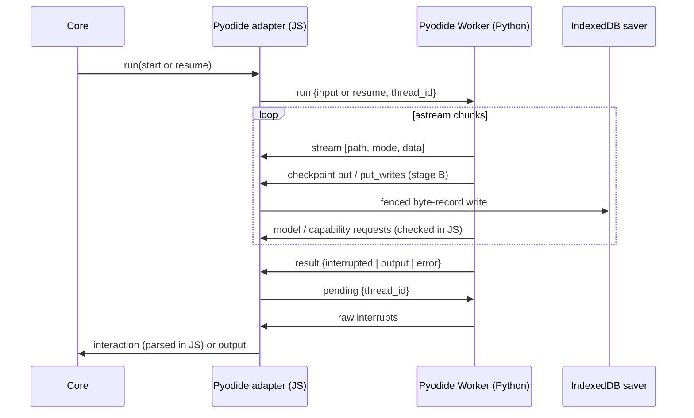
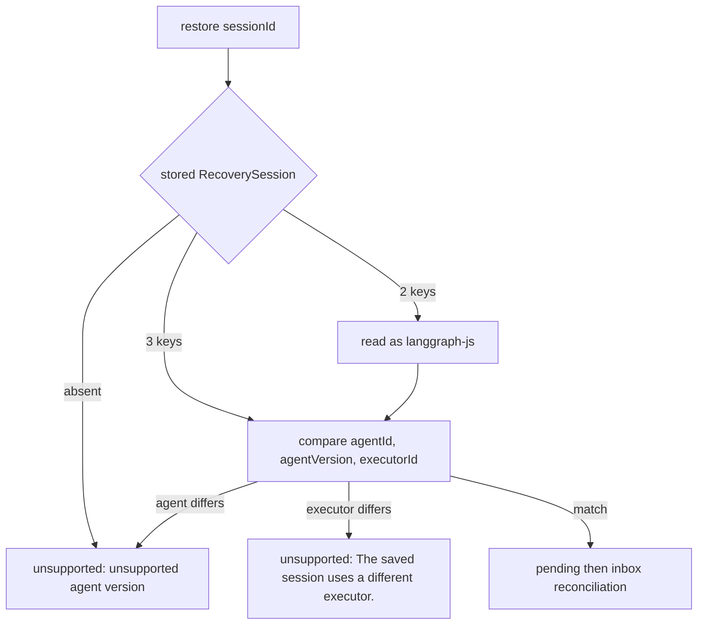
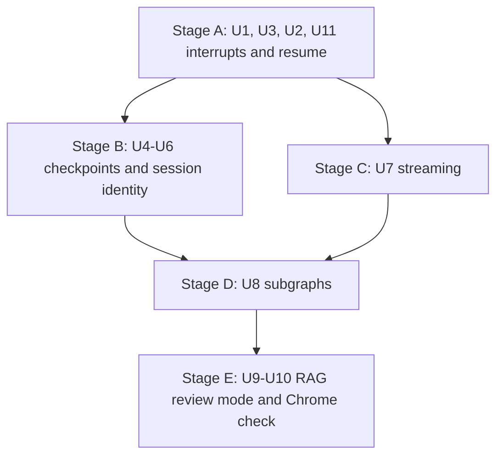

# Pyodide Executor Features - Plan

## Goal Capsule

- **Objective:** A LangGraph Python graph run through `@galaxie/adapter-pyodide` can pause for a user answer, resume, survive a page reload, stream its progress and use subgraphs, with the same galaxie guarantees as a LangGraph.js graph, and a person can see all of this working in Chrome on `examples/rag-browser`.
- **Means:** Turn on the five `ExecutorFeatures` flags stage by stage (A interrupts and resume, B durable checkpoints, C streaming, D subgraphs), then wire an opt-in passage review into `examples/rag-browser` (E) (KTD1).
- **Authority:** This plan, then `AGENTS.md`, ADR-0012, ADR-0017, ADR-0018 (decisions 7 and 8 are binding), system design. Beads feature `galaxie-4ib`.
- **Stop conditions:** Stop and report if any stage would need a CSP or Trusted Types relaxation, would move routing, consent, labels, budgets, credentials, output checks or capability authorization into Python, would make core name a framework, would change the LangGraph.js adapter or `tests/conformance/golden`, or would need a real model download. Also stop if the `ormsgpack` stand-in cannot round-trip a value that a stage B test checkpoints (R10).
- **Execution profile:** Five independently mergeable stages, each one pull request. Mock models only. Test-first where a behavior has a native CPython reference.
- **Finishing:** Codex CLI implements one stage per run. Claude reviews, runs the hands-on Chrome check for stage E, opens the pull request and merges each stage after CI passes.

---

## Product Contract

### Summary

Enable interrupts, resume, checkpoints, streaming and subgraphs for LangGraph Python in the Pyodide executor. Each feature reaches parity with native CPython LangGraph on Python ports of the twelve conformance cases, keeps every JavaScript-owned guarantee, and is visible in `examples/rag-browser` through an opt-in "Review passages before answering" step that streams, pauses, resumes and restores after reload on either executor.

### Problem Frame

Stage 2 of the RAG example shipped the Python executor with all five flags false, so Python agents cannot ask the user anything, cannot resume after reload and show nothing until the run ends. Core refuses `restore()` unless interrupts, resume and checkpoints are all true (`packages/core/src/agent-instance.ts:790`). ADR-0018 already designed the missing pieces (decision 7 for checkpoints and session identity, decision 8 for interrupts); the spike proved interrupt and resume with an in-memory checkpointer only. Streaming and subgraphs were never tried in Pyodide.

### Requirements

**Interrupts and resume**

- R1. `galaxie.langgraph.request_interaction(request, config)` pauses a Python graph through LangGraph Python `interrupt()` with the same four-field request the JavaScript side uses, and the run reports `waiting_input` with that interaction.
- R2. `pending(sessionId)` returns the pending interaction read from committed graph state, validated in JavaScript; it returns undefined when nothing is pending and fails `unsupported` for parallel or ID-less interrupts, matching the LangGraph.js limits.
- R3. Resume by interrupt ID delivers `{ action, payload }` to the waiting `request_interaction` call; resuming the same interaction again never pauses again.
- R4. Abort, step limits, model failures and the 500 ms Worker liveness bound keep their stage 2 behavior while a run is paused or resuming.

**Durable checkpoints and session identity**

- R5. Python checkpoints and pending writes persist through `@galaxie/storage-indexeddb` with the same app/principal scoping, app-epoch and logout-generation fencing, retention, explicit deletion and session export as LangGraph.js checkpoints (ADR-0018 decision 7).
- R6. A fresh page restores a paused Python session and resumes it; completed nodes do not re-run, and accepted answers and journalled effects reconcile as they do for LangGraph.js (AT-35 rule on task namespaces).
- R7. `RecoverySession` records `executorId`; a stored two-key record reads as `langgraph-js`; restoring a session with a different executor fails `unsupported` with "The saved session uses a different executor." and calls neither `pending()` nor inbox reconciliation (ADR-0018 decision 7 bullets 1-7).

**Streaming**

- R8. A Python run emits `stream` events for modes `values`, `updates`, `messages` and `custom`, with paths, while it runs; model text reaches Python and the stream only after JavaScript output checks on each growing chunk.

**Subgraphs**

- R9. Python subgraphs run with stream paths, interrupts inside subgraphs, resume and restore, and capability calls inside a subgraph keep the full task namespace as their effect scope.

**Compatibility**

- R10. The pinned `ormsgpack` stand-in round-trips every value the Python conformance cases and the RAG graph checkpoint; byte identity with real `ormsgpack` is not required, because Python sessions are only written and read through the stand-in. Values LangGraph's `JsonPlusSerializer` encodes lossily by design, such as exceptions in error writes (stored as their string form), count as round-tripping when they decode to that documented form; only a stand-in-specific loss is a stop condition.
- R11. The LangGraph.js adapter, its goldens and the compatibility matrix stay unchanged; the JavaScript RAG executor keeps working.

**Example**

- R12. `examples/rag-browser` offers an opt-in "Review passages before answering" step on both executors: retrieval runs in a subgraph, the run pauses with the retrieved passages, the visitor keeps or drops passages, and the answer then streams into the page.
- R13. Reloading while the review is pending restores it from IndexedDB on either executor, and submitting the review completes the answer.

### Key Decisions

- **Parity reference for Python is native CPython LangGraph.** Python stream chunks and checkpoint shapes differ from LangGraph.js, so JS goldens cannot be the reference; galaxie-observable outcomes (pending ID and value, final state, re-execution counters) must still match the JS cases' intent. Governs R2, R6, R8, R9.
- **The example change is opt-in.** The default RAG question flow keeps its in-memory checkpointer, parity transcript and tests; only review sessions persist to IndexedDB. Governs R12, R13.

### Scope Boundaries

- pydantic-ai, DSPy and the tutor port stay out (ADR-0018 decision 11).
- No streamed Python model output beyond what R8 needs, no tool-call or multimodal messages.
- No cross-executor session migration: a session restores only on the executor that wrote it.
- Static breakpoints, parallel interrupts and multiple requests per node stay unsupported, as for LangGraph.js.

#### Deferred to Follow-Up Work

- CDN/SRI deployment of Pyodide runtime files.
- Real-device measurements with real models.

---

## Planning Contract

### Key Technical Decisions

- KTD1. **One merge per stage, flags turned on only with their evidence.** Stage A sets `interrupts` and `resume`; B sets `checkpoints`; C sets `streaming`; D sets `subgraphs`. Each stage updates the adapter README, `docs/unsupported.md` and the ADR-0018 Verification section for what it proved.
- KTD2. **The Worker drives `graph.astream` instead of `ainvoke`.** Use `stream_mode=['values','updates','messages','custom']`, `subgraphs=True` and `configurable.thread_id = sessionId`, mirroring the LangGraph.js adapter's loop (`packages/adapter-langgraph/src/adapter.ts`). Detect interrupts from a root `updates` chunk carrying `__interrupt__`; take output from the last root `values` chunk. Resume input is `Command(resume={interrupt_id: {'action':…, 'payload':…}})`. Stage A may forward chunks internally without emitting `stream` events until stage C.
- KTD3. **Bridge v2 adds operations and a notification kind, closed and validated on both sides.** `galaxie.bridge/v1` becomes `galaxie.bridge/v2` in `bridge.ts`, `worker.ts`, `python/galaxie/src/galaxie/_bridge.py` and ADR-0018 decision 5; v1 messages are rejected. Besides `request` and `response`, a third kind `notify` carries one-way messages with no reply. New operations: `pending` (JS→Worker request: read interrupts for a thread), `stream` (Worker→JS notify: one `[path, mode, data]` chunk), `model-chunk` (JS→Worker notify: one checked text delta for an open streamed model call) and, in stage B, `checkpoint` (Worker→JS request with a closed set of sub-operations). The 1 MiB per-message limit stays, measured after base64 for bytes; an oversized message fails the run, or the `pending()` call, with a fixed `unsupported` error and no content.
- KTD4. **Request validation lives in JavaScript.** Python `request_interaction` checks only shape for a fast failure; the adapter's `pending()` runs core's `parseInteractionRequest` on the bridged value, as LangGraph.js does. Interrupt IDs come from LangGraph Python.
- KTD5. **Galaxie injects the checkpointer; Python never touches IndexedDB.** `galaxie.langgraph.checkpointer()` returns the run's saver, the Python counterpart of `host.langchain.checkpointer()`; graphs compile with it, and the Worker rejects a compiled graph whose checkpointer is a different object. Stage A returns an `InMemorySaver` owned by the Worker. Stage B returns `GalaxieCheckpointer`, a `BaseCheckpointSaver` whose async methods forward over `checkpoint`.
- KTD12. **Lost Worker state fails `unavailable`.** Every cancellation closes the Worker (`packages/adapter-pyodide/src/adapter.ts:476-490`), and stage A state lives in it. The adapter records when a Worker that held paused state was closed; until a new run starts, `pending()` and resume fail `unavailable` with a fixed message instead of reporting nothing pending. Stage B removes the condition for durable sessions.
- KTD13. **Bridge requests outside a run get their own context.** Core calls `pending()` on submit (`packages/core/src/agent-instance.ts:961`) and restore (`:826`), and LangGraph writes settlement checkpoints after abort (`packages/core/src/executor.ts:47`); today the Worker refuses requests with no active run (`worker.ts:116`) and the adapter answers `stale` (`adapter.ts:309-312`). Each `pending` call gets an ID-prefixed context that allows only `checkpoint` reads, and a cancelled run accepts `checkpoint` writes until its settlement ends or the 500 ms bound closes the Worker.
- KTD6. **Byte records reuse the saver's stores, key layout and envelope, marked by executor.** Python `dumps_typed` output `(type, bytes)` fits the existing `Envelope { v, type, bytes }` (`packages/storage-indexeddb/src/envelope.ts:7-18`); base64 is used only on the bridge. Keys keep `[app, principal, session, checkpoint_ns, id]`, so subgraph namespaces, retention, deletion and the principal wipe work unchanged, with no schema or database version change. Each Python record carries a closed `executor: 'langgraph-python'` marker plus the content-free fields export needs (timestamp, pending interrupt IDs), written by `GalaxieCheckpointer`. The JS saver's `getTuple`/`list` skip marked records, and `exportSession` reports them from the marker fields instead of decoding them with the JS serializer (`saver.ts:537`, `:560`). A `getTuple` reply (checkpoint, its writes and parent writes) must fit one bridge message.
- KTD7. **`RecoverySession` change follows ADR-0018 decision 7 exactly.** Core writes `executorId` from `ExecutorAdapter.id` (`'langgraph-python'` for Pyodide), the validator requires exactly three keys, IndexedDB reads two-key records as `langgraph-js`, the in-memory test store returns three keys, and `galaxie.session-export/1` adds `metadata.agent.executorId`.
- KTD8. **Stream data crosses the bridge as closed JSON projections.** `Interrupt` becomes `{id, value}`, tuples become lists, and message chunks become `{type, content, id}` with a fixed metadata subset (`langgraph_node`, `langgraph_checkpoint_ns`); other values must be JSON or the run fails `unsupported`. `stream` events carry `executor: 'langgraph-python'` and are never journalled. The RAG host renders `messages` from a small normalizer that accepts both this projection and LangGraph.js `AIMessageChunk` objects.
- KTD9. **Model streaming reuses the existing `model` request with incremental replies.** `GalaxieChatModel._astream` asks JavaScript for a streamed call; JavaScript begins the routed call with `requires: ['streaming']`, runs it with streaming, applies the output safety check to each growing chunk and the final text, and sends checked deltas back as `model-chunk` notifications before the final `model` response with usage. Python never sees unchecked text.
- KTD10. **Python conformance cases live beside the JS ones.** Port the twelve cases to `tests/conformance/cases-python/` and record native CPython transcripts as Python goldens under `tests/conformance/golden-python/`, produced by a new recorder script (stage 2 has none; `test_parity.py` compares a committed `session.json`); Pyodide lanes on Node and Chromium compare against them with a separate Python matrix file for any justified difference.
- KTD11. **RAG review mode is a separate persistent instance.** Input gains optional `review: boolean`; when true the graph runs a `retrieval` subgraph, then a node calls `request_interaction` (JS: `requestInteraction`) with component `rag.ReviewPassages/v1` listing passage IDs and titles; the answer node uses only kept passages. Review sessions run on their own agent instance per executor, created with `IndexedDBSaver`, `saver.recovery`, `ui: registry.bindings(...)` and the core Web Lock ownership pattern from host-local; the default flow keeps its current instance. The host persists `{ executor, sessionId }` for the pending review, because the JS and Python definitions have different agent IDs, and offers Start over, which deletes the session. Streamed `messages` render as React text.

### High-Level Technical Design

Run, pause and resume across the bridge (stages A-C). Directional only.

Session restore decision (stage B).

### Assumptions

- LangGraph Python 1.2.16 `astream(..., subgraphs=True)` and `aget_state` work under Pyodide's asyncio loop as they did for `ainvoke`; the spike exercised `aget_state`.
- The existing stage 2 parity script can record native CPython transcripts for the ported cases without new Python dependencies.

### Sequencing

---

## Implementation Units

| U-ID | Title | Key files | Depends on |
| --- | --- | --- | --- |
| U1 | Python conformance cases and native goldens | `tests/conformance/cases-python/`, `tests/conformance/golden-python/`, `scripts/` | none |
| U3 | `galaxie.langgraph` module | `python/galaxie/src/galaxie/langgraph.py`, `python/galaxie/pyproject.toml` | U1 |
| U2 | Bridge v2 run loop, `pending` and resume | `packages/adapter-pyodide/src/{bridge,worker,adapter}.ts`, `_bridge.py` | U3 |
| U11 | Chromium Pyodide conformance harness | `tests/conformance/` or `examples/rag-browser/test/support/` | U2 |
| U4 | Executor-aware `RecoverySession` | `packages/core/src/recovery.ts`, `packages/storage-indexeddb/src/recovery.ts`, `session-export.ts` | none |
| U5 | Byte-record checkpoint port | `packages/storage-indexeddb/src/`, `packages/adapter-pyodide/src/` | U2, U11 |
| U6 | `GalaxieCheckpointer`, serializer check, restore | `python/galaxie/src/galaxie/langgraph.py`, `python/standins/ormsgpack` | U4, U5 |
| U7 | Streaming events and streamed model calls | `packages/adapter-pyodide/src/`, `python/galaxie/src/galaxie/langchain.py` | U2 |
| U8 | Subgraphs | `packages/adapter-pyodide/src/adapter.ts`, Python cases | U6, U7, U11 |
| U9 | RAG review mode on both executors | `examples/rag-browser/src/`, `examples/rag-browser/agent_py/` | U8 |
| U10 | Hands-on Chrome verification record | `examples/rag-browser/README.md` | U9 |

### U1. Python conformance cases and native goldens

- **Goal:** Give stages A-D a native CPython reference.
- **Requirements:** R2, R6, R8, R9
- **Dependencies:** none
- **Files:** `tests/conformance/cases-python/*.py` (twelve cases), `tests/conformance/golden-python/*.json`, a new recorder under `scripts/`, `python/pyproject.toml` (`testpaths`), `tests/conformance/README.md`
- **Approach:** Port each case in `tests/conformance/cases/` keeping node names, counters and interrupt values (KTD10). Record transcripts with native CPython 3.14 from `python/.venv` run with `-I`, using the same mock model replies.
- **Execution note:** Lands with stage A.
- **Test scenarios:**
  - The recording script reproduces each golden byte-for-byte on a second run.
  - A Python test checks each case's re-execution counters match the JS case's documented counters (for example `{ callSub: 1, s1: 0, sask: 1 }` after subgraph reload).
- **Verification:** `pnpm test:python` passes; goldens are committed.

### U2. Bridge v2 run loop, `pending` and resume

- **Goal:** Run through `astream`, read pending state and resume by ID.
- **Requirements:** R1, R2, R3, R4
- **Dependencies:** U3
- **Files:** `packages/adapter-pyodide/src/bridge.ts`, `worker.ts`, `adapter.ts`, `python/galaxie/src/galaxie/_bridge.py`, `packages/adapter-pyodide/test/*`, `docs/adr/0018-python-agents-through-pyodide.md` (decision 5 version text)
- **Approach:** KTD2, KTD3, KTD4, KTD12, KTD13. Set `interrupts: true`, `resume: true`. Rebuild local wheels with `node scripts/build-python-wheels.ts` after any `python/galaxie` change before running Pyodide tests.
- **Test scenarios:**
  - `interrupt-resume`, `interrupt-sequence` and the two durability cases on the Node Pyodide lane match their Python goldens for pending ID, value, final state and counters.
  - `pending()` with nothing pending returns undefined; two distinct interrupt IDs fail `unsupported`; a malformed request value fails `invalid`.
  - Resuming an already-answered interaction fails `unsupported` without pausing.
  - Abort during a resumed run's model call settles `cancelled`; after any abort or Worker crash while paused, `pending()` and resume fail `unavailable` with the fixed message.
  - Bridge v1 envelopes, unknown operations and unexpected `notify` messages are rejected on both sides.
- **Verification:** New and existing adapter tests pass on Node and in the Chromium fake-Worker project.

### U3. `galaxie.langgraph` module

- **Goal:** Python authors pause with the galaxie request shape and compile with the injected checkpointer.
- **Requirements:** R1, R3
- **Dependencies:** U1
- **Files:** `python/galaxie/src/galaxie/langgraph.py`, `python/galaxie/src/galaxie/__init__.py`, `python/galaxie/pyproject.toml` (add `langgraph`), `python/uv.lock`, `python/requirements.lock`, `python/galaxie/tests/test_langgraph.py`
- **Approach:** `request_interaction` wraps `interrupt()` and returns the resume value's `action` and `payload` (KTD4); `checkpointer()` follows KTD5. The lint aid is a denylist, so it needs no change.
- **Test scenarios:**
  - Native CPython: interrupt value equals the four-field request; resume returns `{action, payload}`.
  - Wrong-shape request raises the fixed `GalaxieError('invalid')` before interrupting.
  - `checkpointer()` outside a configured Worker raises a fixed error.
- **Verification:** `pnpm test:python` passes with the updated locks.

### U11. Chromium Pyodide conformance harness

- **Goal:** Run real Pyodide cases in Chromium, including IndexedDB reopen.
- **Requirements:** R2, R6, R8, R9
- **Dependencies:** U2
- **Files:** a Playwright and Vite page harness modelled on `examples/rag-browser/test/python-parity.node.test.ts` and `test/support/python-parity/`, placed under `tests/conformance/` or the example's test support
- **Approach:** The Vitest Chromium project uses a fake Worker (`packages/adapter-pyodide/test/adapter.test.ts:19`), so real Pyodide in Chromium needs this harness. One built page runs a named case, can stop at an interrupt, reload and resume, and reports the transcript. It skips locally without built wheels and fails in CI, like `test/support/python.node.ts:24-27`.
- **Test scenarios:**
  - Stage A cases match their Python goldens in Chromium.
  - The harness reports a fixed failure when a case name is unknown.
- **Verification:** runs in `pnpm check`; extended by U5, U6, U7 and U8.

### U4. Executor-aware `RecoverySession`

- **Goal:** Sessions know which executor wrote them.
- **Requirements:** R7
- **Dependencies:** none (can land with stage B before U6)
- **Files:** `packages/core/src/recovery.ts`, `packages/core/src/agent-instance.ts`, `packages/core/test/support/memory-recovery-store.ts`, `packages/storage-indexeddb/src/recovery.ts`, `packages/storage-indexeddb/src/session-export.ts`, their tests, `docs/system-design.md`
- **Approach:** KTD7, binding to ADR-0018 decision 7 bullets.
- **Test scenarios:**
  - New sessions store three keys with the adapter's `id`.
  - A stored two-key record restores under `langgraph-js` with no rewrite and envelope `v: 1`.
  - Restoring with another executor fails `unsupported` with the fixed message, reports `restore_failed`, and calls neither `pending()` nor `submissions()`.
  - Four keys, empty strings or non-strings read as `corrupt`.
  - At start, a stored record whose executor differs fails `unavailable` (ADR-0018 decision 7 bullet 3).
  - Export includes `metadata.agent.executorId`.
- **Verification:** core, storage and conformance recovery tests pass on Node and Chromium; LangGraph.js restore tests unchanged.

### U5. Byte-record checkpoint port

- **Goal:** Durable, fenced storage for Python checkpoints.
- **Requirements:** R5
- **Dependencies:** U2
- **Files:** `packages/storage-indexeddb/src/saver.ts`, `session-export.ts`, `index.ts`, `README.md`, `packages/adapter-pyodide/src/adapter.ts` (services gain an optional byte-record port), storage tests, cross-package tests in `tests/conformance/` (`scripts/check-dependencies.ts` forbids `adapter-pyodide/test` from importing storage)
- **Approach:** KTD6, KTD13. Operations: get tuple, list, put, put writes, delete thread, each scoped to the saver's principal.
- **Test scenarios:**
  - Writes after a cross-tab takeover or logout generation change fail as the saver's do.
  - Retention sweep, explicit session deletion and principal wipe remove Python records.
  - Content-free export lists them; personal-content export decodes them as bytes.
  - The JS saver's `getTuple` and `list` skip Python-marked records for the same session.
  - Export reports Python records' timestamps and pending interrupt counts from marker fields, not `unrecoverable`.
- **Verification:** storage tests pass in Chromium with IndexedDB reopen.

### U6. `GalaxieCheckpointer`, serializer check, restore

- **Goal:** Python sessions survive reload.
- **Requirements:** R5, R6, R10
- **Dependencies:** U4, U5
- **Files:** `python/galaxie/src/galaxie/langgraph.py`, `python/standins/ormsgpack/`, `packages/adapter-pyodide/src/*`, conformance Pyodide lane and IndexedDB reload tests
- **Approach:** KTD5, KTD6, KTD13. Set `checkpoints: true`. Add a native CPython round-trip test of every value the Python cases and RAG graph checkpoint through the stand-in serializer (R10).
- **Execution note:** Run the round-trip test first; a failure is a stop condition.
- **Test scenarios:**
  - Reload versions of `interrupt-resume` and both durability cases, in Chromium through U11: dispose, reopen IndexedDB, rebuild, and pending ID, value and final state match the golden; counters match.
  - AT-35 in Python: a parent capability write before an interrupting child replays one host write with recovery.
  - `instance.restore()` on a fresh runtime restores a pending Python interaction.
  - Abort while LangGraph writes settlement checkpoints still persists them.
- **Verification:** Chromium reload tests pass; `pnpm test:python` passes.

### U7. Streaming events and streamed model calls

- **Goal:** Python runs stream like LangGraph.js runs.
- **Requirements:** R8
- **Dependencies:** U2
- **Files:** `packages/adapter-pyodide/src/{bridge,worker,adapter}.ts`, `python/galaxie/src/galaxie/langchain.py`, tests
- **Approach:** KTD8, KTD9. Set `streaming: true`.
- **Test scenarios:**
  - `linear` and `branching` cases emit the golden mode sequence and paths.
  - Mock streamed reply: Python receives only checked deltas; an output safety block mid-stream fails `denied` and later chunks never reach Python.
  - An oversized or non-JSON chunk fails `unsupported` with no content.
  - Stream events never appear in the replayable journal.
- **Verification:** adapter and output-safety tests pass on Node and Chromium.

### U8. Subgraphs

- **Goal:** Nested Python graphs work end to end.
- **Requirements:** R9
- **Dependencies:** U6, U7
- **Files:** `packages/adapter-pyodide/src/adapter.ts`, conformance Pyodide lanes
- **Approach:** Set `subgraphs: true` once `subgraph` and `interrupt-subgraph` pass; capability effect scope uses the full namespace from config.
- **Test scenarios:**
  - `subgraph` and `interrupt-subgraph` match Python goldens, including paths.
  - Reload of `interrupt-subgraph` in Chromium through U11 restores with `{ callSub: 1, s1: 0, sask: 1 }`.
  - Two capability calls in a parent and child get distinct effect IDs.
- **Verification:** all twelve Python cases pass on Node and Chromium Pyodide lanes.

### U9. RAG review mode on both executors

- **Goal:** Make every feature visible in the example.
- **Requirements:** R12, R13
- **Dependencies:** U8
- **Files:** `examples/rag-browser/src/agent/{graph.ts,schemas.ts,definition.ts,definition-python.ts}`, `examples/rag-browser/agent_py/rag_agent/graph.py`, `examples/rag-browser/src/host/{app.tsx,runtime.ts,main.tsx}`, a `rag.ReviewPassages/v1` registry entry and payload schema, `examples/rag-browser/package.json` (add `@galaxie/storage-indexeddb`), `scripts/check-dependencies.ts` allowlist, the Python file lists in `runtime.ts` and `test/support/python.node.ts`, tests, `examples/rag-browser/README.md`
- **Approach:** KTD11. Both definitions declare their `ui` requirements. Default path and its parity transcript stay unchanged; add a review-mode transcript to the JS/Python parity test.
- **Test scenarios:**
  - JS and Python review runs produce the same capability inputs, interaction props and final answer on Node and Chromium.
  - Loop test: check "Review passages", ask, drop one passage, submit; the answer streams and cites only kept passages, on both executors.
  - Reload while review is pending restores the review on both executors; submitting completes; Start over deletes the session.
  - Asking without review after a reload still uses the in-memory default instance.
  - Interaction props carry passage IDs and titles only, labelled like retrieval output; no passage text in URLs or requests.
  - CSP, Trusted Types and network-recording assertions unchanged.
- **Verification:** `pnpm check` and `pnpm test:python` pass.

### U10. Hands-on Chrome verification record

- **Goal:** Satisfy the maintainer's real-browser check.
- **Requirements:** R12, R13
- **Dependencies:** U9
- **Files:** `examples/rag-browser/README.md` (dated verification note)
- **Approach:** Claude runs the dev server with mock models and drives Chrome through Claude in Chrome on the Python executor: ask with review, watch the answer stream, reload during review, resume, and confirm the retrieval subgraph appears in stream paths (development trace or React text). Repeat the core flow on the JS executor.
- **Test expectation:** none -- manual verification recorded in the README; automated coverage lives in U9.
- **Verification:** README states browser version, date, steps and outcomes, without claiming real-model results.

---

## Verification Contract

| Check | Applies to | Proves |
| --- | --- | --- |
| `pnpm check` | every stage | Typecheck, Biome, Node and headless Chromium tests, Python lane, builds, dependency and doc checks |
| `pnpm test:python` | every stage | Native CPython tests, Python goldens, serializer comparison |
| Pyodide conformance lanes | A-D | Python cases match native goldens on Node and, through U11, real Chromium |
| IndexedDB reload tests | B, D, E | Restore from reopened IndexedDB in Chromium |
| Hands-on Chrome run | E | Maintainer-requested real-browser check (U10) |

## Definition of Done

- All five `ExecutorFeatures` flags are true for `langgraph-python`, each with its stage's tests passing on Node and headless Chromium.
- `restore()` works for Python sessions; executor mismatch fails as R7 states.
- RAG review mode works on both executors in automated tests and in a recorded Chrome run.
- LangGraph.js adapter, `tests/conformance/golden` and the JS compatibility matrix are byte-identical to `main`.
- ADR-0018 decision 5 names `galaxie.bridge/v2`.
- README files, `docs/unsupported.md`, ADR-0018 Verification and the AGENTS.md status paragraph describe the new state and its limits, without describing galaxie as secure.
- No spike code copied, no abandoned-attempt code left in any stage's diff.
