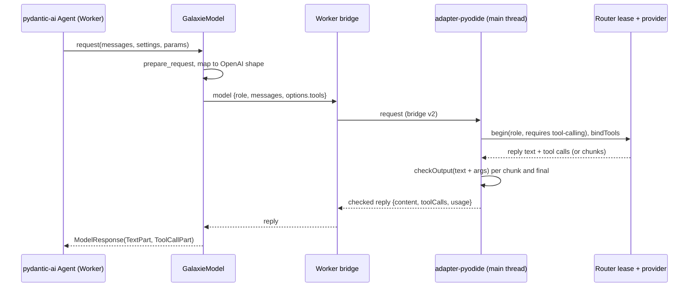
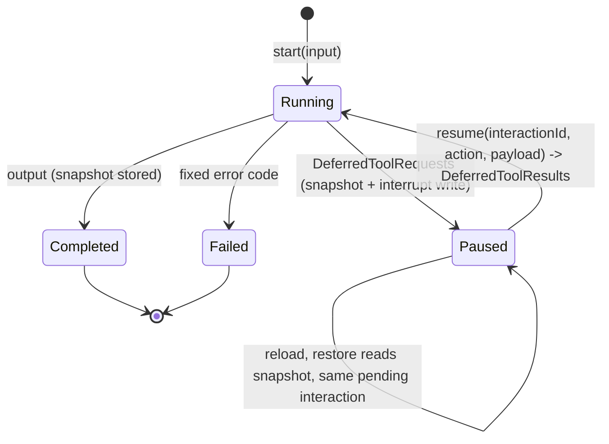

# pydantic-ai Executor - Plan

## Goal Capsule

- **Objective:** A developer can ship a pydantic-ai agent to the browser through galaxie and get the same answers, tool calls, approvals and reload behavior that the agent shows natively on CPython, under the same consent, labels, budgets, credentials and output checks as every other galaxie agent.
- **Means:** A second framework on `@galaxie/adapter-pyodide` with its own executor id, a `galaxie.pydantic_ai` face, an additive tool-call extension to bridge v2, deferred tool calls mapped to galaxie interactions and run conversations persisted through the byte-record port (KTD1, KTD2, KTD9, KTD10).
- **Authority:** This plan, then `AGENTS.md`, ADR-0012, ADR-0017 and ADR-0018. Beads feature `galaxie-p4p` under epic `galaxie-lwn`.
- **Stop conditions:** Stop and report if a stage needs a CSP or Trusted Types relaxation, a weaker ADR-0012 guarantee, a framework name in `packages/core`, a change to LangGraph.js or LangGraph Python behavior, goldens or matrices (the new pydantic-ai lane's own goldens and matrix excepted), a pydantic-ai release newer than the lock cutoff, or a real model download.
- **Execution profile:** Five stages (P1 to P5), each merged on its own after `pnpm check` and CI pass. Mock and scripted models only.
- **Finishing:** Codex CLI implements one stage per run; Claude reviews, fixes, opens the PR and merges after CI.

---

## Product Contract

### Summary

Add `galaxie.pydantic_ai` and a `pydantic-ai-python` executor to `@galaxie/adapter-pyodide`. Model calls, including tool definitions and tool calls, cross the bridge and run through the routed JavaScript path. Capability tools, structured output, streaming, approvals and durable conversations work in Pyodide on Node and in Chromium, checked against native CPython transcripts. The RAG example gains pydantic-ai as a third executor.

### Problem Frame

ADR-0018 names pydantic-ai as the second Python framework, but only the spike proved that `pydantic-ai-slim` imports under Pyodide. Today the bridge carries text only, and the JavaScript adapter rejects any provider tool call as `unsupported` (`packages/adapter-pyodide/src/adapter.ts`, `validateReply`). pydantic-ai depends on tool calls even for its default structured output, so nothing beyond plain text agents can run. The adapter's id, features and Worker driver are hard-coded to LangGraph Python.

### Requirements

**Model and tools (P1)**

- R1. A pydantic-ai `Agent` built with `galaxie.pydantic_ai.GalaxieModel(role)` runs in the Worker; every model call is routed in JavaScript with consent, reservation, credential lease, output safety and usage settlement, and Python never receives a credential or unchecked text.
- R2. Tool definitions travel to the routed provider and tool calls travel back; JavaScript checks reply text plus every tool-call argument before Python sees them, with the same `denied` and `unavailable` outcomes as the LangGraph.js routed model.
- R3. Capability-backed tools call `host.capabilities.call` through the broker with grants, labels, validation and deterministic effect IDs; a tool cannot reach a capability its binding does not allow.
- R4. Structured output through output tools and prompted output is validated in Python after JavaScript has checked the raw text; validation retries are ordinary routed calls counted against galaxie budgets.
- R5. The executor registers as `pydantic-ai-python` with its own feature flags; the `langgraph-python` executor's id, features, third-party wheel inventory and behavior are unchanged (shared `galaxie` wheel and Worker bundle growth is allowed, KTD12).
- R6. Framework-owned instrumentation stays off and only content-free events reach the trace port.

**Streaming (P2)**

- R7. When streaming is requested, checked model text deltas reach the host as stream events in order, and a mid-stream output-safety block fails the run without forwarding the blocked delta.
- R8. Stream events never carry tool arguments, tool results or unchecked text.

**Approvals (P3)**

- R9. A tool that requires approval, or raises `CallDeferred`, pauses the run with one pending galaxie interaction built by the agent author from the deferred requests.
- R10. Resuming by interaction ID turns the user's action and payload into deferred tool results; approved calls execute, denied calls report denial to the model, and a stale or mismatched interaction ID fails without running anything.

**Durable sessions (P4)**

- R11. With a byte-record port, the run's conversation (messages, usage and pending deferred requests) is stored at every pause and at completion, so a fresh Worker after reload restores the same pending interaction and resumes it.
- R12. Restored runs keep galaxie's recovery guarantees: accepted submissions reconcile, journalled write effects replay their receipts instead of repeating, and a session written by another executor is refused.
- R13. Session export labels pydantic-ai records with their own executor and stays content-free by default.

**Example and docs (P5)**

- R14. `examples/rag-browser` offers pydantic-ai as a third executor for the answer flow and the passage-review flow, with mock models in `dev:mock` and tests.
- R15. ADR-0018, the unsupported list, the adapter README and the project status describe what pydantic-ai supports and its limits, without describing galaxie as secure or compliant.

### Scope Boundaries

- Subgraphs are declared `false`: pydantic-ai delegation is an ordinary tool call, a child agent's deferral does not reach its parent, and pydantic-graph 2.60 has no persistence, so nothing matches galaxie's nested interrupt and stream semantics.
- `NativeOutput` (provider JSON-schema mode) is unsupported; `GalaxieModel` reports no JSON-schema output support, so pydantic-ai raises its own `UserError`.
- Inline `HandleDeferredToolCalls` is not used: it does not survive Worker loss. Considered and not built; a reload-safe design would need an in-run journal (see the next bullet).
- Multimodal content, thinking parts as provider fields, builtin or native tools and provider-specific settings are rejected with fixed `unsupported` errors.
- Considered and not built: a pydantic-ai durability backend (`CallableOperationBackend`) journaling every model call for mid-run replay. Conversation snapshots at pause points plus the existing write-effect journal cover the reload cases galaxie promises; evidence of lost work between pauses in a real agent would change this.

### Deferred to Follow-Up Work

- `NativeOutput` through router `structured-output` and provider JSON-schema mode.
- Python type checking (pyright) for `python/` and example agents, including the two `RunnableConfig` and message-content findings in `examples/rag-browser/agent_py/rag_agent/graph.py`.
- DSPy (`galaxie-ktf`) and ADK Python (`galaxie-m1t`) reuse the tool-call bridge from P1.

---

## Planning Contract

### Key Technical Decisions

- KTD1. **One adapter factory with a `framework` option.** `createPyodideAdapter({ framework: 'pydantic-ai', ... })` selects id `pydantic-ai-python`, its feature flags, the stream `executor` tag and the Python driver; the default stays `langgraph-python` with byte-identical behavior. Everything outside the driver (connection, leases, capability dispatch, checkpoint routing, cancellation) is framework-neutral, so a second adapter package would duplicate it. Core keys executors by id and already records `executorId` in `RecoverySession`, so core needs no change.
- KTD2. **Bridge v2, additive.** New optional fields only: a `framework` boot key (precedent: the optional `checkpoints` boot key), `tools` and `toolChoice` in model options, `tool` role messages and assistant `toolCalls` in model messages, `toolCalls` in model replies and tool-call deltas in `model-chunk`. Shapes follow the OpenAI chat format (ADR-0018 decision 5). Both sides ship together, validators stay closed-key, and a reply carrying tool calls for a request that offered no tools is still rejected, so LangGraph Python sees no change. Bridge tests pin accepted and rejected shapes.
- KTD3. **Tool-call output check is reimplemented in the Pyodide adapter.** `scripts/check-dependencies.ts` forbids importing `@galaxie/adapter-langgraph`, so a local module mirrors `routed-chat-model.ts`: the checked text is reply text plus newline-joined argument strings, checked on every growing chunk and once at the end. A shared table of input/expected-check cases is asserted in both packages' tests to keep the two from drifting. As implemented in P2, the Pyodide side checks more than LangGraph.js: tool-call IDs and names are model text that Python receives, so they join the growing and final checks, and streamed fragments without an index group by ID before continuing the latest call. The shared table covers the non-streaming checked text; the streaming differences are covered by `packages/adapter-pyodide/test/tool-calls.test.ts`.
- KTD4. **Tools bind to the leased provider in JavaScript.** When a request offers tools, the adapter asks the router for `tool-calling` (already a `ModelFeature`) and binds the OpenAI-format definitions with LangChain `bindTools` on the leased chat model; a provider without it fails `unsupported` before dispatch.
- KTD5. **`GalaxieModel` follows the 2.60 model contract.** It calls `prepare_request` in both request paths, reads instructions from `model_request_parameters.instruction_parts`, sends `declared_tool_defs`, reports `provider` as `None`, and maps messages with a small port of `OpenAIChatModel._map_messages` without importing `pydantic_ai.models.openai`, which loads the OpenAI SDK. Its profile supports tools and text output, not JSON-schema output.
- KTD6. **Capability tools get an explicit, position-derived effect scope.** `galaxie.pydantic_ai` builds async pydantic-ai tools that call `galaxie.capabilities.call` with scope `pydantic-ai/<conversation_id>/<response_index>/<part_index>`. `response_index` is the position of the `ModelResponse` in the conversation history and `part_index` the position of the tool-call part inside it. Tool-call IDs are model output and never key an effect: core's effect ID is a digest of session, scope, name and a per-run ordinal (`capability-broker.ts`), and KTD9 resumes as a new run, so an ID a model reuses (for example a local model's `call_0`) would replay an old receipt or fail `unrecoverable`. A position stays the same when a crashed run is re-dispatched after restore, so a repeated write replays its receipt, or fails `unrecoverable` when its input changed, and never runs twice (AT-35 rule). The LangGraph scope derivation is unchanged.
- KTD6a. **Conversation identity and tool-call ID validation.** `conversation_id` is fixed for the whole galaxie session: the driver creates it at the session's first run, stores it in the conversation snapshot (KTD10) and reuses it on every resume and restore, never deriving it from the run ID, which restore replaces. Before any tool runs or any interaction is built, the driver validates each model response: every tool-call ID must be a non-empty string of at most 128 characters that does not already appear in the conversation history, and every tool name must be one offered in that request; otherwise the run fails with a fixed `invalid` error.
- KTD7. **Entry returns an agent or an `Executor` wrapper.** A bare `Agent` gets defaults: run input `{"prompt": str}` becomes the user prompt, and output is dumped as JSON. `galaxie.pydantic_ai.Executor(agent, prompt=..., output=..., interaction=..., resume=...)` overrides input and output mapping and supplies the approval mapping (KTD9). The driver sets `Agent.instrument_all(False)` and refuses instrumented models or instrumentation capabilities (R6).
- KTD8. **Run streaming uses `Agent.iter` with node streaming (`run_stream_events` is a convenience over the same graph), projected onto existing modes.** Checked text deltas become `messages` events with a bounded text-only projection; content-free step markers (model request, tool call, deferred) become `updates` events. A tool marker carries the tool name only after KTD6a has confirmed it is one of the offered definitions, and a driver-assigned positional index instead of the model's call ID, so no unchecked model string reaches the host. No bridge mode is added, so the LangGraph-shared mode validators stay unchanged.
- KTD9. **Approvals end the run and resume as a new run.** The driver runs with `DeferredToolRequests` among output types. When a run ends deferred, the author's `interaction(requests)` returns one four-field request, validated by the existing Python mirror of `parseInteractionRequest`. The interaction ID is a digest of the conversation ID and the pause ordinal, the number of deferred pauses already stored in the conversation snapshot, so two pauses never share an ID even when a model repeats tool-call IDs. On resume, the author's `resume(requests, action, payload)` returns `DeferredToolResults`. The default, for approve/deny-only agents, fails closed: it approves only on the exact action `approve`, denies only on `deny`, and fails with a fixed `invalid` error without running any tool for any other action or for a payload that does not cover every deferred call. galaxie's one-pending-interaction rule holds because all deferrals from one model response form one interaction.
- KTD10. **Conversation snapshots through the byte-record port.** At each pause and at completion, the driver stores `ConversationTypeAdapter` bytes as a typed checkpoint `put` plus an `__interrupt__` write carrying the interaction ID, so the existing port, fencing, retention and pending-ID extraction apply. The saver's byte-row test changes from `executor === 'langgraph-python'` to membership in the closed set `langgraph-python | pydantic-ai-python` (cursor, pending-write filter, row selection, validators and export decoding in `saver.ts`), and export copies the stored tag instead of hard-coding it. Without a port, an in-memory store keeps interrupts working for the Worker's lifetime. The byte-record request gains the adapter id, so storage tags rows with the real executor instead of always `langgraph-python` (R13).
- KTD11. **ADR-0018 decision 11 is revised with evidence.** pydantic-graph 2.60 has no persistence module, so "pydantic-graph persistence uses the byte-record port" has nothing to attach to. The revision records conversation snapshots at pause points, the end-of-run approval model, `subgraphs: false` with its reason, and P4's tests as evidence for `interrupts`, `resume` and `checkpoints`.
- KTD12. **Pin pydantic-ai-slim 2.60.0 and load wheels per framework.** 2.60.0 is the newest release before the lock cutoff, needs `pydantic>=2.12` (2.12.5 is locked) and leaves `anyio` 4.15.1 and `typing-extensions` 4.16.0 as locked. The closure adds `pydantic-graph` 2.60.0, `genai-prices`, `griffelib`, `opentelemetry-api` and `logfire-api` at their newest versions before the cutoff, with hashes. Each locked wheel records which frameworks need it, and the Worker installs only the selected framework's set, so the `langgraph-python` third-party wheel inventory (names, versions, hashes and their byte total) stays unchanged. The shared `galaxie` wheel and the Worker bundle are used by both executors and may grow with shared bridge and package code; the LangGraph driver's behavior may not change. The RAG asset plugin (`examples/rag-browser/scripts/python-assets.ts`) emits and counts only the shared plus LangGraph set in P1, so its byte meta stays unchanged; U11 adds one byte figure per Python executor.
- KTD13. **A separate conformance lane.** `tests/conformance/cases-pydantic-ai/`, `golden-pydantic-ai/` and `compatibility-matrix-pydantic-ai.json` sit beside the LangGraph Python lane, which stays untouched. The native reference runs each case on CPython with a scripted pydantic-ai model; the galaxie lanes run the same agent through a scripted tool-calling JavaScript model with identical replies. Transcripts compare output, normalized message parts, tool calls, interaction requests and error codes. Because scripted replies hide request-mapping bugs, each golden also records the per-call request payload (OpenAI-format messages and tool definitions): the galaxie lanes record what the JavaScript mock receives, and the native recorder produces the same payload with pydantic-ai's own `OpenAIChatModel` mapping on CPython. For that, `openai` (newest release before the lock cutoff, hash-pinned in `uv.lock`) joins only the CPython `dev` dependency group used by the recorder and tests; it never enters `requirements.lock`, `runtime-files.ts` or any wheel set the Worker installs. If `openai` cannot resolve under the cutoff without moving an existing pin, the recorder instead uses hand-reviewed expected payloads checked into the golden, and the matrix records that substitution.
- KTD14. **The mock model learns scripted tool calls.** `@galaxie/models/mock` script entries may return tool calls and may be sequences, and `MockChatModel` implements `bindTools`. A sequence entry is selected from the conversation, not a per-instance counter: by the number of assistant tool-call turns after the last human message, so a fresh mock after reload given the same history returns the same reply. The RAG `dev:mock` path and tests use it; text-only scripts keep working.

### High-Level Technical Design

Model call with tools, one routed call:

Run lifecycle for one pydantic-ai session:

### Assumptions

- `pydantic-ai-slim` 2.60.0, its `run_stream_events` background task and anyio cancellation behave under Pyodide's event loop as on CPython. P1 and P2 tests prove or refute this first; a refutation is a stop condition for that stage.
- `genai-prices` loads bundled pricing data without network access during `Model.__init__`; the Worker's blocked-fetch bootstrap in tests catches any attempt.
- One deferred model response per pause is enough for the RAG example and conformance cases.

### Risks

| Risk | Mitigation |
| --- | --- |
| Adding the closure re-resolves LangGraph packages in `uv.lock` | KTD12 pins; `tests/conformance/python-wheels.node.test.ts` version assertions stay green |
| `requirements.lock` and `runtime-files.ts` are maintained by hand and can drift | Existing equality test covers both; add the framework field to both in one change |
| History written by a newer pydantic-ai fails to load | One pinned version in both locks; restore of an unreadable snapshot fails `unrecoverable` |
| Two retry loops (pydantic-ai output retries and galaxie `repairAttempts`) double-count | pydantic-ai never uses routed `withStructuredOutput`, so only pydantic-ai retries apply; each is a budgeted routed call |

---

## Implementation Units

| U-ID | Stage | Title | Key files | Depends on |
| --- | --- | --- | --- | --- |
| U1 | P1 | Lock the pydantic-ai closure per framework | `python/pyproject.toml`, `python/requirements.lock`, `packages/adapter-pyodide/src/runtime-files.ts` | none |
| U2 | P1 | Bridge v2 tool-call fields and JS checks | `packages/adapter-pyodide/src/bridge.ts`, `adapter.ts`, new `tool-calls.ts`, `python/galaxie/src/galaxie/_bridge.py` | U1 |
| U3 | P1 | Scripted tool calls in the mock model | `packages/models/src/mock.ts` | none |
| U4 | P1 | `galaxie.pydantic_ai` model, tools and executor | `python/galaxie/src/galaxie/pydantic_ai.py` | U2 |
| U5 | P1 | Adapter framework option and Worker driver | `packages/adapter-pyodide/src/adapter.ts`, `worker.ts` | U2, U4 |
| U6 | P1 | Lint aid for pydantic-ai provider use | `python/galaxie/src/galaxie/lint.py` | none |
| U7 | P1 | pydantic-ai conformance lane | `tests/conformance/cases-pydantic-ai/`, `golden-pydantic-ai/` | U3, U5 |
| U8 | P2 | Streaming | `pydantic_ai.py`, `adapter.ts`, `worker.ts` | U7 |
| U9 | P3 | Deferred tools as interactions | `pydantic_ai.py`, `worker.ts`, `adapter.ts` | U8 |
| U10 | P4 | Durable conversations and restore | `pydantic_ai.py`, `checkpoints.ts`, `packages/storage-indexeddb/src/saver.ts` | U9 |
| U11 | P5 | RAG example third executor | `examples/rag-browser/src/host/*`, `agent_py/rag_pydantic_ai/` | U10 |
| U12 | P5 | ADR, docs and status | `docs/adr/0018-...md`, `docs/unsupported.md`, `packages/adapter-pyodide/README.md`, `AGENTS.md` | U11 |

### U1. Lock the pydantic-ai closure per framework

- **Goal:** Make `pydantic-ai-slim` 2.60.0 and its closure installable offline in CPython and Pyodide without changing the LangGraph wheel set.
- **Requirements:** R5
- **Dependencies:** none
- **Files:** `python/pyproject.toml`, `python/galaxie/pyproject.toml`, `python/uv.lock`, `python/requirements.lock`, `packages/adapter-pyodide/src/runtime-files.ts`, `packages/adapter-pyodide/src/worker.ts`, `tests/conformance/python-wheels.node.test.ts`, `scripts/fetch-python-wheels.ts`, `examples/rag-browser/scripts/python-assets.ts`
- **Approach:**
  1. Add the closure under the existing `exclude-newer` cutoff with exact pins (KTD12); keep `pydantic==2.12.5`.
  2. Add a per-wheel `frameworks` field to the lock format and `lockedWheels`, and make the Worker install the shared set plus the selected framework's set.
  3. Fetch and hash-verify the new wheels with the existing script.
- **Patterns to follow:** existing `galaxie.python-lock/v1` entries; the equality and version checks in `python-wheels.node.test.ts`.
- **Test scenarios:**
  - `requirements.lock` and `lockedWheels` stay equal, including the new field.
  - `langgraph`, `langchain-core` and `msgpack` versions are unchanged.
  - The LangGraph framework set equals today's wheel list, and its byte total is unchanged.
  - The pydantic-ai set includes `pydantic-ai-slim` 2.60.0 and `pydantic-graph` 2.60.0, and every entry's upload date is before the cutoff.
  - Pyodide on Node imports `pydantic_ai` with fetch blocked.
  - CPython confirms the 2.60.0 symbols the plan relies on exist: `ModelRequestParameters.instruction_parts`, `declared_tool_defs`, `ConversationTypeAdapter`, `Agent.instrument_all`, `DeferredToolRequests`, `DeferredToolResults`, `CallDeferred`, `run_stream_events`. A missing symbol is a stop condition for the KTD that uses it.
  - The RAG byte meta and the bytes served in a LangGraph Python session stay equal.
- **Verification:** `uv lock --check` passes, the wheel tests pass and the LangGraph Python lane is unchanged.

### U2. Bridge v2 tool-call fields and JS checks

- **Goal:** Carry tool definitions and tool calls across the bridge with JavaScript output checks on every argument.
- **Requirements:** R1, R2
- **Dependencies:** U1
- **Files:** `packages/adapter-pyodide/src/bridge.ts`, `packages/adapter-pyodide/src/adapter.ts`, `packages/adapter-pyodide/src/tool-calls.ts` (new), `python/galaxie/src/galaxie/_bridge.py`, `packages/adapter-pyodide/test/bridge.test.ts`, `packages/adapter-pyodide/test/adapter.test.ts`, `packages/adapter-pyodide/test/tool-calls.test.ts` (new), `packages/adapter-langgraph/test/output-safety.test.ts`, `tests/conformance/support/tool-call-checks.ts` (new shared case table), `python/galaxie/tests/test_bridge.py`
- **Approach:**
  1. Extend the request, reply and `model-chunk` shapes per KTD2, on both sides.
  2. Implement KTD3 in `tool-calls.ts` and use it in the stream and final checks.
  3. Request `tool-calling` and bind tools per KTD4; keep rejecting tool calls when no tools were offered.
- **Patterns to follow:** `routed-chat-model.ts` `argumentChunks`, `outputText` and streaming reassembly; closed-key validators in `bridge.ts`.
- **Test scenarios:**
  - A request with two tools and a reply with one tool call round-trips as JSON and validates on both sides.
  - A reply with tool calls to a request without tools fails `unsupported`, as today.
  - Tool-call arguments containing the blocked canary fail `denied` before the Worker receives the reply, both non-streaming and mid-stream.
  - Argument fragments split across chunks are reassembled per call index and checked on growth.
  - An output-safety hook error fails `unavailable` with a fixed message.
  - A provider without `bindTools` or `tool-calling` fails `unsupported` before dispatch and is not retried on another provider.
  - Unknown keys in tool definitions, tool calls or chunks are rejected on both sides.
  - The shared case table gives the same checked text in the Pyodide adapter and in `routed-chat-model.ts`.
- **Verification:** Existing bridge and LangGraph Python tests pass unchanged; the new cases pass on Node and Chromium.

### U3. Scripted tool calls in the mock model

- **Goal:** Let mock scripts return tool calls so `dev:mock` and tests can drive tool-using agents.
- **Requirements:** R14
- **Dependencies:** none
- **Files:** `packages/models/src/mock.ts`, `packages/models/test/mock.test.ts`
- **Approach:** Script entries gain optional tool calls and may be ordered sequences consumed one per call for the same key; `bindTools` returns a bound copy that records the offered tool names (KTD14).
- **Test scenarios:**
  - A text-only script behaves exactly as today.
  - A sequence entry returns a tool call on the first call and text on the second.
  - A fresh mock instance given the same history (including the earlier tool-call turn and its result) returns the second entry.
  - Streaming a tool-call entry yields argument fragments that reassemble to the scripted arguments.
  - A scripted tool call to a tool that was not bound fails with a fixed mock error.
- **Verification:** All existing mock users pass unchanged.

### U4. `galaxie.pydantic_ai` model, tools and executor

- **Goal:** Provide the Python face: `GalaxieModel`, capability tools and the `Executor` wrapper, without streaming or approvals yet.
- **Requirements:** R1, R3, R4, R6
- **Dependencies:** U2
- **Files:** `python/galaxie/src/galaxie/pydantic_ai.py` (new), `python/galaxie/src/galaxie/capabilities.py`, `python/galaxie/tests/test_pydantic_ai.py` (new)
- **Approach:**
  1. `GalaxieModel` per KTD5, mapping replies to `TextPart` and `ToolCallPart` and usage to `RequestUsage`.
  2. Capability tools per KTD6; add an explicit scope argument to `capabilities.call` that LangGraph callers do not pass.
  3. `Executor` and the bare-agent defaults per KTD7.
- **Patterns to follow:** `galaxie/langchain.py` (closed reply checks, fixed errors); fake transport via `_bridge.install_transport` in `test_langchain.py`.
- **Test scenarios:**
  - A text reply becomes a single `TextPart`, and usage that does not add up is rejected.
  - Instructions and a tool return appear in the mapped messages in OpenAI order; an empty assistant response is skipped.
  - A tool-call reply becomes a `ToolCallPart` with the same ID, name and arguments.
  - A capability tool sends name, input and scope `pydantic-ai/<conversation_id>/<response_index>/<part_index>`, and a capability `denied` error reaches the agent as the fixed galaxie error.
  - A tool-call ID repeated from earlier history, an empty or over-long ID, or a tool name that was not offered fails `invalid` before any tool runs.
  - Default `ToolOutput` structured output validates a correct reply; an invalid one triggers one retry, then `UnexpectedModelBehavior` maps to a fixed galaxie error.
  - `PromptedOutput` parses a JSON text reply.
  - `NativeOutput` raises pydantic-ai's unsupported error.
  - Building an executor with instrumentation enabled is refused, and with the trace port faked, every trace event the driver emits carries no prompt, reply text, tool arguments or results.
  - Importing `galaxie.pydantic_ai` does not import `openai`.
- **Verification:** CPython tests pass under `pnpm test:python`.

### U5. Adapter framework option and Worker driver

- **Goal:** Register `pydantic-ai-python` and run a pydantic-ai entry end to end in the Worker.
- **Requirements:** R1, R5
- **Dependencies:** U2, U4
- **Files:** `packages/adapter-pyodide/src/adapter.ts`, `packages/adapter-pyodide/src/worker.ts`, `packages/adapter-pyodide/src/index.ts`, `packages/adapter-pyodide/test/adapter.test.ts`, `packages/adapter-pyodide/test/adapter.node.test.ts`
- **Approach:**
  1. Add the `framework` option (KTD1). P1 features are `streaming: false`, `interrupts: false`, `resume: false`, `checkpoints: false`, `subgraphs: false`; later stages flip them.
  2. Send the `framework` boot key and install a pydantic-ai driver that answers `run` with `agent.run(...)` and returns the projected output.
  3. Keep the LangGraph driver path byte-identical.
- **Test scenarios:**
  - The default adapter still reports `langgraph-python` with all five features, and existing tests pass unchanged.
  - `framework: 'pydantic-ai'` reports `pydantic-ai-python` with the P1 features.
  - A runtime registering both adapters runs a LangGraph Python definition and a pydantic-ai definition side by side.
  - A pydantic-ai run on real Pyodide (Node) calls one capability tool and returns structured output, with fetch blocked.
  - Abort during a model call cancels the run with the fixed cancellation outcome, and the Worker can run again.
  - An entry that returns neither an `Agent` nor an `Executor` fails `unsupported` with a fixed message.
- **Verification:** Node and Chromium adapter tests pass.

### U6. Lint aid for pydantic-ai provider use

- **Goal:** Flag pydantic-ai code that bypasses `GalaxieModel`.
- **Requirements:** R1
- **Dependencies:** none
- **Files:** `python/galaxie/src/galaxie/lint.py`, `python/galaxie/tests/test_lint.py` (new)
- **Approach:** Add imports of `pydantic_ai.models.<provider>` and `pydantic_ai.providers`, and calls to `infer_model`; extend the provider-prefix list with prefixes present in 2.60 that are missing (for example `google:`, `grok:`, `test:` and `function:`), since a shipped agent must use `GalaxieModel`.
- **Test scenarios:**
  - `Agent('openai:gpt')`, `from pydantic_ai.models.openai import OpenAIChatModel`, `from pydantic_ai.providers.openai import OpenAIProvider` and `infer_model('anthropic:x')` are each flagged.
  - `Agent(GalaxieModel('rag.answer'))` passes.
  - Existing RAG lint tests still pass.
- **Verification:** `pnpm test:python` passes.

### U7. pydantic-ai conformance lane

- **Goal:** Prove parity for the P1 cases on CPython, Pyodide on Node and Pyodide in Chromium.
- **Requirements:** R1, R2, R3, R4
- **Dependencies:** U3, U5
- **Files:** `tests/conformance/cases-pydantic-ai/` (new: `suite.py`, case agents, `test_cases.py`), `tests/conformance/golden-pydantic-ai/` (new), `tests/conformance/compatibility-matrix-pydantic-ai.json` (new), `scripts/record-python-conformance.py` or a sibling recorder, `tests/conformance/pydantic-ai.node.test.ts` (new), `examples/rag-browser/test/python-conformance.node.test.ts` or a sibling Chromium test, `python/pyproject.toml` (testpaths)
- **Approach:** KTD13. P1 cases: plain text, one capability tool call, two sequential tool calls, structured output via tool, output retry after invalid output, prompted output, capability denial, output-safety block on a tool argument, abort. Each later stage appends its cases.
- **Test scenarios:**
  - The recorder's `--check` mode reproduces every golden on CPython.
  - Each case's Node Pyodide transcript equals its golden.
  - Each case's Chromium transcript under the strict mock CSP equals its golden.
  - The LangGraph Python goldens and matrix are byte-identical after the change.
- **Verification:** All three lanes pass; differences, if any, are listed in the new matrix with reasons.

### U8. Streaming

- **Goal:** Stream checked model text through `request_stream` and run events through `Agent.iter` node streams (KTD8). The native recorder reuses the same projection loop, so the P2 goldens prove cross-runtime parity of that projection, not equality with `run_stream_events` output; the pydantic-ai matrix states this.
- **Requirements:** R7, R8
- **Dependencies:** U7
- **Files:** `python/galaxie/src/galaxie/pydantic_ai.py`, `packages/adapter-pyodide/src/worker.ts`, `packages/adapter-pyodide/src/adapter.ts`, `python/galaxie/tests/test_pydantic_ai.py`, `tests/conformance/cases-pydantic-ai/`
- **Approach:** `request_stream` returns a `StreamedResponse` fed by checked `model-chunk` text and tool-call deltas and requires the final reply to equal the joined deltas, like `GalaxieChatModel`. The driver projects run events per KTD8. Set `streaming: true`.
- **Test scenarios:**
  - Text deltas arrive as `messages` events in order, and their concatenation equals the final output.
  - A tool-call turn emits `updates` markers with the offered tool name and a positional index only, never the model's call ID, arguments or results.
  - A model whose tool-call ID contains the blocked canary produces no stream event carrying it.
  - A mid-stream block fails the run `denied`, the blocked delta never reaches the host, and earlier deltas are not retracted.
  - A final reply that differs from the joined deltas fails with a fixed error.
  - Abort during streaming stops events and settles the run as cancelled.
  - Streaming cases match native transcripts on all three lanes.
- **Verification:** Conformance lane passes with the new cases; the LangGraph streaming tests are unchanged.

### U9. Deferred tools as interactions

- **Goal:** Pause on approvals and deferred calls as galaxie interactions and resume by ID.
- **Requirements:** R9, R10
- **Dependencies:** U8
- **Files:** `python/galaxie/src/galaxie/pydantic_ai.py`, `packages/adapter-pyodide/src/worker.ts`, `packages/adapter-pyodide/src/adapter.ts`, `python/galaxie/tests/test_pydantic_ai.py`, `tests/conformance/cases-pydantic-ai/`
- **Approach:** KTD9, with an in-memory conversation store (KTD10) so `pending()` and resume work within one Worker. Set `interrupts: true` and `resume: true`.
- **Test scenarios:**
  - A `requires_approval` tool call pauses with one interaction whose request passes `parseInteractionRequest`, and the tool has not run.
  - Approve runs the tool once and completes; deny returns a denial to the model and completes.
  - Two deferred calls in one response form one interaction, and the author's `resume` can approve one and deny the other.
  - A `CallDeferred` tool resumes with an external result supplied in the payload.
  - Resume with a wrong interaction ID fails `stale` without running anything.
  - Two consecutive pauses whose scripted tool calls reuse the same IDs get distinct interaction IDs, and each accepts its own answer.
  - The default resume with an action other than `approve` or `deny` fails `invalid` and runs no tool.
  - An author `interaction` function that returns an invalid request fails `unsupported` with a fixed message.
  - A UI payload resumes through core's accepted/consumed inbox exactly once on double submit.
  - Approval cases match native transcripts on all three lanes.
- **Verification:** Conformance and adapter tests pass; core needs no change.

### U10. Durable conversations and restore

- **Goal:** Persist conversations through the byte-record port so reload restores the pending interaction.
- **Requirements:** R11, R12, R13
- **Dependencies:** U9
- **Files:** `python/galaxie/src/galaxie/pydantic_ai.py`, `packages/adapter-pyodide/src/checkpoints.ts`, `packages/adapter-pyodide/src/adapter.ts`, `packages/storage-indexeddb/src/saver.ts`, `packages/storage-indexeddb/src/byte-records.ts`, `packages/storage-indexeddb/test/`, `tests/conformance/support/memory-byte-checkpoints.ts`, `tests/conformance/cases-pydantic-ai/`
- **Approach:** KTD10. Restore validates the stored snapshot with the pinned type adapter; an unreadable snapshot fails `unrecoverable`. Set `checkpoints: true`.
- **Test scenarios:**
  - Pause, dispose the Worker, restore in a fresh runtime with the same store: the same pending interaction is published and resuming completes.
  - In Chromium with reopened IndexedDB, the same reload case passes.
  - An approved write capability executed before a crash replays its receipt after restore instead of repeating, with the KTD6 effect ID.
  - An unapproved write tool that runs after a resume, followed by Worker loss before completion and a restore that re-dispatches the model call, replays its receipt or fails `unrecoverable`, and never writes twice.
  - The restored session reuses the stored `conversation_id`.
  - A session recorded by `langgraph-python` is refused with "The saved session uses a different executor."
  - A corrupted snapshot fails `unrecoverable` and leaves other sessions readable.
  - Export of a pydantic-ai session is tagged `pydantic-ai-python` and content-free unless `personalContent: true`.
  - Existing LangGraph Python byte-record rows still export as `langgraph-python`.
  - Logout and app-epoch fencing reject a stale write from a pydantic-ai run.
- **Verification:** Storage, adapter and conformance reload tests pass on Node and Chromium.

### U11. RAG example third executor

- **Goal:** Offer pydantic-ai in `examples/rag-browser` for the answer flow and passage review.
- **Requirements:** R14
- **Dependencies:** U10
- **Files:** `examples/rag-browser/agent_py/rag_pydantic_ai/` (new), `examples/rag-browser/agent_py/tests/test_pydantic_ai_agent.py` (new), `examples/rag-browser/src/agent/definition-pydantic-ai.ts` (new), `examples/rag-browser/src/host/runtime.ts`, `examples/rag-browser/src/host/app.tsx`, `examples/rag-browser/src/host/main.tsx`, `examples/rag-browser/scripts/python-assets.ts`, `examples/rag-browser/test/support/python.node.ts`, `examples/rag-browser/test/loop.node.test.ts`, `examples/rag-browser/test/review.node.test.ts`, `scripts/check-dependencies.ts`
- **Approach:**
  1. Write a pydantic-ai agent with a `docs.search@1` capability tool and a cited answer produced as text output, so the answer streams like the other executors (ToolOutput arguments never stream, per R8).
  2. Implement review as an approval-required `review_passages` tool whose interaction uses the existing `rag-review` surface.
  3. Widen the executor choice to three values, persisting and restoring the third in the saved-review state. Offer pydantic-ai only when the answer role has a provider declaring `tool-calling`; the `dev:mock` and test mock descriptors declare it, and the bundled WebLLM and Built-in AI providers do not, which the README and unsupported list state.
  4. Script the mock models with tool calls (U3).
  5. Emit and declare one served-byte figure per Python executor and assert served bytes against the selected executor's figure.
- **Patterns to follow:** `definition-python.ts`, the Python review instance wiring and `selectExecutor` in `runtime.ts`.
- **Test scenarios:**
  - In `dev:mock`, selecting pydantic-ai answers a question with citations, rendered as React text, and the streamed `messages` deltas join to the cited answer.
  - Review with pydantic-ai pauses, keeps two passages, and answers with only those passages cited.
  - Reload during review restores the pydantic-ai executor and the pending review; Start over deletes it.
  - Switching between all three executors leaves no stale pending state.
  - The injected-instruction case fails without adding actions and with no network request.
  - CSP, Trusted Types and recorded-request assertions are unchanged, and the LangGraph Python third-party wheel inventory is unchanged.
  - In default (non-mock) mode without a tool-calling provider, the pydantic-ai choice is not offered.
- **Verification:** RAG Node and Chromium tests pass; `dev:mock` serves all three executors.

### U12. ADR, docs and status

- **Goal:** Record what pydantic-ai supports and its limits.
- **Requirements:** R15
- **Dependencies:** U11
- **Files:** `docs/adr/0018-python-agents-through-pyodide.md`, `docs/unsupported.md`, `packages/adapter-pyodide/README.md`, `examples/rag-browser/README.md`, `tests/conformance/README.md`, `AGENTS.md`, `llms.txt`
- **Approach:** Revise decision 11 per KTD11, update the ADR's pydantic-ai dependency row from the spike's 2.63.0 to the pinned 2.60.0 closure, and add a dated revision line; list the scope boundaries above in the unsupported list.
- **Test expectation:** none -- documentation; the existing offline link check covers it.
- **Verification:** `pnpm check:docs` passes and no text describes galaxie as secure, compliant or certified.

---

## Verification Contract

| Check | Proves | Stage |
| --- | --- | --- |
| `pnpm check` | Licenses, Biome, TypeScript 7 and 6, Node and headless Chromium tests, Python lane, builds, dependency rules, docs links | every stage |
| `pnpm test:python` | CPython unit tests and native goldens for both Python lanes | every stage |
| Recorder `--check` for the pydantic-ai lane | Goldens reproduce natively | P1 onward |
| `tests/conformance/python-wheels.node.test.ts` | Lock equality, unchanged LangGraph third-party wheel inventory | P1 |
| LangGraph Python goldens and `compatibility-matrix-python.json` unchanged in the diff | Executor isolation (R5) | every stage |
| `uv lock --check` in `python/` | Lock matches pins under the cutoff | P1 |

## Definition of Done

- Each stage merges with `pnpm check` and CI green, and its feature flags match the behavior its tests prove.
- After P4, `pydantic-ai-python` declares `streaming`, `interrupts`, `resume` and `checkpoints` true and `subgraphs` false, and ADR-0018 records the evidence.
- The LangGraph.js adapter and the LangGraph Python executor, their goldens, matrices and third-party wheel inventory are unchanged.
- No real model download, CSP or Trusted Types relaxation, or framework name in `packages/core`.
- No spike code copied from `spikes/`, and no leftover probe or abandoned-attempt code in any stage's diff.
- Beads `galaxie-p4p` closes after P5 with the stage PRs listed.
