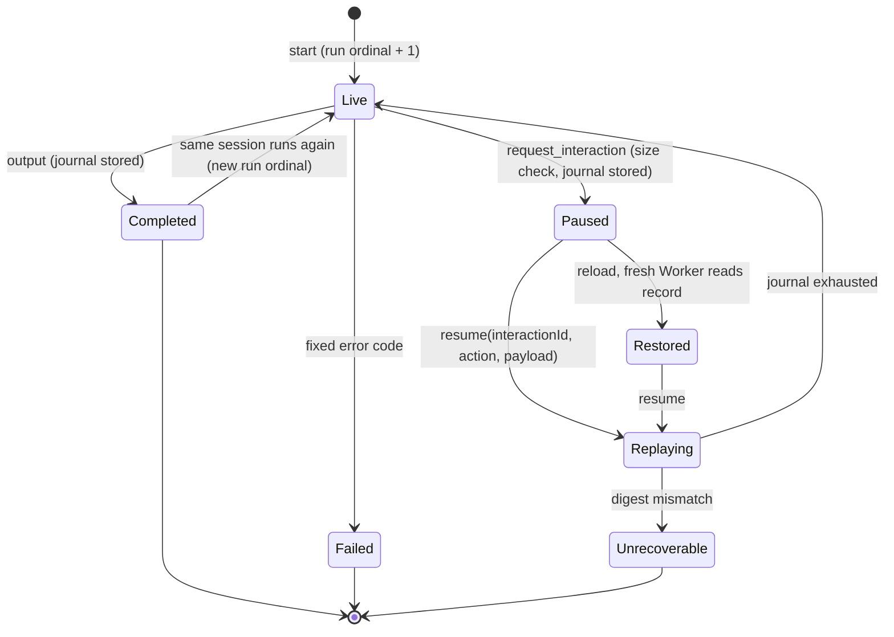
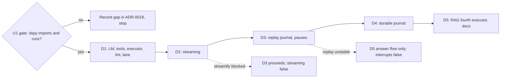

# DSPy Executor - Plan

## Goal Capsule

- **Objective:** A developer can ship a DSPy program to the browser through galaxie and get the same predictions, tool calls, pauses and reload behavior that the program shows natively on CPython, under the same consent, labels, budgets, credentials and output checks as every other galaxie agent.
- **Means:** A third framework on `@galaxie/adapter-pyodide` with executor id `dspy-python`, a `galaxie.dspy` face built on DSPy 3.4's custom-engine LM contract, the existing bridge v2 tool-call fields, a deterministic replay journal for pauses, and the existing byte-record port for durability (KTD1, KTD3, KTD9, KTD11).
- **Authority:** This plan, then `AGENTS.md`, ADR-0012, ADR-0017 and ADR-0018. Beads feature `galaxie-ktf` under epic `galaxie-lwn`.
- **Stop conditions:** Stop and report if a stage needs a CSP or Trusted Types relaxation, a weaker ADR-0012 guarantee, a framework name in `packages/core`, a provider SDK in the Worker wheel set, a change to the LangGraph.js, LangGraph Python or pydantic-ai executors, their goldens or matrices, a change to the LangGraph Python third-party wheel inventory, a dspy release newer than the lock cutoff, a moved existing pin in `python/uv.lock`, or a real model download. The U1 gate adds its own stop condition (R1).
- **Execution profile:** Five stages (D1 to D5), each merged on its own after `pnpm check` and CI pass. Mock and scripted models only.
- **Finishing:** Codex CLI implements one stage per run through `/compound-engineering:lfg`; Claude reviews, fixes, opens the PR and merges after CI.

---

## Product Contract

### Summary

Add `galaxie.dspy` and a `dspy-python` executor to `@galaxie/adapter-pyodide`. DSPy model calls cross the bridge as routed JavaScript calls; capability tools, ChatAdapter and JSONAdapter parsing, ReAct, streaming, pauses and durable sessions work in Pyodide on Node and in Chromium, checked against native CPython transcripts. The RAG example gains DSPy as a fourth executor.

### Problem Frame

ADR-0018 names DSPy as the third Python framework but records only that `dspy` 3.4.1 "needs a stand-in" for `litellm`. Nothing has checked that DSPy imports under Pyodide 314.0.7, which of its required dependencies are safe to omit, or whether its call paths need threads that the Worker lacks. DSPy also has no pause primitive, and both ReAct loops turn every tool exception into observation text, so galaxie's interaction, error-code and write-effect guarantees do not carry over without design work. The adapter knows two frameworks only.

### Requirements

**Install and import gate (D1)**

- R1. dspy 3.4.1 imports and runs `Predict`, `ChainOfThought`, `ReAct` and `ReActV2` through a galaxie engine in Pyodide on Node and in Chromium with fetch blocked, from hash-pinned wheels under the existing `exclude-newer` cutoff, with no provider SDK (`openai`, `litellm` or other) in the Worker wheel set. If it cannot, the stage stops after recording the gap in ADR-0018 and nothing else ships.

**Model and tools (D1)**

- R2. A DSPy program whose predictors use `galaxie.dspy.GalaxieLM(role)` runs in the Worker; every model call is routed in JavaScript with consent, reservation, credential lease, output safety, labels and usage settlement, and Python never receives a credential or unchecked text.
- R3. Adapter output (ChatAdapter field markers, JSONAdapter JSON, text-parsed and native tool calls) is parsed in Python only after JavaScript has checked the raw reply text and every tool-call argument.
- R4. Capability-backed `dspy.Tool`s call `host.capabilities.call` through the broker with grants, labels, validation and deterministic effect IDs; a terminal capability failure ends the run with its galaxie code instead of becoming ReAct observation text.
- R5. Model failures keep their galaxie code (`denied`, `cancelled`, `budget_exceeded`, `unavailable` and others) through DSPy's error boundary and reach the host as the same fixed errors as other executors.
- R6. DSPy caching, history, traces and callbacks that could record prompts or replies are off for every run; only content-free events reach the trace port.
- R7. The executor registers as `dspy-python` with its own feature flags; the `langgraph-python` and `pydantic-ai-python` executors' ids, features, wheel inventories and behavior are unchanged.

**Streaming (D2)**

- R8. When streaming is requested on a ChatAdapter program, checked text for author-declared output fields reaches the host as stream events in order, and a mid-stream output-safety block fails the run without forwarding the blocked text.
- R9. Stream events never carry tool arguments, tool results, prompt text or unchecked model text.

**Pauses (D3)**

- R10. `galaxie.dspy.request_interaction(request)`, called from module or tool code, pauses the run with one pending galaxie interaction, and resuming by interaction ID returns the user's action and payload at the same call.
- R11. A resumed run never repeats a model call, capability call or interaction that completed before the pause, and a program that takes a different path on resume fails `unrecoverable` before any later live call.

**Durable sessions (D4)**

- R12. With a byte-record port, a fresh Worker after reload restores the same pending interaction and resumes it.
- R13. Restored runs keep galaxie's recovery guarantees: accepted submissions reconcile, journalled write effects replay their receipts instead of repeating, and a session written by another executor or another dspy version is refused.
- R14. Session export labels DSPy records with their own executor and stays content-free by default.

**Example and docs (D5)**

- R15. `examples/rag-browser` offers DSPy as a fourth executor for the answer flow, and for passage review when D3 and D4 shipped, with mock models in `dev:mock` and tests.
- R16. ADR-0018, the unsupported list, the adapter README, the conformance README and the project status describe what DSPy supports and its limits, without describing galaxie as secure or compliant.

### Acceptance Examples

- AE1. **Covers R4.** Given a ReAct program whose write tool fails `outcome_unknown`, when the run continues, then the run ends `outcome_unknown` and the model is not called again.
- AE2. **Covers R11.** Given a program paused at its second interaction after one write, when the user answers and the run resumes, then the write is not repeated, no earlier model call is dispatched, and the new answer is returned at the second `request_interaction` call.
- AE3. **Covers R11, R13.** Given a session that completed, when the same session runs the program again, then its first write executes as a new effect and does not replay the earlier run's receipt.

### Scope Boundaries

- Subgraphs are declared `false`: nested `dspy.Module`s have no namespaces, checkpoints or interrupt propagation, and a nested pause unwinds the whole program, so nothing maps to galaxie's nested interrupt and stream-path semantics.
- Optimizers (teleprompters) are outside the runtime: they are sync-only, several need threads or `optuna`, and none can reach the async bridge. Authors may optimize offline on native CPython and ship the resulting program state as agent source; galaxie does not test that loading path in this plan.
- `response_format` and provider JSON-schema mode are not offered: the bridge has no field for them, so `GalaxieLM` does not list `response_format` in its supported params and JSONAdapter falls back to prompted JSON parsed in Python.
- Sync DSPy entry points (`Module.__call__`, sync `forward`, sync `streamify`, `dspy.Parallel`, threaded `Evaluate`) are unsupported and fail with a fixed `unsupported` error, because the bridge is async and the Worker has no threads.
- Multimodal types (`dspy.Image`, `dspy.Audio`), embeddings (`dspy.Embedder`), retrievers that call services, and string-routed `dspy.LM('provider/model')` are unsupported.
- Considered and not built: re-registering journaled capability outputs as private values on replay. Durable restore already starts with every data label, and pydantic-ai history has the same gap; a real leak path through a replayed string would change this. The unsupported list records it.
- Considered and not built: per-chunk journaling of in-flight model calls. The journal records completed calls; work after the last pause is redone live after Worker loss, as for pydantic-ai.
- JSONAdapter streaming is unsupported and fails `unsupported`: DSPy's JSON stream parser needs `jiter`, and the Pyodide-shipped 0.13.0 cannot coexist with the 0.18.0 that `uv.lock` already pins. Non-streaming JSONAdapter runs are supported.
- Considered and not built: supporting ChatAdapter's JSONAdapter fallback. It makes the call sequence depend on whether text streamed, which breaks replay; parse failures fail the run instead (KTD6).

### Deferred to Follow-Up Work

- `response_format` through router `structured-output`, shared with pydantic-ai `NativeOutput`.
- Python type checking (pyright) for `python/` and example agents.
- ADK Python (`galaxie-m1t`) reuses the framework option and tool-call bridge.

---

## Planning Contract

### Key Technical Decisions

- KTD1. **Worker wheel set omits the non-imported hard dependencies; CPython uses a fail-closed `litellm` stand-in.** dspy 3.4.1 declares `litellm`, `openai`, `gepa`, `tenacity`, `diskcache` and `cachetools` as required, but on the custom-engine path it imports none of them at module level (litellm and openai through lazy `require`, caches only when enabled, tenacity never). The Worker installs an explicit hash-checked wheel list with `depends: []` and no resolver (`packages/adapter-pyodide/src/worker.ts`), so the `dspy` framework set lists only what imports need: dspy, json-repair, the Pyodide-built `regex`, `pyyaml` only if the gate shows it is imported, `jsonschema` and its closure, `requests` and its closure, `tqdm`, `cloudpickle`, plus the shared pydantic, anyio and orjson wheels. `jiter` never enters the Worker set: `uv.lock` already pins 0.18.0 through the CPython-only `openai`, Pyodide 314.0.7 ships 0.13.0, and the wheel inventory test forbids it, so JSONAdapter streaming is unsupported (Scope Boundaries). For `uv`, a same-name workspace member `python/standins/litellm` at exactly 1.106.2 (the newest release before the cutoff) ships metadata and no importable module, so `require("litellm")` yields DSPy's missing-module proxy and any accidental litellm path fails at the call site (ADR-0018 decision 10). `openai` stays the real 3.37.0 already pinned for CPython only; it never enters `requirements.lock` or `runtime-files.ts`. An `openai` stand-in was rejected because it cannot coexist with that pin in one workspace. `gepa` 0.1.4 resolves on CPython and is omitted from the Worker, where DSPy installs its own raising `GEPA` stub.
- KTD2. **Compiled wheels match Pyodide 314.0.7; pure wheels match `uv.lock`.** New compiled dependencies (`regex`, `rpds-py`, `pyyaml`) are added to `constraint-dependencies` at the Pyodide-shipped versions, following the existing `orjson` and `xxhash` pins, and come from the Pyodide CDN with hashes. Pure wheels use the version uv resolves under the cutoff. Each wheel's `frameworks` field gains `dspy` where it is shared; the LangGraph and pydantic-ai sets, and their byte totals, stay equal to today's.
- KTD3. **`GalaxieLM` subclasses `dspy.LM` and supplies galaxie engines, not a `BaseLM.forward` override.** `dspy.LM` is itself a `dspy.BaseLM`, so the requested subclass relationship holds. The legacy `forward`/`aforward` override warns on every call, is removed in 3.5 and cannot stream; the 3.4 engine contract (`complete`/`stream` over `dspy.lm15` types) is the supported route. `GalaxieLM(role, native_tools=False)` builds with `cache=False` and `num_retries=0`, so retries and caching stay with JavaScript. The async engine maps `lm15.Request` system, messages, tools, `Config.stop` (to `options.stop`) and `Config.tool_choice` (to `options.toolChoice`) to the bridge v2 model op, whose validators accept no other option keys, and maps checked replies to `lm15.Response`. `GalaxieLM` passes `temperature=None` and `max_tokens=None` to `dspy.LM`; any other non-null `Config` field (temperature, max tokens, top-p, top-k, seed, penalties, reasoning, response format) fails `unsupported` with a fixed message before any bridge call, as `galaxie/pydantic_ai.py` does for model settings. The JavaScript router keeps sampling and token limits. The sync engine fails `unsupported`. The mapper is galaxie code and does not call DSPy's private `lm15_boundary.request_kwargs`; the native recorder uses that helper as an independent check (KTD12).
- KTD4. **Native function calling is opt-in and reuses the bridge v2 tool fields.** The engine reports `supports_function_calling` only when `native_tools=True`; then tool definitions and tool calls travel through the existing `tools`, `toolCalls` and tool-call delta fields, JavaScript requires `tool-calling` and checks every argument (pydantic-ai plan KTD2 to KTD4), and the pydantic-ai tool-call ID validation rule applies. With the default, ReAct and ReActV2 parse tool calls from checked text, so programs run on providers without tool calling. `supports_response_schema` is false and `response_format` is not a supported param.
- KTD5. **Errors keep their codes across DSPy.** The engine raises a `dspy.LMError` subclass carrying the galaxie code, which DSPy's error boundary preserves by identity; the executor maps it back. Capability tools raise a `BaseException` subclass for every code, including `invalid`, so ReAct and ReActV2 cannot turn it into an observation: the broker also returns `invalid` after a dispatched write whose output fails validation, so retrying could repeat the write. The run also records the first galaxie code from any model or capability call, including calls made inside author tool code that DSPy catches, and ends with it at the next model call, capability call or program return.
- KTD6. **Per-run DSPy configuration is fixed by the driver.** At Worker start the driver calls `dspy.configure_cache(enable_disk_cache=False, enable_memory_cache=False)` and sets `LITELLM_LOCAL_MODEL_COST_MAP=true`. Each run executes `module.acall` under `dspy.context(lm=..., adapter=..., disable_history=True, trace=None, callbacks=[])`. The default adapter is `ChatAdapter(use_json_adapter_fallback=False)`; an author adapter with the fallback enabled is refused. Before a run, the driver walks `named_predictors()` and refuses any predictor bound to an LM that is not a `GalaxieLM`, and any module or predictor with instance callbacks. Refusals fail `unsupported` with fixed messages.
- KTD7. **Entry returns a module or an `Executor` wrapper.** A bare `dspy.Module` gets defaults: run input must be a JSON object passed as keyword arguments to `acall`, and output is the prediction's output fields as JSON. `galaxie.dspy.Executor(module, input=..., output=..., adapter=..., stream_fields=...)` overrides mapping, adapter and streamed fields. Modules whose `aforward` is missing fail `unsupported` at the first sync LM call.
- KTD8. **Positions, not segments, key effects and interactions.** Mirroring the pydantic-ai `conversation_id` rule (its plan KTD6, KTD6a), the session stores a fixed `conversation_id`, a monotonic run ordinal and a pause counter. A capability call's effect scope is `dspy/<conversation_id>/<run_ordinal>/<call_ordinal>`, where `call_ordinal` counts capability calls in call-start order across the whole run, including replayed ones, so a frontier call has the same scope whether it first runs live or again after Worker loss. The interaction ID is a digest of `conversation_id` and the session-wide pause counter. A second run on the same session gets a new run ordinal, so its writes are new effects (AE3).
- KTD9. **Pauses end the run; resume re-executes the program against a replay journal.** `request_interaction` raises a pause `BaseException`, validated with the existing Python mirror of `parseInteractionRequest`. The journal records, in call-start order, each completed model reply (checked text, tool calls and usage), each capability result and each interaction answer, with a digest of its canonical request: for a model call, role, messages, system, tools and config minus execution controls and the stream flag; for a capability call, the capability name (which carries its version) and canonical validated input; for an interaction, the canonical parsed request. On resume the program runs from the start; each call with a journal entry returns the recorded value after its digest matches, and the first unjournaled call runs live. A digest mismatch, or a run that completes or raises a new pause while journal entries remain unconsumed (including the pending interaction answer), fails `unrecoverable` before any live call or output, marks the stored session unrecoverable and emits a fixed content-free diagnostic. Replayed model replies make no routed call and are not charged; only live calls count against step and token budgets. A second `request_interaction` while one is in flight fails `unsupported`. This makes `interrupts` and `resume` true for programs that are deterministic apart from model, capability and interaction calls; the ADR states that condition.
- KTD10. **Replay is silent on the stream.** Journaled replies are served through both engine paths without stream events; listener output and step markers are dropped until the journal is exhausted, and one content-free `updates` marker `{kind: 'replayed', count}` is emitted.
- KTD11. **Journal persistence through the byte-record port.** At each pause and at completion, the driver stores the journal and session metadata (`conversation_id`, run ordinal, pause counter, dspy version, adapter class, journal format version) as one typed checkpoint `put` plus an `__interrupt__` write carrying the interaction ID. `ByteExecutor` in `packages/storage-indexeddb/src/byte-records.ts` and the matching checks in `saver.ts` gain `dspy-python`. Core already refuses a session recorded by another executor with `unsupported` before the adapter runs; the driver refuses a different dspy version or journal format with `unrecoverable`. The encoded record must fit the existing 1 MiB bridge message limit; the size is checked before a pause is published, in both durable and in-memory modes, and an oversize journal fails `unsupported` without publishing the pause.
- KTD12. **A separate conformance lane.** `tests/conformance/cases-dspy/`, `golden-dspy/` and `compatibility-matrix-dspy.json` sit beside the pydantic-ai lane. The native reference runs each case on CPython with a scripted engine; the galaxie lanes run the same program through a scripted JavaScript model with identical replies. Goldens compare outputs, normalized requests, tool calls, interaction requests and error codes. Each golden records per-call request payloads: the galaxie lanes record what the JavaScript model receives, and the native recorder produces the payload with DSPy's own `lm15_boundary.request_kwargs(request, "chat")`, pinned to 3.4.1.
- KTD13. **Streaming uses `streamify` with author-declared fields.** The driver wraps the module in `dspy.streamify(..., is_async_program=True, async_streaming=True, stream_listeners=..., status_message_provider=<silent provider>)`. The silent provider avoids the thread pool behind default tool status messages. Each `StreamResponse` becomes a `messages` event with a bounded text-only projection `{field, text}` for fields listed in `stream_fields`; content-free `updates` markers cover model call, tool call (offered tool name only) and pause. The engine's `stream()` turns checked `model-chunk` deltas into `lm15` delta events and requires the final reply to equal the joined deltas.
- KTD14. **One exception unwrap rule.** The driver's last handler is `except BaseException`, mapped to a fixed code. An anyio `BaseExceptionGroup` (from `streamify` task groups) is flattened: one pause plus only sibling cancellations is a pause; any galaxie error or termination reports its code, first in group order; two pauses fail `unsupported`; anything else fails `executor_error`. No traceback or exception text crosses the bridge.

### High-Level Technical Design

One routed model call from a DSPy predictor:

```mermaid
sequenceDiagram
  participant P as dspy Predict/ReAct (Worker)
  participant E as galaxie async engine
  participant J as replay journal
  participant W as Worker bridge
  participant A as adapter-pyodide (main thread)
  participant R as Router lease + provider
  P->>E: complete(lm15.Request) or stream(...)
  E->>J: digest(request); journaled?
  alt journaled
    J-->>E: recorded checked reply
  else live
    E->>W: model {role, messages, options}
    W->>A: request (bridge v2)
    A->>R: begin(role), bind tools if native
    R-->>A: text + tool calls (or chunks)
    A->>A: checkOutput per chunk and final
    A-->>W: checked reply
    W-->>E: reply
    E->>J: append(digest, reply)
  end
  E-->>P: lm15.Response; adapter parses fields in Python
```

Session lifecycle with the replay journal:



Stage dependencies and stop gates:



### Stage Fallbacks

- If U1 shows `streamify` cannot run on the Pyodide event loop (anyio task groups), D2 declares `streaming: false` with the reason, D3 proceeds, and U10 returns the DSPy answer as final output only.
- If U1 shows request digests differ between two identical CPython runs and the difference cannot be removed by the canonical projection (KTD9), D3 and D4 are dropped: `interrupts`, `resume` and `checkpoints` stay false, D5 ships the answer flow only, and the ADR records the evidence.
- If D3 ships and D4 cannot fit realistic journals under 1 MiB for the RAG review case, D4 still ships with the limit documented and D5 keeps review in memory.

### Assumptions

- Pyodide's WebLoop runs `asyncio.to_thread` work inline, so DSPy's async LM path works without threads; U1 proves or refutes this first.
- anyio task groups and shielded cancel scopes behave on the WebLoop as on CPython; U1 probes this before D2.
- DSPy puts no generated identifiers into requests on the paths the lane covers; U1 checks this on CPython (KTD9).
- One pending interaction per pause is enough for the RAG example and conformance cases.
- Exact-string mock keys can drive DSPy prompts; if ChatAdapter prompts make them impractical, U10 adds an opt-in matcher to `@galaxie/models/mock` without changing existing scripts.

### Risks

| Risk | Mitigation |
| --- | --- |
| Adding dspy re-resolves an existing pin in `uv.lock` | KTD1, KTD2 constraints; a moved pin is a stop condition; `python-wheels.node.test.ts` version checks stay green |
| A DSPy path reaches litellm or openai at runtime | The stand-in has no module and the Worker has neither wheel, so the call fails at its call site; fetch-blocked Worker tests cover each supported path |
| Duplicate writes after a terminal capability error in ReAct | KTD5 termination; AE1 conformance case |
| A dspy upgrade changes prompts and breaks stored journals | KTD11 version check refuses restore with `unrecoverable` |
| Journal growth from retrieved passages exceeds 1 MiB | KTD11 pre-publish size check; documented limit |
| Shielded `aclose()` hangs abort | The engine's `aclose()` never awaits JavaScript; abort mid-stream test in Chromium |

---

## Implementation Units

| U-ID | Stage | Title | Key files | Depends on |
| --- | --- | --- | --- | --- |
| U1 | D1 | Gate: lock the dspy closure and prove import and async paths | `python/pyproject.toml`, `python/standins/litellm/`, `python/requirements.lock`, `packages/adapter-pyodide/src/runtime-files.ts` | none |
| U2 | D1 | `galaxie.dspy` engine and `GalaxieLM` | `python/galaxie/src/galaxie/dspy.py` | U1 |
| U3 | D1 | Capability tools, effect positions and terminations | `python/galaxie/src/galaxie/dspy.py`, `capabilities.py` | U2 |
| U4 | D1 | Executor wrapper, adapter framework option and Worker driver | `packages/adapter-pyodide/src/adapter.ts`, `worker.ts`, new `dspy-driver.ts` | U2, U3 |
| U5 | D1 | Lint aid for DSPy provider use | `python/galaxie/src/galaxie/lint.py` | none |
| U6 | D1 | DSPy conformance lane | `tests/conformance/cases-dspy/`, `golden-dspy/` | U4 |
| U7 | D2 | Streaming | `dspy.py`, `dspy-driver.ts`, `adapter.ts` | U6 |
| U8 | D3 | Replay journal and interactions | `dspy.py`, `dspy-driver.ts`, `adapter.ts` | U7 |
| U9 | D4 | Durable journal and restore | `dspy-driver.ts`, `checkpoints.ts`, `packages/storage-indexeddb/src/` | U8 |
| U10 | D5 | RAG example fourth executor | `examples/rag-browser/src/host/*`, `agent_py/rag_dspy/` | U9 |
| U11 | D5 | ADR, docs and status | `docs/adr/0018-...md`, `docs/unsupported.md`, READMEs, `AGENTS.md` | U10 |

### U1. Gate: lock the dspy closure and prove import and async paths

- **Goal:** Make dspy 3.4.1 installable offline in CPython and Pyodide without a provider SDK in the Worker, and prove the facts the later stages rest on before any feature code lands.
- **Requirements:** R1, R7
- **Dependencies:** none
- **Files:** `python/pyproject.toml`, `python/galaxie/pyproject.toml` (a `dspy` extra), `python/standins/litellm/` (new workspace member), `python/uv.lock`, `python/requirements.lock`, `packages/adapter-pyodide/src/runtime-files.ts`, `packages/adapter-pyodide/src/worker.ts` (framework wheel filter and import probe), `scripts/fetch-python-wheels.ts`, `tests/conformance/python-wheels.node.test.ts`, `python/galaxie/tests/test_dspy_gate.py` (new), `packages/adapter-pyodide/test/adapter.node.test.ts`, `examples/rag-browser/test/pyodide-csp.node.test.ts` (Chromium gate probe)
- **Approach:**
  1. Add dspy 3.4.1 and the closure per KTD1 and KTD2, with `dspy` added to `PythonFramework` and to shared wheels' `frameworks`.
  2. Add the litellm stand-in with no importable module.
  3. Write the CPython gate tests and the Node Pyodide import probe.
  4. If the import probe or the async `Predict` probe fails, stop the stage: drop the lock changes, record the failing dependency or path in ADR-0018's dependency table, and report.
- **Execution note:** Start with the Pyodide import probe under blocked fetch; nothing else in D1 is worth building until it passes.
- **Patterns to follow:** the pydantic-ai U1 lock change; `python/standins/ormsgpack`; the version and equality checks in `python-wheels.node.test.ts`.
- **Test scenarios:**
  - `requirements.lock` and `lockedWheels` stay equal, including the new framework tag.
  - The LangGraph and pydantic-ai framework sets equal today's lists and byte totals.
  - The dspy set contains no `openai`, `litellm`, `gepa`, `tenacity`, `diskcache` or `cachetools` wheel, and every entry's upload date is before the cutoff.
  - Pyodide on Node runs `import dspy` with fetch blocked, and `importlib.util.find_spec("openai")` and `find_spec("litellm")` are `None`.
  - In Pyodide on Node and in Chromium under the strict CSP, async `Predict`, `ChainOfThought`, `ReAct` and `ReActV2` (each ReAct with one text-parsed tool) complete through a fake engine, proving inline `to_thread` and the missing-module proxies.
  - In Pyodide, an anyio task group with a memory stream and a shielded cancel scope completes and cancels as on CPython (D2 input; failure triggers the D2 fallback).
  - On CPython, `Predict`, `ChainOfThought`, `ReAct` and `ReActV2` run twice with a scripted engine and produce identical canonical request digests (D3 input).
  - On CPython, a `ChatAdapter(use_json_adapter_fallback=False)` parse failure raises without a second engine call, and a `BaseException` raised in a tool propagates out of `ReAct.acall` and `ReActV2.acall`.
  - `uv lock --check` passes and `langgraph`, `langchain-core`, `pydantic-ai-slim`, `pydantic` and `anyio` versions are unchanged.
- **Verification:** All gate tests pass on CPython, Node Pyodide and Chromium, or the stage stops with the gap recorded.

### U2. `galaxie.dspy` engine and `GalaxieLM`

- **Goal:** Provide the routed LM face per KTD3, KTD4 and KTD5, without streaming yet.
- **Requirements:** R2, R3, R5, R6
- **Dependencies:** U1
- **Files:** `python/galaxie/src/galaxie/dspy.py` (new), `python/galaxie/tests/test_dspy.py` (new)
- **Approach:**
  1. Async engine mapping `lm15.Request` to bridge v2 messages and options, and checked replies to `lm15.Response` with `TextPart`, `ToolCallPart` and `Usage`.
  2. `GalaxieLM(role, native_tools=False)` with capability attributes per KTD4.
  3. `LMError` subclass carrying the galaxie code.
- **Patterns to follow:** `galaxie/pydantic_ai.py` (closed reply checks, fixed errors, tool-call ID validation); fake transport via `_bridge.install_transport` in `test_pydantic_ai.py`.
- **Test scenarios:**
  - A ChatAdapter `Predict` call sends system and user messages in OpenAI order and parses the checked reply into output fields.
  - A JSONAdapter call sends no `response_format` and parses a JSON text reply.
  - With `native_tools=True`, tool definitions are sent and a tool-call reply becomes a `ToolCallPart` with the same ID, name and arguments; a repeated, empty or over-long ID or an unoffered name fails `invalid`.
  - With the default, a reply carrying tool calls fails `unsupported` through the existing bridge rule.
  - A bridge `denied`, `cancelled`, `budget_exceeded` or `unavailable` error reaches the caller of `Predict.acall` as the same galaxie code, never as `LMUnexpectedError` text.
  - `n=2` fails `unsupported` before any bridge call, since DSPy sets a temperature when `n` is above 1, and an author-set temperature fails `unsupported`.
  - Default `Predict`, `ChainOfThought`, `ReAct` and `ReActV2` requests carry no non-null unsupported `Config` field.
  - Usage that does not add up is rejected.
  - Calling the LM synchronously fails `unsupported`.
  - Importing `galaxie.dspy` imports neither `openai` nor `litellm`.
- **Verification:** CPython tests pass under `pnpm test:python`.

### U3. Capability tools, effect positions and terminations

- **Goal:** Expose capabilities as async `dspy.Tool`s with KTD8 scopes and KTD5 terminations.
- **Requirements:** R4
- **Dependencies:** U2
- **Files:** `python/galaxie/src/galaxie/dspy.py`, `python/galaxie/src/galaxie/capabilities.py` (unchanged unless the existing `effect_scope` argument needs a DSPy prefix check), `python/galaxie/tests/test_dspy.py`
- **Approach:** `galaxie.dspy.capability_tool(name, description, args_schema)` returns a `dspy.Tool` whose async function calls `galaxie.capabilities.call` with the KTD8 scope; call ordinals are assigned synchronously before the first await.
- **Test scenarios:**
  - A ReAct tool call sends name, input and scope `dspy/<conversation_id>/<run_ordinal>/<call_ordinal>`.
  - Two gathered tool calls get ordinals in call-start order regardless of completion order.
  - Covers AE1. A write that fails `outcome_unknown` ends `ReAct.acall` with that code and no further engine call.
  - A capability `invalid` error ends the run `invalid`, with no further engine call.
  - A model or capability failure inside author tool code, which ReAct catches, still ends the run with its code.
  - A `denied` capability error ends the run `denied`.
- **Verification:** CPython tests pass; the LangGraph and pydantic-ai scope derivations are unchanged.

### U4. Executor wrapper, adapter framework option and Worker driver

- **Goal:** Register `dspy-python` and run a DSPy entry end to end in the Worker.
- **Requirements:** R2, R6, R7
- **Dependencies:** U2, U3
- **Files:** `python/galaxie/src/galaxie/dspy.py` (`Executor`, `prepare_executor`), `packages/adapter-pyodide/src/runtime-files.ts` (`PythonFramework`), `packages/adapter-pyodide/src/adapter.ts`, `packages/adapter-pyodide/src/bridge.ts` (framework boot key value), `python/galaxie/src/galaxie/_bridge.py`, `packages/adapter-pyodide/src/worker.ts`, `packages/adapter-pyodide/src/dspy-driver.ts` (new), `packages/adapter-pyodide/src/index.ts`, `packages/adapter-pyodide/test/adapter.test.ts`, `packages/adapter-pyodide/test/adapter.node.test.ts`, `python/galaxie/tests/test_dspy.py`
- **Approach:**
  1. `framework: 'dspy'` selects id `dspy-python`; D1 features are all `false`, and later stages flip them.
  2. The driver applies KTD6 and KTD7, runs `module.acall`, and applies the KTD14 unwrap rule.
  3. The LangGraph and pydantic-ai driver paths stay byte-identical.
- **Patterns to follow:** `pydantic-ai-driver.ts`; the framework selection in `adapter.ts` and `worker.ts`.
- **Test scenarios:**
  - The default adapter still reports `langgraph-python`, and `framework: 'pydantic-ai'` still reports its own features.
  - `framework: 'dspy'` reports `dspy-python` with all D1 features false.
  - A runtime registering all three Python adapters runs one definition of each.
  - A DSPy ReAct program on real Pyodide (Node) calls one capability tool and returns output fields, with fetch blocked.
  - A predictor bound to a plain `dspy.LM('openai/x')` is refused `unsupported` before any call.
  - A module with instance callbacks, or an adapter with the JSON fallback enabled, is refused `unsupported`.
  - After a run, `dspy.settings.trace`, the LM history and `GLOBAL_HISTORY` are empty, and no file was written under the DSPy cache directory.
  - With the trace port faked, every emitted event is content-free.
  - Abort during a model call settles the run as cancelled, and the Worker can run again.
  - An entry returning neither a `dspy.Module` nor an `Executor` fails `unsupported` with a fixed message.
  - An unexpected exception in author code reaches the host as `executor_error` with no exception text.
- **Verification:** Node and Chromium adapter tests pass.

### U5. Lint aid for DSPy provider use

- **Goal:** Flag DSPy code that bypasses `GalaxieLM`.
- **Requirements:** R2
- **Dependencies:** none
- **Files:** `python/galaxie/src/galaxie/lint.py`, `python/galaxie/tests/test_lint.py`
- **Approach:** Flag `dspy.LM(...)` and imported `LM(...)` calls whose model argument is a string literal, imports of `dspy.clients.openai`, `dspy.clients.databricks`, `dspy.clients.lm_local`, `dspy.lm15.providers` and `dspy.lm15.transports`, and `dspy.Embedder` with a string model.
- **Test scenarios:**
  - `dspy.LM('openai/gpt-4o')`, `from dspy import LM; LM('anthropic/x')`, `import dspy.lm15.transports` and `dspy.Embedder('openai/text-embedding-3-small')` are each flagged.
  - `GalaxieLM('rag.answer')` passes.
  - Existing lint tests still pass.
- **Verification:** `pnpm test:python` passes.

### U6. DSPy conformance lane

- **Goal:** Prove parity for the D1 cases on CPython, Pyodide on Node and Pyodide in Chromium.
- **Requirements:** R2, R3, R4, R5
- **Dependencies:** U4
- **Files:** `tests/conformance/cases-dspy/` (new: `suite.py`, case programs, fixtures, native recorder, `test_dspy_cases.py`), `tests/conformance/golden-dspy/` (new), `tests/conformance/compatibility-matrix-dspy.json` (new), `scripts/record-python-conformance.py` or a sibling recorder, `tests/conformance/dspy.node.test.ts` (new), `examples/rag-browser/test/dspy-conformance.node.test.ts` (new Chromium lane), `python/pyproject.toml` (testpaths)
- **Approach:** KTD12. D1 cases: Predict text, ChainOfThought, JSONAdapter output, ReAct with one tool, ReAct with two sequential tools, ReActV2 text-parsed tools, native tool calling, parse failure without fallback, capability denial, `outcome_unknown` termination (AE1), output-safety block on reply text, output-safety block on a tool argument, refused non-galaxie LM, abort. Each later stage appends its cases.
- **Test scenarios:**
  - The recorder's `--check` mode reproduces every golden on CPython.
  - Each case's Node Pyodide transcript equals its golden.
  - Each case's Chromium transcript under the strict mock CSP equals its golden.
  - The LangGraph Python and pydantic-ai goldens and matrices are byte-identical after the change.
- **Verification:** All three lanes pass; differences, if any, are listed in the new matrix with reasons.

### U7. Streaming

- **Goal:** Stream checked field text per KTD13, or record the D2 fallback.
- **Requirements:** R8, R9
- **Dependencies:** U6
- **Files:** `python/galaxie/src/galaxie/dspy.py`, `packages/adapter-pyodide/src/dspy-driver.ts`, `packages/adapter-pyodide/src/adapter.ts`, `python/galaxie/tests/test_dspy.py`, `tests/conformance/cases-dspy/`
- **Approach:** Implement engine `stream()` and the `streamify` wrapper; set `streaming: true` once the lane passes.
- **Test scenarios:**
  - Text for a declared field arrives as `messages` events in order, and their concatenation equals the parsed field value.
  - Field markers and undeclared fields never appear in stream events.
  - A ReAct tool turn emits `updates` markers with the offered tool name and a positional index only, never arguments, results or the model's call ID.
  - A mid-stream block fails the run `denied`, the blocked text never reaches the host, and earlier events are not retracted.
  - A final reply that differs from the joined deltas fails with a fixed error.
  - A tool call during streaming spawns no thread (silent status provider).
  - A pause raised under `streamify` reaches the host through the KTD14 unwrap rule (with D3).
  - Abort mid-stream settles as cancelled in Chromium without hanging.
  - A streaming run with JSONAdapter fails with a fixed `unsupported` error before any model call.
  - Streaming cases match native transcripts on all three lanes.
- **Verification:** The lane passes with the new cases; other executors' streaming tests are unchanged.

### U8. Replay journal and interactions

- **Goal:** Pause on `request_interaction` and resume by ID through KTD9 replay, with KTD10 silent replay and an in-memory journal.
- **Requirements:** R10, R11
- **Dependencies:** U7
- **Files:** `python/galaxie/src/galaxie/dspy.py`, `packages/adapter-pyodide/src/dspy-driver.ts`, `packages/adapter-pyodide/src/adapter.ts`, `python/galaxie/tests/test_dspy.py`, `tests/conformance/cases-dspy/`
- **Approach:** KTD8, KTD9, KTD10 and KTD11's size limit. Set `interrupts: true` and `resume: true`.
- **Test scenarios:**
  - A `request_interaction` inside module code pauses with one interaction whose request passes `parseInteractionRequest`.
  - A `request_interaction` inside a ReAct tool pauses instead of becoming an observation.
  - Covers AE2. Resume after a second pause returns the new answer, dispatches no earlier model call and repeats no write.
  - Resume with a wrong interaction ID fails `stale` without running anything.
  - A program whose path changes on resume fails `unrecoverable` before any live call, and the stored session is marked unrecoverable.
  - Covers AE3. A second run on the same session gets a new run ordinal and executes its first write.
  - A resumed program that returns before reaching the pending interaction fails `unrecoverable` instead of completing.
  - A resumed write at the same position with changed arguments fails `unrecoverable` without returning the earlier receipt.
  - Two consecutive pauses get distinct interaction IDs.
  - A second concurrent `request_interaction` fails `unsupported`.
  - Replayed calls emit no `messages` events and one `replayed` marker.
  - A journal that would exceed 1 MiB at its second pause fails `unsupported` and publishes no pause.
  - Replayed calls are not charged, and live calls after the frontier count against the step budget.
  - A resumed run that replays a private-labeled reply still carries the `private-user` label.
  - A UI payload resumes through core's accepted/consumed inbox exactly once on double submit.
  - Pause cases match native transcripts on all three lanes.
- **Verification:** Conformance and adapter tests pass; core needs no change.

### U9. Durable journal and restore

- **Goal:** Persist the journal through the byte-record port so reload restores the pending interaction (KTD11).
- **Requirements:** R12, R13, R14
- **Dependencies:** U8
- **Files:** `packages/adapter-pyodide/src/dspy-driver.ts`, `packages/adapter-pyodide/src/checkpoints.ts`, `packages/adapter-pyodide/src/adapter.ts`, `packages/storage-indexeddb/src/byte-records.ts`, `packages/storage-indexeddb/src/saver.ts`, `packages/storage-indexeddb/test/`, `tests/conformance/support/memory-byte-checkpoints.ts`, `tests/conformance/cases-dspy/`, `tests/conformance/dspy-restore.node.test.ts` (new)
- **Approach:** Store and restore per KTD11; set `checkpoints: true`.
- **Test scenarios:**
  - Pause, dispose the Worker, restore in a fresh runtime with the same store: the same pending interaction is published and resuming completes.
  - In Chromium with reopened IndexedDB, the same reload case passes.
  - An approved write executed before a crash replays its receipt after restore instead of repeating, with the KTD8 effect ID.
  - A write after the last pause, followed by Worker loss and restore, replays its receipt when reached with identical arguments, or fails `unrecoverable`, and never writes twice.
  - The restored session reuses the stored `conversation_id`, run ordinal and pause counter.
  - A session recorded by `pydantic-ai-python` or `langgraph-python` fails `unsupported` with "The saved session uses a different executor." from core's existing check.
  - A record from a different dspy version or journal format fails `unrecoverable`.
  - A corrupted record fails `unrecoverable` and leaves other sessions readable.
  - Export of a DSPy session is tagged `dspy-python` and content-free unless `personalContent: true`.
  - Existing LangGraph Python and pydantic-ai rows still export with their own tags.
  - Logout and app-epoch fencing reject a stale write from a DSPy run.
- **Verification:** Storage, adapter and conformance reload tests pass on Node and Chromium.

### U10. RAG example fourth executor

- **Goal:** Offer DSPy in `examples/rag-browser` for the answer flow, and for passage review when D3 and D4 shipped.
- **Requirements:** R15
- **Dependencies:** U9 (U7 when the fallbacks drop D3 and D4)
- **Files:** `examples/rag-browser/agent_py/rag_dspy/` (new), `examples/rag-browser/agent_py/tests/test_dspy_agent.py` (new), `examples/rag-browser/src/agent/definition-dspy.ts` (new), `examples/rag-browser/src/host/runtime.ts`, `examples/rag-browser/src/host/app.tsx`, `examples/rag-browser/src/host/main.tsx`, `examples/rag-browser/src/host/stream.ts`, `examples/rag-browser/scripts/python-assets.ts`, `examples/rag-browser/test/support/python.node.ts`, `examples/rag-browser/test/loop.node.test.ts`, `examples/rag-browser/test/review.node.test.ts`, `examples/rag-browser/test/dspy-agent.node.test.ts` (new), `packages/models/src/mock.ts` (only if the matcher assumption fails), `scripts/check-dependencies.ts`
- **Approach:**
  1. A DSPy module that calls `docs.search@1` as a capability in `aforward`, then a `ChainOfThought` signature `question, passages -> answer` with citations; `answer` is the streamed field.
  2. Review calls `request_interaction` with the existing `rag-review` surface and answers from the kept passages.
  3. Widen the executor choice to four values, persisting and restoring the fourth in saved-review state.
  4. Offer DSPy whenever the answer role has a provider, since the program needs no tool calling; the README states that real-model format reliability is unmeasured.
  5. Emit one served-byte figure for the DSPy wheel set.
- **Patterns to follow:** `definition-pydantic-ai.ts`, the pydantic-ai review wiring and `selectExecutor` in `runtime.ts`.
- **Test scenarios:**
  - In `dev:mock`, selecting DSPy answers a question with citations rendered as React text, and streamed `messages` text joins to the answer (when D2 shipped streaming; otherwise the answer arrives as final output only).
  - Review with DSPy pauses, keeps two passages and answers citing only those.
  - When D4 persists the review journal, reload during review restores the DSPy executor and the pending review, and Start over deletes it; under the memory-only fallback, review completes without reload and reload starts over.
  - Switching among all four executors leaves no stale pending state.
  - The injected-instruction case fails without adding actions and with no network request.
  - CSP, Trusted Types and recorded-request assertions are unchanged, and the LangGraph Python and pydantic-ai wheel inventories are unchanged.
- **Verification:** RAG Node and Chromium tests pass; `dev:mock` serves all four executors.

### U11. ADR, docs and status

- **Goal:** Record what DSPy supports and its limits.
- **Requirements:** R16
- **Dependencies:** U10
- **Files:** `docs/adr/0018-python-agents-through-pyodide.md`, `docs/unsupported.md`, `packages/adapter-pyodide/README.md`, `examples/rag-browser/README.md`, `tests/conformance/README.md`, `AGENTS.md`, `llms.txt`
- **Approach:** Revise decision 11's DSPy sentence with the evidenced flags, the replay-journal determinism condition, `subgraphs: false` and its reason, the omitted hard dependencies and the litellm stand-in (KTD1); update the dependency table row; add a dated revision line; list the scope boundaries in the unsupported list. State that DSPy's ReAct turns an exception from author tool code into an observation that includes a five-frame traceback (file paths and source lines), which the next routed model call carries; galaxie codes never travel that way because the run ends at the next call (KTD5). Also state that an `Executor` with `stream_fields` always streams and needs a provider that declares streaming, that streaming ReActV2 needs `next_thought` annotated as `str`, and that a field header indented on its line is not streamed.
- **Test expectation:** none -- documentation; the existing offline link check covers it.
- **Verification:** `pnpm check:docs` passes and no text describes galaxie as secure, compliant or certified.

---

## Verification Contract

| Check | Proves | Stage |
| --- | --- | --- |
| `pnpm check` | Licenses, Biome, TypeScript 7 and 6, Node and headless Chromium tests, Python lane, builds, dependency rules, docs links | every stage |
| `pnpm test:python` | CPython unit tests and native goldens for all Python lanes | every stage |
| Recorder `--check` for the DSPy lane | Goldens reproduce natively | D1 onward |
| `tests/conformance/python-wheels.node.test.ts` | Lock equality; unchanged LangGraph and pydantic-ai wheel inventories; no provider SDK in the dspy set | D1, D2 |
| `uv lock --check` in `python/` | Lock matches pins under the cutoff | D1, D2 |
| LangGraph Python and pydantic-ai goldens and matrices unchanged in the diff | Executor isolation (R7) | every stage |

## Definition of Done

- Each stage merges with `pnpm check` and CI green, and its feature flags match what its tests prove.
- After D4, `dspy-python` declares `streaming`, `interrupts`, `resume` and `checkpoints` true and `subgraphs` false, or the ADR records which fallback applied and why.
- The LangGraph.js, LangGraph Python and pydantic-ai executors, their goldens, matrices and third-party wheel inventories are unchanged.
- No real model download, CSP or Trusted Types relaxation, provider SDK in the Worker, or framework name in `packages/core`.
- No spike code copied from `spikes/`, and no leftover probe or abandoned-attempt code in any stage's diff.
- Beads `galaxie-ktf` closes after D5 with the stage PRs listed.

---

## Sources

- dspy 3.4.1 source read at the release tag: custom engines and `_check_engines` (`dspy/clients/lm.py`, `dspy/clients/engines/base.py`), legacy LM deprecation (`dspy/clients/base_lm.py:66-78`), error boundary (`dspy/clients/errors.py:64-123`), ReAct exception handling (`dspy/predict/react.py:112-143`, `react_v2.py:127-267`), streaming (`dspy/streaming/streamify.py`, `messages.py:28-96`), cache (`dspy/clients/cache.py:63-118`), settings and history (`dspy/dsp/utils/settings.py`, `base_lm.py:14-32`), Pyodide inline executor (`pyodide/webloop.py:540-554`).
- PyPI upload dates: dspy 3.4.1 (2026-10-12), litellm 1.106.2 (2026-10-21), both before the 2026-10-23T17:00Z cutoff.
- Prior plan: `docs/plans/2026-10-31-0018-feat-pydantic-ai-executor-plan.md` (KTD2 bridge fields, KTD6 positions, KTD10 byte records, KTD13 lane).
- Code seams: `packages/adapter-pyodide/src/worker.ts` (no-resolver install), `packages/core/src/capability-broker.ts` (effect IDs from session, scope, name and ordinal), `packages/storage-indexeddb/src/byte-records.ts` (`ByteExecutor`).
