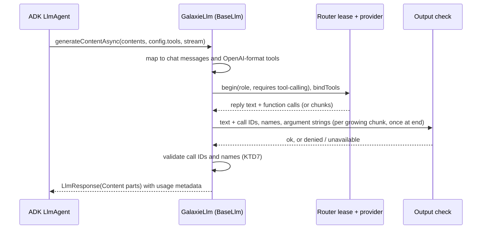
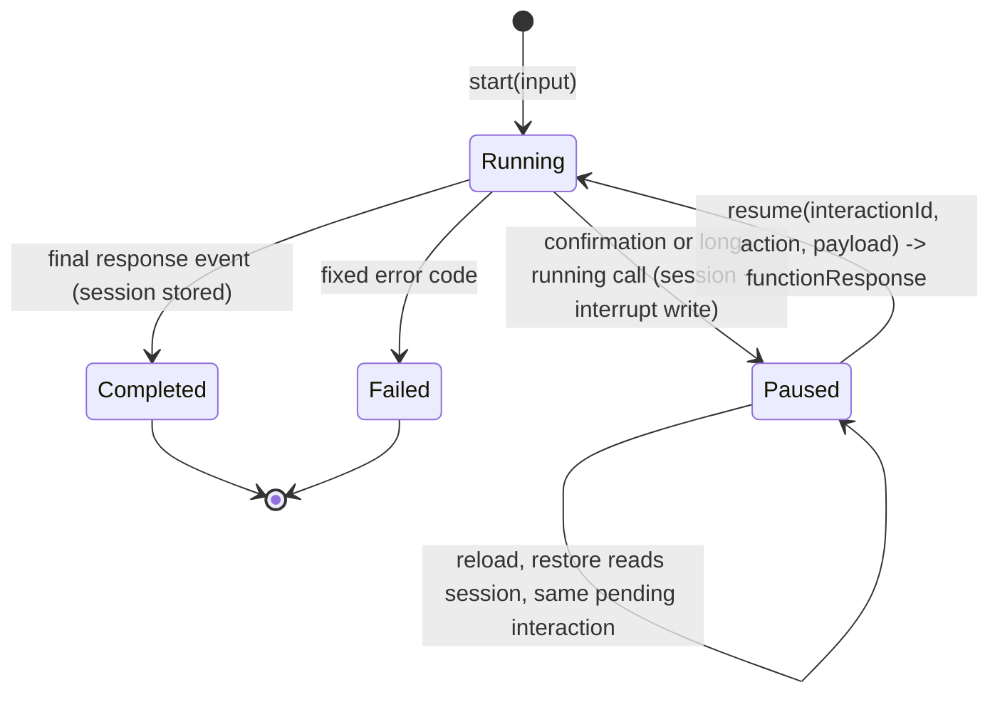

# Google ADK JS Executor - Plan

## Goal Capsule

- **Objective:** A developer can ship a Google ADK (JavaScript) agent to the browser through galaxie and get the answers, tool calls, approvals and reload behavior the agent shows natively in Node, under the same consent, labels, budgets, credentials and output checks as every other galaxie agent.
- **Means:** A new package `@galaxie/adapter-adk` with executor id `adk-js`. It loads ADK's official browser bundle, replaces every model with a router-backed `BaseLlm`, binds tools to the capability broker, maps ADK confirmations and long-running calls to galaxie interactions and persists sessions through the byte-record port (KTD1, KTD2, KTD6, KTD9).
- **Authority:** This plan, then `AGENTS.md`, ADR-0012, ADR-0017 and the new Proposed ADR-0020 this plan creates. Beads feature `galaxie-2y1` under epic `galaxie-lwn`.
- **Stop conditions:** Stop and report if a stage needs a CSP or Trusted Types relaxation (including `unsafe-eval`), a weaker ADR-0012 guarantee, a framework name in `packages/core`, a change to LangGraph.js, LangGraph Python, pydantic-ai or DSPy behavior, goldens or matrices (the new ADK lane's own goldens and matrix excepted), an `@google/adk` release younger than the pnpm `minimumReleaseAge`, a runtime import of a Node-only ADK subpath, an ADK-owned network call from the bundle, or a real model download.
- **Execution profile:** Six stages (A1 to A6), each merged on its own after `pnpm check` and CI pass. Mock and scripted models only.
- **Finishing:** Claude implements one stage per run through `lfg`, runs `pnpm check`, has an independent agent review, fixes findings, opens the PR and merges after CI.

---

## Product Contract

### Summary

Add `@galaxie/adapter-adk`, an executor adapter for `@google/adk` agents. Every model call, including function declarations and function calls, runs through the galaxie router. Capability tools, streaming, tool confirmations, long-running tools and durable sessions work on Node and in headless Chromium, checked against native Node runs of the same agents with a scripted model.

### Problem Frame

The epic's goal is Google ADK in the browser, and the final epic item adapts `adk-recipes` samples to run through galaxie with local models. ADK 2.x ships a browser bundle (`dist/web/index_web.js`, one self-contained 1.3 MB file with `@google/genai`, zod and lodash inlined and no external imports), so the engine itself can load. Left to itself, an ADK agent bypasses galaxie in four ways: model strings resolve through ADK's own registry to the `Gemini` class and Google endpoints with an API key; built-in tools (`GoogleSearchTool`, `LoadWebPageTool`, OpenAPI and REST toolsets) call the network; sessions live in ADK's own services; and pauses surface only as ADK events. The adapter closes each of these.

### Requirements

**Foundation (A1)**

- R1. `@galaxie/adapter-adk` loads only the ADK web bundle, with no Node-only subpath. Importing and running it under the strict mock CSP and Trusted Types on Node and in Chromium causes no CSP violation and no network request.
- R2. ADR-0020 (Proposed) records the adapter decision, the executor features and their evidence.

**Model, tools and run (A2)**

- R3. An ADK agent built with `host.adk.llm(role)` runs; every model call is routed in JavaScript with consent, reservation, credential lease, output safety and usage settlement. ADK never receives a credential or unchecked model text.
- R4. Function declarations travel to the routed provider and function calls travel back. Reply text, function-call IDs, names and every argument string are checked before ADK sees them, with `denied` and `unavailable` outcomes matching the LangGraph.js routed model.
- R5. Tools built with `host.adk.capabilityTool` call `host.capabilities.call` through the broker with grants, labels, validation and deterministic effect scopes.
- R6. The adapter refuses an agent tree whose agent classes, models or tools are not ones the host created from a closed allow-list, and accepts no plugins, `RunConfig` or services of the author's.
- R7. The run's `limits.steps` bounds ADK model calls, exceeding it fails `budget_exceeded`, a fatal galaxie error raised inside a model or tool call fails the run with that code instead of being turned into model-visible text, and abort settles the run as cancelled with the Runner reusable afterwards.
- R8. Framework instrumentation and ADK logging carry no prompt, reply, argument or result text.

**Streaming (A3)**

- R9. With streaming requested, checked text deltas reach the host as stream events in order; a mid-stream output-safety block fails the run without forwarding the blocked delta.
- R10. Stream events never carry function arguments, function results or unchecked text.

**Interactions (A4)**

- R11. A tool that requires confirmation, a `LongRunningFunctionTool` and `requestInputTool` pause the run with one pending galaxie interaction built by the agent author.
- R12. Resuming by interaction ID turns the user's action and payload into ADK function responses; a stale or mismatched ID fails without running a tool, and ADK's own intent checks stay on.

**Durable sessions (A5)**

- R13. With a byte-record port, the session's event log is stored at every pause and at completion, so a fresh page after reload restores the same pending interaction and resumes it.
- R14. Restored runs keep galaxie's recovery guarantees (accepted submissions reconcile, journalled write effects replay receipts, a session from another executor is refused), and session export labels ADK records with their own executor, content-free by default.

**Docs and evidence (A6)**

- R15. Sequential, parallel, loop and sub-agent shapes are tested under pause, stream and reload, `AgentTool` and `Workflow` are refused, and the adapter's `subgraphs` flag (`false`), ADR-0020, the unsupported list, the adapter README and the project status state what the evidence supports, without describing galaxie as secure or compliant.

### Scope Boundaries

- `subgraphs` stays `false`: flipping it needs ADK nested agents to pause, resume and stream with galaxie's path semantics, which this plan does not build. ADK sub-agent events carry `author` and `branch`, which are not LangGraph namespaces; flipping the flag needs parity cases, not a mapping alone.
- Excluded subpaths at runtime: `@google/adk/a2a`, `/tools/mcp`, `/tools/webmcp`, `/sessions/database`, `/artifacts/gcs`, `/telemetry/gcp`, `/agents/agent-engine`. MCP stays with `@galaxie/tools-mcp` through capabilities.
- Not allowed as agent tools or agents: built-in server-side tools, retrieval and RAG tools, OpenAPI, REST, API Hub and Application Integration toolsets, `LoadWebPageTool`, code executors, `AgentTool`, `RemoteAgent`, `LangGraphAgent`, `RoutedAgent`, `Workflow` and author `BaseAgent` subclasses (KTD5). The bundle's `new Function` shim comes from its JSONPath dependency and is reached by streaming and OpenAPI paths the adapter refuses; it must never run.
- Agent-level model callbacks (`beforeModelCallback`, `afterModelCallback`) are trusted author code (ADR-0002): a response they replace after `GalaxieLlm`'s output check is not re-checked. The README states it.
- Live and bidirectional streaming (`runLive`, `StreamingMode.BIDI`, audio, video) and multimodal parts (`inlineData`, `fileData`) are rejected with fixed `unsupported` errors.
- ADK artifact, memory and credential services are replaced by in-memory no-ops owned by the adapter; durable artifacts and memory are not promised.
- ADK plugins other than the adapter's own integrity plugin are not accepted; agent-level callbacks are author code and stay trusted (ADR-0002).
- Considered and not built: a shared tool-call check module for all adapters. Adapters may not import each other and core may not name LangChain, so the Pyodide precedent (a local mirror plus a shared case table) repeats here (KTD3).

### Deferred to Follow-Up Work

- Subgraph parity (`subgraphs: true`) and re-admitting `AgentTool` through an adapter-owned wrapper (see U13).
- ADK Python (`galaxie-m1t`) and ADK Go (`galaxie-la5`) reuse the interaction mapping and effect-scope rules from A4 and A5.
- `adk-recipes` samples through galaxie with local ONNX models (`galaxie-bgz`).
- Importing a newer ADK release than the pin after its release age passes.

---

## Planning Contract

### Key Technical Decisions

- KTD1. **A new package, not another framework option.** ADK JS shares nothing with the Pyodide bridge or LangGraph state, so `packages/adapter-adk` has its own adapter factory `createAdkAdapter()`, id `adk-js`, and the same `ExecutorAdapter` contract as `adapter-langgraph`. Core keys executors by id and records `executorId` in `RecoverySession`, so core needs no change and never names ADK.
- KTD2. **Load only the web bundle, from one specifier.** The adapter imports `@google/adk`; package `exports` maps the `browser` condition to `dist/web/index_web.js`. Bundlers (Vite) resolve it; Node tests and the Chromium test bundle resolve it with the `browser` condition so both lanes run the same file. `scripts/check-dependencies.ts` rejects any other `@google/adk` specifier (every subpath), and a runtime import of `@google/genai` (the bundle inlines its own copy, so a second copy would split class identity). Type-only imports of `@google/genai` stay allowed. Peer and dev `@google/adk` exactly `2.3.0` (the validation allow-list of KTD5 depends on the reviewed class set; a bump re-runs the symbol-presence and bundle-hash tests and the conformance lane): the newest release that satisfies `minimumReleaseAge: 10080` on 2026-11-03 (2.4.0, released 2026-10-28, passes on 2026-11-04 and was inspected too; both contain every symbol this plan relies on).
- KTD3. **The model is a `BaseLlm` subclass owned by galaxie.** `GalaxieLlm extends BaseLlm` implements `generateContentAsync(llmRequest, stream, abortSignal)`. It maps `contents` (text, `functionCall`, `functionResponse` parts) and `config.systemInstruction` to chat messages, maps `config.tools` function declarations to OpenAI-format tools, asks the router for `tool-calling` when tools are offered (`ModelPort.begin(role, { requires })`), and binds tools with LangChain `bindTools` on the leased chat model, as the Pyodide adapter does. `connect` (live) throws `unsupported`. ADK's `FunctionTool` declarations are Gemini-style (`parameters` with uppercase `OBJECT`/`STRING` types, string-valued limits and `nullable` markers) and never set `parametersJsonSchema`, so `GalaxieLlm` converts each declaration to JSON Schema (lowercase types, numeric limits, nullable to a null union) and uses `parametersJsonSchema` only when present. It also maps the request's response-schema config to the leased model's provider-level structured output, so an `outputSchema` agent works. The output check is a local `tool-calls.ts`, mirroring `routed-chat-model.ts` and the Pyodide module: reply text plus newline-joined argument strings form the checked text the existing shared case table in `tests/conformance/support/tool-call-checks.ts` already pins, and every call ID and name is additionally checked as its own string. It checks every growing chunk and once at the end. `generateContentAsync` also re-checks that every entry of `llmRequest.toolsDict` is in the host registry (KTD5).
- KTD4. **The adapter owns the Runner and every ADK service.** The agent factory receives `AdkHost`, shaped like `LangGraphHost`: `{ capabilities: { call }, adk: { llm(role), capabilityTool(name, spec), requestInput() } }`. `capabilityTool`'s spec carries `description`, `parameters` (zod) and optional `requireConfirmation` and `longRunning` flags, so every tool the A4 pauses need is host-created. The factory returns an ADK agent tree. The adapter builds `Runner` with its own `GalaxieSessionService`, no-op artifact, memory and credential services, one `ToolCallIntegrityPlugin` built with the per-session key of KTD8a (needs `crypto.subtle`, present on localhost and HTTPS) and a `RunConfig` it constructs: `maxLlmCalls` from `limits.steps`, `streamingMode` NONE or SSE, `pauseOnToolCalls`, `plainTextToolConfirmation` and `allowRemoteToolConfirmation` all false. Authors never see the Runner and cannot pass plugins or a `RunConfig`.
- KTD5. **Fail-closed tree validation at prepare, by registry membership.** `AdkHost` records every model and tool it creates in a module-private `WeakSet`; ADK's brand guards (`isFunctionTool`, `isBaseLlm`) test a forgeable `Symbol.for` brand and are not used for trust. The adapter walks the root agent and its sub-agents against a closed allow-list of agent classes: `LlmAgent`, `SequentialAgent`, `ParallelAgent`, `LoopAgent`. Any other agent class fails `unsupported`, including `RemoteAgent` (it POSTs the whole session with `fetch`), `LangGraphAgent`, `RoutedAgent`, `Workflow` (until A6 adds node-level validation) and any author `BaseAgent` subclass. Every `LlmAgent.model` must be in the registry (a string, `Gemini`, another `BaseLlm` or an `LLMRegistry` lookup fails `unsupported`); every tool must be in the registry; `AgentTool` fails `unsupported` through A5, because ADK's `AgentTool` starts its own `Runner` with no plugin and no run config (so `limits.steps` and the integrity plugin do not apply) and writes a child session into the parent's service under another `appName`; toolsets, planners with code execution and code executors fail `unsupported`. A5 test: an author-built `FunctionTool` whose `execute` calls `fetch` is refused. Author code inside a registered tool can still call `fetch` (ADR-0002), which the ESLint plugin flags, not the adapter.
- KTD6. **Effect scope is branch-local and position-derived, never ID-derived.** `capabilityTool` calls `capabilities.call` with `effectScope: adk/<conversation-id>/<branch-or-root>/<branch-local-index>/<part-index>`, where `branch-local-index` is the ordinal of the model's function-call event among the events of the same `branch` in the session, and `part-index` the position of the function-call part. ADK generates function-call IDs when the model omits them, and local models reuse IDs, so an ID never keys an effect. A session-wide event index is not used: `ParallelAgent` merges branches by arrival order, so a global position can swap between a run and its re-dispatch, repeating a write. Events inside one branch are sequential, so the branch-local ordinal is stable when a crashed run is re-dispatched after restore, and a repeated write replays its receipt or fails `unrecoverable`, never runs twice (AT-35 rule). The conversation ID is created at the session's first run, stored in the session record (KTD8) and reused on resume and restore. The guarantee for parallel branches is conditional on U13's reversed-arrival test.
- KTD7. **The adapter assigns every function-call ID.** `GalaxieLlm` discards provider-supplied call IDs and assigns IDs from its own counter derived from the session history length and part position, so IDs replay identically and a local model's reused `call_0` is harmless. It still validates each call: a name that is not among the offered declarations fails the run with a fixed `invalid` error.
- KTD8. **Sessions are an event log in a `GalaxieSessionService`.** It extends `BaseSessionService`, keeps one session per galaxie session ID (appName fixed to the agent ID, userId fixed to the principal scope key), and appends events in order. In A4 it is in-memory and the adapter reads pending state from it. In A5 it writes only at each pause and at completion (like the pydantic-ai snapshots, so no dangling function call or synthetic abort event is ever stored and a crash between pauses restarts from the last stored state) through `services.checkpoints` (the `ByteCheckpointPort` request shape) as a typed `put` with checkpoint type `adk.session/v1` plus an `__interrupt__` write carrying the interaction ID, so the existing port, fencing, retention, and pending-ID extraction apply. The saver's closed byte-executor set gains `adk-js`, and the request carries the adapter id so rows are tagged correctly. Partial events are never stored. Binary `inlineData` parts are refused. Events are stored unmodified, including ADK's internal stamp metadata, because the integrity plugin verifies it on the next run.
- KTD8a. **The integrity key is per session and stored with it.** `ToolCallIntegrityPlugin` throws without a non-empty `secretKey`, stamps every function-call event with an HMAC and re-verifies stored events at every `runAsync`; a per-page random key would fail every restore with `ToolCallIntegrityError`. The adapter generates a random 32-byte key at the session's first run and stores it in the `adk.session/v1` record beside the events and conversation ID, under the same app/principal scope, fencing and retention; it is deleted with the session (retention, Start over, logout), never included in session export even with `personalContent: true`, and never appears in events, spans or errors. The plugin runs with unstamped calls disallowed. Restore rebuilds the plugin from the stored key and does not use `prepareRestoredEvent`, which would strip the stamps.
- KTD9. **Pauses end the run and resume as a new run.** ADK ends an invocation when a tool needs confirmation (an `adk_request_confirmation` function call) or a long-running tool returns pending (`longRunningToolIds`), and resumes when the next `runAsync` carries a user message with the matching `functionResponse`. The adapter detects the pause from the appended events, asks the author's `interaction(requests)` for one four-field request (validated by core's `parseInteractionRequest`), and emits one `interaction` event. The interaction ID is a digest of the conversation ID and the pause ordinal (pauses already stored), so reused call IDs cannot collide. On resume the author's `resume(requests, action, payload)` returns the function responses; the default fails closed: it confirms only on the exact action `approve`, denies only on `deny`, and fails `invalid` without running a tool for any other action or a payload that does not cover every pending call. All requests from one model response form one interaction (galaxie's one-pending rule). ADK's confirmation processor rejects a response that does not match a stored request (`IntentMismatchError`), and the integrity plugin detects spliced or altered history; both stay enabled, so a forged confirmation fails before any tool runs.
- KTD10. **Streaming projects onto existing modes.** SSE partial events become `messages` events carrying a bounded text-only delta, checked in `GalaxieLlm` before ADK receives the partial response. Content-free step markers (model request, tool call, paused) become `updates` events carrying the offered tool name (only after KTD7 validation) and a positional index, never the call ID, arguments or results. Stream events use `executor: 'adk-js'` and an empty path in A3; no new bridge or core mode is added.
- KTD11. **ADK's global logging and span content are suppressed by the adapter.** At prepare the adapter calls ADK's `setLogger` with a no-op logger. The bundle inlines the OpenTelemetry API and registers through the shared global, so when a host registers a provider (`docs/guides/tracing.md`), ADK's own spans reach that exporter, and its LLM and tool spans carry full request, response, argument and result JSON unless `ADK_CAPTURE_MESSAGE_CONTENT_IN_SPANS` is `'false'` (the bundle defaults to capture). KTD12 makes that value `'false'`; ADK still emits content-free spans of its own to a registered provider, which the README states. The adapter additionally reports content-free run spans through `RunRequest.trace`. A test registers a global in-memory provider and context manager and asserts no ADK-created span attribute, log line, event or error contains a canary from the prompt, reply, arguments or results. The logger is process-global; the README states it.
- KTD12. **ADK's `process` reads are contained, with span content capture off.** A1 measured this (ADR-0020). The bundle reads `process.env` unguarded when it records span attributes and `process.version` in the browser label path. A Vite production build replaces `process.env` with `{}` inside the bundle, so the capture flag (default on) is reachable only by a build-time define, which the host sets (`process.env.ADK_CAPTURE_MESSAGE_CONTENT_IN_SPANS` to `"false"`). Where `process.env` is not replaced (dev server, Vitest browser lane), a missing `process` makes ADK throw and turn the throw into an ordinary error event, so the adapter calls `ensureAdkRuntimeEnv` at prepare: a frozen env-only object only when `process` is absent, otherwise only the flag, only when unset; no real environment data is exposed. The bundle inlines zod, whose allows-eval probe runs `new Function('')` and trips Trusted Types; the host must run zod jitless configuration (through `globalThis.__zod_globalConfig`) before the bundle module is evaluated, not merely before the first parse, and a `"sideEffects": false` package can drop a side-effect-only import of it, so the host entry owns it, as `examples/*/src/zod-config.ts` does. A1's probe proves the order. A violation that this ordering fixes is not a plan-level stop condition; a CSP relaxation is.
- KTD15. **Fatal errors travel through a per-run failure slot.** ADK catches errors thrown while generating a model response and turns them into an ordinary final event with `errorCode: UNKNOWN_ERROR` (including its own `LlmCallsLimitExceededError`), and it rewraps errors thrown by a `FunctionTool` into a model-visible `{ error }` response. Left alone, a `denied` output block, an `unavailable` provider, `budget_exceeded`, `cancelled`, `fenced`, `unrecoverable` or `outcome_unknown` would end as a "successful" run, or reach the model, which could repeat an unknown-outcome write under a new scope. Each run owns a failure slot: `GalaxieLlm` and `capabilityTool` record the first fatal GalaxieError there and abort the invocation through an internal controller joined to the run signal; after the generator settles the adapter emits the slot's error. Only `denied` and validation failures from a capability return a fixed `{ error }` response to the model. An ADK error event with no slot entry maps to a fixed `unavailable`. Step budget: `GalaxieLlm` counts its own calls against `limits.steps` and fails `budget_exceeded` itself; `maxLlmCalls` is set to `limits.steps + 1` as a backstop only.
- KTD13. **A separate conformance lane.** `tests/conformance/cases-adk/`, `golden-adk/` and `compatibility-matrix-adk.json` sit beside the other lanes, which stay untouched. The native reference runs each case with ADK's `Runner` and a scripted `BaseLlm` in Node (no galaxie); the galaxie lanes run the same agents through the adapter with a scripted tool-calling mock chat model giving identical replies. The native lane resolves the same `browser` condition as KTD2, so goldens come from the web bundle. Transcripts compare final output, normalized events (author, function calls, function responses, confirmations), session event list, interaction requests and error codes. Each golden also records the per-call request seen by the model (messages and tool declarations) so scripted replies cannot hide mapping bugs; the native recorder records what its scripted `BaseLlm` receives and the galaxie lane records what the mock chat model receives, normalized to one shape.
- KTD14. **ADR-0020 is created first, as Proposed.** It records the adapter shape, the tree validation rule, the interaction and effect-scope mapping, `subgraphs: false` and the evidence it needs. Stage A6 revises it with evidence. The ADR index gains the row.

### High-Level Technical Design

One routed model call with tools. This sketch shows the flow of responsibility and is directional:

Session lifecycle for one galaxie session:

### Assumptions

- The ADK web bundle runs under the strict mock CSP and Trusted Types on Node and in Chromium: the `new Function` shim and `WebSocket` and `fetch` code are reachable only from features the adapter forbids. A1's probe proves or refutes this; a refutation is a stop condition for the whole plan.
- A zod 4.6.7 schema created by the repo satisfies the bundle's internal zod guards (`isZodObject`, `isZodSchema`). A1 proves it with a `FunctionTool`.
- `Runner.runAsync` with `abortSignal` stops promptly and its generator settles; A2 proves it, and a refutation makes cancellation a stop condition for A2.
- One pause per invocation is enough for the examples and conformance cases.

### Risks

| Risk | Mitigation |
| --- | --- |
| The bundle touches `process`, `WebSocket`, `fetch` or `new Function` during normal runs | A1 probe with fetch blocked, no `process`, strict CSP and Trusted Types; KTD5 forbids the tools and services that reach them; KTD12 gates a shim |
| ADK adds Node-only behavior in a patch or minor release | Exact pin `2.3.0`; A1 symbol-presence and bundle-hash test; bumps are separate work |
| Install pulls ADK's large dependency tree (auth, database ORM, OpenTelemetry SDKs) into the lockfile | Dependencies ship as ADK's own and never enter bundles because only the web file is imported; the dependency check and a built-host bundle-content test assert the bundle contains no Node-only module |
| Two retry loops (ADK reflect-and-retry plugins and galaxie repair) double-count | The adapter accepts no ADK plugins; only author-level callbacks run, each model call is a budgeted routed call |
| Authors pass a different zod copy | A1 test; README documents the supported zod range |
| Third copy of the tool-call check drifts | Shared case table asserted in all three packages (KTD3) |
| ADK function-call IDs are random, breaking replay and effect IDs | KTD6 and KTD7: positions and adapter-assigned IDs only |

---

## Implementation Units

| U-ID | Stage | Title | Key files | Depends on |
| --- | --- | --- | --- | --- |
| U1 | A1 | ADR-0020, dependency pin and package scaffold | `docs/adr/0020-google-adk-through-an-adapter.md`, `packages/adapter-adk/` | none |
| U2 | A1 | Dependency rules for ADK imports | `scripts/check-dependencies.ts` | U1 |
| U3 | A1 | Bundle-load probe under strict CSP | `packages/adapter-adk/test/`, `tests/conformance/` | U1 |
| U4 | A2 | Tool-call output check and shared case table | `packages/adapter-adk/src/tool-calls.ts`, `tests/conformance/support/tool-call-checks.ts` | U3 |
| U5 | A2 | `GalaxieLlm` | `packages/adapter-adk/src/llm.ts` | U4 |
| U6 | A2 | Host, capability tools and tree validation | `packages/adapter-adk/src/host.ts`, `validate.ts` | U5 |
| U7 | A2 | Adapter, Runner and run loop (non-streaming) | `packages/adapter-adk/src/adapter.ts`, `session.ts` | U6 |
| U8 | A2 | Lint aid for ADK provider use | `packages/eslint-plugin/` | none |
| U9 | A2 | ADK conformance lane | `tests/conformance/cases-adk/`, `golden-adk/` | U7 |
| U10 | A3 | Streaming | `llm.ts`, `adapter.ts` | U9 |
| U11 | A4 | Confirmations and long-running tools as interactions | `adapter.ts`, `interaction.ts`, `session.ts` | U10 |
| U12 | A5 | Durable sessions and restore | `session.ts`, `packages/storage-indexeddb/src/saver.ts` | U11 |
| U13 | A6 | Supported agent-shape evidence | `tests/conformance/cases-adk/` | U12 |
| U14 | A6 | ADR, docs and status | `docs/adr/0020-...md`, `docs/unsupported.md`, `packages/adapter-adk/README.md`, `AGENTS.md`, `llms.txt` | U13 |

### U1. ADR-0020, dependency pin and package scaffold

- **Goal:** Record the decision and create the empty package with the pinned engine.
- **Requirements:** R1, R2
- **Dependencies:** none
- **Files:** `docs/adr/0020-google-adk-through-an-adapter.md`, `docs/adr/README.md`, `packages/adapter-adk/package.json`, `packages/adapter-adk/tsconfig.json`, `packages/adapter-adk/src/index.ts`, `pnpm-lock.yaml`, `pnpm-workspace.yaml` (only if a build-script allow entry is needed)
- **Approach:**
  1. Write ADR-0020 as Proposed with KTD1, KTD2, KTD5 and KTD9 as the decision and the evidence each feature flag needs.
  2. Create the package after `adapter-langgraph` (SPDX headers, strict settings, `@galaxie/core` workspace dependency, peers `@google/adk` exactly `2.3.0`, `@langchain/core` and `zod`).
  3. Install exactly `@google/adk` 2.3.0; confirm pnpm accepts it under `minimumReleaseAge` and that no dependency build script is newly allowed.
- **Patterns to follow:** `packages/adapter-langgraph/package.json`, ADR numbering and status rules in `docs/adr/README.md`.
- **Test scenarios:**
  - The 2.3.0 package exports the `browser` condition for `.` and contains `ToolConfirmation`, `requestInputTool`, `LongRunningFunctionTool`, `ToolCallIntegrityPlugin`, `BaseSessionService`, `StreamingMode` and `Runner` in `dist/web/index_web.js`.
  - Bundle-content test: the web file has no `import` or `require` of a Node built-in or an external package, and its SHA-256 equals the recorded pin value (a bump must update the hash on purpose).
  - The workspace installs with no new allowed build script.
- **Verification:** `pnpm install --frozen-lockfile`, `pnpm check:docs` and typecheck pass.

### U2. Dependency rules for ADK imports

- **Goal:** Make the single-specifier rule mechanical.
- **Requirements:** R1, R6
- **Dependencies:** U1
- **Files:** `scripts/check-dependencies.ts`, `scripts/check-dependencies.test.ts` (or the existing fixtures the script uses)
- **Approach:** In `packages/adapter-adk`, allow only `@google/adk`, type-only `@google/genai`, `@langchain/core` (as the Pyodide adapter does), `@galaxie/core` and relative imports; forbid every other adapter, `@langchain/langgraph`, and every `@google/adk/...` subpath. Forbid `@google/adk` imports anywhere outside `packages/adapter-adk`, except the root specifier in the native conformance lane files under `tests/conformance/` (the native reference runs ADK without galaxie, KTD13). `packages/core` still may not name ADK.
- **Patterns to follow:** The existing per-package import rules in the same script.
- **Test scenarios:**
  - A source importing `@google/adk/a2a`, `@google/adk/sessions/database`, `@google/adk/tools/mcp`, `@google/adk/telemetry/gcp`, `@google/adk/artifacts/gcs`, `@google/adk/agents/agent-engine` or `@google/adk/dist/web/index_web.js` fails the check.
  - A runtime import of `@google/genai` fails; a type-only import passes.
  - `@galaxie/adapter-langgraph` or `@galaxie/adapter-pyodide` imported from the ADK package fails.
  - A `@google/adk` mention in `packages/core/src` fails.
- **Verification:** `pnpm check:deps` passes on the tree and fails on each fixture.

### U3. Bundle-load probe under strict CSP

- **Goal:** Prove or refute R1 and decide KTD12 before any adapter code depends on the bundle.
- **Requirements:** R1
- **Dependencies:** U1
- **Files:** `packages/adapter-adk/test/bundle.test.ts` (Node and Chromium), `packages/adapter-adk/test/bundle-probe.ts`, `packages/adapter-adk/src/runtime-shim.ts` (only if KTD12 requires it)
- **Approach:** Import the bundle through the package specifier in both lanes. Run a no-model agent (a `BaseLlm` stub that returns a text response) through `InMemoryRunner` with fetch, `WebSocket` and `XMLHttpRequest` replaced by throwing stubs, no `process` global in Chromium, the mock host's strict CSP and Trusted Types enforced, and `unsafe-eval` absent. Record the outcome in ADR-0020.
- **Patterns to follow:** The Chromium harness and blocked-fetch helpers in `tests/conformance/no-network.test.ts` and the Pyodide Chromium tests.
- **Execution note:** Probe first; implement the shim only if the probe fails for `process`.
- **Test scenarios:**
  - Importing the bundle emits no CSP or Trusted Types violation and no network request in Chromium.
  - A text-only agent run completes with no `process` global; if it throws `ReferenceError`, the shim lands and the same test passes with it.
  - The `process` handling of KTD12 is in place: a minimal read-only `process.env` exists only when `process` was absent, `ADK_CAPTURE_MESSAGE_CONTENT_IN_SPANS` is `'false'`, and no real environment data is exposed.
  - With a global in-memory OpenTelemetry provider and a context manager registered, a text run emits no ADK span attribute carrying a canary prompt or reply.
  - The host's zod jitless configuration runs before the first ADK parse; a `FunctionTool` with a repo zod 4.6.7 schema executes (zod identity check) with no CSP violation.
  - The `new Function` shim is not invoked during any test (a spy on the global `Function` constructor sees no call).
- **Verification:** The lane passes on Node and Chromium; ADR-0020 states the `process` finding.

### U4. Tool-call output check and shared case table

- **Goal:** Check every model-originated string before ADK sees it.
- **Requirements:** R3, R4
- **Dependencies:** U3
- **Files:** `packages/adapter-adk/src/tool-calls.ts`, `packages/adapter-adk/test/tool-calls.test.ts`, `tests/conformance/support/tool-call-checks.ts` (read; extended only if ADK-specific cases are added)
- **Approach:** Mirror the checked-text rule of `routed-chat-model.ts` (reply text plus newline-joined argument strings) so the existing shared case table applies unchanged; every call ID and name is checked as an additional separate string, as in the Pyodide module (fragments without an index group by ID). The existing assertions in the LangGraph and Pyodide packages are not edited.
- **Patterns to follow:** `packages/adapter-pyodide/src/tool-calls.ts`.
- **Test scenarios:**
  - The shared case table gives the same checked text for the ADK module as for the other two packages.
  - Argument fragments split across chunks reassemble per call and are checked on growth and once at the end.
  - A canary in a call ID, name or argument fails `denied` before the response is returned.
  - A hook error fails `unavailable` with a fixed message and no content.
- **Verification:** The ADK tests pass, and the existing LangGraph and Pyodide tests pass unchanged.

### U5. `GalaxieLlm`

- **Goal:** A router-backed `BaseLlm` for non-streaming calls.
- **Requirements:** R3, R4
- **Dependencies:** U4
- **Files:** `packages/adapter-adk/src/llm.ts`, `packages/adapter-adk/test/llm.test.ts`
- **Approach:** KTD3 and KTD7. Map messages in ADK's order (system instruction, user/model turns, function responses as tool messages), map declarations to OpenAI-format tools, lease through `ModelPort`, settle usage into `usageMetadata`, and return `LlmResponse` content parts. Multimodal parts and `connect` fail `unsupported`. Provider errors keep the fixed galaxie error codes; nothing includes endpoint URLs or content.
- **Patterns to follow:** `packages/adapter-langgraph/src/routed-chat-model.ts`, mapping helpers in `packages/adapter-pyodide/src/adapter.ts`.
- **Test scenarios:**
  - A text reply becomes one text part and usage metadata that adds up.
  - A system instruction, a user turn, a model function call and a function response appear in the mapped messages in OpenAI order.
  - A function call reply becomes a `functionCall` part with an adapter-assigned ID (KTD7); provider IDs, including reused ones such as `call_0` on two turns, are discarded and the assigned IDs are unique in the session.
  - A name not among the offered declarations fails `invalid` before ADK dispatches it.
  - A Gemini-style declaration (uppercase types, string limits, `nullable`) reaches the provider as valid JSON Schema, including `requestInputTool`; `parametersJsonSchema` is used when present.
  - A request with a response schema reaches the provider as structured output, alone and together with tools.
  - A `toolsDict` entry outside the host registry fails `unsupported`.
  - A denied reply, an unavailable provider and an exhausted `limits.steps` each record the failure slot (KTD15) with their code.
  - A provider without `tool-calling` fails `unsupported` before dispatch and is not retried on another provider.
  - An `inlineData` part in the request fails `unsupported`.
- **Verification:** Node and Chromium unit tests with the scripted mock chat model pass.

### U6. Host, capability tools and tree validation

- **Goal:** The authoring surface and the fail-closed agent check.
- **Requirements:** R5, R6
- **Dependencies:** U5
- **Files:** `packages/adapter-adk/src/host.ts`, `packages/adapter-adk/src/validate.ts`, `packages/adapter-adk/test/host.test.ts`, `packages/adapter-adk/test/validate.test.ts`
- **Approach:** KTD4, KTD5, KTD6 and KTD15. `host.adk.capabilityTool(name, { description, parameters, requireConfirmation?, longRunning? })` returns a `FunctionTool` (or `LongRunningFunctionTool`) that calls `capabilities.call` with the branch-local scope; it reads the branch and ordinal from the tool context's invocation and function-call event. It classifies GalaxieError codes: `denied` and validation failures return a fixed error response to the model; every other code is recorded in the run's failure slot and aborts the invocation. `host.adk.requestInput()` returns the registered `requestInputTool`. `validate` walks the closed agent allow-list and checks registry membership of models and tools.
- **Patterns to follow:** `packages/adapter-langgraph/src/host.ts`.
- **Test scenarios:**
  - A capability tool sends the capability name, input and scope `adk/<conversation-id>/<branch-or-root>/<branch-local-index>/<part-index>`, and a broker `denied` error reaches the model as a fixed error response.
  - A write capability that fails `outcome_unknown` (or `unrecoverable`, `fenced`, `budget_exceeded`, `cancelled`) fails the run with that code, issues no second `capabilities.call`, and shows the model no error text.
  - A string `model`, a `Gemini` instance, a foreign `BaseLlm` or an `LLMRegistry` lookup fails `unsupported` at prepare.
  - `GoogleSearchTool`, `LoadWebPageTool`, an OpenAPI toolset, a code executor and an author-built `FunctionTool` whose `execute` calls `fetch` each fail `unsupported`.
  - `RemoteAgent` (with no `fetch` call observed), `LangGraphAgent`, `RoutedAgent`, `Workflow`, an author `BaseAgent` subclass and `AgentTool` each fail `unsupported` at prepare.
  - A sub-agent with a disallowed model fails even when the root is valid.
  - `SequentialAgent`, `ParallelAgent` and `LoopAgent` over valid `LlmAgent`s pass.
- **Verification:** Node and Chromium tests pass.

### U7. Adapter, Runner and run loop (non-streaming)

- **Goal:** Register `adk-js` and run an ADK agent end to end.
- **Requirements:** R3, R6, R7, R8
- **Dependencies:** U6
- **Files:** `packages/adapter-adk/src/adapter.ts`, `packages/adapter-adk/src/session.ts`, `packages/adapter-adk/src/index.ts`, `packages/adapter-adk/test/adapter.test.ts`, `tests/conformance/adapter.node.test.ts`
- **Approach:** KTD4, KTD8 (in-memory service), KTD11, KTD12 and KTD15. Features for A2: `streaming: false`, `interrupts: false`, `resume: false`, `checkpoints: false`, `subgraphs: false`. Run input is `{ prompt: string }`, mapped to one user message; the run output is the final response event's text, or the session state value at the agent's `outputKey` when one is set. No input or output hooks (considered and not built until a deferred sample needs them). `limits.steps` is enforced by `GalaxieLlm`'s own call count with `maxLlmCalls` set to `limits.steps + 1` as a backstop; the per-run failure slot decides the run's error; the abort signal reaches `runAsync` and every model and tool call, and the generator is drained so the adapter settles after abort. Content-free events go to `RunRequest.trace`.
- **Patterns to follow:** `createLangGraphAdapter` in `packages/adapter-langgraph/src/adapter.ts` (event stream, error mapping, settle on abort).
- **Test scenarios:**
  - A runtime with the ADK adapter reports `adk-js` with the A2 features and runs a text agent.
  - One capability tool call, then a final answer, returns the final text; the call went through the broker once.
  - `limits.steps` of 2 with a looping tool agent fails `budget_exceeded` (never a succeeded run with empty output).
  - A denied reply and an unavailable provider fail the run `denied` and `unavailable`; a stray ADK error event with no slot entry fails `unavailable`.
  - Abort during a model call and during a tool call settles as cancelled; the same adapter instance runs again.
  - A runtime registering both `langgraph-js` and `adk-js` runs one of each side by side.
  - A canary in prompt, reply, arguments and tool results appears in no log, event or error, and with a global in-memory OpenTelemetry provider and context manager registered, in no span attribute (ADK's or galaxie's).
  - `maxLlmCalls` and `streamingMode` come only from the adapter; an author cannot supply a `RunConfig` or plugins.
- **Verification:** Node and Chromium adapter tests pass.

### U8. Lint aid for ADK provider use

- **Goal:** Flag ADK code that bypasses `GalaxieLlm`.
- **Requirements:** R6
- **Dependencies:** none
- **Files:** `packages/eslint-plugin/src/rules/` (direct model-provider access rule), `packages/eslint-plugin/test/`
- **Approach:** The existing rule blocks by module-specifier prefix, which would flag every `@google/adk` import. Add named-import matching for `@google/adk` (`Gemini`, `ApigeeLlm`, `LLMRegistry`, plus namespace-member access such as `adk.Gemini`) with an ADK-specific message pointing to `host.adk.llm(role)`, and keep `@google/genai` as a whole-module block. This is an earlier-feedback aid; prepare-time validation (KTD5) is the enforcement.
- **Test scenarios:**
  - `new Gemini({...})`, `LLMRegistry.newLlm(...)`, `new adk.Gemini()` and `import { GoogleGenAI } from '@google/genai'` are each flagged.
  - `import { LlmAgent } from '@google/adk'` and `host.adk.llm('role')` pass; existing rule tests still pass.
- **Verification:** Plugin RuleTester passes on Node.

### U9. ADK conformance lane

- **Goal:** Parity for the A2 cases on native Node, galaxie on Node and galaxie in Chromium.
- **Requirements:** R3, R4, R5, R7
- **Dependencies:** U7
- **Files:** `tests/conformance/cases-adk/` (new), `tests/conformance/golden-adk/` (new), `tests/conformance/compatibility-matrix-adk.json` (new), `tests/conformance/adk-native.node.test.ts` (new), `tests/conformance/adk.test.ts` (new, Node and Chromium), `tests/conformance/README.md`
- **Approach:** KTD13. A2 cases: plain text, one capability tool call, two sequential tool calls, output schema plus output key, capability denial, output-safety block on a function-call argument, step budget, abort.
- **Test scenarios:**
  - The native lane reproduces every golden.
  - Each case's galaxie Node transcript equals its golden; differences appear in the new matrix with reasons.
  - Each case's Chromium transcript under the strict mock CSP equals its golden.
  - The LangGraph and Python lanes' goldens and matrices are byte-identical after the change.
- **Verification:** All three lanes pass.

### U10. Streaming

- **Goal:** Stream checked deltas and content-free step markers.
- **Requirements:** R9, R10
- **Dependencies:** U9
- **Files:** `packages/adapter-adk/src/llm.ts`, `packages/adapter-adk/src/adapter.ts`, `packages/adapter-adk/test/stream.test.ts`, `tests/conformance/cases-adk/`
- **Approach:** KTD10. `generateContentAsync(stream=true)` yields partial `LlmResponse`s from checked chunks and a final aggregated response equal to the joined deltas; the adapter sets `StreamingMode.SSE` when the run requests streaming and projects partial events to `messages` and step markers to `updates`. Set `streaming: true`.
- **Test scenarios:**
  - Text deltas arrive as `messages` events in order and join to the final output.
  - A tool-call turn emits `updates` markers with the offered tool name and a positional index only, never a call ID, argument or result.
  - A call ID containing the canary produces no stream event carrying it.
  - A mid-stream block fails the run `denied`; the blocked delta never reaches the host; earlier deltas are not retracted.
  - A unit test asserts the aggregated final response equals the joined checked deltas.
  - Abort mid-stream stops events and settles the run as cancelled.
  - Streaming cases match the native lane transcripts.
- **Verification:** Conformance lane passes with the new cases; other lanes unchanged.

### U11. Confirmations and long-running tools as interactions

- **Goal:** Pause on confirmations and long-running calls and resume by ID.
- **Requirements:** R11, R12
- **Dependencies:** U10
- **Files:** `packages/adapter-adk/src/adapter.ts`, `packages/adapter-adk/src/interaction.ts` (new), `packages/adapter-adk/src/session.ts`, `packages/adapter-adk/test/interaction.test.ts`, `tests/conformance/cases-adk/`
- **Approach:** KTD9 with the in-memory session service so `pending()` and resume work within one page. The author `AdkEntry` wrapper supplies `interaction` and `resume` (the default `resume` fails closed). Set `interrupts: true`, `resume: true`.
- **Test scenarios:**
  - A `requireConfirmation` tool pauses with one interaction that passes `parseInteractionRequest`; the tool has not run.
  - Approve runs the tool once and completes; deny reports denial to the model and completes.
  - Two confirmations in one model response form one interaction and `resume` can approve one and deny the other.
  - A `LongRunningFunctionTool` pending result pauses; the payload supplies the external result on resume.
  - `requestInputTool` pauses and the payload becomes the user's input.
  - Resume with a wrong interaction ID fails `stale` without running anything.
  - Two consecutive pauses whose scripted calls reuse the same call IDs get distinct interaction IDs.
  - A forged confirmation (a response whose call ID or arguments do not match the stored call) fails through ADK's integrity check and runs no tool.
  - The default resume with an action other than `approve` or `deny` fails `invalid` and runs no tool.
  - An author `interaction` that returns an invalid request fails `unsupported` with a fixed message.
  - A UI payload resumes through core's accepted/consumed inbox exactly once on double submit.
  - Approval cases match native transcripts on all three lanes.
- **Verification:** Conformance and adapter tests pass; core needs no change.

### U12. Durable sessions and restore

- **Goal:** Persist the session event log through the byte-record port so reload restores the pending interaction.
- **Requirements:** R13, R14
- **Dependencies:** U11
- **Files:** `packages/adapter-adk/src/session.ts`, `packages/adapter-adk/src/adapter.ts`, `packages/storage-indexeddb/src/saver.ts`, `packages/storage-indexeddb/src/byte-records.ts`, `packages/storage-indexeddb/test/`, `tests/conformance/support/memory-byte-checkpoints.ts`, `tests/conformance/cases-adk/`
- **Approach:** KTD8 and KTD8a. The session service keeps events in memory; after the Runner generator settles at a pause or at completion, the adapter writes one `adk.session/v1` put (events with ADK's internal stamp metadata, conversation ID, integrity key and pause ordinal) plus the `__interrupt__` write at a pause. Failed and cancelled runs write nothing. Restore validates the stored record against a closed schema that preserves the stamp metadata; an unreadable or oversize record fails `unrecoverable`. The adapter registers restored session data as private through `registerRestoredData` before replay can reach a live outbound call (the DSPy restore precedent). Set `checkpoints: true`.
- **Patterns to follow:** The pydantic-ai and DSPy byte-record wiring in `packages/adapter-pyodide/src/checkpoints.ts` and the saver's executor membership checks.
- **Test scenarios:**
  - Pause, dispose the adapter, restore in a fresh runtime over the same store: the same pending interaction is published and resuming completes.
  - In Chromium with reopened IndexedDB the same reload case passes.
  - An approved write capability executed before a crash replays its receipt after restore instead of repeating, with the KTD6 effect scope.
  - A write that runs after a resume, followed by loss of the page before completion and a restore that re-dispatches the model call, replays its receipt or fails `unrecoverable` and never writes twice.
  - The restored session reuses the stored conversation ID and integrity key: pause, reload, approve and complete passes with stamps verified and no `ToolCallIntegrityError`.
  - A tampered stored function call, or a record spliced from another session, fails before any tool runs.
  - The integrity key is absent from exports (even with `personalContent: true`), events, spans and errors, and is deleted with the session on retention expiry, Start over and logout.
  - A crash between pauses restarts from the last stored state and issues no stored dangling function call or synthetic abort event.
  - A session recorded by `langgraph-js` or `pydantic-ai-python` is refused with "The saved session uses a different executor."
  - A corrupted record fails `unrecoverable` and leaves other sessions readable.
  - Export of an ADK session is tagged `adk-js` and is content-free unless `personalContent: true`.
  - Existing Python byte-record rows still export under their own tags.
  - Logout and app-epoch fencing reject a stale write from an ADK run.
  - Partial streaming events and binary parts are never stored.
- **Verification:** Storage, adapter and conformance reload tests pass on Node and Chromium.

### U13. Supported agent-shape evidence

- **Goal:** State which agent shapes the adapter supports, from tests, and keep `subgraphs: false` with recorded reasons.
- **Requirements:** R15
- **Dependencies:** U12
- **Files:** `tests/conformance/cases-adk/`, `packages/adapter-adk/test/agents.test.ts`
- **Approach:** Add cases for `SequentialAgent`, `ParallelAgent`, `LoopAgent` and an `LlmAgent` with `subAgents` and transfer, all over host-created models and tools. For each: run, stream, confirm inside a child, reload while a child is paused and resume. Record which pass natively and through galaxie in the matrix. `subgraphs` stays `false`: a branch-derived stream path and nested-agent pause parity are the deferred follow-up. `AgentTool` and `Workflow` stay refused (KTD5); re-admitting `AgentTool` needs an adapter-owned wrapper that runs the child with the adapter's run config, integrity plugin and session keying by (appName, sessionId), plus an effect scope that includes the child's appName and an explicit child-pause rule, and belongs to that follow-up.
- **Test scenarios:**
  - Each supported shape completes a run with the same output natively and through galaxie.
  - A confirmation raised inside a sub-agent pauses the whole run with one interaction and resumes in place, or is recorded as unsupported with the exact native result.
  - Two `ParallelAgent` branches each calling a write capability get branch-local scopes; with reversed branch completion order on the re-dispatch after a restore, each write replays its own receipt or fails `unrecoverable` and never runs twice. KTD6's guarantee for parallel branches holds only if this passes; otherwise parallel branches with write capabilities are refused at prepare.
  - `AgentTool` and `Workflow` fail `unsupported` at prepare (`new Function` never runs).
- **Verification:** Conformance lane passes; the matrix records the evidence and `subgraphs` is `false`.

### U14. ADR, docs and status

- **Goal:** Record what the adapter supports and its limits.
- **Requirements:** R15
- **Dependencies:** U13
- **Files:** `docs/adr/0020-google-adk-through-an-adapter.md`, `docs/unsupported.md`, `packages/adapter-adk/README.md`, `tests/conformance/README.md`, `AGENTS.md`, `llms.txt`, `docs/guides/host-integration.md`
- **Approach:** Move ADR-0020's evidence section to the observed results; list the scope boundaries above in the unsupported list; document the authoring surface (`AdkHost`, `AdkEntry`), the supported tool and agent shapes, the process-global logger, bundle license notices (Apache-2.0, lodash MIT, genai Apache-2.0) and the `crypto.subtle` requirement, the per-session integrity key (guards in-flight forgery and corrupt history, not a writer of the store), that ADK still emits content-free spans of its own to a registered global OpenTelemetry provider, and that callback-replaced model responses are not re-checked. The status paragraph in `AGENTS.md` gains one factual sentence.
- **Test expectation:** none -- documentation; the existing offline link check covers it.
- **Verification:** `pnpm check:docs` passes and no text describes galaxie as secure, compliant or certified.

---

## Verification Contract

| Check | Proves | Stage |
| --- | --- | --- |
| `pnpm check` | Licenses, Biome, TypeScript 7 and 6, Node and headless Chromium tests, Python lane, builds, dependency rules, docs links | every stage |
| `pnpm check:deps` fixtures | Only the web bundle is imported; no Node-only subpath; core never names ADK | A1 onward |
| Bundle probe (U3) | The bundle loads and runs under strict CSP and Trusted Types with fetch blocked | A1 |
| Native lane reproduces `golden-adk` | Goldens are real ADK behavior, not galaxie behavior | A2 onward |
| LangGraph, Python, pydantic-ai and DSPy goldens and matrices unchanged in the diff | Executor isolation | every stage |
| Canary scan (logs, spans, events, errors, stored records) | No content leaves through ADK logging or telemetry | A2 onward |

## Definition of Done

- Each stage merges with `pnpm check` and CI green, and its feature flags match the behavior its tests prove.
- After A5, `adk-js` declares `streaming`, `interrupts`, `resume` and `checkpoints` true; `subgraphs` stays `false` with U13's recorded reasons; ADR-0020 records the evidence.
- No other executor's code, goldens, matrices or third-party wheel inventory changed; core does not name ADK.
- No real model download, CSP or Trusted Types relaxation, `unsafe-eval`, or Node-only ADK subpath in any bundle.
- No spike code copied from `spikes/`, and no leftover probe or abandoned-attempt code in any stage's diff.
- Beads `galaxie-2y1` closes after A6 with the stage PRs listed.
