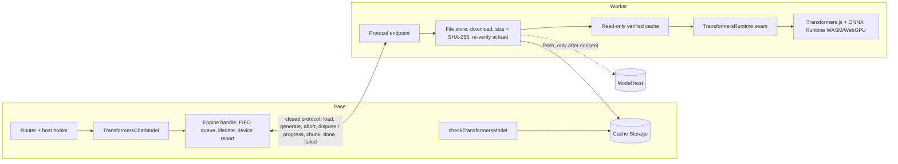
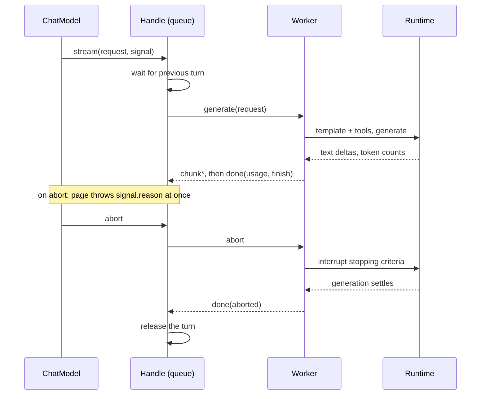
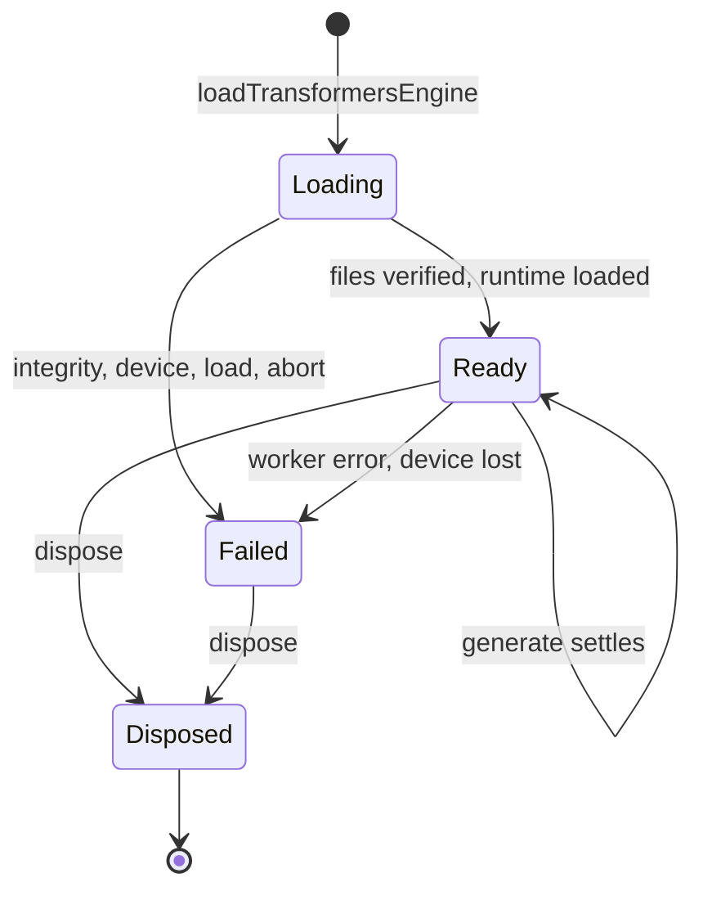

# Local ONNX Chat Provider - Plan

## Goal Capsule

- **Objective:** A developer can run a small open chat model in the user's browser, on the user's own device, behind galaxie's router. The model streams, can be cancelled, can call tools, and is downloaded only after consent, from files whose hashes are pinned.
- **Means:** A new provider subpath `@galaxie/models/transformers` plus a worker entry `@galaxie/models/transformers/worker`. It runs ONNX models through `@huggingface/transformers` 4.3.1 in a dedicated Worker and mirrors the WebLLM provider's queue, lifetime, progress and error shape (KTD1, KTD2, KTD3).
- **Authority:** This plan, then `AGENTS.md`, ADR-0006, ADR-0012, ADR-0017 and the new Proposed ADR-0021 that stage O1 creates. Beads feature `galaxie-a1x` under epic `galaxie-lwn`. It blocks `galaxie-bgz`.
- **Stop conditions:** Stop and report if a stage needs a CSP or Trusted Types relaxation (including `unsafe-eval`), a weaker ADR-0012 guarantee, a change to `packages/core` that names a runtime or model family, a change to the WebLLM, Built-in AI, OpenAI-compatible or mock provider's behavior or tests, a `@huggingface/transformers` release younger than the pnpm `minimumReleaseAge`, a network call from a test, a real model download, or a claim of real-device behavior that no maintainer run backs. Stop the whole plan if U2 shows the ONNX runtime, tokenizer or chat-template path cannot run under the strict mock CSP and Trusted Types without a relaxation. After a maintainer run, also stop O5 onward and revisit the engine if every pinned candidate produces degenerate or empty output on Transformers.js 4.3.1.
- **Execution profile:** Seven stages (O1 to O7), each its own PR, merged after `pnpm check` and CI pass. Fake runtimes and scripted models only; no network except `pnpm install`.
- **Finishing:** Claude implements one stage per run through `lfg`, runs `pnpm check`, has an independent agent review, fixes findings, opens the PR and merges after CI.

---

## Product Contract

### Summary

Add an in-browser ONNX chat provider to `@galaxie/models`. A host registers it under the router with destination `in-browser`. It loads a pinned model record in a dedicated Worker, serves one request at a time, reports usage and a content-free progress stream, and returns typed errors. With a tool-format record it also accepts tool declarations and returns parsed tool calls. Tests use a fake runtime on Node and headless Chromium. Real inference is a maintainer demonstration and stays unmeasured until a maintainer runs it.

### Problem Frame

The epic ends with `adk-recipes` samples running through galaxie with a local model (`galaxie-bgz`). Those samples call tools, and the two local providers cannot serve them: WebLLM's text-only provider rejects tool messages and Built-in AI is English-first, page-only and browser-managed. The ONNX ecosystem offers small open models (Qwen2.5-0.5B, Qwen3-0.6B, Gemma 3 1B) that Transformers.js can run on WebGPU, and `rag-browser` already runs an ONNX embedding model under galaxie's strict CSP. Spike B ran Transformers.js 4.3.1 for chat on one device and got degenerate text with Qwen2.5 `q4f16` (and allocation failures with `q4`), while the same ORT build ran another model correctly in galaxie's own loop. So the provider's code can be tested with fakes, but whether a candidate model produces good text on a real device is unknown. The plan isolates the runtime behind a small seam and says so in the ADR instead of claiming it works.

### Requirements

**Foundation (O1)**

- R1. ADR-0021 (Proposed) records the provider decision, the device policy, the integrity model and the evidence each feature needs.
- R2. The provider's package surface and dependency rules keep `@huggingface/transformers` out of every page-side file. Only the Worker-side runtime file imports it, dynamically, and the dependency check enforces it.
- R3. The real ONNX runtime starts under the strict mock CSP and Trusted Types in Chromium, from same-origin assets, with no violation and no network request.

**Model files (O2)**

- R4. A model record names an immutable 40-hex revision, a device, a context window, a tool format (or none) and every file with its byte size and SHA-256. Validation rejects anything else with a fixed `invalid` error.
- R5. Nothing is fetched before the host decides. The availability check never downloads. A download runs in the Worker, stores a file only after its size and SHA-256 match, and a later load re-verifies every file before the runtime can read it.
- R6. The runtime reads model files only through a read-only cache of verified bytes; its own fetch is denied.

**Engine and chat (O3, O4)**

- R7. Loading reports content-free progress (phase, fraction, elapsed seconds) and a device report. A missing WebGPU, adapter limit, device loss, integrity failure, worker failure, load failure or disposal gives a typed `unavailable` reason. The device never downgrades silently.
- R8. Calls are served one at a time in arrival order. Cancellation stops generation and releases the next call only after generation settles. After a worker failure the provider keeps failing `unavailable` without fallback.
- R9. Chat calls stream text, honor `maxTokens` and `temperature`, report final usage, and reject an over-long prompt with `invalid`. The router sees `in-browser` routing, output safety on every growing chunk, budgets and class-change notices as for any provider.

**Tool calling (O5)**

- R10. With a tool-format record, `bindTools` offers declarations to the model's chat template, history with tool calls and tool results round-trips, and the reply's tool calls come back as complete parsed calls. Malformed calls come back as invalid calls with their raw argument text, so the router's output check sees them. Tool markup never reaches the reply text.
- R11. A record without a tool format refuses `bindTools` with `unsupported`, as does a forced `tool_choice`.

**Structured output (O6)**

- R12. A call's `jsonSchema` option constrains decoding in the Worker and routed `withStructuredOutput` works through the existing shared helper; the provider declares `structured-output` only after this stage lands.

**Docs and evidence (O7)**

- R13. The ADR, unsupported list, provider README, system design §8.4, device matrix, `AGENTS.md` and `llms.txt` state what the evidence supports. They claim no real-device behavior, no accuracy and no security or compliance.
- R14. Every other provider, executor, golden and matrix is unchanged, and `packages/core` does not name the runtime.

### Scope Boundaries

- No default model record ships. Pinning needs file bytes and hashes, which need network access this plan does not have; hosts supply records, and a maintainer-run script produces them (KTD9).
- WebGPU is the default device. A WASM record is allowed but explicit; the provider never falls back from one device to the other (ADR-0006 decision 8).
- The model runs in a dedicated Worker only. A page-side engine is not built.
- One request at a time, no KV-cache reuse, no batching, no speculative decoding.
- No multimodal input, embeddings, speech or classifiers. ADR-0006 decision 8 keeps those for after the MVP.
- No cache eviction or model-delete API. Browser storage controls and the host's own clear flow own that.
- Transformers.js is not wrapped for tool calls it does not template. Only the `hermes` format (Qwen2.5, Qwen3) is built; Gemma 3 is a text-only candidate.
- Considered and not built: a second engine on galaxie's own ORT loop. Spike B showed it can work, but it makes galaxie own the tokenizer, template and decoding loop. The runtime seam (KTD2) keeps it possible.

### Deferred to Follow-Up Work

- Pinned records for the three candidates, and a real-device run of each, as `[HUMAN]` Beads issues (see Documentation / Operational Notes).
- Wiring the provider into a host example. `galaxie-bgz` does it for the `adk-recipes` demo.
- An own-loop ORT engine behind the runtime seam, if real runs show Transformers.js 4.3.1 cannot serve any candidate.
- Eviction, quota estimates and a delete API for stored model files.

---

## Planning Contract

### Key Technical Decisions

- KTD1. **A new subpath, not a new package.** `@galaxie/models` already holds the WebLLM, Built-in AI and OpenAI-compatible providers, and `models` must not depend on `@galaxie/core`. The provider lives in `packages/models/src/transformers/` with the exports `./transformers` and `./transformers/worker`, and an optional peer `@huggingface/transformers` pinned exactly to `4.3.1`. Core needs no change: it sees only a `BaseChatModel` and a routing descriptor.
- KTD2. **The runtime is a Worker-side seam.** Transformers.js has no worker engine class (WebLLM has `WebWorkerMLCEngine`), so the provider owns a small page-to-Worker protocol (KTD4) and a `TransformersRuntime` interface the Worker calls: load files into a model, and run one generation with a text callback, a token callback and an abort signal. `runtime.ts` is the only file that imports `@huggingface/transformers`, dynamically. It uses the tokenizer's chat template and `generate` with a `TextStreamer` and `InterruptableStoppingCriteria`, not `pipeline`, so it can count tokens and template tools. Tests inject a fake runtime; no test loads the real library except U2's probe. Spike B's worker is reference only and is not copied.
- KTD3. **Mirror the WebLLM provider's shape.** A shared FIFO queue per handle, a lifetime object that fails the handle once and keeps failing, a page-side device report, content-free progress, `check*` that never downloads, and typed `ModelError` reasons from the existing `ModelUnavailableReason` union. Mirroring means the router, the React `ModelRoutes` display and the host download hooks need no new code. No reason is added to the union.
- KTD4. **A closed page-to-Worker protocol.** Messages are plain objects from a closed set: `load`, `generate`, `abort`, `dispose` toward the Worker; `ready`, `progress`, `chunk`, `done`, `failed` back. `ready` carries the device report (backend, thread, and adapter vendor and architecture for WebGPU) and resolves the load. Both ends validate every message and ignore the rest. Errors cross as fixed codes, never as engine text. Prompts travel in `generate` and replies in `chunk`, and neither appears in `ready`, `progress` or `failed`. The page's FIFO queue is the only concurrency control; the Worker does not guard against a second `generate`.
- KTD5. **Integrity is per-file SHA-256 and size, weights included.** WebLLM's SRI covers config, library and tokenizer but not weight shards. Here the record lists every file the runtime reads, the Worker downloads each file, checks its size while streaming and its SHA-256 after, stores it in a Cache Storage cache named by model ID and revision, and re-verifies every stored file at load. WebCrypto has no incremental SHA-256, so a file is streamed into one buffer preallocated at the record's `bytes` (aborting on overrun) and hashed once; the record validator caps one file at 1 GiB. The runtime's read-only cache answers from the buffers hashed during load, never from a fresh `cache.match`, so a same-origin script cannot swap a stored entry between verification and read. The runtime sees only a read-only custom cache backed by the verified responses, with `env.fetch` denied, `allowRemoteModels` false and the browser cache off, the pattern `examples/rag-browser/src/retrieval/embedder.ts` already runs for EmbeddingGemma. Re-verification failure never triggers a fetch (KTD6). Source URLs must be `https://` or same-origin and carry the `/resolve/<40-hex>/` revision, as WebLLM's validator requires.
- KTD6. **Consent and the cache check cost nothing.** `checkTransformersModel` lists Cache Storage for the record's files and compares the size markers it wrote at store time; it hashes nothing and fetches nothing, so the router can call it on every selection. It reports `available`, `downloadable` with `bytes` equal to the sum of the record's file sizes and `siteStorage: true`, or `unavailable` (no WebGPU for a WebGPU record, no Cache Storage). `available` means verified-at-store files exist, not a loaded engine; load re-verifies. The download itself runs inside `loadTransformersEngine`, as for WebLLM, but only when the host passes `allowDownload: true` (default `false`), which only its consent path sets. With `allowDownload` false, a missing or hash-failing stored file is deleted and the load fails `unavailable` with reason `integrity`, with no fetch; the next check then reports `downloadable` and the router asks again.
- KTD7. **Device is explicit.** A record carries `device: 'webgpu' | 'wasm'`. A `webgpu` record needs `navigator.gpu` and an adapter, probed in the page before the Worker loads anything, with `shader-f16` required when the record's dtype is a `f16` variant. The report says `webgpu` or `wasm`, thread `worker`, and the adapter vendor and architecture for WebGPU. A host that accepts either lists two records in route order; the router, not the provider, chooses.
- KTD8. **Usage and limits are provider-level.** `maxTokens` (default 1024, like WebLLM) becomes `max_new_tokens`; `temperature` 0 means greedy and above 0 means sampling. Prompt tokens are the templated input length; completion tokens are counted from the token callback and include tool-call tokens. Usage is final-only. A prompt plus `max_new_tokens` above the record's `contextWindow` fails `invalid` before generation. The router's reservation is a separate concept (§8.4).
- KTD9. **No default record; a pinning script instead.** Real pins need a network read of the model repository and the bytes' hashes. `scripts/pin-onnx-model.ts` is a maintainer-run script that reads the Hugging Face tree for a revision, downloads and hashes the listed files, and prints a record as JSON, with a template-render probe (U5). Its tests use an injected fetch only. The three candidates are pinned by a `[HUMAN]` issue, which also blocks `galaxie-bgz`.
- KTD10. **Tool calling is a record-declared text format.** `toolFormat: 'hermes'` means the chat template accepts `tools` and the model emits `<tool_call>{"name": …, "arguments": …}</tool_call>` blocks (Qwen2.5, Qwen3). Declarations come from LangChain's `convertToOpenAITool` and go to `apply_chat_template({ tools })`. A caller-side parser in `tool-parser.ts` turns blocks into tool calls with IDs `call_<n>` from the reply's own order (adapters that need other IDs, like ADK, reassign). A block that is not valid JSON, lacks a string `name` or has non-object arguments becomes an `invalid_tool_calls` entry whose `args` is the raw block text, so the router's output check sees it. More than 16 blocks in one reply, or an unterminated block at the end, are invalid calls too. `tool_choice` `auto` or unset works, `none` omits the tools, and anything that would force a call fails `unsupported` because forcing needs constrained decoding. A record without `toolFormat` refuses `bindTools` with `unsupported`. The shared `mapMessages` stays text-only and unchanged; this provider has its own mapper that also carries assistant tool calls and tool results.
- KTD11. **Tool markup is held back while streaming.** Text outside a block streams as ordinary text deltas. The stream holds back any suffix that could still become `<tool_call>` and any trailing whitespace until a non-whitespace character or the end of the reply, drops whitespace-only runs next to a block, and buffers a block until its closing tag. The one-shot parse follows the same rule, so both give equal text for any chunking. Each complete valid block is emitted once as a `tool_call_chunks` entry with its own `index`, ID, name and JSON argument string (the shape the ADK adapter's stream path accepts); an invalid block is emitted on its own chunk as `invalid_tool_calls` with its raw block text, because argument fragments of a JSON-valid wrong block would be repaired into a valid-looking call (settled in O5 after review). A reply with only tool calls therefore streams no text, and an unterminated block surfaces as an invalid call at the end, never as reply text. Qwen3's thinking mode is turned off by passing `enable_thinking: false` to the template when the record sets `template.enableThinking` to `false`.
- KTD12. **Structured output is its own late stage and may not ship (it shipped: O6 gates passed on 2026-11-03).** Spike B ran `@huggingface/transformers-structured-output` 4.3.1 as a logits processor, with the constraint holding in the one check that exercised it. O6 adds it as an optional peer behind the same `jsonSchema` option WebLLM uses, and the provider declares `structured-output` only if the stage lands. If the package's age, license or CSP behavior fails U13's gates, the stage is dropped and the unsupported list says so.
- KTD13. **CSP and Trusted Types stay as they are.** The provider adds no directive and no policy to any galaxie-owned header: the mock host's strict header keeps its same-origin `connect-src`, and the probe and tests use `examples/rag-browser/src/host/csp.ts` (`trusted-types default`, `'wasm-unsafe-eval'`) unchanged. A real deployment that downloads from a model host lists that host in the Worker's `connect-src` itself, as for WebLLM (§8.4); that is host configuration, not a relaxation by this plan. The host's Worker entry imports the ONNX Runtime asset URLs (`onnxruntime-web/ort-wasm-simd-threaded.asyncify.{mjs,wasm}?url`, as `embedder.ts` does) and passes them to `startTransformersWorker`, which sets `wasmPaths`, `numThreads` 1 and `proxy` false. The Worker URL goes through the host's existing Trusted Types policy. The provider adds no policy and no directive.
- KTD14. **ADR-0021 is created first, as Proposed.** It records KTD1 to KTD13 as the decision, the Spike B finding as the main risk, and the evidence each feature flag needs. O7 revises it with what the tests prove. The ADR index gains the row.

### High-Level Technical Design

Components and trust boundaries. The page holds no model bytes and no engine; the Worker holds the verified files and the runtime:



One generation turn, with cancellation:



Handle lifetime. Failure is terminal; there is no recovery inside a handle:



### Output Structure

```
packages/models/src/transformers/
  index.ts          page exports
  model-record.ts   record type, validation
  model-files.ts    download, verify, cache, read-only serve (Worker side)
  cache.ts          checkTransformersModel (page side)
  protocol.ts       closed messages, validation
  engine.ts         handle, loader, lifetime (page side)
  runtime.ts        real Transformers.js runtime (Worker side, only importer)
  worker.ts         startTransformersWorker
  classify.ts       runtime error to typed reason
  messages.ts       history mapper with tool calls
  tool-parser.ts    hermes block parser and stream splitter
  chat-model.ts     TransformersChatModel
```

### Assumptions

- Transformers.js 4.3.1 exposes `AutoTokenizer.apply_chat_template` with `tools`, `generate` with `streamer`, `stopping_criteria` and `logits_processor`, `TextStreamer`, `InterruptableStoppingCriteria` and the `env` fields used here (`customCache`, `useCustomCache`, `fetch`, `allowRemoteModels`, `backends.onnx.wasm`). Its type declarations show all of them. U2 exercises the tokenizer, chat-template and read-only cache wiring against the installed version; generation with `TextStreamer` and `InterruptableStoppingCriteria` and the WebGPU path stay unproven by automation until a maintainer run.
- Headless Chromium on CI has no usable WebGPU. U2 therefore exercises the WASM execution provider with a hand-built identity ONNX graph plus the tokenizer and template path, which proves asset loading and cache wiring under the CSP and Trusted Types, not WebGPU or generation.
- A 0.5B to 1B parameter `q4` or `q4f16` model has files within the 1 GiB per-file cap; U3 refuses larger files with `invalid`.
- `crypto.subtle` is available (localhost or HTTPS), as for the rest of galaxie.
- The installed `onnxruntime-web` build is the exact one Transformers.js 4.3.1 declares (`1.31.0-dev.20260914-8d85527a0`), already in the lockfile through `rag-browser`; this plan adds no new install of it.

### Risks

| Risk | Mitigation |
| --- | --- |
| Transformers.js 4.3.1 produced degenerate text for Qwen2.5 on one device in Spike B, so the provider may work on fakes and fail on real models | The seam (KTD2) isolates the runtime; the ADR and README state the finding; no real-device claim is made; the real run is a `[HUMAN]` issue that blocks the demo; the own-loop engine is a recorded follow-up |
| The ONNX runtime needs a CSP or Trusted Types relaxation in Chromium | U2 runs first and its failure stops the plan; no directive changes in any stage |
| Buffering a whole file for hashing holds the file buffer plus the digest's copy in the Worker, and all verified buffers stay resident while the runtime reads them | Per-file 1 GiB cap enforced by the validator and while streaming; one preallocated buffer per file; an allocation `RangeError` maps to `unavailable` (`load_failed`); real memory is unmeasured and documented |
| A chat template shape differs from the mapper's | U11 renders history and tools through `@huggingface/jinja` against a Hermes-style template; U5's script renders the real template at pin time; the real-template check remains a maintainer demonstration |
| A hung WebGPU decode raises no error, so the FIFO queue blocks every later call | Recorded as a residual risk; no watchdog is built in this plan |
| Prompt tokens exceed what the model's window allows once the template adds tools | `invalid` before generation (KTD8); tools count in the prompt length |
| A late tool-call chunk bypasses output safety | The provider returns calls in the reply; the router checks arguments and malformed argument text for every provider (§8.4); U12 proves it through the real runtime |
| Prefill cannot be interrupted, so abort latency on long prompts is unbounded | The page rejects at once; the queue waits for the turn to settle; stated as unmeasured, as WebLLM's is |
| Model licenses differ (Gemma terms) | The README lists the license of each candidate as read at pin time; the script prints the model card license field |

---

## Implementation Units

| U-ID | Stage | Title | Key files | Depends on |
| --- | --- | --- | --- | --- |
| U1 | O1 | ADR-0021, dependency pin and package surface | `docs/adr/0021-*.md`, `packages/models/package.json`, `scripts/check-dependencies.ts` | none |
| U2 | O1 | ONNX runtime probe under strict CSP | `packages/models/test/`, `tests/conformance/` | U1 |
| U3 | O2 | Model record and validation | `packages/models/src/transformers/model-record.ts` | U1 |
| U4 | O2 | Verified file store | `model-files.ts` | U3 |
| U5 | O2 | Availability check and pinning script | `cache.ts`, `scripts/pin-onnx-model.ts` | U4 |
| U6 | O3 | Closed worker protocol | `protocol.ts` | U3 |
| U7 | O3 | Engine handle | `engine.ts`, `classify.ts` | U6 |
| U8 | O3 | Loader, Worker entry and runtime | `worker.ts`, `runtime.ts`, `engine.ts` | U4, U7 |
| U9 | O4 | Text chat model | `chat-model.ts`, `messages.ts` | U8 |
| U10 | O4 | Router and runtime conformance | `tests/conformance/transformers-provider.test.ts` | U9 |
| U11 | O5 | Tool template mapping and parser | `messages.ts`, `tool-parser.ts` | U9 |
| U12 | O5 | Tool calling through the model and router | `chat-model.ts`, `tests/conformance/` | U11 |
| U13 | O6 | Constrained decoding | `runtime.ts`, `chat-model.ts` | U12 |
| U14 | O7 | ADR evidence, docs and status | `docs/`, `packages/models/README.md`, `AGENTS.md`, `llms.txt` | U13 |

**PR O1: foundation** (U1, U2). Waits on: nothing.

### U1. ADR-0021, dependency pin and package surface

- **Goal:** Record the decision and make the provider importable without loading the library.
- **Requirements:** R1, R2, R14
- **Dependencies:** none
- **Files:** `docs/adr/0021-in-browser-onnx-chat-provider.md`, `docs/adr/README.md`, `packages/models/package.json`, `packages/models/src/transformers/index.ts`, `packages/models/src/transformers/worker.ts`, `scripts/check-dependencies.ts`, `tests/conformance/check-dependencies.node.test.ts`, `vitest.config.ts`, `tests/conformance/tsconfig.json`, `package.json`, `pnpm-lock.yaml`
- **Approach:**
  1. Write ADR-0021 as Proposed with KTD1 to KTD13 as the decision, the Spike B finding as the main risk, and the evidence each feature needs.
  2. Add `./transformers` and `./transformers/worker` exports, an optional peer `@huggingface/transformers` `4.3.1`, and the matching exact dev dependency. Add exact dev dependencies to `packages/models`: `@huggingface/jinja` `0.5.10` (U11), `vite` `8.3.4` and `onnxruntime-web` `1.31.0-dev.20260914-8d85527a0` (U2 probe), and `@huggingface/jinja` `0.5.10` to the root `devDependencies` for `scripts/` (U5). The lockfile gains importer entries only, not package versions.
  3. Add the `./transformers/worker` and `./transformers` aliases (longer key first) to `vitest.config.ts` and `tests/conformance/tsconfig.json`, mirroring the WebLLM entries.
  4. Extend the models peer rule in `check-dependencies.ts`: the peer set gains the new optional peer; `@huggingface/transformers` may be imported only dynamically, without types, in `packages/models/src/transformers/runtime.ts`; every other transformers file may import only relative files and `@langchain/core/*`.
  5. Confirm `pnpm install` resolves with the existing lockfile entry and no new allowed build script.
- **Patterns to follow:** ADR-0006 revisions; the WebLLM rules in `check-dependencies.ts` lines 262 to 305; `packages/models/package.json` peers.
- **Test scenarios:**
  - The dependency check passes on the repo and fails on fixtures that import `@huggingface/transformers` statically, from `chat-model.ts`, or with a types import outside `runtime.ts`.
  - The check fails when the peer is missing, not optional, or not exactly `4.3.1`.
  - Importing `@galaxie/models/transformers` and `/transformers/worker` loads no `@huggingface/transformers` or `onnxruntime-web` module (the import is inert).
- **Verification:** `pnpm install --frozen-lockfile`, `pnpm check:deps`, `pnpm check:docs` and typecheck pass; the lockfile diff adds no package version.

### U2. ONNX runtime probe under strict CSP

- **Goal:** Prove or refute that the real ONNX Runtime starts under the example host's strict mock CSP and Trusted Types, before any provider code depends on it.
- **Requirements:** R3
- **Dependencies:** U1
- **Files:** `packages/models/test/transformers-csp.node.test.ts`, `packages/models/test/support/transformers-csp/` (page, Worker entry, identity-model bytes and synthetic tokenizer files)
- **Approach:**
  1. Build a small page and a module Worker with a bare Vite config, serve them with `cspHeader('mock')` from `examples/rag-browser/src/host/csp.ts` (host-local's mock header sets `trusted-types 'none'`, which forbids the Worker URL policy), and drive Chromium with Playwright, as the ADK bundle probe does.
  2. In the Worker, import `@huggingface/transformers`, set `env.backends.onnx.wasm` (`wasmPaths` from `?url` imports, `numThreads` 1, `proxy` false, `useWasmCache` false), and run a hand-built identity graph through the WASM execution provider.
  3. In the same Worker, load a tiny synthetic tokenizer and chat template through `AutoTokenizer.from_pretrained` served only from a read-only `customCache` stub with `env.fetch` throwing, and call `apply_chat_template({ tools })`.
  4. Record CSP violation reports, network requests and global `Function` use; the Worker URL goes through a Trusted Types policy like `examples/rag-browser/src/host/trusted-types.ts`.
- **Execution note:** This unit is a go/no-go probe. If it needs any directive change, stop the plan and report.
- **Patterns to follow:** `packages/adapter-adk/test/bundle-csp.node.test.ts` and its `support/bundle-csp/` pages; `examples/rag-browser/src/retrieval/embedder.ts` for the `env` settings.
- **Test scenarios:**
  - The identity graph runs and returns its input, with zero CSP violations and zero requests beyond the page's own origin.
  - The tokenizer loads from the stub only, the template renders a tool declaration, and the denied `env.fetch` is never called.
  - Only the strict header is tested; no widened header is used.
  - The Worker fails to start under a header without `'wasm-unsafe-eval'` (negative control, so the probe can fail).
- **Verification:** The test passes on Chromium; the negative control fails as expected.

**PR O2: verified model files** (U3 to U5). Waits on: O1 (needed before start; U3 builds on the package surface).

### U3. Model record and validation

- **Goal:** Define the pinned record and reject every malformed or unsafe one.
- **Requirements:** R4
- **Dependencies:** U1
- **Files:** `packages/models/src/transformers/model-record.ts`, `packages/models/test/transformers-model-record.test.ts`
- **Approach:**
  1. Type the record: `modelId`, `baseUrl`, 40-hex `revision`, `device`, `dtype`, `contextWindow`, optional `toolFormat: 'hermes'`, optional `template: { enableThinking?: boolean }`, and `files: { path, bytes, sha256 }[]`.
  2. Validate: `https://` or same-origin `baseUrl` ending in `/resolve/<revision>/` semantics as WebLLM's validator; relative paths without `..`; unique paths; 64-hex lowercase SHA-256; safe-integer sizes between 1 and 1 GiB; `config.json`, `tokenizer.json` and `tokenizer_config.json` present; `contextWindow` a positive safe integer.
  3. Failures throw `ModelError('invalid')` with no value in the message.
- **Patterns to follow:** `packages/models/src/webllm/model-record.ts` (`validateModelRecord`, `validUrl`).
- **Test scenarios:**
  - A synthetic valid record passes and the record object is frozen on the way out.
  - Cleartext `http://`, credentials in the URL, a query or hash, a revision that is a branch name or 39 hex characters, a duplicate or `../` path, a 65-character hash, an uppercase hash, a zero or oversized file, and a missing required file each throw `invalid`.
  - An unknown `toolFormat` or `device` throws `invalid`.
- **Verification:** The unit tests pass.

### U4. Verified file store

- **Goal:** Download, verify, store and serve model files so the runtime can read only bytes whose hashes match the record.
- **Requirements:** R5, R6
- **Dependencies:** U3
- **Files:** `packages/models/src/transformers/model-files.ts`, `packages/models/test/transformers-model-files.test.ts`, `tests/conformance/transformers-model-files.test.ts`
- **Approach:**
  1. Per file: use a stored response if it matches the size marker and re-hashes correctly; otherwise delete it. Only when the caller passed `allowDownload`, fetch it with `credentials: 'omit'` and a timeout, write the stream into one buffer preallocated at the record's `bytes` and abort past it, hash the buffer, and store only on a match, with a `content-length` and a marker header. Without `allowDownload`, report `integrity` and fetch nothing.
  2. Report progress as bytes over the record's total, in phases `download` and `verify`.
  3. Serve a read-only cache object (`match`, and a `put` that throws) built from the buffers hashed during this load, keyed by the record's URLs and by the `localModelPath` form `embedder.ts` uses, for the runtime's `customCache`.
  4. Inject `fetch` and a `Cache`-shaped store so Node tests run with an in-memory store and Chromium tests run on real Cache Storage.
  5. A signal abort stops the transfer and leaves no partial entry.
- **Execution note:** Write the size-overrun, hash-mismatch and abort tests first.
- **Patterns to follow:** `examples/rag-browser/src/retrieval/model-files.ts` (`cacheModelFile`, `hasModelFiles`) and its `embedder.ts` cache wiring; reimplement, do not import (packages may not import examples).
- **Test scenarios:**
  - A fresh download of a three-file synthetic record stores all files and reports monotonic progress ending at 1.
  - A body longer than the recorded size aborts before the last chunk is stored; a body with a wrong hash is rejected, deleted and reported as `integrity`.
  - A stored file whose bytes were altered in the store fails the load-time re-verify, is deleted, and causes zero fetches without `allowDownload`.
  - Mutating a stored entry after verification does not change the bytes the read-only cache serves.
  - An abort mid-file leaves no entry; a second call resumes cleanly.
  - The read-only cache refuses `put`, returns nothing for a key outside the record, and the runtime-facing fetch stub throws.
  - Chromium: the same sequence on real Cache Storage, including a second page load that finds the files.
- **Verification:** Node and Chromium tests pass with no network access.

### U5. Availability check and pinning script

- **Goal:** Give hosts a free `available` / `downloadable` answer, and give maintainers a way to produce real records.
- **Requirements:** R5
- **Dependencies:** U4
- **Files:** `packages/models/src/transformers/cache.ts`, `packages/models/test/transformers-cache.test.ts`, `scripts/pin-onnx-model.ts`, `tests/conformance/pin-onnx-model.node.test.ts`
- **Approach:**
  1. `checkTransformersModel({ model })` validates the record, returns `unavailable` without WebGPU for a `webgpu` record or without Cache Storage, and otherwise compares stored size markers: `available` when all match, else `downloadable` with `bytes` and `siteStorage: true`. It hashes nothing and fetches nothing.
  2. `pin-onnx-model.ts <modelId> <revision> <dtype>` reads the revision's file tree, downloads and hashes the files the dtype needs, reads the model card license field and `tokenizer_config.json`'s chat template, renders a fixed probe conversation (with a tool and a tool-result turn) through `@huggingface/jinja`, and prints a record plus the license and render outcome. It does not run in CI; its tests inject `fetch`.
- **Patterns to follow:** `packages/models/src/webllm/cache.ts` (`checkWebLLMModel`, `probeWebLLMModel`).
- **Test scenarios:**
  - No `navigator.gpu` gives `unavailable` for a WebGPU record and does not touch the store; a WASM record ignores that check.
  - All markers present gives `available`; one missing or one size mismatch gives `downloadable` with the summed bytes.
  - The check issues zero fetches and zero hash operations (counted).
  - The script, with a fake tree, fake file bytes and a fake template, prints a record that passes U3 validation; a template that fails to render makes it exit non-zero with a fixed message.
- **Verification:** Unit tests pass; running the script with no arguments prints usage and exits non-zero.

**PR O3: worker engine** (U6 to U8). Waits on: O2 (needed before start).

### U6. Closed worker protocol

- **Goal:** Define and validate every message between the page and the Worker.
- **Requirements:** R7, R8
- **Dependencies:** U3
- **Files:** `packages/models/src/transformers/protocol.ts`, `packages/models/test/transformers-protocol.test.ts`
- **Approach:** Types and guards for `load`, `generate`, `abort`, `dispose`, `ready`, `progress`, `chunk`, `done`, `failed` (KTD4). `generate` carries messages, templated-tool declarations, `maxTokens`, `temperature` and an optional JSON Schema; `done` carries usage and a finish reason from a closed set; `failed` carries only a code from the `ModelErrorCode` set plus, for `unavailable`, a `ModelUnavailableReason`. Guards bound message counts and string lengths and reject unknown fields.
- **Test scenarios:**
  - Each valid message passes its guard; an unknown type, extra field, wrong type, negative token count or oversized string fails it.
  - A `failed` message with a free-text field is rejected, so engine text cannot cross.
  - `progress` accepts only phase, fraction in [0, 1] and elapsed seconds; `ready` accepts only the device report fields.
- **Verification:** Unit tests pass.

### U7. Engine handle

- **Goal:** The page-side handle: one request at a time, cancellation, terminal failure, device report.
- **Requirements:** R7, R8
- **Dependencies:** U6
- **Files:** `packages/models/src/transformers/engine.ts`, `packages/models/src/transformers/classify.ts`, `packages/models/test/transformers-engine.test.ts`
- **Approach:**
  1. Port the WebLLM `EngineLifetime` and `stream` turn logic (shared tail promise, abort racing, failure listeners) onto the closed protocol; the iterator closes by posting `abort` and waiting for `done`.
  2. `classify.ts` maps runtime error names to `unavailable` reasons: `no_webgpu`, `no_adapter`, `no_shader_f16`, `adapter_limits`, `device_lost`, `integrity`, `load_failed` (including an allocation `RangeError`); anything unknown becomes the fixed provider error; an over-long prompt becomes `invalid`.
  3. `dispose` fails the lifetime with `disposed`, posts `dispose`, then terminates the Worker; repeated calls are idempotent.
- **Patterns to follow:** `packages/models/src/webllm/engine.ts` (`EngineLifetime`, `WebLLMEngineHandle.stream`) and its tests.
- **Test scenarios:**
  - Two concurrent `stream` calls run in arrival order; the second sends `generate` only after the first settles.
  - Abort before the turn starts rejects with the signal's reason and never posts `generate`; abort mid-stream posts `abort`, throws at once, and releases the next turn only after `done`.
  - A Worker `error` event fails the handle once with `worker_failed`; every later call fails the same way without posting.
  - `dispose` mid-stream settles the stream and terminates the Worker once.
  - A `failed` message with an unknown code is treated as the fixed provider error.
- **Verification:** Unit tests pass.

### U8. Loader, Worker entry and runtime

- **Goal:** Load a record into a Worker, with progress and a device report, through the real Worker endpoint and a replaceable runtime.
- **Requirements:** R6, R7
- **Dependencies:** U4, U7
- **Files:** `packages/models/src/transformers/engine.ts`, `packages/models/src/transformers/worker.ts`, `packages/models/src/transformers/runtime.ts`, `packages/models/test/transformers-worker.test.ts`, `tests/conformance/transformers-loader.test.ts`
- **Approach:**
  1. `loadTransformersEngine({ worker, model, onProgress, signal, allowDownload })` validates the record, probes WebGPU and the adapter in the page (and `shader-f16` for `f16` dtypes), then posts `load`. The Worker verifies stored files and, only with `allowDownload`, downloads missing ones (U4), builds the runtime and answers `ready` with the device.
  2. `startTransformersWorker({ ort, runtime? }, scope)` refuses a window scope, starts once per scope, validates every incoming message, and keeps its import inert. `ort` carries the `mjs` and `wasm` URLs the host imported.
  3. `runtime.ts` implements the seam with Transformers.js: set `env` (KTD5, KTD13), load the tokenizer and model with the record's device and dtype, template the messages, call `generate` with a `TextStreamer`, `InterruptableStoppingCriteria` and a token counter, and tear down on `dispose`.
  4. The fake runtime used in tests streams scripted text, honors abort, and can fail at load or mid-generation.
- **Test scenarios:**
  - Importing the Worker entry starts nothing; `startTransformersWorker` throws given a window scope and on a second start.
  - A load against a fake runtime and an in-memory file store reports progress phases in order (download, verify, load), then returns a handle whose `device` report names the backend.
  - An integrity mismatch during load fails `unavailable` with reason `integrity`, terminates the Worker, issues no fetch and calls no runtime method.
  - No WebGPU for a WebGPU record fails `no_webgpu` before the Worker is asked to load; a WASM record loads without the probe.
  - An abort signal during load fails with the signal's reason and terminates the Worker.
  - Chromium: a real module Worker with the fake runtime completes a load and a generation over `postMessage`.
- **Verification:** Node and Chromium tests pass; no test imports the real library besides U2's probe.

**PR O4: text chat** (U9, U10). Waits on: O3 (needed before start).

### U9. Text chat model

- **Goal:** A LangChain chat model over the handle, text only.
- **Requirements:** R8, R9
- **Dependencies:** U8
- **Files:** `packages/models/src/transformers/chat-model.ts`, `packages/models/src/transformers/messages.ts`, `packages/models/src/transformers/index.ts`, `packages/models/test/transformers-chat-model.test.ts`
- **Approach:**
  1. `TransformersChatModel extends BaseChatModel` with options `maxTokens` and `temperature` and per-call overrides; `_streamResponseChunks` yields text deltas and a final chunk with `usage_metadata` and `response_metadata.finish_reason`; `_generate` folds the stream, as `WebLLMChatModel` does.
  2. `messages.ts` maps system (first only), human and assistant text messages and refuses everything else with `invalid` (tool messages arrive in U11).
  3. A `jsonSchema` call option fails `unsupported` until U13; `withStructuredOutput` fails `unsupported` for the same reason.
  4. Export the public surface from `index.ts`.
- **Patterns to follow:** `packages/models/src/webllm/chat-model.ts`.
- **Test scenarios:**
  - A scripted three-chunk reply streams in order and `invoke` returns the joined text with usage equal to the fake runtime's counts.
  - Abort mid-stream stops yielding, throws the abort reason and leaves the handle usable for the next call.
  - `maxTokens` and `temperature` per call reach the request; the defaults are 1024 and 0.
  - A system message anywhere but first, a tool message, an assistant message with tool calls and a non-text block each throw `invalid`.
  - A prompt plus `maxTokens` above the record's `contextWindow` fails `invalid` before any chunk.
  - `jsonSchema` given fails `unsupported`.
- **Verification:** Unit tests pass.

### U10. Router and runtime conformance

- **Goal:** Show the provider behaves as an in-browser provider inside the real runtime and router, on Node and Chromium.
- **Requirements:** R5, R8, R9
- **Dependencies:** U9
- **Files:** `tests/conformance/transformers-provider.test.ts`
- **Approach:** Build the fixtures the Built-in AI and shared-lifetime tests use: a runtime with `models` routing a role to this provider with destination `in-browser`, zero pricing and features `['streaming', 'cancellation']`, a fake runtime, and host `availability` and `download` hooks wired to `checkTransformersModel` and `loadTransformersEngine`.
- **Test scenarios:**
  - First call with uncached files: the router asks `download`; refusal fails `denied` and nothing was fetched; acceptance loads with `allowDownload`, re-probes `available` and answers.
  - Markers say `available` but a stored file's bytes differ: the call fails `unavailable` (`integrity`) and the fetch counter stays at zero.
  - Output safety blocks a growing chunk mid-stream: the call fails `denied` and later chunks are not forwarded.
  - A usage report settles the token reservation; a missing report charges the reservation.
  - Instance disposal cancels an in-flight call and does not unload the shared handle; two runtimes share one handle.
  - A Worker failure leaves the role failing `unavailable` and does not retry on another provider.
  - Canary scan: a prompt and reply canary appear in no progress event, error, snapshot or span.
- **Verification:** Node and Chromium tests pass; the other providers' tests are unchanged.

**PR O5: tool calling** (U11, U12). Waits on: O4 (needed before start).

### U11. Tool template mapping and parser

- **Goal:** Turn LangChain tool declarations and history into template input, and model output into tool calls.
- **Requirements:** R10, R11
- **Dependencies:** U9
- **Files:** `packages/models/src/transformers/messages.ts`, `packages/models/src/transformers/tool-parser.ts`, `packages/models/test/transformers-tool-parser.test.ts`, `packages/models/test/transformers-tool-template.test.ts`
- **Approach:**
  1. Map assistant tool calls to template `tool_calls` with object arguments, and tool messages to `role: 'tool'` turns; keep the order and require the last message to be human or tool.
  2. `tool-parser.ts` exposes a one-shot `parseToolBlocks(text)` and a streaming splitter that holds back a partial opening tag and buffers a block until its closing tag (KTD10, KTD11).
  3. Render the mapped input through `@huggingface/jinja` against a Hermes-style template modeled on Qwen's published format, so a shape error shows up without a model.
- **Execution note:** Test-first; the parser has many edge cases.
- **Test scenarios:**
  - One valid block yields one call with parsed arguments and ID `call_0`; two blocks yield `call_0` and `call_1` in order; surrounding text is returned without the blocks and trimmed at the seams.
  - Invalid JSON, a non-string `name`, array arguments, a stray closing tag, an unterminated block at the end and a seventeenth block each yield an invalid call whose `args` is the raw block text.
  - The splitter, fed one character at a time and in random chunk sizes (including replies with whitespace before, between and after blocks), gives the same text and calls as the one-shot parse; a lone `<` at a chunk end is held back and released as text if the next chunk breaks the tag.
  - A reply of only a block streams no text; a reply with text before a block streams that text first.
  - History with an assistant tool call and a tool result renders through the Hermes-style template without error and in the expected order.
- **Verification:** Unit tests pass.

### U12. Tool calling through the model and router

- **Goal:** `bindTools` works end to end under the router's output check.
- **Requirements:** R10, R11
- **Dependencies:** U11
- **Files:** `packages/models/src/transformers/chat-model.ts`, `packages/models/test/transformers-chat-model.test.ts`, `tests/conformance/transformers-provider.test.ts`
- **Approach:** `bindTools(tools, { tool_choice })` returns a bound model holding `convertToOpenAITool` declarations; the request carries them; the model emits parsed calls and invalid calls on the final `AIMessageChunk` and `finish_reason: 'tool_calls'`. A record without `toolFormat` throws `unsupported` from `bindTools`; `tool_choice` `none` drops the tools and any forcing choice throws `unsupported`. The descriptor in the conformance test adds `tool-calling`. The routed tool-call tests run through the ADK adapter's `GalaxieLlm` (the LangGraph routed model has no `bindTools`).
- **Test scenarios:**
  - A scripted reply with a block returns `tool_calls` with the parsed arguments and no tool text in `content`; usage includes the block's tokens.
  - A malformed block returns `invalid_tool_calls`; routed through the runtime (streaming), the call fails `invalid` and no capability runs. The ADK adapter fails an invalid chunk before its output check, so the hook does not see the raw text; a block verdict on well-formed call arguments fails `denied`.
  - A streamed reply with two blocks arrives as two `tool_call_chunks` entries and the ADK stream path accepts it.
  - History with a tool result round-trips: the request seen by the fake runtime holds the assistant call and the tool turn in order.
  - `tool_choice: 'none'` sends no tools; `'required'` and a named tool throw `unsupported`; a record without `toolFormat` throws `unsupported` from `bindTools`.
  - The shared case table `tests/conformance/support/tool-call-checks.ts` produces the same checked text for this provider's replies as for the others.
- **Verification:** Node and Chromium tests pass.

**PR O6: constrained decoding** (U13). Waits on: O5 (needed before start). Gate first, and drop the stage if a gate fails (KTD12).

### U13. Constrained decoding

- **Goal:** Honor `jsonSchema` in the Worker so routed `withStructuredOutput` works.
- **Requirements:** R12
- **Dependencies:** U12
- **Files:** `packages/models/package.json`, `packages/models/src/transformers/runtime.ts`, `packages/models/src/transformers/chat-model.ts`, `scripts/check-dependencies.ts`, `packages/models/test/transformers-structured.test.ts`, `tests/conformance/transformers-provider.test.ts`
- **Approach:**
  1. Gates, checked before any code: `@huggingface/transformers-structured-output` is exactly `4.3.1`, older than `minimumReleaseAge`, permissively licensed, and its code runs without `eval` or `Function` under U2's probe page. Any failure drops this stage and adds an unsupported-list entry in O7.
  2. Add it as an optional peer, imported dynamically only in `runtime.ts`; pass the schema to the runtime as a logits processor.
  3. `jsonSchema` becomes a valid call option and `withStructuredOutput` uses the shared `structuredOutput()` helper. The descriptor example gains `structured-output`.
- **Test scenarios:**
  - A schema reaches the fake runtime's logits-processor hook as a JSON Schema object; an invalid schema value fails `invalid`.
  - Routed `withStructuredOutput` with a Zod schema returns the parsed object from a scripted valid reply and fails with the fixed `invalid` error from a scripted invalid one; with `repairAttempts` set it repairs through an ordinary routed call.
  - The router refuses to select this provider for `structured-output` unless the descriptor declares the feature.
- **Verification:** Node and Chromium tests pass; the probe page still shows no violation with the package loaded.

**PR O7: docs and status** (U14). Waits on: O6 or the decision to drop it (needed before start).

### U14. ADR evidence, docs and status

- **Goal:** Make every document say what the evidence supports and no more.
- **Requirements:** R13, R14
- **Dependencies:** U13
- **Files:** `docs/adr/0021-in-browser-onnx-chat-provider.md`, `docs/adr/README.md`, `docs/system-design.md`, `docs/unsupported.md`, `docs/device-matrix.md`, `docs/guides/host-integration.md`, `packages/models/README.md`, `AGENTS.md`, `llms.txt`, `tests/conformance/README.md`
- **Approach:** Move ADR-0021's evidence to observed results and list what stays unmeasured. Add §8.4 text for the provider next to WebLLM's, an unsupported-list section (no default record, no auto device fallback, one request at a time, text-only tools, prefill abort, memory, real-template compatibility, Spike B finding), a README with a host wiring example (Worker entry, Trusted Types, CSP for the Worker only, `availability` and `download` hooks, descriptor), the license of the library, the runtime and each candidate as read at pin time, and a device-matrix row marked unmeasured. `AGENTS.md` gains one factual sentence and `llms.txt` one link.
- **Test expectation:** none -- documentation; the offline link check and the conformance README check cover it.
- **Verification:** `pnpm check:docs` passes and no text describes galaxie as secure, compliant or certified or claims a real-device result.

---

## Verification Contract

| Check | Proves | Stage |
| --- | --- | --- |
| `pnpm check` | Licenses, Biome, TypeScript 7 and 6, Node and headless Chromium tests, Python lane, builds, dependency rules, docs links | every stage |
| `pnpm check:deps` fixtures | The library is imported only dynamically from `runtime.ts`; core and other packages unchanged | O1 onward |
| ONNX runtime probe (U2) | The runtime starts under the strict mock CSP and Trusted Types, from same-origin assets, with no violation or request | O1 |
| File store tests (U4) | Nothing is stored or read without a size and SHA-256 match | O2 |
| Router conformance (U10, U12) | Consent, output safety, budgets, usage and tool-call checks apply to this provider as to others | O4, O5 |
| Other providers' tests, goldens and matrices unchanged in the diff | Isolation | every stage |
| Canary scan (progress, errors, snapshots, spans) | No prompt or reply text leaves through provider diagnostics | O4 onward |

## Definition of Done

- Each stage merges with `pnpm check` and CI green, and the provider's declared features match what its tests prove.
- After O5 the provider declares `streaming`, `cancellation` and `tool-calling`; `structured-output` is declared only if O6 landed.
- No other provider, executor, golden or matrix changed; core does not name the runtime or a model family.
- No real model download, network call from a test, CSP or Trusted Types relaxation, or `unsafe-eval` in any stage.
- No spike code copied from `spikes/`, and no leftover probe or abandoned-attempt code in any stage's diff.
- Beads `galaxie-a1x` closes after O7 with the stage PRs listed; the `[HUMAN]` pin and real-device issues exist and `galaxie-bgz` depends on the pin issue.

## Documentation / Operational Notes

- When O3 merges, create two standalone `[HUMAN]` Beads issues labeled `human-gate`: one to run `scripts/pin-onnx-model.ts` for the three candidate models and commit the records the demo needs, one to run each pinned candidate on the maintainer's device and record the outcome as a demonstration. State in each what is needed and the definition of done. `galaxie-bgz` keeps its dependency on `galaxie-a1x` (the provider code) and gains one on the pin issue, because the demo cannot run without a pinned record. Create both `[HUMAN]` issues when O3 merges, not after O7, so a maintainer run can land early; neither blocks O4 to O7, which use fakes.
- Spike B's finding (degenerate Qwen2.5 `q4f16` text on Transformers.js 4.3.1, allocation failure with `q4`) is cited from `spikes/b-local-inference/README.md`; the ADR and README repeat it as the reason hosts must treat real-model quality as unmeasured.

## Open Questions

Raised by the non-interactive document review; none blocks O1.

- **Structured output if O6's gates fail.** The request listed structured output via the router. KTD12 drops the stage on a failed gate and leaves the provider without it. Decide whether to ship without it or to add prompt-guided output validated by the shared helper.
- **Candidate list and first real run.** Spike B saw degenerate Qwen2.5 `q4f16` text and `q4` allocation failures on 4.3.1. Decide whether Qwen2.5-0.5B stays a candidate and whether the first maintainer run must precede O5.
- **WASM records.** KTD7 builds the explicit WASM device path although no candidate targets it. Decide whether to accept only `webgpu` records until a host needs WASM.
- **Gemma 3 pinning.** It cannot serve the tool-calling demo; decide whether its pin and device run move to a separate non-blocking issue.
- **`finish_reason` on truncation.** Decided in O5 (ADR-0021 decision 10): `length` wins when the token limit cut the reply, even though it then holds an invalid call; otherwise `tool_calls` when any block was seen.
- **Tool-call ID reuse.** Checked in O5: the ADK adapter discards provider call IDs and assigns run-unique ones, so `call_0` restarting each reply cannot collide there; the Pyodide adapter was not checked.
- **Hand-modeled template render.** U11's Hermes-style render duplicates the pin script's real-template render; keep it unless the extra dev dependency proves a burden.

## Sources & Research

- Provider shape to mirror: `packages/models/src/webllm/` (`engine.ts`, `chat-model.ts`, `cache.ts`, `model-record.ts`, `classify.ts`, `worker.ts`) and `docs/system-design.md` §8.4.
- ONNX under galaxie's CSP today: `examples/rag-browser/src/retrieval/embedder.ts` and `model-files.ts`; CSP in `examples/rag-browser/src/host/csp.ts`; Worker URL policy in `examples/rag-browser/src/host/trusted-types.ts`.
- Decision context: `docs/adr/0006-model-providers-and-routing.md` (decisions 3, 5, 6, 8), `docs/adr/0012-security-baseline.md`.
- Spike B evidence: `spikes/b-local-inference/README.md` (functional checks table) and `results/2026-10-29-apple-m5-pro-chrome155.json`. Reference only.
- Tool binding contract: the Pyodide adapter's `bindTools` use in `packages/adapter-pyodide/src/adapter.ts` and `packages/models/src/mock.ts`.
- Dependency gates: `pnpm-workspace.yaml` (`minimumReleaseAge: 10080`), `scripts/check-dependencies.ts` models rules. `@huggingface/transformers` 4.3.1 is Apache-2.0 and already in the lockfile; the type declarations in `node_modules` confirm the `env`, streamer, stopping-criteria and `tools` template APIs this plan uses.
