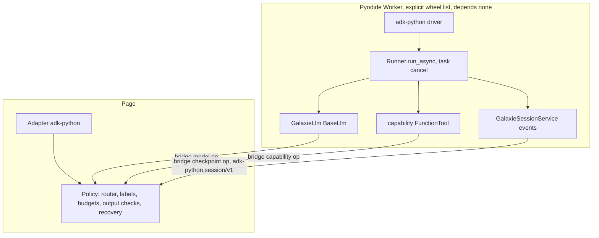

# Google ADK Python Executor - Plan

## Goal Capsule

- **Objective:** A developer can ship a Google ADK (Python) agent to the browser through galaxie and get the answers, tool calls, approvals and reload behavior the agent shows natively on CPython, under the same consent, labels, budgets, credentials and output checks as every other galaxie agent.
- **Means:** A fourth framework option `adk` in `@galaxie/adapter-pyodide` with executor id `adk-python`, a `galaxie.adk` Python module, and a hash-pinned wheel set for `google-adk` 2.12.0 installed without a resolver (KTD1, KTD2, KTD3).
- **Authority:** This plan, then `AGENTS.md`, ADR-0012, ADR-0017, ADR-0018, ADR-0020 and the new Proposed ADR-0022 this plan creates. Beads feature `galaxie-m1t` under epic `galaxie-lwn`.
- **Stop conditions:** Stop and report if a stage needs a CSP or Trusted Types relaxation, a weaker ADR-0012 guarantee, a framework name in `packages/core`, a change to LangGraph, pydantic-ai, DSPy or ADK JS behavior, goldens or matrices (the new lane's own excepted), a moved or removed pin in `python/uv.lock` or `python/requirements.lock`, a changed byte total or fingerprint of the existing three framework wheel sets, a `google-adk` release newer than the lock cutoff `2026-10-23T17:00:00Z`, a provider SDK or network client (`openai`, `litellm`, `grpcio`, `google-cloud-*`, `mcp`) in the Worker set, a native package with no Pyodide wheel on the executed path (`watchdog`, `grpcio`), a gate that passes on Node but fails in headless Chromium under the strict CSP with fetch blocked, an agent tree that reaches `google.genai.Client` through ADK model resolution (string model names, an omitted or inherited model, `Gemini` or `LLMRegistry`) despite tree validation, or a real model download.
- **Execution profile:** Six stages (AP1 to AP6), each merged on its own after `pnpm check` and CI pass. Mock and scripted models only. Python is rebuilt into the wheel after every change under `python/galaxie`.
- **Finishing:** Claude implements one stage per run through `lfg`, runs `pnpm check`, has an independent agent review, fixes findings, opens the PR and merges after CI.

---

## Product Contract

### Summary

Add `adk-python` as a fourth Python executor in the Pyodide adapter. An ADK agent runs in the dedicated Pyodide Worker with a galaxie-owned `BaseLlm`, capability-backed tools and a galaxie-owned session service. Every model call, tool call, pause and stored record passes through JavaScript policy, and the executor is checked against native CPython runs of the same agents with a scripted model, on Node and in headless Chromium.

### Problem Frame

The epic needs Google ADK in the browser in all its languages. ADK JS is merged as `adk-js`. ADK Python is the next item; its engine is pure Python but heavier than the pydantic-ai and DSPy closures. A feasibility pass on 2026-11-03 ran `google-adk` 2.12.0 in Pyodide 314.0.7 on Node: agents, tool confirmation, long-running tools, SSE streaming, the four agent classes, graph `Workflow` and event-replay restore all passed with ten new wheels (about 9.4 MB). It also found four hazards. The first `Runner.run_async` imports `fastapi`, `authlib` (and so `cryptography`) and `opentelemetry` lazily, so an import-only probe passes while the first run fails. ADK's metadata would move three existing pins (`opentelemetry-api`, `tenacity`, `websockets`). A string model name resolves to `Gemini` and the Google client, a route around galaxie. And no run has yet been made in Chromium under the strict CSP or through the galaxie bridge.

### Requirements

**Foundation (AP1)**

- R1. `google-adk` 2.12.0 and its closure install in the Worker as an explicit hash-checked wheel list with no resolver, import, and complete a scripted `Runner.run_async` on CPython, Pyodide on Node and headless Chromium under the strict CSP and Trusted Types with fetch blocked.
- R2. Adding the ADK wheel set moves no existing pin in `python/uv.lock` or `python/requirements.lock` and leaves the LangGraph, pydantic-ai and DSPy wheel sets byte-for-byte unchanged.
- R3. ADR-0022 (Proposed) records the pin, the closure, the escape hatches and the evidence each feature flag needs.

**Model, tools and run (AP2)**

- R4. An ADK agent built with the module's model helper runs; every model call is routed in JavaScript with consent, reservation, credential lease, output safety and usage settlement. ADK never receives a credential or unchecked model text.
- R5. Function declarations travel to the routed provider and function calls travel back. Reply text, call IDs, names and every argument string are checked before ADK sees them, with the same `denied` and `unavailable` outcomes as the other Python executors.
- R6. Tools built with the module's capability helper call the broker with grants, labels, validation and deterministic effect scopes.
- R7. The adapter refuses any agent tree whose agent classes, models or tools are not ones the host helpers created from a closed allow-list, and accepts no plugins, `App`, run config, services or string model names from the author.
- R8. `limits.steps` bounds ADK model calls and exceeding it fails `budget_exceeded`; a fatal galaxie error inside a model or tool call fails the run with that code instead of becoming model-visible text; abort settles the run as cancelled and the adapter stays reusable.
- R9. Framework logging, warnings and telemetry carry no prompt, reply, argument or result text.

**Streaming (AP3)**

- R10. With streaming requested, checked text deltas reach the host in order; a mid-stream output-safety block fails the run without forwarding the blocked delta; stream events never carry arguments, results or unchecked text.

**Interactions (AP4)**

- R11. A tool that requires confirmation and a `LongRunningFunctionTool` pause the run with one pending galaxie interaction built by the agent author; resuming by interaction ID turns the user's action and payload into ADK function responses, and a stale or mismatched ID fails without running a tool.

**Durable sessions (AP5)**

- R12. With a byte-record port, the session's event log is stored at every pause and at completion, so a fresh page after reload restores the same pending interaction and resumes it, with the same recovery guarantees as the other durable executors.

**Docs and evidence (AP6)**

- R13. Sequential, parallel, loop and sub-agent shapes are tested under pause, stream and reload; `Workflow`, `AgentTool` and the other refused shapes are recorded; the adapter flags, ADR-0022, the unsupported list and the READMEs state what the evidence supports without describing galaxie as secure or compliant.

### Scope Boundaries

- `subgraphs` stays `false`, as for `adk-js`, pydantic-ai and DSPy.
- Not allowed in an agent tree: `Workflow` and graph nodes, `LangGraphAgent`, `RemoteA2aAgent`, `AgentTool`, toolsets (MCP, OpenAPI, REST), built-in server-side tools, code executors, planners, `Gemini` or any model not created by the host helper, string model names, author `BaseAgent` subclasses, plugins and `App`. MCP stays with `@galaxie/tools-mcp` through capabilities.
- Not supported: `Runner.run` (sync, thread-based), live and bidirectional streaming, multimodal parts, `tool_thread_pool_config`, ADK artifact, memory and credential services, database, sqlite and Vertex session services. Sync tools run inline.
- Agent-level callbacks (`before_model_callback` and the like) are trusted author code (ADR-0002); a response they replace after the output check is not re-checked. The README states it.
- Python is trusted and can `import js`; the tree validation and lint aid reduce accidents and are not an isolation boundary (ADR-0018).
- Considered and not built: metadata-only stand-ins for `authlib` and `fastapi.openapi.models`, which would drop about 2.5 MB (`cryptography`, `authlib`, `joserfc`, `requests`). Untested, and they raise drift risk against ADK. Evidence that would change the call: a measured Worker boot cost that matters on a real device.
- Considered and not built: a stand-in or lint rule for `watchdog` and `uvicorn`. No resolver runs in the Worker, and the CPython reference environment installs them normally.

### Deferred to Follow-Up Work

- `google-adk` 2.13.0 (uploaded 2026-10-23T18:26:31Z, 86 minutes after the lock cutoff) at the next cutoff; it changes the telemetry default and promotes experimental features.
- `Workflow` graph agents as a separate stage with node-level validation. Subgraph parity. A rag-browser example executor.
- ADK Go (`galaxie-la5`) and `adk-recipes` through galaxie with local ONNX models (`galaxie-bgz`).

---

## Planning Contract

### Key Technical Decisions

- KTD1. **A fourth framework option, not a new package.** `createPyodideAdapter({ framework: 'adk' })` gives id `adk-python`, like `pydantic-ai-python` and `dspy-python`. ADK Python needs the same Worker, bridge, wheel verification and checkpoint op, so a new package would duplicate them. Core keys executors by id and needs no change. A new `PythonFramework` member, id string, wheel tag `adk`, driver string file `adk-python-driver.ts`, boot import probe and `galaxie.adk` module are the whole registration surface (ADR-0017).
- KTD2. **Pin `google-adk` 2.12.0, bump by date, not by JS parity.** It is the newest release at or before the fixed Python cutoff (uploaded 2026-10-13, Apache-2.0, `requires-python >=3.11`). The 2.x Python line is unrelated to JS 2.3.0. 2.13.0 is deferred to the next cutoff. A bump re-runs the hidden-import discovery (KTD4), the symbol-presence test and the conformance lane.
- KTD3. **Lock strategy: overrides keep every existing pin; the Worker gets an explicit wheel list.** `python/galaxie/pyproject.toml` gains an `adk` extra. `python/pyproject.toml` gains `override-dependencies` for `opentelemetry-api==1.45.1`, `opentelemetry-semantic-conventions==0.66b1` (an override replaces the exact pin that `opentelemetry-sdk` 1.42.1 places on 0.63b1), `tenacity==9.2.1`, `websockets==17.3` and constraints `cryptography==47.0.0`, `cffi==2.0.0`, `pycparser==3.0`, so `uv lock` adds packages and moves none (verified in a scratch copy: 22 new CPython packages; the semconv override was found by review and is re-verified in U1). The lock test asserts that every distribution shared by `requirements.lock` and `uv.lock` has one version. `requirements.lock` gains ten wheels tagged `adk` (about 9.44 MB: `google-adk`, `google-genai`, `google-auth`, `authlib`, `joserfc`, `opentelemetry-semantic-conventions`, `fastapi`, `starlette`, `annotated-doc`, and Pyodide's wasm `cryptography`) and the `adk` tag on shared wheels. Hashes come from PyPI and the Pyodide lock, checked by `fetchWheel`. The Worker installs with `depends: []`; `micropip.install` is never used for ADK. `watchdog`, `uvicorn`, `grpcio`, `aiosqlite`, `graphviz`, `click`, `python-dotenv`, `python-multipart`, `opentelemetry-sdk`, `pyasn1*`, `mcp` and `google-cloud-*` stay out of `requirements.lock`. Fallback if the overrides are judged too invasive: a separate uv project for the ADK lane, with the same Worker set.
- KTD4. **The gate proves the first run, not just the import.** Import of `google.adk.agents`, `runners`, `models.base_llm`, `tools`, `sessions` and `events` passes without `fastapi`, `authlib` and `opentelemetry`; the first `Runner.run_async` fails without them, one module at a time. The gate therefore runs a scripted `run_async` on CPython, Node and Chromium, and the Worker boot probe imports the hidden modules (`fastapi.openapi.models`, `authlib.integrations.requests_client`, `opentelemetry._logs`, `opentelemetry.semconv`) so a missing wheel fails at boot with a fixed error. Every bump repeats the discovery by removing each candidate package from a working environment. Discovery covers every code path AP2 to AP5 uses (structured output, agent transfer, `exit_loop`, tool and model exceptions, abort, confirmation, restore, the integrity plugin), so a wheel missing on a later path is found in AP1; one found later is added to the `adk` set through the same lock test and is not a stop condition on its own.
- KTD5. **The model is a `BaseLlm` subclass over the bridge.** `GalaxieLlm` implements `generate_content_async(llm_request, stream)` and sends bridge `model` ops, reusing the pydantic-ai tool-call fields and the JS checks in `packages/adapter-pyodide/src/tool-calls.ts`. It maps genai `Content`, `Part`, `FunctionCall` and `FunctionResponse`, and `config.system_instruction`, to chat messages; maps function declarations (Gemini-style types and `parameters_json_schema`) to JSON Schema tools; maps `response_schema` to provider-level structured output; and maps `usage_metadata` from settled usage. Structured output has no bridge channel today: the `model` payload validator accepts only `stop`, `stream`, `tools` and `toolChoice` in `options`, and the adapter's model call never requires `structured-output`. U4 therefore adds an optional `jsonSchema` option to the bridge validator and the adapter's model path (the lease then requires `structured-output`); the field is additive and absent for every other executor, so their payloads and goldens do not change. Live `connect` raises `unsupported`. Non-stream yields one `partial=False` response; stream yields checked `partial=True` chunks and one aggregated final response. Mapping mirrors the pydantic-ai message mapper and ADK JS `GalaxieLlm` semantics (ADR-0020).
- KTD6. **Fail-closed tree validation by registry membership.** The host helpers record every model and tool they create in a module-private registry. At prepare the driver walks the root agent and sub-agents against exact classes (`type(x) is`, never `isinstance`): `LlmAgent`, `SequentialAgent`, `ParallelAgent`, `LoopAgent`. It refuses every other agent, every model not in the registry (string names, `Gemini`, `LLMRegistry` lookups), every tool not in the registry, toolsets, code executors, planners, plugins, `App`, a sub-agent cycle and a tree deeper than 16 levels, with fixed `unsupported` errors. Validation resolves each `LlmAgent`'s model the way ADK's `canonical_model` does: an empty `model` is accepted only when the nearest `LlmAgent` ancestor resolves to a registry model, because an unresolved chain falls back to ADK's default Gemini through `LLMRegistry`. The only ADK-owned tool the helpers admit is `exit_loop`, recorded in the registry as such; `LoopAgent` also needs `max_iterations`. Sequential, Parallel and Loop emit `DeprecationWarning` in 2.12.0 and work; warnings are filtered inside the driver, not shown to authors. The lint aid in `galaxie.lint` flags `google.genai.Client`, `google.adk.models.Gemini`, `LLMRegistry`, `httpx` and `js` imports in agent sources.
- KTD7. **The adapter owns the Runner and every service.** The driver builds an `App` internally with exactly one plugin, ADK's `ToolCallIntegrityPlugin` (KTD14), and `Runner(app=..., session_service=GalaxieSessionService)` with no artifact, memory or credential service, and a `RunConfig` it constructs (`streaming_mode` NONE or SSE, no `tool_thread_pool_config`). Authors cannot supply plugins, an `App` or services. `limits.steps` is enforced once, in `GalaxieLlm`'s call count (KTD9); an ADK-side `max_llm_calls` backstop is not built because it would report `unavailable` instead of `budget_exceeded`. It drives only `run_async`. Cancellation cancels the Python task bounded by the adapter's 500 ms cancel bound, and `abort_signal` is not relied on: ADK polls it only between yielded events, and its abort path appends sealing events to the session. The engine's `aclose()` never awaits JavaScript (the DSPy lesson). Authors never see the Runner.
- KTD8. **The adapter assigns function-call IDs and effect scopes by position.** `GalaxieLlm` discards provider IDs and assigns `galaxie-<n>` from a per-session counter seeded past stored calls, so IDs replay identically and ADK's own `adk-<uuid>` IDs never key anything. Capability tools call the broker with `effectScope` `adk-python/<conversation-id>/<branch-or-root>/<branch-local-index>/<part-index>`, where the index is the ordinal of the function-call event among the events of the same `branch`, as in ADK JS KTD6. The conversation ID is created at the session's first run, stored in the record and reused on restore. The parallel-branch guarantee is conditional on AP6's reversed-arrival test.
- KTD9. **Fatal errors propagate; a failure slot covers swallowing callbacks.** ADK 2.12.0 re-raises model and tool exceptions out of `run_async` (`flows/llm_flows/tools/_caller.py` re-raises when no `on_tool_error_callback` answers), so the driver maps the raised galaxie error code (`budget_exceeded`, `denied` output block, `unavailable`, `cancelled`, `fenced`, `stale`, `unrecoverable`, `outcome_unknown`) directly. Author error callbacks can swallow an exception, so `GalaxieLlm` and the capability tool also record the first fatal error in a per-run slot; every later model call and capability tool checks the slot first and fails without dispatching, so a sibling write in the same batch does not run once a fatal error is set. After the run settles, the driver reports the slot's code. Only `denied` and validation failures from a capability return a fixed error response to the model. An ADK error event with no slot entry maps to a fixed `unavailable`. `GalaxieLlm` counts its own calls and fails `budget_exceeded` before dispatch; this is the only enforcement of `limits.steps`.
- KTD10. **Pauses end the run and resume as a new `run_async`.** A `FunctionTool(require_confirmation=...)` yields an `adk_request_confirmation` call whose ID is in `Event.long_running_tool_ids`; a `LongRunningFunctionTool` ends the run with a pending response. The driver detects the pause from appended events, the author's `interaction(requests)` builds one four-field request, and the interaction ID is a digest of the conversation ID and the pause ordinal. On resume the author's `resume(requests, action, payload)` returns function responses; the default fails closed (`approve` or `deny` only, with payload `{indexes: [...]}` covering every request once, else `invalid`). ADK's confirmation processor stays enabled. The refusal rules of ADK JS (README) are the starting list: a confirmation-gated call beside any call that is not itself a confirmation or beside a long-running call (several confirmations in one model response form one interaction), a long-running call whose result never arrives, a pause inside `ParallelAgent` or `LoopAgent`, a pause in a later child of a `SequentialAgent`, and an unknown or duplicate pausing agent name all fail `unsupported`. Each rule is kept only if the native CPython lane shows the same ADK behavior; the `require_confirmation` feature is flagged EXPERIMENTAL in 2.12.0 and AP4 records the native result of each rule (R11).
- KTD11. **Streaming projects onto existing modes.** SSE partial chunks become `messages` events `{author, text}` split at 4096 characters without splitting surrogate pairs, checked in `GalaxieLlm` before ADK receives the chunk. `updates` events carry content-free step markers (`tool_call`, `tool_result`, `paused`, offered tool name, positional index) and never IDs, arguments or results. Partial events and thought parts are excluded; the stream is not journaled.
- KTD12. **Sessions are an event log in `GalaxieSessionService`.** It extends `BaseSessionService` in memory, one session per galaxie session ID, and refuses `DatabaseSessionService`, `SqliteSessionService` and Vertex services. Events serialize with `Event.model_dump_json(by_alias=True, exclude_none=True)` and restore with `Event.model_validate` followed by `append_event` replay (verified on Pyodide: about 2.4 kB for a confirmation pause). One record per pause and per completed conversation, written through the byte-record port as checkpoint type `adk-python.session/v1` plus an `__interrupt__` write carrying the interaction ID, state type `galaxie.adk-python-state/v1`, 20-digit revision IDs. The record also stores the built pending interaction request beside the event log; restore republishes the stored request and never re-runs the author's `interaction()` hook, and the interaction ID digest covers the request content as well as the conversation ID and ordinal. The record metadata holds the per-session integrity key (KTD14), which exports and diagnostics never include. A failed or cancelled run writes nothing and restores the in-memory events and state to the last stored point, so ADK's abort-sealing events never reach the next run's history. Partial events and binary parts are never stored. The saver's `ByteExecutor` set gains `adk-python`.
- KTD13. **The record must fit the bridge frame.** A bridge message is capped at 1 MiB including base64, unlike ADK JS's 4 MiB record limit. AP5 sets the record limit to the largest raw size that fits one frame with its envelope. `GalaxieSessionService.append_event` projects the record size after each appended event (events, both base64 envelopes and a reserved margin for the final response) and fails the run `unsupported` before the next model or tool dispatch when the projection would exceed the frame; a start whose stored record is already within the margin is refused too. A check only at publish time would fail a run after its writes happened. Chunked records are not built. The limit is recorded in the matrix; ADK JS's 10,000-event cap is not carried over because it cannot be reached at this size.
- KTD14. **Integrity uses ADK's own plugin with a per-session key.** ADK 2.12.0 ships `ToolCallIntegrityPlugin` (`google/adk/plugins/_tool_call_integrity_plugin.py`): it stamps each function call with an HMAC, checks every stamp before a run, and lets a tool run only when its call has a valid stamp. The adapter enables it (KTD7) with a random per-session key kept in the record metadata, as ADR-0020 does for JS. A stored call changed by a writer of the store fails `unrecoverable` at restore. Like the JS adapter, this does not protect against a writer who can also replace the key in the record; ADR-0022 says so. Stamps live in event `custom_metadata`, so the AP2 to AP4 goldens normalize them, and the plugin is on from AP2 so that no golden is re-recorded in AP5. A resume response that does not match a stored request fails `invalid` through ADK's confirmation processor before a tool runs.
- KTD15. **Observability is off by construction.** No `opentelemetry-sdk` and no exporter are in the Worker set, so ADK spans are no-ops through the API. The driver sets ADK loggers to a null handler and filters warnings. Galaxie's own allowlisted spans cover runs (ADR-0018 decision 12). A canary scan covers logs, warnings, events, errors, spans and stored records.
- KTD16. **A separate conformance lane that reuses the JS case table.** `tests/conformance/cases-adk-python/` holds the CPython reference (`native.py`, `suite.py`, `test_adk_python_cases.py`), reading the scripted replies from `tests/conformance/cases-adk/fixtures.json`. Goldens live in `golden-adk-python/` because genai field names differ from the JS bundle's. The matrix is `compatibility-matrix-adk-python.json`. A recorder `scripts/record-adk-python-conformance.py --check` and a Node test run the same programs in the Worker, and a Chromium test repeats the gate and the core cases. `golden-adk`, `golden-python`, `golden-pydantic-ai` and `golden-dspy` and their matrices stay unchanged.
- KTD17. **ADR-0022 first, as Proposed.** A new ADR records the Python adapter decision rather than editing ADR-0018 or ADR-0020, which name other scopes. ADR-0018's dependency table and ADR-0020 each gain a one-line pointer. AP6 moves ADR-0022's evidence from required to observed.

### High-Level Technical Design

The first run's dependency discovery is the gate's real work; the adapter then follows the pydantic-ai shape:

One session's lifecycle matches ADK JS: Running, then Completed, Paused or Failed; Paused returns to Running on `resume(interactionId, action, payload)` and survives reload through the stored record.

### Assumptions

- The Node feasibility result holds in Chromium under the strict CSP (`script-src 'self' 'wasm-unsafe-eval'`, Trusted Types, same-origin `connect-src`). AP1 proves or refutes it; a refutation is a stop condition for the whole plan.
- Pyodide's cooperative event loop runs `Runner.run_async` and task cancellation promptly. AP2 proves it.
- ADK starts no thread on the executed path (verified: `threading.active_count() == 1`), and `ThreadPoolExecutor` fallbacks run inline.
- Network reachability of Python in the Worker follows ADR-0018 decision 9: `httpx2-jsfetch` is tagged to `langgraph` and `pydantic-ai` only and is not in the `adk` set, but `js`, `pyodide.http` and `urllib` remain routes for trusted Python, and the Worker restores the real `fetch` after install. "No sockets" is therefore not a mitigation for the Gemini route until U6's direct-`Gemini` test shows it fails closed.

### Risks

| Risk | Mitigation |
| --- | --- |
| Chromium Worker fails CSP, Trusted Types or unpacking a 5 MB wheel and 550 modules | AP1 gate in Chromium before any feature code; stop condition |
| ADK metadata moves existing pins | KTD3 overrides; the lock diff is part of AP1's tests |
| A new hidden import appears on a bump | KTD4 boot probe and discovery step on every bump |
| String model resolves to `Gemini` and the Google client | KTD6 validation including inherited and omitted models, lint rule; AP2 tests build trees with `model='gemini-2.5-flash'` and with no model and expect `unsupported`, and a direct `Gemini` agent built in the Worker bypassing validation makes no outbound request |
| ADK catches errors and hides fatal codes | KTD9 failure slot; AP2 tests one case per fatal code |
| ADK events carry ADK-invented IDs and replay differs | KTD8; AP4 and AP5 reuse-ID and reload tests |
| Record exceeds the 1 MiB frame | KTD13 pre-publish check and fixed error |
| Experimental flags and deprecations churn in a minor | Exact pin; AP6 records them in the matrix; bump is separate work |
| Real small-model function-call formats differ from the scripts | Unmeasured; stated in ADR-0022 and the unsupported list |

---

## Implementation Units

| U-ID | Stage | Title | Key files | Depends on |
| --- | --- | --- | --- | --- |
| U1 | AP1 | ADR-0022, ADK extra and lock | `docs/adr/0022-*.md`, `python/pyproject.toml`, `python/galaxie/pyproject.toml`, `python/uv.lock`, `python/requirements.lock` | none |
| U2 | AP1 | Framework registration and wheel inventory | `packages/adapter-pyodide/src/{runtime-files,bridge,worker,adapter}.ts`, `tests/conformance/python-wheels.node.test.ts` | U1 |
| U3 | AP1 | Gate: scripted run on CPython, Node and Chromium | `python/galaxie/tests/test_adk_gate.py`, `examples/rag-browser/test/adk-gate.node.test.ts` | U2 |
| U4 | AP2 | `GalaxieLlm` and tool-call mapping | `python/galaxie/src/galaxie/adk.py`, `packages/adapter-pyodide/src/{tool-calls,bridge,adapter}.ts` | U3 |
| U5 | AP2 | Host helpers, capability tools, tree validation, failure slot | `python/galaxie/src/galaxie/adk.py` | U4 |
| U6 | AP2 | Driver, Runner and run loop (non-streaming) | `packages/adapter-pyodide/src/adk-python-driver.ts`, `worker.ts`, `adapter.ts` | U5 |
| U7 | AP2 | Lint aid for ADK provider use | `python/galaxie/src/galaxie/lint.py` | none |
| U8 | AP2 | ADK Python conformance lane | `tests/conformance/cases-adk-python/`, `golden-adk-python/`, `scripts/record-adk-python-conformance.py` | U6 |
| U9 | AP3 | Streaming | `adk.py`, `adk-python-driver.ts`, `tool-calls.ts` | U8 |
| U10 | AP4 | Confirmations and long-running tools as interactions | `adk.py`, `adk-python-driver.ts` | U9 |
| U11 | AP5 | Durable sessions and restore | `adk.py`, `checkpoints.ts`, `packages/storage-indexeddb/src/byte-records.ts` | U10 |
| U12 | AP6 | Supported agent-shape evidence | `tests/conformance/cases-adk-python/` | U11 |
| U13 | AP6 | ADR, docs and status | `docs/adr/0022-*.md`, `docs/unsupported.md`, `packages/adapter-pyodide/README.md`, `AGENTS.md`, `llms.txt` | U12 |

### PR AP1: Gate and lock

Waits on: none.

### U1. ADR-0022, ADK extra and lock

- **Goal:** Record the decision and add the pinned engine to both locks with no existing pin moved.
- **Requirements:** R2, R3
- **Dependencies:** none
- **Files:** `docs/adr/0022-google-adk-python-through-the-pyodide-adapter.md`, `docs/adr/README.md`, `docs/adr/0018-python-agents-through-pyodide.md` (dependency table row), `docs/adr/0020-google-adk-through-an-adapter.md` (pointer), `python/pyproject.toml`, `python/galaxie/pyproject.toml`, `python/uv.lock`, `python/requirements.lock`, `scripts/fetch-python-wheels.ts` (only if the Pyodide-CDN `cryptography` wheel needs a new source rule)
- **Approach:**
  1. Write ADR-0022 as Proposed with KTD1 to KTD4, KTD6 and KTD10 as the decision and the evidence each feature flag needs.
  2. Add the `adk = ["google-adk==2.12.0"]` extra, the `override-dependencies` and the constraints of KTD3.
  3. Regenerate `uv.lock` and `requirements.lock`; diff both against `main` and show added packages only.
  4. Record hashes from PyPI and the Pyodide lock, and the licenses read from the wheels' dist-info.
- **Patterns to follow:** The DSPy plan's U1 lock handling and the ADR index rules in `docs/adr/README.md`.
- **Test scenarios:**
  - A lock diff test shows every pre-existing package at its prior version in `uv.lock` and `requirements.lock`.
  - Every new wheel's bytes and SHA-256 match PyPI or the Pyodide lock; every `upload-time` is before `2026-10-23T17:00:00Z`.
  - `watchdog`, `uvicorn`, `grpcio`, `opentelemetry-sdk`, `mcp` and any `google-cloud-*` are absent from `requirements.lock`.
  - Every distribution shared by `requirements.lock` and `uv.lock` has the same version, including `opentelemetry-semantic-conventions` 0.66b1 and `pycparser` 3.0.
- **Verification:** `uv lock --check`, the lock test and `pnpm check:docs` pass.

### U2. Framework registration and wheel inventory

- **Goal:** Add `adk` as a Python framework with flags all false, its wheel filter and boot probe.
- **Requirements:** R1, R2
- **Dependencies:** U1
- **Files:** `packages/adapter-pyodide/src/runtime-files.ts`, `packages/adapter-pyodide/src/bridge.ts`, `packages/adapter-pyodide/src/worker.ts`, `packages/adapter-pyodide/src/adapter.ts`, `packages/adapter-pyodide/test/adapter.node.test.ts`, `examples/rag-browser/scripts/python-assets.ts`, `tests/conformance/python-wheels.node.test.ts`
- **Approach:**
  1. Extend `PythonFramework`, the bridge framework validators, the id map (`adk` to `adk-python`) and the feature table (all false for now).
  2. Mirror the lock into `lockedWheels` with the `adk` tag; extend the asset plugin's framework list.
  3. Add the boot probe of KTD4 for `adk` only; failure maps to a fixed `unavailable` error.
  4. Make the wheel test additive: allow `adk` and assert the ten new wheels, the `adk` set total and fingerprint, and that the three existing set totals and fingerprints (6,042,342, 5,208,632 and 4,431,463 bytes) are unchanged.
- **Test scenarios:**
  - The adapter with `framework: 'adk'` reports id `adk-python` and all features false.
  - A tampered wheel byte fails `fetchWheel` with the fixed verification error.
  - The Worker for `langgraph`, `pydantic-ai` and `dspy` still installs exactly its previous set.
  - A Worker for `adk` with `fastapi` removed fails boot with the fixed error, not at first run.
- **Verification:** Adapter and wheel tests pass; existing fingerprints unchanged.

### U3. Gate: scripted run on CPython, Node and Chromium

- **Goal:** Prove R1 before any feature code, and stop the plan if it fails.
- **Requirements:** R1
- **Dependencies:** U2
- **Files:** `python/galaxie/tests/test_adk_gate.py`, `examples/rag-browser/test/adk-gate.node.test.ts`, `examples/rag-browser/test/support/adk-gate/{index.html,main.ts,worker.ts}`
- **Approach:** Copy the DSPy gate shape: a Vite page served with the unchanged strict CSP and Trusted Types, with fetch, `WebSocket` and `XMLHttpRequest` replaced by throwing stubs. The Python gate source defines a scripted `BaseLlm`, a `FunctionTool`, and runs `Runner.run_async` for plain text, a tool call, a confirmation pause and resume in a second `run_async`, a `LongRunningFunctionTool`, SSE partials, the three workflow-style agents, `output_schema`, agent transfer, `exit_loop`, a raising tool and a raising model, a cancelled task, an event-replay restore into a fresh service, and a run with `ToolCallIntegrityPlugin` enabled including a restore with a tampered stored call. Record boot time, unpack time and heap in the PR as unmeasured-on-device figures, not claims.
- **Execution note:** Run the hidden-import discovery of KTD4 first, over every code path AP2 to AP5 uses, and update the boot probe list from U2 (which starts with the four modules KTD4 names) from its result. The byte totals recorded in U2 are provisional until this gate passes under the Worker's `depends: []` isolation; Pyodide-bundled extras such as `click`, `httpcore` and `h11` were proven on CPython and not yet under that isolation.
- **Test scenarios:**
  - Each scenario above passes on CPython 3.14 from the locked environment.
  - The same scenarios pass in Pyodide on Node and in headless Chromium with zero CSP, Trusted Types or network events.
  - `threading.Thread().start()` is never called (a spy on the thread constructor).
  - A tree built with `model='gemini-2.5-flash'` is not exercised here, only recorded as the AP2 case.
- **Verification:** All three lanes pass; a Chromium failure stops the plan with the evidence in the PR.

### PR AP2: Model, tools and run

Waits on: AP1 (merge order).

### U4. `GalaxieLlm` and tool-call mapping

- **Goal:** Route every ADK model call through the bridge with checks (R4, R5).
- **Requirements:** R4, R5
- **Dependencies:** U3
- **Files:** `python/galaxie/src/galaxie/adk.py`, `python/galaxie/tests/test_adk.py`, `packages/adapter-pyodide/src/tool-calls.ts`, `packages/adapter-pyodide/test/`
- **Approach:** Follow KTD5 and KTD8. Reuse the pydantic-ai bridge fields and the shared case table in `tests/conformance/support/tool-call-checks.ts`; add genai-types mapping with `ModelPayload` tool definitions. Rebuild the galaxie wheel.
- **Patterns to follow:** `python/galaxie/src/galaxie/pydantic_ai.py` message mapping, `packages/adapter-adk/src/llm.ts` for the ADK semantics.
- **Test scenarios:**
  - A text reply, a function call with arguments and a structured-output request map to the expected bridge payloads and back to `LlmResponse` parts.
  - A call whose ID, name or argument contains a blocked canary fails `denied` before ADK sees it.
  - A provider-supplied ID is replaced by `galaxie-<n>`; two replies reusing `call_0` get distinct IDs.
  - A tool name not among the offered declarations fails the run with a fixed `invalid` error.
  - A non-text part (`inline_data`, `file_data`) fails `unsupported`.
  - `connect` raises `unsupported`.
  - A `response_schema` request reaches the model path as the optional `jsonSchema` option and the lease requires `structured-output`; a route without it fails closed; the other executors' `model` payloads are byte-identical to before.
- **Verification:** CPython and Worker unit tests pass; the wheel rebuilds.

### U5. Host helpers, capability tools, tree validation, failure slot

- **Goal:** Give authors the only way to build models and tools and refuse everything else.
- **Requirements:** R6, R7, R8
- **Dependencies:** U4
- **Files:** `python/galaxie/src/galaxie/adk.py`, `python/galaxie/tests/test_adk.py`
- **Approach:** KTD6, KTD8, KTD9. The host exposes `llm(role)`, `capability_tool(name, spec)` (description, JSON Schema or pydantic parameters, optional `require_confirmation` and `long_running`) and `request_input`-free interaction hooks in AP4. Tool names are sanitized to `[A-Za-z_][A-Za-z0-9_]{0,63}`.
- **Test scenarios:**
  - Each allowed class passes; each refused shape in Scope Boundaries fails `unsupported` at prepare, including `model='gemini-2.5-flash'`, `Gemini`, `Workflow`, `AgentTool`, a toolset, a plugin and an `App`.
  - A subclass of `LlmAgent` fails (exact class check); a forged model that copies the registry attribute fails.
  - A tool whose body calls the broker through `capability_tool` uses the KTD8 scope and replays its receipt on a repeated call.
  - A `denied` capability returns a fixed error response to the model; a `budget_exceeded`, `unavailable`, `cancelled` or `fenced` error ends the run with that code and never reaches the model.
  - A cyclic sub-agent graph and a tree deeper than 16 levels fail `unsupported`.
  - Model resolution: a root with no model fails; a sub-agent that inherits a registered parent model passes; a sub-agent under a `SequentialAgent` with no `LlmAgent` ancestor fails.
  - `exit_loop` is admitted only through the helper and ends a `LoopAgent`; a `LoopAgent` without `max_iterations` is refused unless `exit_loop` is present.
- **Verification:** Python tests pass on CPython and in the Worker.

### U6. Driver, Runner and run loop (non-streaming)

- **Goal:** Run a whole non-streaming ADK conversation through the adapter.
- **Requirements:** R4 to R9
- **Dependencies:** U5
- **Files:** `packages/adapter-pyodide/src/adk-python-driver.ts`, `packages/adapter-pyodide/src/worker.ts`, `packages/adapter-pyodide/src/adapter.ts`, `packages/adapter-pyodide/test/adk-python.node.test.ts`
- **Approach:** KTD7 and KTD9. Select the driver by framework, build the `App` with the integrity plugin, the Runner and the in-memory `GalaxieSessionService`, map the raised error code (or the failure slot's) as the run outcome, and cancel the task within the cancel bound. Steps are counted only in `GalaxieLlm`. Input is `{ prompt: string }` like `adk-js`. All features stay false in this stage; `streaming`, `interrupts`, `resume` and `checkpoints` turn on in AP3, AP4 and AP5, and `subgraphs` stays false.
- **Test scenarios:**
  - A text-only run completes and the output equals the golden.
  - A tool-calling run with a capability completes with the broker call recorded once.
  - `limits.steps = 2` with a third scripted call fails `budget_exceeded` before the third dispatch.
  - Abort mid-model settles `cancelled` within the cancel bound and a second run on the same adapter succeeds.
  - A raising model and a raising tool end the run with the raised galaxie code, not a model-visible message; an author `on_tool_error_callback` that swallows the exception still ends with the slot's code.
  - Two sibling tools in one model turn where the first fails fatally: the second capability is never dispatched.
  - A run that fails or is cancelled leaves the session at its last stored point; the next run's model history contains no abort-sealing events.
  - A `Gemini`-backed agent built directly in the Worker, bypassing tree validation, makes no outbound request (the recorded result decides whether ADR-0022 may cite the Worker as a mitigation).
  - Framework warnings and ADK loggers emit nothing (canary scan of the Worker console).
- **Verification:** Node and Chromium tests pass; other executors' tests unchanged.

### U7. Lint aid for ADK provider use

- **Goal:** Flag the accidental routes around galaxie in Python agent sources.
- **Requirements:** R7
- **Dependencies:** none
- **Files:** `python/galaxie/src/galaxie/lint.py`, `python/galaxie/tests/test_adk_lint.py`
- **Approach:** `lint.py` already forbids `js`, `urllib`, `socket` and `google.genai`. Add only the missing module prefixes `google.adk.models.google_llm` and `google.adk.models.registry` to its module list. Stated as a linting aid, not enforcement: KTD6's prepare-time validation is the enforcement point for the ADK model route.
- **Test scenarios:**
  - Each added prefix is reported with the existing fixed message.
  - An agent using only the host helpers lints clean.
- **Verification:** Lint tests pass on CPython.

### U8. ADK Python conformance lane

- **Goal:** Pin the behavior to native ADK Python.
- **Requirements:** R4 to R8
- **Dependencies:** U6
- **Files:** `tests/conformance/cases-adk-python/{native.py,suite.py,test_adk_python_cases.py}`, `tests/conformance/golden-adk-python/*.json`, `tests/conformance/compatibility-matrix-adk-python.json`, `tests/conformance/adk-python.node.test.ts`, `tests/conformance/support/adk-python.ts`, `scripts/record-adk-python-conformance.py`, `pyrightconfig.json`, `python/pyproject.toml` (testpaths)
- **Approach:** KTD16. Cases: plain-text, capability, sequential-tools, output-schema, capability-denial, argument-block, step-budget, abort, each recorded natively on CPython with the scripted `BaseLlm` and then run through the Worker with the mock chat model; transcripts compare final output, normalized events (integrity stamps in `custom_metadata` and ADK-generated IDs are normalized), requests seen by the model and error codes. The matrix lists cases, features and differences and is compared with the adapter's features.
- **Test scenarios:**
  - The native lane reproduces every golden (`--check`).
  - The Worker lane matches every golden on Node; the Chromium lane repeats the plain, capability and abort cases.
  - Matrix cases equal the case list and `differences` is `[]` or documented.
  - `golden-adk`, `golden-python`, `golden-pydantic-ai` and `golden-dspy` and their matrices are unchanged in the diff.
- **Verification:** Conformance lanes pass; `pnpm check` passes.

### PR AP3: Streaming

Waits on: AP2 (merge order).

### U9. Streaming

- **Goal:** Deliver checked text deltas and content-free step markers.
- **Requirements:** R10
- **Dependencies:** U8
- **Files:** `python/galaxie/src/galaxie/adk.py`, `packages/adapter-pyodide/src/adk-python-driver.ts`, `packages/adapter-pyodide/src/tool-calls.ts`, `tests/conformance/cases-adk-python/`
- **Approach:** KTD11. Reuse `GrowingOutput` checking for every growing chunk and the final check. Set `streaming: true`.
- **Test scenarios:**
  - Deltas arrive in order as `messages` events and join to the final output.
  - A tool-call turn emits `updates` markers with the offered tool name and index only; a canary call ID or argument appears in no event.
  - A mid-stream block fails `denied`; the blocked delta is not forwarded; earlier deltas are not retracted.
  - A 4096-character split does not split a surrogate pair.
  - Abort mid-stream stops events and settles `cancelled`.
  - Streaming cases match native transcripts.
- **Verification:** Conformance lanes pass on Node and Chromium; the matrix flag matches.

### PR AP4: Interactions

Waits on: AP3 (merge order).

### U10. Confirmations and long-running tools as interactions

- **Goal:** Pause on confirmations and long-running calls and resume by ID.
- **Requirements:** R11
- **Dependencies:** U9
- **Files:** `python/galaxie/src/galaxie/adk.py`, `packages/adapter-pyodide/src/adk-python-driver.ts`, `packages/adapter-pyodide/src/adapter.ts`, `tests/conformance/cases-adk-python/`
- **Approach:** KTD10 with the in-memory session service, so `pending()` and resume work within one page. Native evidence first: record each refusal rule against ADK 2.12.0 on CPython and keep, change or drop it by that result. Set `interrupts` and `resume` true.
- **Test scenarios:**
  - A confirmation tool pauses with one interaction that passes `parseInteractionRequest`; the tool has not run.
  - Approve runs the tool once and completes; deny reports denial to the model and completes.
  - Two confirmations in one model response form one interaction and the default resume covers both indexes; a payload missing one fails `invalid`.
  - A long-running tool pauses and the payload supplies the external result.
  - A wrong interaction ID fails `stale` without running anything.
  - Two consecutive pauses with scripted calls reusing IDs get distinct interaction IDs.
  - A response that does not match a stored request fails before any tool runs.
  - Each refusal rule of KTD10 fails `unsupported`, or is recorded as supported with the native result.
  - A double UI submit resumes through the core inbox exactly once.
- **Verification:** Conformance lanes pass; core unchanged.

### PR AP5: Durable sessions

Waits on: AP4 (merge order).

### U11. Durable sessions and restore

- **Goal:** Persist the event log so reload restores the pending interaction.
- **Requirements:** R12
- **Dependencies:** U10
- **Files:** `python/galaxie/src/galaxie/adk.py`, `packages/adapter-pyodide/src/checkpoints.ts`, `packages/adapter-pyodide/src/adk-python-driver.ts`, `packages/adapter-pyodide/src/adapter.ts`, `packages/storage-indexeddb/src/byte-records.ts`, `packages/storage-indexeddb/test/byte-records.test.ts`, `tests/conformance/support/memory-byte-checkpoints.ts`, `tests/conformance/adk-python-restore.node.test.ts`, `tests/conformance/support/adk-python-restore.ts`
- **Approach:** KTD12 to KTD14; the integrity plugin is already on from AP2, so this stage adds the key to the record and the restore check. Add the ADK Python record type, state type and validators to `checkpoints.ts`, a `ByteExecutor` member and its guard, and register restored text as private through `registerRestoredData` before any live outbound call. Set `checkpoints` true.
- **Patterns to follow:** `dspy-driver.ts` and `checkpoints.ts` for the byte-record port and the 4 MiB-versus-1 MiB handling.
- **Test scenarios:**
  - Pause, dispose, restore in a fresh runtime over the same store: the same pending interaction is published and resuming completes.
  - In Chromium with reopened IndexedDB the same reload case passes.
  - An approved write executed before a crash replays its receipt after restore and never runs twice.
  - The restored session reuses the stored conversation ID and call counter, so new IDs do not collide with stored ones.
  - A tampered stored call, a record spliced from another session or an unreadable record fails `unrecoverable` and leaves other sessions readable.
  - Growth that crosses the frame limit mid-run fails `unsupported` before the next model or tool dispatch and invokes no further capability; a start whose stored record is already within the margin is refused; the largest permitted record round-trips.
  - A changed author `interaction()` hook does not alter the request republished after restore, and the interaction ID covers the request content.
  - The integrity key is in the record metadata and absent from exports and diagnostics; a tampered stored call fails `unrecoverable`.
  - A session recorded by another executor is refused with "The saved session uses a different executor."; existing Python rows still export under their own tags.
  - Export of an ADK Python session is tagged `adk-python` and content-free unless `personalContent: true`.
  - Logout and app-epoch fencing reject a stale write; a failed or cancelled run writes nothing.
  - Partial events and binary parts are never stored.
- **Verification:** Storage, adapter and conformance reload tests pass on Node and Chromium.

### PR AP6: Evidence and docs

Waits on: AP5 (merge order).

### U12. Supported agent-shape evidence

- **Goal:** State which shapes the adapter supports, from tests.
- **Requirements:** R13
- **Dependencies:** U11
- **Files:** `tests/conformance/cases-adk-python/`, `packages/adapter-pyodide/test/adk-python-agents.node.test.ts`
- **Approach:** Add cases for `SequentialAgent`, `ParallelAgent`, `LoopAgent` and an `LlmAgent` with sub-agents and transfer, each over host-created models and tools: run, stream, confirm in a child where KTD10 allows, reload while paused. Record native and galaxie results in the matrix. `Workflow`, `AgentTool` and the other refused shapes are recorded as `unsupported` with their native results.
- **Test scenarios:**
  - Each supported shape gives the same output natively and through galaxie.
  - Two `ParallelAgent` branches calling write capabilities get branch-local scopes; with reversed completion order after a restore, each write replays its own receipt or fails `unrecoverable`, and never runs twice. If this fails, parallel branches with write capabilities are refused at prepare.
  - `Workflow` and `AgentTool` fail `unsupported` at prepare.
- **Verification:** Conformance passes; the matrix records the evidence and `subgraphs` is `false`.

### U13. ADR, docs and status

- **Goal:** Record what the adapter supports and its limits.
- **Requirements:** R13
- **Dependencies:** U12
- **Files:** `docs/adr/0022-google-adk-python-through-the-pyodide-adapter.md`, `docs/adr/0018-python-agents-through-pyodide.md`, `docs/unsupported.md`, `packages/adapter-pyodide/README.md`, `packages/adapter-pyodide/AGENTS.md`, `packages/storage-indexeddb/README.md`, `tests/conformance/README.md`, `docs/system-design.md`, `AGENTS.md`, `llms.txt`
- **Approach:** Move ADR-0022's evidence to observed results; add a "Google ADK (Python)" section to the unsupported list (scope boundaries, `import js`, callbacks, experimental and deprecated ADK features, 1 MiB record limit, unmeasured device cost); document the authoring surface and license notices (Apache-2.0 for ADK, `google-genai`, `google-auth`, `tenacity`, `opentelemetry-*`; BSD-3-Clause for `authlib`, `joserfc`, `websockets`, `starlette`; MIT for `fastapi`; Pyodide `cryptography` notices read from the wheel); add one factual sentence to `AGENTS.md`.
- **Test expectation:** none -- documentation; the offline link check covers it.
- **Verification:** `pnpm check:docs` passes and no text describes galaxie as secure, compliant or certified.

---

## Verification Contract

| Check | Proves | Stage |
| --- | --- | --- |
| `pnpm check` | Licenses, Biome, TypeScript 7 and 6, Node and Chromium tests, Python lane, builds, dependency rules, docs links | every stage |
| `uv lock --check` and the lock diff test | The ADK set adds packages and moves none | AP1 |
| `python-wheels.node.test.ts` | Existing three sets keep their byte totals and fingerprints; the `adk` set is as recorded | AP1 onward |
| Gate (U3) in Chromium | The pinned set imports and runs under strict CSP and Trusted Types with fetch blocked | AP1 |
| Native CPython lane reproduces `golden-adk-python` (`--check`) | Goldens are ADK behavior, not galaxie behavior | AP2 onward |
| LangGraph, Python, pydantic-ai, DSPy and ADK JS goldens and matrices unchanged in the diff | Executor isolation | every stage |
| Canary scan (console, warnings, events, errors, stored records) | No content leaves through ADK logging or telemetry | AP2 onward |
| Wheel rebuild after any change under `python/galaxie` | The Worker runs the current module | every stage |

`test:python` cannot run on the maintainer's machine because the local Python lacks Homebrew libssl.3; CI runs it.

## Definition of Done

- Each stage merges with `pnpm check` and CI green, and its flags match what its tests prove.
- After AP5, `adk-python` declares `streaming`, `interrupts`, `resume` and `checkpoints` true; `subgraphs` stays `false` with AP6's recorded reasons; ADR-0022 records the evidence.
- No other executor's code, goldens, matrices or third-party wheel inventory changed, apart from the `adk` tag on shared wheels; core does not name ADK.
- No real model download, CSP or Trusted Types relaxation, resolver in the Worker, or provider SDK in the Worker set.
- No spike code copied from `spikes/`, and no leftover probe or abandoned-attempt code in any stage's diff.
- Beads `galaxie-m1t` closes after AP6 with the stage PRs listed.
