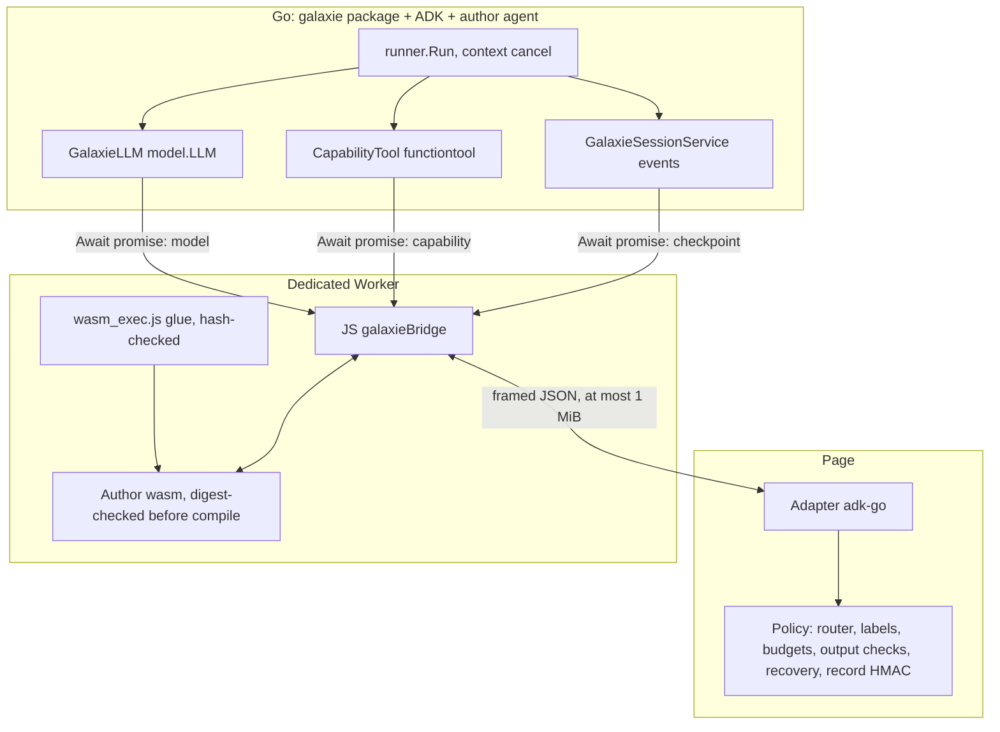

# Google ADK Go Executor - Plan

## Goal Capsule

- **Objective:** A developer can ship a Google ADK (Go) agent, compiled to WebAssembly, to the browser through galaxie and get the answers, tool calls, approvals and reload behavior the agent shows natively in Go, under the same consent, labels, budgets, credentials and output checks as every other galaxie agent.
- **Means:** A new package `@galaxie/adapter-go` with executor id `adk-go`, a Go module under `go/` with a `galaxie` package the author links into the agent, and an integrity-checked wasm artifact plus a hash-checked `wasm_exec.js` glue file run in a dedicated Worker (KTD1, KTD2, KTD3).
- **Authority:** This plan, then `AGENTS.md`, ADR-0012, ADR-0017, ADR-0018, ADR-0020, ADR-0022 and the new Proposed ADR-0023 this plan creates. Beads feature `galaxie-la5` under epic `galaxie-lwn`.
- **Stop conditions:** Stop and report if a stage needs a CSP or Trusted Types relaxation (for example `'unsafe-eval'`), a weaker ADR-0012 guarantee, a framework name in `packages/core`, a change to LangGraph, pydantic-ai, DSPy, ADK JS or ADK Python behavior, goldens, matrices or wheel inventories (the new lane's own excepted), a gate that passes on Node but fails in headless Chromium under the strict CSP with fetch blocked, a reference wasm larger than 48 MB or a Chromium cold start (fetch start to Go ready) longer than 10 s on the maintainer's machine, a build that is not byte-reproducible on one machine with a fixed toolchain, a Go module in the build list first seen in the public module index after the lock cutoff `2026-10-28T00:00:00Z`, a toolchain or module change that cannot be pinned by `go.sum` and the toolchain directive, an agent tree that reaches `genai.NewClient`, `gemini.NewModel` or any non-galaxie `model.LLM` through the host helpers despite tree validation, or a real model download.
- **Execution profile:** Six stages (AG1 to AG6), each merged on its own after `pnpm check` and CI pass. Mock and scripted models only. Go sources are compiled with the pinned toolchain; nothing is installed system-wide by an agent run.
- **Finishing:** Claude implements one stage per run through `lfg`, runs `pnpm check`, has an independent agent review, fixes findings, opens the PR and merges after CI.

---

## Product Contract

### Summary

Add `adk-go` as a third ADK-family executor, after `adk-js` and `adk-python`. An ADK Go agent runs as a wasm module in a dedicated Worker with a galaxie-owned `model.LLM`, capability-backed function tools and a galaxie-owned session service. Every model call, tool call, pause and stored record passes through JavaScript policy, and the executor is checked against native Go runs of the same agents with a scripted model, on Node and in headless Chromium.

### Problem Frame

The epic needs Google ADK in the browser in all its languages. ADK JS (`adk-js`) and ADK Python (`adk-python`) are merged. ADK Go is the last language, and its engine arrives differently: the author compiles agent and engine into one wasm binary. A feasibility pass on 2026-11-04, run in scratch space outside the repo, found:

| Question | Result |
| --- | --- |
| Module and license | `google.golang.org/adk` v1.9.0, Apache-2.0, published 2026-10-15T13:05:02Z, `go 1.25.0` minimum; Go 1.27.3 is installed |
| Compiles to wasm | Yes for `GOOS=js GOARCH=wasm` and for `wasip1`, about 4 s warm |
| Linked closure | 33 modules, 480 packages. `google.golang.org/genai` v1.57.0 pulls `cloud.google.com/go/auth`, grpc, protobuf and OpenTelemetry API in, and `net/http` links. genai types are the parameter types of `model.LLM`, so they cannot be avoided |
| Size | 30.5 MB raw, 29.6 MB stripped (`-s -w`), 6.4 MB gzip, 4.5 MB brotli. A plain Go hello wasm is 2.45 MB; genai alone adds about 26.5 MB and ADK about 3 MB |
| Reproducibility | Two builds with `-trimpath -ldflags="-s -w -buildid="` and `CGO_ENABLED=0` gave identical SHA-256 |
| Glue under the strict CSP | `wasm_exec.js` (16,992 bytes) has no `eval` or `new Function`; it needs only `crypto.getRandomValues`, `performance`, `TextEncoder` and `TextDecoder`. Headless Chromium 156.0.8078.4 ran a module Worker under the unchanged mock CSP (`script-src 'self' 'wasm-unsafe-eval'`, Trusted Types default policy, same-origin `connect-src`) with zero `securitypolicyviolation` events, no external request and MIME `application/wasm`. Removing `'wasm-unsafe-eval'` fails with a `CompileError` (negative control) |
| Cold start | Chromium: fetch 2 ms, streaming compile 30 ms, Go init 35 ms, first run 12 ms. Node: about 56 ms to ready. Probe figures from this machine, not device claims |
| Bridge | `syscall/js` calling a JS `galaxieBridge` object whose methods return promises works: a Go goroutine awaits a promise through `js.FuncOf` callbacks and a channel while the callback itself returns at once. A scripted `model.LLM` plus a function tool that called a JS capability completed a two-turn ADK run through `runner.Run` |
| Cancellation | Cancelling the run `context` while the model promise never settles made the await return `context canceled` within the 50 ms the probe waited; a late settle is absorbed by releasing the callbacks in a goroutine |
| Native ADK semantics | A confirmation-gated `functiontool` emits an `adk_request_confirmation` function call whose ID is in `LongRunningToolIDs`; a second `runner.Run` with a `FunctionResponse{confirmed:true}` ran the tool and finished, two model calls in all. `encoding/json` round-trips `session.Event` (key order of maps aside). Events are 0.7 to 1.0 kB each. ADK Go assigns `adk-<uuid>` call IDs itself through `platform.NewUUID`, and `platform.WithUUIDProvider` and `WithTimeProvider` make IDs and timestamps deterministic per context |
| Not measured | TinyGo and `wasm-opt` are not installed; Chromium heap; any real device; a real model's function-call format |

Remaining hazards this plan must close: the strict-CSP result above was for a probe, not the shipped package; the size is large for a first load; the author's Go code is trusted native code that can link `net/http` and `syscall/js`; ADK Go has no tool-call integrity plugin; `agent.Agent` cannot be inspected by concrete type (its interface has an unexported method), so tree validation needs a registry; and a stuck wasm loop cannot be cancelled from inside.

### Requirements

**Foundation (AG1)**

- R1. An ADK Go agent compiled with the pinned toolchain and module set loads in a Worker, completes a scripted `runner.Run` natively, on Node and in headless Chromium under the strict CSP and Trusted Types with fetch blocked, and the wasm digest is verified before it is compiled.
- R2. The Go module set is pinned by `go.sum`, the toolchain directive and a lock file with the release-age cutoff, and a build with the pinned toolchain is byte-reproducible on one machine; the glue file is verified by SHA-256.
- R3. ADR-0023 (Proposed) records the artifact model, the pins, the size and cold-start thresholds, the escape hatches and the evidence each feature flag needs.

**Model, tools and run (AG2)**

- R4. An ADK Go agent built with the galaxie constructors runs; every model call is routed in JavaScript with consent, reservation, credential lease, output safety and usage settlement. ADK never receives a credential or unchecked model text.
- R5. Function declarations travel to the routed provider and function calls travel back. Reply text, names and every argument string are checked before ADK sees them, with the same `denied` and `unavailable` outcomes as the other executors.
- R6. Tools built with the capability constructor call the broker with grants, labels, validation and deterministic effect scopes.
- R7. The adapter refuses any agent tree whose agents, models or tools were not created by the galaxie constructors, and accepts no plugins, services or run configuration from the author.
- R8. `limits.steps` bounds ADK model calls and exceeding it fails `budget_exceeded`; a fatal galaxie error inside a model or tool call fails the run with that code; abort settles the run as cancelled within a bound and the adapter stays reusable even when the wasm does not yield.
- R9. Framework logging and telemetry carry no prompt, reply, argument or result text, and Go standard output and error are discarded.

**Streaming (AG3)**

- R10. With streaming requested, checked text deltas reach the host in order; a mid-stream output-safety block fails the run without forwarding the blocked delta; stream events never carry arguments, results or unchecked text.

**Interactions (AG4)**

- R11. A confirmation-gated tool and a long-running tool pause the run with one pending galaxie interaction built by the agent author; resuming by interaction ID turns the user's action and payload into ADK function responses, and a stale or mismatched ID fails without running a tool.

**Durable sessions (AG5)**

- R12. With a byte-record port, the session's event log is stored at every pause and at completion, authenticated by a per-session key, so a fresh page after reload restores the same pending interaction and resumes it, with the same recovery guarantees as the other durable executors.

**Docs and evidence (AG6)**

- R13. Sequential, parallel, loop and sub-agent shapes are tested under pause, stream and reload; the refused shapes are recorded; the adapter flags, ADR-0023, the unsupported list and the READMEs state what the evidence supports, including size and cold start as measurements, without describing galaxie as secure or compliant.

### Scope Boundaries

- `subgraphs` stays `false`, as for the other ADK executors.
- Not allowed in an agent tree: any agent, tool or model not built by the galaxie constructors; `agenttool`, `mcptoolset`, `geminitool`, `loadartifactstool`, `loadmemorytool`, `preloadmemorytool`, `skilltoolset`, `exampletool`, `remoteagent`, custom agents built with `agent.New`, plugins, artifact, memory and credential services, and any model other than `galaxie.Model`. MCP stays with `@galaxie/tools-mcp` through capabilities.
- Not supported: live and bidirectional streaming, multimodal parts, `SaveInputBlobsAsArtifacts`, database and Vertex session services. Sync work runs inline on the single wasm thread.
- Agent-level callbacks (`BeforeModelCallbacks` and the like) are trusted author code (ADR-0002); a response they replace after the output check is not re-checked. The README states it.
- Go is trusted and can import `syscall/js` and `net/http`; tree validation and the source lint aid reduce accidents and are not an isolation boundary (ADR-0018 reasoning). Network egress is limited by the CSP (`connect-src 'self'`) and by the shipped Worker loader replacing `fetch`, `WebSocket`, `EventSource`, `XMLHttpRequest`, `Worker` and `SharedWorker` with throwing stubs before the Go program starts (U2); this is a best-effort accident guard for trusted Go code, not isolation: a same-origin dynamic import or IndexedDB access through `syscall/js` is not covered. U6 records whether a direct genai client call fails closed.
- Hosts must serve the wasm with transfer compression; the CSP is unaffected.
- Considered and not built: TinyGo or `wasm-opt` size reduction. Neither is installed, ADK Go's reflection-heavy generics make TinyGo support unlikely, and a `replace` stub of genai would fork a dependency. Evidence that would change the call: a measured cold start or transfer size that blocks a real use, or an upstream ADK release that stops requiring the genai client packages.
- Considered and not built: a Go-side tool-call integrity plugin like Python's. ADK Go ships none; the record is authenticated as a whole by the page (KTD13).
- Considered and not built: `wasip1`. It compiles but needs a WASI shim and has no `syscall/js` bridge; `js/wasm` matches the Worker model.

### Deferred to Follow-Up Work

- `adk-recipes` through galaxie with local ONNX models (`galaxie-bgz`, blocked by the `[HUMAN]` gate `galaxie-eth`).
- Subgraph parity, further workflow agents with node-level validation, a rag-browser example executor for Go, and on-device size and cold-start measurements.

---

## Planning Contract

### Key Technical Decisions

- KTD1. **A new package, `@galaxie/adapter-go`, executor id `adk-go`.** The Pyodide adapter is Python-specific and the dependency rules forbid adapters from importing each other (`scripts/check-dependencies.ts`), so Go gets its own package that imports only `@galaxie/core` plus the `@langchain/core/` types the sibling adapters are allowed (the tool-call checks and the shared case table are built from LangChain messages). Page-side checks that other adapters hold (tool-call argument checks, growing-output checks, byte-record validators) are re-implemented in the package and tested against the shared case table `tests/conformance/support/tool-call-checks.ts`, as `adapter-adk` does. Core keys executors by id and needs no change. Go sources live in `go/` (module `galaxie.invalid/galaxie`; the path is local only) beside `python/`.
- KTD2. **Pin ADK v1.9.0, the toolchain and the module graph; the cutoff is fixed.** `go/go.mod` requires `google.golang.org/adk v1.9.0` and `google.golang.org/genai v1.57.0` and declares `toolchain go1.27.3`; `go/go.sum` pins every module hash and `go mod verify` runs in `check`. `go/wasm.lock` (JSON) records the toolchain version, the `GOFLAGS` of the build, the module list with versions and licenses, the lock cutoff `2026-10-28T00:00:00Z` (seven days before the planning date, matching the pnpm `minimumReleaseAge` of 10,080 minutes) and the SHA-256 and byte size of `wasm_exec.js`. `go list -m -json` reports the version's VCS commit time, which a tag on a backdated commit can fake, so the lock records two times per module: `time` (informational) and `firstSeen`, when the version first appeared in the public module index (found by paging `index.golang.org/index` forward from `time`; `scripts/check-go-lock.ts --update` fails when it cannot find the entry, with no fallback to `time`). An offline test asserts that every module in the wasm build list (`go list -deps -m`) has a `firstSeen` at or before the cutoff and a `go.sum` entry. The index lookup runs only when the lock is updated and counts as Go module fetching. Bumps follow the wheel rule: a new module version waits for the next cutoff, and a bump re-runs the symbol-presence test and the conformance lane. The newest module in the build list today is `google.golang.org/adk` itself (2026-10-15), 20 days old.
- KTD3. **The wasm is the author's build artifact, verified before compile; the glue is fetched from the pinned toolchain.** The author builds `GOOS=js GOARCH=wasm CGO_ENABLED=0 go build -trimpath -ldflags="-s -w -buildid="` against the `galaxie` Go package. The host passes `{ url, sha256, bytes }` for the wasm; the Worker fetches same-origin bytes, checks length and SHA-256 with `crypto.subtle.digest` and only then calls `WebAssembly.compile`, with a fixed `unavailable` error on any mismatch (the wheel rule). `wasm_exec.js` is copied from `$(go env GOROOT)/lib/wasm/` by `scripts/fetch-go-glue.ts` into `.cache/go-wasm/` after its digest matches `go/wasm.lock`; it is third-party BSD-3-Clause code and is not committed, so the SPDX rule for source files is untouched. The Worker loads it as a same-origin module script (no `importScripts`, no `eval`). The fixture wasm for tests is built by `scripts/build-go-wasm.ts`; two builds on one machine must match byte for byte, while the cross-machine result is recorded in the PR, not gated (toolchain and OS differences are possible). An author's own module can select other ADK, genai or toolchain versions, so `galaxie.Serve` reports `runtime/debug.ReadBuildInfo()` data (Go version and the `google.golang.org/adk` and `google.golang.org/genai` versions and sums) in the `galaxieReady` handshake; the page compares them with `go/wasm.lock` and fails `unavailable` with a fixed message on a mismatch, so the size, cutoff and conformance evidence applies only to a matching build. Authors consume the package through a `replace galaxie.invalid/galaxie => <path>` directive (or a `go.work` file) documented in `go/README.md`, and their own `go.sum` governs every other module.
- KTD4. **Go to JS bridge: promises awaited by goroutines.** A Go package `galaxie/bridge` is the only place that imports `syscall/js`. It exposes `Await(ctx, promise)`: it registers `js.FuncOf` callbacks, waits on a channel or `ctx.Done()`, and on cancel leaves the callbacks alive until the late settle releases them in a goroutine (verified). `main` registers `galaxieGo.{prepare,run,resume,cancel}`, calls the JS `galaxieReady`, and blocks in `select{}`; JS-invoked callbacks start goroutines and return at once, because blocking inside a `js.FuncOf` callback deadlocks the single thread. Go calls `galaxieBridge.{model,capability,emit,checkpoint}` with JSON strings and receives JSON strings. The JS side of the bridge lives in the Worker and speaks the same framed protocol to the page as the Python bridge: one message at most 1 MiB, validated on the page, op and payload validators closed.
- KTD5. **The model is a `model.LLM` over the bridge.** `galaxie.Model(role)` returns a `GalaxieLLM` whose `GenerateContent(ctx, req, stream)` maps genai `Content`, `Part`, `FunctionCall`, `FunctionResponse` and `req.Config.SystemInstruction` to chat messages; maps `req.Config.Tools` function declarations (`ParametersJsonSchema` first, `Parameters` converted) to JSON Schema tools; maps `ResponseSchema` and `ResponseJsonSchema` to the provider-level structured-output option; and maps settled usage to `UsageMetadata`. Non-stream yields one final response; stream yields checked partial chunks and one aggregated final response. Provider call IDs are dropped: ADK assigns call IDs through `platform.NewUUID`, and the driver installs deterministic ID and time providers on the run context (`platform.WithUUIDProvider`, `WithTimeProvider`) seeded from a per-session counter stored in the record, so IDs replay identically. Non-text parts fail `unsupported`. Mapping mirrors the pydantic-ai and ADK JS mappers in meaning (ADR-0020, ADR-0022) and reuses the `jsonSchema` model option the Python lane added to the bridge validator, which is absent for every other payload.
- KTD6. **Fail-closed tree validation by registry membership.** Go cannot inspect `agent.Agent` by concrete type (its interface has an unexported method) and a model or tool is any value implementing a public interface, so the `galaxie` package keeps a package-private registry of pointers. `galaxie.LlmAgent`, `galaxie.Sequential`, `galaxie.Parallel` and `galaxie.Loop` wrap the ADK constructors and record the agent with its model, tools and parent links; `galaxie.CapabilityTool` and `galaxie.ExitLoop` record tools; `galaxie.Model` records models. At prepare the root is walked through `SubAgents()` against the registry; an agent, tool or model not recorded (a direct `llmagent.New`, `agent.New`, `geminitool`, `agenttool`, a toolset, `gemini.NewModel`) fails with a fixed `unsupported` error, as does a cycle or a tree deeper than 16 levels. ADK Go has no string model names, so the Python route through `LLMRegistry` does not exist; the remaining route is trusted code calling a client directly, covered by the Scope Boundaries and a test. A source lint aid (`go/galaxie/lint`, standard `go/parser` and `go/ast`) reports imports of `net/http`, `os/exec`, `syscall/js`, `google.golang.org/genai` client use and `google.golang.org/adk/model/gemini` in agent sources; it is advice, and the registry is the enforcement point.
- KTD7. **The adapter owns the Runner and every service.** The Go side calls `runner.New(runner.Config{AppName, Agent, SessionService: galaxieSessions})` with no artifact or memory service, no plugin and `AutoCreateSession` off, and `agent.RunConfig` it constructs (`StreamingMode` none or SSE). Authors cannot supply them. `limits.steps` is enforced once, in `GalaxieLLM`'s call count (KTD9). Cancellation cancels the run `context`; the page then allows a 500 ms bound for the Go side to settle. Because a Go loop that never yields cannot be interrupted from inside the wasm, the adapter then terminates the Worker, settles the run as cancelled, restores the last stored record on the next `prepare` and builds a new Worker. When a Worker is terminated (cancel bound or Go exit) and the session has no stored record (before AG5, or with no byte-record port), the session is marked lost: its next `run` fails `unrecoverable` with a fixed message instead of silently starting an empty conversation under a host UI that still shows the earlier turns. `Await` returns on `ctx.Done()`, so an ordinary wait settles at once.
- KTD8. **Effect scopes by position.** Capability tools call the broker with `effectScope` `adk-go/<conversation-id>/<branch-or-root>/<branch-local-index>/<part-index>`, where the index is the ordinal of the function-call event among the events of the same `Branch`, as in ADK JS and Python. The conversation ID is created at the session's first run, stored in the record and reused on restore. The parallel-branch guarantee is conditional on AG6's reversed-arrival test. `ParallelAgent` runs branches on goroutines, which wasm schedules cooperatively on one thread; the test covers it.
- KTD9. **Fatal errors propagate; a failure slot covers swallowing.** AG2 records, from the native Go lane, whether ADK Go returns tool errors to the model or ends the run, and whether `OnModelErrorCallbacks` can swallow a model error. Independent of that result, `GalaxieLLM` and `CapabilityTool` record the first fatal galaxie error in a per-run slot; every later model call and capability tool checks the slot first and fails without dispatching. ADK Go starts one goroutine per function call in a model turn (`handleFunctionCalls`), so `CapabilityTool` holds a per-run mutex across the slot check and the whole broker round trip: sibling tools of one turn run one after another, the later one sees the slot, and the run context is cancelled when the slot is first set; after the run settles, the driver reports the slot's code. Only `denied` and validation failures from a capability become a fixed error response to the model. An ADK error with no slot entry maps to a fixed `unavailable`. `GalaxieLLM` counts its own calls and fails `budget_exceeded` before dispatch.
- KTD10. **Pauses end the run and resume as a new `Run`.** A `functiontool` with confirmation yields an `adk_request_confirmation` call whose ID is in `LongRunningToolIDs`; a long-running tool ends the run with a pending response. The driver detects the pause from appended events, the author's `Interaction(requests)` builds one four-field request, and the interaction ID is a digest of the conversation ID, the pause ordinal and the request content. On resume the author's `Resume(requests, action, payload)` returns function responses; the default fails closed (`approve` or `deny` only, payload `{indexes: [...]}` covering every request once, else `invalid`). The starting refusal list is the ADK JS and Python one (a confirmation beside a call that is not a confirmation or beside a long-running call, a pause inside `Parallel` or `Loop`, a pause in a later child of a `Sequential`, a pausing agent that is not the last leaf under sequential ancestors, an unknown or duplicate pausing agent name). Each rule is kept only if the native Go lane shows the same ADK behavior; AG4 records the native result of each rule, because ADK Go's resume and branch semantics are its own (R11).
- KTD11. **Streaming projects onto existing modes.** With `StreamingMode` SSE, partial chunks become `messages` events `{author, text}` split at 4096 characters without splitting surrogate pairs, checked in `GalaxieLLM` before ADK receives the chunk. `updates` events carry content-free step markers and never IDs, arguments or results. Partial events and thought parts are excluded; the stream is not journaled. Goroutine scheduling means events cross the bridge in emit order because `emit` is called from one goroutine at a time (a mutex in the Go bridge).
- KTD12. **Sessions are an event log in `GalaxieSessionService`.** It implements `session.Service` in memory, one session per galaxie session ID, and refuses other services. Events serialize with `encoding/json` and restore by `Create` followed by `AppendEvent` replay (verified: semantic round trip, 0.7 to 1.0 kB per event). One record per pause and per completed conversation is written through the byte-record port as checkpoint type `adk-go.session/v1` plus an `__interrupt__` write carrying the interaction ID, state type `galaxie.adk-go-state/v1`, 20-digit revision IDs. The record also stores the built pending interaction request; restore republishes it and never re-runs the author's `Interaction` hook. A failed or cancelled run writes nothing and restores the in-memory events and state to the last stored point. Partial events and binary parts are never stored. The saver's `ByteExecutor` set gains `adk-go`.
- KTD13. **The record must fit the bridge frame; the page authenticates it.** A bridge message is capped at 1 MiB including base64, so `GalaxieSessionService.AppendEvent` projects the record size after each appended event (events, base64 envelopes, a reserved margin for the final response) and fails the run `unsupported` before the next model or tool dispatch when the projection would exceed the frame; a start whose stored record is already within the margin is refused too. Because ADK Go has no integrity plugin, the page computes an HMAC-SHA-256 with WebCrypto over the canonical record bytes using a random per-session key kept in the record metadata, and verifies it before the Go side sees any stored event; a changed record fails `unrecoverable` at restore. As in ADR-0020 and ADR-0022, this does not protect against a writer who can also replace the key; ADR-0023 says so. The key never appears in exports or diagnostics.
- KTD14. **Observability is off by construction.** The module set contains the OpenTelemetry API only, so ADK spans are no-ops. The Worker replaces `globalThis.fs.writeSync` and `write` so Go standard output and error are discarded, and sets Go's `slog` default to a discard handler in `galaxie.Serve`. Galaxie's own allowlisted spans cover runs. A canary scan covers the Worker console, events, errors, spans and stored records.
- KTD15. **Size and cold start are measured and gated by thresholds, not claimed.** The gate (U3) records raw, stripped, gzip and brotli sizes of the reference wasm, and in headless Chromium the fetch, compile, Go-init and first-run times and, when exposed, the heap. Stop thresholds: 48 MB raw (the probe is 30 MB, so a 60 percent margin for the `galaxie` package and later features) and 10 s from fetch start to Go ready. These are numbers from the maintainer's machine; ADR-0023 says what they are not. The gate binary does not link the `galaxie` package, so U8 repeats the size and cold-start assertions on the reference wasm built from the `galaxie` package (the first binary that links it) and U12 repeats them once more; U13 records both sets of figures. The Worker starts only at `prepare`, never at page load, so a page that never runs Go pays nothing.
- KTD16. **A separate conformance lane that reuses the JS case table.** The Go reference lives in the Go module, `go/conformance/`: a Go test binary that runs each case with a scripted `model.LLM` natively, reading replies from `../tests/conformance/cases-adk/fixtures.json`, and `native/` programs that also build to wasm for the Worker lane, so `go test ./...`, `go mod verify` and the lock cover them. `tests/conformance/cases-adk-go/` holds the README and the TypeScript recorder's inputs. Goldens live in `golden-adk-go/` because genai JSON field names differ from the JS bundle's. The matrix is `compatibility-matrix-adk-go.json`. A recorder `scripts/record-adk-go-conformance.ts --check` runs `go test` for the native lane and a Node test runs the same programs through the Worker; a Chromium test repeats the gate and the core cases. `go test ./...`, `go vet ./...` and `go mod verify` join `pnpm check` as `test:go`. `golden-adk`, `golden-python`, `golden-pydantic-ai`, `golden-dspy` and `golden-adk-python` and their matrices stay unchanged.
- KTD17. **ADR-0023 first, as Proposed.** A new ADR records the Go/WASM executor host rather than editing ADR-0020 or ADR-0022, which name other scopes. ADR-0020 and ADR-0022 each gain a one-line pointer. AG6 moves ADR-0023's evidence from required to observed.
- KTD18. **CI installs the toolchain; no human gate.** `.github/workflows/ci.yml` gains a `actions/setup-go` step pinned by commit SHA, like the other actions, with `go-version-file: go/go.mod`. Local runs use the installed Go; tests skip with a fixed message when `go` is absent, as wheel tests skip without wheels. No `[HUMAN]` issue is needed.

### High-Level Technical Design

One session's lifecycle matches the other ADK executors: Running, then Completed, Paused or Failed; Paused returns to Running on `resume(interactionId, action, payload)` and survives reload through the stored record. A cancel that the wasm does not settle in 500 ms terminates the Worker and returns the session to its last stored point.

### Assumptions

- The headless Chromium result for the probe holds for the shipped Worker package under the strict CSP and Trusted Types. AG1 proves or refutes it; a refutation is a stop condition for the whole plan.
- The single-threaded Go scheduler yields to the JS event loop whenever every goroutine is blocked, so awaiting promises and `ParallelAgent` goroutines make progress. Verified for awaiting; AG6 verifies `ParallelAgent`.
- Go module fetching for the lock and the build is the only network use; the Worker never fetches module code.
- A Go agent author has Go 1.27.3 or the pinned toolchain available; this plan gives hosts no prebuilt agent binary.

### Risks

| Risk | Mitigation |
| --- | --- |
| Chromium Worker fails CSP, Trusted Types or compiling a 30 MB module | AG1 gate in Chromium before any feature code; stop condition |
| Size or cold start is unacceptable | KTD15 thresholds recorded in the gate; stop condition with the evidence; alternatives listed as considered and not built |
| The wasm or glue was swapped | KTD3 digest check before compile; glue digest in `go/wasm.lock`; tests with a tampered byte |
| A stuck wasm loop ignores cancel | KTD7 Worker termination after the 500 ms bound; test with a busy loop |
| Author code reaches a model or the network around galaxie | KTD6 registry validation, CSP and Worker fetch replacement; U6 test of a direct genai client call; lint aid |
| ADK Go changes in a minor release | Exact pin; symbol-presence test; bump is separate work |
| Go module graph drifts or is compromised | `go.sum`, `go mod verify`, cutoff test, lock file; stop condition |
| ADK Go lacks an integrity plugin | KTD13 page-side record HMAC; ADR-0023 states its limit |
| Record exceeds the 1 MiB frame | KTD13 projection and fixed error |
| `ParallelAgent` goroutine ordering differs on wasm | AG6 reversed-arrival test; refusal of parallel write branches if it fails |
| Real small-model function-call formats differ from scripts | Unmeasured; stated in ADR-0023 and the unsupported list |

---

## Implementation Units

| U-ID | Stage | Title | Key files | Depends on |
| --- | --- | --- | --- | --- |
| U1 | AG1 | ADR-0023, Go module, lock, build scripts, CI toolchain | `docs/adr/0023-*.md`, `go/`, `scripts/{build-go-wasm,fetch-go-glue}.ts`, `.github/workflows/ci.yml` | none |
| U2 | AG1 | `@galaxie/adapter-go` skeleton and Worker loader | `packages/adapter-go/`, `scripts/check-dependencies.ts` | U1 |
| U3 | AG1 | Gate: scripted run natively, on Node and in Chromium | `go/gate/`, `examples/rag-browser/test/go-gate.node.test.ts` | U2 |
| U4 | AG2 | Go bridge, `GalaxieLLM` and mapping | `go/galaxie/{bridge,llm}/`, `packages/adapter-go/src/{bridge,llm,tool-calls}.ts` | U3 |
| U5 | AG2 | Constructors, capability tools, tree validation, failure slot | `go/galaxie/`, `packages/adapter-go/src/validate.ts` | U4 |
| U6 | AG2 | Page adapter and run loop (non-streaming) | `packages/adapter-go/src/{adapter,worker,run}.ts` | U5 |
| U7 | AG2 | Source lint aid | `go/galaxie/lint/` | none |
| U8 | AG2 | ADK Go conformance lane | `tests/conformance/cases-adk-go/`, `golden-adk-go/`, `scripts/record-adk-go-conformance.ts` | U6 |
| U9 | AG3 | Streaming | `go/galaxie/llm`, `packages/adapter-go/src/stream.ts` | U8 |
| U10 | AG4 | Confirmations and long-running tools as interactions | `go/galaxie/`, `packages/adapter-go/src/interaction.ts` | U9 |
| U11 | AG5 | Durable sessions and restore | `go/galaxie/session`, `packages/adapter-go/src/persist.ts`, `packages/storage-indexeddb/src/byte-records.ts` | U10 |
| U12 | AG6 | Supported agent-shape evidence | `tests/conformance/cases-adk-go/`, `tests/conformance/adk-go-agents.node.test.ts` | U11 |
| U13 | AG6 | ADR, docs and status | `docs/adr/0023-*.md`, `docs/unsupported.md`, `packages/adapter-go/README.md`, `AGENTS.md`, `llms.txt` | U12 |

### PR AG1: Gate and toolchain

Waits on: none.

### U1. ADR-0023, Go module, lock, build scripts, CI toolchain

- **Goal:** Record the decision and pin the engine, the toolchain and the glue with no other lock touched.
- **Requirements:** R2, R3
- **Dependencies:** none
- **Files:** `docs/adr/0023-google-adk-go-through-a-wasm-worker.md`, `docs/adr/README.md`, `docs/adr/0020-google-adk-through-an-adapter.md` and `docs/adr/0022-google-adk-python-through-the-pyodide-adapter.md` (one-line pointers), `go/go.mod`, `go/go.sum`, `go/wasm.lock`, `go/README.md`, `scripts/build-go-wasm.ts`, `scripts/fetch-go-glue.ts`, `scripts/check-go-lock.ts`, `.github/workflows/ci.yml`, `package.json` (`test:go`, `check:go`), `tests/conformance/go-lock.node.test.ts`, `.gitignore` (already ignores `.cache/`)
- **Approach:**
  1. Write ADR-0023 as Proposed with KTD1 to KTD4, KTD6, KTD7, KTD10, KTD13 and KTD15 as the decision, the feasibility table as context and the evidence each feature flag needs.
  2. Create `go/go.mod` and run `go mod tidy` and `go mod verify` with the pinned toolchain; write `go/wasm.lock` from `go list -m -json` (version, time, licenses read from each module's LICENSE file) and the glue digest.
  3. `scripts/build-go-wasm.ts` builds a named `go/` main package with the KTD3 flags to `.cache/go-wasm/` and prints bytes and SHA-256; `scripts/fetch-go-glue.ts` verifies and copies the glue (fixed error "The Go glue file could not be verified.").
  4. Add a SHA-pinned `actions/setup-go` step to CI (read the SHA from the action's release) and a `test:go` step running `go vet`, `go test` and `go mod verify` in `go/`.
- **Patterns to follow:** `scripts/fetch-python-wheels.ts` for lock shape, verification and fixed errors; the Python plan's U1 for ADR handling and `docs/adr/README.md` rules.
- **Test scenarios:**
  - Every module in the wasm build list is in `go/wasm.lock` with a `go.sum` entry and a first-seen time at or before the cutoff.
  - The glue digest matches the toolchain's file; a one-byte change fails with the fixed error.
  - Two builds of the same main package with the same toolchain give identical SHA-256.
  - No existing Python, pnpm or other lock file changes.
  - A missing `go` binary skips the Go tests with a fixed message instead of failing.
- **Verification:** `go mod verify`, the lock test, `pnpm check:docs` and `check:license` pass.

### U2. `@galaxie/adapter-go` skeleton and Worker loader

- **Goal:** A package that registers `adk-go` with all features false and can load, verify and terminate a Go Worker.
- **Requirements:** R1, R2
- **Dependencies:** U1
- **Files:** `packages/adapter-go/{package.json,tsconfig.json,tsconfig.build.json,README.md,AGENTS.md}`, `packages/adapter-go/src/{index,adapter,worker,loader,errors}.ts`, `packages/adapter-go/test/{adapter,loader}.node.test.ts`, `scripts/check-dependencies.ts`, `scripts/check-dependencies` tests, root `package.json`, `vitest.config.ts`, `pnpm-workspace.yaml` (no change expected)
- **Approach:**
  1. Mirror the layout of `packages/adapter-pyodide` (exports `.` and `./worker`): dependency `@galaxie/core`, peer dependency `@langchain/core` at `~1.2.20` with the same pinned devDependency as the sibling adapters; AGPL license field and SPDX headers.
  2. The loader fetches same-origin wasm bytes, checks length and SHA-256 with WebCrypto, replaces `fetch`, `WebSocket`, `EventSource`, `XMLHttpRequest`, `Worker` and `SharedWorker` in the Worker global with throwing stubs (after the bytes are fetched and before `go.run`, so author `init` code runs behind them), runs `WebAssembly.compile` and `instantiate` against `Go.importObject`, calls `go.run` and attaches handlers to its promise and to the Worker `error` event, waits for `galaxieReady` and exposes `terminate()`. Any Go exit or Worker error (an unrecovered panic in a goroutine, `os.Exit`) marks the Worker dead and fails the in-flight run `unavailable` with a fixed message; the next `prepare` builds a new Worker.
  3. `createGoAdapter()` returns an executor with id `adk-go` and every feature false; `start` fails `unsupported` until AG2.
  4. Extend `check-dependencies` with a Go adapter area: only `@galaxie/core` and `@langchain/core/` imports (as the `adapter-adk` area allows), no other adapter, no `@google/adk`, no `pyodide`, `syscall/js` confined by a Go-side import rule checked on `go/` sources (only `go/galaxie/bridge` and `go/gate` may import it), and the package `dist` exceptions.
- **Test scenarios:**
  - The adapter reports id `adk-go` and all features false.
  - A tampered wasm byte, a wrong length and a wrong digest each fail with the fixed `unavailable` error before compile (compile spy never called).
  - A Worker that never signals ready times out with a fixed error and is terminated.
  - `terminate()` after load frees the Worker and a second load works.
  - The dependency rule rejects an import of another adapter, `@google/adk` or a `syscall/js` import outside the allowed Go packages.
- **Verification:** Package tests, `check:deps` and typechecks (TypeScript 7 and 6) pass.

### U3. Gate: scripted run natively, on Node and in Chromium

- **Goal:** Prove R1 before any feature code, and stop the plan if it fails.
- **Requirements:** R1
- **Dependencies:** U2
- **Files:** `go/gate/main.go`, `go/gate/gate_test.go`, `examples/rag-browser/test/go-gate.node.test.ts`, `examples/rag-browser/test/support/go-gate/{index.html,main.ts,worker.ts}`
- **Approach:** Copy the Python gate shape: a Vite page served with `cspHeader('mock')` and the Trusted Types default policy, with the Worker loaded through the U2 loader (which installs the throwing egress stubs itself), and a negative control without `'wasm-unsafe-eval'`. The gate program is a standalone `main` (not the `galaxie` package) that imports ADK and runs: plain text, a function tool through a JS capability, a confirmation pause and resume in a second `runner.Run`, a long-running tool, SSE partials, `Sequential`, `Parallel` and `Loop` agents with `exit_loop`, an output schema, agent transfer, a raising tool, a raising model, a cancelled context, and an event-replay restore into a fresh session service. Record raw, stripped, gzip and brotli sizes and the Chromium fetch, compile, init and first-run times in the PR as measurements, not claims.
- **Execution note:** Run native first (`go test`), then Node, then Chromium; record the first Chromium failure verbatim before changing anything.
- **Test scenarios:**
  - Each scenario passes natively with `go test`.
  - The same scenarios pass in the Worker on Node and in headless Chromium with zero CSP, Trusted Types or network events.
  - The negative control fails with the wasm-eval violation, and a non-origin request is aborted and recorded as none.
  - Wasm raw size is at most 48 MB and Chromium cold start at most 10 s; otherwise the test fails with the numbers (the stop condition).
  - (U8 and U12 repeat both assertions on the reference wasm built from the `galaxie` package, which the gate binary does not link; see KTD15.)
  - A tampered wasm byte never reaches `compile`.
  - A direct `net/http` GET issued from gate Go code, including from an `init` function, is blocked by the shipped loader's stubs and counted.
- **Verification:** All three lanes pass; a Chromium failure or a threshold breach stops the plan with the evidence in the PR.

### PR AG2: Model, tools and run

Waits on: AG1 (merge order).

### U4. Go bridge, `GalaxieLLM` and mapping

- **Goal:** Route every ADK model call through the bridge with checks (R4, R5).
- **Requirements:** R4, R5
- **Dependencies:** U3
- **Files:** `go/galaxie/bridge/{await.go,bridge.go}`, `go/galaxie/llm/{llm.go,map.go}`, `go/galaxie/llm/llm_test.go`, `packages/adapter-go/src/{bridge,llm,tool-calls}.ts`, `packages/adapter-go/test/`
- **Approach:** KTD4 and KTD5. Port the page-side checks from `packages/adapter-pyodide/src/tool-calls.ts` and reuse the shared case table; add genai types mapping with closed op and payload validators (`model`, `capability`, `emit`, `checkpoint`); ID and time providers on the run context.
- **Patterns to follow:** `packages/adapter-adk/src/llm.ts` for ADK semantics, `packages/adapter-pyodide/src/bridge.ts` for framing and validators.
- **Test scenarios:**
  - A text reply, a function call with arguments and a structured-output request map to the expected bridge payloads and back to `LLMResponse` parts (native `go test` with a fake bridge, and Worker).
  - A call whose name or argument contains a blocked canary fails `denied` before ADK sees it.
  - A provider-supplied call ID is dropped and ADK-assigned IDs are `adk-<n>` from the installed provider, identical across two runs.
  - A tool name not among the offered declarations fails the run with a fixed `invalid` error.
  - A non-text part (`InlineData`, `FileData`) fails `unsupported`.
  - `Await` returns `context canceled` on cancel and a late settle neither panics nor leaks callbacks (a count of live `js.Func` values returns to zero).
  - An oversized frame (above 1 MiB) is refused on both sides with a fixed error.
- **Verification:** `go test` and Worker unit tests pass.

### U5. Constructors, capability tools, tree validation, failure slot

- **Goal:** Give authors the only way to build agents, models and tools and refuse everything else.
- **Requirements:** R6, R7, R8
- **Dependencies:** U4
- **Files:** `go/galaxie/{agents,tools,registry,serve}.go`, `go/galaxie/*_test.go`, `packages/adapter-go/src/validate.ts`
- **Approach:** KTD6, KTD8, KTD9. `galaxie.Serve(entries)` registers named entries and the bridge handlers. `CapabilityTool(name, spec)` takes a description, a JSON Schema and optional `RequireConfirmation` and `LongRunning`; tool names are sanitized to `[A-Za-z_][A-Za-z0-9_]{0,63}`.
- **Test scenarios:**
  - Each galaxie constructor passes; each refused shape in Scope Boundaries fails `unsupported` at prepare, including a direct `llmagent.New`, `agent.New`, `geminitool`, `agenttool`, a toolset, a plugin and a `gemini` model.
  - A forged value that copies the registry's pointer type does not pass (registry holds the pointers themselves).
  - A capability tool uses the KTD8 scope and replays its receipt on a repeated call.
  - A `denied` capability returns a fixed error response to the model; `budget_exceeded`, `unavailable`, `cancelled` or `fenced` ends the run with that code and never reaches the model.
  - A cyclic sub-agent graph and a tree deeper than 16 levels fail `unsupported`.
  - A `Loop` without `MaxIterations` is refused unless `ExitLoop` is present.
  - Two sibling tools in one model turn where the first fails fatally: the per-run mutex serializes them, the second capability is never dispatched and the run context is cancelled.
- **Verification:** `go test` passes natively and the same cases pass in the Worker.

### U6. Page adapter and run loop (non-streaming)

- **Goal:** Run a whole non-streaming ADK Go conversation through the adapter.
- **Requirements:** R4 to R9
- **Dependencies:** U5
- **Files:** `packages/adapter-go/src/{adapter,worker,run,host,session}.ts`, `packages/adapter-go/test/adk-go.node.test.ts`, `tests/conformance/adk-go-run.node.test.ts`
- **Approach:** Prepare loads the Worker and wasm, calls Go `prepare` for the registry validation and reads the entry list. Each run sends `run` with `{ prompt }`, serves `model` and `capability` ops through the core router and broker, maps the settled error code (or the slot's) as the run outcome, and enforces the cancel bound with Worker termination (KTD7). All features stay false except as each later stage turns them on; `subgraphs` stays false. Input is `{ prompt: string }`.
- **Test scenarios:**
  - A text-only run completes and the output equals the golden.
  - A tool-calling run with a capability completes with the broker call recorded once.
  - `limits.steps = 2` with a third scripted call fails `budget_exceeded` before the third dispatch.
  - Abort mid-model settles `cancelled` and a second run on the same adapter succeeds; a Go busy loop that ignores the context is terminated after the 500 ms bound, settles `cancelled` and the adapter works again after a new `prepare`.
  - A raising model and a raising tool end the run with the raised galaxie code, not a model-visible message.
  - A direct genai client call made from Go code in a tool body (outside the helpers) makes no outbound request (the recorded result decides whether ADR-0023 may cite the Worker as a mitigation).
  - Go standard output and error, `slog` and ADK logging emit nothing to the console (canary scan).
  - A generated per-call provider credential (supplied through an OpenAI-compatible provider over injected fetch, through success, a 401 and a transport failure) appears only in the provider request's authorization header, and is absent from every bridge frame in both directions (base64 fields decoded), run events, snapshots, diagnostics, spans, stored checkpoint rows and the recovery journal, with positive controls for the scanner as in the ADK Python scan.
  - A panicking `BeforeModelCallback` goroutine and an `os.Exit` call each fail the in-flight run `unavailable` with a fixed message, mark the Worker dead and let the next `prepare` build a new Worker.
  - A Worker terminated by the cancel bound, in a session with no stored record, fails that session's next `run` `unrecoverable`, and a fresh session on the same adapter works.
  - The build-info handshake with a matching Go version, ADK and genai passes; a wasm built against another ADK version fails `unavailable` with the fixed message before any run.
- **Verification:** Node and Chromium tests pass; other executors' tests unchanged.

### U7. Source lint aid

- **Goal:** Flag accidental routes around galaxie in Go agent sources.
- **Requirements:** R7
- **Dependencies:** none
- **Files:** `go/galaxie/lint/lint.go`, `go/galaxie/lint/lint_test.go`
- **Approach:** KTD6. A `go/parser` walk reports imports and calls of `net/http`, `os/exec`, `syscall/js`, `google.golang.org/genai` client constructors and `google.golang.org/adk/model/gemini`, with fixed messages. Stated as a linting aid, not enforcement.
- **Test scenarios:**
  - Each flagged import and constructor is reported once with its fixed message.
  - An agent using only galaxie constructors lints clean.
  - A shadowed identifier named `http` is not reported.
- **Verification:** `go test ./galaxie/lint` passes.

### U8. ADK Go conformance lane

- **Goal:** Pin the behavior to native ADK Go.
- **Requirements:** R4 to R8
- **Dependencies:** U6
- **Files:** `go/conformance/{native/,conformance_test.go}`, `tests/conformance/cases-adk-go/README.md`, `tests/conformance/golden-adk-go/*.json`, `tests/conformance/compatibility-matrix-adk-go.json`, `tests/conformance/adk-go.node.test.ts`, `tests/conformance/support/adk-go.ts`, `scripts/record-adk-go-conformance.ts`
- **Approach:** KTD16. Cases: plain-text, capability, sequential-tools, output-schema, capability-denial, argument-block, step-budget, abort, each recorded natively with the scripted model, then run through the Worker with the mock chat model; transcripts compare final output, normalized events (ADK IDs and timestamps come from the deterministic providers), requests seen by the model and error codes. The matrix lists cases, features and differences and is compared with the adapter's features. This unit also records the native Go results KTD9 asks for (tool errors, model-error callbacks).
- **Test scenarios:**
  - The native lane reproduces every golden (`--check`).
  - The Worker lane matches every golden on Node; the Chromium lane repeats the plain, capability and abort cases.
  - Matrix cases equal the case list and `differences` is `[]` or documented.
  - The goldens and matrices of every other executor are unchanged in the diff.
  - The reference wasm built from the `galaxie` package is at most 48 MB raw and reaches Go ready in headless Chromium within 10 s; the raw, stripped, gzip and brotli sizes and the fetch, compile, init and first-run times are recorded in the PR.
- **Verification:** Conformance lanes pass; `pnpm check` passes.

### PR AG3: Streaming

Waits on: AG2 (merge order).

### U9. Streaming

- **Goal:** Deliver checked text deltas and content-free step markers.
- **Requirements:** R10
- **Dependencies:** U8
- **Files:** `go/galaxie/llm/`, `packages/adapter-go/src/{stream,tool-calls}.ts`, `tests/conformance/cases-adk-go/`
- **Approach:** KTD11. Reuse growing-output checking for every chunk and the final check. Set `streaming: true`.
- **Test scenarios:**
  - Deltas arrive in order as `messages` events and join to the final output.
  - A tool-call turn emits `updates` markers with the offered tool name and index only; a canary call ID or argument appears in no event.
  - A mid-stream block fails `denied`; the blocked delta is not forwarded; earlier deltas are not retracted.
  - A 4096-character split does not split a surrogate pair.
  - Abort mid-stream stops events and settles `cancelled`.
  - Streaming cases match native transcripts.
- **Verification:** Conformance lanes pass on Node and Chromium; the matrix flag matches.

### PR AG4: Interactions

Waits on: AG3 (merge order).

### U10. Confirmations and long-running tools as interactions

- **Goal:** Pause on confirmations and long-running calls and resume by ID.
- **Requirements:** R11
- **Dependencies:** U9
- **Files:** `go/galaxie/{interaction,serve}.go`, `packages/adapter-go/src/{interaction,run}.ts`, `tests/conformance/cases-adk-go/`
- **Approach:** KTD10 with the in-memory session service, so `pending()` and resume work within one page. Native evidence first: record each refusal rule against ADK Go v1.9.0 and keep, change or drop it by that result. Set `interrupts` and `resume` true.
- **Test scenarios:**
  - A confirmation tool pauses with one interaction that passes `parseInteractionRequest`; the tool has not run.
  - Approve runs the tool once and completes; deny reports denial to the model and completes.
  - Two confirmations in one model response form one interaction and the default resume covers both indexes; a payload missing one fails `invalid`.
  - A long-running tool pauses and the payload supplies the external result.
  - A wrong interaction ID fails `stale` without running anything.
  - Two consecutive pauses get distinct interaction IDs under the deterministic ID provider.
  - A response that does not match a stored request fails before any tool runs.
  - Each refusal rule of KTD10 fails `unsupported`, or is recorded as supported with the native result.
  - A double UI submit resumes through the core inbox exactly once.
- **Verification:** Conformance lanes pass; core unchanged.

### PR AG5: Durable sessions

Waits on: AG4 (merge order).

### U11. Durable sessions and restore

- **Goal:** Persist the event log so reload restores the pending interaction.
- **Requirements:** R12
- **Dependencies:** U10
- **Files:** `go/galaxie/session/`, `packages/adapter-go/src/{persist,checkpoints}.ts`, `packages/storage-indexeddb/src/byte-records.ts`, `packages/storage-indexeddb/test/byte-records.test.ts`, `tests/conformance/support/memory-byte-checkpoints.ts`, `tests/conformance/adk-go-restore.node.test.ts`
- **Approach:** KTD12 and KTD13. Add the record type, state type and validators to the package, a `ByteExecutor` member and its guard, the page-side HMAC with a per-session key, and register restored text as private through `registerRestoredData` before any live outbound call. Set `checkpoints` true.
- **Patterns to follow:** `packages/adapter-adk/src/persist.ts` and `packages/adapter-pyodide/src/checkpoints.ts` for the byte-record port and the 1 MiB handling.
- **Test scenarios:**
  - Pause, dispose, restore in a fresh runtime over the same store: the same pending interaction is published and resuming completes.
  - In Chromium with reopened IndexedDB the same reload case passes.
  - An approved write executed before a crash replays its receipt after restore and never runs twice.
  - The restored session reuses the stored conversation ID and counter, so new IDs do not collide with stored ones.
  - A tampered stored event, a record spliced from another session or an unreadable record fails `unrecoverable` and leaves other sessions readable.
  - Growth that crosses the frame limit mid-run fails `unsupported` before the next dispatch; a start whose stored record is already within the margin is refused; the largest permitted record round-trips.
  - A changed author `Interaction` hook does not alter the request republished after restore.
  - The integrity key is in the record metadata and absent from exports and diagnostics.
  - A session recorded by another executor is refused with "The saved session uses a different executor."; existing rows still export under their own tags.
  - Export of an ADK Go session is tagged `adk-go` and content-free unless `personalContent: true`.
  - Logout and app-epoch fencing reject a stale write; a failed or cancelled run writes nothing.
  - A Worker terminated by the cancel bound restores the last stored record on the next prepare.
- **Verification:** Storage, adapter and conformance reload tests pass on Node and Chromium.

### PR AG6: Evidence and docs

Waits on: AG5 (merge order).

### U12. Supported agent-shape evidence

- **Goal:** State which shapes the adapter supports, from tests.
- **Requirements:** R13
- **Dependencies:** U11
- **Files:** `tests/conformance/cases-adk-go/`, `tests/conformance/adk-go-agents.node.test.ts`
- **Approach:** Add cases for `Sequential`, `Parallel`, `Loop` and an `LlmAgent` with sub-agents and transfer, each over galaxie constructors: run, stream, confirm in a child where KTD10 allows, reload while paused. Record native and galaxie results in the matrix. Refused shapes are recorded as `unsupported` with their native results.
- **Test scenarios:**
  - Each supported shape gives the same output natively and through galaxie.
  - Two `Parallel` branches calling write capabilities get branch-local scopes; with reversed completion order after a restore, each write replays its own receipt or fails `unrecoverable`, and never runs twice. If this fails, parallel branches with write capabilities are refused at prepare.
  - `agenttool` and a direct `llmagent.New` fail `unsupported` at prepare.
- **Verification:** Conformance passes; the matrix records the evidence and `subgraphs` is `false`; the size and cold-start assertions of U8 pass again on the final reference wasm.

### U13. ADR, docs and status

- **Goal:** Record what the adapter supports and its limits.
- **Requirements:** R13
- **Dependencies:** U12
- **Files:** `docs/adr/0023-google-adk-go-through-a-wasm-worker.md`, `docs/unsupported.md`, `packages/adapter-go/README.md`, `packages/adapter-go/AGENTS.md`, `go/README.md`, `tests/conformance/README.md`, `docs/system-design.md`, `docs/device-matrix.md` (only if it lists executors), `AGENTS.md`, `llms.txt`
- **Approach:** Move ADR-0023's evidence to observed results with the measured sizes and times labeled as maintainer-machine figures; add a "Google ADK (Go)" section to the unsupported list (scope boundaries, `syscall/js` and `net/http` in trusted Go, callbacks, size and cold start unmeasured on devices, 1 MiB record limit, no integrity plugin, TinyGo not built); document the authoring surface, the build command and the license notices (Apache-2.0 for ADK, genai and most Google modules; BSD-3-Clause for Go's `wasm_exec.js` and `golang.org/x/*`; the rest read from the lock); add one factual sentence to `AGENTS.md`.
- **Test expectation:** none -- documentation; the offline link check covers it.
- **Verification:** `pnpm check:docs` passes and no text describes galaxie as secure, compliant or certified.

---

## Verification Contract

| Check | Proves | Stage |
| --- | --- | --- |
| `pnpm check` | Licenses, Biome, TypeScript 7 and 6, Node and Chromium tests, Python lane, Go lane, builds, dependency rules, docs links | every stage |
| `go mod verify`, `go vet ./...`, `go test ./...` in `go/` | The module set matches `go.sum` and the Go code and native cases pass | every stage |
| Go lock test | Every module in the build list is in `go/wasm.lock`, at or before the cutoff, with a `go.sum` entry; glue digest matches | AG1 onward |
| Reproducible build test | Two builds with the pinned toolchain are byte-identical | AG1 onward |
| Gate (U3) in Chromium | The shipped loader runs the wasm under strict CSP and Trusted Types with fetch blocked, within the size and cold-start thresholds | AG1 |
| Native Go lane reproduces `golden-adk-go` (`--check`) | Goldens are ADK behavior, not galaxie behavior | AG2 onward |
| Goldens and matrices of LangGraph, Python, pydantic-ai, DSPy, ADK JS and ADK Python unchanged in the diff | Executor isolation | every stage |
| Canary scan (console, Go stdout and stderr, events, errors, spans, stored records) | No content leaves through ADK logging or telemetry | AG2 onward |
| Credential scan (bridge frames in both directions, events, snapshots, diagnostics, spans, checkpoints, recovery journal) | A per-call provider credential stays in the provider request header | AG2 onward |

`test:python` cannot run on the maintainer's machine because the local Python lacks Homebrew libssl.3; CI runs it. Go tests run locally with the installed Go 1.27.3.

## Definition of Done

- Each stage merges with `pnpm check` and CI green, and its flags match what its tests prove.
- After AG5, `adk-go` declares `streaming`, `interrupts`, `resume` and `checkpoints` true; `subgraphs` stays `false` with AG6's recorded reasons; ADR-0023 records the evidence, including measured size and cold start.
- No other executor's code, goldens, matrices or third-party artifact inventory changed; core does not name ADK or Go.
- No real model download, CSP or Trusted Types relaxation, `eval`, or unpinned module or toolchain.
- No spike code copied from `spikes/` (none exists for Go), and no leftover probe or abandoned-attempt code in any stage's diff.
- Beads `galaxie-la5` closes after AG6 with the stage PRs listed.

---

## Deferred / Open Questions

These entries are review items left for the author. They do not block implementation.

### From 2026-11-04 review

- **The Go source lint aid repeats protection the registry and the CSP already give** — U7, Source lint aid (P3, scope-guardian, confidence 75)

  The lint aid is a new Go analyzer built from scratch (the Python sibling only extended an existing lint file), and the plan itself calls it advice. Every route it flags is already refused at prepare by the tree registry or stopped by the CSP and the Worker's egress stubs, so a missed import fails loudly without it, and adding it later changes no stored data or shared interface.
  Change: drop U7 and the lint sentence in KTD6, list the lint aid under "Considered and not built" with the evidence that would reopen it (authors reaching `net/http` or genai clients in practice), and renumber the units.
