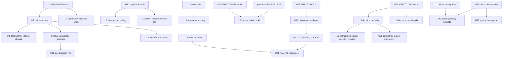
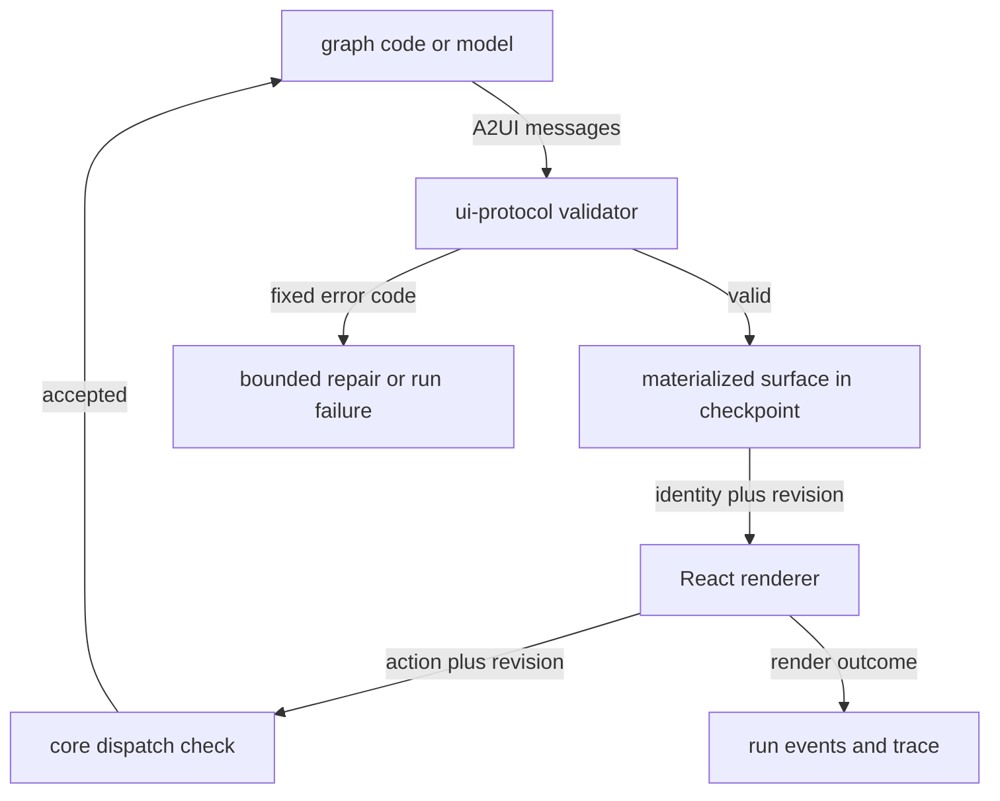

# Open-Source Launch and Architecture Backlog - Plan

## Goal Capsule

- **Objective:** A developer outside the project can find galaxie, read under which license and on which terms they may use and change it, install the launch packages, and wire an agent with tools, durable UI surfaces and a choice of local, partly local or backend inference without asking the maintainer anything.
- **Means:** Five workstreams, each one Beads epic: open-source launch readiness, runtime architecture fixes, UI feedback and A2UI surfaces, a decision-model role, and templates with a hosted demo (KTD1 to KTD9). Each implementation unit is one Beads issue and one pull request.
- **Authority:** This plan, then `AGENTS.md`, ADR-0012 (never weakened), ADR-0017, ADR-0018 and ADR-0020 to ADR-0023, and the new ADRs this plan creates. Where this plan and an Accepted ADR disagree, the unit that writes the superseding ADR lands first.
- **Stop conditions:** Stop and report if a unit needs a weaker ADR-0012 guarantee, a CSP or Trusted Types relaxation, a change to existing conformance goldens or compatibility matrices (other than a unit's own new lane), a behavior change in an executor other than the one the unit names, or a claim that galaxie is secure, compliant or certified. Also stop if the history audit (U5) finds a committed secret or `internal/` content: that blocks the public visibility gate until the maintainer decides.
- **Execution profile:** Many pull requests, grouped below by epic, one unit per pull request. Units inside a group may run in parallel unless their `Dependencies` say otherwise. Mock and scripted models only; real-device and real-model runs are `[HUMAN]` gates.
- **Finishing:** An agent picks a ready Beads issue, implements its unit on its own branch, runs `pnpm check`, gets an independent review, opens the pull request and merges after CI. Human gates are closed by the maintainer.

---

## Product Contract

### Summary

Turn the review of 2026-10-30 to 2026-11-04 into executable work. First make galaxie publishable under Apache-2.0 with contribution rules and launch packages. Then close the architecture gaps that block multi-framework agents: model-chosen tools in LangGraph.js and OpenAI-compatible providers, a shared adapter kit, a real output cap, idempotent backend writes and consistent scoping. Then give agents a closed feedback loop with the UI, adopt A2UI as the surface format with durable surfaces, add a decision-model role measured in the browser, and ship templates plus a hosted demo.

### Problem Frame

galaxie has a working runtime, six executors and a careful security baseline, but nobody outside the project can use it. The repository is private, licensed AGPL-3.0 with a commercial offer, refuses outside contributions until a CLA exists, and every package is `private: true` at `0.0.0` (`LICENSE`, `COMMERCIAL-LICENSE.md`, `AGENTS.md:76`, `packages/*/package.json`). The maintainer decided to publish it without monetization.

Several architecture gaps also limit the stated multi-framework goal. LangGraph.js has no way to offer capabilities to a model as tools (`packages/adapter-langgraph/src/routed-chat-model.ts` has no `bindTools`), and the OpenAI-compatible provider rejects tool calls by design (`packages/models/src/openai/chat-model.ts:132-158`). Adapters copy the same tool-call and provider-resolution code three times, and the ADK Go plan will add a fourth copy. The router's `maxTokens` is only a reservation. `httpCapability` never sends the effect ID as an `Idempotency-Key`, although `docs/system-design.md:447` tells hosts to. Scope validation is repeated in three places, and the rag-browser retrieval cache ignores principals and logout.

On the UI side, a surface that fails to resolve or render leaves the run paused with no signal to the run or its trace (`packages/react/src/surface.tsx`, no error boundary). The maintainer wants agents to compose application surfaces from components and backend data, which points at A2UI, and wants to try small decision models running in the browser as a faster alternative to generating UI or labels token by token.

### Key Decisions

- **galaxie is public and non-monetized.** Governs R1, R2, R5. (session-settled: user-directed — chosen over the AGPL-3.0 plus commercial license model of ADR-0015: the maintainer wants community adoption, not revenue.)
- **Apache-2.0 for the whole repository.** Governs R1, R2. (session-settled: user-directed — chosen over MIT: Apache-2.0 carries an explicit patent grant and matches the licenses of the dependencies.)
- **Full multi-framework support stays a goal.** Governs R8, R10, R27. (session-settled: user-directed — chosen over narrowing to fewer adapters: support for many frameworks is the project's differentiator.)
- **Developers choose fully local, partly local or backend inference per model role.** Governs R26. Stated by the maintainer; the templates make both ends concrete.

### Requirements

**Open-source launch**

- R1. The repository, its packages and its docs are licensed Apache-2.0, with every license statement, header and package field consistent and checked in CI.
- R2. Outside contributions are accepted under the Developer Certificate of Origin, with the sign-off checked on pull requests.
- R3. Contributors find how to build, test, add a conformance case and report a vulnerability without asking.
- R4. The history contains no secret and no maintainer-private content before the repository becomes public.
- R5. The launch packages can be packed for npm with correct metadata, and every other package is visibly marked experimental.
- R6. The README tells a newcomer what galaxie does and how to start within one screen; long status prose lives in a separate status document.
- R7. Every third-party runtime dependency of a launch package has a license on a reviewed allowlist, checked in CI.

**Runtime architecture**

- R8. A LangGraph.js agent can offer host capabilities to a routed model as tools; every model-chosen call runs through the broker with its labels, budgets, confirmations and effect IDs.
- R9. A model-chosen call to a write capability always requires a host-rendered confirmation (brief §9.5).
- R10. The OpenAI-compatible provider supports tool calling when tools are bound, and still rejects tool calls and refusals when none are bound.
- R11. A routed call's `maxTokens` reaches providers that accept a per-call output limit.
- R12. HTTP write capabilities declared with `retry: 'idempotency-key'` send the effect ID as the `Idempotency-Key` header.
- R13. `appId` and `principalScope` are validated by one rule everywhere they enter core, and that rule matches storage.
- R14. The rag-browser retrieval cache is scoped by app and principal and wiped by the core principal-invalidation (logout) signal and by Clear data.
- R15. Shared adapter logic (tool-call text extraction, routed provider resolution, worker bridge framing) exists once, with no behavior change in any executor.
- R16. The main `@galaxie/core` entry point uses no browser globals; browser-only modules live behind a separate entry point.

**UI feedback and surfaces**

- R17. A component that throws while rendering, or an interaction the registry rejects, produces a content-free render outcome on the run's events and trace instead of breaking the host page.
- R18. Agents describe surfaces with A2UI messages; galaxie validates every message against the bound catalog before rendering.
- R19. A pending surface, including its data model and revision, survives a reload exactly as a pending interaction does today.
- R20. The English tutor keeps its current behavior on the new surface format.

**Decision models**

- R21. A model role can be declared as a decision role answering typed questions (choice, score, boolean), routed with the same labels, consent and budgets as text roles.
- R22. Any routed chat model with structured output can serve a decision role through enum-constrained output.
- R23. When a decision's confidence is below a host threshold, or absent, an agent can ask the user through an ordinary interaction.
- R24. Decision roles can add controls but never remove a confirmation or policy check.
- R25. In-browser decision models are measured on galaxie's own questions before any of them is recommended.

**Templates, demo and docs**

- R26. A developer can start from a local-only template and from a hybrid-gateway template that run the same agent with different routing and bindings.
- R27. Candidate frameworks beyond the current executors have a written feasibility note before any adapter work starts.
- R28. A hosted demo shows a run surviving a reload without any local setup.
- R29. Launch packages have a size budget measured in CI.
- R30. The host integration guide starts with a minimal runnable layer and adds persistence and hardening as later layers.

### Success Criteria

- Three months after the `[HUMAN]` launch post gate closes: at least three developers outside the project integrate a template without help and report their integration time, and at least five issues and one pull request come from people the maintainer does not know. If not, the status document says galaxie continues as a research project.
- `pnpm check` passes on every merged unit, with no change to existing goldens or matrices.

### Scope Boundaries

- Weakening or demoting the private-string guard or any other ADR-0012 control is not built: the review suggested it, but it removes a guarantee and needs no change for this backlog.
- Moving manifest digests to scripts is not built: it changes no user-visible behavior; revisit only if the manifest API is redesigned.
- A plain-function executor is not built: six executors already show that the contracts are framework-neutral.
- Node 22 support is not built: the root `package.json` requires Node 24 and the earlier failure came from a Node 22 container.
- Real-model quality claims are outside this backlog; every real-device number is a `[HUMAN]` gate and a demonstration, never a pass/fail check.

#### Deferred to Follow-Up Work

- A `@galaxie/contracts` package split from core: it would carry error, interaction, schema and URL helper values, not only types, and needs an ADR-0017 amendment (`docs/adr/0017-framework-neutral-contracts.md:22`).
- Running LangGraph.js in a worker through the adapter kit's bridge, and removing the synchronous context shim that this would make unnecessary.
- An A2UI Express inference-format compiler, LLM-composed surfaces under constrained decoding, and a format evaluation (valid rate, tokens, time to first component) on local models.
- `callAgentFunction` from A2UI surfaces into the capability broker.
- An SBOM in CI (ADR-0015 promised one; U3 covers the allowlist only).
- Adapters for the frameworks U32 finds feasible.
- A scaffolder CLI over the templates.
- MCP tools in the hybrid-gateway template, once `@galaxie/tools-mcp` is a launch package.

### Dependencies

- Beads `galaxie-la5` (ADK Go, stage AG2) creates `packages/adapter-go/src/{bridge,llm,tool-calls}.ts`. U15 runs after AG2 merges.
- Beads `galaxie-kgo` (CI sharding) overlaps every new CI job in U3, U4, U30 and U31; those jobs run as separate jobs, not as extra steps in the serial `check` job.
- Beads `galaxie-f0k` ([HUMAN] legal review of learner data) is an existing gate before public release.
- Beads `galaxie-3r5` (spikes epic) is related to U26; U26 stays a child of the decision-models epic.

### Sources

- Repository research dossier for this plan (machine-local, best effort): `/tmp/compound-engineering-501/ce-plan-research/1cc60feb/repo-research.md`. A missing dossier is not a blocker; this plan governs.
- A2UI v1.0 protocol specification: https://github.com/a2ui-project/a2ui/blob/main/specification/v1_0/docs/a2ui_protocol.md
- Fast, reliable A2UI (swappable inference formats): https://developers.googleblog.com/fast-reliable-a2ui/
- Liquid d1 ONNX: https://huggingface.co/LiquidAI/d1-2B-ONNX; WaterSheep: https://huggingface.co/samratduttaofficial/WaterSheep; Laya browser build: https://github.com/dockndevai/laya-models
- Jev calibration audit (per-domain calibration does not transfer): https://arxiv.org/pdf/2609.24574
- Developer Certificate of Origin: https://developercertificate.org/

---

## Planning Contract

### Key Technical Decisions

- KTD1. **Relicense by a superseding ADR, then one mechanical pass.** ADR-0024 supersedes ADR-0015 and records Apache-2.0 for code, docs and ADRs, a `NOTICE` file, and the DCO. U2 then rewrites every header and statement in one pull request so the tree never mixes licenses. Inherits the labels of the license Key Decisions; governs R1, R2.
- KTD2. **DCO instead of a CLA.** A sign-off line on each commit, checked by a small CI job over the pull request's commits. It needs no service account and keeps the bar low for first contributors.
- KTD3. **Launch set: `@galaxie/core`, `@galaxie/adapter-langgraph`, `@galaxie/models`, `@galaxie/storage-indexeddb`, `@galaxie/react` at `0.1.0`.** These carry the parity verdict and the full hardening. Adapters for Python, ADK and Go, `tools-mcp` and `eslint-plugin` stay private and are labeled experimental until their own evidence matures. A new package that a launch package depends on at runtime (U15 `@galaxie/adapter-kit`, U19 `@galaxie/ui-protocol`) joins the launch set in the unit that creates it, with the same metadata, pack test, license check and size budget. Publishing itself is a `[HUMAN]` gate because it needs the npm scope and credentials.
- KTD4. **Model-chosen tools mirror the ADK adapter.** LangGraph.js gets `bindTools` on the routed model (selection first, then `provider.bindTools`, as `packages/adapter-adk/src/llm.ts:320-321`) and a `capabilityTool` helper on `LangGraphHost` modeled on `packages/adapter-adk/src/host.ts:166-207`. The write-confirmation rule (R9) is enforced in galaxie's tool helpers through a read-only binding kind and approval lookup that core exposes to adapters: U8 does it for LangGraph.js, and U33 applies the same refusal to the ADK JS helper and the Python helpers (ADK, pydantic-ai, DSPy) as a named behavior change. Custom tools an agent author builds outside these helpers are recorded in `docs/unsupported.md`.
- KTD5. **Extract the adapter kit after ADK Go AG2, not before.** A new non-adapter package `@galaxie/adapter-kit` consolidates three live copies (LangGraph.js, Pyodide, ADK JS) plus Go once AG2 exists. Generalizing from four real instances is safer than designing ahead of the in-flight Go work, and the ADK Go order the maintainer chose is not delayed. ADR-0025 amends ADR-0023 decision 1. Governs R15.
- KTD6. **Forward `maxTokens` as a per-call output cap.** The router adds it to the model call, and adapters pass it as the provider's per-call limit. Input tokens can still push actual usage above the reservation, and the docs keep saying so. Governs R11.
- KTD7. **A2UI replaces the single-component interaction format; galaxie keeps the envelope.** A2UI messages describe the surface, while galaxie's identity, revision, labels, broker and checkpoint wrap them. The validator, not the renderer, is the trust boundary. A materialized surface (components, data model, catalog ID, revision) lives in the checkpoint, not a raw message log. The ADR pins the latest non-release-candidate A2UI version at implementation time. ADR-0026 supersedes ADR-0007 and lifts the A2UI deferral in ADR-0010 and brief §5/§11.2. Governs R18, R19.
- KTD8. **Decision role as a router modality with a `system_one`-shaped contract.** A state plus typed questions in, an answer with optional probabilities and confidence out. The first provider wraps structured output with enum schemas, so it works on WebLLM, Built-in AI and remote models with no new download. Dedicated decision models (d1, WaterSheep, Laya) wait for U26's measurements. ADR-0027 records the rule that decisions only add controls. Governs R21 to R25.
- KTD9. **Templates are workspace packages under `templates/`, not a generator.** Each has its own README and tests in the existing Node and Chromium lanes. Both run the English tutor or a small shared agent with different routing and bindings. Governs R26.

### High-Level Technical Design

Dependencies between units across epics. A unit without arrows can start at once.

The surface envelope after U20, as a directional sketch:

### Human gates

These are standalone Beads issues titled `[HUMAN] ...` with the `human-gate` label. No agent unit depends on them.

- Make the GitHub repository public and enable private vulnerability reporting, after U2, U4, U5 and `galaxie-f0k`.
- Claim the npm scope and publish the launch packages, after U6.
- Choose and enable the demo host, after U30 and the visibility gate: GitHub Pages cannot send response headers, so either accept a meta-tag CSP without `frame-ancestors` for a mock-only demo as a recorded limit, or use a static host that serves U30's header file.
- Publish the launch post, after the visibility gate, the npm publish gate, U7, U8, U9, U28, U29 and U30; record its date in `docs/status.md` as the start of the three-month window.
- Accept or revise ADR-0025 (adapter kit), ADR-0026 (A2UI) and ADR-0027 (decision role).
- Run the decision-model spike page on the maintainer's device and record results, after U26.

---

## Implementation Units

### Unit Index

| U-ID | Title | Key files | Depends on |
| --- | --- | --- | --- |
| U1 | ADR-0024: Apache-2.0 and DCO | `docs/adr/0024-*.md` | none |
| U2 | Relicense the tree | `LICENSE`, `NOTICE`, `scripts/check-license.ts`, all headers | U1 |
| U3 | Dependency license allowlist | `scripts/check-dependency-licenses.ts` | U2 |
| U4 | Community files and DCO check | `CONTRIBUTING.md`, `SECURITY.md`, `.github/` | U1 |
| U5 | History and secrets audit | none tracked | none |
| U6 | Launch package metadata | `packages/*/package.json`, `docs/releasing.md` | U2 |
| U7 | README and status document | `README.md`, `docs/status.md`, `AGENTS.md`, `llms.txt` | U2 |
| U8 | LangGraph.js model-chosen tools | `packages/adapter-langgraph/src/*` | none |
| U9 | OpenAI-compatible tool calling | `packages/models/src/openai/*` | U8 |
| U10 | Per-call output cap | `packages/core/src/model-router.ts`, adapters | none |
| U11 | Idempotency-Key for HTTP writes | `packages/core/src/http-capability.ts` | none |
| U12 | One scope validation rule | `packages/core/src/{runtime,ownership,invalidation}.ts` | none |
| U13 | Scoped rag-browser retrieval cache | `examples/rag-browser/src/retrieval/*` | U12 |
| U14 | ADR-0025: adapter kit | `docs/adr/0025-*.md` | none |
| U15 | Extract `@galaxie/adapter-kit` | `packages/adapter-kit/`, adapters | U14, galaxie-la5 AG2 |
| U16 | Browser entry point for core | `packages/core/src/browser.ts`, `scripts/check-dependencies.ts` | none |
| U17 | Render outcome and error boundary | `packages/react/src/surface.tsx`, `packages/core/src/agent-instance.ts` | none |
| U18 | ADR-0026: A2UI surfaces | `docs/adr/0026-*.md` | none |
| U19 | `@galaxie/ui-protocol` | `packages/ui-protocol/` | U18 |
| U20 | Core pending surfaces | `packages/core/src/interactions.ts`, adapter-langgraph | U19 |
| U21 | React A2UI renderer and tutor migration | `packages/react/`, `examples/` | U17, U20 |
| U22 | ADR-0027: decision role | `docs/adr/0027-*.md` | none |
| U23 | Decision modality and mock provider | `packages/core/src/models.ts`, `model-router.ts` | U22 |
| U24 | Structured-output decision provider | `packages/models/src/decision/*` | U23 |
| U25 | Confidence-gated interaction | adapter-langgraph helper, `tests/injection-corpus/` | U23 |
| U26 | Spike: in-browser decision models | `spikes/decision-models/` | U22 |
| U27 | Layered host integration guide | `docs/guides/host-integration.md` | U28 |
| U28 | Local-only template | `templates/local-only/` | none |
| U29 | Hybrid-gateway template | `templates/hybrid-gateway/` | U11, U28 |
| U30 | Hosted demo build and deploy workflow | `.github/workflows/demo.yml`, `examples/rag-browser` | none |
| U31 | Size budget in CI | `scripts/check-size.ts` | U6 |
| U32 | Framework feasibility notes | `docs/notes/` | none |
| U33 | Other tool helpers enforce write confirmation | `packages/adapter-adk/src/host.ts`, `python/galaxie/src/galaxie/*` | U8 |

### PR group A: Open-source launch (epic, P1)

Waits on: nothing.

### U1. ADR-0024: Apache-2.0 and DCO

- **Goal:** Record the license change and the contribution policy before any file changes.
- **Requirements:** R1, R2 (KTD1, KTD2).
- **Dependencies:** none.
- **Files:** `docs/adr/0024-apache-2-0-license-and-dco.md`, `docs/adr/0015-licensing-agpl-with-commercial-license.md` (status line, and its `COMMERCIAL-LICENSE.md` link turned into plain text naming the removed file), `docs/adr/README.md`.
- **Approach:** Accepted with the maintainer's decision of 2026-11-04. It supersedes ADR-0015 entirely, covers code, docs and ADRs under Apache-2.0, adds `NOTICE`, replaces the CLA with the DCO, keeps the promised dependency allowlist, and defers the SBOM. It states that the maintainer is the sole copyright holder so far, which is what makes the relicense possible.
- **Test expectation:** none -- a decision record; `pnpm check` covers doc links.
- **Verification:** ADR-0015 shows "Superseded by ADR-0024", and the ADR index lists 0024.

### U2. Relicense the tree

- **Goal:** Make every license statement in the repository say Apache-2.0 in one pull request.
- **Requirements:** R1 (KTD1).
- **Dependencies:** U1.
- **Files:** `LICENSE`, `NOTICE`, delete `COMMERCIAL-LICENSE.md`, `scripts/check-license.ts`, every tracked file with an SPDX header (ts, tsx, js, mjs, py, go, css, html; markdown files carry no header), the three header-less html files (`examples/rag-browser/index.html` and two Python test pages) gain one, every `package.json` `license` field, the four `pyproject.toml` `license` fields (`python/`, `python/galaxie/`, two under `python/standins/`), the license lines in `examples/rag-browser/README.md` and the two spike READMEs, `AGENTS.md` (header rule and the outside-contribution rule), `README.md` license and contributing sections, `llms.txt`, `packages/core/README.md`, `packages/models/README.md`, `packages/adapter-langgraph/README.md`, `docs/framework-overview.md`, `docs/system-design.md`, `docs/adr/README.md`, the brief's license references.
- **Approach:**
  1. Replace `LICENSE` with the Apache-2.0 text and add `NOTICE` with the copyright line from the current header.
  2. Change the SPDX identifier to `Apache-2.0`, keeping the existing copyright line.
  3. Extend `check-license.ts` from JS/TS only to ts, tsx, js, mjs, py, go, css and html, each with its own comment syntax, and make it check `package.json` and `pyproject.toml` `license` fields.
  4. Update `AGENTS.md` so outside contributions are accepted with a DCO sign-off.
- **Patterns to follow:** the existing two-line header and the `check:license` script wiring in root `package.json`.
- **Test scenarios:**
  - A TS file with the old AGPL header fails `check:license`.
  - A Python, Go, HTML and CSS file missing the header each fails `check:license`.
  - A `package.json` or `pyproject.toml` with `"AGPL-3.0-only"` as its license fails.
  - The full tree passes after the rewrite.
- **Verification:** No tracked file other than ADR-0015, ADR-0024, historical files under `docs/plans/` and `docs/adr/`, and the license-check test fixtures contains `AGPL`; no `LICENSE`, package or pyproject license field, SPDX header or README license statement does; `pnpm check` passes.

### U3. Dependency license allowlist

- **Goal:** Fail CI when a launch package pulls in a runtime dependency whose license is not on a reviewed allowlist.
- **Requirements:** R7.
- **Dependencies:** U2 (merge order only).
- **Files:** `scripts/check-dependency-licenses.ts`, `scripts/dependency-license-allowlist.json`, root `package.json` script, `.github/workflows/ci.yml` (as its own job, see `galaxie-kgo`), test `tests/conformance/dependency-licenses.node.test.ts`.
- **Approach:** The checked set is each launch package's `dependencies` plus `peerDependencies` (optional peers included), resolved to the versions locked for that importer, plus their transitive production dependencies from the lockfile's `packages`/`snapshots` sections. Read each license from the installed package's `package.json`, and compare against an allowlist of permissive identifiers plus explicit per-package exceptions with a reason. Unknown or missing licenses fail.
- **Patterns to follow:** `scripts/check-go-lock.ts` `classifyLicense` and the lock test that runs it.
- **Test scenarios:**
  - An `MIT` dependency passes.
  - A dependency with no license field fails with its name.
  - A `GPL-3.0` dependency fails unless listed as an exception.
  - An exception without a reason is rejected.
  - The checked set is non-empty and contains `@langchain/core`, `@mlc-ai/web-llm`, `@huggingface/transformers` and `react`.
- **Verification:** The current lockfile passes; a deliberately added copyleft fixture fails.

### U4. Community files and DCO check

- **Goal:** Give contributors the rules and a path to report problems.
- **Requirements:** R2, R3 (KTD2).
- **Dependencies:** U1.
- **Files:** `CONTRIBUTING.md`, `SECURITY.md`, `CODE_OF_CONDUCT.md`, `.github/ISSUE_TEMPLATE/bug.yml`, `.github/ISSUE_TEMPLATE/feature.yml`, `.github/ISSUE_TEMPLATE/integration-report.yml` (template used, integration time, whether help was needed, device and browser; linked from the U7 quick start and both template READMEs), `.github/pull_request_template.md`, `AGENTS.md` (every commit, agent commits included, is made with `git commit -s`), `.github/workflows/dco.yml`, `scripts/check-dco.ts`, test `tests/conformance/dco.node.test.ts`.
- **Approach:** CONTRIBUTING covers Node 24 and pnpm 11, `pnpm check`, the English-only rule, SPDX headers, how to add a conformance case and an injection-corpus case, and the sign-off. SECURITY points to GitHub private vulnerability reporting and states scope and the documented limits, never a security claim. Code of conduct is Contributor Covenant 2.1. The DCO job checks every commit in the pull request range for a `Signed-off-by` line matching the author. Branches opened before U4 merges are re-signed before their pull request runs.
- **Test scenarios:**
  - A commit range where every commit is signed off passes.
  - A range with one unsigned commit fails and names it.
  - A sign-off whose email differs from the author fails.
- **Verification:** The new workflow runs on a test pull request; docs links pass `check:docs`.

### U5. History and secrets audit

- **Goal:** Prove the history is safe to publish before the visibility gate.
- **Requirements:** R4.
- **Dependencies:** none.
- **Files:** none tracked. Findings go into the Beads issue notes.
- **Approach:** Fetch `refs/pull/*/head` (squash-merged pull requests keep their pre-squash commits only there) and every tag, then run gitleaks over all refs, and search history for paths under `internal/`, `.beads/`, `.codegraph/` and `.env*`. Also scan pull request and issue titles, bodies and review comments (exported with `gh api`) for secrets and `internal/` content, and review Actions run logs and artifacts, listing any that must be deleted before visibility. Record each source and its result in the Beads issue. Report every finding to the maintainer without quoting secret values. Any finding triggers the stop condition.
- **Test expectation:** none -- an audit with a recorded result.
- **Verification:** The Beads issue records the commands, the commit range and a clean result, or the findings and the maintainer's decision.

### U6. Launch package metadata

- **Goal:** Make the five launch packages packable for npm and label the rest experimental.
- **Requirements:** R5 (KTD3).
- **Dependencies:** U2 (merge order only).
- **Files:** `packages/{core,adapter-langgraph,models,storage-indexeddb,react}/package.json`, the other packages' `README.md` (experimental notice), `docs/releasing.md`, test `tests/conformance/package-pack.node.test.ts`.
- **Approach:** Remove `private`, set `0.1.0`, add `repository`, `homepage`, `bugs`, `files`, `publishConfig.access: public`, and keep `peerDependencies` as they are. `docs/releasing.md` states the 0.x versioning policy (breaking changes such as the U21 surface API may land in 0.x minors) and the manual publish steps for the `[HUMAN]` gate. Internal workspace references must resolve to versions in the packed manifest.
- **Test scenarios:**
  - `pnpm pack` of each launch package contains `dist`, `LICENSE`, `NOTICE` and `README.md`, and no `src`, test or `internal` files.
  - Each packed manifest has no `workspace:` protocol left.
  - Every non-launch package still has `private: true`.
- **Verification:** The pack test passes on Node; `check:deps` still passes.

### U7. README and status document

- **Goal:** A newcomer understands galaxie and how to start from the first screen of the README.
- **Requirements:** R6.
- **Dependencies:** U2 (merge order only).
- **Files:** `README.md`, `docs/status.md`, `AGENTS.md`, `llms.txt`, test via `check:docs`.
- **Approach:** Move `README.md:20-48` and `AGENTS.md:5-47` into `docs/status.md` with the same claims and links. The README opens with one paragraph on what galaxie does, a short example, the three inference choices per role, the experimental packages, and links to `docs/unsupported.md` and the status document. Fix the stale MVP sentence in `llms.txt:17`. `AGENTS.md` keeps a short pointer so agents still read the status.
- **Test expectation:** none -- documentation; `check:docs` verifies links.
- **Verification:** No status claim is lost (diff the moved text); README never describes galaxie as secure or compliant.

### PR group B: Runtime architecture (epic, P1 for U8 and U9, P2 otherwise including U33, P3 for U16)

Waits on: nothing. U15 waits on `galaxie-la5` stage AG2 merging (needed before start).

### U8. LangGraph.js model-chosen tools

- **Goal:** A LangGraph.js agent can bind host capabilities as tools on a routed model.
- **Requirements:** R8, R9 (KTD4).
- **Dependencies:** none.
- **Files:** `packages/adapter-langgraph/src/routed-chat-model.ts`, `packages/adapter-langgraph/src/host.ts`, `packages/adapter-langgraph/src/index.ts`, `packages/adapter-langgraph/README.md`, `packages/models/README.md` (remove "no `bindTools`"), `packages/core/src/capability-broker.ts` (read-only binding kind and approval lookup), `docs/unsupported.md`, `docs/security-review.md` (rows C4 and LLM06 and the agent-author duty on executing model tool calls), `tests/injection-corpus/cases.json`, tests `packages/adapter-langgraph/test/tools.test.ts`, `tests/conformance/langgraph-tools.test.ts`.
- **Approach:**
  1. `bindTools` on the routed model stores declarations; a call with tools requires `tool-calling` at selection, then binds on the selected provider.
  2. `capabilityTool(name, spec)` on the host builds a LangChain tool that calls `capabilities.call` with the checkpoint-namespace effect scope; `denied` and `invalid` go back to the model as fixed text, other failures end the run.
  3. Enforce R9 in `capabilityTool` through the core lookup, so a write capability without confirmation cannot be offered as a tool. Core's broker behavior and other adapters are unchanged; U33 covers the other helpers.
- **Patterns to follow:** `packages/adapter-adk/src/host.ts:166-207`, `packages/adapter-adk/src/llm.ts:222,320-321`, existing tool-call output checks in `routed-chat-model.ts:117-172`.
- **Test scenarios:**
  - A mock model choosing a read capability gets its result as a `ToolMessage` and the run completes.
  - Calls to a provider without `tool-calling` fail `unsupported` before dispatch.
  - A write capability whose binding does not require confirmation is refused as a tool with a fixed `invalid` error.
  - A write capability with confirmation produces a host confirmation and runs once after approval.
  - A broker `denied` is returned to the model as fixed text and the run continues.
  - Two tool calls in one step get distinct, deterministic effect IDs across a resume (prebuilt `ToolNode` concurrency).
  - Tool-call arguments that fail output safety end the call `denied`.
  - Injection (tool output, obedient-attacker mock through a `capabilityTool` loop): an injected write still yields a host confirmation and is declined; an injected read forwarding a private value to a third-party binding is denied before dispatch. Existing corpus assertions are unchanged.
- **Verification:** Node and Chromium lanes pass; existing LangGraph goldens are unchanged.

### U9. OpenAI-compatible tool calling

- **Goal:** Remote OpenAI-compatible models can serve tool-calling roles.
- **Requirements:** R10.
- **Dependencies:** U8 (merge order only; the integration scenario uses U8's helper).
- **Files:** `packages/models/src/openai/chat-model.ts`, `packages/models/README.md`, `docs/unsupported.md`, tests `packages/models/test/openai-chat-model.test.ts`, `tests/conformance/openai-provider.test.ts`.
- **Approach:** Add `bindTools` with `tool_choice`. Accept `tool_calls` and streamed deltas only when tools are bound. Keep rejecting refusals and unbound tool calls. Map provider tool-call IDs through unchanged. The host still declares the `tool-calling` feature.
- **Patterns to follow:** `packages/models/src/transformers/chat-model.ts:127` `bindTools`; injected-fetch tests in `openai-chat-model.test.ts`.
- **Test scenarios:**
  - With bound tools, a non-streaming reply with one tool call returns it with arguments.
  - Streaming deltas assemble two parallel tool calls in order.
  - Without bound tools, a reply containing `tool_calls` still fails `ModelProviderError`.
  - A refusal fails as before.
  - Malformed argument JSON yields an invalid tool call, not a crash.
  - Integration: a LangGraph.js agent with a `capabilityTool` completes a tool loop against the loopback stub on Node and Chromium.
- **Verification:** Both lanes pass; credential scans in the existing AT-23 tests stay clean.

### U10. Per-call output cap

- **Goal:** A routed call never asks a provider for more output tokens than its reservation.
- **Requirements:** R11 (KTD6).
- **Dependencies:** none.
- **Files:** `packages/core/src/models.ts`, `packages/core/src/model-router.ts`, `packages/adapter-langgraph/src/routed-chat-model.ts`, `packages/adapter-pyodide/src/adapter.ts`, `packages/adapter-adk/src/llm.ts`, `packages/models/src/{openai,transformers,webllm}/chat-model.ts`, `docs/system-design.md`, `AGENTS.md`, `docs/status.md`, tests `packages/core/test/model-router.test.ts`, adapter tests.
- **Approach:** Add `maxTokens` to the model call from `attempt()`. Each adapter passes it as the provider's per-call option. The WebLLM, Transformers and OpenAI providers send the lower of the per-call value and their constructor limit (today WebLLM and Transformers let `options.maxTokens` replace the constructor limit). Built-in AI has no limit; document that. The ADK Go adapter picks this up in its own stages.
- **Test scenarios:**
  - A route with `maxTokens: 64` leads the provider to receive 64 on each call.
  - A provider-level constructor limit lower than the route keeps the lower value.
  - A Built-in AI route still runs and its docs state the limit does not apply.
- **Verification:** Router and adapter tests pass; neither `AGENTS.md` nor `docs/status.md` says per-call provider caps are unimplemented.

### U11. Idempotency-Key for HTTP writes

- **Goal:** Backends can deduplicate a replayed write by effect ID.
- **Requirements:** R12.
- **Dependencies:** none.
- **Files:** `packages/core/src/http-capability.ts`, `docs/system-design.md`, `docs/guides/host-integration.md`, tests `packages/core/test/http-capability.test.ts`, `tests/conformance/http-integration.test.ts`.
- **Approach:** When the capability declares `retry: 'idempotency-key'`, set `Idempotency-Key` to the effect ID after host headers, so a host cannot accidentally drop it. Document the CORS allow-header requirement next to the existing `X-Galaxie` note.
- **Test scenarios:**
  - A write with `retry: 'idempotency-key'` sends the effect ID as the header.
  - A capability with `retry: 'none'` sends no header.
  - A replay after recovery sends the same key as the first attempt.
  - Chromium: a cross-origin loopback server that does not allow the header yields the fixed `unavailable` error.
- **Verification:** Node and Chromium loopback tests pass.

### U12. One scope validation rule

- **Goal:** Core rejects an invalid `appId` or `principalScope` at the first entry point, with the same rule as storage.
- **Requirements:** R13.
- **Dependencies:** none.
- **Files:** `packages/core/src/ids.ts` (or a new `scope.ts`), `packages/core/src/runtime.ts`, `packages/core/src/ownership.ts`, `packages/core/src/invalidation.ts`, tests `packages/core/test/scope.test.ts`, `tests/conformance/scope-rule.test.ts`.
- **Approach:** One exported validator used by `createRuntime`, `runtime.create`, `acquireOwnership` and `watchInvalidation`. Storage keeps its own copy because it does not depend on core; a conformance test asserts both accept and reject the same table of values.
- **Test scenarios:**
  - `createRuntime({appId: 'bad id'})` fails `invalid`.
  - A 128-character id passes; 129 fails.
  - The shared table gives identical results for core and `storage-indexeddb` `validateScope`.
- **Verification:** Existing host examples still start; tests pass on both lanes.

### U13. Scoped rag-browser retrieval cache

- **Goal:** One user's retrieval index is never shown to another principal and is removed on logout invalidation and Clear data.
- **Requirements:** R14.
- **Dependencies:** U12 (merge order only).
- **Files:** `examples/rag-browser/src/retrieval/cache.ts`, `examples/rag-browser/src/retrieval/service.ts`, `examples/rag-browser/src/host/runtime.ts`, `examples/rag-browser/README.md`, `docs/unsupported.md`, tests under `examples/rag-browser/test/`.
- **Approach:** Key `IndexCache` by `appId` and `principalScope`, add the inactivity retention the saver already uses, and wipe on the core principal-invalidation signal and the existing Clear data action. rag-browser hard-codes one principal (`visitor`) and has no Sign out, so Start over stays per-review and keeps the index, as its README flow and Chromium loops expect.
- **Test scenarios:**
  - Cache module (`test/cache.test.ts`): two principals indexing different passages each see only their own after reopen.
  - Cache module: a principal-invalidation signal removes that principal's index records and leaves the other's.
  - Clear data removes the index and a reload starts empty; Start over keeps it.
  - An index older than the retention window is removed on the next sweep.
- **Verification:** Chromium tests pass, including the existing Start over loops; the unsupported-list entry is updated.

### U14. ADR-0025: adapter kit

- **Goal:** Record where shared adapter logic lives and how the dependency rules change.
- **Requirements:** R15 (KTD5).
- **Dependencies:** none.
- **Files:** `docs/adr/0025-adapter-kit-package.md`, `docs/adr/0023-google-adk-go-through-a-wasm-worker.md` (amendment note), `docs/adr/README.md`, `docs/system-design.md` §4.
- **Approach:** Proposed. Scope is tool-call text extraction, routed provider and credential resolution, prepare-time service validation, error helpers and the worker bridge framing and validators. Adapters may depend on `@galaxie/adapter-kit`; it depends only on core and `@langchain/core` types. It lists what stays per-adapter.
- **Test expectation:** none -- a decision record.
- **Verification:** The ADR names every duplicated site from the research and the dependency-rule changes.

### U15. Extract `@galaxie/adapter-kit`

- **Goal:** Shared adapter code exists once, with identical behavior.
- **Requirements:** R15 (KTD5).
- **Dependencies:** U14; `galaxie-la5` stage AG2 merged.
- **Files:** `packages/adapter-kit/` (new, a launch package per KTD3 because `adapter-langgraph` depends on it), `packages/adapter-{langgraph,pyodide,adk,go}/src/*`, `tests/conformance/package-pack.node.test.ts` and the size budget, `scripts/check-dependencies.ts`, root `package.json` build and typecheck chains, `vitest.config.ts` aliases, tests `packages/adapter-kit/test/*`.
- **Approach:** Move code, do not redesign it. Start from the copies with the strictest validation. Migrate one adapter per commit.
- **Execution note:** Characterization first: run every adapter's existing suites before each migration commit; they must pass unchanged after it.
- **Test scenarios:**
  - Tool-call text extraction gives identical output on the shared fixtures in `tests/conformance/support/tool-call-checks.ts` for all adapters.
  - Bridge validators reject the same malformed envelopes as the Pyodide bridge tests.
  - `check:deps` rejects an adapter importing another adapter and accepts imports of the kit.
- **Verification:** All goldens and matrices unchanged; Node and Chromium lanes pass.

### U16. Browser entry point for core

- **Goal:** Core's main entry runs anywhere JavaScript runs; browser-only helpers are opt-in.
- **Requirements:** R16.
- **Dependencies:** none.
- **Files:** `packages/core/src/index.ts`, `packages/core/src/browser.ts`, `packages/core/package.json` exports, `scripts/check-dependencies.ts`, host examples' imports, `docs/system-design.md`.
- **Approach:** Move `acquireOwnership` and `watchInvalidation` to `@galaxie/core/browser`. Add a dependency-check rule that rejects unguarded top-level references to `navigator`, `document`, `window` and `BroadcastChannel` in main-entry modules, allowing the feature-guarded uses in `model-router.ts` (storage `persist()`) and `development.ts` (`RuntimeOptions.developmentWarnings`), whose API stays unchanged.
- **Test scenarios:**
  - Importing `@galaxie/core` in a Node context with no browser globals and running a fake executor works.
  - The dependency check fails when a main-entry module references `navigator` unguarded at top level, and passes the guarded router and development uses.
  - Host examples import ownership from the new entry and their reload tests pass.
- **Verification:** Both lanes pass; the system design lists the new entry point.

### PR group C: UI feedback and A2UI surfaces (epic, P2)

Waits on: nothing for U17 and U18; U19 to U21 as their dependencies state.

### U17. Render outcome and error boundary

- **Goal:** Render failures become visible to the run and its trace, and never break the host page.
- **Requirements:** R17.
- **Dependencies:** none.
- **Files:** `packages/react/src/surface.tsx`, `packages/core/src/instance.ts`, `packages/core/src/agent-instance.ts`, `packages/core/src/run-events.ts`, `packages/core/src/tracing.ts`, tests `packages/react/test/surface.test.tsx`, `tests/conformance/react-surface.test.tsx`, `packages/core/test/render-outcome.test.ts`.
- **Approach:** `AgentSurface` wraps the component in an error boundary that shows the host fallback and reports once. Without a host fallback it renders a fixed English message in a `role=alert` region (focus moved once, as `SubmissionError` does) saying the step could not be shown, and the host gets a documented hook to cancel the run or Start over. A new instance method records a render outcome (`rendered` or `failed` with a fixed code) for the current interaction and revision. Core ignores stale revisions and emits a content-free run event and span attribute. The run stays paused; resuming on a failed render is deferred to the A2UI ADR.
- **Test scenarios:**
  - A component that throws shows the fallback, calls `onError` once and records `failed`.
  - With no host fallback, a throwing component still renders the fixed alert and leaves no empty region.
  - A registry rejection records `failed` with the existing fixed code.
  - A successful mount records `rendered` once, also under Strict Mode.
  - An outcome for an older `viewRevision` is ignored.
  - Events and spans contain no props or user text.
- **Verification:** Chromium component tests and the conformance surface test pass.

### U18. ADR-0026: A2UI surfaces

- **Goal:** Decide how A2UI becomes galaxie's surface format.
- **Requirements:** R18, R19, R20 (KTD7).
- **Dependencies:** none.
- **Files:** `docs/adr/0026-a2ui-surfaces.md`, status notes in `docs/adr/0007-typed-ui-registry-for-mvp.md` and `docs/adr/0010-mvp-scope-cuts.md`, `docs/adr/README.md`, brief §5 and §11.2 pointers.
- **Approach:** Proposed. It records:
  - the pinned spec version, named explicitly (the latest non-release-candidate when U18 starts; reviewers reported v0.9.1 stable and v1.0 as a candidate on 2026-11-04, so confirm and link that version's specification), and how upgrades are adopted
  - the galaxie envelope fields
  - the materialized surface stored in the checkpoint
  - validator checks: catalog schema, root, ID references, data paths, URL allowlist, size caps, `@` keys; catalog URL-typed properties accept literal values only, and any data binding on them is rejected
  - the catalog: which components it defines, the accessible semantics each must keep (grouping, labels, live region, focus rule), and how a core dispatch receipt (rejected, duplicate, stale) reaches the rendered component as status, with `components.test.tsx` and `education-a11y.test.tsx` as the acceptance bar
  - what a host and the run do after a failed render (stay paused, retry or fail the run), and which revision rules apply
  - whether pending answer state persists before submit; if it does, the persistence trigger, the `private-user` labeling point and the restore notice
  - function mapping: renderer functions are host-registered and pure; agent functions go to the broker with confirmation for writes
  - data-model labels
  - the renderer choice and its pin
  - the compatibility path for single-component interactions
- **Test expectation:** none -- a decision record.
- **Verification:** The ADR answers each A2UI item in Deferred to Follow-Up Work (the Express inference-format compiler, LLM-composed surfaces under constrained decoding, `callAgentFunction`) with "deferred" or a decision.

### U19. `@galaxie/ui-protocol`

- **Goal:** Typed A2UI messages, the galaxie envelope, a validator and a surface reducer, with no React dependency.
- **Requirements:** R18 (KTD7).
- **Dependencies:** U18.
- **Files:** `packages/ui-protocol/` (new: `src/messages.ts`, `src/envelope.ts`, `src/validate.ts`, `src/surface.ts`, `README.md`, `AGENTS.md`; a launch package per KTD3 because `@galaxie/react` and core depend on it), `scripts/check-dependencies.ts`, `tests/conformance/package-pack.node.test.ts` and the size budget, root build chains, tests `packages/ui-protocol/test/*`.
- **Approach:** The reducer applies create, update-components, update-data-model and delete messages to a materialized surface, bumps its revision, and records the pinned A2UI spec version on it. The validator returns fixed error codes usable by the existing bounded repair loop.
- **Test scenarios:**
  - A valid create plus update sequence yields the expected materialized surface and revision.
  - A missing root, a dangling component ID and a data path outside the data model each fail with a distinct fixed code.
  - A URL outside the allowlist fails; an allowlisted origin with a query passes, matching core's URL rules.
  - A surface above the size cap fails.
  - A key starting with `@` in the data model is rejected.
  - A component not in the bound catalog fails.
  - A URL-typed property bound to a data-model path fails, even when the current value is allowlisted.
- **Verification:** Node and Chromium tests pass; the package has no React import.

### U20. Core pending surfaces

- **Goal:** Interactions can carry an A2UI surface that survives reload.
- **Requirements:** R19 (KTD7).
- **Dependencies:** U19.
- **Files:** `packages/core/src/interactions.ts`, `packages/core/src/agent-instance.ts`, `packages/adapter-langgraph/src/interaction.ts`, `packages/storage-indexeddb` tests, `docs/system-design.md`, tests `packages/core/test/surfaces.test.ts`, `tests/conformance/surface-restore.test.ts`.
- **Approach:** A pending interaction may hold a validated materialized surface. Today's single-component interaction maps to a one-component surface, so existing agents keep working. Dispatch checks the surface revision. Data typed into the surface gains `private-user` before it reaches the checkpoint. On every revision, before it is published, core runs `checkInteractionUrlPolicy` with the run's private values over the full materialized surface (components and data model). The checkpoint record carries the A2UI spec version.
- **Test scenarios:**
  - A surface interaction restores after reload with the same components, data model and revision (Chromium, IndexedDB).
  - An action with a stale revision is rejected.
  - A single-component interaction from the tutor still resolves and dispatches unchanged.
  - Surface data from user input carries `private-user` in the restored run.
  - A registered private string placed in a surface URL by an update is rejected before publication.
  - A surface stored under the pinned spec version restores after the package's version constant changes.
- **Verification:** All existing interaction and recovery tests pass unchanged.

### U21. React A2UI renderer and tutor migration

- **Goal:** Hosts render A2UI surfaces with their registered components, and the tutor runs on them.
- **Requirements:** R18, R20.
- **Dependencies:** U17, U20.
- **Files:** `packages/react/src/a2ui/*`, `packages/react/src/registry.ts`, the education components moved to `examples/english-tutor-ui/` (or the tutor example), catalog JSON Schema export through `createManifest`, `examples/host-local`, `examples/host-remote`, `templates/local-only`, `templates/hybrid-gateway`, tests `packages/react/test/a2ui.test.tsx`, `tests/conformance/english-tutor.test.tsx`.
- **Approach:** Render from the materialized surface with the renderer chosen in U18, reuse U17's boundary and outcome, and export the catalog as JSON Schema with `x-galaxie` annotations. The tutor's flows and copy do not change. The renderer keys by interaction and surface identity only and applies later revisions in place, keeping component-local input and focus, and announces a materially changed region through one polite live region.
- **Test scenarios:**
  - The tutor's quiz, writing prompt, feedback and progress render from surfaces with the same accessible names as today.
  - A reload mid-quiz restores the surface, and answer state resets as today (unless ADR-0026 decides to persist it).
  - Typed text and focus survive an update-data-model message; a stale-revision action is still rejected by core.
  - An example agent composes a multi-component surface from a mock capability result, the user acts on it, and the surface restores after reload with the same data model and revision.
  - Both templates render their interactions from surfaces and their tests pass with only import changes.
  - A component outside the catalog never renders and records `failed`.
  - Keyboard and alert-focus behavior from the accessibility tests still pass.
- **Verification:** Existing tutor tests pass with only import changes; both example hosts run.

### PR group D: Decision models (epic, P3)

Waits on: nothing for U22; the rest as their dependencies state.

### U22. ADR-0027: decision role

- **Goal:** Decide the decision-role contract and its safety rule.
- **Requirements:** R21 to R25 (KTD8).
- **Dependencies:** none.
- **Files:** `docs/adr/0027-decision-model-role.md`, `docs/adr/README.md`.
- **Approach:** Proposed. It records:
  - the `system_one`-shaped request and answer
  - modality routing and destinations
  - which providers come first
  - that confidence is optional and must be calibrated by the host on its own questions
  - the rule that a decision may add a confirmation or interaction but never remove one
  - the model licenses hosts must check (LFM Open License revenue threshold for d1)
- **Test expectation:** none -- a decision record.
- **Verification:** The ADR states what U26 must measure before any model is recommended.

### U23. Decision modality and mock provider

- **Goal:** A role can be declared and routed as a decision role.
- **Requirements:** R21, R24 (KTD8).
- **Dependencies:** U22.
- **Files:** `packages/core/src/models.ts`, `packages/core/src/model-router.ts`, `packages/models/src/mock.ts`, `packages/adapter-langgraph/src/host.ts`, tests `packages/core/test/decision-routing.test.ts`, `packages/adapter-langgraph/test/decide.test.ts`.
- **Approach:** Add `'decision'` to the modality, a decision call with the same lease, consent, labels, budgets and output checks as text calls, a deterministic mock decision provider, and a `decide(role, request)` entry on the LangGraph host.
- **Test scenarios:**
  - A decision role routes to a decision provider and never to a text provider.
  - A `private-user` state blocks a third-party decision provider, as for text roles.
  - The mock returns the scripted choice with probabilities that sum to 1.
  - Budget reservation and settlement apply per decision call.
  - An answer naming an option not in the question fails `invalid`.
- **Verification:** Both lanes pass; text routing tests are unchanged.

### U24. Structured-output decision provider

- **Goal:** Any routed model with structured output can answer decision questions with no new download.
- **Requirements:** R22 (KTD8).
- **Dependencies:** U23.
- **Files:** `packages/models/src/decision/structured.ts`, `packages/models/package.json` export, `packages/models/README.md`, tests `packages/models/test/decision-structured.test.ts`, `packages/models/test/webllm-enum.test.ts`, `packages/models/test/builtin-ai-enum.test.ts`.
- **Approach:** Turn the questions into one JSON Schema with enum fields, call the model with structured output, and map the reply to answers without confidence. Add the missing tests that enum schemas reach WebLLM `response_format` and Built-in AI `responseConstraint` unchanged.
- **Test scenarios:**
  - Three questions of different types produce one schema and three answers.
  - An enum schema reaches the fake WebLLM engine and the fake `LanguageModel` unchanged.
  - A reply with an out-of-enum value fails and enters the bounded repair loop.
  - Answers from this provider carry no confidence field.
- **Verification:** Fake-runtime tests pass on Node and Chromium.

### U25. Confidence-gated interaction

- **Goal:** Agents ask the user instead of guessing when a decision is not confident.
- **Requirements:** R23, R24.
- **Dependencies:** U23.
- **Files:** `packages/adapter-langgraph/src/decide.ts`, `tests/injection-corpus/cases.json`, `tests/injection-corpus/README.md`, tests `packages/adapter-langgraph/test/decide-gate.test.ts`, `tests/conformance/injection-corpus.test.ts`, `tests/conformance/support/obedient-attacker.ts` (a new decision directive kind), `tests/conformance/support/injection-fixture.ts` (a fixture path that calls the decision helper).
- **Approach:** A helper takes a decision, a host threshold and an interaction request. Below the threshold or with no confidence, it calls `requestInteraction`. Add injection cases where untrusted state tries to flip a decision that would skip a confirmation.
- **Test scenarios:**
  - Confidence 0.9 with threshold 0.7 returns the answer without an interaction.
  - Confidence 0.5 opens the interaction and resumes with the user's choice.
  - A missing confidence always opens the interaction.
  - Injection: a lesson payload steering the decision toward skipping a write confirmation still produces the confirmation.
- **Verification:** Corpus tests pass with the new cases and existing case assertions unchanged.

### U26. Spike: in-browser decision models

- **Goal:** Measure whether small decision models are worth recommending.
- **Requirements:** R25.
- **Dependencies:** U22.
- **Files:** `spikes/decision-models/` (own pnpm workspace: `package.json`, `README.md`, page, question set of about 200 galaxie questions), `docs/plans/<date>-spike-decision-models-plan.md`.
- **Approach:** One page loads WaterSheep, the Laya 4-bit browser build and d1-2B `q4f16` through `onnxruntime-web/webgpu` in a worker, plus Built-in AI enum output as the zero-download baseline. It records load time from cache, first-decision latency for 200 and 1,000 token states with 10 and 30 questions, GPU memory with and without a loaded chat model, and accuracy and ECE. Pin model revisions and file hashes. Spike code never moves to `packages/`.
- **Test expectation:** none -- throwaway spike; results are demonstrations recorded in its README by the `[HUMAN]` device run.
- **Verification:** The page runs with a mock backend in headless Chromium; the README lists every unmeasured item.

### PR group E: Templates, demo and docs (epic, P2)

Waits on: nothing for U28, U30 and U32; U27 waits on U28; U29 waits on U11 and U28 (merge order only); U31 waits on U6 (merge order only).

### U27. Layered host integration guide

- **Goal:** Integration starts small and adds guarantees in layers.
- **Requirements:** R30.
- **Dependencies:** U28 (merge order only; the Layer 0 snippet must match its code).
- **Files:** `docs/guides/host-integration.md`, `llms.txt`.
- **Approach:** Layer 0: graph, router and an in-memory checkpointer, runnable by copy-paste. Layer 1: IndexedDB saver, recovery and ownership. Layer 2: CSP, Trusted Types, logout fencing and export. Each layer links its tests.
- **Test expectation:** none -- documentation; `check:docs` verifies links.
- **Verification:** The Layer 0 snippet matches the local-only template's code.

### U28. Local-only template

- **Goal:** A developer starts with no download and adds local models deliberately.
- **Requirements:** R26 (KTD9).
- **Dependencies:** none.
- **Files:** `templates/local-only/` (Vite app, `README.md`), `pnpm-workspace.yaml`, `vitest.config.ts`, tests `templates/local-only/test/*`.
- **Approach:** Built-in AI first, mock when unavailable, WebLLM only after an explicit opt-in. A state table maps each typed Built-in AI reason (`no_api`, `unsupported_languages`, `download_required`, `activation_required`, `download_failed`, `not_allowed`) and each WebLLM phase (explicit opt-in with size shown, in progress with cancel, failed, ready) to one fixed message and control, plus no WebGPU. The template depends only on the launch packages at `^0.1.0` and third-party packages.
- **Test scenarios:**
  - With no Built-in AI and no WebGPU, the template runs on the mock and shows both unavailable states.
  - Declining the download keeps the mock route and shows the declined state.
  - A failed download keeps the mock route and shows the failed state.
  - The template's `package.json` depends only on launch packages and third-party packages.
  - A reload mid-interaction restores the pending interaction.
- **Verification:** Node and Chromium lanes pass with mocks.

### U29. Hybrid-gateway template

- **Goal:** A developer keeps private prompts and backend data on their own server while the agent runs in the browser.
- **Requirements:** R26 (KTD9).
- **Dependencies:** U11, U28 (merge order only).
- **Files:** `templates/hybrid-gateway/` (Node gateway and page, `README.md`), tests `templates/hybrid-gateway/test/*`.
- **Approach:** The gateway offers:
  - an OpenAI-compatible proxy with per-user auth, quotas, a model allowlist, and prompt IDs with variables instead of raw system prompts
  - HTTP capabilities honoring `Idempotency-Key`, with idempotency records keyed by (authenticated principal, key, capability) and a reused key with a different request digest rejected
  - `docs.search@1` over HTTP for private documents

  The user is derived only from a short-lived, scoped token issued as `examples/host-remote` does. The same agent package runs in both templates. The template depends only on the launch packages at `^0.1.0` and third-party packages; any server code it needs is copied in, not imported from `examples/`.
- **Test scenarios:**
  - An unauthenticated model call gets a fixed `denied`.
  - A user over quota gets a fixed error and no upstream call.
  - A replayed write with the same `Idempotency-Key` is applied once.
  - The same key from a second user is neither deduplicated against nor answered with the first user's response; a user ID supplied in the arguments is ignored or refused.
  - A model outside the allowlist is refused.
  - The same agent completes its flow in both templates with different routing.
- **Verification:** Node and Chromium loopback tests pass; no credential appears in spans, events or snapshots.

### U30. Hosted demo build and deploy workflow

- **Goal:** Anyone can see a run survive a reload in the browser.
- **Requirements:** R28.
- **Dependencies:** none.
- **Files:** `.github/workflows/demo.yml`, `examples/rag-browser` build config, entry and README, `docs/device-matrix.md`.
- **Approach:** Build only `vite build --mode mock` on pushes to `main` as its own job; the README notes that real models need a local default-mode build. Emit the same `cspDirectives` both as a meta tag in the built `index.html`, before any script, and as a header file for header-capable static hosts. The demo starts with the review option enabled and a visible one-line cue saying the page can be reloaded to resume the paused review and that Start over clears it. Deployment starts only after the `[HUMAN]` demo-host gate; deploying without `frame-ancestors` is allowed only when that gate records it as an accepted limit.
- **Test scenarios:**
  - Served from a static server that adds no headers, the build enforces its meta CSP and Trusted Types in headless Chromium and makes no external request.
  - A reload during passage review shows the cue before and the restored notice after, and restores the pending review.
- **Verification:** The workflow builds on a branch; the deploy step is skipped until the demo-host gate closes.

### U31. Size budget in CI

- **Goal:** Launch package size is measured and regressions fail.
- **Requirements:** R29.
- **Dependencies:** U6 (merge order only).
- **Files:** `scripts/check-size.ts`, `scripts/size-budget.json`, root `package.json`, `.github/workflows/ci.yml` (its own job), `docs/device-matrix.md`.
- **Approach:** Measure the minified and gzip size of each launch package's built entry points and compare with a budget set at the current size plus a stated margin.
- **Test scenarios:**
  - A build within budget passes and prints sizes.
  - A fixture entry above budget fails and names the entry.
- **Verification:** The budget file records today's sizes; the brief's size-budget promise is met.

### U32. Framework feasibility notes

- **Goal:** Each candidate framework has a short, evidence-based note before any adapter work.
- **Requirements:** R27.
- **Dependencies:** none.
- **Files:** `docs/notes/framework-vercel-ai-sdk.md`, `docs/notes/framework-openai-agents-js.md`, `docs/notes/framework-mastra.md`.
- **Approach:** For each, at a pinned version: does it run in a browser, how its tool loop and human-in-the-loop points map onto the executor contract and interactions, how it persists state, and what it would need from the adapter kit. Each note ends with go, no-go or blocked, with a reason.
- **Test expectation:** none -- documentation.
- **Verification:** Each note cites the framework's source or docs at the pinned version.

### U33. Other tool helpers enforce write confirmation

- **Goal:** Model-chosen writes need a host confirmation in every galaxie tool helper, not only LangGraph.js.
- **Requirements:** R9 (KTD4).
- **Dependencies:** U8 (the core binding lookup).
- **Files:** `packages/adapter-adk/src/host.ts`, `python/galaxie/src/galaxie/{adk,pydantic_ai,dspy}.py` (the Python `capability_tool` helpers), `packages/adapter-pyodide/src/*` if the lookup must cross the bridge, their READMEs, `docs/unsupported.md`, tests `packages/adapter-adk/test/agents.test.ts`, `python/galaxie/tests/test_{adk,pydantic_ai,dspy}.py`, `packages/adapter-pyodide/test/adapter.node.test.ts`.
- **Approach:** Named behavior change in the ADK JS executor and the Pyodide executors (ADK Python, pydantic-ai, DSPy): each tool helper refuses a write binding whose approval is `none` with the same fixed `invalid` error as U8. Existing tests that offer `docs.save@1` with approval `none` move to approval `confirm` or assert the refusal. Custom tools built outside the helpers stay recorded in `docs/unsupported.md`.
- **Test scenarios:**
  - ADK JS and each Python helper: an approval-`none` write offered through `capabilityTool` is refused with the fixed error.
  - With approval `confirm`, the model-chosen write produces a host confirmation and runs once after approval.
- **Verification:** Node, Chromium and CPython lanes pass; goldens change only where this unit names them, and the behavior change is listed in the adapter READMEs.

---

## Deferred / Open Questions

### From 2026-11-04 review

- **Demo host (U30).** GitHub Pages cannot send the CSP response header; a meta-tag CSP cannot carry `frame-ancestors`. The `[HUMAN]` demo-host gate decides: GitHub Pages with that loss recorded as a limit, or a header-capable static host.
- **Decision epic shape (U23 to U25).** Three reviewers found that U24 returns no confidence, so U25's gate always asks, and U23 adds a public core modality before any evidence. Option: replace U23 to U25 with a `decide(role, request)` LangGraph helper over routed `withStructuredOutput` with enum schemas, keep the injection cases, and defer the router modality, confidence field and threshold gate until U26 names a model worth recommending. Decide before U23 starts.
- **Decision spike timing (U26).** Brief §16.2 runs spikes only when a milestone needs the answer; nothing in this backlog consumes U26. Option: defer U26 and its device gate. If kept, a reviewer on another model proposed adding gold answers to the question set and a confidence source per candidate, with ECE reported only where confidence exists.
- **Launch set and multi-framework support (KTD3).** Only the LangGraph.js adapter is installable during the three-month window, while full multi-framework support is the stated differentiator. Decide whether any Python, ADK or Go adapter joins the launch set or the window is read as single-framework.
- **npm publish timing versus U21.** Publishing `@galaxie/react` before U21 means early adopters meet a breaking surface API change inside the window. Decide whether the npm gate waits on U21.
- **Hybrid-gateway scope (U29).** One reviewer proposed cutting quotas and `docs.search@1` over HTTP to Deferred; they serve no step of R26.
- **Education components location (U21).** Moving them out of `@galaxie/react` removes exports from a launch package; U21 should keep them in place unless ADR-0026 names one destination before U6 publishes.
- **History audit closure (U5).** A reviewer on another model proposed that U5 and the visibility gate close only after any finding is remediated (rotated or revoked and removed from history) and a full-history rerun is clean, matching R4.
- **Hybrid-gateway upstream credentials (U29).** A reviewer on another model proposed specifying server-side secret injection and rotation for upstream credentials, verified absent from browser bundles and repository files.

---

## Verification Contract

| Applies to | Gate |
| --- | --- |
| Every unit | `pnpm check` (the same checks CI runs: license, Biome, both typechecks, Node and Chromium tests, Python and Go tests, build, dependency rules, docs links) |
| Units that add a CI job (U3, U4, U30, U31) | The job runs on the pull request as a separate job, and the serial `check` job time does not grow |
| Units touching an executor (U8, U10, U15, U20, U33) | Existing conformance goldens and compatibility matrices unchanged, except changes U33 names |
| U5 | Recorded audit result in the Beads issue |
| U26 | Spike page runs with mocks in headless Chromium; device numbers come only from the `[HUMAN]` run |

---

## Definition of Done

- Each unit's Verification holds and its Beads issue is closed with a short note on what was proved.
- No unit weakens an ADR-0012 control, relaxes CSP or Trusted Types, or adds a security or compliance claim.
- New source files carry the SPDX header in force when they land (AGPL before U2 merges, Apache-2.0 after).
- `docs/unsupported.md` and the status document are updated whenever a unit changes a documented limit.
- Abandoned-attempt code is removed from the diff before review.
