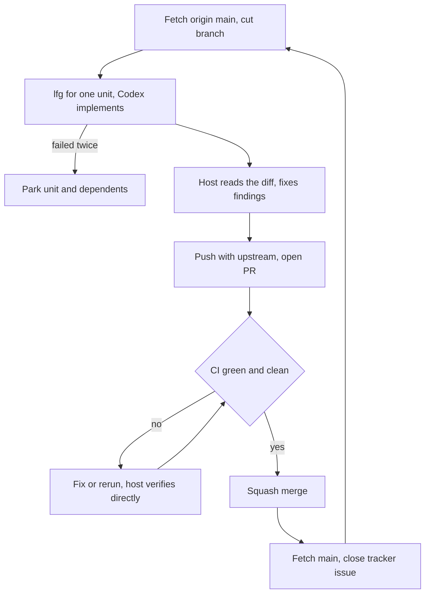

# Remaining Backlog Execution - Plan

## Goal Capsule

- **Objective:** A developer outside the project can find galaxie, read under which license and on which terms they may use and change it, install the launch packages, and wire an agent with tools, durable UI surfaces and a choice of local, partly local or backend inference without asking the maintainer anything. This is the objective of the origin plan; this plan finishes the part of it that is still open.
- **Means:** Deliver the 27 unfinished units of the origin plan as 27 pull requests, one at a time, each implemented by Codex CLI (model `gpt-6.1-sol`, reasoning effort `xhigh`) through `compound-engineering:lfg`, then reviewed, fixed, pushed, merged and followed by a main refresh by the host (KTD1, KTD2).
- **Authority:** The origin plan owns what each unit builds, its test scenarios and its verification. Then `AGENTS.md`, ADR-0012 (never weakened), the accepted and proposed ADRs under `docs/adr/`, and the new ADRs the units create. This plan owns only order, grouping, the per-PR loop and the stop rules. Where it and the origin plan disagree about a unit's content, the origin plan wins.
- **Stop conditions:** Those of the origin plan, plus: a unit whose Codex run fails twice, or whose review finds a defect the host cannot fix within the unit, is parked and reported. Only units whose `Waits on:` entry says "needed before start" are parked with it (R5); every other unit continues, and its branch is cut from `main` without the parked unit.
- **Execution profile:** 28 pull requests (this plan, then one per unit), executed sequentially in one worktree and merged in the order below. Planning and review stay with the host; implementation is Codex.
- **Finishing:** The host merges each pull request after CI is green and review findings are fixed (the maintainer authorized merging for this goal), then moves the worktree onto the refreshed `origin/main` and closes the unit's tracker issue.

---

## Product Contract

### Summary

Six of the origin plan's 33 units are done. Finish the other 27 as separate, dependency-ordered pull requests that land on `main` one by one. Units that need a human (credentials, accounts, device runs, maintainer decisions) are not attempted and are listed.

### Problem Frame

The origin plan is implementation-ready and its first six units are merged: the license decision and relicense, the dependency license allowlist, community files and the DCO check, the history audit (audit only) and launch package metadata. Nothing in the other 27 units has started, and the origin plan assumes a loop for picking, reviewing and merging them that has not been run at that scale. Running 27 units without a written order risks conflicting branches, a unit started before its dependency landed, and ADR numbers that collide: the origin plan names ADR-0025, ADR-0026 and ADR-0027, but `docs/adr/0025-adk-recipes-demo.md` already exists.

### Key Decisions

- **Codex CLI implements, the host plans and reviews.** Governs R2. (session-settled: user-directed — chosen over the host implementing directly: the maintainer assigned implementation to Codex CLI with GPT-6.1-Sol at xhigh effort and keeps planning and review with the host.)
- **The host merges each pull request of this plan after review and green CI.** Governs R3. (session-settled: user-directed — chosen over leaving every merge to the maintainer: the maintainer's goal for this run is to review, fix, push and merge. The authorization covers the pull requests of this plan only.)
- **galaxie is public and non-monetized, under Apache-2.0.** Carried from the origin plan. Governs R6. (session-settled: user-directed — chosen over AGPL-3.0 with a commercial license, and over MIT: the maintainer wants community adoption, and Apache-2.0 carries a patent grant.)
- **Full multi-framework support stays a goal, and developers choose local, partly local or backend inference per model role.** Carried from the origin plan. Governs R6. (session-settled: user-directed — chosen over narrowing to fewer adapters: support for many frameworks is the differentiator.)

### Requirements

**Delivery**

- R1. Each of the 27 unfinished units lands as its own branch and pull request based on `main`, in an order that never starts a unit before the units it depends on have merged.
- R2. Codex CLI (`gpt-6.1-sol`, `xhigh`) implements every unit through `compound-engineering:lfg`; the host does not write unit code except to fix review findings.
- R3. A pull request merges only after its CI is green, its review findings are fixed or recorded in the pull request body, and the host has read the diff itself. After the merge the worktree moves onto the refreshed `origin/main` and the unit's tracker issue is closed.
- R4. A unit that is a human gate, or needs credentials, an account, a device or information only the maintainer holds, is skipped, listed in the final report, and blocks nothing else.
- R5. A parked unit parks only the units that need its output before they can start: those whose `Waits on:` entry says "needed before start". A wait marked "merge order only" never parks a unit.

**Preserved constraints**

- R6. Every origin-plan requirement the unit advances still holds, and the origin plan's settled decisions are not reopened.
- R7. All tracked content is English, new source files carry the Apache-2.0 SPDX header, every commit is signed off (`git commit -s`), and no document claims galaxie is secure, compliant or certified.
- R8. No unit weakens an ADR-0012 control, relaxes the CSP or Trusted Types, or changes existing conformance goldens or compatibility matrices beyond what the unit names.
- R9. The tracker (Beads) stays stealth: `.beads` is never committed, `bd dolt push` and `bd sync` are never run, tracker text is English, and plan or tracker identifiers stay out of pull request titles, pull request bodies and tracked source files.

### Success Criteria

- All 27 pull requests are merged or parked with a reported reason, and `main` passes `pnpm check` and CI after each merge.
- The final report lists every parked unit, every human gate left open, and every advisory finding that was recorded rather than fixed.

### Scope Boundaries

- Rewriting or re-planning any unit's content is not done here; the origin plan is the source.
- Human gates are not attempted: making the repository public, claiming the npm scope and publishing, choosing the demo host, publishing the launch post, accepting or revising the three new ADRs, running the decision-model spike on a device, deciding the origin plan's open questions, and the legal review of learner data.
- Real-model quality claims and device measurements stay out of scope, as in the origin plan.

#### Deferred to Follow-Up Work

- Everything the origin plan defers (a `@galaxie/contracts` package, LangGraph.js in a worker, an A2UI inference-format compiler, `callAgentFunction`, an SBOM, adapters for the frameworks the feasibility notes find viable, a scaffolder CLI, MCP tools in the hybrid-gateway template).
- The advisory finding from the launch-package pull request: source maps and declaration maps in the published tarballs point at `src` files that are not shipped.

### Sources

- Origin plan: `docs/plans/2026-11-04-0809-feat-open-source-launch-and-architecture-backlog-plan.md` (unit bodies, test scenarios, verification contract and open questions).
- Repository state checked on `main` at b46364c: `docs/adr/0025-adk-recipes-demo.md` is taken; `packages/adapter-go/src/{bridge,llm,tool-calls}.ts` exist and the ADK Go stage the adapter-kit unit waits on is merged; `packages/adapter-langgraph/src/routed-chat-model.ts` has no `bindTools` while `packages/adapter-adk/src/llm.ts:320-321` does; `packages/core/src/http-capability.ts` never mentions `Idempotency-Key`; `packages/core/src/model-router.ts` uses `maxTokens` only for the budget reservation; `docs/status.md`, `docs/notes/` and `templates/` do not exist.
- `docs/releasing.md` (merged): the five launch packages share one version and three kinds of hand-edited version places that tests guard.
- `AGENTS.md`: commands, English-only rule, SPDX header, DCO, ADR-0012.

---

## Planning Contract

### Key Technical Decisions

- KTD1. **One unit, one pull request, sequential.** The plan runs in a single worktree, so a branch is cut from the freshly fetched `origin/main` only after the previous pull request merged. This avoids stacked branches and the merge conflicts that overlapping units would cause (U8, U10, U15, U20 and U33 all touch executors or the router). Governs R1, R5.
- KTD2. **Each unit goes through `compound-engineering:lfg` scoped to that unit.** The call passes the origin plan path, names the one unit, states the stage assignment (Codex implements, the host plans and reviews), and carries the repository constraints. Settled decisions travel with every call. Governs R2, R7, R8, R9.
- KTD3. **The host's merge gate is CI-decided, not time-boxed.** The host squash-merges with the pull request number in the subject, which is the repository convention, only when every check passes, merge state is clean, and there is no unresolved review thread or unrecorded finding. Governs R3.
- KTD4. **ADR numbers are allocated at write time.** The origin plan's ADR-0025, ADR-0026 and ADR-0027 are read by title: the adapter-kit ADR, the A2UI surfaces ADR and the decision-role ADR. Each takes the smallest unused number when its unit writes it (0026, 0027 and 0028 in the planned order). Every tracked document that cites an ADR by number is updated to the allocated number in the same unit, except the origin plan, which stays unedited; its implementers read the ADR by title. The three ADRs are written as Proposed; later units proceed against them and each such pull request says so. Governs R6.
- KTD5. **New runtime dependencies of a launch package join the launch set in the unit that creates them.** `@galaxie/adapter-kit` and `@galaxie/ui-protocol` get launch metadata, copies of `LICENSE` and `NOTICE`, an entry in the pack test's launch list, the dependency rules, and the release steps in `docs/releasing.md`, which list every hand-edited version place. This is the origin plan's launch-set decision applied to the two packages the origin plan names. Governs R6.
- KTD6. **A drift check opens every unit.** Before editing, the implementer verifies the origin unit's file and symbol claims against current `main` and records any drift in the pull request body. A stale claim changes the unit's approach, not its goal. Governs R6.
- KTD7. **Verification of host fix commits is direct.** When the cross-model controller's receipt covers only Codex's commit, the host's later fix commits are verified by running `pnpm check` (or the narrowest sufficient suite) and CI, and the pull request body says so. Governs R3.
- KTD8. **Templates land before the A2UI renderer.** The origin plan's renderer unit migrates both templates and tests them "with only import changes", so the two template units merge before it. The origin plan lists no such dependency, so this is an ordering choice of this plan, not a change to any unit. Governs R1.

### High-Level Technical Design

The execution order, which is a single line. An arrow means "merge before start". The real dependencies are those in each pull request's `Waits on:` line; the line is longer than they require so that no two units touching the same executor, router or package file are ever open at once.

```mermaid
flowchart TB
  P0[PR0 this plan] --> U7[U7 README and status]
  U7 --> U8[U8 LangGraph tools]
  U8 --> U9[U9 OpenAI tool calling]
  U9 --> U33[U33 helpers confirm writes]
  U33 --> U10[U10 output cap]
  U10 --> U11[U11 Idempotency-Key]
  U11 --> U12[U12 scope rule]
  U12 --> U13[U13 rag cache scoping]
  U13 --> U14[U14 adapter kit ADR]
  U14 --> U15[U15 extract adapter kit]
  U15 --> U16[U16 browser entry]
  U16 --> U17[U17 render outcome]
  U17 --> U28[U28 local-only template]
  U28 --> U27[U27 layered guide]
  U27 --> U29[U29 hybrid gateway]
  U29 --> U18[U18 A2UI ADR]
  U18 --> U19[U19 ui-protocol]
  U19 --> U20[U20 core pending surfaces]
  U20 --> U21[U21 React A2UI renderer]
  U21 --> U30[U30 hosted demo build]
  U30 --> U31[U31 size budget]
  U31 --> U32[U32 feasibility notes]
  U32 --> U22[U22 decision role ADR]
  U22 --> U23[U23 decision modality]
  U23 --> U24[U24 decision provider]
  U24 --> U25[U25 confidence gate]
  U25 --> U26[U26 decision spike]
```

The loop each pull request goes through:

### Assumptions

These are un-validated bets of this plan, not decisions the maintainer made.

- The origin plan's open questions are not blockers, and each unit runs as the origin plan writes it. The decision-epic shape (U23 to U25) runs as written; its pull request bodies state that with no confidence from the structured-output provider the confidence gate always asks. The decision spike (U26) runs as a mock-only page, and its device run stays a human gate. The hybrid-gateway scope (U29) runs as written, and the education components stay in `@galaxie/react` unless the A2UI ADR names a destination, as the origin plan says.
- "Switch and pull" means: after each merge, fetch `origin/main` and cut the next branch from it in this worktree. The main checkout is not touched except for tracker commands; the maintainer pulls it themselves.
- Merging uses `gh pr merge --squash`, which matches the history on `main`.
- Codex's served reasoning effort cannot be verified; each pull request body states the requested effort and that serving is unverified.
- Continuous integration takes up to about fifteen minutes per pull request because of the Python lanes. Waiting is done with a background watcher, never a blocking poll.
- A Codex run is retried once with the review findings as input. A second failure parks the unit.

---

## Implementation Units

### Unit Index

Unit IDs and titles are the origin plan's, so U7 here is U7 there; IDs 1 to 6 are absent because those units are merged. Every unit's goal, approach, test scenarios and verification are those of the same-numbered origin unit. The entries after the index add only what this plan fixes: order, waits and execution deltas found in the repository. Every unit also follows KTD6.

| U-ID | Title | Key files | Depends on (origin plan) |
| --- | --- | --- | --- |
| U7 | README and status document | `README.md`, `docs/status.md`, `AGENTS.md`, `llms.txt` | none |
| U8 | LangGraph.js model-chosen tools | `packages/adapter-langgraph/src/routed-chat-model.ts`, `host.ts` | none |
| U9 | OpenAI-compatible tool calling | `packages/models/src/openai/chat-model.ts` | U8 |
| U33 | Other tool helpers enforce write confirmation | `packages/adapter-adk/src/host.ts`, `python/galaxie/src/galaxie/*.py` | U8 |
| U10 | Per-call output cap | `packages/core/src/{models,model-router}.ts`, adapters | none |
| U11 | Idempotency-Key for HTTP writes | `packages/core/src/http-capability.ts` | none |
| U12 | One scope validation rule | `packages/core/src/{ids,runtime,ownership,invalidation}.ts` | none |
| U13 | Scoped rag-browser retrieval cache | `examples/rag-browser/src/retrieval/*` | U12 |
| U14 | Adapter kit ADR | `docs/adr/` | none |
| U15 | Extract `@galaxie/adapter-kit` | `packages/adapter-kit/`, four adapters | U14 |
| U16 | Browser entry point for core | `packages/core/src/browser.ts` | none |
| U17 | Render outcome and error boundary | `packages/react/src/surface.tsx`, core events | none |
| U28 | Local-only template | `templates/local-only/` | none |
| U27 | Layered host integration guide | `docs/guides/host-integration.md` | U28 |
| U29 | Hybrid-gateway template | `templates/hybrid-gateway/` | U11, U28 |
| U18 | A2UI surfaces ADR | `docs/adr/` | none |
| U19 | `@galaxie/ui-protocol` | `packages/ui-protocol/` | U18 |
| U20 | Core pending surfaces | `packages/core/src/interactions.ts` | U19 |
| U21 | React A2UI renderer and tutor migration | `packages/react/src/a2ui/*`, examples, templates | U17, U20 |
| U30 | Hosted demo build and deploy workflow | `.github/workflows/demo.yml` | none |
| U31 | Size budget in CI | `scripts/check-size.ts`, `scripts/size-budget.json` | U6 (merged) |
| U32 | Framework feasibility notes | `docs/notes/` | none |
| U22 | Decision role ADR | `docs/adr/` | none |
| U23 | Decision modality and mock provider | `packages/core/src/{models,model-router}.ts` | U22 |
| U24 | Structured-output decision provider | `packages/models/src/decision/` | U23 |
| U25 | Confidence-gated interaction | `packages/adapter-langgraph/src/decide.ts` | U23 |
| U26 | Spike: in-browser decision models | `spikes/decision-models/` | U22 |

### PR0: This plan

Waits on: nothing.

Ships this file as a docs-only pull request. Test expectation: none -- documentation only; `pnpm run check:docs` must pass.

### PR1: README and status document

Waits on: PR0 (merge order only).

### U7. README and status document

- **Goal:** A newcomer learns what galaxie does and how to start within one screen; the long status prose moves to `docs/status.md`.
- **Requirements:** Origin R6 (R6, R7 here).
- **Files:** `README.md`, `docs/status.md`, `AGENTS.md`, `llms.txt`.
- **Execution deltas:** The status prose now lives mostly in `AGENTS.md`'s project-status section, so the move touches it. Keep every documented limit and every "unmeasured" statement; add no security or compliance claim. Leave the `SECURITY.md` sentence about unpublished packages alone; it changes at publish time.
- **Verification:** `pnpm run check:docs` and `pnpm check` pass; the README opens with what galaxie is and a start path.

### PR2: LangGraph.js model-chosen tools

Waits on: PR1 (merge order only).

### U8. LangGraph.js model-chosen tools

- **Goal:** A LangGraph.js agent can offer host capabilities to a routed model as tools, and every model-chosen call runs through the broker.
- **Requirements:** Origin R8, R9 (origin KTD4).
- **Files:** `packages/adapter-langgraph/src/routed-chat-model.ts`, `packages/adapter-langgraph/src/host.ts`, `packages/adapter-langgraph/src/index.ts`, `packages/core/src/capability-broker.ts` (read-only lookup), READMEs, `docs/unsupported.md`, `docs/security-review.md`, tests.
- **Execution deltas:** Confirmed on `main`: the routed model has no `bindTools`. Mirror `packages/adapter-adk/src/llm.ts:320-321`. Security-sensitive (a write capability always needs a host-rendered confirmation), so the host reads this diff line by line.
- **Verification:** Existing conformance goldens and compatibility matrices unchanged; Node and Chromium tests pass.

### PR3: OpenAI-compatible tool calling

Waits on: PR2 (needed before start: the integration scenario uses PR2's helper; the origin plan calls this wait merge order only).

### U9. OpenAI-compatible tool calling

- **Goal:** Remote OpenAI-compatible models can serve tool-calling roles.
- **Requirements:** Origin R10.
- **Files:** `packages/models/src/openai/chat-model.ts`, `packages/models/README.md`, `docs/unsupported.md`, tests.
- **Execution deltas:** Follow the `bindTools` pattern in `packages/models/src/transformers/chat-model.ts`. Without bound tools, tool calls and refusals keep failing with the existing fixed errors.
- **Verification:** Both lanes pass; credential scans in the existing credential tests stay clean.

### PR4: Write confirmation in the other tool helpers

Waits on: PR2 (needed before start: it uses the binding lookup PR2 adds).

### U33. Other tool helpers enforce write confirmation

- **Goal:** Model-chosen writes need a host confirmation in every galaxie tool helper, not only LangGraph.js.
- **Requirements:** Origin R9 (origin KTD4).
- **Files:** `packages/adapter-adk/src/host.ts`, `python/galaxie/src/galaxie/{adk,pydantic_ai,dspy}.py`, `packages/adapter-pyodide/src/*` if the lookup must cross the bridge, adapter READMEs, `docs/unsupported.md`, tests.
- **Execution deltas:** A named behavior change in the ADK JavaScript and Pyodide executors; the only unit allowed to change goldens, and only the ones it names. Python lanes in CI must pass.
- **Verification:** Node, Chromium and CPython lanes pass; goldens differ only where the unit names; the behavior change is listed in the adapter READMEs.

### PR5: Per-call output cap

Waits on: PR4 (merge order only; no code dependency, ordered to keep executor changes apart).

### U10. Per-call output cap

- **Goal:** A routed call's `maxTokens` reaches providers that accept a per-call output limit.
- **Requirements:** Origin R11 (origin KTD6).
- **Files:** `packages/core/src/models.ts`, `packages/core/src/model-router.ts`, the LangGraph, Pyodide and ADK adapters, `packages/models/src/{openai,transformers,webllm}/chat-model.ts`, `docs/system-design.md`, `AGENTS.md`, `docs/status.md`, tests.
- **Execution deltas:** Confirmed on `main`: the router uses `maxTokens` only for the reservation. WebLLM sends its own provider-level `max_tokens` (default 1024); reconcile the two without changing that default silently. Docs keep saying actual usage can exceed the reservation.
- **Verification:** Node and Chromium tests with the mock provider; goldens unchanged.

### PR6: Idempotency-Key for HTTP writes

Waits on: PR5 (merge order only).

### U11. Idempotency-Key for HTTP writes

- **Goal:** HTTP write capabilities declared with `retry: 'idempotency-key'` send the effect ID as the `Idempotency-Key` header.
- **Requirements:** Origin R12.
- **Files:** `packages/core/src/http-capability.ts`, `docs/system-design.md`, `docs/guides/host-integration.md`, tests.
- **Execution deltas:** Confirmed on `main`: the header is never sent today. A replay of a successful receipt must still not invoke the capability.
- **Verification:** Injected-fetch tests on Node and Chromium, including a retry that reuses the same key.

### PR7: One scope validation rule

Waits on: PR6 (merge order only).

### U12. One scope validation rule

- **Goal:** `appId` and `principalScope` are validated by one rule everywhere they enter core, and the rule matches storage.
- **Requirements:** Origin R13.
- **Files:** `packages/core/src/ids.ts` (or a new `scope.ts`), `packages/core/src/runtime.ts`, `packages/core/src/ownership.ts`, `packages/core/src/invalidation.ts`, tests.
- **Execution deltas:** Security-adjacent: values accepted before must not become unreadable data after the change. State the accepted set and check it against the storage rule.
- **Verification:** Node and Chromium tests, including previously accepted and newly rejected values.

### PR8: Scoped rag-browser retrieval cache

Waits on: PR7 (merge order only).

### U13. Scoped rag-browser retrieval cache

- **Goal:** The rag-browser retrieval cache is scoped by app and principal and is wiped by the principal-invalidation signal and by Clear data.
- **Requirements:** Origin R14.
- **Files:** `examples/rag-browser/src/retrieval/{cache,service}.ts`, `examples/rag-browser/src/host/runtime.ts`, `examples/rag-browser/README.md`, `docs/unsupported.md`, `docs/status.md` (where the status unit moves the sentence that says the cache lacks principal scoping; also `AGENTS.md` if the drift check still finds it there), tests.
- **Execution deltas:** Update every document that states the old limit. The example's four executors keep their behavior.
- **Verification:** Node and Chromium tests with mocks; reload and logout cases.

### PR9: Adapter kit ADR

Waits on: PR8 (merge order only).

### U14. Adapter kit ADR

- **Goal:** Record the shared adapter kit decision before any code moves.
- **Requirements:** Origin R15 (origin KTD5); KTD4 here for numbering.
- **Files:** `docs/adr/<next unused number>-adapter-kit-package.md`, the ADK Go ADR amendment note, `docs/adr/README.md`, `docs/system-design.md` §4.
- **Execution deltas:** Written as Proposed. Test expectation: none -- documentation; `check:docs` passes.
- **Verification:** The ADR index lists it and the amended ADR links to it.

### PR10: Extract the adapter kit

Waits on: PR9 (needed before start: it follows the ADR).

### U15. Extract `@galaxie/adapter-kit`

- **Goal:** Tool-call text extraction, routed provider resolution and worker bridge framing exist once, with no behavior change in any executor.
- **Requirements:** Origin R15 (origin KTD5); KTD5 here.
- **Files:** `packages/adapter-kit/`, `packages/adapter-{langgraph,pyodide,adk,go}/src/*`, `tests/conformance/package-pack.node.test.ts`, `docs/releasing.md`, `scripts/check-dependencies.ts`, root build and typecheck chains, `vitest.config.ts` aliases, tests.
- **Execution deltas:** The ADK Go stage that creates the Go copies is merged, so all four copies exist. The new package gets full launch metadata, license files and a pack-test entry. Highest regression risk in the backlog: goldens and matrices must be unchanged.
- **Verification:** `pnpm check` plus the Go and Python lanes; no golden diff.

### PR11: Browser entry point for core

Waits on: PR10 (merge order only).

### U16. Browser entry point for core

- **Goal:** The main `@galaxie/core` entry point uses no browser globals; browser-only modules live behind a separate entry.
- **Requirements:** Origin R16.
- **Files:** `packages/core/src/index.ts`, `packages/core/src/browser.ts`, `packages/core/package.json` exports, `scripts/check-dependencies.ts`, host examples' imports, `docs/system-design.md`.
- **Execution deltas:** The pack test asserts every `exports` target exists in the tarball; the new entry must satisfy it.
- **Verification:** Node tests import the main entry with no DOM; the pack test passes.

### PR12: Render outcome and error boundary

Waits on: PR11 (merge order only).

### U17. Render outcome and error boundary

- **Goal:** A component that throws while rendering, or an interaction the registry rejects, produces a content-free render outcome on the run's events and trace.
- **Requirements:** Origin R17.
- **Files:** `packages/react/src/surface.tsx`, `packages/core/src/{instance,agent-instance,run-events,tracing}.ts`, tests.
- **Execution deltas:** The outcome carries no props, model text or user content.
- **Verification:** Chromium component tests, including Strict Mode.

### PR13: Local-only template

Waits on: PR12 (merge order only).

### U28. Local-only template

- **Goal:** A developer can start from a template that runs an agent with local inference only.
- **Requirements:** Origin R26 (origin KTD9).
- **Files:** `templates/local-only/` (Vite app, `README.md`), `pnpm-workspace.yaml`, `vitest.config.ts`, tests.
- **Execution deltas:** `templates/` does not exist; the unit creates it. Mock and scripted models only. It merges before the renderer unit so that unit can migrate it (KTD8).
- **Verification:** The template's tests run in the existing lanes.

### PR14: Layered host integration guide

Waits on: PR13 (needed before start: the Layer 0 snippet must match its code; the origin plan calls this wait merge order only).

### U27. Layered host integration guide

- **Goal:** The host integration guide starts with a minimal runnable layer and adds persistence and hardening as later layers.
- **Requirements:** Origin R30.
- **Files:** `docs/guides/host-integration.md`, `llms.txt`.
- **Execution deltas:** Keep all existing hardening statements and limits. Test expectation: none -- documentation; the link check passes.
- **Verification:** `pnpm run check:docs`.

### PR15: Hybrid-gateway template

Waits on: PR6 and PR13 (needed before start: the unit reuses the idempotency header and the local-only template's shape; the origin plan calls these waits merge order only).

### U29. Hybrid-gateway template

- **Goal:** The same agent runs with backend routing and HTTP bindings.
- **Requirements:** Origin R26 (origin KTD9).
- **Files:** `templates/hybrid-gateway/` (Node gateway and page, `README.md`), tests.
- **Execution deltas:** Upstream credentials are injected server-side, and a test or script confirms they appear in no browser bundle or repository file. No real credential is created or stored. Merges before the renderer unit (KTD8).
- **Verification:** Node and Chromium tests with a loopback gateway stub.

### PR16: A2UI surfaces ADR

Waits on: PR15 (merge order only).

### U18. A2UI surfaces ADR

- **Goal:** Record the A2UI decision before the package exists.
- **Requirements:** Origin R18, R19, R20 (origin KTD7); KTD4 here.
- **Files:** `docs/adr/<next unused number>-a2ui-surfaces.md`, status notes in `docs/adr/0007-typed-ui-registry-for-mvp.md` and `docs/adr/0010-mvp-scope-cuts.md`, `docs/adr/README.md`, brief §5 and §11.2 pointers.
- **Execution deltas:** Written as Proposed. The A2UI version is the latest non-release-candidate at write time; look it up, do not assume. Test expectation: none -- documentation.
- **Verification:** `check:docs` passes.

### PR17: UI protocol package

Waits on: PR16 (needed before start).

### U19. `@galaxie/ui-protocol`

- **Goal:** A validator that checks every A2UI message against the bound catalog, with fixed error codes.
- **Requirements:** Origin R18 (origin KTD7); KTD5 here.
- **Files:** `packages/ui-protocol/` (new), `scripts/check-dependencies.ts`, `tests/conformance/package-pack.node.test.ts`, `docs/releasing.md`, root build chains, tests.
- **Execution deltas:** Joins the launch set with full metadata, because `@galaxie/react` and core depend on it. The validator, not the renderer, is the trust boundary.
- **Verification:** Node and Chromium tests; the pack test covers the new package.

### PR18: Core pending surfaces

Waits on: PR17 (needed before start).

### U20. Core pending surfaces

- **Goal:** A pending surface, with its data model and revision, survives a reload exactly as a pending interaction does.
- **Requirements:** Origin R19 (origin KTD7).
- **Files:** `packages/core/src/interactions.ts`, `packages/core/src/agent-instance.ts`, `packages/adapter-langgraph/src/interaction.ts`, storage tests, `docs/system-design.md`, tests.
- **Execution deltas:** The materialized surface lives in the checkpoint, not a raw message log. This changes the stored shape, so the unit states its read path for checkpoints written before it.
- **Verification:** Node and Chromium reload tests; existing goldens unchanged.

### PR19: React A2UI renderer and tutor migration

Waits on: PR12 (needed before start), PR18 (needed before start), PR13 and PR15 (needed before start: this unit migrates both templates).

### U21. React A2UI renderer and tutor migration

- **Goal:** Hosts render A2UI surfaces with their registered components, and the tutor runs on them.
- **Requirements:** Origin R18, R20.
- **Files:** `packages/react/src/a2ui/*`, `packages/react/src/registry.ts`, `examples/host-local`, `examples/host-remote`, `templates/local-only`, `templates/hybrid-gateway`, tests.
- **Execution deltas:** The education components stay in `@galaxie/react` unless the A2UI ADR names a destination. This is a breaking change to a launch package's surface API; `docs/releasing.md` allows it in a 0.x minor, and the pull request body says so.
- **Verification:** Existing tutor tests pass with only import changes; both example hosts and both templates run; the injection corpus passes unchanged.

### PR20: Hosted demo build

Waits on: PR19 (merge order only).

### U30. Hosted demo build and deploy workflow

- **Goal:** A mock-mode build of the demo is produced on pushes to `main`, ready to host.
- **Requirements:** Origin R28.
- **Files:** `.github/workflows/demo.yml`, `examples/rag-browser` build config, entry and README, `docs/device-matrix.md`.
- **Execution deltas:** Build only. The deploy step stays disabled until the maintainer's demo-host gate closes; the workflow runs as its own job, not inside the serial check job.
- **Verification:** The workflow builds on the pull request; the serial check job time does not grow.

### PR21: Size budget in CI

Waits on: PR20 (merge order only).

### U31. Size budget in CI

- **Goal:** Launch packages have a size budget measured in CI.
- **Requirements:** Origin R29.
- **Files:** `scripts/check-size.ts`, `scripts/size-budget.json`, root `package.json`, `.github/workflows/ci.yml` (its own job), `docs/device-matrix.md`.
- **Execution deltas:** The launch set now includes the packages the adapter-kit and UI-protocol units created. Runs as its own job.
- **Verification:** The job passes on the pull request; the serial check job time does not grow.

### PR22: Framework feasibility notes

Waits on: PR21 (merge order only).

### U32. Framework feasibility notes

- **Goal:** Candidate frameworks beyond the current executors have written feasibility notes.
- **Requirements:** Origin R27.
- **Files:** `docs/notes/framework-vercel-ai-sdk.md`, `docs/notes/framework-openai-agents-js.md`, `docs/notes/framework-mastra.md`.
- **Execution deltas:** Notes only, no adapter code. Each finding states its evidence; no claim without a source. Test expectation: none -- documentation.
- **Verification:** `check:docs` passes.

### PR23: Decision role ADR

Waits on: PR22 (merge order only).

### U22. Decision role ADR

- **Goal:** Record the decision-role rule, including that decisions only add controls.
- **Requirements:** Origin R21 to R25 (origin KTD8); KTD4 here.
- **Files:** `docs/adr/<next unused number>-decision-model-role.md`, `docs/adr/README.md`.
- **Execution deltas:** Written as Proposed. Test expectation: none -- documentation.
- **Verification:** `check:docs` passes.

### PR24: Decision modality and mock provider

Waits on: PR23 (needed before start).

### U23. Decision modality and mock provider

- **Goal:** A model role can be declared a decision role answering typed questions, routed with the same labels, consent and budgets as text roles.
- **Requirements:** Origin R21, R24 (origin KTD8).
- **Files:** `packages/core/src/models.ts`, `packages/core/src/model-router.ts`, `packages/models/src/mock.ts`, `packages/adapter-langgraph/src/host.ts`, tests.
- **Execution deltas:** Adds a public core modality. The pull request body records the origin plan's open question about this unit and that the plan proceeds as written.
- **Verification:** Node and Chromium router tests; goldens unchanged.

### PR25: Structured-output decision provider

Waits on: PR24 (needed before start).

### U24. Structured-output decision provider

- **Goal:** Any routed chat model with structured output can serve a decision role through enum-constrained output.
- **Requirements:** Origin R22 (origin KTD8).
- **Files:** `packages/models/src/decision/structured.ts`, `packages/models/package.json` export, `packages/models/README.md`, tests.
- **Verification:** Node and Chromium tests with mock models.

### PR26: Confidence-gated interaction

Waits on: PR24 (needed before start).

### U25. Confidence-gated interaction

- **Goal:** When a decision's confidence is below a host threshold, or absent, an agent can ask the user through an ordinary interaction.
- **Requirements:** Origin R23, R24.
- **Files:** `packages/adapter-langgraph/src/decide.ts`, `tests/injection-corpus/cases.json` and README, `tests/conformance/support/{obedient-attacker,injection-fixture}.ts`, tests.
- **Execution deltas:** The provider from U24 returns no confidence, so the gate asks every time until a provider reports one; the pull request body says so.
- **Verification:** Injection corpus cases pass; the gate never removes a confirmation or policy check.

### PR27: Spike: in-browser decision models

Waits on: PR23 (merge order only).

### U26. Spike: in-browser decision models

- **Goal:** A throwaway page measures candidate decision models on galaxie's own questions.
- **Requirements:** Origin R25.
- **Files:** `spikes/decision-models/` (own pnpm workspace), a spike plan under `docs/plans/`.
- **Execution deltas:** Spike code stays out of `packages/`. The page runs with mocks in headless Chromium; every device number comes only from the maintainer's own run, which is a human gate.
- **Test expectation:** none -- throwaway spike.
- **Verification:** The page runs headless with mocks.

---

## Verification Contract

| Applies to | Gate |
| --- | --- |
| Every pull request | `pnpm check` (license, Biome, both typechecks, Node and Chromium tests, Python and Go tests, build, dependency rules, docs links), run by CI; every check on the pull request passes and merge state is clean |
| Units that add a CI job (U30, U31) | The job is separate from the serial check job, whose time does not grow |
| Units touching an executor or the router (U8, U10, U15, U20, U33) | Existing conformance goldens and compatibility matrices unchanged, except changes U33 names |
| Units that add a launch package (U15, U19) | The pack test lists and passes the new package |
| Docs-only units (PR0, U14, U18, U22, U27, U32) | `pnpm run check:docs` and CI pass |
| Merge | Every thread resolved or recorded in the pull request body; the host has read the diff |

## Definition of Done

- All 27 unit pull requests are merged, or the unit is parked with a stated reason and its dependents parked with it.
- After each merge, the worktree is on the refreshed `origin/main` and the unit's tracker issue is closed with a one-line note of what was proved.
- No unit weakens an ADR-0012 control, relaxes the CSP or Trusted Types, or adds a security or compliance claim.
- Abandoned-attempt code is removed from every diff before review.
- The final report lists parked units, open human gates, advisory findings left unfixed, and the verification limits of each pull request.

## Deferred / Open Questions

### Deferred to implementation

- The exact ADR numbers and the A2UI version are fixed by the units that write them (KTD4, U18).
- Whether U30's deploy step lands disabled or absent depends on how the workflow reads best; either is allowed until the maintainer picks a demo host.

### Carried from the origin plan, not blocking

These stay as maintainer decisions; the pull request of the unit they touch repeats the question.

- Whether any Python, ADK or Go adapter joins the launch set (affects U31's budget list).
- Whether the npm publish gate waits for U16, U20 and U21. They change the core entry points, the stored checkpoint shape and the React surface API of launch packages, so publishing 0.1.0 first means early adopters meet those breaking changes. This plan publishes nothing; the gate stays with the maintainer.
- The shape of the decision epic and whether U26 stays. The origin plan says to decide this before U23 starts, because the structured-output provider reports no confidence (so the gate always asks) and U23 adds a public core modality. This plan proceeds as written (see Assumptions) unless the maintainer's decision on the origin plan's open questions has been recorded before PR24 starts; the host checks the tracker for it then.
