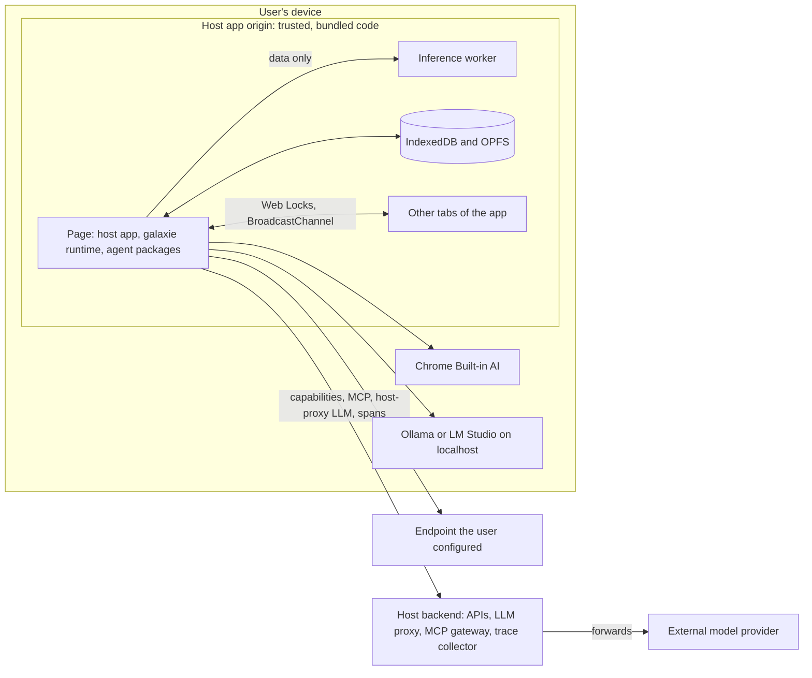
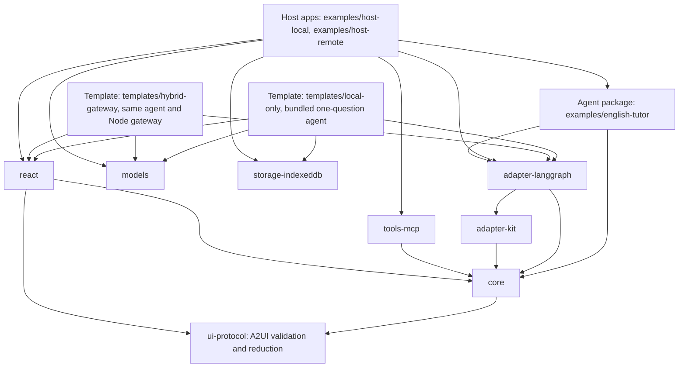
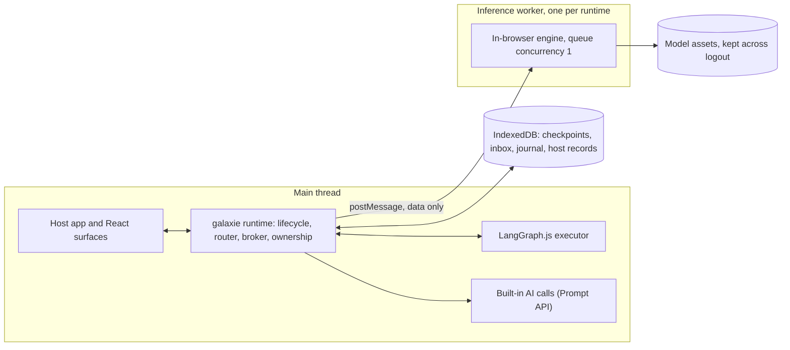
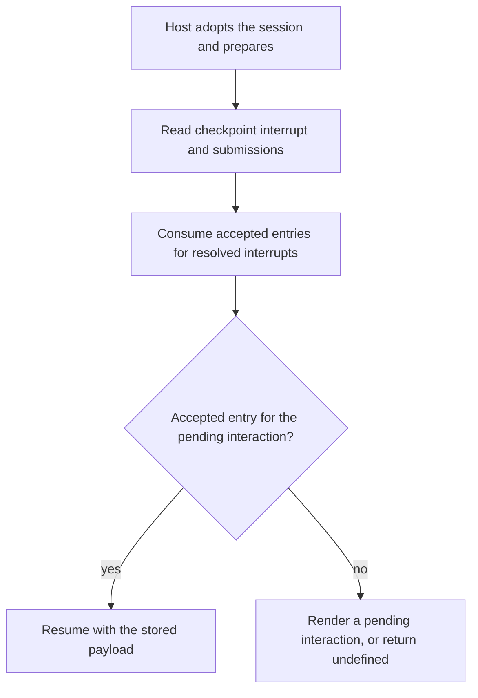
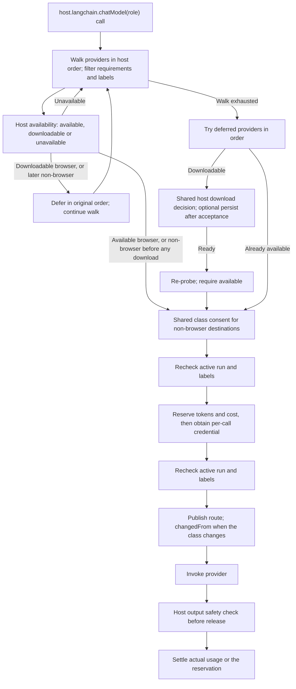
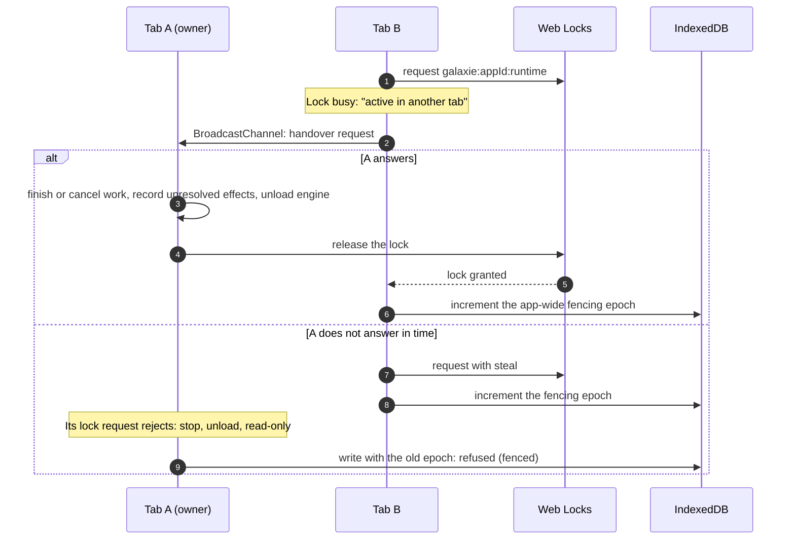

# System design

> **Status:** draft, 2026-10-28.
>
> This document maps the [project brief](galaxie-project-brief.md) and the [ADRs](adr/README.md) onto components, packages, contracts and runtime flows. It does not repeat their reasons.
>
> - When this document and the brief disagree, the brief wins and this document is fixed.
> - Proposed ADRs are working defaults until a spike or a milestone confirms them. So is every part of this document that depends on them.

## 1. What exists today

- **MVP evidence:** the [exit record](mvp-exit-record.md) maps AT-01 through AT-36 to existing evidence and gaps, and [unsupported features](unsupported.md) lists current limits and unverified paths; the maintainer decided Go on 2026-10-30, with the open items still open.
- **Toolchain:** a pnpm workspace with TypeScript 7 and 6 side by side, Biome, Vitest and CI (§10).
- **`packages/core`:** framework-neutral contracts and four M1 runtime slices: lifecycle, identity, cancellation, replayable in-memory events, a capability broker, model routing with consent and per-call credentials, sticky labels, argument shapes, finite budgets, interrupt dispatch and resume, and allowlisted OpenTelemetry spans. M3 adds an optional durable recovery port, inbox reconciliation and a write-effect journal (§6, §8.1–§8.3). The M1 exit controls add interaction URL policy and development trace text filtered by live labels and destination (§6, §9).
- **`packages/adapter-langgraph`:** native LangGraph execution, host-injected models and checkpointers, run-bound capability access, native step limits and callback-based tracing.
- **`packages/models`:** the deterministic scripted LangChain mock and the `@galaxie-ai/models/webllm` worker provider and `@galaxie-ai/models/builtin-ai` page-side Prompt API provider. Both have fake-only coverage on Node and Chromium; neither has had a real-device run yet (§8.4). `@galaxie-ai/models/transformers` adds an ONNX chat provider over Transformers.js with the same fake-only coverage and no pinned model record (§8.4).
- **`packages/react`:** a typed component registry, snapshot hook, identity-bound surfaces and headless Quiz, WritingPrompt, Feedback and Progress entries. Chromium tests cover rendering, validation, Strict Mode ownership and real LangGraph resume (§4, §8.1).
- **`packages/storage-indexeddb`:** a LangGraph checkpoint saver and structural recovery port, with scoped keys, versioned envelopes and transaction-completion barriers. Host-local supplies both for reload reconciliation; Node/Chromium fault tests cover inbox and journal crash windows, including IndexedDB reopen in Chromium. Retention and app-wide fencing are implemented; logout remains slice 6 work (§8.2).
- **`examples/host-remote`:** the unchanged English tutor with a same-origin OpenAI-compatible quiz stub, HTTP capabilities, renewable demo tokens and host-rendered progress confirmation. Feedback stays in-browser; MemorySaver starts over after reload. Node and headless Chromium tests exercise request privacy, consent, confirmation, tokens and CSP. See [the host README](../examples/host-remote/README.md) for the stub and deployment limits.
- **`examples/adk-recipes`:** a [separate scripted browser host](../examples/adk-recipes/README.md) for financial-advisor rewrites on ADK JavaScript and Go and auditor/loan rewrites on ADK Python, with one chosen executor per document, checked text, model destinations and scoped loan checkpoint/recovery storage; missing optional runtime assets disable their entries, and no real-model result is claimed.
- **`templates/local-only`:** a [copyable Vite + React starter](../templates/local-only/README.md) with its own one-question LangGraph agent, available Built-in AI first, immediate scripted mock fallback, size-disclosed WebLLM opt-in, an exhaustive fixed-message model-state table and fenced IndexedDB checkpoint/recovery restore. Automated tests use injected probes and fake engine handles; real-device behavior for this template is unverified.
- **`templates/hybrid-gateway`:** a [copyable browser and Node starter](../templates/hybrid-gateway/README.md) running the identical agent through one host-server model route, with server-rendered prompt IDs, scoped demo tokens, per-user call quotas, idempotent notes and private document search. MemorySaver starts over on reload. Stub-upstream Node and headless-Chromium loopback tests are supplied. Production authentication/storage and real upstream behavior remain unverified.
- **`tests/conformance`:** twelve graph cases compared across native Node, galaxie on Node and galaxie in headless Chromium, with native-owned goldens and an exact difference matrix, plus dual-lane policy, lifecycle, budget and tracing tests. The [conformance README](../tests/conformance/README.md) lists the explicit-config APIs.
- **`spikes/`:** three throwaway spikes: B0 (a 1.7B model on WebGPU), the local English tutor (a LangGraph.js agent on that model in Chrome) and [Spike C](../spikes/c-ui-path/README.md) (typed interrupt UI and session-checkpoint reload). Each has its own pnpm workspace (brief §16.2).
- **Everything else here is the target.** Each milestone builds its part (brief §16), and a folder appears only when work on it starts (brief §15).

The maintained [browser-built RAG example](../examples/rag-browser/README.md) keeps retrieval behind a host read capability. Its separate retrieval cache is scoped by app and principal using URI-encoded name components and is wiped by the principal-invalidation signal and Clear data. The retrieval Worker owns the watcher beside the cache, closes it on reinitialization/disposal and replaces its one-shot signal after each wipe. The cache remains outside `@galaxie-ai/storage-indexeddb`, with no retention sweep or individual-passage removal; browser eviction can lose data and concurrent builds can replace whole records. The example has a constant `visitor` principal and no login or host-side principal logout wipe; a real host must announce invalidation after committing its principal wipe. The example also offers an optional [Pyodide executor](../packages/adapter-pyodide/README.md) with policy in JavaScript; [ADR-0019](adr/0019-in-browser-retrieval.md) records its separate Worker/cache design and unmeasured real-model paths, while [ADR-0018](adr/0018-python-agents-through-pyodide.md) remains Proposed with Python persistence and the tutor port unevidenced. The same adapter also hosts Google ADK Python 2.12.0 agents as `adk-python` ([ADR-0022](adr/0022-google-adk-python-through-the-pyodide-adapter.md), Proposed): `LlmAgent`, `SequentialAgent`, `ParallelAgent` and `LoopAgent` trees with router-backed models and capability tools, checked streaming, confirmations and long-running tools as interactions, and durable sessions through the byte-record port, with scripted-model evidence only and `subgraphs` false.

`packages/adapter-go` hosts Google ADK Go 1.9.0 agents as `adk-go` ([ADR-0023](adr/0023-google-adk-go-through-a-wasm-worker.md), Proposed). The author compiles the agent with the Go toolchain to one WebAssembly module (`GOOS=js GOARCH=wasm`, about 30 MB); a dedicated Worker checks its length and SHA-256 before compiling it, and a framed bridge carries each model call, capability call and run result to the page. Routing, labels, consent, budgets, credentials, output checks and authorization stay in JavaScript, and Go is trusted author code. `LlmAgent`, `SequentialAgent`, `ParallelAgent` and `LoopAgent` trees built with the galaxie constructors run with streaming, confirmations and long-running tools as interactions, and durable sessions as a page-owned record through the byte-record port; `subgraphs` is false. Evidence is scripted models on native Go, Node and headless Chromium under the unchanged strict CSP and Trusted Types, with no real model and no device measurement. See the [adapter README](../packages/adapter-go/README.md), the [Go module](../go/README.md) and [the limits](unsupported.md#google-adk-go).

## 2. System context and trust boundaries



Destination classes (brief §3.1, ADR-0006) name the final recipient of the data in a call:

| Class | In the diagram |
| --- | --- |
| `in-browser` | Inference worker, Chrome Built-in AI |
| `user-device` | Ollama or LM Studio on `localhost` |
| `user-endpoint` | Endpoint the user configured |
| `host-server` | Host backend, when it handles the data itself |
| `third-party` | External model provider, even when the request goes through the host proxy |

Trust rules:

- **Code is trusted.** The host app, galaxie and the agent packages are reviewed and bundled by the developer (ADR-0002). They share one origin, so same-origin code can go around the SDK (brief §9.9).
- **Data is not.** Model output, tool results, lesson content, skills and MCP tool descriptions may carry prompt injection. None of it grants execution rights (brief §9.3).
- **Guarantees hold on SDK-controlled paths:** the model router, the capability broker, the MCP client, the registry renderer and galaxie's own storage (ADR-0012, part A). The host's own duties, such as backend authorization, a strict CSP and spending limits on the proxy, are in part B.
- **The three axes are separate.** Local inference does not mean local tools: a browser-local agent can still send data out through a capability (brief §3).

## 3. Components

| Component | Responsibility | Package | Decisions |
| --- | --- | --- | --- |
| Runtime host | Instance and run lifecycle, identity, snapshots, budgets, the inbox processor | `core` | brief §8, §9.4 |
| Executor adapter | Runs LangGraph.js itself on the main thread; maps checkpoints, interrupts and events; exposes the model router to graphs as LangChain chat models. Other frameworks get their own adapters | `adapter-langgraph` | [ADR-0001](adr/0001-langgraph-adapter-not-engine.md), [ADR-0003](adr/0003-executor-execution-context.md), [ADR-0017](adr/0017-framework-neutral-contracts.md) |
| Model router | Per-role provider lists, destination classes, data labels, consent, first-run order | `core` | [ADR-0006](adr/0006-model-providers-and-routing.md), [ADR-0014](adr/0014-data-labels-and-argument-shapes.md) |
| Model providers | The in-browser engine in a worker, Built-in AI from the page, OpenAI-compatible, mock | `models` | ADR-0006 |
| Capability broker | Grants, schema validation, argument shapes, confirmations, attribution header, effect journal | `core` | brief §9.2, [ADR-0012](adr/0012-security-baseline.md), ADR-0014 |
| MCP client | Streamable HTTP, tools only, allowlist, `mcp.<server>.<tool>` names, definition pinning | `tools-mcp` | [ADR-0011](adr/0011-mcp-via-controlled-servers.md) |
| Storage | Implemented: checkpoint saver, pending writes, recovery inbox/journal, scoped versioned envelopes and durability barrier; later M3: retention, host records, migrations, epoch checks and logout deletion | `storage-indexeddb` | [ADR-0004](adr/0004-interrupt-as-pending-interaction-source.md), [ADR-0005](adr/0005-indexeddb-checkpoint-saver.md) |
| Ownership | One owner tab per app, handover, takeover, logout generation | `core/browser` | [ADR-0009](adr/0009-multi-tab-ownership.md) |
| UI | Hooks, surfaces, typed registry, headless reference components | `react` | [ADR-0007](adr/0007-typed-ui-registry-for-mvp.md) |
| Agent linting | Implemented: five ESTree rules for direct network, storage, DOM/HTML sinks, eval and model-provider access; scope-aware, without type information or runtime enforcement | `eslint-plugin` | [ADR-0002](adr/0002-trusted-first-execution.md), [ADR-0012](adr/0012-security-baseline.md), [ADR-0013](adr/0013-typescript-first-implementation.md) |
| Agent definitions | Code-first definitions; a build script generates the manifest | `core` (types) | [ADR-0008](adr/0008-code-first-agent-definition.md) |
| Tracing | OpenTelemetry spans for runs, nodes, model calls and capability calls; every value galaxie records is filtered, and span content follows the data labels; no exporter | `core` | [ADR-0016](adr/0016-parity-demonstrations-and-otel-traces.md), brief §14.4 |

## 4. Packages and dependency rules



Proposed rules; M1 confirms them:

1. `core` depends only on `@galaxie-ai/ui-protocol` through its public root; its only peers are `@opentelemetry/api` (`^1.9.0`) and `zod` (`^4.6.0`). Alongside the protocol package, only the OpenTelemetry API peer is imported at runtime; its calls do nothing until the host registers an SDK (ADR-0016). Input validation uses Standard Schema and Zod is imported for types only. Tests pin API 1.10.0 and SDK 3.0.0; an SDK 2.x host check remains deferred. Core imports no agent framework (ADR-0017) and touches no engine, UI framework or browser API when imported (`sideEffects: false`). `check:deps` enforces the source and build boundaries. It also rejects module-load references to `navigator`, `document`, `window` and `BroadcastChannel` in main-entry modules and unguarded references inside functions. Guarded means a preceding same-function `typeof <global> ===/!== 'undefined'` check, or a `globalThis` property read with optional chaining before dereferencing a potentially missing value. This lexical check ignores types and property names; it does not prove control flow. Main-entry modules cannot import or re-export `browser.ts`, `ownership.ts` or `invalidation.ts`.
2. The `models` package imports `@langchain/core/*` subpaths and relative files, plus the exact optional peer `@mlc-ai/web-llm` 0.2.86 only in its WebLLM engine, cache probe and worker files, and the exact optional peers `@huggingface/transformers` and `@huggingface/transformers-structured-output` 4.3.2 only as dynamic, type-free imports in `transformers/runtime.ts`; it has no `core` dependency. WebLLM types are local structural types because its declaration re-exports do not resolve under NodeNext. `storage-indexeddb` also has no `core` dependency: its peers are `@langchain/langgraph-checkpoint` `~1.2.0` and type-only `@langchain/core` `~1.2.20`, tested at 1.2.0 and 1.2.20. Integration packages depend on core and their own libraries, with the existing models/storage exceptions. Executor adapters may additionally import `@galaxie-ai/adapter-kit`. No adapter imports another adapter. The kit imports only core public exports, erased `@langchain/core` types and its own relative files; it imports no adapter. The host app wires the integration packages together through `createRuntime`.
3. Agent packages depend on `core` and their engine, never on a host package. The private `@galaxie-ai/example-english-tutor` workspace package also uses `adapter-langgraph` for its host and interrupt contracts; its source and build import allowlist admits only those two galaxie packages, `@langchain/langgraph/web`, `@langchain/core/*`, `zod` and relative files. It imports neither React nor model implementations. The M4 ESLint plugin flags direct network, storage, DOM/HTML sinks, eval and model-provider access (brief §9.7 C). It is a linting aid with no runtime enforcement; aliases and dependency-provided values can escape detection. See [usage and limits](../packages/eslint-plugin/README.md). Its source imports only relative modules and type-only `eslint`; `check:deps` enforces that boundary.
4. React lives only in `react`. A Vue binding would be a sibling package; `core` never imports a UI framework (brief §14.3).
5. `tools-mcp` source and build imports are limited to `@galaxie-ai/core`, SDK client subpaths, SDK shared `types.js` and relative files. It imports no SDK server entry or Node module. `examples/mcp-server` uses SDK server/shared subpaths, `node:*`, `zod` and relative files. No package source or build imports examples; tests use source aliases without new dependencies. Hosts may import `@galaxie-ai/tools-mcp`. `check:deps` enforces these rules.
6. Fewer packages are fine while these boundaries hold (brief §15).

`@galaxie-ai/ui-protocol` is a dependency-free launch package for pinned A2UI messages, catalog validation and pure surface reduction ([ADR-0027](adr/0027-a2ui-surfaces.md), Accepted). Its public root is the only supported entry. It imports no galaxie, React or platform modules and uses no DOM/Worker globals. Core imports it for pending surfaces (§6.3); React imports its public root for catalog types and the shared pure data-path resolver. There is no executor checkpoint-commit method. See its [API and validation order](../packages/ui-protocol/README.md).

`@galaxie-ai/adapter-kit` now exists as a non-adapter launch package sharing the release version ([ADR-0026](adr/0026-adapter-kit-package.md), Accepted). Executor adapters import only its public root for common tool-call text extraction, selected-provider/credential resolution and pure bridge framing/validators. Prepare-time service validation and error helpers remain deferred. The kit imports no framework runtime and touches no DOM/Worker globals at import time. Framework execution, lifecycle, restore/checkpoints, loaders and Python/Go glue remain per-adapter. Dependency checks enforce these boundaries; all other limits remain unchanged.

`@galaxie-ai/storage-indexeddb` exports `IndexedDBSaver.open({ appId, principalScope, databaseName?, serde? })` and `StorageError`. It implements `BaseCheckpointSaver` 1.2.0 and exposes the structural `saver.recovery` port on the same connection, without importing core. The host derives the principal from its authenticated session; every session-data key includes app and principal. One app-wide epoch key is shared across principals (§8.5). Database version 1 contains indexed `checkpoints` and `writes`, scoped schema/insertion-order `meta`, and the recovery `inbox` and `journal` stores. Serializer tags and bytes are retained in versioned checkpoint envelopes; recovery envelopes remain `{ v: 1, value }`, with validated JSON records carrying `formatVersion: 1`. Absent record versions read as 1, newer integer versions reject `newer_record`, and malformed versions reject `corrupt`. The database version stays 1. Writes request strict durability where supported and resolve on transaction completion; malformed records and decode failures reject with fixed `corrupt` errors. The package emits no diagnostics or spans and retains no host error text or error cause. See its [usage and limits](../packages/storage-indexeddb/README.md); core reconciles submissions and write receipts during restore (§8.2–§8.3). Retention and app-wide fencing are implemented; logout remains slice 6 work.

`@galaxie-ai/react` exports `defineComponent`, `createRegistry`, `useAgentSnapshot`, `AgentSurface`, the individual `Quiz`, `WritingPrompt`, `Feedback` and `Progress` entries, and `educationComponents`. An entry declares its versioned ID, synchronous Standard Schema props and action payloads, trusted action labels, optional `urls(props)` extractor and trusted React component. Zod 4 reference schemas bound strings, IDs and collection sizes. Components receive `{ props, actions, status }` and optional already-rendered `children`; bound actions expose their host label and `submit(payload)`. Model-produced strings render only as React text children.

The A2UI renderer is a **breaking change to the launch React package's surface API**,
intended for a 0.x minor release ([release policy](releasing.md)). `Registry.catalogs()`
builds catalogs from registered IDs and schemas, and `bindings({ surfaces })` includes
them for core. Optional entry fields `child`, `children`, `bindable`, `urlProperties`,
`allowedParents` and `allowedChildren` describe composition; catalog URL names and the
existing `urls(props)` extractor both apply. No renderer functions are registered or
evaluated. React's new protocol dependency uses only its public root.

`AgentSurface` normalizes legacy requests through core's `surfaceFromRequest` to a
one-component surface, preserving registry validation/transforms, original event
identity and the absence of `surfaceAction`. The same tree renderer handles native
surfaces. Native actions add the originating component ID, numeric revision and
unchanged stored data model. One local guard disables the interaction's actions after
acceptance; rejection permits retry. The renderer validates all components before
mounting, rejecting unknown names, invalid props, missing references, cycles and URL
violations. Its cap is core's default 50 UI elements, including template expansion;
cap violations fail `denied`. Core remains the publication and policy boundary.

`structuralComponents(catalogId)` separately supplies headless Column, Row, Text and
Card entries; `educationComponents` remains the same four domain entries. Groups
accept ordered child-ID arrays or templates `{ componentId, path }`. Text supports
literal text and read-only `{ '@path': '/pointer' }` bindings and renders React text
only. RFC 6901 lookup is shared with protocol validation: absolute paths use the
current revision's root model, relative paths stay within template items. Unresolved
bindings omit the property and its schema decides validity. Child-reference keys
remain in schema props, with rendered children passed separately.

Native trees key by instance, run, host region and A2UI surface ID; compatible new
interactions update in place, preserving component-local drafts and focus across the
same-run gap while core resumes. Terminal runs and another region clear the retained
tree. Legacy
interactions remount on interaction/view revision changes. Submission state, guards
and outcome reports reset per interaction/view revision for both paths. Material
change detection compares entire component maps structurally, ignoring object key
order and preserving array order. One visible fixed `This step changed.` notice uses
one polite, atomic `role="status"` region mounted empty on successful renders.
First render and data-model-only revisions do not announce; notices never move focus
or echo model/user text. Failure views preserve their existing single-alert DOM.

Explicit A2UI `accessibility` adds a minimal wrapper: label becomes `aria-label` on
a group; description becomes hidden text referenced by `aria-describedby`; live
becomes `aria-live`; hidden becomes both `aria-hidden` and `hidden`. Without these
attributes domain components have no extra wrapper. Fieldsets, labels, native
controls and trusted action text remain intact. Continue-only entries use the same
fixed rejection alert and transition-only focus as Quiz/WritingPrompt. Drafts remain
local and disappear on remount/reload; writable bindings, catalog manifest export and
example-agent composition are deferred.

`WritingPrompt` collects a component-local sentence with a labelled textarea and a trusted `Submit sentence` action. Props bound prompt text to 2000 characters, title and placeholder to 200, and `maxLength` to an integer from 1 to 500 (default 500). The submit schema trims and bounds the sentence to 1–500 characters and annotates it `private-user` free text. Empty trimmed drafts and submitting or accepted actions disable submission. All strings remain React text.

The tutor graph loads a host-bound lesson, generates and commits a quiz and separate key before Quiz, grades against that key, collects a sentence, reviews it through `tutor.feedback`, shows Feedback, saves progress after `continue`, and shows Progress. IDs and quiz correctness text are built in code. Grading is local practice only. Its nine-step graph has explicit input/output schemas and runs inside a parent graph whose only channels are `{ lessonId, score, total, saved }`. LangGraph 1.5.1 streams all state channels despite an output schema, so the parent node explicitly projects the subgraph result before the adapter emits its root values. Quiz props omit the key; Feedback reveals correct option labels after grading.

Raw `stream` events still contain graph state and the answer key and must never be rendered as display data. The projection covers run output and interaction props only. The checkpointer contains the sentence and key and must remain on-device, scoped to the learner and session; the default in-memory saver does. `progress.save@1` receives only `{ lessonId, score, total }`: its host binding must derive the learner from trusted context and authorize that learner for the lesson before writing. Tests use only mock providers on Node and Chromium, including real registry resolution. The host-local example supplies a strict CSP, Trusted Types, mock-only AT-04 network capture and IndexedDB reload restore (§8.2). Drafts remain component-local and reset on reload; real providers and devices remain exit work. Optional model-generated quiz explanations and rubric quality evaluation are outside this slice.

The registry's `resolve(pending)` returns validated props or a fixed `ErrorInfo`. Unknown components are `unsupported`, invalid or asynchronous validation is `invalid`, and disallowed URLs are `denied`. Schemas must validate synchronously: with Zod 4.6.7 a rejecting async refinement still yields `invalid`, but Zod drops that refinement's Promise, so its rejection, carrying the refinement's own error text, surfaces as an unhandled rejection. Hosts must not use async refinements in UI schemas. `submit` takes the payload schema's input type and dispatches the input unchanged, so core validates the same value again. `AgentSurface` renders only its assigned surface, reports resolution errors from an effect, and supports a host fallback. It subscribes through `useSyncExternalStore`; the host owns creation, preparation, start and disposal outside the surface.

`AgentSurface` contains registered components in a class error boundary. After commit, a successful mount reports `rendered`; registry rejections report `failed` with the registry's fixed code, and a caught component error reports `failed` with `render_failed`. The thrown object, message and stack never enter core, `onError`, events, spans or the DOM. `onError(error)` is called once per interaction revision. The host can provide `fallback(error, controls)`, where exported `AgentSurfaceControls.cancel(): Promise<void>` cancels the render-time run and propagates rejection. Existing one-argument fallbacks remain compatible. Without a host fallback, a fixed `role="alert"` paragraph says `This step could not be shown.` and receives focus once. New interaction/view revision identity resets the boundary while native surface trees retain their mounted identity across compatible revisions. Render failures leave the run paused in `waiting_input`; resuming on a failed render is not supported yet. The host owns cancellation and Start over.

Host wiring (the runtime, definition, graph factory and input are host-owned):

```tsx
import { AgentSurface, createRegistry, educationComponents } from '@galaxie-ai/react';

const registry = createRegistry({ components: educationComponents, urlAllowlist: [] });
const instance = await runtime.create(definition, {
  principalScope: 'learner',
  agent: graphFactory,
  ui: registry.bindings({ surfaces: ['lesson-main'] }),
});
await instance.prepare();
await instance.start(input);

// Mount in the host's React tree after the host has created the instance.
<AgentSurface instance={instance} registry={registry} surfaceId="lesson-main" />;
```

`CreateOptions.ui` is optional framework-neutral `UiBindings`: supported component IDs and action payload schemas, plus host-assigned surfaces. Core checks the definition's catalog requirements at create, rejects unbound or unanswerable pending components and unlisted surfaces, and checks actions and payloads at dispatch. Without `ui`, core skips UI requirement checks and accepts any non-empty action, preserving M1 behavior. Hosts using the registry must pass `registry.bindings({ surfaces })` to get these checks. `Schema` remains the existing Zod contract; `StandardSchema` and synchronous validation helpers cover the UI protocol without changing it.

Each trusted entry's `urls(props)` must return every loaded or linked URL from validated props. Each is an absolute string used verbatim as one attribute value, never CSS `url()` or a `srcset` list. The registry rejects ASCII whitespace and applies core's normalized exact-origin allowlist. Core's recursive URL-like string check remains a backup: it does not detect URLs embedded in CSS, lists or ordinary text. Before publishing an interaction, core also rejects registered private strings in URL candidates as described in §9. An allowed origin still permits unregistered model-chosen paths and queries that can carry data to that host (ADR-0012); hosts must constrain those values where needed.

## 5. Repository layout

Today:

```text
galaxie/
├── .github/workflows/ci.yml   CI: parallel jobs for static checks, build, tests (grouped), Python and Go
├── docs/                      brief, framework overview, this document, ADRs
├── packages/
│   ├── core/                  runtime and framework-neutral contracts (§6)
│   ├── adapter-langgraph/     native LangGraph executor and routed chat models
│   ├── models/                mock and local model providers, with a host-bundled worker entry
│   └── react/                 typed registry, snapshot hook, surfaces and headless education entries
├── scripts/
│   ├── check-license.ts       SPDX headers and package license fields (ADR-0024)
│   └── check-dependencies.ts  source and built-package dependency boundaries
├── templates/
│   ├── local-only/            browser-local starter with pending-question recovery
│   └── hybrid-gateway/        same agent with a Node model and capability gateway
├── tests/conformance/         shared cases, native goldens and compatibility-matrix.json
├── spikes/                    throwaway spike code, outside the root workspace (brief §16.2)
├── biome.json  package.json  pnpm-workspace.yaml  tsconfig.base.json  vitest.config.ts
└── AGENTS.md  LICENSE  NOTICE  README.md
```

Target (brief §15), with the milestone that first needs each path:

| Path | First needed in |
| --- | --- |
| `packages/adapter-langgraph/` | M1 |
| `packages/models/` | M1 (mock), M2 (in-browser engine, Built-in AI), M4 (OpenAI-compatible) |
| `packages/react/` | M2 |
| `packages/storage-indexeddb/` | M3 |
| `packages/tools-mcp/` | M4 |
| `packages/eslint-plugin/` | M4 |
| `examples/english-tutor/` | M2 |
| `examples/host-local/`, `examples/host-remote/` | M2 (first host, CSP), M4 (second host, host proxy, MCP) |
| `examples/mcp-server/` | M4 |
| `tests/conformance/` | M1 |
| `tests/injection-corpus/` | M4 |

Spike code is throwaway. Keep it out of `packages/` and never promote it to package code (brief §16.2).

## 6. Core runtime and contracts

Core has two entry points. `@galaxie-ai/core` (`index.ts`) exports the public contracts and runtime API with no unguarded browser globals. Optional storage persistence in the model router and page development warnings remain guarded in that main entry. `@galaxie-ai/core/browser` (`browser.ts`) opts into ownership and invalidation helpers and all their public types. Moving those functions and types out of the main entry was a breaking change to the public API, made before the first release.

Modules in `packages/core/src`:

| Module | Contents | Source |
| --- | --- | --- |
| `schema.ts` | `Schema`, `Infer`, `InferInput` over Zod v4 core types | ADR-0008 |
| `ids.ts` | Branded runtime IDs; host-supplied IDs as plain strings | brief §8.2 |
| `lifecycle.ts` | `InstanceState`, `RunStatus` and their transition tables | brief §8.3 |
| `errors.ts` | `ErrorCode`, fixed-message `ErrorInfo`, `GalaxieError` and sanitization helpers | brief §9.4, §10, §11.4, §12 |
| `policy.ts` | Destination classes, presets, data labels, argument shapes, shared label/destination checks, budget limits | brief §3, §9.4; ADR-0014 |
| `models.ts` | Model roles, descriptors, routing configuration, consent, usage and run-bound leases | brief §10; ADR-0006 |
| `model-router.ts` | Per-instance configuration validation, ordered selection, shared consent, per-call credentials and model-budget reservations | ADR-0006, ADR-0014 |
| `capabilities.ts` | Capability names, requests, kinds, grant scopes, retry policy, host bindings, executor port and attribution headers | brief §9.2, §12.3 |
| `annotations.ts` | Cached Standard JSON Schema walking in both directions; labels, constraints and string matchers | ADR-0014 |
| `capability-broker.ts` | Per-instance grants, validation, FIFO concurrency, timeouts, sticky labels, verbatim guard and optional write-effect journal | brief §9.2, §12.3; ADR-0012, ADR-0014 |
| `budgets.ts` | Finite defaults, option validation, per-run tool-call, payload, token and cost accounting | brief §9.4 |
| `http-capability.ts` | Host-literal HTTP templates, attribution headers and capped response reads | ADR-0012 A3, A8 |
| `interactions.ts`, `urls.ts` | Catalogs, components, UI requirements, pending interactions, user events, receipts, inbox status, URL candidates and shared origin checks | brief §11, §12; ADR-0004, ADR-0007 |
| `effects.ts` | Effect states and transitions | brief §12.3 |
| `recovery.ts` | `RecoveryStore`, JSON submission receipts and write-effect records, with returned-record validation | brief §12.2, §12.3; ADR-0004, ADR-0005 |
| `events.ts` | Executor-native stream events and runtime envelopes, including cancellation and host render outcomes; currently in memory only | brief §7.5, §12.1 |
| `executor.ts` | Executor adapter contract and feature flags | brief §7.5; ADR-0001 |
| `definition.ts` | `AgentDefinition`, `defineAgentDefinition`, `BindingsFor`, `InputOf` | brief §13.2; ADR-0008 |
| `instance.ts` | `AgentInstance`, snapshots, cancel receipt and content-free `RenderOutcome` | brief §14.1 |
| `browser.ts` | `@galaxie-ai/core/browser` entry for `acquireOwnership`, `watchInvalidation` and their public types | ADR-0009, ADR-0012 A10 |
| `invalidation.ts` | `watchInvalidation` implementation, same-origin per-principal logout signals | ADR-0012 A10 |
| `ownership.ts` | `acquireOwnership` implementation, Web Lock handover/takeover, lost signals and bfcache verification | ADR-0009 |
| `runtime.ts`, `agent-instance.ts` | `createRuntime`, instance identity and lifecycle, validation, run slots, cancellation and bounded disposal | brief §8, §14 |
| `run-events.ts` | Per-run replay and live iteration with independent consumers | brief §8.2 |
| `trace.ts`, `tracing.ts`, `version.ts` | Data-only executor instrumentation and core-owned, allowlisted OpenTelemetry spans | ADR-0016 |

Contract choices where the brief leaves room:

- **Branded IDs.** IDs with a control meaning are branded types, so a plain string, such as text from model output, needs an explicit cast to pass as one. This helps at compile time only; the runtime still checks every ID (brief §8.2).
- **App and principal scopes.** `appId` and `principalScope` are strings of 1 to 128 characters from `A-Z a-z 0-9 . _ : -`, exactly `/^[A-Za-z0-9._:-]{1,128}$/`. One internal core validator in `ids.ts` enforces this at `createRuntime` for `appId`, at the start of `runtime.create` for `principalScope` before instance state or hooks, and in ownership and invalidation. Invalid runtime inputs fail with fixed, value-free `GalaxieError('invalid', ...)` messages. IndexedDB storage keeps its identical validator without depending on core; a shared conformance table checks both rules on Node and Chromium.
- **A failed `prepare`** returns the instance to `created`, which gives the retry or dispose path brief §8.3 asks for.
- **Typed bindings.** `BindingsFor<D>` turns a missing or mistyped host binding into a compile error (brief §14.2). `invoke` is a function property rather than a method, so a binding that needs more input than the schema gives fails too.
- **Run status belongs to the runtime.** An executor reports events; the runtime derives the run status from them and creates every ID.
- **Streams are live only.** `RunEvents` journals interaction, render, output, error and cancellation events. Host-recorded `render` events do not end iteration or change run status; executors never emit them. Stream payloads go only to attached consumers and are released when consumed or detached; they are absent from later replay. Replayed lifecycle events keep their original event IDs and sequence numbers, including gaps left by streams.
- **Schema annotations.** Hosts use `.meta(galaxieField({ label: 'private-user', shape: 'freeText' }))`. Core reads `x-galaxie` through Standard JSON Schema in both input and output directions, preserving transform and pipe labels without a runtime Zod import. Unrepresentable positions are free text and unlabelled; schemas without Standard JSON Schema and unsupported subschema keywords reject with `unsupported`. Shapes derive from enum/const, UUID and narrow bounded patterns; declarations cannot claim a stricter shape than their constraints support (ADR-0014).

Scope compatibility: runtime creation previously rejected only an empty `appId`, and instance creation did not validate `principalScope`. Previously accepted values now rejected are exactly those outside the scope pattern; valid identifiers retain their spelling and meaning. This cannot make existing IndexedDB data unreadable: storage and the cross-tab APIs already reject out-of-pattern scopes, so no data was stored under them through the saver. A runtime that never used storage has no scope-keyed stored data to migrate. No storage format, key or session ID changes.

The scope-flow audit covers IndexedDB checkpoint, recovery inbox/journal and metadata keys, host session keys, ownership locks and BroadcastChannel names, capability contexts, confirmation binding, MCP principal sessions and span attributes. Recovery keys already use the saver's validated app/principal pair; deterministic effect IDs derive from session, executor task scope, capability name and call ordinal rather than either scope identifier. Spans record `appId` and exclude `principalScope`. No package, example or successful test fixture relies on accepting out-of-pattern scope values; existing invalid values are deliberate rejection tests.

Not in `core` yet: durable events (M3). App-wide ownership is a separate host-composed API (§8.5). The model slice has WebLLM worker and Built-in AI page providers (§8.4); the OpenAI-compatible provider is implemented (§8.4), and the LangGraph, Pyodide and ADK JavaScript adapters now forward per-call provider output limits (§8.4). Dispatch and resume use an in-memory submission inbox unless the host supplies `CreateOptions.recovery`. Conformance covers stream events, final state, checkpoint history, interrupts and resume for twelve cases on native Node, galaxie Node and Chromium, including capability calls, the native 25-step limit, subgraph re-execution, falsy resume payloads and the `async`, `sync` and `exit` durability modes. Separate recovery graphs exercise durable inbox and write replay without changing those goldens or the compatibility matrix.

`RecoveryStore` is an asynchronous core port, implemented structurally by `IndexedDBSaver.recovery` without a storage-to-core dependency. Its methods are `recordSession(sessionId, { formatVersion: 1, agentId, agentVersion, executorId })` (insert-if-absent returning the stored identity), `session(sessionId)`, `acceptSubmission(sessionId, entry)` (atomic insert-if-absent returning `accepted` or `duplicate`), `consumeSubmission(sessionId, interactionId)`, `submissions(sessionId)`, `effect(sessionId, effectId)` and `recordEffect(sessionId, effectId, record)`. Writes resolve only after durable commit. Core stamps `formatVersion: 1` on session identities, submissions and effect records; an absent field reads as version 1. Custom stores must persist and return `formatVersion` unchanged, including its absence when consuming a submission. Submissions contain `interactionId`, `action`, JSON `payload` and status `accepted` or `consumed`; effect records contain a state, input digest and, for success, the validated JSON output. Returned IDs and agent identities are plain strings; core validates records, rejecting malformed data as `unrecoverable`. The host must scope the store to the same app and authenticated principal as the checkpointer and keep it on-device: answers and capability outputs are principal data, as private as checkpoints. Core records `ExecutorAdapter.id` as `executorId` and validates the three non-empty identity strings together with the optional format version; extra fields remain invalid. Start compares all three fields and rejects mismatches as `unavailable`. Restore checks the executor before pending-state reads or inbox reconciliation: a mismatch reports `restore_failed` and rejects `unsupported` with "The saved session uses a different executor." IndexedDB reads legacy two-key identities as `langgraph-js` without rewriting the version-1 envelope; other stores must return all three identity fields, with `formatVersion` preserved when present. Session export includes the executor ID ([ADR-0018](adr/0018-python-agents-through-pyodide.md) decision 7).

`ErrorCode` includes `invalid`, `denied`, `unavailable`, `unreachable`, `unsupported`, `budget_exceeded`, `timeout`, `stale`, `duplicate`, `fenced`, `cancelled`, `unrecoverable`, `outcome_unknown`, `render_failed` and `executor_error`. The fixed `render_failed` message is `The step could not be shown.` `stale` also covers an own invalidation marker on a storage failure. The new `outcome_unknown` message is fixed: `The outcome of an earlier call is unknown.` It means a prior write may have reached the backend and its retry policy forbids automatic replay. Public error data has no stored input/output or host error text; the journal path's typed errors set no cause.

`AgentInstance.recordRenderOutcome(outcome: RenderOutcome): void` accepts `{ runId, interactionId, viewRevision, status: 'rendered' }` or the same identity with `{ status: 'failed', code: ErrorCode }`. It never throws or returns state. It ignores calls while disposing/disposed, without a current run, for another run, outside `waiting_input`, without pending state or with a mismatched interaction/revision. For each interaction revision it ignores repeated status reports and all reports after `failed`; `rendered` followed by `failed` records both. A failure leaves the run paused. Only the selected identity/status/code fields are copied into the event, never other object fields.

`RunEvent` adds the host-recorded `{ type: 'render', interactionId, viewRevision, status: 'rendered' | 'failed', code?: ErrorCode }` alongside executor `stream`, `interaction`, `output`, `error` and host `cancelled`, with the existing `eventId`, `runId` and `sequence` envelope. Outcomes are content-free: no props, payload, model text, user content or thrown error details. Each recorded outcome is also a short `galaxie.render` span, a child of the paused segment's run span, with only `galaxie.render.status` and, for a failure, `galaxie.render.error.code`. The run span is already closed when a page renders the pause; the child starts after it and no closed span is modified. Resuming on a failed render is not supported yet.

Each instance owns one session. A run consists of a start segment and one resume segment per accepted submission, all sharing its run ID, journal, labels, grants and spend budgets. Steps and wall-clock time apply separately to each segment and stop while waiting for input. Each segment owns its outcome, closed model/capability ports and root span, with `galaxie.run.segment` starting at zero; a paused span ends `waiting_input` without an error status. Late events from a settled segment are dropped and reported as `late_event`.

A pending interaction is read from committed checkpoint `tasks[].interrupts`. Dispatch checks the instance, run, interrupt, surface and view revision, validates the action and JSON payload budget, claims the interrupt synchronously against duplicate submissions, and confirms it again against committed state. Acceptance clears pending, records `accepted` in the per-run inbox and starts one resume segment after its predecessor settles. With recovery, durable acceptance precedes the receipt and resume, and consumption follows a checkpoint-confirmed output or new interaction (§8.1). Without recovery, the existing in-memory behavior remains: executor outcomes consume the entry, effect IDs are random and there is no journal. Cancelling or disposing a waiting run calls no executor; a later start abandons the old interrupt on the same thread.

A run claims its slot before asynchronous Standard Schema validation; queued successors wait for the previous executor iterator to complete. Cancellation invalidates results immediately while core keeps draining. Core's single 10-second settlement bound limits queued waits and disposal without permitting overlapping loops on a session. Diagnostics alone receive raw errors; snapshots and error events contain fixed messages and sanitized types.

The LangGraph adapter imports only `@langchain/langgraph/web`. It drives the public runnable `transform()` method with one input and the native `values`, `updates`, `messages` and `custom` modes. This invokes LangGraph's own engine without LangChain 1.2.20's outer `stream()` abort race, which can leave its generator suspended before root callbacks. Native transformation and `getState` must be available; facades without either reject with `unsupported`. Pauses must have exactly one distinct interrupt ID and a valid four-field interaction request. Parallel interrupts, static breakpoints, interrupts without IDs and a resumed node pausing again on its answered ID fail with `unsupported`; use one request per node. Resumes use `Command({ resume: { [interactionId]: { action, payload } } })`, including in subgraphs. The adapter adds no scheduler or settlement timeout. Tests cover a cancelled run followed by a successful run, including delayed checkpoint writes.

Portable graph nodes call the adapter's `requestInteraction(request, config)` with their own config, including after an `await`. The helper validates the request and scopes stock `interrupt()` synchronously with that config. During `prepare`, the adapter installs a synchronous context shim only if LangChain has no global context instance. Stock `interrupt()`, `getConfig()` and implicit model config under that shim work only in a node's synchronous prefix, before the first `await`. Routed models await policy and credential acquisition before using config, so pass config explicitly to them even in that prefix.

Context installation is first-writer-wins for the process or page lifetime. A Node host using LangChain outside galaxie must initialize real `AsyncLocalStorage` before the first `prepare` (for example by importing the root `@langchain/langgraph` entry or `@langchain/core/context`). The adapter preserves an existing instance; it cannot upgrade a previously installed shim. Otherwise other LangChain code in the same Node process also loses async context after an `await`. The adapter imports no Node context module and keeps the browser dependency guard unchanged. Both galaxie conformance lanes import only `/web` and run under the shim.

Core records a run/node/model/capability span tree using explicit parent contexts. The host owns SDK registration and export; core ships neither. Attributes follow `open-telemetry/semantic-conventions-genai@51a0f580f8a6ad804ca4de5e033683c6fbbe5906`, `schema_url https://opentelemetry.io/schemas/gen-ai-dev/1.42.0-dev`, core semantic conventions v1.44.0. Spans contain no events, links, exception attributes or status descriptions. Principal scope is excluded. Failed spans use `ERROR`; cancellation leaves status `UNSET`. Canary and no-network tests run on Node and Chromium.

Text is absent by default. A host may opt in with `RuntimeOptions.developmentTraceText: { destination }`, declaring the destination class of the system that finally receives exported spans. Core checks every text attribute against the run's live sticky labels at record time and omits it if any label disallows that destination or permits only `in-browser`. Accepted submission payloads containing a non-empty string also make the trace decision carry `private-user`, including after resume. With `CreateOptions.ui`, accepting a dispatch also adds every label from the host-bound action payload schema (including implicit `app`) to the run's sticky labels and registers its private strings for the verbatim guard, before the resume segment starts. The resumed trace decision, model router and capability broker see these labels. Schemas without Standard JSON Schema or with unreadable annotations conservatively add `private-user` when the payload contains a non-empty string and register every payload string value for the verbatim guard. Annotations are cached by schema; payload values never supply labels. Rejected submissions add no labels. Without UI bindings the M1 routing behaviour is unchanged.

The opt-in permits only JSON-encoded model input messages, model output messages and capability arguments that passed validation, the payload budget and both policy checks, under `gen_ai.input.messages`, `gen_ai.output.messages` and `gen_ai.tool.call.arguments`. Omission is silent, including serialization failure. Galaxie itself adds no capability output, error message, credential, URL or header to a span. Recorded messages and arguments are verbatim: tool results, error text or URLs that agent code puts in a prompt or argument can therefore appear in the opted-in text, subject to the label and destination checks. The host owns exporter limits and credentials.

### 6.1. MCP client

`@galaxie-ai/tools-mcp` binds host-allowlisted tools as `mcp.<server>.<tool>@<version>` capabilities through SDK 1.32.1 Streamable HTTP, requiring negotiated protocol 2025-11-25. The host configures URL, destination, short-lived per-principal bearer callback, definition pins and policies. Input/output validation remains the broker's host schema contract; server schemas only contribute to the RFC 8785 SHA-256 pin. Host kinds override annotations, and write bindings require `approval: 'confirm'`, which dispatches only through the host confirmation gate (§8.3). Without `CreateOptions.confirmations` these bindings still fail `unsupported`.

Each principal owns one client/transport and serial lane for token acquisition, listing and calling, making per-principal concurrency effectively one. Hosts call `closePrincipal` at sign-out and `close` at shutdown. The client advertises no sampling, elicitation or roots and rejects server requests with `-32601`. Pins are checked on connect, list-change notifications and a fresh complete listing before every call (at least one extra round trip per call). Direct SDK requests avoid compilation of remote output schemas under CSP. Listings have a ten-page cap and one aggregate wire budget. Pinning detects metadata changes only, never behavior behind unchanged metadata.

The fetch wrapper counts bytes before parsing, cancels excessive or idle POST streams and signals pending SDK requests directly; standalone GET notifications have no idle deadline and reconnection is disabled. Defaults are 262144 wire bytes, 65536 canonical result bytes and 30000 ms idle. A 404 discards the session and permits one retry only for idempotent policies. Every initialize/list/call receives the binding timeout and abort signal. A separate handshake deadline bounds the SDK initialized notification, and failed setup connections are discarded. Results return structured content by default or `{ text }` for text-only results. They remain untrusted, even after schema validation: instruction-shaped text grants no policy, approval or follow-on capability.

A8 attribution travels in per-call MCP `_meta` as `galaxie.dev/agent`, `galaxie.dev/run` and `galaxie.dev/effect`, rather than session-wide headers; it never authorizes. Tokens remain readable by page code (ADR-0012); hosts should issue short-lived tokens. Errors are fresh fixed-message `GalaxieError`s without causes; event fields contain fixed codes, host IDs and protocol methods only. Original SDK/server/host callback errors never reach core's host-only `DiagnosticEvent.error`; core may receive the sanitized binding error. The package emits no diagnostics, logs or spans. Agent code can still copy untrusted results into its own prompts or outputs; hosts own those paths and any development trace-text opt-in (§6).

`examples/mcp-server` is a development reference bound to `127.0.0.1`. It checks Origin on every request, authenticates non-preflights, binds sessions to verified principals and provides narrowly scoped CORS. Its test admin API is in-process only. There is no OAuth, resources, prompts, third-party server support, runtime pin approval, resumable stream replay or MCP host wiring in this slice. See the [client usage and limits](../packages/tools-mcp/README.md) and [reference server](../examples/mcp-server/README.md).

### 6.2. Generated agent manifests

`createManifest(definition, { entry })` in `@galaxie-ai/core` is a pure build-time generator. Code remains the source of truth (ADR-0008). It returns a `schemaVersion: '0.2'` manifest with identity, executor, package-relative entry, input schema path, required and optional capability kinds and schema paths, model roles, UI requirements and skills. Absent groups are omitted; capability, model and schema maps use code-unit key order. It reads no host grants or credentials and performs no I/O.

Schemas use Standard JSON Schema's input conversion with target `draft-2020-12`, preserving `x-galaxie` labels and shapes. A missing converter or an unrepresentable position, including a nested date, fails with fixed `unsupported` errors. Custom refinements have no JSON Schema form and are omitted; runtime schema validation stays authoritative. In particular, the tutor's `score <= total` refinement remains runtime-only.

The package's `galaxie` field selects the definition module, named export and output directory:

```json
{
  "galaxie": {
    "definition": "./dist/index.js",
    "export": "tutorDefinition",
    "out": "./dist/galaxie"
  }
}
```

After compiling the package, run:

```sh
node scripts/build-manifest.ts examples/english-tutor
node scripts/build-manifest.ts examples/english-tutor --verify
```

The root build runs both commands immediately after compiling the tutor. The Node-only script resolves core from that package, imports the definition and requires its version to match `package.json`. It validates package-relative POSIX paths and output containment before mutation. The output must be strictly inside a directory listed in `files`, its parent must already exist, and package symlinks are rejected. `files` entries are literal files or directories. Generation computes all bytes before replacing only the output directory, removing stale artifacts. `manifest.json` sits at its root, with `schemas/input.json` and `schemas/<capability>.input.json` and `.output.json` beneath it. Manifest schema paths are relative to this output directory; entry and skill paths are relative to the package. JSON uses two-space indentation and a trailing newline.

The script appends `integrity.entry`, `integrity.files` and `integrity.lockfile`, all SHA-256 digests encoded as `sha256-<base64>`. The sorted file inventory covers `package.json`, every file beneath the package's `files` entries except the generated output, and every declared skill file. Entry and skill files must exist outside the output directory; filesystem identity checks also reject case aliases inside it. The lockfile digest covers the nearest ancestor `pnpm-lock.yaml`. Exclusive file creation rejects schema filenames that alias on the destination filesystem. Verification uses the same inventory and regenerates schemas and manifest bytes, rejecting missing, added or changed shipped files, digest mismatches and any missing, added or changed output file. It compares exact filenames and raw bytes, without UTF-8 replacement decoding. It writes nothing; failures contain fixed messages or paths, never file or schema contents or underlying error text.

Digests prove only that a package matches the manifest being checked. A host must obtain that manifest, or pin its digest, from a source it trusts, such as its own lockfile-resolved build output or a reviewed commit. Without signing, an attacker who replaces both package and manifest passes verification. A hash identifies provenance and integrity, not safe behavior (brief §9). This is neither a sandbox nor a security guarantee. Signing, runtime loading by manifest and browser-side verification APIs are outside this slice; hosts verify at build or deploy time, or use Subresource Integrity with the listed digests.

### 6.3. Surface-bearing interactions

A surface-bearing interaction uses the engine interrupt as its only durable anchor.
The interrupt value is the reduced `galaxie.surface/1` record: region, A2UI identity,
catalog, revision, pinned spec version and revision, status, components and data model.
It contains neither core labels nor `viewRevision`. Core derives the opaque token
`a2uiSurfaceId + '#' + revision` solely from those two fields and computes labels
from the run, ignoring any adapter-supplied labels or token. The published surface
is a detached frozen copy. No message log or second durable projection is added.

Core builds the validator context from host-bound `ui.catalogs` and `ui.surfaces`,
the run's `payloadBytes` and `uiElements` limits, and the host URL allowlist. It
validates before publication and restore and scans both components and the entire
data model for URL/private-value policy violations, retaining the private-user
third-party exception. Protocol diagnostics carry only fixed codes. A per-run map
requires creation at revision 1 and subsequent live revisions exactly one higher.
Restore seeds that map from the stored revision and selects its validator by the
exact `(specVersion, specRevision)` pin; unknown pins fail `unsupported`.

LangGraph cannot replace a pending interrupt's value in place. The node resumes,
reduces the next batch against the previous record and yields a new interrupt in
a later node. Revisions therefore advance per interaction; in-place updates while
waiting are out of scope, and there is no executor surface-commit method. The
checkpoint is written before core sees the interrupt, so rejection prevents public
interaction state but cannot erase raw checkpoint/stream data.

For today's renderer the pending projection uses the region as `surfaceId`, the
derived token as `viewRevision`, the root's catalog/name as the legacy component ID
(`education/v1` plus `Quiz` becomes `education.Quiz/v1`), and root domain props
without component identity, accessibility or metadata fields. The exported
`surfaceFromRequest` converts representable four-field requests to a single `root`
component, revision 1 and an empty model. Props with `id` or `component` cannot be
represented. Legacy requests remain on their existing parser and validation path.

Surface actions check both revision and derived token against committed pending
state and validate the originating component's registered action/payload. Changed
or added model paths must relate to an `@path` binding as an ancestor or descendant;
this is coarser than per-property writable declarations. Changed string leaves are
registered private and add sticky `private-user` before acceptance or inbox storage.
The submitted model never enters the resume payload. Labels are not persisted in
the interrupt; restore applies the conservative public/app/private-user superset
and registers surface strings and recovered payload strings before policy checks.

Recovery submissions retain only action and domain payload, with no component ID.
Replay accepts when at least one registered action on a surface component validates
that payload; it cannot recover the originating component. Render outcomes continue
to use interaction ID and view token, so each new revision has a new outcome key.

## 7. Runtime topology



Rules (brief §6.2, ADR-0003):

- The executor runs on the main thread in the MVP. It moves to a worker only when a measured trigger fires (brief §18).
- Inference runs in a worker. Built-in AI is called from the page, because the Prompt API is not available in workers.
- One worker serves every agent in the runtime. Weights are loaded once, and the queue starts at concurrency 1.
- `postMessage` carries data only, never functions or closures. Capabilities are called through an RPC proxy that carries identity.
- A worker is a thread, not a sandbox: it can still call `fetch`.
- Checkpoints never hold weights, audio buffers or large tensors; they hold scoped asset handles.
- Execution is cooperative: budgets, cancellation and epoch checks cannot preempt a synchronous loop.
- Storage is namespaced by `appId` and principal. Model assets are stored apart from principal data and survive logout.

## 8. Key flows

### 8.1. A run with a pending interaction

With UI bindings, core checks component availability, a non-empty action map and surface assignment before publishing pending state, alongside the URL check. The registry then validates props and declared URLs before rendering. A bound submit dispatches the instance, run, interaction, surface and revision captured at render time. Core checks identity and duplicates before the action allowlist, then validates the budget-parsed payload and confirms the committed interrupt. A stale screen therefore cannot answer a newer interaction, and the surface suppresses concurrent or already accepted submissions for its interaction.

Each registry entry declares URL props through `urls`; model-produced props render only as React text. Drafts stay component-local. A new interaction ID or view revision remounts the trusted component with empty inputs. Any other remount, including reload, also loses local input; recovery persists accepted submissions, not drafts.

With `recovery`, dispatch durably inserts the answer before returning `accepted` or starting resume. An existing accepted or consumed record rejects `duplicate`. A store failure reports `dispatch_failed` and returns the fixed storage outcome, including `fenced` for a stale epoch, without starting a segment. After the insert resolves, core rechecks disposal, current run and waiting status; a race returns `stale` and leaves the accepted entry for restore. Core consumes it only after an executor `output` or valid new `interaction`, which the adapter emits after checkpoint writes drain, and before publishing the consumed status. Errors, throws, protocol violations and cancellation leave it accepted. A consume failure reports `dispatch_failed` and leaves reconciliation work without failing an otherwise successful run.

```mermaid
sequenceDiagram
    autonumber
    participant UI as Host UI (registry renderer)
    participant RT as Runtime
    participant EX as Executor (LangGraph.js)
    participant DB as IndexedDB
    UI->>RT: start(input)
    RT->>EX: run, command start
    EX->>DB: checkpoint: quiz and answer key
    EX->>DB: checkpoint: pending interrupt with the display payload
    EX-->>RT: interaction event
    RT-->>UI: snapshot: waiting_input, pending interaction
    UI->>RT: dispatch(event)
    RT->>RT: check identity, interactionId, viewRevision, payload schema
    RT->>DB: confirm the committed pending interrupt
    RT->>DB: atomic insert inbox entry "accepted"; await commit
    RT-->>UI: receipt: accepted
    RT->>EX: inbox processor: run, command resume
    EX->>DB: checkpoint after resume, durably committed
    RT->>DB: mark the inbox entry "consumed"
```

- The checkpoint interrupt is the source of truth for the pending interaction. The host UI projection is a cache rebuilt from it (ADR-0004).
- A second event for the same `interactionId` is rejected at the inbox, so a double click cannot submit twice.
- `interactionId` comes from the engine's interrupt ID or from the checkpoint, never from the model.
- Code before `interrupt()` must be deterministic and free of side effects, because resuming re-runs the node, and the parent node of an interrupting subgraph (brief §12.2).
- MVP limit: one pending interrupt per run. More gives a typed `unsupported` error.

### 8.2. Reload and crash recovery

Each instance exposes `sessionId`. `runtime.create(definition, { sessionId, recovery, ... })` adopts a lowercase RFC 4122 UUID for restore only; `start()` on that instance rejects `invalid`. Core cannot authorize session ownership: the host must store the ID per app and authenticated principal and scope both checkpointer and recovery store to that principal.

With a recovery store, `start()` durably records the definition's ID and version before starting its segment. A failed recording rejects with fixed text without starting a run: `stale` for an own invalidation marker, otherwise `unavailable`, including an incompatible existing identity returned by insert-if-absent. The write participates in bounded disposal settlement.

After `prepare()`, `instance.restore(options?)` claims the run slot synchronously. It requires `interrupts`, `resume` and `checkpoints`. With recovery, it first reads `session(sessionId)` and validates the format version together with the identity, before any pending-state read. A returned newer version rejects `unrecoverable` with the fixed message "The saved session uses an unsupported recovery format."; malformed versions reject `unrecoverable` with generic fixed text. IndexedDB refuses a newer version with `newer_record`, whose marker also maps to `unrecoverable` on restore. A different agent ID or version, or a missing identity record, rejects `unsupported` with fixed text, reports `restore_failed` and publishes no run. Missing metadata cannot establish compatibility. Records without `formatVersion` read as version 1, but no recovery-data migration exists and old segment-keyed receipts are not converted. The refusal deletes no data. Only after these checks does restore read `executor.pending(sessionId)`. Restore and dispatch pass `pending(sessionId, { registerRestoredData })`, and every run request carries the same optional `registerRestoredData(value)`. An adapter calls it with plain JSON read from its own checkpoints before that data reaches a live outbound call or interaction validation: core registers its strings as private and, when there are any, adds `private-user` to the live run. The hook is framework-neutral and optional; it throws `stale` once the run is no longer active, and an adapter that needs it fails closed when it is absent. `dspy-python`, `adk-js` and `adk-python` use it today.

Checkpoint read failures normally reject with fixed `executor_error` text; recovery-store failures normally reject `unavailable`. An error with an own data property `invalidated === true` maps to `stale`, ahead of other markers, in restore, dispatch, run errors and broker journal failures, including failures after a validated capability result. Session recording also maps invalidation to `stale`. An error with an own data property `fenced === true` maps to `fenced` in restore, dispatch, run errors and broker journal failures. An own data property `unrecoverable === true` maps to `unrecoverable` in restore and dispatch. The run error path recognizes the same marker on the error itself or on its cause when the adapter wrapped it in `GalaxieError`. Core uses this structural contract without importing storage. Malformed returned recovery records also reject `unrecoverable`. Restore failures report `restore_failed` before publishing a run. The optional raw `DiagnosticEvent.error` is host-only and must never go to a destination `private-user` may not reach; public errors, events, snapshots and spans contain no stored content or host error text, and the new typed errors set no cause.

With recovery, restore validates the session's submissions and reconciles them before publishing any run snapshot:

- An accepted entry matching the pending interrupt passes the live URL/UI, action, payload schema and payload-budget checks. Core reapplies the payload schema's labels and private strings, starts a resume segment without UI input and resolves `{ runId }` with status `running`.
- Accepted entries whose interrupt is no longer pending become consumed. If another interrupt remains, the existing `AgentSurface` renders it normally; otherwise restore resolves `undefined` and releases the slot.
- With no matching accepted entry, the pending interaction is published as `waiting_input` with the same interaction event as the live path. Without a recovery store, this remains the slice 2 behavior.

A rejected interaction exposes no props in snapshots, interaction events or diagnostics. Restored inbox entries reject subsequent dispatches as `duplicate`, including consumed receipts; dispatch still checks instance and run identity first. When no interrupt remains, restore creates no run, so an obsolete dispatch is `stale`; the durable store still rejects reinsertion of the consumed interaction. Dispose that adopted instance and create a fresh instance for a new session.

Restore creates a fresh run ID and fresh budgets. Because previous provenance is not persisted, it starts with all labels (`public`, `app`, `private-user`), an initially empty private-value registry and conservative submitted-text handling. Stored accepted payloads and replayed capability outputs re-register their private strings. Grants use the same validation as `start()`. Display-only restore opens no run span; an automatic or later resume opens one normally. Prior run IDs, labels, private values and budgets are not persisted.

Host-local opens one IndexedDB saver lazily per host for app `galaxie-host-local` and its trusted demo learner, passing `recovery: saver.recovery` alongside the checkpointer. It falls back to the adapter's MemorySaver without recovery when IndexedDB is absent, and closes the saver after runtime disposal. Once a host exists, it attempts restore from a `sessionStorage` key containing the app and principal; real model preparation still requires its button. It stores the ID at `waiting_input` and removes it after success; failed or cancelled runs retain it so reload can reconcile accepted answers. The saver opens before acquiring core ownership on `galaxie:galaxie-host-local:runtime`, with `fence: saver.fencing`. Opening never sweeps. Only after acquisition claims the epoch does the host sweep and then restore. Busy tabs offer "Use here" to request takeover; ownership loss disables input and shows "The lesson moved to another tab." until reload. The handover hook disposes the runtime. A sweep failure is observed without retrying in that page; restore proceeds. A missing interrupt or `denied`, `unsupported` or `invalid` rejection clears only the key and returns to Start. Other operational failures retain the key and show a fixed error with Retry. An unrecoverable restore shows "Saved lesson cannot be recovered" and keeps the key/data until "Start over" explicitly calls `deleteSession`, under the Web Lock, then clears the key. Quota observations show "Storage is full". A version-change handover shows "Reload to use the updated app" and disables input. Neither IndexedDB nor sessionStorage changes the CSP.

**Storage lifecycle.** Database version remains 1 and recovery envelopes remain `{ v: 1, value }`; the recovery records now carry `formatVersion: 1`. Each checkpoint has a `savedAt` timestamp; checkpoint, pending-write and recovery writes update per-thread last activity in the same transaction. The saver never sweeps automatically. Explicit `saver.sweep({ historyMs?, expireMs?, now? })` defaults to 7 days of history and 30 days of inactivity and returns `{ prunedCheckpoints, expiredSessions }`. Non-finite or negative values reject `invalid`. History pruning always keeps the latest checkpoint per namespace; a checkpoint missing `savedAt` counts as older than every cutoff. Parent `TASKS` writes needed by retained legacy tuples are preserved conservatively and marked for reclamation when later sweeps no longer need them. Unmarked writes for checkpoints not yet stored remain untouched. Expiry removes a session's checkpoints, pending writes, inbox, journal and metadata, within the saver's app/principal scope. A session without activity metadata is not expired by guessing its age. One deletion transaction per session makes failure atomic for that session, while earlier processed sessions stay processed. `deleteSession(sessionId)` explicitly removes the same session data; `deleteThread` retains its narrower `BaseCheckpointSaver` behavior and leaves recovery/activity records. Sweep and delete sessions only while holding app ownership; every write transaction checks the shared app epoch.

Saver connections close immediately on `versionchange`; later storage operations reject `superseded`, and the optional `onVersionChange()` hook runs once without arguments. A newer opener can then proceed. Connections without a handler still cause `blocked`; a rejected blocked open cancels its queued upgrade. An older package refuses a newer database with `newer_schema`. No migration or database version bump ships in this slice. `onError(code)` observes every rejected open/saver/recovery operation with only the fixed storage code; callback failures are swallowed. Storage errors set no cause and expose a read-only own `unrecoverable` property:

| Storage code | Marker | Core outcome on restore/dispatch/run failure |
| --- | --- | --- |
| `invalidated` | `false` (`invalidated: true`, `fenced: false`) | `stale` |
| `fenced` | `false` (`fenced: true`) | `fenced` |
| `corrupt`, `newer_schema`, `superseded` | `true` | `unrecoverable` |
| `newer_record` | `true` | `unrecoverable`; retain the session and do not offer Start over |
| `quota`, `blocked`, `aborted`, `invalid`, `unavailable` | `false` | Existing path mapping: `executor_error` for checkpoints, `unavailable` for recovery storage |

Validation of a malformed or newer returned recovery record remains `unrecoverable`. A store-thrown `newer_record` or `corrupt` error on the capability journal path retains the existing `unavailable` mapping and never invokes the binding or overwrites the unreadable record. A failed consume is reported without failing an otherwise successful run. See the [storage README](../packages/storage-indexeddb/README.md) for the direct error table. Persistence is not permanence: browsers may evict or clear the database. Host-local treats missing session metadata or pending data as a fresh start; model caches are not backups of session data.

**Explicit session export.** `IndexedDBSaver.exportSession(sessionId, { personalContent? })` returns a deeply frozen JSON object with format `galaxie.session-export/1`. The default contains only app/session identity, export time and metadata: recorded agent identity, checkpoint count and first/last timestamps, distinct interrupt IDs counted from the latest checkpoint per namespace, recovery counts grouped by status, and an `unrecoverable: true` flag when export observes unreadable checkpoint/write data. No persisted session-unrecoverable marker exists; export writes nothing. Only exact `personalContent: true` adds checkpoints in ascending ID/namespace order, with parent IDs, timestamps, decoded channel values and ordered pending writes. Bytes use marked base64; unrepresentable or undecodable values use `[unavailable]`, without raw errors. Recovery inbox/journal records and runtime-event history are excluded; opted-in checkpoints can contain learner text and capability results. Malformed stored structures still reject `corrupt`; unknown/deleted sessions reuse fixed `invalid`. The read transaction is scoped to the saver's app/principal, checks its held logout generation and rechecks after asynchronous decoding. Ownership loss does not fence this read; principal invalidation rejects it, including after a new saver recreates the session. Already returned host copies cannot be revoked. Hosts must bind the opt-in to an explicit user action and treat the export as personal data. Host-local supplies explicit metadata-summary and host-confirmed personal-content downloads, gated by current session ownership; no import, sync or cross-device recovery is supplied. The export format remains `galaxie.session-export/1`; its agent identity omits the stored `formatVersion`, and a newer recovery record rejects export with `newer_record`. See [export semantics](../packages/storage-indexeddb/README.md#explicit-session-export).

**Current limits:** drafts are not persisted. If a multi-step resume crashes after an intermediate checkpoint has already resolved the interrupt, restore consumes its accepted entry and resolves `undefined`: it cannot finish that run or replay later writes. Keep one active instance per session under core app ownership; journal serialization is per call and storage writes check the app-wide epoch atomically. Per-principal logout generation checks and deletion are described in §8.6. Write-outcome limits are below.

The implemented inbox reconciliation is:



There is one render path for unanswered interactions: after a reload the host renders the checkpoint payload through the same surface (brief §12.2). Fault-injection tests run actual LangGraph resume under `async`, `sync` and `exit` on Node and Chromium, with an IndexedDB reopen lane in Chromium. All use mock providers; the twelve existing goldens and compatibility matrix stay unchanged.

### 8.3. A capability call

Per-instance bindings live at `runtime.create(definition, { bindings, ... })`, with instance-lifetime grants for `app`/`principal`/`instance` and explicit `start(input, { grants })` for run grants. Nodes call `host.capabilities.call(name, input, config)`; passing the node's `config` parents the capability span under that node. Input and output validate before dispatch and return respectively. Bindings with `approval: 'confirm'` require the host confirmation gate described below; without `CreateOptions.confirmations` they still reject `unsupported`.

`CreateOptions.confirmations` declares host-renderable `capabilities`, a live `policyRevision()` callback, optional `expiresInMs` (default 120000, safe integer 1000–600000) and optional host `AbortSignal`s. Creation fails `invalid` for malformed options or any bound `confirm` capability missing from the list; unknown list names are allowed. Each call requires a non-empty policy revision of at most 128 characters; a thrown callback or invalid return fails `unavailable` with fixed text.

After validation, payload/label checks, the tool-call reservation and the journal read, core opens a confirmation only if a new effect will dispatch. Successful receipts replay without confirmation; unknown `retry: 'none'` writes consult a bound reconcile hook before any confirmation, or fail without one when no hook is bound. The in-memory approval binds the principal, capability, deep-frozen copy of plain JSON arguments, SHA-256 digest of the journal's canonical JSON, effect ID, policy revision and expiry. `invoke` receives that same copy and effect ID. Core rechecks the digest, policy revision, expiry and invalidation immediately before invocation; changing the original object cannot change the approved value.

`snapshot.confirmations` is a frozen, request-ordered list of `{ id, capability, arguments, expiresAt }`, absent when none is open. It is in-page host data, separate from `run.pending`, executor events and agent components. `instance.respond(id, 'approve' | 'decline')` synchronously consumes the entry once, returning `{ status: 'approved' | 'declined' | 'stale' }`; malformed inputs, closed/unknown IDs and invalidated approvals return `stale` without throwing or publishing. Closing on run end is merged into the instance publication so failed snapshots never retain confirmations.

Decline, expiry and configured logout/takeover abort signals fail the call `denied`. Fixed diagnostics are `confirmation_requested`, `confirmation_declined`, `confirmation_expired` and `confirmation_invalidated`, with `runId` only. A policy change at approval or dispatch also invalidates; disposal cancels and reports invalidation. Run cancellation/end cancels without a confirmation diagnostic; a wall-clock budget cancels the waiting call and fails the run `budget_exceeded`. Waiting holds no concurrency slot. The binding timeout starts after approval, while expiry and host signals still apply to an approved call waiting for a slot.

The host renders a separate `ConfirmationPrompt` from `defineConfirmations` entries: fixed host titles/labels and rows derived from actual arguments. Values render as React text; missing or failing rows permit only decline. `AgentSurface` components still receive only `{ props, actions, status }`, with no confirmation ID or response method. See [React usage](../packages/react/README.md).

Approvals live only in page memory: reload asks again. Same-origin code can call `respond`; the gate protects against model-controlled content, not page scripts (brief §9.9). The host must dispose the instance on logout and takeover and should also pass those signals. Backends must still authorize every write (B1). Expiry or decline does not undo a request already sent. Confirmation IDs and host text never enter traces, errors, run events or generated diagnostics; arguments stay out too, except for the existing policy-gated `developmentTraceText` span opt-in. Host-only `DiagnosticEvent.error` retains its existing binding-error handling and destination limits.

With recovery, only host bindings of `kind: 'write'` use the effect journal. Core derives a lowercase UUID-shaped effect ID with SHA-256 over the session ID, executor task scope, capability name and per-scope, per-name call ordinal. The LangGraph capability bridge reads the running node's full `metadata.langgraph_checkpoint_ns`, falling back to `configurable.checkpoint_ns`, from the explicitly forwarded config and passes it as the optional opaque `CapabilityPort.call` option `effectScope`. LangGraph includes the task ID in this namespace; nested child tasks include the parent's task segment and their own task ID. Counters restart in each run segment, so re-executing the same pending task after resume or restore reuses its IDs and replays successful receipts without invoking the host. Call order within each task must be deterministic. A later task calling the same write receives a new ID, even in the same session.

Without a task scope, core retains the segment key (resume `interactionId` or literal `start`) and per-name call order. Repeated unscoped starts in one session still reuse the `start` key; use a fresh session/instance for a new logical operation. Other kinds, and all calls without recovery, retain random effect IDs and no journal. Effects outside the broker still require author discipline: place side effects after interrupts or in a separate completed node.

The [task-identity tests](../tests/conformance/task-scope.test.ts) verify namespace stability before scoping, including a graph rebuild and IndexedDB reopen. The [parent-effect tests](../tests/conformance/subgraph-effects.test.ts) prove two parent bodies but one host write with recovery, and two without it. The [scope and restore tests](../tests/conformance/subgraph-effect-scopes.test.ts) prove ordinal-distinct parent writes, separate nested and later task identities, and one host write after restore through a reopened IndexedDB saver in Chromium. Node uses memory storage. The recovery record format gained `formatVersion` (current value 1); old segment-keyed receipts are still not converted into task-scoped receipts, and the stamp cannot distinguish the two unstamped keying schemes. Resume existing sessions with their matching runtime/agent build, or reconcile prior effects before upgrading.

Each record includes a SHA-256 digest of canonical validated JSON input, with sorted object keys. Changed input at the same effect ID fails `unrecoverable` before invoking or returning a stored receipt. This detects reordered calls to the same capability with different inputs. Journal behavior is:

| Stored state | Replay or transition |
| --- | --- |
| Absent, `planned` or `failed` | Persist `planned` after input validation, policy checks and any required approval, then persist `dispatched` immediately before invoking. A failure after planning but before dispatch records `failed`. |
| `succeeded` | Return a fresh copy of the already validated output without invoking or rerunning schema transforms; reapply output labels and private strings. |
| `dispatched` or `outcome_unknown` | Persist `outcome_unknown`. Replay for `idempotent` or `idempotency-key`, reusing the effect ID. With `none`, consult a bound reconcile hook once before approval: `applied` settles `succeeded` without invoking; `not-applied` permits replay under the same effect ID with fresh approval where required. Without a hook or a resolving answer, the write stays blocked. |

A validated live output records `succeeded`; a host rejection, abort or invalid output after dispatch records `outcome_unknown`, since abort does not establish that the backend did nothing. One per-call promise chain serializes journal writes. Success is terminal: once its write starts, that write's result decides the record, and an abort/rejection cannot overwrite it with unknown. An ordinary journal-store failure before invoke fails `unavailable`; after invoke it preserves the validated result without another record and reports `capability_failed` without result or raw store-error content. A fenced failure always fails the call with `fenced`, including after a validated result, and cannot commit a successful receipt.

The binding receives the effect ID in `CapabilityContext.effectId`; send it to the backend as the idempotency key, with verified backend deduplication semantics. This policy permits replay after recovery, not an immediate retry loop. The optional `reconcile(effectId, context)` hook is valid only with `retry: 'none'`; a non-function hook or a hook on another retry policy fails creation with `invalid` ([ADR-0029](adr/0029-reconcile-hook-for-unknown-outcome-writes.md), Proposed). It receives the usual call context, including the abort signal, but never the call input. Core consults it once per restored call before approval, with its own `timeoutMs` timer in both approval modes.

An `applied` answer includes the output: core applies the usual payload bound and output-schema validation, records `succeeded`, reapplies output labels and registers private values, without invoking or requesting approval. `not-applied` continues through the existing replay path, with fresh approval where required, then `planned` and `dispatched` under the same effect ID. The replay edge `outcome_unknown` followed by `planned` is already used by retryable writes; it remains outside the exported `EFFECT_TRANSITIONS` table, which neither the broker nor either store enforces. `unknown`, a throw, a rejection or a malformed answer fails `outcome_unknown`; timeout fails `timeout` and aborts the hook's signal. Cancellation or disposal fails `cancelled`, aborts the signal and discards late answers. Invalid applied output fails `invalid`; exceeding the payload bound fails `budget_exceeded`. These failures leave the receipt `outcome_unknown`. The content-free diagnostics `effect_reconciled_applied`, `effect_reconciled_not_applied` and `effect_outcome_unknown` each carry the effect ID.

Without a hook, calls, journal writes, diagnostics and errors are unchanged: the unknown write stays blocked. Reconcile it outside the framework with the backend by effect ID before starting a new session that could repeat the logical operation. A host's `not-applied` answer must mean no request sent before the answer can still apply that effect ID, while the replay that core sends next is admitted (for example by refusing earlier owner generations). An absence check cannot exclude a late request from a former owner ([ADR-0009](adr/0009-multi-tab-ownership.md)); core cannot verify the answer, and a false answer can repeat a write. A new session derives new IDs, so galaxie cannot prevent that repeat; there is no general exactly-once HTTP guarantee. The hook changes neither the stored records nor `RECOVERY_FORMAT_VERSION`.

Labels from run input and validated outputs are sticky, conservative and sorted in snapshots. Non-empty free-text strings and dynamic property names can reach a destination only when every run label allows it. The default keeps `app` off `third-party` and `private-user` in-browser; a host may replace individual label policies. When private-user policy disallows a binding destination, the extra verbatim guard checks every argument string and key, including structured arguments, against registered private strings in raw, percent-decoded and double-decoded forms, treating `+` as a space on each pass. It shares the interaction URL guard's decoder in `private-values.ts`: valid escape runs decode independently next to malformed escapes, while invalid UTF-8 runs stay raw. Matching lowercases, collapses Unicode whitespace and registers private strings of at least eight normalized characters. Allowed destinations receive unchanged arguments. [Core label tests](../packages/core/test/labels.test.ts) and [Node/Chromium capability tests](../tests/conformance/capabilities.test.ts) cover encoded copies, policy allowance and unregistered values. Paraphrases, other encodings such as base64 and unregistered values remain undetected; short or structured values remain a low-bandwidth channel. These controls cover SDK paths; trusted code can bypass them (ADR-0002).

Finite defaults are 25 steps, 50 tool calls, 300000 ms wall clock and 1048576 payload bytes. Exhaustion fails the run and aborts it, even if graph code catches a call's rejection. The adapter passes the lower of the step budget and the graph's positive integer recursion limit to LangGraph. Model calls also enforce token (100000) and cost (0) defaults through reservations and settlement (§8.4). The run-wide repair budget defaults to 2 and is enforced for host-enabled routed structured-output repair (§8.4). UI elements (50) remain a validated default reserved for later enforcement.

`httpCapability({ url, method, ...bindingPolicy })` is the broker's request path. Only host-literal HTTPS origins (or HTTP loopback) are accepted; validated top-level fields fill percent-encoded path/query placeholders, with no free-text path placeholders. POST/PUT/PATCH send remaining fields as JSON. The host's `headers(context)` callback supplies credentials, requests default to `credentials: 'same-origin'`, and redirects reject. Responses are byte-capped, JSON-checked and schema-validated. Custom bindings can use `attributionHeaders(context)` to forward the same `X-Galaxie-Agent` and `X-Galaxie-Run` headers. Headers never authorize. A cross-origin server must list both attribution headers in `Access-Control-Allow-Headers`.

With `retry: 'idempotency-key'`, `httpCapability` sets `Idempotency-Key` to `CapabilityContext.effectId` after the host's header callback and attribution headers, so the host cannot remove or override that key. This applies to every supported method and binding kind. Other retry policies add no key and preserve any host-supplied `Idempotency-Key`. For writes with recovery, deterministic call order within each executor task gives a replay the same key; without recovery the effect ID is random on each call. A successful journal receipt still returns without invoking the binding or sending HTTP. The backend must implement deduplication: galaxie sends the key and does not guarantee the backend honors it.

Cross-origin servers must also allow `Idempotency-Key` in `Access-Control-Allow-Headers` for `retry: 'idempotency-key'`. A failed preflight follows the existing network-error rule: `unreachable` for `user-device` or loopback/private-address `user-endpoint`, and `unavailable` for `host-server`, `third-party` or public `user-endpoint`. The fixed messages do not distinguish CORS from other network failures. Evidence for the header is injected-fetch and Node/Chromium loopback only; it does not establish third-party backend deduplication or real Local Network Access permission behavior.

By default, capability spans contain only allowlisted metadata and fixed errors. The development trace opt-in may add validated, budgeted and policy-approved arguments under the label rules in §6; capability results are never recorded on capability spans. Galaxie adds no URLs, headers or binding error messages. The root records sorted labels and an exhausted budget's name. Host-only `capability_failed.error` diagnostics retain the binding's raw error and may contain private values; hosts must not forward them to a destination `private-user` may not reach. Generated diagnostic fields carry no such content. Timeout or cancellation drops late results without validation or labelling; a timed-out binding holds its concurrency slot until its promise settles.

The new-write path includes the optional confirmation gate; the table above covers replay:

```mermaid
sequenceDiagram
    autonumber
    participant G as Graph node
    participant B as Capability broker
    participant J as Effect journal
    participant H as Host confirmation prompt
    participant X as Host binding
    G->>B: call progress.save@1 with arguments
    B->>B: granted? validate input, labels and argument shapes; reserve budget
    B->>J: read existing receipt, if recovery is configured
    opt Binding requires confirmation
        B-->>H: publish frozen arguments in host snapshot
        H->>B: single-use response
    end
    B->>J: planned, with its effect ID
    B->>J: dispatched
    B->>B: recheck approval, live policy and data labels
    B->>X: invoke(approved input, signal, effect ID, run, principal, agent)
    X-->>B: result
    B->>B: validate output; label it (default app)
    B->>J: succeeded or outcome_unknown
    B-->>G: validated result
```

- Only capabilities the host bound and granted can run. There is never a generic `fetch`, SQL or shell capability (ADR-0012 A2, A3).
- The binding's kind, destination class, timeout, concurrency, grant scope, approval and retry policy come from the host, never from the tool (brief §9.2).
- With recovery, the effect ID is persisted before dispatch and the binding sends it as the idempotency key. An unknown `retry: 'none'` write stays blocked unless the host's reconcile hook resolves it; only a final `not-applied` answer permits another invocation, with fresh approval where required (brief §12.3).
- Only `write` bindings are journaled. Reads, device and UI bindings skip the journal.
- Confirmation snapshots expose frozen validated arguments only to the in-page host. Inbox payloads and stored capability outputs are not added to snapshots, events, spans or generated diagnostics. Other snapshots expose only submission identity/status; spans retain allowlisted metadata and fixed outcome codes. The existing host-only `DiagnosticEvent.error` rules still apply to raw binding failures.
- Outbound requests carry an attribution header, for example `X-Galaxie-Agent`. It attributes; it never authorizes (ADR-0012 A8).

### 8.4. A model call

**Implemented through the M2 first-run slice, verified with mock providers and fake host hooks:** the host supplies descriptors and ordered per-role routes in `CreateOptions.models`. Selection filters required features, primary language subtags, destination allowlists and sticky run labels before probing readiness. Every destination other than `in-browser` needs one instance-lifetime consent decision per role and class; concurrent callers share the pending decision. Policy exclusions or a download refusal give `denied` when nothing can be selected; unmet requirements or unavailable providers give `unavailable`.



The optional `availability({ role, providerId, signal })` hook runs on every call, at most once per considered provider plus one re-probe after an accepted download. Without it, all providers are available, preserving M1 host order. Valid results are `{ status: 'available' }`, `{ status: 'unavailable' }` or `{ status: 'downloadable', bytes?, siteStorage }`; `bytes` must be a non-negative safe integer. Downloadable answers qualify only for `in-browser` destinations. The router tries available browser providers immediately. Once it encounters a downloadable provider, it defers that provider and every later non-browser provider, then tries the deferred list in original order. With `[builtin, webllm, remote]`, this selects a ready browser model or cached WebLLM before requesting a download, and offers the download before remote consent. A host listing remote first still tries remote first.

The optional `download({ role, providerId, bytes?, persist?, signal })` hook owns both the decision and the download; only `true` followed by an `available` re-probe permits selection. Without the hook, downloadable providers are skipped as unavailable. Refusals are remembered per provider for the instance lifetime and make the call fail `denied` when nothing else is selected. Concurrent calls share the decision, whose signal aborts only when no caller still waits. Invalid answers and failed hooks count as unavailable or refused and report `model_failed`; raw hook errors go only to the host-only `DiagnosticEvent.error`, never into public errors, events, snapshots or spans. Class-consent error behavior stays unchanged.

For `siteStorage: true`, the host may call `request.persist()` after acceptance and before downloading. It shares one `globalThis.navigator?.storage?.persist()` result per instance and resolves `false` for a missing or rejecting API, or cancellation of the waiting decision. Browser-managed downloads (`siteStorage: false`) carry no `persist`. Waiting counts toward the run's `wallClockMs`; hosts expecting long downloads should raise that budget. A download already started should continue when the decision signal aborts, while the hook resolves `false`; a later call can discover the completed download by probing again.

`snapshot.routes[role]` publishes `{ providerId, destination }` and adds `changedFrom` only when the instance's previous selection for that role used a different class, including across runs. A first selection or a provider change within the same class has no `changedFrom`. This is the host display notice required by [ADR-0006 decision 6](adr/0006-model-providers-and-routing.md#decision), not a new run event; consent remains the host hook.

`@galaxie-ai/react` exports headless `ModelRoutes`, mounted beside the run status in both example hosts. It renders one named-list item per role in snapshot order: `<role label>: <provider label> (<destination label>)`, followed by `changed from <previous destination label>` when present. Role and provider labels are optional trusted host text, falling back to host-defined snapshot IDs; destination labels have fixed English defaults with optional host overrides. Everything renders as React text, never model output. The polite live container stays mounted before the first selection and omits only the list when routes are empty; it has no `role="status"`. Route history belongs to the instance and is not restored from a checkpoint: a restored session shows a role only after its next routed call. Chromium [component tests](../packages/react/test/model-routes.test.tsx) and the [local](../examples/host-local/test/loop.node.test.ts) and [remote](../examples/host-remote/test/loop.node.test.ts) mock loop tests cover this display.

`RunRequest.models` is a framework-neutral port with no LangChain objects. Selection receives no messages; the frozen lease carries `ModelCall.maxTokens: number` from the route, and `ModelCall.checkOutput` receives generated text for the host hook below. The separate opt-in trace channel offers plain JSON messages to core (§6). The adapter returns a routing `BaseChatModel` for each declared role, preserving one LangChain chat-model run, provider metadata and streamed tokens. `invoke`, `batch`, `stream` and `streamEvents` all route, including calls without forwarded config. Calls without config still have no implicit chat span. Multi-list `generate` rejects `unsupported`; `batch` reserves each call separately. Credentialed providers use a per-call factory; other providers are model instances keyed by provider ID.

`withStructuredOutput(schema, { method?: 'jsonSchema', includeRaw? })` accepts Zod, Standard Schema and JSON Schema objects. It converts the schema, binds the provider's `jsonSchema` decoding option and begins with `requires: ['structured-output']`; `ModelPort.begin(role, { signal, requires, repairAttempt? })` combines this with the role's requirements. Unknown feature names reject with `invalid`; other methods reject with `unsupported`. The adapter validates JSON text and the converted JSON Schema, then uses LangChain's content parser for Zod or Standard Schema validation. Parsing follows normal lease settlement. Hosts may declare `structured-output` for WebLLM and Built-in AI.

The host opts into repair with `ModelRoute.repairAttempts`, a non-negative safe integer that defaults to `0`. It bounds additional calls per structured invocation. On a JSON, JSON Schema or content-parser failure, the wrapper keeps the original input messages, appends an `AIMessage` containing only the last invalid reply's content, then one `HumanMessage`: `The previous reply did not match the required JSON Schema. Reply again with only JSON that matches the schema.` It never includes validator text. Each reply is validated again; the first valid reply wins. Earlier failed replies are not accumulated in the repair prompt.

Each repair passes a one-based `repairAttempt` through call options to `ModelPort.begin`. The Pyodide adapter forwards an optional bridge `repairAttempt` from `galaxie.pydantic_ai` native-output retries to the same option under these rules. After checking that the run is active and the role exists, core rejects an invalid index or one above the route limit with the fixed `invalid` error, before availability, consent, selection or model reservation. Otherwise `RunBudget.reserveRepair()` claims one of the run-wide `BudgetLimits.repairAttempts` (default `2`), shared across roles and invocations. Exhaustion fails and aborts the run with `budget_exceeded`, recording `repairAttempts` on the root span. A permitted claim is consumed even if subsequent selection or dispatch fails.

A repair is an ordinary routed model call: it reserves and settles tokens and cost and rechecks current labels, consent, output safety, features and destinations. It charges neither steps (LangGraph supersteps) nor tool calls (capability calls). Reselection can send the original input and invalid reply to a different provider in the same role's route, including a different destination class, only under the ordinary label, consent and route-change rules. A failed dispatched provider call is not repaired or retried by this loop. Direct provider-level structured output is unchanged.

With repair disabled or the per-call limit reached, invalid replies throw the existing fixed `invalid` error without reply text, validator text or a cause. `includeRaw` returns `{ raw: lastReply, parsed }`, with `parsed: null` only for a fixed `invalid` result, including a refused per-call claim. Budget failures and cancellation always propagate, including with `includeRaw`; abort or disposal prevents further repair dispatch. Repair adds no span attributes: calls are identified by the existing spans' count and order. Generated errors, diagnostics, snapshots and telemetry contain no reply or validator text; fixed repair errors have no cause. Existing host-only `DiagnosticEvent.error` rules for raw host callback failures and the separate development trace-text policy (§6) still apply. Callers must project display data separately from raw graph streams and `includeRaw` results.

`RuntimeOptions.outputSafety` is an optional host function, validated at runtime creation. It receives `{ text, final, role, destination, signal }` and returns `'allow'` or `'block'`, synchronously or asynchronously. Core exposes `ModelCall.checkOutput(text, { final })` to adapters. A block fails the model call with `denied` and the fixed message `The output safety hook blocked the reply.` A thrown or rejected hook, or any other verdict, fails closed with `unavailable` and `The output safety hook failed.` These errors have no cause; the host error is discarded. Later checks on that call fail with the same code without invoking the hook. Cancellation aborts the hook's signal and stops waiting with `cancelled`. Failed calls charge the reservation as before.

The routed model checks the complete reply text, valid tool calls' JSON-serialized arguments and malformed argument text before returning a non-streaming result. Streaming keeps visible reply text contiguous and accumulates argument fragments separately by tool index, with ID or position fallback. The hook receives reply text followed by each call's arguments, joined with newlines. Complete and malformed argument strings are preserved before LangChain conversion or concatenation can discard them, including legacy `additional_kwargs.tool_calls`. Each changed accumulated value is checked before release, then checked once more with `final: true` at stream end. Provider `handleLLMNewToken` and `handleChatModelStreamEvent` callbacks are suppressed; the routed model yields each allowed chunk and then emits one token callback. This covers `invoke`, `stream`, `streamEvents`, the default generation bridge, LangGraph's `messages` stream and routed `withStructuredOutput`; structured validation follows the check. Other provider callbacks and run-manager properties remain available.

Core reports `output_blocked` or `output_safety_failed` without an `error` or checked text. Without a hook, checks resolve without host work and core reports `output_safety_unset` once at creation of each instance with model routing. Model spans record only the allowlisted outcome `galaxie.output_safety`: `allowed`, `blocked`, `failed` or `unset`, reflecting the last check. When LangChain calls `_streamChatModelEvents` without a run manager, output is still checked, but its model span gets no route or outcome attribute.

The hook checks text produced through `host.langchain.chatModel(role)` only. Trusted agent code holding its own model, tool outputs and capability results bypass it (ADR-0002). A host-supplied provider that emits display text through another callback is outside this check. The hook receives reply text: keeping it on the device, or obtaining consent before sending it elsewhere, is the host's responsibility. A block does not retract chunks that passed an earlier non-final check. A host that returns `'allow'` for every non-final check and examines only the final text accepts that streamed text has already been shown without examination. There is no built-in classifier, redaction or retraction.

Routing, labels, consent and model budgets also apply only to calls through `host.langchain.chatModel(role)`. A class names the final recipient, including when a host proxy forwards a call (ADR-0006).

The router's `maxTokens` is both a per-call reservation and the output limit handed to providers that accept one. The LangGraph routed model forwards `lease.maxTokens` on invoke and stream, including tool-bound, structured-output and repair calls, using any lower caller `maxTokens`. Pyodide forwards the lease value on invoke and stream; its closed bridge has no caller token-limit option. ADK JavaScript forwards the lower of the lease value and ADK's `maxOutputTokens`. WebLLM and Transformers send the lower of the per-call value and their constructor limit, retaining the 1024 default. OpenAI-compatible calls do the same when a constructor limit exists; without either value they send no token limit. The transport chooses `max_tokens` or `max_completion_tokens` for the configured model without changing shared SDK state. Built-in AI exposes no output-token limit and ignores the value. ADK Go forwards the lease value on every model call, streamed or not; Go code cannot lower it. Evidence for these limits is mock, fake-engine and injected-fetch only; no real provider limit behavior has been measured. Known prices reserve `maxTokens × max(inputPerToken, outputPerToken)`; unknown prices require the route's `maxCost`. Valid reported usage replaces the reservation; missing or malformed usage, failures and abandoned calls charge the reservation. A call can use more than reserved, and an actual-usage overrun fails the run only after that call returns. Hard spending limits belong on the host proxy. Providers are trusted to report usage accurately.

`getCredential({ role, providerId })` hands credentials to page code per call and never persists them in galaxie. An XSS or malicious dependency on the origin can read them; hosts should supply short-lived, host-proxy-scoped tokens rather than long-lived provider keys (ADR-0012). Credential callback failures emit a fixed error and a diagnostic without the raw error. By default, chat spans record only allowlisted metadata, including `galaxie.destination.class` and `galaxie.model.provider`; opted-in message text follows §6.

`@galaxie-ai/models/mock` remains a scripted provider with word streaming, optional usage, cancellation, scripted errors, call counts and received per-call limits through `MockChatModel.maxTokens`, without network requests or changes to reply transcripts. `@galaxie-ai/models/webllm` adds `loadWebLLMEngine`, `WebLLMChatModel` and a pinned default Qwen2.5-1.5B record. A host bundles its own inference worker file that imports and calls `startWebLLMWorker()` from `@galaxie-ai/models/webllm/worker`. The page creates that worker with `new Worker(new URL('./inference.worker.ts', import.meta.url), { type: 'module' })`, passes it to `loadWebLLMEngine({ worker })`, and registers `new WebLLMChatModel(handle)` under `LangGraphServices.chatModels`. Its routing descriptor uses destination `in-browser`, zero pricing and features `['streaming', 'cancellation', 'structured-output']`.

The host owns provider handles. Instance and runtime disposal cancel their calls but never unload a shared WebLLM handle. A handle and worker can serve multiple instances or runtimes in the same page; the host calls `handle.dispose()` when the last consumer is gone. It unloads exactly once and repeated disposal is idempotent. There is no reference counting or automatic unload. [Shared-model lifetime tests](../tests/conformance/shared-model-lifetime.test.ts) exercise cancellation, instance disposal, runtime disposal and two runtimes sharing one handle through the real runtime on Node and headless Chromium, using a fake engine only. The same suite shows that disposing one Built-in AI consumer destroys only its own call's session while another call stays in flight; it does not establish the browser-managed model's internal lifetime.

A shared FIFO queue runs one request at a time, resetting the engine conversation before sending the full history. Cancellation interrupts generation and returns the stream before releasing the queue. Calls report final-only usage and accept `jsonSchema`; provider-level `withStructuredOutput` converts Zod, Standard Schema and JSON Schema values, binds constrained decoding, and sanitizes parser failures. The engine bundle loads lazily after record validation and the page's WebGPU precheck. Progress exposes phase, fraction and elapsed seconds without engine text. Typed `unavailable` reasons distinguish missing WebGPU, adapter or shader-f16, adapter limits, device loss, integrity failure, worker failure, load failure and disposal. The device report is the page's view of the high-performance adapter's vendor and architecture, not a measurement of the worker's adapter.

The default record pins weights and the model library by commit URL, enforces SRI for the chat config, library and tokenizer, and exposes 868,547,584 weight bytes. SRI does not cover weight shards; host records must name an immutable 40-hex revision under `/resolve/<revision>/`, which validation enforces. Only the inference worker needs download hosts `https://huggingface.co`, `https://*.hf.co` and `https://raw.githubusercontent.com` in `connect-src`, and `'wasm-unsafe-eval'` in `script-src`. Hosts that can set per-path headers should send these directives on the worker script's response and leave the page CSP unchanged. The [local example host](../examples/host-local/README.md#policy-and-rendering) serves its shared [CSP directive map](../examples/host-local/src/csp.ts) as a Vite response header, with a same-origin-only mock policy and a default Trusted Types policy restricted to the bundled worker URL.

Loading, streaming, cancellation, schema decoding and the device report have fake-engine coverage only, on Node and Chromium. The first real-device run belongs to the M2 exit slice. Abort latency during long prefill, the page/worker adapter match and the cost of foregoing KV-cache reuse have not been measured. After worker failure or device loss, the role keeps its selected provider and every later call fails `unavailable`; the router can skip unavailable providers before dispatch when the host reports their state, but does not retry a failed dispatched call on another provider. Recovery requires disposing the handle and creating a new handle, model and runtime.

`@galaxie-ai/models/builtin-ai` exports `BuiltInAIChatModel({ inputLanguages, outputLanguages })`, `checkBuiltInAI` and `prepareBuiltInAI`. The Prompt API is page-only; a worker without `LanguageModel` reports `unavailable` with reason `no_api`. Register the model under `LangGraphServices.chatModels` with destination `in-browser`, zero pricing, features `['streaming', 'cancellation', 'structured-output']` and the role's `languages`. Each call checks the configured input and output languages, requires availability `available`, opens a fresh session with the full history, streams the final user turn and destroys the session on success, failure, cancellation or early stream exit. Calls never download, even with transient activation. Hosts check availability with `checkBuiltInAI({ inputLanguages, outputLanguages })` and call `prepareBuiltInAI({ inputLanguages, outputLanguages, onProgress, signal })` from an intentional download click. Preparation requires activation for `downloadable` and `downloading`, reports content-free download fractions and destroys its preparation session. Typed `unavailable` reasons are `no_api`, `unsupported_languages`, `download_required`, `activation_required`, `download_failed` and `not_allowed`; invalid input or quota/schema limits give `invalid`, and unknown browser failures have a fixed provider error without browser text or a cause.

Provider-level `jsonSchema` and `withStructuredOutput` use `responseConstraint` with `omitResponseConstraintInput: true`, so the schema is omitted from the prompt input. Built-in AI reports no per-call usage; the router charges its token reservation. `maxTokens` and temperature have no effect on this provider. The browser-managed model identity cannot be pinned, and replies vary. All verification in this slice uses a fake `LanguageModel` global, saved and restored around tests; no real Built-in AI ran. The host availability hook can skip it before selection; a failed dispatched call is not retried on another provider. The real-device run, stable/beta smoke tests and session-creation cost measurements belong to the M2 exit slice.

A Built-in AI host can wire the hooks as follows. `showDownloadConsent` and `showProgress` are host UI functions: the dialog invokes `prepare` directly from the acceptance click, resolves `true` only after preparation succeeds and resolves `false` on decline, failure or when no caller waits. A started preparation continues independently of the decision signal.

```ts
import type { ModelRouting } from '@galaxie-ai/core';
import { BuiltInAIChatModel, checkBuiltInAI, prepareBuiltInAI } from '@galaxie-ai/models/builtin-ai';

const languages = { inputLanguages: ['en'], outputLanguages: ['en'] };
const chatModels = { builtin: new BuiltInAIChatModel(languages) };
const models: ModelRouting = {
  providers: {
    builtin: {
      destination: 'in-browser', modality: 'text',
      features: ['streaming', 'cancellation', 'structured-output'], languages: ['en'],
      pricing: { inputPerToken: 0, outputPerToken: 0 },
    },
  },
  roles: { assistant: { providers: ['builtin'], allow: ['in-browser'], maxTokens: 1024 } },
  async availability() {
    const status = await checkBuiltInAI(languages);
    return status === 'available' || status === 'unavailable'
      ? { status }
      : { status: 'downloadable', siteStorage: false };
  },
  download: ({ signal }) => showDownloadConsent({
    signal,
    sizeText: 'The browser manages this download; its size is not reported.',
    prepare: () => prepareBuiltInAI({ ...languages, onProgress: showProgress }),
  }),
};
// Pass models and services: { chatModels } to runtime.create with an assistant role.
```

Both `downloading` and `downloadable` from `checkBuiltInAI` map to downloadable here. The Prompt API exposes no byte size, so the request has no `bytes`. Hosts must explicitly tell users that the browser manages the download and its size is not reported. This is a known gap against ADR-0006 decision 5's requirement to show the size, not a measured estimate.

**ONNX provider.** `@galaxie-ai/models/transformers` and `/transformers/worker` run an ONNX chat model through Transformers.js ([ADR-0021](adr/0021-in-browser-onnx-chat-provider.md), Proposed). A host-bundled module worker calls `startTransformersWorker({ ort })` with same-origin ONNX Runtime asset URLs; the page passes a pinned `TransformersModelRecord` (revision, device, dtype, context window, per-file size and SHA-256) to `loadTransformersEngine`. The Worker verifies every file against the record before storing it in Cache Storage and answers the library from that read-only store, so the library never fetches. `checkTransformersModel({ model })` reports `available` for stored files whose size markers match, `downloadable` when files are missing or altered, and `unavailable` when the record's WebGPU device is missing, Cache Storage is absent or an error occurs, and the host's `availability` and `download` hooks arrange consent before `loadTransformersEngine` is called with downloads allowed. Wrong bytes fail `unavailable` and are never fetched around. The device is explicit in the record (`webgpu` or `wasm`) and never changes silently. `TransformersChatModel` supports streaming and cancellation, reports actual prompt and completion tokens, and queues requests one at a time. A record with `toolFormat: 'hermes'` supports `bindTools` (routed tool calling is tested through `host.adk.llm` and, with mock models only, through the routed LangGraph model's `bindTools`): the template receives the declarations, `<tool_call>` blocks in the reply become tool calls with IDs `call_0`, `call_1`, … that restart each reply, malformed, truncated or more than 16 blocks become invalid calls, and `tool_choice` may be `auto`, unset or `none` (anything that forces a call fails `unsupported`). `withStructuredOutput` passes the schema to the Worker, which constrains decoding through the optional `@huggingface/transformers-structured-output` peer; a schema cannot share a request with tools. The provider performs no router work itself: consent, labels, output safety, budgets and fixed errors apply through `host.langchain.chatModel(role)` and `host.adk.llm(role)` as for other providers. Evidence is fake-runtime only; the Worker needs the model host in its `connect-src` and `'wasm-unsafe-eval'`, and no galaxie-owned policy changes.

For WebLLM, the host's availability hook can return `checkWebLLMModel({ model })` from `@galaxie-ai/models/webllm`. It validates the same record used by the loader, checks for WebGPU, then lazily calls WebLLM's `hasModelInCache(modelId, appConfig)` without downloading. Cached weights give `available`; uncached weights give `downloadable` with the record's `weightBytes` and `siteStorage: true`; import or cache failures give `unavailable`. Invalid records reject with `invalid`. `available` means cached weights, not a loaded engine. Routing a not-yet-loaded provider requires lazy chat-model construction, deferred to the host example slice. Until then a WebLLM provider must be loaded before prepare, with consent arranged by the host before loading. For site-storage downloads the host calls `request.persist?.()` after acceptance, before starting its loader; persistence refusal does not itself prevent downloading.

**OpenAI-compatible provider (M4 first slice).** `@galaxie-ai/models/openai` exports `openAICompatible(options)`, `OpenAICompatibleChatModel`, `OpenAICompatibleOptions` and `OpenAICompatibleCallOptions`. The factory is the credentialed form of `services.chatModels[providerId]`: the router obtains a fresh credential through `models.getCredential({ role, providerId })` once per call and passes it to a new wrapper and `ChatOpenAICompletions` instance. Host-proxy descriptors use `host-server` when the final recipient is the host, or `third-party` when the proxy forwards externally. User endpoints use `user-endpoint` or `user-device`. Every non-browser destination still needs router consent and permission for every live data label.

```ts
import { openAICompatible } from '@galaxie-ai/models/openai';

const chatModels = {
  proxy: openAICompatible({
    baseURL: 'https://app.example/model/v1',
    model: 'host-model',
    maxTokens: 1024,
    temperature: 0,
  }),
};
const models = {
  providers: {
    proxy: {
      destination: 'host-server', modality: 'text', credential: true,
      features: ['streaming', 'cancellation', 'structured-output'],
      pricing: { inputPerToken: 0.001, outputPerToken: 0.002 },
    },
  },
  roles: { assistant: { providers: ['proxy'], allow: ['host-server'], maxTokens: 2048 } },
  consent: request => showDestinationConsent(request),
  getCredential: ({ providerId }) => getShortLivedToken(providerId),
};
```

`baseURL` must be absolute HTTPS, or HTTP on exactly `localhost`, `127.0.0.1` or `[::1]`, with no username, password, query or fragment. `model` must be non-empty; `maxTokens`, when supplied, is a positive safe integer. The optional `fetch` is forwarded to the SDK, and `headers` adds request headers except the reserved `authorization`, `cookie` and `host`. Invalid options or messages fail with fixed `invalid` errors before dispatch. Messages use the shared text-only mapping: optional leading system text, user/assistant history ending in a user message, and no tool calls. The descriptor may claim `streaming`, `cancellation` and `structured-output`, never `tool-calling`.

The pinned transport is `ChatOpenAICompletions` from `@langchain/openai` 1.6.3 (OpenAI SDK 7.42.0), keeping all model IDs, including `gpt-5.6` and Codex IDs, on `/chat/completions`. `ChatOpenAI` may automatically select the Responses API for those IDs even with `useResponsesApi: false`. Re-check the public `ChatOpenAICompletions` export's `@internal` designation, direct generation/stream methods, raw-response option and SDK headers on every dependency upgrade. Inner calls bypass LangChain's invocation and callback setup and receive no run manager, so only the routed call produces spans. Raw responses are inspected internally for refusals and non-streaming usage, including zero counts that the pinned LangChain converter omits, and then discarded; returned messages contain text and validated token counts only.

`maxRetries: 0` gives one dispatched request per routed call, with the SDK timeout left at its default. `stream_options.include_usage` requests final streamed usage; non-streaming usage comes from the response. Missing usage charges the router reservation; explicitly reported zero counts remain zero. An SSE stream that ends without a terminal finish reason fails with a fixed provider error, even after some text has arrived. The provider's `maxTokens` controls the installed transport's `max_tokens` or `max_completion_tokens` request field. The per-call value forwarded from the lease can lower, but cannot raise, a configured constructor limit; without either value no limit is sent. This request option does not guarantee actual usage stays within the reservation. `jsonSchema` and provider-level `withStructuredOutput` send strict `response_format: { type: 'json_schema', json_schema: { name: 'output', strict: true, schema } }`. Routed calls validate the reply in the router, and direct structured calls use the shared parser. The SDK's non-streaming parse helper rejects malformed JSON, truncation and filtered replies first, producing a fixed `ModelProviderError`; well-formed JSON that fails the routed schema produces `invalid`. Schema support is the host's descriptor claim; there is no probing or repair.

HTTP 401/403 becomes `unavailable/not_allowed`, 429 becomes `unavailable/rate_limited`, and 408, 5xx and SDK timeouts become `unavailable/endpoint_failed`. A connection or CORS failure before any HTTP response becomes `unreachable` for local user endpoints as described below; other destinations and public user endpoints keep `unavailable/network`. Other HTTP failures, empty or malformed responses, refusals and tool-call deltas become fixed `ModelProviderError` objects. Errors have no upstream message, response body or cause. The wrapper checks cancellation before dispatch, after each chunk, after stream end and first in its catch path, rejecting with the abort signal's reason even when the SDK ends a stream normally after abort. Aborting closes the response body/socket; it does not guarantee the provider stops work or billing. Hard spending limits belong on the host proxy.

**User endpoints and `unreachable` (AT-24).** A network rejection before any HTTP response reports `unreachable` when the declared destination is `user-device`, or when it is `user-endpoint` and the URL's literal host is loopback, RFC 1918, IPv4/IPv6 link-local, IPv6 unique-local or `.local`. No DNS lookup is used for classification. The LangGraph adapter supplies the selected destination as private per-call metadata for both factories and preconstructed models, including concurrent roles sharing one instance. It overrides the provider's optional `destination` setting for classification without mutating constructor state or forwarding the metadata to the SDK. Direct OpenAI-compatible calls default to `user-endpoint`, so direct host proxies must declare `destination: 'host-server'` or `'third-party'`. The models package keeps its address check independent of core to preserve the dependency boundary.

The fixed message is: "The endpoint did not answer. Local Network Access may be denied, CORS may not allow this app origin (for example OLLAMA_ORIGINS), or the server may be stopped." It names possible causes without deciding which occurred and carries no URL, host or user content. The router selects once and never invokes another provider after a dispatched failure. HTTP responses, user cancellation and caller timeouts retain their existing mappings. The same rule applies to `httpCapability` using the broker binding's declared destination; a host-server binding on loopback still fails `unavailable`. The existing HTTP/HTTPS permissions are unchanged, including loopback-only `user-device` HTTP bindings. No LNA permission API or retry is added.

Credentials remain readable by page code: an XSS or malicious same-origin dependency can read them (ADR-0012). Hosts should return short-lived, host-proxy-scoped tokens. **Binding credentials to origins is the host's job:** each provider ID maps to one fixed `baseURL`, and `getCredential` must return a credential valid only for that provider's origin. Never return a host-proxy token for a user-endpoint provider; a URL from user settings receives only the user's own credential for that endpoint. Keyless endpoints are outside this slice: even a local server receives the host-supplied non-empty credential as a bearer token, with no Authorization-removal mode.

The SDK client uses `logLevel: 'off'`, overriding `OPENAI_LOG`. Explicit `organization: null` and `project: null` suppress SDK organization/project environment lookup, including LangChain's `OPENAI_ORGANIZATION` default. On Node the SDK still reads `OPENAI_CUSTOM_HEADERS`; hosts must control that environment because it can add or override headers. Custom transports and host callbacks are trusted code. Raw host-hook errors may reach only the host-only `DiagnosticEvent.error`; hosts must not forward that field to a destination private data may not reach. Provider failures are sanitized before reaching that field.

A cross-origin host proxy must allow the app's origin and the request headers `authorization`, `content-type`, `x-stainless-lang`, `x-stainless-package-version`, `x-stainless-os`, `x-stainless-arch`, `x-stainless-runtime`, `x-stainless-runtime-version`, `x-stainless-retry-count`, `x-stainless-timeout` and `x-stainless-helper-method` (structured output). Re-check this set on SDK upgrades and allow any extra host-configured headers deliberately. User endpoints need equivalent CORS handling; Chrome's Local Network Access rules remain a host integration concern.

The provider and routed integration tests use injected in-memory JSON/SSE responses on Node and headless Chromium, including credential rotation, failure hygiene, usage, structured output and cancellation. [AT-24 model tests](../tests/conformance/openai-provider.test.ts) additionally cover real loopback invoke and stream success with fixed JSON/SSE replies and usage, plus transport failures that never call a second mock provider. Node uses the fixture's `127.0.0.1` binding for success; Chromium uses `localhost` and checks the allowed preflight as well as the existing no-CORS fixture. [HTTP integration tests](../tests/conformance/http-integration.test.ts) cover a closed-loopback user-device capability and preserve the host-server CORS mapping. Errors, events, snapshots, diagnostics and spans are checked for endpoint and content leaks, with raw host-hook errors subject to the host-only limits above. Real Ollama inference and real LNA grant/denial remain unmeasured and require a human. The second host exercises this provider against a deterministic same-origin backend stub; wiring it into host-local remains outside this slice. Repair attempts, a consent UI component and lazy WebLLM chat-model construction remain deferred. Tests download no weights, load no real WebLLM bundle and call no real `LanguageModel` global.

### 8.5. Tab ownership and takeover

```ts
import { acquireOwnership } from '@galaxie-ai/core/browser';
```

`acquireOwnership({ appId, takeover?, handoverTimeoutMs?, onHandoverRequest, fence? })` resolves `{ status: 'busy' }` or `{ status: 'owner', ownership }`. It stays outside `AgentInstance`; hosts compose it with the saver and runtime. `appId` matches `/^[A-Za-z0-9._:-]{1,128}$/`; takeover defaults to false and the finite positive timeout defaults to 5000 ms. Invalid options reject `invalid`; missing Web Locks or `BroadcastChannel` rejects `unsupported`. Node hosts need both globals.

Acquisition first requests `galaxie:<appId>:runtime` with `ifAvailable`. For takeover, a busy caller posts exactly `{ v: 1, type: 'handover' }` on the channel of the same name, waits for a normal lock request and aborts that wait at the timeout before using `steal`. Malformed messages are ignored. The owner runs its handover hook once for concurrent requests and then releases, even if the hook rejects; hook failures are swallowed without host text. Once granted, acquisition awaits `fence.claim()` before publishing ownership. Claim failure releases the lock and rejects fixed `unavailable` text.

`ownership.signal` aborts with a fixed reason also available as `lostReason`: `released`, `handover`, `stolen` or `stale`. `release()` is idempotent. A stolen holder's own lock request rejects, causing `stolen`. While live, `verify()` checks that request and `fence.current()`; a settled request or a false/rejected fence check loses ownership as `stale`. A `pageshow` with `persisted === true` performs the same check. Release/loss removes the listener. A host must disable input and stop acting on non-`released` loss; a synchronous loop can delay noticing it.

The saver's app epoch is `{ v: 1, epoch }` at meta key `[appId]`, default 0. Every principal scope shares it, while session ranges never include it. Opening reads the held epoch and principal generation; `claim()` checks that generation before incrementing the epoch atomically, and `current()` compares both. Every checkpoint, pending-write, inbox, journal, identity, sweep and deletion write checks the generation first and the epoch second inside its own transaction. An epoch mismatch aborts before mutation with read-only own markers `fenced: true`, `unrecoverable: false`, fixed storage text and `onError('fenced')`. Reads remain available, and no-claim/reopen behavior is unchanged. Fencing is opt-in composition: it protects against a former owner, not a tab that writes without acquiring ownership.



Every local write checks the epoch in the same IndexedDB transaction, so at most one owner commits local state. A remote request the old owner already sent may still complete; the journal records `outcome_unknown` and a retry reuses its persisted effect ID as the idempotency key. A `retry: none` call fails `outcome_unknown` without invocation. A fenced late journal result fails `fenced`; it cannot become a successful receipt. Backend epoch checks are an option for hosts, but this slice sends no epoch headers. Chromium AT-18 verifies cooperative and forced mid-run takeover, one committed remote effect under idempotent replay, rejected late writes and bfcache loss (ADR-0009).

### 8.6. Logout

```ts
import { watchInvalidation } from '@galaxie-ai/core/browser';
```

`watchInvalidation({ appId, principalScope })` is a separate host-composed core API returning `{ signal, announce(), close() }`. Both IDs use `/^[A-Za-z0-9._:-]{1,128}$/`; invalid options throw fixed `invalid` and missing `BroadcastChannel` throws `unsupported`. The same-origin channel is `galaxie:<appId>:invalidation`. `announce()` posts exactly `{ v: 1, type: 'invalidated', principalScope }` and aborts its own signal with `'invalidated'`. A matching valid peer notice does the same; malformed notices and other principals are ignored. `close()` is idempotent, stops listening and closes the channel. Hosts use trusted, content-free principal identifiers and close the watcher on teardown.

Each saver holds the principal generation read at open, default 0. Its versioned `{ v: 1, generation }` record lives in `meta` at `[appId, principalScope, 'generation']`, outside session enumeration. Every state-write transaction checks this generation before the app epoch and before mutation. A mismatch aborts with fixed `StorageError('invalidated')`, "The principal's storage was invalidated.", own read-only markers `invalidated: true`, `fenced: false`, `unrecoverable: false`, and `onError('invalidated')`. Generation mismatch takes precedence over an epoch mismatch. Reads are unchecked. `fencing.claim()` checks generation before changing the epoch, and `fencing.current()` returns false if either value differs, including on a persisted `pageshow`.

`saver.invalidatePrincipal()` atomically increments the stored generation and wipes the principal range in `checkpoints`, `writes`, `inbox` and `journal`, and all scoped `meta` except schema and generation. It checks no epoch: logout may start in a non-owner tab. It leaves the app epoch, other principals and shared model assets untouched. Failure rolls back the whole wipe. Its own saver also becomes stale; only a reopened saver holds the new generation. Sweep and session deletion preserve the generation. No state write from a saver opened before logout can commit after the logout transaction, so stale tabs cannot recreate deleted records (ADR-0012 A10).

Host-local creates one watcher per page, including before model preparation. Sign out awaits storage invalidation before announcing. Its own abort and peer aborts share idempotent cleanup: remove the sessionStorage key, disable input, discard displayed results, dispose instance/runtime, release ownership and show "Signed out. Reload to continue." until reload opens a fresh saver. A failed wipe shows "Sign out failed" and announces nothing. `LocalHost.signOut()` uses a short-lived saver when its cached saver is missing, closed or disposed, so a former owner can sign out. Before a host exists, the same storage-only helper handles sign-out without model preparation.

Every tab is notified when `BroadcastChannel` delivers; delivery failure is caught by the next write or persisted `pageshow` check. A synchronous loop can delay disposal and a remote request already sent may complete. Hosts configuring confirmations should pass the watcher and ownership signals in `CreateOptions.confirmations.signals`; these invalidate pending and unused approvals immediately, while host disposal remains required. Hosts must clear their own non-galaxie storage and tokens. This API adds no authentication, deletes no shared model assets and has no local trace store to wipe. Node watcher tests, Chromium AT-13 and two-page host-local tests cover the implemented controls and rollback limits.

## 9. Security baseline map

The [security review](security-review.md) maps every ADR-0012 baseline item and the OWASP Top 10 for LLM Applications (2025) to implementation, tests and host/author duties. The [prompt injection corpus](../tests/injection-corpus/README.md) runs 32 synthetic cases with an obedient-attacker mock on Node and Chromium through the real router, broker, interaction policy and MCP client. Seven separate query cases cover four encodings and three parser-control variants of accepted private payloads through a framework-neutral executor. The original allowlisted-origin query case documents the remaining unregistered-value channel; raw engine streams and checkpoints remain data that hosts must not render as UI.

| ADR-0012 part A | Enforced in | Package |
| --- | --- | --- |
| A1. No model-produced HTML or JS; URL allowlist; no auto-loaded resources | M1 interaction URL boundary; M2 registry renderer | `core`, later `react` |
| A2. Deny by default; validate request and response | Capability broker | `core` |
| A3. No generic `fetch`, SQL or shell | Capability broker | `core` |
| A4. Credentials never in prompts, state, checkpoints, traces or exports; allowlisted trace fields | Router, providers, tracing, storage | `core`, `models`, `storage-indexeddb` |
| A5. Host-rendered, single-use confirmations bound to principal, arguments, effect, policy and expiry | Broker confirmation gate and separate host `ConfirmationPrompt` | `core`, `react` |
| A6. No silent destination change; data labels | Model router, broker | `core` |
| A7. Finite budgets | Runtime | `core` |
| A8. HTTP attribution headers; per-call MCP `_meta` | Broker requests, MCP client | `core`, `tools-mcp` |
| A9. Allowlisted RFC 8785 definition pins, checked before calls | MCP client | `tools-mcp` |
| A10. Logout invalidation | Ownership, storage | `core`, `storage-indexeddb` |

M1 enforces A1's headless URL share before an interaction becomes `pending`. `RuntimeOptions.urlAllowlist` defaults to empty and accepts exact HTTPS origins or HTTP origins on `localhost`, `127.0.0.1` or `[::1]`. Core checks every string leaf in interaction props for URL candidates, including scheme-relative/backslash forms and special schemes after WHATWG parser-control normalization. A candidate must parse, use HTTPS or loopback HTTP, contain no user information, and match an allowed origin. Rejection fails the run with fixed `denied` text and an `interaction_rejected` diagnostic without props or an error field. `checkInteractionUrls` and `isAllowedUrl` are exported for hosts and the M2 renderer.

Core's internal `checkInteractionUrlPolicy` additionally checks the raw candidate string and two successive percent-decoded forms, replacing `+` with a space before each decode. When whole-URL decoding fails, each maximal run of valid percent escapes is decoded independently; invalid UTF-8 runs stay raw on both passes. The parser-normalized candidate is checked through the same forms too, so literal tabs, newlines or carriage returns cannot disappear during URL parsing to reconstruct registered text. `private-values.ts` shares the broker's matcher: lowercase, collapsed whitespace, an eight-character registration minimum, substring matching and the reverse match for candidates of at least eight characters. A match uses the existing URL rejection and `url_blocked` warning. The guard is skipped only when `private-user` policy allows `third-party`, because following a link can reach an arbitrary site; origin restrictions still apply. Fresh interactions use the run's registered strings. Restore registers all recovered submission text before checking pending props, conservatively including public submission text because historical entries have no schema identity. It cannot recover strings held only in prior input, capability output or arbitrary checkpoint state; a restore without recovery has no saved submission strings. No storage format or public API changes. [Core tests](../packages/core/test/interaction-private.test.ts) and [Node/Chromium injection tests](../tests/conformance/interaction-url-private.test.ts) cover these checks; the synthetic unregistered-query corpus case still passes. The broker uses the same shared decoding for argument strings and keys under its existing destination policy (§8.3). Paraphrases, unregistered values, other encodings such as base64 and remaining structured channels remain residual risks.

Raw `stream` events are untrusted engine output and must not be rendered as UI. A LangGraph root `updates` chunk contains an interrupt before core sees its interaction, so even a rejected interaction's props remain in that raw stream and in its checkpoint. Snapshots, interaction/error events and rejection diagnostics do not expose those props. Any later path that exposes checkpoint pending state, including M3 reload, must apply the same URL check before publishing it. M1's all-string-leaves heuristic can reject text that starts with a URL-like token; the M2 registry will identify URL props by schema and reuse `isAllowedUrl`.

M2 owns A1's rendering rules: no model-produced HTML or JavaScript, no auto-loaded resources, streamed text rendered as text, and interactions rendered only from validated `pending` state. A5 bindings dispatch only after the host gate approves their frozen arguments; without confirmation configuration they refuse dispatch with `unsupported`. Model routing and consent cover M1's A6 share; later components gain their controls in their own milestones. The M1 exit requirement is A1–A4, A7 and A8, plus the lifecycle guarantees below (brief §16.3). These controls cover SDK paths and their documented limits (brief §9.9).

### Development warnings

`RuntimeOptions.developmentWarnings?: (warning: DevelopmentWarning) => void` enables best-effort development advice (brief §9.9), separate from `diagnostics`. Hosts must omit it in production. With the option absent, core performs no page/storage checks or extra provider probes and emits no warnings. Host-local enables it only through `import.meta.env.DEV`; built preview pages omit it.

```ts
const runtime = createRuntime({
  appId: 'my-app',
  executors: [adapter],
  ...(import.meta.env.DEV
    ? {
        developmentWarnings: (warning) =>
          console.warn('[galaxie]', warning.code, warning.name ?? '', warning.area ?? ''),
      }
    : {}),
});
```

The readonly warning contains `code`, optional `instanceId`, optional `name` and optional `area: 'localStorage' | 'sessionStorage'`. Names come only from trusted definitions or host configuration; a blocked component is named only if the host bound it. Warnings contain no URLs, origins, prop paths, storage keys or values, counts, credentials, model text or error text. Core emits each combination of code, instance, name and area at most once per runtime, including when the callback throws.

| Code | When and what core checks | Limits |
| --- | --- | --- |
| `csp_unenforced` | Once at runtime creation in a page: compiling the constant `new Function('return 1')` succeeds; `name` is `script-src`. | Indicates that eval is permitted, including by an absent policy or `'unsafe-eval'`. It cannot read response headers or audit other CSP directives. |
| `trusted_types_unenforced` | Once at runtime creation in a page: a string assignment to a detached template's `innerHTML` succeeds. | A pass-through default `createHTML` policy produces a known false positive even when Trusted Types is enforced. The template is discarded without insertion. |
| `provider_key_in_storage` | Once at runtime creation in a page: an accessible storage value matches a fixed provider-key-shaped pattern. Only the matching `area` is reported. | Values are read only, never changed. The fixed patterns require a token boundary and cover `sk-`/`sk-ant-`/`sk-proj-`, `AIza`, `gsk_`, `hf_`, `xai-` and `r8_`. Other formats, inaccessible storage, other stores and later changes are invisible. |
| `capability_unbound` | At instance creation after broker/router validation: a requested optional capability has no binding; `name` is the capability. | Missing required bindings and unrequested bindings still reject creation with `invalid` and emit no warning. No grant or binding is added. |
| `role_without_provider` | At instance creation after router validation: no listed provider matches the role's required features and primary language subtags and is usable; `name` is the role. | With no availability hook, matching descriptors count as available. Otherwise creation awaits one probe per distinct provider per role; `available` is usable, as is valid `downloadable` for `in-browser` with a host download hook. Failures and malformed results count as unavailable without diagnostics. No download, consent or credential callback runs; no probe result is retained for routing. Later calls re-check readiness, labels, consent and budgets. |
| `url_blocked` | On live or restored interaction rejection for URL policy, with instance identity. `name` is the component only when it is an own entry in the host's UI bindings. | Binding-only rejections do not warn. URL origin/private-string policy and raw-stream/checkpoint limits remain as described above. |

Page checks skip workers and Node, and failed page probes emit no warning. Under enforced CSP/Trusted Types, each probe produces one expected blocked-eval or Trusted Types console violation per runtime creation in development, with no corresponding warning. The browser also sends a report when a reporting endpoint is configured. Report-only policies report without blocking, so successful probes can still warn; page code cannot distinguish them from other permitted evaluations. This probe traffic is browser policy reporting, not a fetch of the page or its headers.

Availability probes receive `{ role, providerId, signal }`. Their controller is aborted on instance disposal, including runtime disposal while creation is pending. Disposal releases creation even if a hook ignores cancellation; without disposal, creation waits for the host hook to settle.

Throwing instance-scoped callbacks report `listener_threw` once through that instance's existing `report`, with the raw thrown object only in host-only `DiagnosticEvent.error`. Hosts must not forward that field to a destination private data may not reach. Runtime-level callback failures are caught and rethrown with `queueMicrotask`, matching throwing diagnostics; they do not become diagnostics. `DiagnosticEvent` is unchanged. Warnings are integration advice, not policy enforcement, remediation or evidence that a host satisfies the baseline.

[`development.test.ts`](../packages/core/test/development.test.ts) covers capability/role validation, availability, cancellation, callback failures, de-duplication, storage and both URL rejection sites. [`development-warnings.test.ts`](../tests/conformance/development-warnings.test.ts) runs real LangGraph interrupts with mock models on Node and Chromium; Chromium also checks the default page probes and zero eval/HTML-sink access without the option. [`host-local tests`](../examples/host-local/test/development.node.test.ts) cover its development flag and exact logging arguments.

### M1 coverage

The conformance files in both test columns run on Node and Chromium. Node package tests add focused negative cases; `.node.test.ts` files do not run in Chromium.

| Guarantee | Code | Node tests | Chromium tests |
| --- | --- | --- | --- |
| A1: interaction URL policy before pending; honest interrupt features | [`interactions.ts`](../packages/core/src/interactions.ts), [`urls.ts`](../packages/core/src/urls.ts), `acceptEvent` in [`agent-instance.ts`](../packages/core/src/agent-instance.ts) | [`interaction-policy.test.ts`](../tests/conformance/interaction-policy.test.ts): `rejected URL candidate never becomes host-visible: %s`, `executor interrupt feature honesty is checked before URL policy`, and the real-graph checkpoint/stream case; [`interactions.test.ts`](../packages/core/test/interactions.test.ts) for parser and origin cases | [`interaction-policy.test.ts`](../tests/conformance/interaction-policy.test.ts): the same URL, feature, rejected-state and checkpoint/stream cases |
| A2: bound and granted capabilities; request/response validation | [`capability-broker.ts`](../packages/core/src/capability-broker.ts) | [`broker.test.ts`](../packages/core/test/broker.test.ts): `AE1 denies requested unbound and unrequested calls without host execution`, `confirmation refuses dispatch and invalid input never invokes`, `invalid outputs are neither returned nor labelled`; [`capabilities.test.ts`](../tests/conformance/capabilities.test.ts): `a real graph calls bound capabilities, denies an unbound call and attributes HTTP in Node and Chromium` and `A2 invalid capability inputs never execute and invalid outputs never return or add labels` | [`capabilities.test.ts`](../tests/conformance/capabilities.test.ts): `A2 invalid capability inputs never execute and invalid outputs never return or add labels`, plus the real-graph bound-call and unbound-denial path |
| A3: named host bindings and literal HTTP templates; no generic network, SQL or shell capability | [`capability-broker.ts`](../packages/core/src/capability-broker.ts), [`http-capability.ts`](../packages/core/src/http-capability.ts) | [`http-capability.test.ts`](../packages/core/test/http-capability.test.ts): `rejects free-text paths, in-browser HTTP and remote user-device templates` and path-injection cases; [`capabilities.test.ts`](../tests/conformance/capabilities.test.ts): the real-graph bound/unbound case | [`capabilities.test.ts`](../tests/conformance/capabilities.test.ts): the same named-binding, unbound-denial and host-literal HTTP case |
| A4: allowlisted spans, opt-in text policy and credential hygiene on implemented SDK paths | [`tracing.ts`](../packages/core/src/tracing.ts), [`trace-handler.ts`](../packages/adapter-langgraph/src/trace-handler.ts), [`model-router.ts`](../packages/core/src/model-router.ts), [`capability-broker.ts`](../packages/core/src/capability-broker.ts) | [`tracing.test.ts`](../tests/conformance/tracing.test.ts): `AT-36 one real graph contains run, node, routed model and capability spans in one tree`, `AT-36 failed model and capability spans omit errors and credentials with text opt-in %s`, opt-in/live-label/resume cases; [`models.test.ts`](../tests/conformance/models.test.ts): `AE5 %s keeps the credential out of spans, events, snapshots and ErrorInfo`; [`no-network.test.ts`](../tests/conformance/no-network.test.ts): `all conformance cases including capability and step-limit make no outbound requests` | The same dual-lane cases in [`tracing.test.ts`](../tests/conformance/tracing.test.ts), [`models.test.ts`](../tests/conformance/models.test.ts) and [`no-network.test.ts`](../tests/conformance/no-network.test.ts) |
| A7: finite defaults; steps, tool calls, wall clock, payload, tokens and cost | [`budgets.ts`](../packages/core/src/budgets.ts), [`agent-instance.ts`](../packages/core/src/agent-instance.ts), [`model-router.ts`](../packages/core/src/model-router.ts), [`adapter.ts`](../packages/adapter-langgraph/src/adapter.ts) | [`budgets.test.ts`](../packages/core/test/budgets.test.ts): `finite defaults equal the R20 table`; [`runtime-guarantees.test.ts`](../tests/conformance/runtime-guarantees.test.ts): `toolCalls exhaustion fails the run and records the exhausted budget on its root span`, `wallClockMs expiry fails a latched executor with budget_exceeded`, `payloadBytes rejects an oversized capability input and fails the run`; [`models.test.ts`](../tests/conformance/models.test.ts): `AE4 %s reservations fail before the second mock call and record the budget on the root span`; [`galaxie.test.ts`](../tests/conformance/galaxie.test.ts): `step-limit` | The same tool-call, wall-clock and payload cases in [`runtime-guarantees.test.ts`](../tests/conformance/runtime-guarantees.test.ts), token/cost cases in [`models.test.ts`](../tests/conformance/models.test.ts), and `step-limit` parity case in [`galaxie.test.ts`](../tests/conformance/galaxie.test.ts) |
| A8: attribution headers, which never authorize | [`capabilities.ts`](../packages/core/src/capabilities.ts), [`http-capability.ts`](../packages/core/src/http-capability.ts) | [`http-capability.test.ts`](../packages/core/test/http-capability.test.ts): `AE4 encodes path values and overwrites attribution headers after host credentials`; [`capabilities.test.ts`](../tests/conformance/capabilities.test.ts): the real-graph attribution case | [`capabilities.test.ts`](../tests/conformance/capabilities.test.ts): the same real-graph HTTP attribution case |
| No duplicate runs on double start or repeated host reads | Run-slot claim and preparation memoization in [`agent-instance.ts`](../packages/core/src/agent-instance.ts) | [`runtime-guarantees.test.ts`](../tests/conformance/runtime-guarantees.test.ts): `two starts in one tick claim one slot before asynchronous validation`, `repeated preparation, subscriptions, snapshots and event reads never execute another command`; original [`runs.test.ts`](../packages/core/test/runs.test.ts) and [`dispatch.test.ts`](../packages/core/test/dispatch.test.ts) cases remain | [`runtime-guarantees.test.ts`](../tests/conformance/runtime-guarantees.test.ts): the same double-start and repeated-read cases |
| Late results invalidated after cancellation | Active-segment checks in [`agent-instance.ts`](../packages/core/src/agent-instance.ts); run-bound model and capability ports | [`runtime-guarantees.test.ts`](../tests/conformance/runtime-guarantees.test.ts): `a model settlement after cancellation drops the late output and reports late_event`; [`broker.test.ts`](../packages/core/test/broker.test.ts): `AE5 timeout drops late results without validation or labels` | [`runtime-guarantees.test.ts`](../tests/conformance/runtime-guarantees.test.ts): the same latched model-settlement case |

### M4 confirmation coverage

| Guarantee | Implementation | Proof |
| --- | --- | --- |
| AT-28 / A5: registry text, look-alikes, replay, immutable arguments, expiry, logout and takeover | [`confirmations.ts`](../packages/core/src/confirmations.ts), [`host prompt`](../packages/react/src/confirmations.tsx) | [`confirmations.test.ts`](../tests/conformance/confirmations.test.ts) on Node and Chromium; [`core cases`](../packages/core/test/confirmations.test.ts) for timers, budgets, policy, journal ordering and snapshot identity; [`React cases`](../packages/react/test/confirmations.test.tsx) in Chromium for text-only rendering, fallback, agent-action isolation and Strict Mode |
| Approved MCP writes carry the bound effect ID; decline never reaches the server | Existing MCP binding through the broker gate | [`mcp.test.ts`](../tests/conformance/mcp.test.ts) on Node and Chromium |

### M4 MCP coverage

| Guarantee | Implementation | Node proof | Chromium proof |
| --- | --- | --- | --- |
| AT-25 / A9: allowlist, namespacing, every pinned field and result limits | [`tools-mcp`](../packages/tools-mcp/src/index.ts) | [`client.node.test.ts`](../packages/tools-mcp/test/client.node.test.ts), [`canonical.test.ts`](../packages/tools-mcp/test/canonical.test.ts), [`limits.node.test.ts`](../packages/tools-mcp/test/limits.node.test.ts), and broker [`mcp.test.ts`](../tests/conformance/mcp.test.ts) | Broker cases in [`mcp.test.ts`](../tests/conformance/mcp.test.ts) |
| AT-33 / A8: server profile, protocol, principal sessions, 404, rejected sampling and call attribution | [`reference server`](../examples/mcp-server/src/index.ts), [`sessions`](../packages/tools-mcp/src/session.ts) | [`server.node.test.ts`](../examples/mcp-server/test/server.node.test.ts), client and broker cases above | Same broker cases, with in-process admin via Vitest commands and a separate server for bad-Origin CORS refusal |

## 10. Toolchain

- **Node.js 24** (`.nvmrc`) and **pnpm 11** through Corepack (`packageManager`), in one workspace (`packages/*`, `tests/*`).
- **Release age gate:** `minimumReleaseAge: 10080` lets pnpm resolve only versions published at least 7 days earlier, a supply-chain control.
- **TypeScript 7** (`tsc`) builds and type-checks. **TypeScript 6** (`tsc6`, from `@typescript/typescript6`) type-checks the same projects, as ADR-0013 requires.
- **Strict settings** in `tsconfig.base.json`, including `exactOptionalPropertyTypes`, `noUncheckedIndexedAccess`, `isolatedDeclarations` and `erasableSyntaxOnly`. Relative imports end in `.js` (NodeNext).
- **Biome** lints and formats; it needs no compiler API. ESLint comes with the agent-package plugin in M4. It will run on TypeScript 6, because typescript-eslint supports TypeScript only below 6.1.
- **Vitest** runs `node` and `browser (chromium)` projects. The browser project explicitly enables Playwright, retains Vitest's default exclusions and resolves dependencies from the conformance workspace. Type tests use `expectTypeOf`; the type-check enforces them, not Vitest. Package source excludes Node globals; separate test configs allow Node types.
- **CI** pins actions by commit SHA, uses a read-only token, does not persist credentials and installs from the frozen lockfile.

| Command | What it runs |
| --- | --- |
| `pnpm check` | Everything CI runs, in the same order |
| `pnpm check:license` | SPDX headers and package license fields (ADR-0024) |
| `pnpm check:deps` | Core and models peers/imports, guarded browser globals and browser-entry isolation, WebLLM imports limited to engine/worker value imports, adapter web imports and Node-free built packages; run after build |
| `pnpm lint` | Biome lint and format check |
| `pnpm format` | Biome formatting and safe fixes, written to disk |
| `pnpm typecheck` | TypeScript 7 |
| `pnpm typecheck:ts6` | TypeScript 6 |
| `CI=true pnpm test` | Both Vitest projects without writing missing goldens |
| `pnpm conformance:update` | Write goldens from the native Node lane only; review the diff |
| `pnpm exec playwright install --only-shell chromium` | Install the local headless Chromium binary; CI adds `--with-deps` |
| `pnpm exec vitest run --project 'browser (chromium)'` | Run only Chromium tests |
| `pnpm build` | Build core, then the adapter against core's `dist`, and the mock, WebLLM and Built-in AI providers, including the WebLLM worker entry |

## 11. What confirms this design, and when

Spikes run when a milestone needs them (brief §16.2, ADR-0016).

| Check | When | Parts of this design it confirms or revises |
| --- | --- | --- |
| Conformance suite (replaces Spike A) | M1 with the in-memory saver; reload persistence and repeated resume after a crash in M3 | The executor contract (`executor.ts`), interrupt IDs, re-execution on resume, resume values and durability modes compared between Node and Chrome. The IndexedDB saver adds durable inbox and crash-recovery evidence in M3 (§8.1, §8.2); ADR-0001, 0003, 0004, 0005 |
| Spike B: local inference | Before M2 | The in-browser engine to ship, whether it enforces a JSON Schema while decoding, Built-in AI language support, `ChatWebLLM` with a worker engine (§7, §8.4); ADR-0006. Its numbers are demonstrations, not thresholds (brief §18). |
| Spike C: UI path | Observed 2026-10-29, before M2 | [Chromium evidence](../spikes/c-ui-path/README.md): typed interrupt rendering, stale/duplicate rejection and reload through a session saver and spike-only restore shim; URL denial on restore (§8.1, §8.2). M3 durability remains unverified; ADR-0004, 0007 |
| Spike D: remote paths | Before M4 | Host proxy and `localhost` endpoints under Local Network Access, CORS, the credential callback, the MCP profile (§8.4); ADR-0006, 0011 |

Milestones confirm the rest: the tracing spans in M1 (AT-36); ADR-0017's framework-neutral `core` in M1, through a CI dependency check; ADR-0014 in M1, M2 and M4 (AT-36, AT-04, AT-32); ADR-0009 in M3 (AT-18); and ADR-0008 and ADR-0010 in M4 (brief §16.2).
