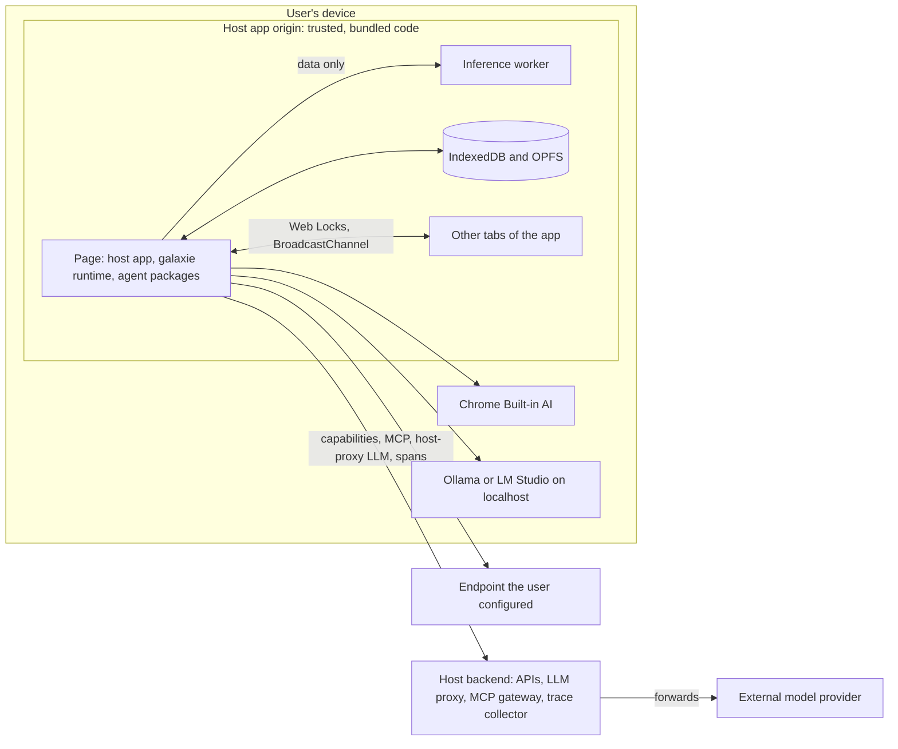
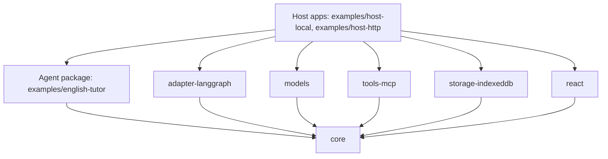
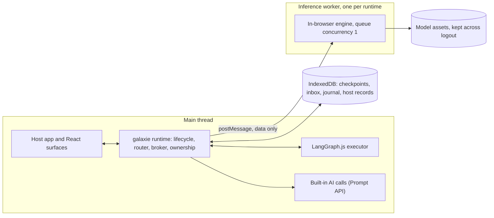
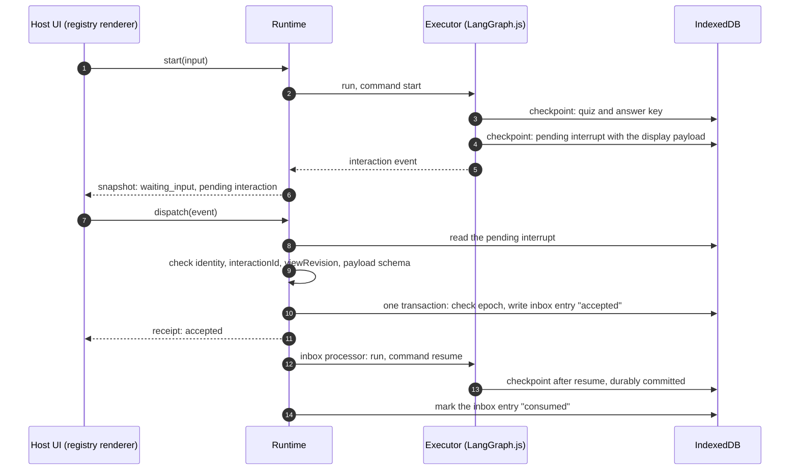
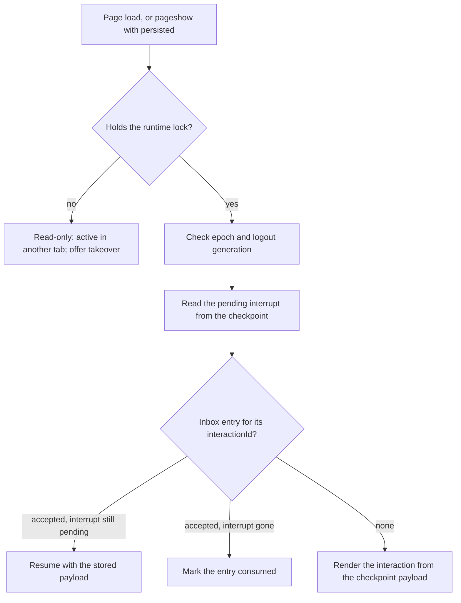
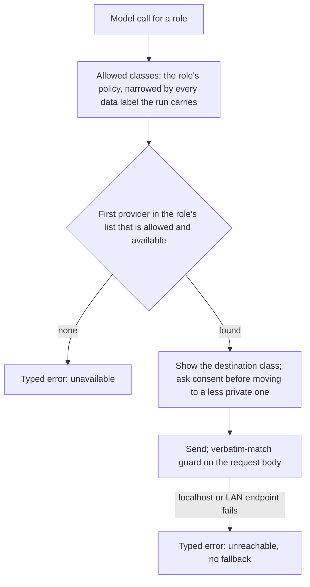
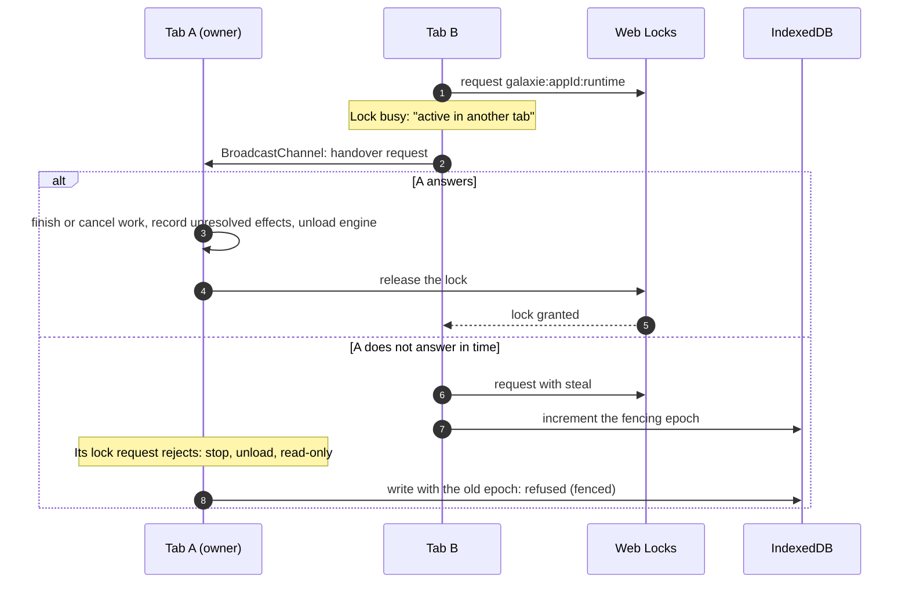

# System design

> **Status:** draft, 2026-10-28.
>
> This document maps the [project brief](galaxie-project-brief.md) and the [ADRs](adr/README.md) onto components, packages, contracts and runtime flows. It does not repeat their reasons.
>
> - When this document and the brief disagree, the brief wins and this document is fixed.
> - Proposed ADRs are working defaults until a spike or a milestone confirms them. So is every part of this document that depends on them.

## 1. What exists today

- **Toolchain:** a pnpm workspace with TypeScript 7 and 6 side by side, Biome, Vitest and CI (§10).
- **`packages/core`:** draft contracts only: types plus three fixed transition tables, with no runtime behavior (§6).
- **`spikes/`:** two throwaway spikes, B0 (a 1.7B model on WebGPU) and the local English tutor (a LangGraph.js agent on that model in Chrome). Each has its own pnpm workspace (brief §16.2).
- **Everything else here is the target.** Each milestone builds its part (brief §16), and a folder appears only when work on it starts (brief §15).

## 2. System context and trust boundaries



Destination classes (brief §3.1, ADR-0006) name the final recipient of the data in a call:

| Class | In the diagram |
| --- | --- |
| `in-browser` | Inference worker, Chrome Built-in AI |
| `user-device` | Ollama or LM Studio on `localhost` |
| `user-endpoint` | Endpoint the user configured |
| `host-server` | Host backend, when it handles the data itself |
| `third-party` | External model provider, even when the request goes through the host proxy |

Trust rules:

- **Code is trusted.** The host app, galaxie and the agent packages are reviewed and bundled by the developer (ADR-0002). They share one origin, so same-origin code can go around the SDK (brief §9.9).
- **Data is not.** Model output, tool results, lesson content, skills and MCP tool descriptions may carry prompt injection. None of it grants execution rights (brief §9.3).
- **Guarantees hold on SDK-controlled paths:** the model router, the capability broker, the MCP client, the registry renderer and galaxie's own storage (ADR-0012, part A). The host's own duties, such as backend authorization, a strict CSP and spending limits on the proxy, are in part B.
- **The three axes are separate.** Local inference does not mean local tools: a browser-local agent can still send data out through a capability (brief §3).

## 3. Components

| Component | Responsibility | Package | Decisions |
| --- | --- | --- | --- |
| Runtime host | Instance and run lifecycle, identity, snapshots, budgets, the inbox processor | `core` | brief §8, §9.4 |
| Executor adapter | Runs LangGraph.js itself on the main thread; maps checkpoints, interrupts and events; exposes the model router to graphs as LangChain chat models. Other frameworks get their own adapters | `adapter-langgraph` | [ADR-0001](adr/0001-langgraph-adapter-not-engine.md), [ADR-0003](adr/0003-executor-execution-context.md), [ADR-0017](adr/0017-framework-neutral-contracts.md) |
| Model router | Per-role provider lists, destination classes, data labels, consent, first-run order | `core` | [ADR-0006](adr/0006-model-providers-and-routing.md), [ADR-0014](adr/0014-data-labels-and-argument-shapes.md) |
| Model providers | The in-browser engine in a worker, Built-in AI from the page, OpenAI-compatible, mock | `models` | ADR-0006 |
| Capability broker | Grants, schema validation, argument shapes, confirmations, attribution header, effect journal | `core` | brief §9.2, [ADR-0012](adr/0012-security-baseline.md), ADR-0014 |
| MCP client | Streamable HTTP, tools only, allowlist, `mcp.<server>.<tool>` names, definition pinning | `tools-mcp` | [ADR-0011](adr/0011-mcp-via-controlled-servers.md) |
| Storage | Checkpoint saver, submission inbox, journal, host records, migrations, epoch checks | `storage-indexeddb` | [ADR-0004](adr/0004-interrupt-as-pending-interaction-source.md), [ADR-0005](adr/0005-indexeddb-checkpoint-saver.md) |
| Ownership | One owner tab per app, handover, takeover, logout generation | `core` | [ADR-0009](adr/0009-multi-tab-ownership.md) |
| UI | Hooks, surfaces, typed registry, headless reference components | `react` | [ADR-0007](adr/0007-typed-ui-registry-for-mvp.md) |
| Agent definitions | Code-first definitions; a build script generates the manifest | `core` (types) | [ADR-0008](adr/0008-code-first-agent-definition.md) |
| Tracing | OpenTelemetry spans for runs, nodes, model calls and capability calls; every value galaxie records is filtered, and span content follows the data labels; no exporter | `core` | [ADR-0016](adr/0016-parity-demonstrations-and-otel-traces.md), brief §14.4 |

## 4. Packages and dependency rules



Proposed rules; M1 confirms them:

1. `core` has one runtime dependency, the OpenTelemetry API (`@opentelemetry/api`), whose calls do nothing until the host registers an SDK (ADR-0016). It uses Zod v4 types (a peer dependency), imports no agent framework (ADR-0017), and touches no engine, UI framework or browser API when it is imported (`sideEffects: false`).
2. Every other package depends on `core` and on its own library: LangGraph.js, LangChain, the MCP SDK or React. Packages do not import each other; the host app wires them together through `createRuntime` (brief §14.2).
3. Agent packages depend on `core` and their engine, never on a host package. From M4 the ESLint plugin flags direct `fetch`, storage, DOM and `eval` use (brief §9.7 C).
4. React lives only in `react`. A Vue binding would be a sibling package; `core` never imports a UI framework (brief §14.3).
5. Fewer packages are fine while these boundaries hold (brief §15).

## 5. Repository layout

Today:

```text
galaxie/
├── .github/workflows/ci.yml   CI: license check, lint, type-check (TS 7 and 6), tests, build
├── docs/                      brief, framework overview, this document, ADRs
├── packages/
│   └── core/                  draft contracts (§6)
├── scripts/
│   └── check-license.ts       SPDX headers and package license fields (ADR-0015)
├── spikes/                    throwaway spike code, outside the root workspace (brief §16.2)
├── biome.json  package.json  pnpm-workspace.yaml  tsconfig.base.json
└── AGENTS.md  COMMERCIAL-LICENSE.md  LICENSE  README.md
```

Target (brief §15), with the milestone that first needs each path:

| Path | First needed in |
| --- | --- |
| `packages/adapter-langgraph/` | M1 |
| `packages/models/` | M1 (mock), M2 (in-browser engine, Built-in AI), M4 (OpenAI-compatible) |
| `packages/react/` | M2 |
| `packages/storage-indexeddb/` | M3 |
| `packages/tools-mcp/` | M4 |
| `packages/eslint-plugin/` | M4 |
| `examples/english-tutor/` | M2 |
| `examples/host-local/`, `examples/host-http/` | M2 (first host, CSP), M4 (second host, host proxy, MCP) |
| `examples/mcp-server/` | M4 |
| `tests/conformance/` | M1 |
| `tests/fixtures/` | M1 |
| `tests/injection-corpus/` | M4 |

Spike code is throwaway. Keep it out of `packages/` and never promote it to package code (brief §16.2).

## 6. Core contracts (draft)

`packages/core/src`, exported from `index.ts`:

| Module | Contents | Source |
| --- | --- | --- |
| `schema.ts` | `Schema`, `Infer`, `InferInput` over Zod v4 core types | ADR-0008 |
| `ids.ts` | Branded runtime IDs; host-supplied IDs as plain strings | brief §8.2 |
| `lifecycle.ts` | `InstanceState`, `RunStatus` and their transition tables | brief §8.3 |
| `errors.ts` | `ErrorCode`, `ErrorInfo`, `GalaxieError` | brief §9.4, §10, §11.4, §12 |
| `policy.ts` | Destination classes, presets, data labels, argument shapes, budget limits | brief §3, §9.4; ADR-0014 |
| `models.ts` | Model roles, features, role requirements, `ModelPolicy` | brief §10; ADR-0006 |
| `capabilities.ts` | Capability names, requests, kinds, grant scopes, retry policy, host bindings | brief §9.2, §12.3 |
| `interactions.ts` | Catalogs, components, UI requirements, pending interactions, user events, receipts, inbox status | brief §11, §12; ADR-0004, ADR-0007 |
| `effects.ts` | Effect states and transitions | brief §12.3 |
| `events.ts` | Executor events and journaled run events | brief §7.5, §12.1 |
| `executor.ts` | Executor adapter contract and feature flags | brief §7.5; ADR-0001 |
| `definition.ts` | `AgentDefinition`, `defineAgentDefinition`, `BindingsFor`, `InputOf` | brief §13.2; ADR-0008 |
| `instance.ts` | `AgentInstance`, snapshots, cancel receipt | brief §14.1 |

Choices the draft makes where the brief leaves room:

- **Branded IDs.** IDs with a control meaning are branded types, so a plain string, such as text from model output, needs an explicit cast to pass as one. This helps at compile time only; the runtime still checks every ID (brief §8.2).
- **A failed `prepare`** returns the instance to `created`, which gives the retry or dispose path brief §8.3 asks for.
- **Typed bindings.** `BindingsFor<D>` turns a missing or mistyped host binding into a compile error (brief §14.2). `invoke` is a function property rather than a method, so a binding that needs more input than the schema gives fails too.
- **Run status belongs to the runtime.** An executor reports events; the runtime derives the run status from them and creates every ID.
- **Open for M1:** how a schema field carries its data label and argument shape (`FieldAnnotation`), for example through Zod metadata (ADR-0014).

Not in `core` yet: `createRuntime`, the broker, the router, budget enforcement and tracing spans, which are M1 work (brief §16.3), and multi-tab ownership, which is M3 work (brief §16.5). Unit tests cover the broker, the router and the budgets, and AT-36 covers the spans. The conformance suite (AT-15) checks that the same graphs behave alike on Node and in Chrome (ADR-0016).

## 7. Runtime topology



Rules (brief §6.2, ADR-0003):

- The executor runs on the main thread in the MVP. It moves to a worker only when a measured trigger fires (brief §18).
- Inference runs in a worker. Built-in AI is called from the page, because the Prompt API is not available in workers.
- One worker serves every agent in the runtime. Weights are loaded once, and the queue starts at concurrency 1.
- `postMessage` carries data only, never functions or closures. Capabilities are called through an RPC proxy that carries identity.
- A worker is a thread, not a sandbox: it can still call `fetch`.
- Checkpoints never hold weights, audio buffers or large tensors; they hold scoped asset handles.
- Execution is cooperative: budgets, cancellation and epoch checks cannot preempt a synchronous loop.
- Storage is namespaced by `appId` and principal. Model assets are stored apart from principal data and survive logout.

## 8. Key flows

### 8.1. A run with a pending interaction



- The checkpoint interrupt is the source of truth for the pending interaction. The host UI projection is a cache rebuilt from it (ADR-0004).
- A second event for the same `interactionId` is rejected at the inbox, so a double click cannot submit twice.
- `interactionId` comes from the engine's interrupt ID or from the checkpoint, never from the model.
- Code before `interrupt()` must be deterministic and free of side effects, because resuming re-runs the node, and the parent node of an interrupting subgraph (brief §12.2).
- MVP limit: one pending interrupt per run. More gives a typed `unsupported` error.

### 8.2. Reload and crash recovery



There is one render path: after a reload the host renders from the checkpoint exactly as it did before (brief §12.2). The M1 conformance suite records how the pinned LangGraph.js version persists resume values and whether a repeated resume is safe; M3 runs those cases again with the IndexedDB saver.

### 8.3. A capability call

```mermaid
sequenceDiagram
    autonumber
    participant G as Graph node
    participant B as Capability broker
    participant H as Host confirmation
    participant J as Effect journal
    participant X as Host binding
    G->>B: call progress.save@1 with arguments
    B->>B: granted? validate input, labels and argument shapes; reserve budget
    B->>J: planned, with its effect ID
    opt binding requires confirmation
        B->>H: render from the real parameters
        H-->>B: single-use approval bound to principal, capability, arguments, effect ID, policy revision, expiry
    end
    B->>J: dispatched
    B->>X: invoke(input, signal, effect ID, run, principal, agent)
    X-->>B: result
    B->>B: validate output; label it (default app)
    B->>J: succeeded, failed or outcome_unknown
    B-->>G: validated result
```

- Only capabilities the host bound and granted can run. There is never a generic `fetch`, SQL or shell capability (ADR-0012 A2, A3).
- The binding's kind, destination class, timeout, concurrency, grant scope, approval and retry policy come from the host, never from the tool (brief §9.2).
- The effect ID is persisted before dispatch, and the binding sends it as the idempotency key. An `outcome_unknown` effect is reconciled or decided by a person; a non-idempotent one is never fired again silently (brief §12.3).
- The journal applies to external effects. A read with no effect skips it.
- Outbound requests carry an attribution header, for example `X-Galaxie-Agent`. It attributes; it never authorizes (ADR-0012 A8).

### 8.4. A model call



- First-run order: Built-in AI if it is available and the host lists it for the role, then the cached in-browser model, then a download after consent with the size shown, then a remote provider if the role allows it and the user consents (ADR-0006).
- Where the provider can enforce a JSON Schema while it decodes, structured output uses it (brief §10.6).
- Built-in AI is eligible for a role only when `availability()` supports the role's input and output languages.
- Labels are sticky for the run. To shed one, the host starts a new run (ADR-0014).
- Provider keys come from the host's `getCredential()` callback for each request. galaxie never stores them (ADR-0006).

### 8.5. Tab ownership and takeover



Every local write checks the epoch in the same IndexedDB transaction, so at most one owner commits local state. A remote request the old owner already sent may still complete; the journal marks it `outcome_unknown` until it is reconciled (ADR-0009).

### 8.6. Logout

Logout bumps an invalidation generation that every tab sees, wipes the principal's local storage, and invalidates every in-flight result and approval. Every write checks the generation in the same transaction, so a stale tab cannot recreate deleted records (ADR-0012 A10).

## 9. Security baseline map

| ADR-0012 part A | Enforced in | Package |
| --- | --- | --- |
| A1. No model-produced HTML or JS; URL allowlist; no auto-loaded resources | Registry renderer | `react` |
| A2. Deny by default; validate request and response | Capability broker | `core` |
| A3. No generic `fetch`, SQL or shell | Capability broker | `core` |
| A4. Credentials never in prompts, state, checkpoints, traces or exports; allowlisted trace fields | Router, providers, tracing, storage | `core`, `models`, `storage-indexeddb` |
| A5. Host-rendered, single-use confirmations bound to the call | Broker and the host's confirmation surface | `core`, `react` |
| A6. No silent destination change; data labels | Model router, broker | `core` |
| A7. Finite budgets | Runtime | `core` |
| A8. Attribution header | Broker requests, MCP client | `core`, `tools-mcp` |
| A9. Pinned MCP tool definitions | MCP client | `tools-mcp` |
| A10. Logout invalidation | Ownership, storage | `core`, `storage-indexeddb` |

M1 must cover A1–A4, A7 and A8 with tests (brief §16.3). The others are tested in the milestone that builds their component. These guarantees are bounded and testable; they are not a promise that nothing can go wrong (brief §0.2, §9.9).

## 10. Toolchain

- **Node.js 24** (`.nvmrc`) and **pnpm 11** through Corepack (`packageManager`), in one workspace (`packages/*`).
- **Release age gate:** `minimumReleaseAge: 10080` lets pnpm resolve only versions published at least 7 days earlier, a supply-chain control.
- **TypeScript 7** (`tsc`) builds and type-checks. **TypeScript 6** (`tsc6`, from `@typescript/typescript6`) type-checks the same projects, as ADR-0013 requires.
- **Strict settings** in `tsconfig.base.json`, including `exactOptionalPropertyTypes`, `noUncheckedIndexedAccess`, `isolatedDeclarations` and `erasableSyntaxOnly`. Relative imports end in `.js` (NodeNext).
- **Biome** lints and formats; it needs no compiler API. ESLint comes with the agent-package plugin in M4. It will run on TypeScript 6, because typescript-eslint supports TypeScript only below 6.1.
- **Vitest** runs the unit tests. Type tests use `expectTypeOf`; the type-check enforces them, not Vitest.
- **CI** pins actions by commit SHA, uses a read-only token, does not persist credentials and installs from the frozen lockfile.

| Command | What it runs |
| --- | --- |
| `pnpm check` | Everything CI runs, in the same order |
| `pnpm check:license` | SPDX headers and package license fields (ADR-0015) |
| `pnpm lint` | Biome lint and format check |
| `pnpm format` | Biome formatting and safe fixes, written to disk |
| `pnpm typecheck` | TypeScript 7 |
| `pnpm typecheck:ts6` | TypeScript 6 |
| `pnpm test` | Vitest |
| `pnpm build` | `packages/core/dist` |

## 11. What confirms this design, and when

Spikes run when a milestone needs them (brief §16.2, ADR-0016).

| Check | When | Parts of this design it confirms or revises |
| --- | --- | --- |
| Conformance suite (replaces Spike A) | M1; persistence cases again in M3 | The executor contract (`executor.ts`), interrupt IDs, re-execution on resume, resume-value persistence and repeated resume (§8.1, §8.2), compared between Node and Chrome; ADR-0001, 0003, 0004, 0005 |
| Spike B: local inference | Before M2 | The in-browser engine to ship, whether it enforces a JSON Schema while decoding, Built-in AI language support, `ChatWebLLM` with a worker engine (§7, §8.4); ADR-0006. Its numbers are demonstrations, not thresholds (brief §18). |
| Spike C: UI path | Before M2 | Rendering from an interrupt payload, stale-event rejection, reload (§8.1, §8.2); ADR-0004, 0007 |
| Spike D: remote paths | Before M4 | Host proxy and `localhost` endpoints under Local Network Access, CORS, the credential callback, the MCP profile (§8.4); ADR-0006, 0011 |

Milestones confirm the rest: the tracing spans in M1 (AT-36); ADR-0017's framework-neutral `core` in M1, through a CI dependency check; ADR-0014 in M1, M2 and M4 (AT-36, AT-04, AT-32); ADR-0009 in M3 (AT-18); and ADR-0008 and ADR-0010 in M4 (brief §16.2).
